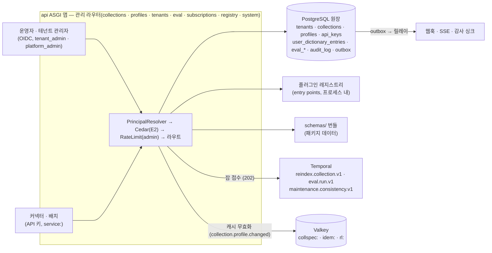

# 관리 API

## 목적

이 문서는 플랫폼의 **관리 평면(management plane)** — 테넌트 정책·계량, 컬렉션 수명주기, 프로파일, 플러그인 레지스트리, 스키마 레지스트리, API 키, 웹훅 구독, 평가 런, 시스템 상태, 감사 로그 — 을 다루는 REST 엔드포인트의 요청·응답·인가·오류를 확정한다. 수집(`/v1/ingest*`, `/v1/jobs*`, `/v1/documents/*`의 잡 접수)은 [수집 API](02-ingestion-api.md), 검색(`/v1/query`, `/v1/render`, `/v1/answer`, `/v1/feedback`)은 [리트리벌 API](03-retrieval-api.md), 웹훅 전달·SSE 프레임은 [웹훅과 이벤트](07-webhooks-and-events.md)가 소유하며, 이 문서는 그 세 문서가 "관리 API에서 확정"으로 위임한 항목(문서 메타 객체, `run_id` 회수 경로, 재색인 요청 본문, API 키 형식, 테넌트 `tier` 값 집합 등)을 닫는다.

정본 관계: 경로·메서드는 설계 바이블(Design Bible) §14 그대로이고, 공통 규약(테넌트 스코프의 토큰 도출, `Idempotency-Key`, 커서 페이지네이션, JSON Merge Patch, RFC 9457, 레이트 리밋, `operationId`)은 [API 설계 가이드라인](01-api-design-guidelines.md)이 정본이다. 바이블 §14에 없는 엔드포인트·필드·열거값은 이 문서에서 **제안**으로 표기하고(바이블 §1.1), 채택은 `## 미해결 이슈`의 바이블 patch/minor 발의로 이뤄진다. 이 문서의 절 번호는 `§n`, 바이블은 `바이블 §n`, 가이드라인은 `01 §n`으로 쓴다.

## 범위

- 포함: 바이블 §14의 관리 표면(`/v1/collections*`, `/v1/profiles*`, `/v1/tenants/{tenant_id}/usage`·`/policies`, `/v1/subscriptions*` 요약, `/v1/eval/*` 요약, `/v1/schemas/{name}`, `/healthz`·`/readyz`)의 엔드포인트별 요청·응답 형식과 예시, 관리 응답 객체(`TenantPolicies`, `TenantUsage`, `CollectionStatsView`, `DictionaryReplaceResult`, `ProfileSummary`, `ProfileValidationResult`, `ApiKey`, `SchemaDescriptor`, `VersionInfo`, `CapacityView`, `Document`)의 필드 표, 바이블 §14에 없는 관리 기능의 **제안** 엔드포인트(API 키, 플러그인 레지스트리, 스키마 목록, 시스템 버전·용량, 정합성 점검 트리거, 감사 로그 조회, 테넌트 전역 사전, 프로파일 등록, PII 복원), 역할 × 엔드포인트 인가 매트릭스, 엔드포인트별 전용 오류·이벤트.
- 제외: 공통 HTTP 규약(01), 계약 타입의 필드 정의(`CollectionSpec`·`Profile`·`PluginMeta`·`Capabilities`는 [컬렉션·프로파일·정책 계약](../03-contracts/15-collection-profile-and-policy-contracts.md), `EvalDataset`·`EvalRun`·`EvalReport`·`UserDictEntry`는 [평가·피드백·사이드카 계약](../03-contracts/16-eval-feedback-and-sidecar-contracts.md)), Cedar 정책 번들의 정의([멀티테넌시·보안 아키텍처](../02-architecture/07-multi-tenancy-and-security-architecture.md) §4), 웹훅 전달·서명·재시도(07), 평가 하네스의 메트릭·산출물([리트리벌 메트릭과 하네스](../08-evaluation/02-retrieval-metrics-and-harness.md)), 재색인 사가 내부([갱신·삭제·재색인](../04-pipelines/19-update-delete-and-reindexing.md)), 정합성 검사 알고리즘([저장소 아키텍처](../02-architecture/04-storage-architecture.md) §7.3), MCP `list_collections`([MCP 서버](05-mcp-server.md)).
- 이 문서가 소유하는 파일: `docs/05-api/04-management-api.md`. `docs/05-api/openapi.yaml`의 관리 연산은 이 문서 §1 표가 정의한다(01 §17.6).

## 1. 표면 개요

### 1.1 관리 평면의 위치



관리 API는 검색 핫패스와 분리된다. 검색 경로는 PostgreSQL을 읽지 않고 `collspec:{collection_id}` 캐시 사본을 쓰므로(바이블 §13.1, [ADR-0034](../06-adr/0034-retrieval-hot-path-postgres-independence-and-hydrate.md)), 컬렉션·사전·프로파일을 바꾸는 모든 관리 연산은 원장 갱신과 **같은 트랜잭션**에 `collection.profile.changed` 이벤트를 아웃박스에 기록해 캐시를 무효화한다. 관리 연산은 스테이지를 실행하지 않는다 — 재색인·평가·정합성 검사는 잡(202)으로 접수되어 Temporal이 실행한다(바이블 §2.3 `api`, D-17).

### 1.2 엔드포인트 표

정본 열: `§14` = 바이블 §14 등재, `제안` = 이 문서 제안(바이블 §14 minor 발의 대상, §미해결 이슈 1), `07` = [웹훅과 이벤트](07-webhooks-and-events.md) §3.2 제안. 모든 인증 연산의 한도 클래스는 `admin`(01 §11), 공개 표면(`/v1/schemas*`, `/healthz`, `/readyz`)은 `public`이다. `Idempotency-Key`는 01 §6 표를 따른다(자원 생성·잡 접수 POST 선택, 그 외 무시). Cedar 액션은 [멀티테넌시·보안 아키텍처](../02-architecture/07-multi-tenancy-and-security-architecture.md) §4.1의 이름이며 `read_registry`·`read_audit`은 이 문서의 제안이다(§13).

| 메서드 | 경로 | 정본 | 성공 | 응답 본문 | Cedar 액션 | `operationId` |
|--------|------|------|------|-----------|------------|---------------|
| GET / POST | `/v1/tenants` | §14 | 200 / 201 | `{items: Tenant[], next_cursor}` / `Tenant`(§2.4) | `manage_tenants` | `list_tenants` / `create_tenant` |
| GET / PATCH | `/v1/tenants/{tenant_id}` | §14 | 200 / 200 | `Tenant`(§2.4) | `manage_tenants` | `get_tenant` / `update_tenant` |
| GET | `/v1/tenants/{tenant_id}/usage` | §14 | 200 | `TenantUsage`(§2.2) | `read_usage` | `get_tenant_usage` |
| GET | `/v1/tenants/{tenant_id}/policies` | §14 | 200 | `TenantPolicies`(§2.1) | `manage_tenant_policies` | `get_tenant_policies` |
| PATCH | `/v1/tenants/{tenant_id}/policies` | §14 | 200 | `TenantPolicies` | `manage_tenant_policies` | `update_tenant_policies` |
| GET / PUT | `/v1/tenants/{tenant_id}/dictionary` | 제안 | 200 / 200 | `{items: UserDictEntry[], next_cursor}` / `DictionaryReplaceResult`(§3.7) | `manage_dictionary` | `list_tenant_dictionary_entries` / `replace_tenant_dictionary` |
| GET / POST | `/v1/collections` | §14 | 200 / 201 | `{items: CollectionSpec[], next_cursor}` / `CollectionSpec` | `manage_collection`(GET은 인증된 전원, `allowed_collections` 필터) | `list_collections` / `create_collection` |
| GET / PATCH / DELETE | `/v1/collections/{collection_id}` | §14 | 200 / 200·202 / 202 | `CollectionSpec` / `CollectionSpec`·`JobStatus(kind=reindex_collection)` / `JobStatus(kind=delete_collection)`(바이블 §5.7·§11.2 1.3.0, AM-37) | `manage_collection`(GET은 `search` 또는 `read_document` 보유자) | `get_collection` / `update_collection` / `delete_collection` |
| POST | `/v1/collections/{collection_id}/reindex` | §14 | 202 / 200(`dry_run`) | `JobStatus(kind=reindex_collection)` / `ReindexEstimate`(§3.5) | `manage_collection` | `reindex_collection` |
| GET | `/v1/collections/{collection_id}/stats` | §14 | 200 | `CollectionStatsView`(§3.6) | `manage_collection` | `get_collection_stats` |
| GET / PUT | `/v1/collections/{collection_id}/dictionary` | §14 | 200 / 200 | `{items: UserDictEntry[], next_cursor}` / `DictionaryReplaceResult` | `manage_dictionary` | `list_dictionary_entries` / `replace_dictionary` |
| POST | `/v1/collections/{collection_id}/consistency-check` | §14 | 202 | `JobStatus(kind=consistency_check)` | `manage_collection` | `check_collection_consistency` |
| GET | `/v1/profiles` | §14 | 200 | `{items: ProfileSummary[], next_cursor}`(`view=full`이면 `Profile[]`) | `read_registry` | `list_profiles` |
| GET | `/v1/profiles/{profile_id}` | §14 | 200 | `Profile`(해소 결과) | `read_registry` | `get_profile` |
| POST | `/v1/profiles/validate` | §14 | 200 / 422 | `ProfileValidationResult`(§4.2) / `ProblemDetails` | `manage_profiles` | `validate_profile` |
| POST | `/v1/profiles` | §14 | 201 | `Profile` | `manage_profiles` | `create_profile` |
| GET | `/v1/plugins` | §14 | 200 | `{items: PluginMeta[], next_cursor}` | `read_registry` | `list_plugins` |
| GET | `/v1/plugins/{plugin_id}` | §14 | 200 | `PluginMeta` | `read_registry` | `get_plugin` |
| GET | `/v1/plugins/{plugin_id}/capabilities` | 제안 | 200 | `PluginCapabilitiesView`(§5.2) | `read_registry` | `get_plugin_capabilities` |
| GET | `/v1/plugins/{plugin_id}/health` | 제안(AM-53 보류) | 200 | `PluginHealth`(§5.3) | `read_registry` | `get_plugin_health` |
| GET | `/v1/schemas` | §14 | 200 | `{items: SchemaDescriptor[], next_cursor}` | 공개 | `list_schemas` |
| GET | `/v1/schemas/{name}` | §14 | 200 / 304 | `application/schema+json` | 공개 | `get_schema` |
| GET / POST | `/v1/api-keys` | §14 | 200 / 201 | `{items: ApiKey[], next_cursor}` / `ApiKey`(+`secret` 1회) | `manage_api_keys` | `list_api_keys` / `create_api_key` |
| GET / DELETE | `/v1/api-keys/{api_key_id}` | §14 | 200 / 204 | `ApiKey` / 없음(폐기) | `manage_api_keys` | `get_api_key` / `delete_api_key` |
| POST | `/v1/api-keys/{api_key_id}/rotate` | §14 | 201 | `ApiKey`(새 키, +`secret` 1회) | `manage_api_keys` | `rotate_api_key` |
| GET / POST | `/v1/subscriptions` | §14 | 200 / 201 | `{items: Subscription[], next_cursor}` / `Subscription` | `manage_subscriptions` | `list_subscriptions` / `create_subscription` |
| GET / PATCH / DELETE | `/v1/subscriptions/{subscription_id}` | §14(PATCH는 07) | 200 / 200 / 204 | `Subscription` / `Subscription` / 없음 | `manage_subscriptions` | `get_subscription` / `update_subscription` / `delete_subscription` |
| POST | `/v1/subscriptions/{subscription_id}/test` · `/rotate-secret` · `/redeliver` | 07 | 200 / 200 / 202 | 07 §10 · §3.4 · §6.5 | `manage_subscriptions` | `test_subscription` / `rotate_subscription_secret` / `redeliver_subscription_events` |
| GET | `/v1/subscriptions/{subscription_id}/deliveries` | 07 | 200 | `{items: WebhookDelivery[], next_cursor}` | `manage_subscriptions` | `list_subscription_deliveries` |
| GET / POST | `/v1/eval/datasets` | §14 | 200 / 201 | `{items: EvalDataset[], next_cursor}` / `EvalDataset` | `run_eval` | `list_eval_datasets` / `create_eval_dataset` |
| GET / POST | `/v1/eval/runs` | §14 | 200 / 202 | `{items: EvalRun[], next_cursor}` / `JobStatus(kind=evaluate)` + `Link rel="related"` | `run_eval` | `list_eval_runs` / `create_eval_run` |
| GET | `/v1/eval/runs/{run_id}` · `/report` | §14 | 200 | `EvalRun` / `EvalReport` | `run_eval` | `get_eval_run` / `get_eval_report` |
| GET | `/healthz` · `/readyz` | §14 | 200 / 503 | 상태 객체(01 §21.4) | 공개 | `healthz` / `readyz` |
| GET | `/v1/version` | §14 | 200 | `VersionInfo`(§10.2) | `read_registry` | `get_version` |
| GET | `/v1/capacity` | 제안(AM-53 보류) | 200 | `CapacityView`(§10.3) | `read_usage` | `get_capacity` |
| GET | `/v1/audit-events` | §14 | 200 | `{items: CloudEventEnvelope[], next_cursor}` | `read_audit` | `list_audit_events` |
| GET | `/v1/documents/{document_id}` | §14(형식은 이 문서) | 200 | `Document`(§12.1) | `read_document` | `get_document` |
| PATCH | `/v1/documents/{document_id}/metadata` | §14(형식은 이 문서) | 200 | `Document`(+`reprocess_suggested`) | `reprocess_document` | `update_document_metadata` |
| POST | `/v1/documents/{document_id}/unmask` | §14 | 200 | `{items: [{token, value}]}`(§12.2) | `unmask_pii` | `unmask_document_pii` |

`/v1/version`은 바이블 §14 1.3.0이 단일 인스턴스 자원(singleton) 예외로 확정했다(AM-39; 01 §3.1 경로 정규식 `^/v1/[a-z-]+(/\{[a-z_]+_id\}(/[a-z-]+)?)*$`에는 부합하고 "복수 명사" 관례만 벗어난다). `/v1/capacity`는 같은 관례 예외가 필요하지만 AM-53 보류라 채택 전이다(§미해결 이슈 1). 나머지 제안 경로(`/plugins/{plugin_id}/capabilities`·`/plugins/{plugin_id}/health`·`/tenants/{tenant_id}/dictionary`)는 정규식과 명사 관례를 모두 만족하므로 예외 등재가 필요 없다. 새 `operationId` 동사 `check`·`rotate`·`unmask`·`test`·`redeliver`는 01 §17.3 동사 목록의 확장 제안이다.

## 2. 테넌트

테넌트 자원은 `GET/POST /v1/tenants`(플랫폼 관리자의 목록·생성), `GET/PATCH /v1/tenants/{tenant_id}`(조회·상태·할당량 변경, §2.4)와 `/v1/tenants/{tenant_id}/…` 둘(§2.1·§2.2)이다(바이블 §14 1.3.0, AM-39). 경로의 `{tenant_id}`는 토큰의 `tenant_id`와 같아야 한다(불일치 403 `auth.forbidden`, 01 §3.2). **`tier` 변경(승격)과 테넌트 삭제만은 v1 API 표면에 없다** — 승격은 `tier.promotion.v1` 잡 전용(읽기 전용 `tier`), 삭제는 원장 마이그레이션 경로다(01 §3.2; `manage_tenants`는 `platform_admin` 전용). 이 결정으로 "테넌트 생성은 CLI·Helm 경로여야 한다"는 이전 정정 요청(트리아지 §4 #3)은 기각한다 — `rag` CLI는 `POST /v1/tenants`를 호출하는 래퍼일 뿐 별도 경로가 아니다. 정본 저장소는 `tenants(tenant_id, name, tier, status, quotas jsonb, policies jsonb, disabled_at)`(바이블 §13.1 1.3.0)다.

### 2.1 정책 — `GET`·`PATCH /v1/tenants/{tenant_id}/policies`

**결정:** 테넌트 정책 응답 객체 `TenantPolicies`는 바이블 §13.1 `tenants.policies`의 네 키를 필수로 갖고, PATCH는 JSON Merge Patch(01 §3.4)로 이 네 키와 제안 키만 바꾼다. `tier`·`tenant_id`·`updated_at`은 읽기 전용이며 패치에 포함되면 400 `contract.violation`(pointer). 컬렉션 정책과의 관계는 **AND**다: 컬렉션 `policies.llm_enrichment_allowed=true`라도 테넌트가 `false`면 LLM 보강은 실행되지 않고, 컬렉션 `EgressPolicy`는 프로파일 정책 AND 테넌트 정책의 교집합이다(바이블 §10.3 E16, [ADR-0038](../06-adr/0038-outbound-egress-policy-and-webhook-signing.md)).

| 필드 | 타입 | 필수 | 설명 | 예시 |
|------|------|------|------|------|
| `schema_type` | string(const `TenantPolicies`) | Y | 응답 식별(계약 인벤토리 밖의 관리 객체; §미해결 이슈 2) | `"TenantPolicies"` |
| `tenant_id` | string(ulid) | Y | 토큰 테넌트(readOnly) | ULID |
| `tier` | enum(TenantTier) | Y | 테넌트 서비스 등급(readOnly; §2.3 제안 열거) | `"reserved"` |
| `llm_enrichment_allowed` | boolean | Y | O-05 옵트인. `false`면 모든 컬렉션에서 LLM 보강 끔 | `false` |
| `allow_distribution_documents` | boolean | Y | 배포용 HWP 텍스트 전용 파싱 허용(O-07) | `true` |
| `classification_max` | enum(Classification) | Y | 테넌트 주체가 볼 수 있는 최고 등급 기본값(`SecurityContext.classification_max`의 테넌트 정책 기본, 바이블 §5.3) | `"confidential"` |
| `egress_policy` | `EgressPolicy` | Y | 테넌트 아웃바운드 정책(프로파일 정책과 AND). `deny_cidrs`는 기본 목록 축소 불가(바이블 §7.4 (12)). 정본 필드는 바이블 §5.3의 다섯(`allowed_schemes`, `allowed_hosts`, `deny_cidrs`, `max_redirects`, `resolve_pin`)이고, `max_bytes`·`connect_timeout_ms`·`allowed_ports`는 15 §8이 추가한 선택 필드(N; 바이블 §5.3 타입 표 미등재)다 | 15 §8 예시 8 |
| `daily_ingest_bytes_max` | integer \| null | N | 일일 수집 바이트 상한(07 §10 "일일 수집 바이트 한도" 제안). `usage_ledger.bytes_indexed` 대비 초과 시 접수 거부 | `null` |
| `query_text_retention` | enum[hash_only, encrypted_text] | N | 감사 질의 텍스트 보존 모드(07 §8.2 제안). 기본 `hash_only` | `"hash_only"` |
| `updated_at` | string(date-time) | Y | readOnly | — |

요청(`PATCH`, `Content-Type: application/merge-patch+json`)과 응답 예시:

```json
{
  "llm_enrichment_allowed": false,
  "egress_policy": {
    "allowed_schemes": ["https", "s3"],
    "allowed_hosts": [".go.kr", "docs.example.go.kr"],
    "deny_cidrs": ["10.0.0.0/8", "172.16.0.0/12", "192.168.0.0/16", "127.0.0.0/8", "169.254.0.0/16", "0.0.0.0/8", "::1/128", "fc00::/7", "fe80::/10", "100.64.0.0/10"],
    "max_redirects": 2,
    "resolve_pin": true
  }
}
```

```json
{
  "schema_type": "TenantPolicies",
  "tenant_id": "01J9ZQ4K7X2M8N3P5R6S7T8V9W",
  "tier": "reserved",
  "llm_enrichment_allowed": false,
  "allow_distribution_documents": true,
  "classification_max": "confidential",
  "egress_policy": {
    "allowed_schemes": ["https", "s3"],
    "allowed_hosts": [".go.kr", "docs.example.go.kr"],
    "deny_cidrs": ["10.0.0.0/8", "172.16.0.0/12", "192.168.0.0/16", "127.0.0.0/8", "169.254.0.0/16", "0.0.0.0/8", "::1/128", "fc00::/7", "fe80::/10", "100.64.0.0/10"],
    "max_redirects": 2,
    "resolve_pin": true,
    "max_bytes": 209715200,
    "connect_timeout_ms": 5000,
    "allowed_ports": [443]
  },
  "daily_ingest_bytes_max": null,
  "query_text_retention": "hash_only",
  "updated_at": "2026-09-23T01:12:44.000Z"
}
```

응답 예시의 `max_bytes`·`connect_timeout_ms`·`allowed_ports`는 15 §8 추가 필드(N)이며 바이블 §5.3 `EgressPolicy` 정본 필드 집합에는 없다 — 이 세 키의 수용은 15 §8의 바이블 §5.3 patch 발의 채택에 종속되고, 채택 전 정본 스키마(`egress-policy.schema.json`)만으로 검증하는 구현은 이 키를 거부할 수 있다.

규칙: (1) `egress_policy.deny_cidrs`가 기본 9개 CIDR(바이블 §5.3)을 모두 포함하지 않으면 400 `contract.violation`(pointer `/egress_policy/deny_cidrs`); `allowed_hosts` 항목은 소문자 호스트명(선행 `.`은 접미 일치, IP 리터럴 불가, 15 §8)이다. (2) 패치 적용 결과는 `EgressPolicy` 스키마로 재검증되고, 프로파일 정책과의 합성 결과(`allowed_schemes`·`allowed_hosts`, 15 §8 추가 필드 채택 시 `allowed_ports`도)가 공집합이면 422 `profile.invalid`(15 §8 E-1)로 거부한다. (3) 변경은 같은 트랜잭션에 `audit.admin.action{action: manage_tenant_policies, resource: {type: "tenant", id}}`와 `tenant.policies.changed`(바이블 §5.7 1.3.0, AM-38) 아웃박스 이벤트를 함께 기록한다 — api 프로세스 캐시(TTL 60초 초안)는 이 이벤트로 즉시 무효화한다(§미해결 이슈 3 종결). (4) 워커는 잡 시작 시 `tenants.policies`를 읽으므로(RLS `SELECT`, 바이블 §13.1) 진행 중 잡에는 적용되지 않는다. (5) `If-Match`를 받으며 불일치는 01 §3.4 규칙(412 코드 채택 전 400)이다.

### 2.2 계량 — `GET /v1/tenants/{tenant_id}/usage`

`usage_ledger(tenant_id, day, meter, value)`(바이블 §13.1)의 일 단위 집계다. 계량기(meter)는 바이블 정본 `llm_tokens`, `gpu_seconds`, `bytes_indexed`, `queries` 네 개이며, `bytes_stored`는 [저장소 아키텍처](../02-architecture/04-storage-architecture.md) 미해결 이슈 16의 제안이다. 목록 자원이 아니라 유계 집계(최대 366일 × 계량기 수)이므로 커서를 쓰지 않는다(01 §7.3 "개수는 전용 자원으로").

| 파라미터 | 타입 | 기본 | 규칙 |
|----------|------|------|------|
| `day_gte`, `day_lt` | string(date) | 오늘 − 30일, 내일 | 범위 ≤ 366일. 위반 400 |
| `meter` | 쉼표 구분 | 전부 | `llm_tokens,gpu_seconds,bytes_indexed,queries`(+`bytes_stored` 제안) 부분집합 |

```json
{
  "schema_type": "TenantUsage",
  "tenant_id": "01J9ZQ4K7X2M8N3P5R6S7T8V9W",
  "day_gte": "2026-09-21",
  "day_lt": "2026-09-23",
  "totals": {"llm_tokens": 0, "gpu_seconds": 812.4, "bytes_indexed": 3221225472, "queries": 18422},
  "items": [
    {"day": "2026-09-21", "meter": "gpu_seconds", "value": 402.1},
    {"day": "2026-09-21", "meter": "bytes_indexed", "value": 1610612736},
    {"day": "2026-09-21", "meter": "queries", "value": 9011},
    {"day": "2026-09-22", "meter": "gpu_seconds", "value": 410.3},
    {"day": "2026-09-22", "meter": "bytes_indexed", "value": 1610612736},
    {"day": "2026-09-22", "meter": "queries", "value": 9411}
  ],
  "generated_at": "2026-09-23T01:15:00.000Z"
}
```

`items`는 값이 0인 (일, 계량기) 조합을 생략하고 `totals`는 요청 범위 합계다. 값은 `IndexCommit.stats`·`EnrichedChunkSet.budget_used`·질의 카운터에서 집계되며 지연은 아웃박스 SLO와 무관한 배치(일 1회 + 시간당 증분, 초안 목표)다. 실시간 소진은 `RateLimit` 헤더로 관측한다(01 §11).

### 2.3 테넌트 서비스 등급 `TenantTier`(제안)

`tenants.tier`의 값 집합은 바이블 §13.1에 없고 [멀티테넌시·보안 아키텍처](../02-architecture/07-multi-tenancy-and-security-architecture.md) §1.1·[저장소 아키텍처](../02-architecture/04-storage-architecture.md) 미해결 이슈 15가 이 문서에 확정을 위임했다. **결정(제안):** `TenantTier = shared, reserved, dedicated`. 격리 등급 `TenantIsolationTier`(물리 배치)·프로파일 등급 `ProfileTier`와 다른 축이며, 값은 디스패처 동시성과 큐 네임스페이스에만 매핑된다(바이블 §7.2 `runtime.tenant_concurrent_jobs_max` "`korean-gov` 등급별 8/32/128").

| `tier` | `tenant_concurrent_jobs_max`(`korean-gov`, 바이블 §7.2) | 큐 네임스페이스 | 기본 |
|--------|------------------------------------------------------------|-----------------|------|
| `shared` | 8 | 공유 큐 | 신규 테넌트 |
| `reserved` | 32 | 공유 큐 + 예약 슬롯 | — |
| `dedicated` | 128 | 테넌트 전용 네임스페이스 | 규제·계약 요구 |

`lite`·`standard`·`premium`은 등급 무관 단일 값(4/32/64)이며 `tier`는 정보 표시만 한다. 바이블 §5.7 등재(`TenantTier`)와 §13.1 `CHECK` 추가는 §미해결 이슈 2다.

### 2.4 테넌트 자원 — `GET`·`POST /v1/tenants`, `GET`·`PATCH /v1/tenants/{tenant_id}`

**결정:** 테넌트 자체를 자원으로 다루는 유일한 목록·단일 경로다(01 §3.2 "교차 테넌트 관리" 예외). `POST /v1/tenants`는 `platform_admin` 전용이며 `{name, quotas?}`를 받아 `status=active`·`tier=shared`(§2.3 기본값)로 생성한다(바이블 §14·§13.1 1.3.0, AM-39). `GET /v1/tenants`는 `platform_admin`만 전체 목록을, 그 외 인증 주체는 자기 테넌트 하나만 본다. `GET/PATCH /v1/tenants/{tenant_id}`의 `{tenant_id}`는 토큰 테넌트와 같아야 한다(§2 본문 규칙; `platform_admin`은 예외적으로 임의 테넌트 조회 가능, 감사 기록).

| 필드 | 타입 | 필수 | 설명 |
|------|------|------|------|
| `schema_type` | string(const `Tenant`) | Y | 계약 인벤토리 밖의 관리 객체(§미해결 이슈 2) |
| `tenant_id` | string(ulid) | Y | 서버 발급(readOnly) |
| `name` | string(1..128) | Y | 표시 이름 |
| `tier` | enum(TenantTier) | Y | 읽기 전용(readOnly) — 변경은 `tier.promotion.v1` 잡(§2.3)뿐이며 이 자원의 PATCH로 바꿀 수 없다 |
| `status` | enum(TenantStatus) | Y | `active, disabled`(바이블 §5.7 1.3.0, AM-38). `disabled`인 테넌트의 모든 요청은 403 `auth.forbidden`(E2) |
| `quotas` | object `{documents_max, storage_bytes_max, qps_max}` | Y | 각 필드 정수 \| null(무제한). 바이블 §13.1 1.3.0, AM-39 |
| `disabled_at` | string(date-time) \| null | Y(nullable) | `status=disabled` 전이 시각(바이블 §13.1 1.3.0) |
| `created_at`, `updated_at` | string(date-time) | Y | |

PATCH(JSON Merge Patch)는 `name`·`status`·`quotas`만 바꾼다. `tier`를 패치에 포함하면 400 `contract.violation`(pointer `/tier`, readOnly). `status`를 `disabled`로 바꾸면 그 순간부터 해당 테넌트의 신규 요청이 403이고, 진행 중 잡은 계속 실행되어 종결까지 간다(강제 취소 없음). 변경은 `audit.admin.action{action: manage_tenants}`를 같은 트랜잭션에 남긴다. 테넌트 삭제(하드/논리)는 이 자원에 없다(§2 본문).

## 3. 컬렉션

컬렉션은 테넌트 안에서 프로파일이 고정된 인덱스 논리 단위다(브리프 §10). 계약은 `CollectionSpec`(바이블 §5.6, [15 §2](../03-contracts/15-collection-profile-and-policy-contracts.md))이고 응답은 항상 그 인스턴스 그대로다(01 §8). 컬렉션은 `profile_hash`·`embedding_profile_hash`·`analyzer_id`·`dictionary_hash` 넷에 동시에 바인딩되며 어느 것이든 바뀌면 blue/green 재색인으로만 갱신된다(15 §2.3, [ADR-0031](../06-adr/0031-profile-schema-extends-and-quality-gates.md), [ADR-0026](../06-adr/0026-index-commit-generation-saga-and-ledger.md)).

### 3.1 목록 — `GET /v1/collections`

`allowed_collections`에 든 컬렉션만 돌려준다(01 §3.3; MCP `list_collections`와 같은 규칙, E14). 파라미터: `cursor`, `limit`, `sort`(`created_at`, `updated_at`, `name`), 필터 `profile_id=`, `tenant_isolation_tier=`, `name=`(정확 일치). 논리 삭제된 컬렉션(`collections.deleted_at IS NOT NULL`, 19 §6.1 제안)은 제외한다.

### 3.2 생성 — `POST /v1/collections`

**결정:** 생성 요청 본문은 `CollectionCreateRequest`(이 문서 정의)다. `CollectionSpec`의 서버 파생 필드(`collection_id`, `tenant_id`, `profile_hash`, `embedding_space_ids`, `embedding_profile_hash`, `analyzer_id`, `dictionary_hash`, `dictionary_ref`, `mapping_version`·`lexical_profile_hash`(15 추가), `backends`, `stats`, 시각)는 클라이언트가 보낼 수 없으므로 계약 인스턴스를 그대로 요청 본문으로 쓸 수 없고, 01 §8이 허용한 래퍼 DTO 셋(목록·접수·검색)에 네 번째로 등재를 요청한다(§미해결 이슈 4).

| 필드 | 타입 | 필수 | 설명 |
|------|------|------|------|
| `name` | string(1..128) | Y | 테넌트 내 유일(`UNIQUE(tenant_id, name)`; 중복 400 `contract.violation`, `detail="duplicate collection name"`) |
| `profile_id` | string(kebab) | Y | 등록된 프로파일(`profiles` 표) |
| `profile_version` | string(semver) | N | 생략 = 최신 게시 버전. 해소 결과가 `profile_hash`가 된다 |
| `tenant_isolation_tier` | enum(TenantIsolationTier) | N | 생략 = 프로파일 `security.tenant_isolation_tier`. `index_per_tenant`는 프로파일 `tiering.index_per_tenant ≠ disabled`이고 백엔드 `capabilities.tenant_isolation`이 지원할 때만(15 §3.9) |
| `policies` | `CollectionPolicies` | N | 생략 키는 프로파일·테넌트 정책 기본값. `llm_enrichment_allowed=true`는 테넌트 정책도 `true`여야 함(아니면 422 `profile.invalid`, pointer `/policies/llm_enrichment_allowed`) |
| `filterable_fields` | array<string> | N | `custom.*` 키 ≤ 64. 기본 `[]` |
| `license_policy` | `LicensePolicy` | N | 생략 = 프로파일 `license_policy`. 프로파일보다 넓힐 수 없다(`max_grade` 초과 422 `plugin.license_denied`) |
| `calibration_ref` | string \| null | N | |

서버는 (1) 프로파일을 해소·검증(15 §3.9의 12 규칙 + `profile.invalid`·`plugin.license_denied`·`plugin.capability_unsupported`), (2) `embedding_space_ids`·`embedding_profile_hash`·`analyzer_id`를 프로파일에서 계산, (3) 사전 유효 집합(테넌트 전역 항목)으로 `dictionary_hash`·`dictionary_ref`를 만들고, (4) 물리 대상(`rag_vec_{hash12}`·`rag_lex_{hash12}`, 없으면 생성)과 alias(`col_{collection_id}_vec`·`_lex`)를 준비해 `backends[]`를 채운 뒤(바이블 §13.4), (5) `collections` INSERT + `collection.profile.changed` 아웃박스 + `audit.admin.action{action: manage_collection}`을 한 트랜잭션으로 커밋하고 201 + `Location: /v1/collections/{collection_id}`로 `CollectionSpec`을 돌려준다. `Idempotency-Key`는 선택이다(01 §6).

```json
{
  "name": "행정안전부 훈령·예규 2026",
  "profile_id": "korean-gov",
  "tenant_isolation_tier": "index_per_tenant",
  "policies": {
    "pii_policy": "tokenize",
    "pii_tokenize_mode": "encrypt",
    "llm_enrichment_allowed": false,
    "allow_distribution_documents": true,
    "enrichment_budget_tokens": 0,
    "corpus_multiplier_max": 1.5
  },
  "filterable_fields": ["custom.ministry_code", "custom.rule_kind"],
  "license_policy": {"max_grade": "B", "territory": ["KR"]}
}
```

### 3.3 조회·변경 — `GET`·`PATCH /v1/collections/{collection_id}`

`GET`은 `CollectionSpec` + `ETag`(`updated_at` 기준)이며 `pending_reindex`(N, 제안: `{job_id, target_profile_hash, started_at}`)를 blue/green 진행 중에만 덧붙인다. 다른 테넌트·부재 ID는 403(존재 비노출, 01 §3.3).

**결정:** `PATCH`는 JSON Merge Patch로 `name`, `profile_id`·`profile_version`, `policies`, `filterable_fields`, `license_policy`, `calibration_ref`, `tenant_isolation_tier`를 바꾼다. 응답은 두 갈래다 — (a) 재색인이 필요 없는 변경(`name`, `policies`, `filterable_fields` 추가, `calibration_ref`, `query.*`만 다른 프로파일 버전)은 **200 `CollectionSpec`**(바인딩 즉시 교체, `collection.profile.changed`); (b) `embedding_profile_hash`·`lexical_profile_hash`·`tenant_isolation_tier`를 바꾸는 변경은 **202 `JobStatus(kind=reindex_collection)`** + `Location: status_url`이며 `CollectionSpec.profile_hash`는 alias 교체가 끝날 때 갱신된다(19 §5). 01 §9.3의 "200 + `Link rel="related"`(초안)"는 이 결정으로 대체하고 표 갱신을 요청한다(§미해결 이슈 5). 판정은 [스키마 버전과 호환성](../03-contracts/14-schema-versioning-and-compatibility.md) §6.3의 재색인 범위 규칙을 따르며, 진행 중 재색인이 있으면 400 `contract.violation`(`detail="reindex in progress: /v1/jobs/{job_id}"`; `api.job_state_conflict` 채택 후 409). `filterable_fields`에서 키를 제거하면 그 키를 쓰는 저장 필터는 없으므로 재색인은 없지만 `plan.filter_field_forbidden`이 즉시 적용된다.

### 3.4 삭제 — `DELETE /v1/collections/{collection_id}`

202 + `JobStatus(kind=delete_collection)`. 잡 종류 `JobKind.delete_collection`·워크플로우 `collection.delete.v1`·`collections.deleted_at`(논리 삭제)은 바이블 §5.7·§11.2·§13.1 1.3.0이 채택했다(AM-37; [갱신·삭제·재색인](../04-pipelines/19-update-delete-and-reindexing.md) §6.1이 원 제안) — 워크플로우가 컬렉션의 문서 ID 페이지를 순회해 자식 `delete.document.v1` 잡을 팬아웃하고, 부모 `JobStatus`가 전체 진행률을 보고한다(§미해결 이슈 6 종결). 접수 트랜잭션에서 논리 삭제·alias 제거·`collspec:` 무효화가 일어나 이후 질의는 `plan.collection_forbidden`이다. `If-Match` 권장. 활성 잡(`queued`·`running`)이 있는 컬렉션은 400 `contract.violation`(`detail="active jobs: n"`). 본문 없는 잡 접수형 DELETE이므로 지문은 `wire_body = {}`다 — [수집 API](02-ingestion-api.md) `DELETE /v1/documents/{document_id}`와 같은 규칙으로 대조 완료(#52).

### 3.5 재색인 — `POST /v1/collections/{collection_id}/reindex`

**결정:** 요청 본문은 19 미해결 이슈 10의 제안을 채택한다(모든 필드 N).

| 필드 | 타입 | 설명 |
|------|------|------|
| `profile_id`, `profile_version` | string | 대상 프로파일(생략 = 현재 바인딩; 컬렉션 PATCH 없이 같은 프로파일로 재색인) |
| `from_stage` | enum[parse, normalize, chunk, recount, enrich, embed, index] | 강제 시작 스테이지. 생략 = 지문 비교로 자동 판정(19 §5.1) |
| `dry_run` | boolean | `true`면 잡을 만들지 않고 200 `ReindexEstimate` |
| `reindex_max_share` | number(0 < r ≤ 1) | 테넌트 동시 잡 중 재색인 점유 상한(19 §5.6) |

`dry_run=false`(기본)는 202 `JobStatus(kind=reindex_collection, progress.unit=document)`이고 `Idempotency-Key`는 선택·권장이다. `ReindexEstimate`(제안)는 19 §5.6의 산식 결과이며 모든 수치는 초안 계수다.

```json
{
  "schema_type": "ReindexEstimate",
  "collection_id": "01JADQ3G5R7T9V2X4Z6B8D0F2H",
  "target_profile_hash": "9f3a0b1c2d3e4f5a6b7c8d9e0f1a2b3c4d5e6f7a8b9c0d1e2f3a4b5c6d7e8f9a",
  "blue_green": true,
  "backends_affected": ["index_backend.qdrant", "index_backend.opensearch"],
  "from_stage": "embed",
  "documents": 1284,
  "leaf_count": 96520,
  "estimated": {
    "wall_clock_seconds": 5400,
    "gpu_seconds": 1930,
    "llm_tokens": 0,
    "extra_bytes_during_blue_green": 1181116006
  },
  "window": 25,
  "reindex_max_share": 0.8,
  "generated_at": "2026-09-23T01:20:00.000Z"
}
```

19 §5.5 규칙 1(모드 A에서 green을 만들 수 없는 백엔드)은 접수 시점에 검사해 400 `contract.violation`(`detail="backend cannot create green target: {backend_id}"`)으로 거부한다 — 잡을 `failed`로 끝내는 것보다 빠른 실패가 운영자에게 유리하다(19 미해결 이슈 2에 대한 이 문서의 선택). 롤백 액션(19 미해결 이슈 6)은 v1 표면에 두지 않고 런북 RB 경로로 남긴다(§미해결 이슈 7).

### 3.6 통계 — `GET /v1/collections/{collection_id}/stats`

`CollectionStatsView`(제안)는 `CollectionSpec.stats`(`CollectionStats`, 15 §2.2)에 세대·커밋·바인딩 정보를 더한 읽기 전용 객체다. 바이블 §14 "레코드·바이트·세대".

```json
{
  "schema_type": "CollectionStatsView",
  "collection_id": "01JADQ3G5R7T9V2X4Z6B8D0F2H",
  "stats": {
    "document_count": 1284,
    "leaf_count": 96520,
    "parent_count": 11834,
    "bytes_dense": 395345920,
    "bytes_sparse": 61612032,
    "bytes_lexical": 133693440
  },
  "generations": {"min": 1, "max": 7, "documents_with_superseded": 212},
  "commits": {"committed": 1284, "pending": 3, "failed": 0, "rolled_back": 2},
  "binding": {
    "profile_id": "korean-gov",
    "profile_hash": "c0d1e2f3a4b5c6d7e8f9a0b1c2d3e4f5a6b7c8d9e0f1a2b3c4d5e6f7a8b9c0d1",
    "embedding_profile_hash": "d4e5f6a7b8c9d0e1f2a3b4c5d6e7f8a9b0c1d2e3f4a5b6c7d8e9f0a1b2c3d4e5",
    "dictionary_hash": "5d7e9f3a4c1e7b0a5d7e9f3a4c1e7b0a5d7e9f3a4c1e7b0a5d7e9f3a4c1e7b0a",
    "commits_on_stale_dictionary": 0
  },
  "pending_swap": null,
  "last_consistency_check": {"job_id": "01JAE4C0NS1ST2E3N4C5Y6Z7A8", "finished_at": "2026-09-23T00:00:41.000Z", "mismatches": 0},
  "updated_at": "2026-09-23T01:00:00.000Z"
}
```

`commits_on_stale_dictionary`는 현재 세대 `IndexCommit.dictionary_hash ≠ CollectionSpec.dictionary_hash`인 문서 수(16 §6.2 "불일치 관측")이며 0이 아니면 렉시컬 레그가 `degraded{channel.lexical, analyzer_mismatch}`를 낸다. `stats`는 커밋 시점 집계이므로 실시간 백엔드 count와 다를 수 있다(정합성 검사가 대조).

### 3.7 사용자 사전 — `GET`·`PUT /v1/collections/{collection_id}/dictionary`, `GET`·`PUT /v1/tenants/{tenant_id}/dictionary`(제안)

`UserDictEntry`(바이블 §5.6, [16 §6](../03-contracts/16-eval-feedback-and-sidecar-contracts.md))는 Kiwi·mecab-ko 사용자 사전, Nori `user_dictionary_rules`, `synonym_graph`의 단일 소스다([ADR-0021](../06-adr/0021-korean-analyzer-kiwi-promotion-and-interim-mecab-kss.md)). 컬렉션 경로는 `collection_id`가 그 컬렉션인 항목만, 테넌트 경로는 `collection_id=null`(전역) 항목만 다룬다 — 전역 항목은 모든 컬렉션에 병합되므로 바이블 §14에 없는 관리 경로가 필요하다(제안). `GET`은 커서 목록(`sort` 기본 `surface`, 필터 `pos=`, `source=`, `surface=`(접두), `scope=own|effective` — `effective`는 전역 ∪ 컬렉션 병합 결과·읽기 전용). `PUT`은 **전체 교체**다: 본문 `{"items": UserDictEntry[]}`(`entry_id`·`tenant_id`·`collection_id`·`updated_at` 생략, 행 2KB·본문 8MB, 01 §20), 자연 키 `(surface, pos)`로 upsert·삭제하고 `entry_id`는 유지·발급한다(16 §6.2).

```json
{
  "schema_type": "DictionaryReplaceResult",
  "scope": "collection",
  "collection_id": "01JADQ3G5R7T9V2X4Z6B8D0F2H",
  "dictionary_hash": "7b0a5d7e9f3a4c1e7b0a5d7e9f3a4c1e7b0a5d7e9f3a4c1e7b0a5d7e9f3a4c1e",
  "previous_dictionary_hash": "5d7e9f3a4c1e7b0a5d7e9f3a4c1e7b0a5d7e9f3a4c1e7b0a5d7e9f3a4c1e7b0a",
  "dictionary_ref": "s3://rag-artifacts/tenants/01J9ZQ4K7X2M8N3P5R6S7T8V9W/derived/dictionaries/7b/7b0a5d7e9f3a4c1e7b0a5d7e9f3a4c1e7b0a5d7e9f3a4c1e7b0a5d7e9f3a4c1e.json",
  "changed": {"added": 12, "updated": 3, "removed": 1, "unchanged": 411},
  "reindex_suggested": true,
  "reindex_url": "https://rag.example.go.kr/v1/collections/01JADQ3G5R7T9V2X4Z6B8D0F2H/reindex",
  "affected_collection_ids": ["01JADQ3G5R7T9V2X4Z6B8D0F2H"],
  "updated_at": "2026-09-23T01:25:10.000Z"
}
```

규칙: (1) 해시가 바뀌면 `collections.dictionary_hash`·`dictionary_ref` 갱신 + `collection.profile.changed` + `audit.admin.action{action: manage_dictionary}`를 같은 트랜잭션에 기록하고 `reindex_suggested=true`를 돌려준다. **재색인은 자동으로 시작하지 않는다**(16 §6.2). (2) 테넌트 경로는 모든 컬렉션의 해시를 바꾸므로 `affected_collection_ids`가 여럿이고 이벤트도 컬렉션마다 발행된다. (3) 검증 실패(NFC·공백·`pos` 패턴·`decompound` 결합)는 400 `contract.violation`(pointer `/items/{i}/…`). (4) `If-Match`(현재 `dictionary_hash` 앞 16 hex)를 권장한다 — 전체 교체는 갱신 유실이 크다. (5) `lite`(Qdrant 단독)도 같은 경로를 쓰며 `normalizer_fingerprint`에 `dictionary_hash`가 들어가므로 새 수집은 자동으로 새 사전을 쓴다.

### 3.8 정합성 점검 — `POST /v1/collections/{collection_id}/consistency-check`

엔드포인트는 바이블 §14·§11.2 1.3.0 등재다(`JobKind.consistency_check`, AM-39). `maintenance.consistency.v1`은 스케줄(시간 1회 샘플·일 1회 전체)로 돌지만([저장소 아키텍처](../02-architecture/04-storage-architecture.md) §7.3) 운영자가 롤백·복구 뒤 즉시 확인할 경로가 필요하다. 본문 `{mode: enum[sample, full], document_ids?: array<string(ulid)>(≤ 1,000)}`(기본 `sample`), 응답 202 `JobStatus(kind=consistency_check)`. 결과는 `index.consistency.mismatch` 이벤트와 `rag_consistency_mismatch_total{backend_id, outcome}`로 관측하고 요약은 §3.6 `last_consistency_check`에 반영된다. 복구(`missing_records`·`hash_mismatch` → `reprocess from_stage=index`)는 잡이 자동 수행하며 본문 `repair: false`(N, 기본 `true`)로 감지만 할 수 있다. 진행 중 blue/green의 green 커밋은 `pending_swap`으로 제외된다(04 §7.3).

## 4. 프로파일

프로파일(`Profile`, 바이블 §5.6·§7.3)은 운영자 YAML이 원천이고 `profiles(profile_id, version)` 표(전역, RLS 유일 예외, 04 §2.2)에 해소 결과(`resolved`)와 `profile_hash`가 저장된다. `GET /v1/profiles*`는 인증된 전원이 읽을 수 있고(07 §4.1), 검증·게시는 `manage_profiles`(`platform_admin`)다.

### 4.1 목록·조회 — `GET /v1/profiles`, `GET /v1/profiles/{profile_id}`

`GET /v1/profiles`의 기본 뷰는 `view=summary`(`ProfileSummary`, 제안)이고 `view=full`은 `Profile[]`(항목 ≤ 256KB라 `limit` 상한 10)이다. 필터 `tier=`, `extends=`, `deprecated=`. `GET /v1/profiles/{profile_id}`는 `?version=`(생략 = 최신 게시)·`?resolved=true|false`(기본 `true`: `extends` 해소·기본값 채움 뒤; `false`: 원본 YAML을 JSON으로 변환한 형태)를 받고, `ETag`는 `profile_hash` 앞 16 hex다 — `Profile.profile_hash`(readOnly, 바이블 §5.6 1.3.0 AM-34)가 본문에도 있으므로 헤더는 캐시 검증용 사본이다(§미해결 이슈 8 종결).

| `ProfileSummary` 필드 | 타입 | 필수 | 설명 |
|----------------------|------|------|------|
| `profile_id`, `version` | string(kebab) / string(semver) | Y | |
| `tier` | enum(ProfileTier) | Y | `lite, standard, premium, korean-gov` |
| `extends` | string \| null | Y(nullable) | |
| `profile_hash` | string(hex64) | Y | `H("profile", canonical_json(해소 결과))` |
| `license_policy` | `LicensePolicy` | Y | |
| `validated_at` | string(date-time) \| null | Y(nullable) | 마지막 검증 성공 시각(`profiles.validated_at`, 04 §2.2 N 컬럼) |
| `collections_bound` | integer | N | 이 해시에 바인딩된 **요청 테넌트의** 컬렉션 수 |
| `deprecated`, `sunset` | boolean / string(date-time) \| null | N | 게시 폐기 표기(01 §16) |

### 4.2 검증 — `POST /v1/profiles/validate`

**결정:** 본문은 `application/json`이며(01 §12.1) `{"yaml": "<프로파일 YAML 원문>"}` 또는 `{"profile": <Profile JSON>}` 중 정확히 하나를 갖는다. YAML 문자열을 받는 이유는 운영자가 쓰는 원본(주석·앵커 포함)을 그대로 검증해 `rag profile validate`와 결과가 같아야 하기 때문이다(바이블 §7.4). `rag profile validate`, 이 엔드포인트, `POST /v1/collections`·`PATCH /v1/collections/{collection_id}`는 **같은 검증기**를 호출한다(15 §3.9). 검증은 `extends` 해소(등록된 프로파일 참조) → 스키마 → 12 규칙 + 15 불변식 P-1~P-13 → 플러그인 레지스트리 대조(라이선스·능력) 순이며, 실패는 422 `profile.invalid`·`plugin.license_denied`·`plugin.capability_unsupported` + `errors[]`(`StageError{stage: "loader", location.pointer}`)다. 성공은 200 `ProfileValidationResult`(제안)다.

```json
{
  "schema_type": "ProfileValidationResult",
  "valid": true,
  "profile_id": "standard-ko-hybrid",
  "version": "1.2.0",
  "extends": "standard",
  "profile_hash": "9f3a0b1c2d3e4f5a6b7c8d9e0f1a2b3c4d5e6f7a8b9c0d1e2f3a4b5c6d7e8f9a",
  "embedding_profile_hash": "d4e5f6a7b8c9d0e1f2a3b4c5d6e7f8a9b0c1d2e3f4a5b6c7d8e9f0a1b2c3d4e5",
  "analyzer_id": "mecab-ko:1.3.7:ko-dic-2.1.1",
  "warnings": [
    {"code": "profile.gate_pending", "message": "query.fusion.method=convex_minmax requires gate min_qrels=200 on eval.datasets[0]; gate result not yet recorded", "pointer": "/query/fusion/method"}
  ],
  "auto_degraded": [
    {"component": "channel.late_interaction", "reason": "capability_unsupported", "detail": "index_backend.qdrant supports_multivector=true but embedder declares no late_interaction vector"}
  ],
  "plugins_resolved": [
    {"plugin_id": "embedder.vllm_pooling_bge_m3", "version": "1.0.0", "license_grade": "A", "isolation": "in_process"},
    {"plugin_id": "index_backend.qdrant", "version": "1.0.0", "license_grade": "A", "isolation": "in_process"},
    {"plugin_id": "index_backend.opensearch", "version": "1.0.0", "license_grade": "A", "isolation": "in_process"}
  ],
  "registered": false,
  "validated_at": "2026-09-23T01:30:00.000Z"
}
```

`warnings[].code`는 `profile.` 접두를 쓰는 검증기 경고다 — `profile.gate_pending`은 바이블 §5.7 1.3.0에 카탈로그 코드(경고, `—`행)로 등재되었다(AM-36, §미해결 이슈 9 종결). `auto_degraded`는 바이블 §7.4 (2)의 자동 저하 항목이다. 검증은 계산형이라 `Idempotency-Key`를 무시하고 감사 이벤트를 남기지 않는다. 본문 상한 256KB(바이블 §5.1 `Profile`).

### 4.3 커스텀 프로파일 등록 — `POST /v1/profiles`

엔드포인트는 바이블 §14 1.3.0 등재다(`(profile_id, version)` 불변, AM-39). 07 §4.1은 "프로파일 게시"를 `manage_profiles`에 둔다. 코어 프로파일 4종(`lite`·`standard`·`premium`·`korean-gov`)은 릴리스에 번들되어 기동 시 등록되고, 커스텀 프로파일(`standard-ko-hybrid` 등)은 CLI 또는 이 엔드포인트로 등록한다. 본문은 §4.2와 같고, 검증 통과 시 `profiles` INSERT(`(profile_id, version)` 불변 — 같은 키 재등록은 400 `contract.violation`, `detail="profile version already registered"`; 수정은 `version` 증가) + `audit.admin.action{action: manage_profiles}` 뒤 201 + `Location: /v1/profiles/{profile_id}?version={version}`으로 해소된 `Profile`을 돌려준다. `extends`가 코어 프로파일이 아닌 커스텀 프로파일을 가리키는 것도 허용되되 체인은 비순환(15 P-1)이어야 한다. 품질 기본값(`gate` 붙은 값)을 바꾼 프로파일은 게이트 결과(`EvalReport.gate_result.passed`) 없이 등록될 수 있지만 컬렉션 바인딩 시 `warnings`로 남으며 정책상 ADR이 필요하다(바이블 §7.4). `platform_admin` 전용이고 테넌트 스코프가 없다(01 §3.2 "교차 테넌트 관리" 예외 — 프로파일은 전역 자원이라 테넌트 데이터가 아니다).

## 5. 플러그인 레지스트리

`GET /v1/plugins`·`GET /v1/plugins/{plugin_id}`는 바이블 §14 1.3.0 등재다(AM-39). `/capabilities`·`/health`(§5.3, AM-53 보류)는 바이블 §14에 없는 이 문서의 제안으로 남는다. 플러그인 레지스트리는 Python entry points + `PluginMeta`로 프로세스 기동 시 구성되며 PostgreSQL 표가 아니다([플러그인 아키텍처](../02-architecture/05-plugin-architecture.md) §6, 04 §2.2). 따라서 이 절의 엔드포인트는 **api 프로세스에 설치된 배포 세트**를 노출한다 — 파서 워커 이미지(`parser-workers`)나 GPL 사이드카 저장소의 플러그인은 프로파일이 참조하면 `PluginMeta`가 있어도 api 프로세스에 설치되지 않을 수 있고, 그 경우 `installed: false`로 표시한다. 인가는 `read_registry`(인증된 전원)다. 플러그인 **정책**(`optIn.*` 허용 목록)의 변경은 Helm 값 경로이며 API 표면에 없다 — 이 문서는 테넌트 CRUD(§2.4, 바이블 §14 1.3.0 AM-39로 실제 API에 들어왔다)와 플러그인 옵트인 정책(CLI·Helm 전용, 01 §3.2)을 구분한다(§미해결 이슈 12).

### 5.1 목록·조회 — `GET /v1/plugins`, `GET /v1/plugins/{plugin_id}`

`{items: PluginMeta[], next_cursor}`(`PluginMeta`는 바이블 §5.6 그대로; 05 §6.2 예시). 필터 `extension_point=`(enum(ExtensionPoint) 14종), `role=`, `license_grade=`(쉼표 `in`), `isolation=`(enum(IsolationMode)), `installed=`. 정렬 기본 `plugin_id`. 항목마다 `installed`(boolean)·`package`(`{name, version}`)를 덧붙인다(N, 이 문서 추가; `PluginMeta` 계약 필드가 아니라 응답 확장이므로 `additionalProperties: false`와 충돌한다 — §미해결 이슈 10). `{plugin_id}`는 `parser.hwpx_python_hwpx`처럼 점을 포함하며 경로 변수 값으로 그대로 쓴다.

### 5.2 능력 — `GET /v1/plugins/{plugin_id}/capabilities`

`PluginCapabilitiesView`(제안) = `{plugin_id, static: Capabilities, config_schema: object(JSON Schema 2020-12), extra_schema: object | null}`. `static`은 `PluginMeta.capabilities`(정적 선언)이고, `capabilities()`의 **실행 시 값**(임베더 `model_ids` 등)은 프로파일·설정에 종속되어 인스턴스를 만들어야 하므로 이 엔드포인트가 만들지 않는다(05 §5) — 실행 시 값은 `IndexCommit.producer`·`QueryPlan.producer`에 기록된 `Producer`에서 읽는다. `config_schema`는 `Stage.config_schema`(05 §4)로 프로파일 작성 시 필드 확인에 쓰인다. `index_backend`의 `static.extra`는 `IndexBackendCapabilities`(바이블 §5.3)다.

### 5.3 헬스 — `GET /v1/plugins/{plugin_id}/health`(제안, AM-53 보류)

```json
{
  "schema_type": "PluginHealth",
  "plugin_id": "parser.hwp5_java_sidecar",
  "status": "degraded",
  "source": "sidecar_healthz",
  "checked_at": "2026-09-23T01:31:02.000Z",
  "latency_ms": 41,
  "sidecar_image": "parser-workers",
  "image_digest": "sha256:4c1e7b0a5d7e9f3a4c1e7b0a5d7e9f3a4c1e7b0a5d7e9f3a4c1e7b0a5d7e9f3a",
  "detail": "jvm warm; hwp2hwpx model cache cold",
  "checks": {"jvm": "ok", "libreoffice": "not_applicable", "model_cache": "degraded"}
}
```

`status ∈ {ok, degraded, failing, unknown}`은 `StageLifecycle.health()`의 값(05 §6.4)이고 `source ∈ {lifecycle, sidecar_healthz, unknown}`은 판정 원천이다: api 프로세스에 로드된 질의 측 플러그인(`retriever`·`fuser`·`reranker`·`packer`·`index_backend`)은 `lifecycle`, `sidecar_image`가 있는 파서·OCR은 사이드카 `GET /healthz`(바이블 §14) 프록시, 그 외 워커 전용 인프로세스 플러그인은 `unknown`이다. 상태는 30초(초안) 캐시되며 이 엔드포인트가 사이드카를 요청마다 두드리지 않는다. 헬스 값은 파서 후보 체인의 순서 재배열에 쓰이지만(05 §6.4) 프로파일 해시는 바꾸지 않는다.

## 6. 스키마 레지스트리

`GET /v1/schemas/{name}`은 바이블 §14 정본이며 규약은 [스키마 버전과 호환성](../03-contracts/14-schema-versioning-and-compatibility.md) §5.2와 01 §12.3이 확정했다: `{name}`은 kebab-name(`collection-spec`; PascalCase는 404), 본문은 배포 빌드의 `schemas/{name}.schema.json` 바이트 그대로(현재 major의 최신 minor·patch), `Content-Type: application/schema+json`, `ETag`(BLAKE3 앞 16 hex)·`If-None-Match` 304, `Cache-Control: public, max-age=3600`, **무인증 공개**. 이 문서가 더하는 것은 다음이다.

**결정:** (1) 목록 `GET /v1/schemas`(바이블 §14 1.3.0 등재, AM-39; 14 미해결 이슈 10이 요청한 항목)는 `{items: SchemaDescriptor[], next_cursor: null}`이며 항목은 `{name, schema_id, schema_type, schema_version, media_type, deprecated, sunset}`이다 — `schema_id = urn:rag:schema:{name}:{major}`, `media_type = application/vnd.rag.{name}+json`(바이블 §6.4). 도구 스키마(`schema-diff-report`)는 인벤토리 밖이라 목록에 없다(14 범위). (2) 이전 major는 폐기 창(180일 또는 2 minor 중 긴 것, 01 §16) 동안 `GET /v1/schemas/{name}?major={n}`으로 게시하고 창 종료 후 404다. (3) 경로 변수로 버전을 받는 `GET /v1/schemas/{name}/{version}`은 **채택하지 않는다** — 스키마 파일은 major 단위(`$id`에 major만)이고 minor·patch는 같은 파일의 현재 값만 게시하므로 주소화 단위가 major뿐이며, 01 §3.1 경로 정규식(`{snake_id}`만 허용)에도 맞지 않는다. `?major=`는 목록에도 필터로 적용된다.

```json
{
  "items": [
    {"name": "collection-spec", "schema_id": "urn:rag:schema:collection-spec:1", "schema_type": "CollectionSpec", "schema_version": "1.0.0", "media_type": "application/vnd.rag.collection-spec+json", "deprecated": false, "sunset": null},
    {"name": "profile", "schema_id": "urn:rag:schema:profile:1", "schema_type": "Profile", "schema_version": "1.0.0", "media_type": "application/vnd.rag.profile+json", "deprecated": false, "sunset": null},
    {"name": "user-dict-entry", "schema_id": "urn:rag:schema:user-dict-entry:1", "schema_type": "UserDictEntry", "schema_version": "1.0.0", "media_type": "application/vnd.rag.user-dict-entry+json", "deprecated": false, "sunset": null}
  ],
  "next_cursor": null
}
```

## 7. API 키

API 키는 `service:` 주체 전용 자격 증명이며(07 §3.1 결정) `Authorization: Bearer <key>`로 제시한다(01 §5.1). 바이블 §13.1 `api_keys(api_key_id, tenant_id, hash, principal, expires_at)`가 저장소이고, 07 §4.1의 `manage_api_keys`가 "(관리 API, 05-api/04)"로 위임한 엔드포인트가 이 절이다. 엔드포인트 자체(`/v1/api-keys*`)는 바이블 §14 1.3.0에 등재되었다(AM-39); 정확한 키 표기·해시 알고리즘(§7.1)은 이 문서가 여전히 **제안**한다.

### 7.1 키 형식과 저장

**결정(제안):** 키 표기는 `rag_ak_` + 패딩 없는 base64url 43자(32바이트 CSPRNG) = 총 51자다(01 §5.1 접두 제안 채택; 웹훅 비밀 `rag_whs_`와 같은 방식, 07 §3.4). 형식 판별은 접두로만 하며 JWS(점 2개)와 결정적으로 구분된다. 저장은 `hash`만(평문 미저장, E1)이고 조회용 `prefix`(`rag_ak_` 뒤 8자; 04 §2.2·07 미해결 이슈 17 제안 컬럼)를 함께 둔다. 해시 알고리즘은 [보안과 컴플라이언스](../09-operations/05-security-and-compliance.md) §3.5가 argon2id를 권고하지만 256비트 무작위 비밀에는 메모리 강한 KDF가 요청당 지연만 더하므로 이 문서는 **SHA-256(솔트 없음, 비밀 자체가 고엔트로피)** 을 대안으로 병기하고 확정은 09-operations/05에 남긴다(§미해결 이슈 11). 09-operations/05 §6.1의 비밀 패턴 스캐너가 쓰는 접두 `rgp_…`는 이 결정과 어긋나므로 `rag_ak_`·`rag_whs_`로 정정을 요청한다.

### 7.2 `ApiKey` 객체

| 필드 | 타입 | 필수 | 설명 | 예시 |
|------|------|------|------|------|
| `schema_type` | string(const `ApiKey`) | Y | | `"ApiKey"` |
| `api_key_id` | string(ulid) | Y | 서버 발급(readOnly) | ULID |
| `tenant_id` | string(ulid) | Y | 토큰 테넌트(readOnly) | ULID |
| `client_id` | string(`^[a-z0-9][a-z0-9._-]{1,63}$`) | Y | 주체 이름. `principal = service:{client_id}` | `"dms-connector"` |
| `principal` | string | Y | `service:{client_id}`(readOnly, 바이블 §6.1) | `"service:dms-connector"` |
| `roles` | array<enum(Role)> | Y | `ingestor`·`reader`·`collection_admin`의 부분집합(1..3). `tenant_admin`·`platform_admin`·`pii_officer`는 400(07 §4.1 원칙 (3)) | `["ingestor"]` |
| `allowed_collections` | array<string(ulid)> | Y | 1..64. 요청 주체의 `allowed_collections` 부분집합이어야 함(아니면 403) | — |
| `prefix` | string | Y | `rag_ak_` 뒤 8자(식별·로그용; 비밀 아님, readOnly) | `"Q7hpfCMX"` |
| `expires_at` | string(date-time) | Y | 생성 시각 + ≤ 90일(초안 목표, 09-operations/05 §3.5). 생략 시 90일 | — |
| `status` | enum[active, expired, revoked] | Y | 파생(readOnly) | `"active"` |
| `revoked_at`, `last_used_at` | string(date-time) \| null | N | readOnly. `last_used_at`은 분 단위 반올림(쓰기 부하) | — |
| `rotated_from` | string(ulid) \| null | N | 회전으로 생성된 키가 가리키는 이전 키 | — |
| `description` | string(≤ 256) | N | 콘텐츠·비밀 금지 | — |
| `secret` | string | 조건 | **생성·회전 응답에만 1회 노출**. 조회·목록에는 없다 | `"rag_ak_…"` |
| `created_at`, `updated_at` | string(date-time) | Y | | — |

### 7.3 발급·회전·폐기

| 연산 | 규칙 |
|------|------|
| `POST /v1/api-keys` | 본문 `{client_id, roles, allowed_collections, expires_at?, description?}`. 201 + `Location` + `ApiKey`(+`secret`). 테넌트당 활성 키 ≤ 64(초안; 초과 400 `contract.violation`, `detail="api key quota exceeded"`). 같은 `client_id`의 활성 키는 회전 유예 중 최대 2개 |
| `POST /v1/api-keys/{api_key_id}/rotate` | 새 `api_key_id`·새 비밀을 같은 `client_id`·`roles`·`allowed_collections`로 발급(201, `rotated_from` = 이전 키)하고 이전 키의 `expires_at`을 `min(기존, now + 7d)`(유예, 초안 목표; 09-operations/05 §3.5 "동시 유효 2개")로 당긴다. 본문 `{grace_period: string(duration)?}`로 유예를 줄일 수 있다(늘릴 수 없음). 이미 `revoked`·`expired`면 400 |
| `DELETE /v1/api-keys/{api_key_id}` | 즉시 폐기: `revoked_at = now()`, 204. 행은 감사를 위해 보존되며 `GET`은 `status=revoked`로 200. 인증 캐시 `apikey:{tenant}:{hash}`(Valkey, TTL 60s, 제안 키 — 바이블 §13.4 미등재, §미해결 이슈 11)를 같은 트랜잭션 뒤 삭제해 다음 요청부터 401이다 |
| 공통 | 모든 변경은 `audit.admin.action{action: manage_api_keys, resource: {type: "api_key", id}}`. `service:` 주체는 이 절의 어떤 연산도 호출할 수 없다(Cedar `forbid … when principal is RAG::Service`). 만료 30일 전부터 `GET`에 `expiring_soon: true`(N)를 덧붙인다 |

```json
{
  "schema_type": "ApiKey",
  "api_key_id": "01JAE1M2N3P4Q5R6S7T8V9W0X1",
  "tenant_id": "01J9ZQ4K7X2M8N3P5R6S7T8V9W",
  "client_id": "dms-connector",
  "principal": "service:dms-connector",
  "roles": ["ingestor"],
  "allowed_collections": ["01JADQ3G5R7T9V2X4Z6B8D0F2H"],
  "prefix": "Q7hpfCMX",
  "expires_at": "2026-12-22T01:40:00.000Z",
  "status": "active",
  "revoked_at": null,
  "last_used_at": null,
  "rotated_from": null,
  "description": "문서관리시스템 수집 커넥터",
  "secret": "rag_ak_Q7hpfCMXlxb0L_gPZ0I-w5HzUinY_XLe1BMIgc6c7hf",
  "created_at": "2026-09-23T01:40:00.000Z",
  "updated_at": "2026-09-23T01:40:00.000Z"
}
```

API 키 주체가 보는 데이터 범위는 ACL이 결정한다: `visibility=tenant` 문서는 `acl_allow`에 `service:{client_id}`가 명시된 경우에만 보인다(바이블 §10.2 `:visible_set`). 키에 `reader`를 부여해도 이 규칙은 우회되지 않는다.

## 8. 웹훅 구독

정본은 [웹훅과 이벤트](07-webhooks-and-events.md) §3(리소스 `Subscription`, 등록 검증 S1~S7, 시크릿 발급·회전), §6.4~6.5(전달 상태·재발행), §10(테스트)이다. 이 문서는 표면 표(§1.2)에 등재하고 다음만 확인한다: (1) 구독은 `manage_subscriptions`(`tenant_admin`·`platform_admin`)만 만들 수 있어 API 키로는 관리하지 못한다. (2) 등록 시 `EgressPolicy` 판정은 §2.1 테넌트 정책 AND 프로파일 정책이며 `PATCH /v1/tenants/{tenant_id}/policies`로 `allowed_hosts`를 좁히면 기존 구독은 다음 전송에서 `egress_denied`로 종결된다(07 §3.3 S2 "전송 시점마다 재판정"). (3) 테스트(`/test`)·전달 이력(`/deliveries`)·재발행(`/redeliver`)·회전(`/rotate-secret`)은 07의 제안 엔드포인트이며 이 문서는 별도 형식을 정하지 않는다. (4) 감사는 `audit.admin.action{resource.type="subscription"}`이다.

## 9. 평가

정본은 바이블 §14 `/v1/eval/*`, 계약은 [16 §2~4](../03-contracts/16-eval-feedback-and-sidecar-contracts.md), 실행·메트릭·산출물은 [리트리벌 메트릭과 하네스](../08-evaluation/02-retrieval-metrics-and-harness.md) §8이다([ADR-0023](../06-adr/0023-evaluation-qrels-answer-spans-and-linear-ndcg.md)). 이 문서는 API 표면의 두 위임 항목을 닫는다.

**결정:** (1) `POST /v1/eval/runs`는 202 `JobStatus(kind=evaluate)` + `Location: status_url`(01 §9.3)이며, 생성된 런의 식별자는 응답 헤더 `Link: <{base}/v1/eval/runs/{run_id}>; rel="related"`로 전달한다(08-evaluation/02 §8 "run_id를 202 응답에서 얻는 경로"). 역방향은 `EvalRun.job_id`(16 §3.1, N)다. `JobStatus`에 `run_id`를 넣지 않는 이유는 `run_id`가 `EvalRun` 전용 식별자(바이블 §6.1)이고 `JobStatus` 계약을 바꾸는 것은 minor 발의이기 때문이다. (2) `GET /v1/eval/runs/{run_id}/report`는 `status=running`이면 404 `api.not_found`(바이블 §5.7 1.3.0, AM-36; `detail="not found: report for running eval run"`), `failed`면 리포트 없이 `EvalRun.error`를 보라는 같은 응답이다. (3) 목록 필터: `/v1/eval/datasets`는 `corpus_collection_id=`, `judgment_level=`, `label_provenance=`; `/v1/eval/runs`는 `dataset_id=`, `profile_id=`, `status=`(쉼표 `in`), `experiment_id=`, `started_at_gte`·`started_at_lt`. (4) `POST /v1/eval/datasets` 본문은 `EvalDataset`의 readOnly 필드(`dataset_id`, `content_hash`, `created_at`)를 제외한 인스턴스이며 `qrels_ref`·`answer_spans_ref`는 이미 업로드된 산출물 `ArtifactRef`다(업로드 경로는 CLI `rag eval datasets register`, 08-evaluation/02 §8). (5) 인가는 `run_eval`(`collection_admin`은 `corpus_collection_id ∈ allowed_collections`일 때만).

```http
HTTP/1.1 202 Accepted
Location: https://rag.example.go.kr/v1/jobs/01JAE6EV0A1B2C3D4E5F6G7H8J
Link: <https://rag.example.go.kr/v1/eval/runs/01J9ZR5E3H7K9M2N4P6Q8S0T1V>; rel="related"
Content-Type: application/json
```

## 10. 시스템

### 10.1 `GET /healthz`·`GET /readyz`

바이블 §14 정본, 형식은 01 §21.4(`/healthz` `{"status": "ok"}`, `/readyz` `{status, checks}` 제안). `/healthz`는 liveness(의존성 상태를 포함하지 않는다), 의존성 상태(PG·오브젝트 스토리지·벡터·렉시컬 백엔드·Temporal 등)는 `/readyz`로만 노출한다 — [관측성](../09-operations/03-observability.md)과 정합(#174 확인). 무인증·`Cache-Control: no-store`·`ProblemDetails` 규칙의 명시적 예외다. 이 문서가 더하는 규칙: `/readyz.checks`의 키는 `pg`, `valkey`, `object_store`, `vector_backend`, `lexical_backend`, `temporal`에 `plugin_registry`(entry point 로딩 완료)와 `schemas`(번들 로딩·`$id` 해석 완료)를 더하고, 각 값은 `{status: enum[ok, degraded, unavailable], latency_ms}`다. 필수 의존(PG·오브젝트 스토리지·벡터 백엔드·`plugin_registry`·`schemas`) 불가 → 503, Temporal·Valkey 불가 → `degraded`(수집 접수는 503 + `Retry-After`, 검색은 정상, 바이블 §11.5). 버전 정보는 무인증 표면에 넣지 않는다(01 §19 버전 비노출).

### 10.2 `GET /v1/version`

```json
{
  "schema_type": "VersionInfo",
  "version": "1.0.0",
  "api_major": "v1",
  "git_sha": "4c1e7b0a5d7e",
  "image_digest": "sha256:9f3a0b1c2d3e4f5a6b7c8d9e0f1a2b3c4d5e6f7a8b9c0d1e2f3a4b5c6d7e8f9a",
  "built_at": "2026-09-20T12:00:00.000Z",
  "python": "3.13.7",
  "contracts_compat": ">=1.0,<2.0",
  "profiles_loaded": [
    {"profile_id": "lite", "version": "1.0.0", "profile_hash": "c0d1e2f3a4b5c6d7e8f9a0b1c2d3e4f5a6b7c8d9e0f1a2b3c4d5e6f7a8b9c0d1"},
    {"profile_id": "standard", "version": "1.0.0", "profile_hash": "d4e5f6a7b8c9d0e1f2a3b4c5d6e7f8a9b0c1d2e3f4a5b6c7d8e9f0a1b2c3d4e5"}
  ],
  "orchestrator": "temporal",
  "deprecations": []
}
```

`version`은 플랫폼 릴리스 semver(OpenAPI `info.version`과 동일, 01 §17.5)이고 계약 버전은 §6 스키마 레지스트리에서 읽는다. `deprecations[]`는 현재 폐기 표기 중인 연산·경로 major(`{route, deprecated_at, sunset}`)다. 인증 필수(`read_registry`). 엔드포인트는 바이블 §14·§6.7 1.3.0 등재다(AM-39, 단일 인스턴스 자원 예외 §1.2 참고).

### 10.3 `GET /v1/capacity`(제안, AM-53 보류)

테넌트 스코프의 용량·동시성 요약이다(교차 테넌트 집계는 v1 API에 없다, 01 §3.2). `CapacityView` = `{schema_type, tenant_id, tier, tenant_concurrent_jobs_max, jobs: {queued, running, waiting_for_document}, collections: integer, isolation_tiers: {payload_filter, shard_key, index_per_tenant}, stats: CollectionStats(테넌트 합산), tiering: {shard_key_threshold_chunks, leaf_count_ratio, promotion_pending: boolean}, generated_at}`. `stats`는 §3.6과 같은 커밋 시점 집계이고 `tiering.leaf_count_ratio = Σ leaf_count / shard_key_threshold_chunks`는 E15 승격 판정의 입력이다([ADR-0028](../06-adr/0028-tenant-isolation-tiering-policy.md)). 플랫폼 전체 용량은 Prometheus(`rag_index_bytes_total{vector}`, 바이블 §6.5)와 [저장소 아키텍처](../02-architecture/04-storage-architecture.md) §8 산정표로 본다.

## 11. 감사 로그 조회 — `GET /v1/audit-events`

엔드포인트는 바이블 §14 1.3.0 등재다(AM-39). 감사 이벤트는 바이블 §5.7 카탈로그의 네 종류(`audit.query.executed`, `audit.document.accessed`, `audit.acl.changed`, `audit.admin.action`)이며 `CloudEventEnvelope`로 아웃박스에 기록되어 감사 저장소(`audit_log` 또는 OpenSearch 감사 인덱스, 07 §8.3)에 저장된다. **결정:** 조회 응답 항목은 저장 형식이 아니라 발행 당시의 `CloudEventEnvelope` 그대로다 — SSE `/v1/events` 프레임·웹훅 본문과 같은 타입이라 소비자가 하나의 파서를 쓴다. `data`에는 ID·해시·상태만 있고 질의 원문·문서 본문·주체 평문은 없다(E12·E13; `principal_hash = H("principal", tenant_id, subject)`는 07 §8.1 제안). 파라미터: `type=`(쉼표 `in`, `audit.*`만), `subject=`(정확 일치 또는 `tenant/{tenant_id}/document/` 접두), `principal_hash=`, `action=`(Cedar 액션명, `audit.admin.action`만), `trace_id=`, `created_at_gte`·`created_at_lt`(기본 최근 7일, 최대 창 90일), `sort` 기본 `-created_at`. 인가 `read_audit`(`tenant_admin`·`platform_admin`; `pii_officer`는 `type=audit.admin.action&action=unmask_pii`만). `platform_admin`의 조회는 그 자체가 `audit.admin.action{action: read_audit}`이다(07 §8.3). 한도 클래스 `admin`. `korean-gov`의 `encrypted_text` 보존 필드(07 §8.2)는 이 엔드포인트가 노출하지 않으며 복호는 `unmask_pii` 권한의 별도 경로(§12.2)다.

```json
{
  "items": [
    {
      "specversion": "1.0",
      "id": "01JAE3A0D1T2E3F4G5H6J7K8M9",
      "source": "urn:rag:api",
      "type": "audit.admin.action",
      "time": "2026-09-23T01:25:10.412Z",
      "subject": "tenant/01J9ZQ4K7X2M8N3P5R6S7T8V9W/collection/01JADQ3G5R7T9V2X4Z6B8D0F2H",
      "datacontenttype": "application/json",
      "tenantid": "01J9ZQ4K7X2M8N3P5R6S7T8V9W",
      "data": {
        "action": "manage_dictionary",
        "resource": {"type": "collection", "id": "01JADQ3G5R7T9V2X4Z6B8D0F2H"},
        "principal_hash": "4c1e7b0a5d7e9f3a4c1e7b0a5d7e9f3a4c1e7b0a5d7e9f3a4c1e7b0a5d7e9f3a",
        "decision": "allow",
        "policy_version": "2026.09.1",
        "request_id": "01JAE3A0D1T2E3F4G5H6J7K8M8"
      }
    }
  ],
  "next_cursor": null
}
```

## 12. 문서 메타 객체와 PII 복원

### 12.1 `Document`(01 §9.3 위임)

`GET /v1/documents/{document_id}`·`PATCH …/metadata`의 응답 "문서 메타 객체"는 `documents` 표(바이블 §13.1, 04 §2.2)의 투영 `Document`(이 문서 정의; 계약 인벤토리 밖, §미해결 이슈 2)다. 엔드포인트의 잡 의미(`reprocess`·`acl`·`delete`)는 [수집 API](02-ingestion-api.md)가 정의한다.

| 필드 | 타입 | 필수 | 설명 |
|------|------|------|------|
| `schema_type` | string(const `Document`) | Y | |
| `document_id`, `tenant_id`, `collection_id` | string(ulid) | Y | |
| `external_id`, `source_uri` | string \| null / string | N(nullable) / Y | `source_uri`는 `read_document` 보유자에게만 노출(콘텐츠 위치 정보) |
| `current_doc_version` | string(hex64) \| null | Y(nullable) | `= content_hash`([ADR-0005](../06-adr/0005-doc-version-content-hash-only-and-acl-payload-update.md)); 첫 커밋 전 null |
| `current_generation`, `current_commit_id` | integer / string(ulid) \| null | Y / Y(nullable) | |
| `acl`, `acl_hash` | `Acl` / string(hex64) | Y | 문서 단위 ACL(바이블 §10.1) |
| `metadata`, `metadata_hash` | object / string(hex64) | Y | `IngestRequest.metadata` 정규화 결과(≤ 16KB) |
| `status` | enum[active, deleting, deleted] | Y | 04 §2.2 제안 값. 툼스톤 조회 규칙은 01 §9.4 |
| `deleted_at`, `last_verified_at` | string(date-time) \| null | N | 삭제 시각 / 마지막 정합성 검사 통과 |
| `active_job_id` | string(ulid) \| null | N | 문서 직렬화 중인 잡(`jobs` 부분 인덱스, 바이블 §13.1) |
| `reprocess_suggested` | object \| null | N | `PATCH …/metadata` 응답에만: `{from_stage: "enrich", reason: "context_prefix_inputs_changed", url}` — 접두어 입력(제목·heading 경로·캡션에 영향을 주는 키)이 바뀌었을 때(바이블 §14) |
| `created_at`, `updated_at` | string(date-time) | Y | |

### 12.2 PII 복원 — `POST /v1/documents/{document_id}/unmask`

엔드포인트는 바이블 §14 1.3.0 등재다(`pii_officer` 전용, `pii_tokenize_mode ∈ {tokenize, encrypt}` 문서만; 감사 `audit.document.accessed`; AM-39). 07 §4.1은 `unmask_pii`("`tokenize` 토큰 복호")를 관리 API에 위임했다. 본문 `{tokens: array<string>(1..100)}`(`pii_policy=tokenize` 청크 텍스트의 토큰 표기), 응답 200 `{document_id, items: [{token, value, category}], unresolved: [token]}`. `pii_tokenize_mode=hash`는 복원 불가라 `unresolved`로만 돌아오고, `encrypt`는 테넌트 DEK(OpenBao Transit)로 복호한다. 인가는 `pii_officer` 전용(`allowed_collections` 지정 시 그 안), `service:` 주체 금지이며 호출마다 `audit.admin.action{action: unmask_pii, resource: {type: "document", id}}`를 남긴다(FR-SEC-08). 응답에는 `Cache-Control: no-store`가 붙고 값은 로그·트레이스에 기록되지 않는다(E13). 한도 클래스 `admin`, 테넌트당 분당 30회(초안 목표).

## 13. 권한 역할 매트릭스

역할 집합은 `platform_admin`, `tenant_admin`, `collection_admin`, `ingestor`, `reader`, `pii_officer`(07 §4.1; `Role` 열거의 바이블 §5.7 등재는 07 미해결 이슈 5)다. O = 허용, C = `allowed_collections` 스코프 내 허용, - = 거부. 인가는 Cedar(E2, fail-closed; `lite`는 동일 표의 `static_roles` 어댑터)이며 `service:` 주체는 `ingestor`·`reader`·`collection_admin`만 가질 수 있다. 07 §4.1 표에 없는 액션 `read_registry`·`read_audit`과 행별 세분(`manage_collection`의 생성·삭제 vs 변경)은 이 문서의 제안이며 07 갱신을 요청한다(§미해결 이슈 12).

| 엔드포인트 | Cedar 액션 | `platform_admin` | `tenant_admin` | `collection_admin` | `ingestor` | `reader` | `pii_officer` |
|-----------|------------|:---:|:---:|:---:|:---:|:---:|:---:|
| `GET`·`POST /v1/tenants`, `GET`·`PATCH /v1/tenants/{tenant_id}` | `manage_tenants` | O(전체 목록·임의 테넌트, 감사 기록) | O(자기 테넌트만) | - | - | - | - |
| `GET /v1/tenants/{tenant_id}/usage`, `GET /v1/capacity` | `read_usage` | O | O | - | - | - | - |
| `GET`·`PATCH /v1/tenants/{tenant_id}/policies` | `manage_tenant_policies` | O | O | - | - | - | - |
| `GET /v1/collections` | (인증된 전원; `allowed_collections` 필터) | O | O | C | C | C | C |
| `GET /v1/collections/{collection_id}` | `search` 또는 `read_document` | O | O | C | C | C | C |
| `POST /v1/collections`, `DELETE /v1/collections/{collection_id}` | `manage_collection`(생성·삭제) | O | O | - | - | - | - |
| `PATCH /v1/collections/{collection_id}`, `/reindex`, `/stats`, `/consistency-check` | `manage_collection` | O | O | C | - | - | - |
| `GET`·`PUT /v1/collections/{collection_id}/dictionary` | `manage_dictionary` | O | O | C | - | - | - |
| `GET`·`PUT /v1/tenants/{tenant_id}/dictionary` | `manage_dictionary`(테넌트 전역) | O | O | - | - | - | - |
| `GET /v1/profiles*`, `GET /v1/plugins*`, `GET /v1/version` | `read_registry` | O | O | O | O | O | O |
| `POST /v1/profiles/validate`, `POST /v1/profiles` | `manage_profiles` | O | - | - | - | - | - |
| `GET /v1/schemas*`, `/healthz`, `/readyz` | 공개 | O | O | O | O | O | O |
| `/v1/api-keys*` | `manage_api_keys` | O | O | - | - | - | - |
| `/v1/subscriptions*`, `GET /v1/events` | `manage_subscriptions` | O | O | - | - | - | - |
| `/v1/eval/*` | `run_eval` | O | O | C(`corpus_collection_id`) | - | - | - |
| `GET /v1/audit-events` | `read_audit` | O(감사 기록) | O | - | - | - | C(`unmask_pii` 행만) |
| `GET /v1/documents/{document_id}` | `read_document`(+ACL) | O(감사 기록) | O | C | C | C | C |
| `PATCH /v1/documents/{document_id}/metadata` | `reprocess_document` | O | O | C | C | - | - |
| `POST /v1/documents/{document_id}/unmask` | `unmask_pii` | - | - | - | - | - | C / O(미지정 시) |

원칙(07 §4.1): `platform_admin`의 테넌트 데이터 읽기는 운영 진단용이며 `audit.admin.action`이 남고 정책에서 끌 수 있다; 컬렉션 스코프 역할은 `allowed_collections` 밖에서 항상 Deny; `unmask_pii`는 `pii_officer` 외 어떤 역할에도 합쳐지지 않는다; 매트릭스 변경은 `policy_version` 증가 + `audit.admin.action`이다.

## 14. 오류·이벤트·감사 요약

### 14.1 엔드포인트 전용 오류

공통 집합(400 `contract.violation`, 401, 403 `auth.forbidden`, 422 `auth.too_many_principals`·`api.idempotency_payload_mismatch`, 409 `api.idempotency_conflict`, 429 `api.rate_limited`, 503)은 01 §9.2이다. 관리 API가 더 쓰는 카탈로그 코드와, 코드가 없어 임시 400 `contract.violation` + `detail` 첫 토큰으로 응답하는 경우는 다음이다(01 §9.2 규칙).

| 상황 | 상태 | 코드 |
|------|------|------|
| 프로파일 검증 실패(12 규칙·불변식) | 422 | `profile.invalid` |
| 플러그인 라이선스 등급·지역·`B + static_bundled` 위반 | 422 | `plugin.license_denied` |
| 요구 능력 불일치(자동 저하 불가) | 422 | `plugin.capability_unsupported` |
| 웹훅 URL egress 거부 | 422 | `outbox.egress_denied`(07 §3.3 S2) |
| 컬렉션 이름 중복·프로파일 버전 중복·구독 중복 | 400 | `contract.violation`(`detail="duplicate …"`; 전용 코드 없음) |
| 재색인 진행 중 PATCH·활성 잡 있는 DELETE | 400 | `contract.violation`(`detail="reindex in progress …"`; `api.job_state_conflict` 채택 후 409) |
| 부재 자원(권한 있는 스코프 안) | 404 | `api.not_found`(바이블 §5.7 1.3.0, AM-36) |
| 테넌트 할당량 초과(`quotas.documents_max`·`storage_bytes_max`) | 403 | `api.quota_exceeded`(바이블 §5.7 1.3.0, AM-39 — [API 설계 가이드라인](01-api-design-guidelines.md) §9·[멀티테넌시·보안 아키텍처](../02-architecture/07-multi-tenancy-and-security-architecture.md) §10과 같은 값. QPS 초과는 429 `api.rate_limited`를 그대로 쓴다) |
| `If-Match` 불일치 | 400 | `contract.violation`(`api.precondition_failed` 채택 후 412) |
| 오케스트레이터 불가(202 접수형) | 503 + `Retry-After: 30` | 코드 없음(`api.orchestrator_unavailable` 채택 후) |
| 사전 항목 검증(NFC·`pos`·`decompound`) | 400 | `contract.violation`(pointer `/items/{i}/…`) |
| API 키 역할에 사람 전용 역할 포함 | 400 | `contract.violation`(pointer `/roles`) |

### 14.2 발행 이벤트와 감사

| 연산 | 도메인 이벤트(카탈로그) | 감사 |
|------|--------------------------|------|
| 컬렉션 생성·PATCH(바인딩 교체)·삭제, 사전 PUT, 프로파일 변경 반영 | `collection.profile.changed` | `audit.admin.action{manage_collection \| manage_dictionary}` |
| 재색인 종료 | `collection.reindex.completed{gate_result}` | `audit.admin.action{manage_collection}`(접수 시; `reindex_collection`은 `JobKind` 값이지 Cedar 액션이 아니다) |
| 정합성 검사 불일치 | `index.consistency.mismatch` | — |
| 평가 런 종료 | `eval.run.completed` | `audit.admin.action{run_eval}`(접수 시) |
| 테넌트 정책·API 키·구독·프로파일 등록·PII 복원·`platform_admin` 데이터 읽기 | — | `audit.admin.action{해당 Cedar 액션}` |
| 문서 메타 조회 | — | `audit.document.accessed` |

모든 감사 이벤트는 변경과 **같은 트랜잭션**의 아웃박스 행이며(바이블 §3.1 D-08, [ADR-0017](../06-adr/0017-event-delivery-outbox-cloudevents-no-broker.md)), `data`에 콘텐츠·비밀·주체 평문을 넣지 않는다. 테넌트 정책 변경 전용 도메인 이벤트는 카탈로그에 없다(§미해결 이슈 3).

## 결정 사항 요약

- **결정:** 관리 API의 경로·메서드는 바이블 §14 그대로다. 바이블 1.3.0(AM-39)이 테넌트 CRUD, API 키, 플러그인 목록·조회, 스키마 목록, `/v1/version`, 정합성 점검 트리거, 감사 조회, 프로파일 등록, PII 복원을 정식 등재했다. 아직 표면에 없는 나머지(`/v1/capacity`, 테넌트 전역 사전, 플러그인 `capabilities`·`health`)만 01 §3.1 경로 규약에 맞춘 **제안 엔드포인트**로 남는다(대부분 AM-53 보류; [ADR-0018](../06-adr/0018-api-rest-sse-mcp-no-grpc-rfc9457.md), [ADR-0036](../06-adr/0036-naming-and-identifier-conventions.md)).
- **결정:** 테넌트 자원은 `GET/POST /v1/tenants`·`GET/PATCH /v1/tenants/{tenant_id}`(§2.4, 바이블 §14 1.3.0 AM-39)로 관리하며 `status`(`TenantStatus = active, disabled`)·`quotas{documents_max, storage_bytes_max, qps_max}`·`disabled_at`을 필드로 갖는다. `tier`는 읽기 전용이고 승격은 `tier.promotion.v1` 잡뿐이다. 테넌트 정책은 별도 자원 `TenantPolicies`(바이블 §13.1 네 키 + 제안 키 2개)이며 컬렉션 정책과 AND로 합성된다. `tenants.tier`의 값 집합 `TenantTier = shared, reserved, dedicated`(제안)는 디스패처 동시성만 결정한다([ADR-0027](../06-adr/0027-security-context-injection-and-acl-enforcement-points.md), [ADR-0038](../06-adr/0038-outbound-egress-policy-and-webhook-signing.md)).
- **결정:** 컬렉션 생성 본문은 `CollectionCreateRequest`(서버 파생 필드 제외)이고 응답은 `CollectionSpec` 그대로다. PATCH는 재색인 불필요 시 200 `CollectionSpec`, blue/green 유발 시 202 `JobStatus(kind=reindex_collection)`이다. 재색인 본문은 `{profile_id?, profile_version?, from_stage?, dry_run?, reindex_max_share?}`이며 `dry_run`은 200 `ReindexEstimate`다([ADR-0026](../06-adr/0026-index-commit-generation-saga-and-ledger.md), [ADR-0031](../06-adr/0031-profile-schema-extends-and-quality-gates.md)).
- **결정:** 사용자 사전 PUT은 전체 교체이며 `dictionary_hash` 변경 시 `reindex_suggested=true`와 `collection.profile.changed`만 내고 재색인을 자동 시작하지 않는다. 테넌트 전역 항목은 `/v1/tenants/{tenant_id}/dictionary`(제안)로 관리한다([ADR-0021](../06-adr/0021-korean-analyzer-kiwi-promotion-and-interim-mecab-kss.md)).
- **결정:** `POST /v1/profiles/validate`는 `{"yaml"}` 또는 `{"profile"}` JSON 본문을 받아 컬렉션 생성·PATCH와 같은 검증기를 호출하고 200 `ProfileValidationResult` / 422 `profile.invalid`·`plugin.*`를 낸다. 프로파일 조회의 `profile_hash`는 `ETag`와 `Profile.profile_hash`(readOnly, 바이블 §5.6 1.3.0 AM-34) 둘로 전달한다.
- **결정:** 스키마 레지스트리는 `GET /v1/schemas`(목록) + `GET /v1/schemas/{name}?major=`이며 경로 버전(`/{version}`)은 채택하지 않는다 — 주소화 단위가 major뿐이다.
- **결정:** API 키는 `rag_ak_` + base64url 43자(51자), `service:` 주체 전용, 역할은 `ingestor`·`reader`·`collection_admin`만, 만료 ≤ 90일, 회전은 새 키 발급 + 이전 키 7일 유예(동시 유효 2개), 폐기는 `DELETE`(행 보존·즉시 무효). 비밀은 생성·회전 응답에 1회만 노출된다.
- **결정:** `POST /v1/eval/runs`의 `run_id`는 202 응답의 `Link: <…/v1/eval/runs/{run_id}>; rel="related"` 헤더로 전달하고 `EvalRun.job_id`가 역방향이다([ADR-0023](../06-adr/0023-evaluation-qrels-answer-spans-and-linear-ndcg.md)).
- **결정:** 감사 조회 응답 항목은 발행 당시의 `CloudEventEnvelope` 그대로이며 `data`는 ID·해시·상태만이다([ADR-0017](../06-adr/0017-event-delivery-outbox-cloudevents-no-broker.md)). `/v1/version`은 인증 필수, `/healthz`·`/readyz`는 버전을 노출하지 않는다.
- **결정:** 인가는 07 §4.1 매트릭스를 엔드포인트 단위로 투영한 §13 표이며 `read_registry`(인증된 전원)·`read_audit`(관리자)을 액션으로 추가 제안한다. 모든 변경 연산은 같은 트랜잭션에 `audit.admin.action`을 남긴다.

## 미해결 이슈

1. **바이블 §14 minor 발의(제안 엔드포인트 묶음) — 대부분 종결**: 바이블 1.3.0(AM-39)이 `/v1/tenants*`, `/v1/api-keys*`, `/v1/plugins`·`/v1/plugins/{plugin_id}`, `GET /v1/schemas`, `/v1/version`(01 §3.1 단일 인스턴스 자원 예외 포함), `POST /v1/collections/{collection_id}/consistency-check`, `GET /v1/audit-events`, `GET /v1/tenants/{tenant_id}/policies`, `POST /v1/profiles`, `POST /v1/documents/{document_id}/unmask`, §17.3 동사(`check`·`rotate`·`unmask`·`test`·`redeliver`)를 채택해 종결한다. **AM-53 보류로 남은 것**: `/v1/capacity`(단일 인스턴스 자원 예외 포함), `GET`·`PUT /v1/tenants/{tenant_id}/dictionary`, `GET /v1/plugins/{plugin_id}/health`, `GET /v1/plugins/{plugin_id}/capabilities`(바이블 §14 미등재, AM-53과 별개로 계속 제안).
2. **종결(바이블 §5.1 각주, AM-02): 관리 응답 객체의 계약 지위.** `TenantPolicies`, `TenantUsage`, `Tenant`, `CollectionCreateRequest`, `ReindexEstimate`, `CollectionStatsView`, `DictionaryReplaceResult`, `ProfileSummary`, `ProfileValidationResult`, `PluginCapabilitiesView`, `PluginHealth`, `SchemaDescriptor`, `ApiKey`, `VersionInfo`, `CapacityView`, `Document`는 바이블 §5.1 1.3.0이 명시적으로 **API 전용 뷰**로 확정했다 — 계약 인벤토리·`schemas/`·`GET /v1/schemas` 게시 대상이 아니고, 단일 출처는 `src/rag_platform/api/`의 Pydantic 모델이며 OpenAPI `components.schemas`에만 정의한다(FR-API-04). `TenantTier`(§2.3)·`Role`(07 미해결 이슈 5)도 같은 이유로 §5.7에 등재하지 않는다(트리아지 §4 #5).
3. **종결(AM-38): 테넌트 정책 변경 이벤트.** 바이블 §5.7 1.3.0이 `tenant.policies.changed`(도메인 "테넌트", 정책·할당량·상태 변경 시 발행, 캐시 무효화 트리거)를 이벤트 카탈로그에 등재했다 — api 캐시(TTL 60초 초안)는 이 이벤트로 즉시 무효화할 수 있고, 감사 이벤트(`audit.admin.action`)를 제어 용도로 겸용할 필요가 없어졌다(E12 원칙과의 충돌도 해소).
4. **`CollectionCreateRequest`·`POST /v1/eval/datasets`·`POST /v1/profiles` 본문의 래퍼 DTO 등재**: 01 §8은 래퍼를 셋으로 한정한다. 서버 파생 필드가 있는 계약의 생성 요청은 인스턴스를 그대로 쓸 수 없으므로 "생성 요청 DTO" 부류의 일반 규칙(계약의 readOnly 필드를 제외한 부분 스키마 자동 생성 등)을 01에 요청한다.
5. **01 §9.3 표 갱신**: `PATCH /v1/collections/{collection_id}` 200·202 이원화(§3.3), `DELETE /v1/collections/{collection_id}` 202 `JobStatus(kind=delete_collection)`, `PATCH …/metadata` 200 `Document`(+`reprocess_suggested`), `POST /v1/eval/runs`의 `Link rel="related"`.
6. **종결(AM-37): 컬렉션 삭제 잡 종류.** `JobKind.delete_collection`·워크플로우 `collection.delete.v1`·`collections.deleted_at`을 바이블 §5.7·§11.2·§13.1 1.3.0이 채택했다(19 §6.1이 원 제안). 남은 세부: 삭제의 감사 값은 이 문서가 Cedar 액션명 `audit.admin.action{action: manage_collection}`(§14.2)을 쓰고 19 §6.1은 `action: delete_collection`(값 제안, 19 미해결 이슈 19)을 쓰므로 `audit.admin.action.action` 어휘 확정 시 한쪽으로 맞춘다.
7. **롤백 액션**: alias 되돌림·superseded 커밋 재적재(19 미해결 이슈 6)를 v1 API에 두지 않고 런북 경로로 남겼다. 운영 요구가 확인되면 `POST /v1/collections/{collection_id}/rollback`(제안)과 ADR-0026 개정으로 다룬다.
8. **종결(AM-34): `profile_hash`의 전달 위치.** 바이블 §5.6 1.3.0이 `Profile.profile_hash`(readOnly, N)를 추가했다 — `ETag`·`ProfileSummary` 전달에 더해 `Profile` 응답 본문 자체에서도 읽을 수 있다. §4.1의 "`Profile` 계약에는 `profile_hash` 필드가 없으므로 헤더로 전달한다"는 서술은 이 필드가 배포에 반영되면 갱신한다.
9. **종결(AM-36): 검증기 경고 코드.** `profile.gate_pending`(경고: 게이트 미통과 기본값)이 바이블 §5.7 오류·경고 코드 카탈로그의 `—`(경고) 행에 1.3.0으로 등재되었다. `ProfileValidationResult.warnings[].code`는 이 카탈로그 코드를 그대로 쓴다.
10. **`PluginMeta` 응답 확장**: 목록 항목에 `installed`·`package`를 덧붙이면 `additionalProperties: false`와 충돌한다. `PluginMeta`에 N 필드로 추가(minor)하거나 `{meta: PluginMeta, installed, package}` 래퍼로 바꾼다. 또한 레지스트리가 프로세스별이라 워커 이미지의 플러그인 세트를 api가 정확히 알 수 없다 — 04 미해결 이슈 3의 `plugin_snapshots` 표 제안이 채택되면 그 표를 원천으로 바꾼다.
11. **API 키 세부(07 미해결 이슈 17·01 미해결 이슈 9 공동)**: 해시 알고리즘(argon2id 권고 vs SHA-256; 09-operations/05 확정), `prefix` 컬럼·`roles[]`·`allowed_collections[]` 컬럼의 바이블 §13.1 등재, 인증 캐시 키 `apikey:{tenant}:{hash}`의 §13.4 등재, 09-operations/05 §6.1 스캐너 접두 `rgp_` → `rag_ak_`·`rag_whs_` 정정, 회전 유예(7일)와 웹훅 비밀 유예(24h/7일, 07 미해결 이슈 11)의 통일.
12. **07 §4.1 매트릭스 갱신**: `read_registry`·`read_audit` 액션 신설, `manage_collection`의 생성·삭제(관리자만) vs 변경(`collection_admin` C) 세분, `run_eval`의 `collection_admin` 조건(`corpus_collection_id`), `pii_officer`의 감사 조회 범위, 그리고 `manage_tenants` 행의 "플러그인 정책(관리 API)" → "…(CLI·Helm, 01 §3.2)" 정정(테넌트 생성·`GET/PATCH`는 이제 §2.4의 실제 관리 API이므로 이 행에서 제외) — 이 액션별 인가 목록의 정본은 07 §4.1이며 §13 표는 그 엔드포인트 단위 투영으로 이관되었으니 두 표가 갈리면 07 §4.1을 따른다. 이 문서는 플러그인 옵트인 정책(`optIn.*`)만 v1 API 표면에 두지 않는다(§5).
13. **`GET /v1/plugins/{plugin_id}/health`의 사이드카 프록시 범위**: 사이드카 `GET /healthz`는 서비스 디스커버리 주소만 허용되는 내부 표면이다. api가 프록시하는 것이 배포 아키텍처 §5.2 NetworkPolicy와 정합한지, 아니면 워커가 주기적으로 스냅샷을 원장에 쓰는 방식이 나은지 확정이 필요하다.
14. **`usage_ledger.bytes_stored`·일일 수집 한도**: 계량기 `bytes_stored`(04 미해결 이슈 16)와 `daily_ingest_bytes_max`(07 §10) 채택 여부. 채택 전 `TenantUsage.meter`는 바이블 네 값만 반환한다.
15. **depends_on 대조 상태**: [수집 API](02-ingestion-api.md)·[MCP 서버](05-mcp-server.md)·[구성 참조](../09-operations/02-configuration-reference.md)는 모두 게시되었다(문서 맵 경로, 브리프 §8). `Document` 객체의 사용, `list_collections`와 §3.1 필터 규칙, 캐시 TTL 설정 키 이름의 대조는 남은 작업이다.

## 참조

- [설계 브리프](../00-vision/00-design-brief.md) — §3 원칙 1·3·4·7·9, §4 D-08·D-09·D-10·D-12·D-14·D-15·D-17, §6 포함 범위 "관리 API", §8 문서 맵, §9 문서 규약, §10 Collection·Profile
- [설계 바이블](../02-architecture/00-design-bible.md) — §1.1~1.2, §2.3, §3.1 D-08~D-10·D-12·D-15·D-17, §3.3, §5.1 인벤토리·한계, §5.3 `Acl`·`SecurityContext`·`Capabilities`·`IndexBackendCapabilities`·`EgressPolicy`·`CloudEventEnvelope`, §5.6 `JobStatus`·`CollectionSpec`·`PluginMeta`·`EvalRun`·`UserDictEntry`·`Profile`, §5.7 열거·이벤트·오류 카탈로그, §6.1~6.7 명명, §7.2·§7.4 프로파일 검증, §10.1~10.4, §11.5, §13.1~13.4, §14 API 표면
- [기술 지형 종합: 선정 매트릭스](../07-tech-landscape/00-summary-and-selection-matrix.md) — 보안·PII 행(API 키 + 정적 역할 / OIDC + Cedar), O-06 이벤트 버스, 리스크 5(두 백엔드 정합성)
- [API 설계 가이드라인](01-api-design-guidelines.md) — §3 경로·스코프, §3.4 PATCH·`If-Match`, §5 인증, §6 멱등성, §7 페이지네이션, §8 봉투, §9.2~9.4 상태 코드, §11 한도 클래스, §12.3 공개 표면, §16 폐기, §17 OpenAPI, §20 크기 한계, §21.4 상태 엔드포인트, 미해결 이슈 2·4·8·9·11
- [저장소 아키텍처](../02-architecture/04-storage-architecture.md) — §2.2 테이블 정의(`tenants`·`api_keys`·`profiles`·`collections`·`user_dictionary_entries`·`usage_ledger`·`audit_log`), §2.4 RLS, §7.3 정합성 검사, §8 용량 산정, 미해결 이슈 1·3·15·16
- [플러그인 아키텍처](../02-architecture/05-plugin-architecture.md) — §4 `config_schema`, §5 능력 선언, §6 등록·발견·조회·폴백, §7 격리, 미해결 이슈 11·13
- [멀티테넌시·보안 아키텍처](../02-architecture/07-multi-tenancy-and-security-architecture.md) — §1.1 테넌트 모델·`tier`, §3.1 인증 수단·API 키, §4.1 RBAC 매트릭스·Cedar, §8 감사 로그, §10 레이트 리밋·쿼터, 미해결 이슈 5·15·17·18
- [계약 개요와 공통 규약](../03-contracts/00-contract-overview.md) — §2 소유, §3 봉투, §4.4~4.5, §4.12, §4.19~4.23, §6 명명, §7 `H()`, §8 null·확장·크기
- [스키마 버전과 호환성](../03-contracts/14-schema-versioning-and-compatibility.md) — §5.2 `GET /v1/schemas/{name}`, §5.3 URN 해석, §6.3 재색인 범위, §7 폐기, 미해결 이슈 10
- [컬렉션·프로파일·정책 계약](../03-contracts/15-collection-profile-and-policy-contracts.md) — §2 `CollectionSpec`, §3.1~3.10 `Profile`·검증 규칙, §4 `PluginMeta`, §5 `Capabilities`, §8 `EgressPolicy`
- [평가·피드백·사이드카 계약](../03-contracts/16-eval-feedback-and-sidecar-contracts.md) — §2~4 `EvalDataset`·`EvalRun`·`EvalReport`, §6 `UserDictEntry`·`dictionary_hash`·재색인 제안 경로
- [갱신·삭제·재색인](../04-pipelines/19-update-delete-and-reindexing.md) — §5 컬렉션 재색인·게이트·비용 추정, §6.1 컬렉션 삭제, 미해결 이슈 2·6·10·17
- [웹훅과 이벤트](07-webhooks-and-events.md) — §3 구독 모델·엔드포인트·검증·시크릿, §6.4~6.5 전달 상태·재발행, §8 페이로드, §10 테스트
- [리트리벌 메트릭과 하네스](../08-evaluation/02-retrieval-metrics-and-harness.md) — §8 API·CLI, `POST /v1/eval/runs` 본문·`run_id` 회수 경로
- [보안과 컴플라이언스](../09-operations/05-security-and-compliance.md) — §3.5 API 키 운영, §6.1 비밀 스캐너, ISMS-P 매핑
- ADR(바이블 §3.3): [ADR-0005](../06-adr/0005-doc-version-content-hash-only-and-acl-payload-update.md), [ADR-0017](../06-adr/0017-event-delivery-outbox-cloudevents-no-broker.md), [ADR-0018](../06-adr/0018-api-rest-sse-mcp-no-grpc-rfc9457.md), [ADR-0021](../06-adr/0021-korean-analyzer-kiwi-promotion-and-interim-mecab-kss.md), [ADR-0023](../06-adr/0023-evaluation-qrels-answer-spans-and-linear-ndcg.md), [ADR-0026](../06-adr/0026-index-commit-generation-saga-and-ledger.md), [ADR-0027](../06-adr/0027-security-context-injection-and-acl-enforcement-points.md), [ADR-0028](../06-adr/0028-tenant-isolation-tiering-policy.md), [ADR-0031](../06-adr/0031-profile-schema-extends-and-quality-gates.md), [ADR-0034](../06-adr/0034-retrieval-hot-path-postgres-independence-and-hydrate.md), [ADR-0036](../06-adr/0036-naming-and-identifier-conventions.md), [ADR-0038](../06-adr/0038-outbound-egress-policy-and-webhook-signing.md)
- 이 문서를 전제로 하는 문서(문서 맵): [수집 API](02-ingestion-api.md), [리트리벌 API](03-retrieval-api.md), [MCP 서버](05-mcp-server.md), [클라이언트 SDK](06-client-sdks.md), [구성 참조](../09-operations/02-configuration-reference.md), [런북](../09-operations/06-runbooks.md)
- 표준: RFC 9457, RFC 7396(JSON Merge Patch), RFC 6750(Bearer), RFC 8288(Link), RFC 9745·RFC 8594(Deprecation·Sunset), RFC 3339, RFC 4648 §5(base64url), JSON Schema 2020-12, CloudEvents 1.0.2
