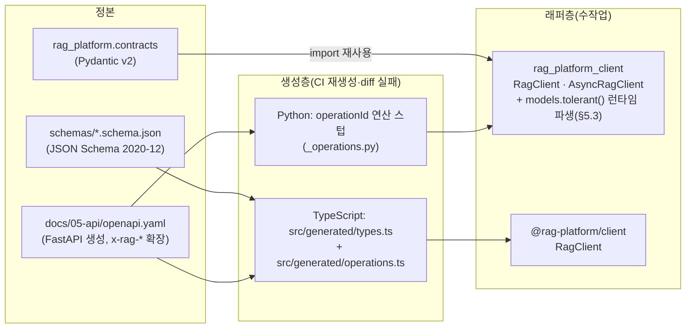
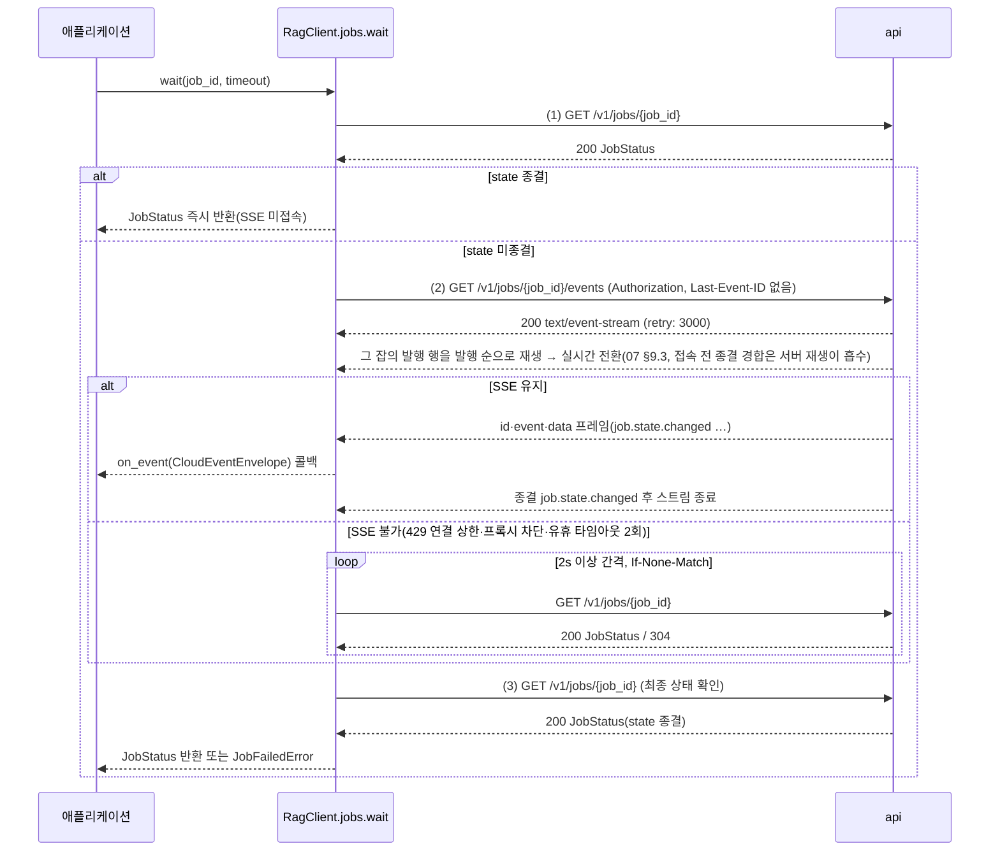

# 클라이언트 SDK (Python·TypeScript)

## 목적

이 문서는 플랫폼의 REST(`/v1`)·SSE(Server-Sent Events) 표면을 외부 애플리케이션이 소비하기 위한 **클라이언트 SDK(Software Development Kit)** 두 종 — Python `rag-platform-client`, TypeScript `@rag-platform/client` — 의 생성 전략, 패키지 구성, 클라이언트 클래스, 인증·재시도·타임아웃·멱등 키·페이지네이션·잡 대기·이벤트 구독 규약, 오류 클래스 매핑, 관측성 전파, 버전 정책, 렌더 헬퍼(`ContextPack` → Anthropic Messages 호출), LangChain·LlamaIndex 통합 어댑터, 릴리스·문서화 규칙을 확정한다. [API 설계 가이드라인](01-api-design-guidelines.md) §18이 "SDK에 요구하는 것"만 적고 세부를 이 문서에 위임했으며, [스키마 버전과 호환성](../03-contracts/14-schema-versioning-and-compatibility.md) §9와 [저장소 구조](../10-development/01-repository-structure.md) §3.3이 각각 SDK 버전 정합과 패키지명 확정을 이 문서에 위임했다.

정본 우선순위는 설계 브리프 > 설계 바이블(Design Bible) > ADR > 이 문서다(브리프 §11, 바이블 §1.1). API 표면은 바이블 §14, 경로·헤더·패키지 명명은 바이블 §6.7, 오류 모델은 바이블 §5.3·§5.7과 [에러 모델](../03-contracts/13-error-model.md), 렌더러 규칙은 바이블 §9.3과 [컨텍스트 팩 계약](../03-contracts/11-context-pack.md) §8이 정본이며, SDK는 이들을 **그대로** 투영한다. SDK는 서버 로직(렌더러·융합·ACL 판정)을 재구현하지 않는다.

## 범위

- 포함: OpenAPI 기반 생성 + 수작업 래퍼의 2층 전략, Python SDK(패키지명·클라이언트 클래스·동기/비동기·재시도·타임아웃·페이지네이션 이터레이터·`wait_for_job`·이벤트 구독·계약 모델 재사용·렌더 헬퍼 `to_anthropic_messages`·인용 역매핑), TypeScript SDK(패키지·타입 생성·`fetch` 기반·SSE 스트리밍), 인증 설정, `ProblemDetails` → 예외 계층 매핑, 로깅·트레이싱 전파, 버전 정책(API 경로 major·계약 `schema_version`·`contracts_compat`), 예시 코드 6개, LangChain·LlamaIndex Retriever 어댑터 개요, 릴리스·문서화.
- 제외: 엔드포인트별 요청·응답 필드 정의([수집 API](02-ingestion-api.md), [리트리벌 API](03-retrieval-api.md), [관리 API](04-management-api.md), 03-contracts 각 문서), MCP(Model Context Protocol) 클라이언트([MCP 서버](05-mcp-server.md); MCP 호스트는 `mcp` 공식 SDK를 쓴다), 웹훅 수신자 구현([웹훅과 이벤트](07-webhooks-and-events.md); 서명 검증 함수는 [잡·이벤트·상태 계약](../03-contracts/12-jobs-events-and-status.md) §8), 플러그인 SDK(`rag_platform.sdk`, [플러그인 개발 가이드](../10-development/06-plugin-development-guide.md)), 레퍼런스 `answer` 엔드포인트의 서버 구현([리트리벌 API](03-retrieval-api.md)).
- 이 문서가 소유하는 파일: `docs/05-api/06-client-sdks.md`. SDK 소스는 저장소 `sdk/python/`·`sdk/typescript/`(바이블 §12)이며 `docs/05-api/openapi.yaml`은 [API 설계 가이드라인](01-api-design-guidelines.md) §17의 생성 산출물이다.
- depends_on 대조 상태: [리트리벌 API](03-retrieval-api.md)(`QueryResponse`·`RenderRequest`·`RenderOptions`·`AnswerResponse`·`answer` SSE)와 [웹훅과 이벤트](07-webhooks-and-events.md)(§9 SSE 프레임·재접속 규칙·첫 접속 의미 — 잡 스트림은 그 잡의 발행 행 재생, 테넌트 스트림은 실시간 전용)는 게시본과 대조했다. [수집 API](02-ingestion-api.md)·[관리 API](04-management-api.md)·[MCP 서버](05-mcp-server.md)는 이제 게시되어 §5.1 표와 대조를 마쳤고(문서 메타 객체·`TenantPolicies`·`TenantUsage`·`CollectionStatsView`·`IngestBatchAccepted`는 일치), 남은 세부는 미해결 이슈 1이다.

## 1. 생성 전략: OpenAPI 기반 생성 + 수작업 래퍼

**결정:** SDK는 **2층**으로 구성한다. 하층은 정본(`schemas/*.schema.json`, `rag_platform.contracts`, `docs/05-api/openapi.yaml`)에서 **기계 생성**되는 타입·연산 표면이고, 상층은 손으로 쓰는 **관용 래퍼(idiomatic wrapper)** — 인증, 재시도, 멱등 키, 페이지네이션 이터레이터, `wait_for_job`, SSE 구독, 렌더 헬퍼, 오류 계층, 관측성 — 다. 생성층은 CI가 정본에서 재생성해 diff가 있으면 실패하고(바이블 §12 "CI export diff"; [API 설계 가이드라인](01-api-design-guidelines.md) §17.5), 래퍼층은 생성층의 이름만 참조한다. 근거: (1) 요청·응답 본문은 계약 인스턴스 그대로이므로(01 §8) 타입은 생성해야 정본과 어긋나지 않는다. (2) 재시도·멱등·SSE 재접속·인용 역매핑은 OpenAPI가 표현하지 못하는 의미론이라 손으로 써야 한다. (3) 두 층을 섞으면 재생성 때마다 수작업 코드가 덮어써진다([ADR-0018](../06-adr/0018-api-rest-sse-mcp-no-grpc-rfc9457.md) 결정 동인 1 — 계약 정본은 하나이고 OpenAPI 3.1은 Pydantic에서 코드젠한 파생물이며 손으로 두 번 쓰지 않는다는 원칙의 요약).



| 층 | Python | TypeScript | 생성 입력 | 갱신 규칙 |
|----|--------|------------|-----------|-----------|
| 요청·응답 타입 | `rag_platform.contracts` 모델 **재사용**(코드젠 없음) + 관용 모드 **런타임 파생**(§5.3; 생성 산출물 없음, 래퍼층) | `schemas/*.schema.json` → `src/generated/types.ts`(도구 선정은 미해결 이슈 3) | 계약 스키마 | Python: 계약 패키지 범프 시 자동(import 시 파생) / TypeScript: 계약 minor마다 재생성 |
| 연산 표면(경로·메서드·파라미터·상태 코드) | `openapi.yaml`의 `operationId`·`x-rag-*` → `_operations.py`(경로 템플릿·한도 클래스·멱등 정책·비동기 여부 상수 표) | 동일 → `src/generated/operations.ts` | `openapi.yaml` | 엔드포인트 추가·변경마다 재생성 |
| 래퍼(인증·재시도·멱등·페이지네이션·대기·SSE·렌더 헬퍼·오류·관측) | 수작업 `rag_platform_client/*` | 수작업 `src/*` | 이 문서 §3~§6 | 이 문서 개정 시 |
| 적합성 테스트 | `openapi.yaml`·골든 예시(03-contracts `## 예시`)로 왕복 검증 | 동일 | 계약 문서 | 릴리스마다 |

생성층이 읽는 OpenAPI 확장(01 §17.4)의 사용은 다음과 같다: `x-rag-idempotency: required`면 멱등 키 인자를 필수로 생성하고 `optional`이면 UUID v4 자동 생성, `x-rag-async: true`면 해당 연산에 `wait()` 헬퍼를 붙이고, `x-rag-rate-limit-class`는 클라이언트 측 동시성 힌트(§3.2)로만 쓰며, `deprecated: true`·`x-rag-sunset`은 호출 시 `DeprecationWarning`을 낸다.

## 2. 패키지와 배포

**결정:** 패키지명은 다음 표와 같다. 바이블 §6.7은 코어(`rag-platform`)·플러그인(`rag-plugin-{name}`)·사이드카 이미지 이름만 정하고 클라이언트 SDK 패키지명을 정하지 않으므로, 이 문서가 [저장소 구조](../10-development/01-repository-structure.md) §3.3·§6의 제안(`rag-platform-client` / `rag_platform_client`)을 **확정**하고 바이블 §6.7 개정을 요청한다(개정 등급은 바이블 §1.2 변경 절차 표에 따라 ADR에서 확정; 미해결 이슈 2; [ADR-0036](../06-adr/0036-naming-and-identifier-conventions.md) 명명 규약과 정합: 배포명 kebab-case, import명 snake_case).

| 항목 | Python | TypeScript |
|------|--------|------------|
| 배포명 / import명 | `rag-platform-client` / `rag_platform_client` | `@rag-platform/client`(npm 스코프; 스코프 소유 확인 필요 as of 2026-09) / ESM `import { RagClient } from "@rag-platform/client"` |
| 저장소 위치 | `sdk/python/`(uv 워크스페이스 멤버) | `sdk/typescript/`(비멤버 npm 프로젝트) |
| 런타임 | Python `>=3.12,<3.14`([ADR-0035](../06-adr/0035-python-version-and-toolchain-pins.md); 워크스페이스 공유 `requires-python`) | Node.js 22 LTS 이상(네이티브 `fetch`·`ReadableStream`; Node.js 20은 2026-04 유지보수 종료로 알려져 하한에서 제외 — 확인 필요 as of 2026-09, 미해결 이슈 3), 모던 브라우저(초안 목표) |
| 필수 의존 | `rag-platform>=1.0,<2.0`(계약 모델 `rag_platform.contracts`; §2.1의 경량 분리가 채택되면 `rag-platform-contracts`로 교체), `httpx`, `httpx-sse`(선정 매트릭스 `uri_fetcher` 행의 httpx 근거 재사용; `httpx-sse` 버전·API는 확인 필요 as of 2026-09) | 없음(`fetch` 표준만). 타입 생성 도구는 개발 의존 |
| 선택 extra | `[otel]`(`opentelemetry-api`; §5.5), `[anthropic]`(`anthropic`; §5.4 예시), `[langchain]`(`langchain-core`), `[llamaindex]`(`llama-index-core`)(§9) | 없음(렌더 헬퍼는 Anthropic SDK 타입에 의존하지 않는 순수 객체 반환) |
| 라이선스 | Apache-2.0(코어와 동일 `LICENSE`, [ADR-0001](../06-adr/0001-license-grade-table-and-d02-interpretation.md) A 등급 의존만) | 동일 |
| 릴리스 채널 | PyPI(코어 릴리스와 같은 태그 트레인, §10) | npm(동일) |

### 2.1 계약 모델 공유 패키지 `rag-platform-contracts`(제안)

**제안(ADR 필요):** Python SDK는 계약 Pydantic 모델을 재사용한다(바이블 §12 `sdk/` 주석 "계약 모델 재사용", [스키마 버전과 호환성](../03-contracts/14-schema-versioning-and-compatibility.md) §9). **현재 규칙**은 바이블 §12의 단일 배포 패키지 원칙에 따라 `rag-platform-client`가 `rag-platform>=1.0,<2.0`에 의존하는 것이다([저장소 구조](../10-development/01-repository-structure.md) §3.3 예시). 그러나 이 의존은 클라이언트 설치에 FastAPI·서버 의존을 끌어오므로, 선정 매트릭스의 D-01 보강 문구 "외부 앱 SDK는 인프로세스 의존에서 제외(HTTP만)"([기술 지형 종합](../07-tech-landscape/00-summary-and-selection-matrix.md) 브리프 수정 제안 표)와 [저장소 구조](../10-development/01-repository-structure.md) 미해결 이슈 3(a)에 따라 `src/rag_platform/contracts/` + `schemas/`를 **경량 배포 패키지 `rag-platform-contracts`** 로 분리하고 코어 `rag-platform`과 `rag-platform-client`가 둘 다 이 패키지에 의존하는 안을 제안한다. 바이블 §12 "배포 패키지 `rag-platform`" 단일 패키지 정본과 충돌하므로 이 문서가 확정하지 않으며, 개정 등급(minor/major)은 바이블 §1.2 변경 절차 표에 따라 ADR에서 판정한다(미해결 이슈 2).

| 항목 | 제안 내용 |
|------|-----------|
| 배포명 | `rag-platform-contracts`(uv 워크스페이스 멤버). 저장소 내 위치는 [저장소 구조](../10-development/01-repository-structure.md)가 정한다 — 그 문서 §2.4가 `packages/*` 경로를 쓰지 않기로 했으므로 이 문서는 경로를 제안하지 않는다 |
| import 경로 | 바이블 §12의 `rag_platform.contracts`를 **그대로 유지**한다. 실현 방식(`rag_platform`을 PEP 420 네임스페이스 패키지로 분할 vs `rag_platform_contracts` 배포 + 코어 재노출 shim)은 ADR에서 확정하되, 어느 쪽이든 문서·코드의 import 문은 `from rag_platform.contracts.context_pack import ContextPack`으로 불변이다 |
| 의존 | `pydantic>=2`·표준 라이브러리만(A 등급). `fastapi`·`temporalio`·`qdrant-client` 등 서버 의존 금지(import-linter `contracts-pure` 계약, [저장소 구조](../10-development/01-repository-structure.md) §4) |
| 내용 | 바이블 §5.1 인벤토리의 모든 모델, `enums.py`(§5.7 단일 소스), `versioning.py`(`schema_version` 호환 규칙·`contracts_compat` 평가), 패키지 데이터 `schemas/`(URN 리졸버 1순위, 14 §5.3), `errors.ERROR_CATALOG`(13 §9) |
| 버전 | 계약 `schema_version`과 별개인 패키지 semver. major = 계약 major(14 §9). 채택 전에는 위 "현재 규칙"(`rag-platform>=1.0,<2.0`)이 적용된다 |

TypeScript SDK는 어느 경우에도 Python 패키지를 쓰지 않고 `schemas/`에서 타입을 생성한다(14 §9). 두 언어의 타입이 같은 스키마에서 나오므로 필드명·열거값 철자는 자동으로 일치하고, CI의 열거 대조(바이블 §1.2)가 생성 산출물에도 적용된다.

## 3. 공통 클라이언트 규약(두 언어 동일)

### 3.1 인증 설정

**결정:** 자격 증명은 `Authorization: Bearer <credential>` 한 헤더로만 보낸다(01 §5.1; OIDC JWT와 API 키 공용). SDK는 자격 증명의 **종류를 판별하지 않고** 문자열을 그대로 싣는다. 테넌트는 토큰에서 도출되므로(바이블 §10.3 E1, [ADR-0027](../06-adr/0027-security-context-injection-and-acl-enforcement-points.md)) SDK 생성자·메서드에 `tenant_id` 인자는 **없다**. 요청 본문에 `tenant_id`·`SecurityContext` 하위 키가 있으면 서버가 422로 거부하므로(01 §3.2) SDK 요청 빌더는 이 키를 전송 전 검증에서 제거하지 않고 `ForbiddenFieldError{field}`(`RagClientError` 하위, §4; HTTP 없음)로 즉시 거부한다 — 조용히 고치면 호출자의 의도 오류가 숨는다.

| 인증 방식 | Python | TypeScript | 비고 |
|-----------|--------|------------|------|
| API 키 | `ApiKeyAuth("rag_ak_…")` / `ApiKeyAuth.from_env("RAG_PLATFORM_API_KEY")` | `{ apiKey: "rag_ak_…" }` | 접두 `rag_ak_`는 01 §5.1 제안(관리 API 확정 대기). SDK는 접두를 검증하지 않는다 |
| OIDC 액세스 토큰(정적) | `BearerTokenAuth("eyJ…")` | `{ token: "eyJ…" }` | 만료 시 401 → 갱신 없음 |
| OIDC 토큰 공급자(갱신) | `BearerTokenAuth(provider=callable)` — 요청마다 호출(동기·비동기 모두), 401 `auth.unauthenticated` 1회 갱신 재시도(13 §10) | `{ tokenProvider: async () => string }` | 토큰 캐시·갱신은 공급자 책임(OIDC 클라이언트 라이브러리 재사용) |
| mTLS | `httpx` 클라이언트 인자(`cert`) 주입 | Node `undici` 디스패처 주입(브라우저 불가) | 헤더 없음; 서버는 인증서에서 주체 도출 |
| 환경 변수(제안) | `RAG_PLATFORM_BASE_URL`, `RAG_PLATFORM_API_KEY`, `RAG_PLATFORM_TOKEN`, `RAG_PLATFORM_ACCEPT_LANGUAGE` — `RagClient.from_env()` | 동일 이름(`process.env`; 브라우저 없음) | 이름은 이 문서 제안. 서버 pydantic-settings는 선언된 필드명(`RAG_PG__DSN` 등, 바이블 §6.6)만 읽으므로 실제 충돌은 없으나, 같은 셸에서 서버 변수와 시각적으로 구분되도록 `RAG_PLATFORM_` 접두를 쓴다. [구성 참조](../09-operations/02-configuration-reference.md)에서 확정(미해결 이슈 4) |

**결정:** 기본 `Accept-Language`는 [API 설계 가이드라인](01-api-design-guidelines.md) §12.4가 이 문서에 위임한 제안을 그대로 채택한다 — 우선순위는 (1) 생성자 인자 `accept_language`/`acceptLanguage`, (2) 환경 변수 `RAG_PLATFORM_ACCEPT_LANGUAGE`, (3) 프로세스 로케일에서 유도(Python `locale.getlocale()[0]`의 언어 부분, TypeScript `Intl.DateTimeFormat().resolvedOptions().locale`; BCP 47 소문자화), (4) 로케일을 알 수 없으면 `ko, en;q=0.5`다. 이 값은 `ProblemDetails.title` 지역화(13 §9)에만 영향하고 분기 키 `code`에는 영향하지 않는다(01 §12.4). 로케일 유도 알고리즘의 세부(지역 부호 유지 여부, 언어 목록 형식)는 미해결 이슈 11이다.

공개 표면(`GET /v1/schemas/{name}`, `/healthz`, `/readyz`)에는 자격 증명을 붙이지 않는다(01 §12.3). SSE도 같은 헤더 인증이며 쿼리 토큰은 없다(01 §10.4) — 브라우저에서는 `EventSource`가 헤더를 설정할 수 없으므로 TypeScript SDK는 `fetch` 기반 SSE 파서만 제공한다(§6.4).

### 3.2 재시도·타임아웃

**결정:** 자동 재시도는 [API 설계 가이드라인](01-api-design-guidelines.md) §18과 [에러 모델](../03-contracts/13-error-model.md) §10의 규칙을 그대로 구현한다: (a) `ProblemDetails.retryable=true` 또는 429 `api.rate_limited` 또는 전송 오류(연결 실패·타임아웃·5xx 본문 없음)이고 **동시에** (b) 요청이 멱등일 때만 — `GET`, `POST /v1/query`, `POST /v1/render`, `POST /v1/answer`(비스트리밍), `POST /v1/profiles/validate`, `Idempotency-Key`를 무시하는 자연 멱등 연산(`cancel_job`, PATCH·PUT; 01 §6), 같은 `Idempotency-Key`를 가진 `POST`(수집·잡 접수·자원 생성). `x-rag-idempotency: optional` 연산은 SDK가 호출자 키가 없으면 UUID v4를 자동 생성해 붙이므로(§3.3; 01 §18) `POST /v1/feedback`·`POST /v1/collections`를 포함한 모든 접수·생성 POST가 재시도 대상이다 — 서버는 제시된 키를 필수 키와 같은 의미론으로 처리한다(01 §6). `Retry-After` 헤더가 있으면 그 값이 백오프에 우선하며, 헤더가 없는 응답 경로는 본문 사본 `ProblemDetails.retry_after`(바이블 §5.3 1.3.0 AM-28 선택 필드; 헤더와 같은 값, I8)를 대신 읽는다. 429는 `retryable=false`이지만 한도 정책이 재시도 정책에 우선하므로 `Retry-After`(또는 `retry_after` 본문 사본) 뒤 같은 요청을 재전송한다(13 §10).

| 파라미터 | 기본값(초안 목표) | 근거·비고 |
|----------|-------------------|-----------|
| 최대 재시도 횟수 `max_retries` | 5 | 01 §18 "최대 5회(초안)" |
| 백오프 | `min(60s, 1s × 2^n)` + 지터 ±20% | 01 §18 |
| `Retry-After` 상한 | 120s(초과 시 `RateLimitedError`/`UnavailableError`를 즉시 올림) | 무한 대기 방지; 이 문서 제안 |
| 연결 타임아웃 `connect` | 5s | — |
| 읽기 타임아웃 `read`(한도 클래스별) | `query` 30s / `ingest` 10s / `admin` 30s | 리트리벌 p95 목표 800ms(브리프 §7)에 여유를 두되 리랭커 CPU 경로 1.5s와 서버 큐잉을 흡수 |
| SSE 유휴 타임아웃 | 60s(서버 keepalive 15s의 4배) → 재접속 | 12 §9 `: keepalive` 15s |
| `retrieve.unavailable` 서킷 | 연속 2회 실패 시 30s 오픈(같은 `base_url`) | 13 §10 |
| 401 갱신 재시도 | 1회(토큰 공급자가 있을 때만) | 13 §10 |
| 총 실제 경과 시간 상한 | `timeout × (max_retries + 1)`을 문서화; 호출별 `deadline` 인자로 절단 | — |

재시도 시 `Idempotency-Key`가 있는 `POST`는 **최초 직렬화한 본문 바이트를 그대로** 재전송한다(01 §6: `requested_at` 포함 바이트 동일; 재직렬화 금지). 멱등 재생 응답(200, 원 202 본문 동일)은 성공으로 처리하고 `accepted.replayed=true`로 표시한다. 409 `api.idempotency_conflict`는 재시도하지 않고 `IdempotencyConflictError`를 올리며 `instance`의 잡 경로를 `existing_job_url`로 노출한다(13 §10 "새 키로 재전송하지 않는다").

한도 클래스(01 §11)는 클라이언트 측 **동시성 힌트**로만 쓴다: 기본 동시 요청 상한 `query` 16 / `ingest` 8 / `admin` 4(초안 목표; 세마포어). 서버 `RateLimit`·`RateLimit-Policy` 헤더는 파싱해 `client.ratelimit[class]`로 노출하되 선제 차단(pre-emptive throttling)은 하지 않는다(정책 정본은 서버).

### 3.3 멱등 키

| 연산(`x-rag-idempotency`) | SDK 인자 | 규칙 |
|---------------------------|----------|------|
| `required`(`ingest_document`, `ingest_documents_batch`) | `idempotency_key: str` **필수** | 형식 `^[\x21-\x7E]{1,255}$` 전송 전 검증(12 §2.1). 배치는 키 하나가 전체를 덮는다 |
| `optional`(`reprocess_document`, `reindex_collection`, `delete_document`, `delete_collection`, `retry_job`, `create_eval_run`, `create_collection`, `create_subscription`, `create_eval_dataset`, `submit_feedback`; 01 §9.3) | `idempotency_key: str \| None = None` | `None`이면 잡 접수형·자원 생성형 구분 없이 SDK가 UUID v4를 자동 생성해 보낸다(01 §18 "`optional`은 기본 자동 생성(UUID v4)"). 서버가 제시된 키를 같은 의미론으로 처리하므로(01 §6) 자동 생성 요청도 재시도 가능하고, 재시도 시 같은 키·같은 본문 바이트를 재전송한다(§3.2). 호출자가 준 키는 형식 검증 후 그대로 전송한다 |
| `ignored`(GET 전체, `query`, `render`, `answer`, `validate_profile`, `cancel_job`, `delete_subscription`, PATCH·PUT; 01 §6) | 인자 없음 | 헤더를 보내지 않는다 |

`client.collections.delete(collection_id)`는 202 `JobStatus(kind=JobKind.delete_collection)`을 반환한다(바이블 §5.7·§14 1.3.0 AM-37; 워크플로우 `collection.delete.v1`) — `wait()`가 붙는 `x-rag-async` 연산이며 `client.documents.delete`(`delete_document`)와 같은 패턴이다.

### 3.4 페이지네이션 이터레이터

**결정:** 모든 목록 연산(`list_*`, `get_document_content`, `list_dictionary_entries`)은 두 형태를 제공한다: 한 페이지를 돌려주는 `list_*(cursor=None, limit=50, sort=None, **filters) -> Page[T]{items, next_cursor}`와 `next_cursor`를 따라가는 이터레이터 `iter_*(**filters) -> Iterator[T]`(Python은 동기 `Iterator`·비동기 `AsyncIterator`, TypeScript는 `AsyncIterable<T>`로 `for await`). 커서는 불투명 문자열이며 SDK는 해석·조립하지 않는다(01 §7.2). `limit`은 1..200(01 §7.1) 전송 전 검증. 필터 파라미터는 엔드포인트 화이트리스트를 생성층 상수로 두고 미지 파라미터는 서버가 400으로 거부하므로(01 §7.4) SDK도 `TypeError`로 거부한다. `next_cursor=null`이 마지막 페이지다. 이터레이터는 총 개수를 제공하지 않는다(서버가 제공하지 않음).

### 3.5 잡 대기 헬퍼 `wait_for_job`

**결정:** `x-rag-async` 연산(202 + `JobStatus` 또는 `IngestAccepted`)의 결과에는 `wait(timeout=None, on_event=None) -> JobStatus`가 붙고, 독립 함수 `client.jobs.wait(job_id, ...)`도 같은 구현이다. 종결 판정은 `state ∈ {succeeded, partial, failed, cancelled}`이고 알 수 없는 `JobState` 값은 "종결 아님"으로 보고 계속 기다린다(14 §2.2 부류 C; 01 §10.1).



| 규칙 | 내용 |
|------|------|
| 우선 경로 | (1) `GET /v1/jobs/{job_id}` 1회로 현재 `state`를 읽고 종결이면 **즉시 반환**한다 — 이미 끝난 잡(소형 TXT 수집·멱등 재생 200·과거 `job_id`)에 SSE 연결(테넌트당 100, 01 §10.4)을 쓰지 않고, 종결 뒤 재생 보존 창(7일 초안) 밖인 잡도 여기서 끝난다. (2) 미종결이면 SSE `GET /v1/jobs/{job_id}/events`를 `Last-Event-ID` 없이 연다(12 §9 프레임 규약). 잡 스트림의 첫 접속은 그 잡의 발행 행을 발행 순으로 **먼저 재생한 뒤** 실시간으로 이어가고, (1)과 접속 사이에 종결됐으면 종결 `job.state.changed`까지 재생한 뒤 서버가 닫으므로(07 §9.3) 접속 전 종결 경합은 **서버 재생이 흡수**한다 — SDK는 접속 직후 상태를 다시 조회하지 않으며, 재생된 과거 프레임도 실시간 프레임과 같이 `on_event`로 전달한다(중복 제거는 `id` 기준, §3.6). (3) 종결 `job.state.changed`를 받으면 스트림이 닫히고 SDK는 `GET /v1/jobs/{job_id}`를 1회 호출해 **원장 읽기 모델을 반환값으로** 쓴다(이벤트 `data`는 부분집합). 서버가 `event: gap{reason: job_outside_retention}` 1프레임 뒤 닫는 경우(07 §9.3; (1)이 미종결을 봤다면 정상 경로에서는 나오지 않는 방어 분기)도 같은 `GET`으로 마무리하고, 그 결과가 미종결이면 폴링 폴백으로 넘어간다 |
| 폴백 | SSE 연결이 429(연결 상한, 01 §10.4)·프록시 차단·유휴 타임아웃 2회로 실패하면 폴링. 간격은 `max(2s, Retry-After)`(01 §10.1 "폴링 간격 ≥ 2s"), `ETag`/`If-None-Match`로 304 활용 |
| `partial` | 반환한다(오류 아님). 호출자가 `client.jobs.retry(job_id, stages=["enrich"])`를 결정(13 §10). `raise_on_partial=True` 옵션이면 `JobPartialError` |
| `failed` | `JobFailedError(job)`를 올리고 `job.last_error`(`StageError`)를 `.stage_error`로 노출. `stage_error.retryable=true`면 `.suggest_retry=True` |
| `cancelled` | `JobCancelledError(job)` |
| 타임아웃 | `timeout` 초과 시 `JobTimeoutError(job)`(마지막 관측 `JobStatus` 포함). 서버 잡은 취소하지 않는다(취소는 명시적 `cancel`) |
| 다중 대기 | `client.jobs.wait_all(job_ids, ...)`은 먼저 각 `job_id`에 `GET /v1/jobs/{job_id}`를 1회 호출해 이미 종결된 잡을 결과에 넣고, 남은 잡이 있으면 테넌트 스트림 `GET /v1/events?types=job.state.changed`를 1개 열어 `data.job_id`로 분배한다(연결 상한 절약). 테넌트 스트림은 잡 스트림과 달리 첫 접속에 과거를 재생하지 않으므로(07 §9.3) 스트림 접속 직후 남은 잡의 `GET`을 1회 재확인해 접속 전 종결 경합을 흡수한다(이 재확인은 `wait_all`에만 있고 단일 잡 `wait`에는 없다) |

### 3.6 이벤트 구독(SSE)

**결정:** `client.events.stream_job(job_id, last_event_id=None)`과 `client.events.stream_tenant(types=None, collection_id=None, last_event_id=None)`은 `CloudEventEnvelope` 인스턴스를 내는 (비동기) 이터레이터다. 프레임 규약(`id`·`event`·`data`·`retry`·주석 keepalive)과 재접속 규약(`Last-Event-ID`)은 [잡·이벤트·상태 계약](../03-contracts/12-jobs-events-and-status.md) §9와 [웹훅과 이벤트](07-webhooks-and-events.md) §9(엔드포인트 필터·프레임·재접속·종료)를, 첫 접속(`Last-Event-ID` 없음)의 의미는 [웹훅과 이벤트](07-webhooks-and-events.md) §9.3만을(12 §9는 재접속만 정한다) 그대로 따른다.

| 규칙 | 내용 |
|------|------|
| 첫 접속(`last_event_id=None`) | 두 스트림의 의미가 다르다(07 §9.3). `stream_tenant`는 접속 시각 이후 실시간만 전달하고 과거를 재생하지 않는다 — 과거 상태는 `client.jobs.get`·`client.jobs.list`로 복원한다(§3.5 `wait_all`의 초기 `GET`·접속 직후 재확인이 이 규칙의 결과). `stream_job`은 그 잡의 발행 행을 발행 순으로 **재생한 뒤** 실시간으로 이어가고, 잡이 이미 종결이면 종결 `job.state.changed`까지 재생한 뒤 서버가 닫으며, 종결 뒤 재생 보존 창(7일 초안) 밖이면 `event: gap{reason: job_outside_retention}` 1프레임 뒤 서버가 닫는다 — SDK는 `GapEvent`를 낸 뒤 이터레이터를 정상 종료하고(재접속 없음) 호출자는 상태를 `client.jobs.get`으로 조회한다 |
| 재접속 | 연결 종료·유휴 타임아웃 시 마지막 `id`를 `Last-Event-ID`로 자동 재접속(백오프 §3.2; 서버 `retry:` 값이 초기 지연). 재생은 발행 순 커서로 10,000행(초안) 배치를 순차 전송하며 총량 상한이 없으므로(07 §9.3) SDK는 `id`를 매 프레임 갱신한다. 잡 스트림은 종결 `job.state.changed` 뒤(또는 `gap{reason: job_outside_retention}` 뒤) 서버가 닫으므로 그 프레임을 관측했으면 재접속하지 않는다 |
| 멱등 | at-least-once(재접속 경계 중복 가능, 07 §9.3)이므로 `id`(= `event_id`) 기준 중복 제거. 최근 10,000개 LRU(초안 목표); `dedupe=False`로 끔 |
| 제어 프레임 | `event` 값이 `EventType`(바이블 §5.7 이벤트 카탈로그)에 속하지 않는 프레임은 `id:` 없이 오는 SSE 전용 제어 프레임으로 다룬다(07 §9.2). 현재 정의된 것은 `event: gap`(12 §9·07 §9.2 제안)이며 `reason ∈ {last_event_id_outside_retention, job_outside_retention}`다 — 전자는 재접속의 `Last-Event-ID`가 재생 보존 창 밖이어서 보존된 첫 행부터 재생함을 알리고(`replay_from` 동반), 후자는 잡 스트림 첫 접속에서 재생할 행이 없어 곧 닫힘을 알린다(07 §9.3). SDK는 `GapEvent{replay_from, reason}`(`replay_from`은 전자에만, 없으면 `None`)로 올리고(예외 아님) 알 수 없는 `reason` 값은 문자열 그대로 보존한다(부류 C). 알 수 없는 제어 프레임은 `ControlFrame{event, data}`로 전달하고 `Last-Event-ID`를 갱신하지 않는다 |
| 필터 | `stream_tenant(types=…, collection_id=…)`는 쿼리 `types=`(쉼표 구분)·`collection_id=`로 그대로 전송한다(07 §9.1). SDK는 `types` 값을 검증하지 않는다(미래 minor의 새 이벤트를 막지 않기 위해) — 미지 값은 서버가 400 `contract.violation`으로 거부한다 |
| 파싱 | `data`는 `CloudEventEnvelope`로 검증(관용 모드). `type`이 알 수 없는 값이면 그대로 전달(부류 C: 무시·ack는 소비자 몫) |
| 콘텐츠 | `data`에는 콘텍스트 본문이 없다(바이블 §5.3 E12). SDK는 `data`를 로그에 남기지 않는다 |
| 연결 수 | 테넌트당 100(01 §10.4 초안). SDK는 프로세스 내 동시 스트림 수를 세어 경고 로그(차단은 서버) |

### 3.7 기능 게이트와 계약 호환 선언

**결정:** SDK는 서버가 모르는 선택 필드를 **요청에 넣지 않는다**(14 §9). 판정은 `GET /v1/schemas/{name}`(무인증, `Cache-Control: public, max-age=3600`; 01 §12.3, 14 §5.2)의 `properties` 키 집합으로 하며, 캐시 수명은 응답 `Cache-Control`을 따르고 헤더가 없으면 3,600초다(14 §9가 이 문서에 위임한 값을 **확정**). 게이트는 시작 시가 아니라 **최초 사용 시**(lazy) 수행하고, 서버가 모르는 필드를 호출자가 지정하면 조용히 버리지 않고 `UnsupportedFieldError{field, schema_name}`를 올린다 — 필드를 떨어뜨리면 의미(예 `filters`)가 바뀐다. `feature_gate=False`로 끄면 그대로 전송해 서버 400을 받는다.

패키지 메타데이터 `contracts_compat`(예 `">=1.0,<2.0"`, 14 §4.3 문법)를 SDK가 선언하고, 응답 봉투 `schema_version`이 범위 밖이면 `ContractsCompatWarning`(경고, 예외 아님)을 프로세스당 1회 낸다. 응답은 검증하지 않는다(서버 신뢰, 14 §9); 요청은 로컬 계약 모델로 검증 후 전송한다.

### 3.8 전송 전 크기 검증

바이블 §5.1 인라인 한계를 전송 전에 검사해 왕복을 줄인다(서버 검증을 대체하지 않는다, 01 §18): `IngestRequest` 64KB·`metadata` 16KB, 배치 1..100건, `QueryRequest` 16KB·`query` 4,000자·`collection_ids` 1..20·`filters` 8KB·`exclude_ids` ≤ 1,000·`cursor` ≤ 512바이트(01 §20)·`conversation` ≤ 10턴, `POST /v1/render` 인라인 `context_pack` 512KB, `FeedbackEvent` 8KB(`cite_ids` ≤ 20), 목록 `limit` 1..200. 위반은 `RequestTooLargeError`(클라이언트 측 `RagError`, HTTP 없음).

### 3.9 관용 규칙(부류 C)

SDK는 [스키마 버전과 호환성](../03-contracts/14-schema-versioning-and-compatibility.md) §2.2 부류 C 소비자다: 모르는 선택 필드는 **TypeScript는 보존**하고(`JSON.parse` 결과를 좁히지 않음, §6.2), **Python은 파싱에서 무시**하되(14 §9가 요구하는 `extra='ignore'`, §5.3) `RagClient(raw_responses=True)`의 `response.raw`로 원 JSON을 보존한다; 모르는 열거값은 두 언어 모두 불투명 문자열로 보존하며 분기에서는 fail-closed 기본값을 쓴다 — `Classification` unknown은 `secret`보다 높은 등급, `Visibility` unknown은 `restricted`, `JobState` unknown은 "종결 아님", `ConfidenceTier` unknown은 `low`, `EventType` unknown은 전달만. 두 SDK의 관용 규칙 구현은 적합성 테스트(§10)의 "미래 minor 응답" 픽스처로 검증한다.

## 4. 오류 클래스 매핑(`ProblemDetails` → 예외 계층)

**결정:** 모든 4xx·5xx 응답(`application/problem+json`)은 `RagError` 계층의 예외로 변환한다([에러 모델](../03-contracts/13-error-model.md) §10; 01 §18 `RagError{code, status, retryable, retry_after, trace_id, request_id, problem}`). 매핑 키는 **(`code`, `status` 계열) 쌍**이다: 1차 키는 `code`이고(`status`가 같은 코드가 여럿, 13 §7.1), 같은 `code`가 4xx·5xx 양쪽에 있는 경우(`contract.violation` 400 요청 / 500 산출물, `profile.invalid`·`pack.tokenizer_mismatch` 422 요청 유도 / 500 런타임 구성; 13 §7.1)는 `status`로 분기하며, `code`에 매핑이 없으면 `status` 계열로 폴백한다. 알 수 없는 `code`는 `RagApiError`로 올리되 `.code`를 그대로 보존한다(부류 C). 클래스 이름은 두 언어에서 같다(Python `rag_platform_client.errors`, TypeScript `@rag-platform/client` export).

```mermaid
classDiagram
    class RagError {
        +str code
        +Optional~int~ status
        +bool retryable
        +Optional~int~ retry_after
        +Optional~str~ trace_id
        +Optional~str~ request_id
        +Optional~ProblemDetails~ problem
    }
    RagError <|-- RagTransportError
    RagTransportError <|-- RagConnectionError
    RagTransportError <|-- RagTimeoutError
    RagError <|-- RagApiError
    RagApiError <|-- AuthenticationError
    RagApiError <|-- ForbiddenError
    RagApiError <|-- ContractViolationError
    RagApiError <|-- RenderError
    RagApiError <|-- SemanticValidationError
    RagApiError <|-- IdempotencyConflictError
    RagApiError <|-- IdempotencyPayloadMismatchError
    RagApiError <|-- RateLimitedError
    RagApiError <|-- QuotaExceededError
    RagApiError <|-- NotFoundError
    RagApiError <|-- UnavailableError
    RagApiError <|-- ServerError
    RagError <|-- RagClientError
    RagClientError <|-- RequestTooLargeError
    RagClientError <|-- UnsupportedFieldError
    RagClientError <|-- ForbiddenFieldError
    RagClientError <|-- JobFailedError
    RagClientError <|-- JobPartialError
    RagClientError <|-- JobCancelledError
    RagClientError <|-- JobTimeoutError
```



| 예외 | 매핑 조건(`code` 우선, 같은 `code`가 양쪽에 있으면 `status`, 이후 `status` 계열) | 추가 속성 | 재시도(§3.2) |
|------|----------------------------------------|-----------|--------------|
| `AuthenticationError` | `auth.unauthenticated` / 401 | `www_authenticate` | 토큰 공급자 있으면 1회 |
| `ForbiddenError` | `auth.forbidden`, `plan.collection_forbidden` / 403 | — | 없음. 존재 비노출이므로 ID 오타도 의심(13 §10) |
| `ContractViolationError` | `contract.violation`(400일 때; 500이면 `ServerError`) — `contract.schema_type_mismatch`·`contract.upcast_failed`(바이블 §5.7 1.3.0 AM-36 등재; [스키마 버전과 호환성](../03-contracts/14-schema-versioning-and-compatibility.md) §9의 계약 카탈로그 채택 전까지는 `contract.violation` + `detail`로 수신되므로 그때까지 이 클래스가 함께 받는다) | `violations: list[StageError]`(`errors[]`), `pointers`(`location.pointer`), `intent`(§4.1) | 없음 |
| `RenderError` | `render.mixed_blocks`, `render.citations_with_structured_output`, `render.empty_pack` / 400 | — | 없음 |
| `SemanticValidationError` | `auth.too_many_principals`, `plan.filter_field_forbidden`, `profile.invalid`, `plugin.license_denied`, `plugin.capability_unsupported`, `pack.tokenizer_mismatch` / 422(`profile.invalid`·`pack.tokenizer_mismatch`가 500이면 `ServerError`, 13 §7.1) | `violations` | 없음 |
| `IdempotencyConflictError` | `api.idempotency_conflict`(409) | `existing_job_url`(`instance`) | 없음 — 기존 잡을 조회·대기 |
| `IdempotencyPayloadMismatchError` | `api.idempotency_payload_mismatch`(422) | — | 없음 — 새 키로 재전송은 호출자 결정 |
| `RateLimitedError` | `api.rate_limited`(429) | `retry_after`, `ratelimit{policy, remaining, reset}` | `Retry-After` 뒤 같은 요청 |
| `QuotaExceededError` | `api.quota_exceeded`(바이블 §5.7 1.3.0 AM-39; HTTP 상태 403(문서 수·저장 용량) 또는 429(QPS, `api.rate_limited`와 동일 취급) 미확정 — 05-api/01 §9·02-architecture/07 §10 확정 전까지 코드 우선 매핑으로 두 상태 모두 인식) | `retry_after`(429 경로만) | 429 경로면 `Retry-After` 뒤 재시도, 403 경로면 없음 |
| `NotFoundError` | `api.not_found`(바이블 §5.7 1.3.0 AM-36 등재, 404; [에러 모델](../03-contracts/13-error-model.md) §3.3의 계약 카탈로그 채택 전까지는 `contract.violation` + `detail`로도 올 수 있어 §4.1 `intent=not_found` 파생과 함께 인식) | — | 없음 |
| `UnavailableError` | `retrieve.unavailable`, `parse.sidecar_unavailable`, 채택 시 `api.orchestrator_unavailable`·`api.dependency_unavailable` / 503 | `retry_after` | `Retry-After` 뒤; 연속 2회 실패 시 서킷 30s |
| `ServerError` | 그 외 5xx(`contract.violation` 500 산출물, `fuse.k_missing`, 채택 시 `api.internal_error`) | — | `retryable=true`이고 멱등 요청일 때만 |
| `RagApiError` | 매핑 없는 `code`(미래 minor) | — | `retryable` 값에 따름 |
| `RagConnectionError` / `RagTimeoutError` | 전송 계층(본문 없음) | `cause` | 멱등 요청만 |
| `RequestTooLargeError`, `UnsupportedFieldError`, `ForbiddenFieldError` | 클라이언트 전송 전 검증(§3.8 크기 / §3.7 기능 게이트 / §3.1 본문 `tenant_id`·`SecurityContext` 키) | `field`, `limit`(크기), `schema_name`(게이트) | 없음 |
| `JobFailedError`, `JobPartialError`, `JobCancelledError`, `JobTimeoutError` | `wait_for_job`(§3.5) | `job: JobStatus`, `stage_error: StageError \| None` | — |

### 4.1 카탈로그 미채택 상태 코드의 잠정 처리

404(`api.not_found`는 바이블 §5.7 1.3.0 AM-36으로 등재됐으나 [에러 모델](../03-contracts/13-error-model.md) §3.3의 계약 카탈로그·스키마 채택은 아직이다)·409(잡 상태)·410·412·413·415·503(의존)의 전용 코드는 계약 카탈로그(`common-types.schema.json` `$defs/ErrorCodeCatalog`)에 없어 채택 전까지 서버가 400 `contract.violation` + 목표 의미를 담은 `detail`로 응답한다. 그런데 `detail`의 형식이 정본 사이에서 **일치하지 않는다**: [API 설계 가이드라인](01-api-design-guidelines.md) §9.2·§9.4는 키워드 접두(`"not found: /v1/jobs/{job_id}"`, `"gone: document deleted"`), [에러 모델](../03-contracts/13-error-model.md) §7.1과 [리트리벌 API](03-retrieval-api.md) §4.1은 포인터 접두·키워드 접미(`"{경로 파라미터 포인터}: resource not found"`, `"/pack_id: resource not found"`), 412는 01 §3.4의 고정 문구(`"If-Match does not match current ETag"`)이고 413·415·503(의존)은 형식이 정의되지 않았다. SDK는 이 기간에만 `ContractViolationError.intent ∈ {not_found, gone, conflict, precondition_failed, None}`을 다음 규칙으로 **파생**해 노출한다.

| 판정 순서 | `detail` 패턴(정규식, 대소문자 무시) | `intent` | 근거 |
|-----------|--------------------------------------|----------|------|
| 1 | `^not found:` | `not_found` | 01 §9.2 |
| 2 | `^/\S+: resource not found$` | `not_found` | 13 §7.1, 03 §4.1 |
| 3 | `^gone:` | `gone` | 01 §9.2·§9.4 |
| 4 | `^conflict:` | `conflict` | 01 §9.2 일반 규칙("잠정 400 동안 `detail` 첫 토큰은 목표 의미를 적는다")에서 이 문서가 **유추**. 01 §9.2의 예시 문구는 `not found:`·`gone:` 둘뿐이고 409 잡 상태(`api.job_state_conflict` 채택 전 400)의 예시 문구는 미정의(미해결 이슈 5) |
| 5 | `^If-Match does not match current ETag$` | `precondition_failed` | 01 §3.4 |
| 6 | 그 외(413·415·503 포함) | `None` | 형식 미정의 — 파생하지 않는다 |

`intent`는 `errors[]`가 비어 있고 `status=400`일 때만 계산한다(진짜 요청 계약 위반은 `errors[].location.pointer`가 있다). 코드가 채택되면(`api.not_found` 등) 전용 예외(`NotFoundError` 등)로 매핑하고 `intent` 속성은 한 minor 릴리스 뒤 제거한다(`DeprecationWarning`). 텍스트 파싱은 결함을 인정한 잠정 조치이며, 두 `detail` 형식의 통일과 코드 조기 채택을 함께 요청한다(01 미해결 이슈 2와 공동, 미해결 이슈 5).

### 4.2 지역화·로깅

`ProblemDetails.title`은 `Accept-Language` 협상 결과(`ko`/`en`; 13 §9)이고 예외 메시지는 `"{code}: {title}"`이다. `detail`은 영문 기계 지향 문구로 콘텐츠를 포함하지 않으므로(13 §9) 로그에 남겨도 된다. SDK는 `trace_id`·`request_id`를 예외 문자열 표현에 포함해 지원 요청에 인용할 수 있게 한다(13 §10).

## 5. Python SDK

### 5.1 클라이언트 클래스와 리소스 네임스페이스

**결정:** 진입점은 `RagClient`(동기)와 `AsyncRagClient`(비동기) 둘이며, 리소스 네임스페이스는 OpenAPI 태그(01 §17.3)와 1:1이다. 메서드명은 `operationId`에서 태그 명사를 뺀 동사형(`list_jobs` → `client.jobs.list`)이고, 필드 인자는 계약 필드명 그대로 키워드 인자로 받는다. 봉투 필드 `schema_version`·`requested_at`은 SDK가 채우고, 서버 발급 `readOnly` 필드(`request_id`, `query_id`)는 인자로 받지 않는다(01 §8).

```python
from rag_platform_client import RagClient, AsyncRagClient, Timeouts
from rag_platform_client.auth import ApiKeyAuth

client = RagClient(
    base_url="https://rag.example.go.kr",
    auth=ApiKeyAuth.from_env("RAG_PLATFORM_API_KEY"),
    timeouts=Timeouts(connect=5.0, read_query=30.0, read_ingest=10.0, read_admin=30.0),
    max_retries=5,
    accept_language="ko",   # 명시 지정. 생략 시 §3.1 규칙: RAG_PLATFORM_ACCEPT_LANGUAGE → 프로세스 로케일 → "ko, en;q=0.5"
)
aclient = AsyncRagClient.from_env()  # RAG_PLATFORM_BASE_URL · RAG_PLATFORM_API_KEY | RAG_PLATFORM_TOKEN · RAG_PLATFORM_ACCEPT_LANGUAGE
```

| 네임스페이스 | 메서드(Python) | `operationId` | 반환 | 비고 |
|--------------|----------------|---------------|------|------|
| `client.ingest` | `document(idempotency_key, **fields)`, `batch(requests, idempotency_key)` | `ingest_document`, `ingest_documents_batch` | `IngestAccepted`(+`.wait()`), `IngestBatchAccepted` | 202; 재생 200은 `.replayed=True` |
| `client.jobs` | `list`/`iter`, `get(job_id, if_none_match=None)`, `wait`, `wait_all`, `cancel`, `retry(job_id, stages=None)`, `update(job_id, priority)` | `list_jobs`, `get_job`, `cancel_job`, `retry_job`, `update_job` | `JobStatus` | `stream_job_events`는 `client.events` |
| `client.documents` | `get`, `content(document_id, view, cursor)`/`iter_content`, `commits`/`iter_commits`, `update_acl`, `update_metadata`, `reprocess(document_id, from_stage)`, `delete` | `get_document`, `get_document_content`, `list_document_commits`, `update_document_acl`, `update_document_metadata`, `reprocess_document`, `delete_document` | 문서 메타(관리 API 정의), `Page`, `JobStatus`(잡 접수형) | 툼스톤 본문 410 → §4.1 `intent=gone` |
| `client.retrieval` | `query(**fields)`, `render(*, renderer, pack_id=None, context_pack=None, options=None)`(키워드 전용; `pack_id`·`context_pack` 택1), `answer(**fields)`, `answer_stream(**fields)`, `to_anthropic_messages(...)`, `resolve_citations(...)` | `query`, `render_context_pack`, `answer` | `QueryResponse{context_pack, rendered?, explain?}`(03 §3.2), `RenderedContext`, `AnswerResponse`(03 §5.4) / `Iterator[AnswerStreamEvent]`(03 §5.5) | 와이어 타입명은 [리트리벌 API](03-retrieval-api.md) §3.2·§4.1·§4.2·§5.2·§5.4(`QueryResponse`·`RenderRequest`·`RenderOptions`·`AnswerRequest`·`AnswerResponse`)를 그대로 쓴다 |
| `client.feedback` | `submit(**fields)` | `submit_feedback` | `FeedbackEvent` | 201 |
| `client.collections` | `list`/`iter`, `create`, `get`, `update`, `delete`, `reindex`, `stats`, `dictionary.list`/`iter`, `dictionary.replace(entries)` | `list_collections` … `replace_dictionary` | `CollectionSpec`, `JobStatus`, `Page[UserDictEntry]` | `update`가 재색인 잡을 유발하면 `Link rel="related"`를 `.related_job_url`로 노출 |
| `client.profiles` | `list`, `get(profile_id)`, `validate(yaml_text)` | `list_profiles`, `get_profile`, `validate_profile` | `Profile`, 검증 결과 | 422 `profile.invalid` → `SemanticValidationError` |
| `client.tenants` | `usage(tenant_id)`, `get_policies(tenant_id)`, `update_policies(tenant_id, patch)` | `get_tenant_usage`, `get_tenant_policies`, `update_tenant_policies` | 집계·정책 객체 | `tenant_id`는 토큰과 같아야 함(불일치 403). `/v1/tenants` 목록·생성(GET/POST, 바이블 §14 1.3.0 AM-39)은 관리 API가 `operationId`를 아직 정의하지 않아 이 표에 없다 — 게시 후 추가(미해결 이슈 1) |
| `client.api_keys`(1.3.0 AM-39) | `list`/`iter`, `create(client_id, roles, allowed_collections, expires_at=None, description=None)`, `get(api_key_id)`, `delete(api_key_id)`, `rotate(api_key_id, grace_period=None)` | `list_api_keys`, `create_api_key`, `get_api_key`, `delete_api_key`, `rotate_api_key` | `ApiKey`(+`secret`은 발급·회전 응답 1회만) | `service:` 주체 호출 금지(관리 API §4 Cedar 규칙) |
| `client.plugins`(1.3.0 AM-39) | `list`/`iter`, `get(plugin_id)`, `capabilities(plugin_id)`, `health(plugin_id)` | `list_plugins`, `get_plugin`, `get_plugin_capabilities`, `get_plugin_health` | `PluginMeta`, `PluginCapabilitiesView`, `PluginHealth` | `installed`(N)로 api 프로세스 설치 여부 표시(관리 API §5.1) |
| `client.subscriptions` | `list`/`iter`, `create`, `delete` | `list_subscriptions`, `create_subscription`, `delete_subscription` | 구독 객체 | — |
| `client.events` | `stream_job(job_id, last_event_id=None)`, `stream_tenant(types=None, collection_id=None, last_event_id=None)` | `stream_job_events`, `stream_tenant_events` | `Iterator[CloudEventEnvelope]` | §3.6 |
| `client.audit`(1.3.0 AM-39) | `events.list`/`iter` | `list_audit_events` | `Page[CloudEventEnvelope]` | 인가 `read_audit`(관리 API §11) |
| `client.eval` | `datasets.create`/`list`/`iter`, `runs.create(dataset_id, profile_id, metrics_requested, judge_model=None, experiment_id=None, baseline_run_id=None, idempotency_key=None)`, `runs.list`/`iter`, `runs.get(run_id)`, `runs.report(run_id)` | `create_eval_dataset`, `list_eval_datasets`, `create_eval_run`, `list_eval_runs`, `get_eval_run`, `get_eval_report` | `EvalDataset`, `EvalRunAccepted{job, run_id}`, `EvalRun`, `EvalReport` | `run_id`는 202 응답의 `Link rel="related"`(제안)에서 채우며 없으면 `None`. 결정적 획득 경로(16 §3.1 `EvalRun.job_id` 필터 포함)는 미해결 이슈 6 |
| `client.schemas` | `list`/`iter`, `get(name, if_none_match=None, major=None)` | `list_schemas`, `get_schema` | `{items: SchemaDescriptor[]}`(1.3.0 AM-39), `dict`(JSON Schema) | 무인증·캐시(§3.7) |
| `client.system` | `healthz()`, `readyz()`, `version()` | `healthz`, `readyz`, `get_version` | 상태 객체, `VersionInfo`(1.3.0 AM-39) | 무인증 |

PATCH 계열(`update_*`)의 본문은 JSON Merge Patch(RFC 7396) 부분 객체이며 `None`은 "선택 필드 제거"다(01 §3.4). 따라서 Python 래퍼는 "지정하지 않음"과 "`null`로 제거"를 구분해야 하므로 PATCH 메서드는 `dict` 패치 본문을 받고 `exclude_unset` 직렬화를 쓴다. `If-Match`는 `if_match=` 인자로 받는다.

### 5.2 동기·비동기

**결정:** 동기 `RagClient`와 비동기 `AsyncRagClient`는 같은 리소스 정의에서 생성한 **한 소스**로 유지한다(래퍼층의 리소스 메서드를 전송 코루틴 하나로 작성하고 동기 클래스는 이를 `httpx.Client`로 실행하는 얇은 래퍼). 전송은 `httpx`(동기·비동기 단일 API), SSE는 `httpx-sse`(버전·API 확인 필요 as of 2026-09). 비동기 이터레이터·컨텍스트 매니저(`async with AsyncRagClient(...) as c`)를 제공하고, 이벤트 루프가 없는 환경에서는 동기 클라이언트를 쓴다. 스레드 안전성: 클라이언트 인스턴스는 스레드·태스크 간 공유 가능(연결 풀 재사용)하며, 공유 상태 — 토큰 캐시·스키마 캐시(§3.7), 서킷 상태·레이트리밋 스냅숏 `client.ratelimit[class]`·한도 클래스 세마포어(§3.2), 이벤트 중복 제거 LRU(§3.6), `ContractsCompatWarning`(§3.7)·폐기 경고(§5.5)의 프로세스당 1회 플래그 — 는 모두 락 또는 원자 연산으로 보호한다.

### 5.3 계약 모델 재사용(관용 모드)

**결정:** 요청 모델은 `rag_platform.contracts`의 엄격 모델(`ConfigDict(extra='forbid')`, 00 § Pydantic `ContractModel`)을 그대로 써서 전송 전 검증한다. 응답 모델은 같은 계약 모델에서 **관용 모드로 파생**한다(14 §9: `extra='ignore'`, 응답 열거는 `str`(알려진 값 집합 별도)). 파생은 `rag_platform_client.models.tolerant(Model)`이 import 시점에 1회 **런타임**으로 수행한다(코드젠 산출물이 아니므로 §1의 CI diff 검사 대상이 아니며, §10의 필드 집합 동치 단정이 대신 검증한다): `model_config`를 `extra='ignore'`로 바꾸고 `enum(TypeName)` 필드 타입을 `str`로 넓히되 원 열거 클래스를 `known_values`로 보존해 `item.confidence_tier in ConfidenceTier` 검사가 가능하게 한다. `extra='ignore'`는 미래 minor의 새 필드를 **버린다** — 보존이 필요한 소비자(프록시·저장)는 `RagClient(raw_responses=True)`로 원 JSON(`dict`)을 함께 받는다(`response.raw`). 두 표현 사이의 필드명·열거값 철자는 동일하므로 문서·서버 로그와 그대로 대조된다.

```python
from rag_platform.contracts.context_pack import ContextPack           # 엄격 계약 모델(서버·검증용)
from rag_platform_client.models import ContextPack as ContextPackView  # 관용 파생(응답용, extra='ignore', 열거 str)

view: ContextPackView = client.retrieval.query(query="…", collection_ids=["…"]).context_pack
strict = ContextPack.model_validate(view.model_dump())  # 필요 시 엄격 모델로 재검증(모르는 열거값이면 ValidationError)
```

### 5.4 렌더 헬퍼: `to_anthropic_messages` → Anthropic SDK 호출

**결정:** 렌더링의 정본은 서버 렌더러(바이블 §9.3; `POST /v1/query`의 `renderer=` 또는 `POST /v1/render`)이며 SDK는 렌더러를 **재구현하지 않는다**(인용 정합성·`[ocr]` 표기·`cache_control` 위치·빈 결과 처리 등 규칙이 서버에 있고 적합성 키트 `renderer_citation_roundtrip`이 서버를 검증한다; [ADR-0024](../06-adr/0024-context-pack-ordering-and-anthropic-search-result-renderer.md)). `to_anthropic_messages`는 `RenderedContext.provider_payload`를 Anthropic Messages API 호출 인자로 **적응(adapt)** 하는 얇은 함수다.

| 시그니처 | 동작 |
|----------|------|
| `client.retrieval.to_anthropic_messages(source, *, renderer="anthropic_search_result", tool_result=False, tool_use_id=None, structured_output=False, options=None, inline=False) -> AnthropicRender` | `source`가 `RenderedContext`(`renderer ∈ {anthropic_search_result, anthropic_document}`)면 로컬 적응만(`options`·`inline` 지정 시 `TypeError`); `ContextPack`이면 `POST /v1/render`를 호출해 `RenderedContext`를 얻은 뒤 적응한다. `tool_result`·`tool_use_id`·`structured_output`은 같은 이름의 서버 `RenderOptions` 키로 그대로 전달되는 단축 인자이고, `options`는 나머지 키(`query_text`, `include_instructions`, `cache_control`, `empty_policy`; [리트리벌 API](03-retrieval-api.md) §4.2의 9개 키 중 `response_format`·`max_result_tokens`는 `mcp_tool_result` 전용이라 여기서 무효)를 **가공 없이** 전달하는 `dict`다. SDK는 지시문·안내 텍스트를 만들거나 끼워 넣지 않는다(지시문은 서버 `include_instructions`가 결정) |
| `ContextPack` 입력의 전송 방식 | 기본은 `RenderRequest{pack_id}`다(03 §4.1; Valkey 조회 창 10분·같은 주체만, 03 §4.4) — 팩 전문을 다시 보내지 않고 서버 저장 팩을 렌더하므로 팩이 `response_format=pack_only`로 받은 것이어도 **본문 전체**가 렌더된다. `pack_id` 조회가 `intent=not_found`(§4.1)로 실패하거나 `inline=True`면 `RenderRequest{context_pack}`(≤ 512KB, §3.8)로 팩 전문을 보낸다(인라인 팩은 서버가 ACL을 재검증하지 않는다, 03 §4.1) |
| 반환 `AnthropicRender` | `system: list[dict] \| None`(= `stable_prefix.system`; `stable_prefix`가 `null`이면 — `tool_result` 경로·`include_instructions=false`, 11 §2.11·03 §4.2 — `None`이고 호출자는 `system` 인자를 **생략**해야 한다, §8.4), `messages: list[dict]`(= `volatile_suffix.messages`; `cache_control`은 서버가 넣은 위치 그대로), `tool_result: dict \| None`(`tool_result=True`일 때 `{type: tool_result, tool_use_id, content: [search_result…]}`), `citation_map`, `rendered`(원본), `token_count_rendered`, `count_method` |
| `structured_output=True` | 서버가 `citation_style=bracket_id`로 렌더(`citations.enabled=false`, `title` 앞 `[dN]`; 11 §8) → `output_config.format` 병용 가능. `native` 인용과 구조화 출력을 함께 요청하면 서버 400 `render.citations_with_structured_output` → `RenderError` |
| 금지 | `system`·`messages`에 `tenant_id`·`record_id`·주체 문자열이 없음은 서버 불변식(11 §8 공통 규칙 1). SDK는 추가 텍스트를 끼워 넣지 않는다(`tool_result.content`에 `text` 혼합 시 `render.mixed_blocks`) |

`resolve_citations(message, rendered, context_pack=None) -> list[ResolvedCitation]`은 Anthropic 응답의 `citations[]`(`type=search_result_location{search_result_index, start_block_index, end_block_index, cited_text}` 또는 `content_block_location`)를 [컨텍스트 팩 계약](../03-contracts/11-context-pack.md) §9 절차로 역매핑한다: (1) `provider_key = search_result_index`, (2) `citation_map[provider_key] → {cite_id, chunk_id, collection_id, document_id, segment_range}`, (3) 블록 인덱스 → `segment_index`, (5) `cited_text` 대조(NFC·공백 정규화). `context_pack`을 함께 주면 (4) `segments[i].block_id` → `items[].provenance[j]`로 원문 좌표(`element_path`, `page`, `bbox`, `char_start`, `char_end`)까지 채운다. 맵에 없는 키·범위 밖 인덱스는 버리지 않고 `unresolved=True`로 표시한다(환각 인용 차단, [ADR-0030](../06-adr/0030-single-coordinate-system-and-score-ledger.md)). `ResolvedCitation` 예:

```json
{
  "cite_id": "d1",
  "chunk_id": "9dd42a210fd232cd678522b46f76adf364beca52441279a7272357a497f905e8",
  "collection_id": "01J9ZQ5A1B2C3D4E5F6G7H8J9K",
  "document_id": "01JAD0C0000000000000000A01",
  "segment_index": 1,
  "cited_text": "② 보존기간은 영구, 준영구, 30년, 10년, 5년, 3년, 1년의 7종으로 구분한다.",
  "provenance": {"element_path": "/hp:sec[0]/hp:p[42]", "char_start": 0, "char_end": 49, "page": null, "bbox": null, "section_index": 0},
  "unresolved": false
}
```

`bracket_id` 스타일(`xml_documents`·`markdown`·`openai_messages`·`gemini_messages`·`bracket_id` Anthropic)은 `resolve_marker_citations(text, rendered)`가 정규식 `\[d(\d+)\]`로 `cite_id`를 추출하고 `d1..dK` 화이트리스트 밖은 `unresolved`로 표시한다.

### 5.5 로깅·트레이싱 전파

| 항목 | 규칙 |
|------|------|
| 로거 | 표준 `logging` 로거 `rag_platform_client`(핸들러 미설정; 애플리케이션이 구성). 필드: `operation_id, method, route(경로 템플릿), status, code, duration_ms, request_id, trace_id, attempt`. **질의 텍스트·본문·`source_uri`·주체 문자열·자격 증명 미기록**(13 §8·§9와 같은 콘텐츠 금지). `DEBUG`에서도 본문은 크기와 `schema_type`만 |
| 추적 | `[otel]` extra 설치 시 현재 OTel 컨텍스트에서 `traceparent`·`tracestate`를 주입(01 §14; W3C Trace Context만). 스팬 이름 `rag_client.{operation_id}`(제안; 서버 스팬 `rag.{stage}`와 접두를 달리 해 혼동 방지), 속성은 OTel HTTP 클라이언트 semconv(`http.request.method`, `http.response.status_code`, `server.address`, `url.template`) + `rag.request_id`·`rag.error.code`(제안, 01 미해결 이슈 6과 정합). 콘텐츠 캡처 없음. 스팬은 두 층이다: 논리 연산 스팬 `rag_client.{operation_id}`는 항상 만들고(재시도 전체를 덮음; 시도마다 `attempt` 이벤트), 그 자식으로 HTTP 클라이언트 스팬(시도마다 1개)을 만든다. `opentelemetry-instrumentation-httpx`가 설치·활성화되어 있으면 SDK는 자체 HTTP 클라이언트 스팬을 **만들지 않고** httpx 계측의 스팬이 `rag_client.*`의 자식이 되게 한다(중복 억제 대상은 HTTP 스팬만; 논리 스팬은 억제하지 않는다) |
| 상관 | 성공 응답에는 추적 헤더가 없으므로(01 §14) 클라이언트는 자기가 보낸 `trace-id`로 상관하고, 오류는 `ProblemDetails.trace_id`·`request_id`를 예외에 싣는다 |
| 폐기 경고 | `Deprecation`·`Sunset` 헤더를 읽어 프로세스당 연산별 1회 `DeprecationWarning` + `WARNING` 로그(01 §16). 헤더 형식은 RFC 9745 `@{unix}`·RFC 8594 HTTP-date |
| 메트릭 | SDK는 메트릭을 내지 않는다(애플리케이션의 OTel 메트릭 계측 대상은 스팬). 필요 시 `on_response` 훅으로 집계 |

## 6. TypeScript SDK

### 6.1 패키지와 타입 생성

**결정:** `@rag-platform/client`는 ESM 전용, 런타임 의존 없음, `fetch`·`ReadableStream`·`AbortController`·`TextDecoder` 표준 API만 사용한다(Node.js 22 LTS 이상·모던 브라우저; 초안 목표. 하한은 활성 LTS 기준으로 정하고 유지보수 종료 버전은 제외한다 — Node.js 20은 2026-04 종료로 알려짐, 확인 필요 as of 2026-09; 버전 정책은 미해결 이슈 3). 타입은 `schemas/*.schema.json`에서 `src/generated/types.ts`로 생성하고(14 §9·[저장소 구조](../10-development/01-repository-structure.md) §3.2 "TS 코드젠" 행), 연산 표는 `openapi.yaml`에서 `src/generated/operations.ts`로 생성한다. 생성 도구는 07-tech-landscape에 근거가 없어 이 문서가 단정하지 않는다 — 후보(`json-schema-to-typescript`, `openapi-typescript`, `@hey-api/openapi-ts`)의 JSON Schema 2020-12(`$defs`·URN `$ref`·`const`·`dependentRequired`) 지원 여부는 확인 필요(as of 2026-09), 선정은 미해결 이슈 3([플러그인 개발 가이드](../10-development/06-plugin-development-guide.md)와 공동). 열거 타입은 `type JobState = "queued" | "running" | … | (string & {})`처럼 **알려진 값 유니온 + 열린 문자열**로 생성해 부류 C 관용 규칙(§3.9)을 타입 수준에서 표현한다.

### 6.2 클라이언트

```ts
import { RagClient, RagError, RateLimitedError } from "@rag-platform/client";

const client = new RagClient({
  baseUrl: "https://rag.example.go.kr",
  apiKey: process.env.RAG_PLATFORM_API_KEY,        // 또는 token / tokenProvider: async () => string
  acceptLanguage: "ko",                             // 명시 지정. 생략 시 §3.1 규칙(환경 변수 → Intl 로케일 → "ko, en;q=0.5")
  timeouts: { connectMs: 5_000, readQueryMs: 30_000, readIngestMs: 10_000, readAdminMs: 30_000 },
  maxRetries: 5,
  fetch: globalThis.fetch,                          // 테스트·프록시용 주입 지점
});
```

| 항목 | 규칙 |
|------|------|
| 네임스페이스·메서드 | §5.1 표와 동일 구조, 이름은 camelCase(`client.jobs.list`, `client.retrieval.query`, `client.eval.runs.create`; 01 §17.3 "TypeScript `listJobs`" 변환 규칙) |
| 요청 타입 | 생성 타입 그대로(`IngestRequest`, `QueryRequest`). 봉투 `schema_version`·`requested_at`은 SDK가 채움. 런타임 검증은 하지 않고(의존 없음) 크기 한계(§3.8)만 검사 |
| 응답 타입 | 생성 타입(열거는 열린 유니온). 알 수 없는 필드는 그대로 보존(`JSON.parse` 결과를 좁히지 않음) |
| 재시도·타임아웃 | §3.2 동일. `AbortSignal.timeout`과 호출별 `signal` 인자 병합 |
| 멱등 키 | §3.3 동일. `crypto.randomUUID()`로 자동 생성 |
| 페이지네이션 | `list*()`는 `{ items, nextCursor }`, `iter*()`는 `AsyncIterable<T>` |
| 잡 대기 | `await client.jobs.wait(jobId, { timeoutMs, onEvent })` → `JobStatus`; 실패는 `JobFailedError` |
| 오류 | §4 계층을 `class … extends RagError`로 제공, `instanceof` 분기. `error.code`는 알려진 코드 유니온 + 열린 문자열 |
| 추적 | 호출별 `traceparent` 인자 또는 `getTraceparent: () => string \| undefined` 훅(OTel JS API 의존 없음) |
| 로깅 | `logger?: { debug, info, warn, error }` 주입(기본 무음). 콘텐츠 미기록 규칙 §5.5 동일 |

### 6.3 렌더 헬퍼

`toAnthropicMessages(source, options)`는 §5.4와 같은 의미론으로 `{ system, messages, toolResult, citationMap, rendered }`를 반환하며 Anthropic SDK 타입에 의존하지 않는 순수 객체다(`@anthropic-ai/sdk`의 `MessageCreateParams`에 그대로 전개 가능). `resolveCitations(message, rendered, contextPack?)`·`resolveMarkerCitations(text, rendered)`도 동일.

### 6.4 스트리밍(SSE)

**결정:** SSE는 `fetch` + `ReadableStream` 위에 자체 파서로 구현하고 브라우저 `EventSource`는 쓰지 않는다(`Authorization` 헤더를 설정할 수 없고 쿼리 토큰은 금지, 01 §5.1·§10.4). 파서는 HTML Living Standard의 이벤트 스트림 문법(`id:`·`event:`·`data:`·`retry:`·주석 `:`·빈 줄 분리)을 구현하고, `retry:` 값을 재접속 초기 지연으로 반영한다. `client.events.streamJob(jobId, { lastEventId, signal })`·`client.events.streamTenant({ types, collectionId, lastEventId, signal })`은 `AsyncIterable<CloudEventEnvelope>`이며 재접속·중복 제거·제어 프레임·`gap` 규칙은 §3.6과 같다. `POST /v1/answer`의 토큰 스트리밍([리트리벌 API](03-retrieval-api.md) §5.5; `stream=true` 또는 `Accept: text/event-stream`)은 같은 파서를 `client.retrieval.answerStream()`(Python `answer_stream`)에 재사용해 `answer.progress`·`answer.delta`·`answer.citation`·`answer.done`·`answer.error` 프레임을 `AnswerStreamEvent`로 낸다 — 이 스트림은 `id:`가 없고 재접속·재생이 없으므로(한 번의 계산 응답) 끊기면 `RagConnectionError`를 올리고 자동 재접속하지 않는다; `answer.error` 프레임은 `ProblemDetails` 투영을 §4 규칙으로 예외에 매핑한다.

## 7. 버전 정책(API·계약 버전과 정합)

**결정:** [스키마 버전과 호환성](../03-contracts/14-schema-versioning-and-compatibility.md) §9 표를 채택하고 다음으로 정밀화한다.

| 항목 | 규칙 |
|------|------|
| SDK major | = 요청·응답 계약 major = API 경로 major(`/v1` ↔ SDK 1.x; 14 §4.4, 01 §4.2). `/v2`가 열리면 SDK 2.x가 `/v2`를 호출하고 1.x는 `/v1` 폐기 유예(180일, 01 §16) 동안 보안 패치만 |
| SDK minor | 서버 minor·플랫폼 릴리스와 독립. 새 계약 minor(선택 필드·열거값 추가)를 노출하는 SDK 릴리스는 minor. 기능 게이트(§3.7)로 "SDK minor > 서버 minor" 조합을 안전하게 한다 |
| SDK patch | 버그·문서·의존 범프 |
| `contracts_compat` | 패키지 메타데이터(`pyproject.toml [tool.rag_platform.client] contracts_compat`, `package.json "ragPlatform": {"contractsCompat"}`; 제안)에 `">=1.0,<2.0"` 선언. 응답 `schema_version`이 범위 밖이면 `ContractsCompatWarning` |
| 계약 모델 핀 | Python SDK는 현재 `rag-platform>=1.x,<2`(SDK가 노출하는 최저 계약 minor를 하한으로; §2.1 경량 분리 채택 시 `rag-platform-contracts>=1.x,<2`로 교체). TypeScript는 생성 시점 스키마 커밋을 `package.json` 메타데이터 `ragPlatform.schemasCommit`에 기록 |
| 폐기 | 서버 `Deprecation`·`Sunset` 헤더 → 경고 1회(§5.5). SDK 자체 폐기 메서드는 `@deprecated`(TS)·`warnings.deprecated`(Python 3.13; 3.12는 `DeprecationWarning` 수동) + 최소 1 minor 유지 후 major에서 제거 |
| 지원 창 | 서버는 SDK보다 먼저 배포된다(14 §2.2 부류 C 전제). SDK N.x는 서버 N.(x−2) 이상에서 기능 게이트로 동작(초안 목표) |
| 릴리스 트레인 | 코어 릴리스 태그 `v{semver}`와 같은 날 SDK 태그(`sdk-python/v{semver}`, `sdk-typescript/v{semver}`; 제안, [릴리스 프로세스](../10-development/08-release-process.md) 확정) |

## 8. 예시 코드

예시의 `collection_id`·`chunk_id`·`document_id`·`cite_id`·인용 텍스트는 [컨텍스트 팩 계약](../03-contracts/11-context-pack.md) 예시 1·2의 골든 값을, §8.1 수집 예시의 `source_uri`·`external_id`·`metadata`·`acl`은 [수집 요청 계약](../03-contracts/01-ingest-request.md) 예시 1의 값을 재사용한다. `Idempotency-Key` 값·`dataset_id`·`run_id`·`job_id`는 형식 규약만 지키는 이 문서 고유 플레이스홀더다. 모델 식별자 `claude-opus-5`는 [컨텍스트 팩 계약](../03-contracts/11-context-pack.md) §15의 레퍼런스 예시와 같다.

### 8.1 수집(`POST /v1/ingest`)

```python
from rag_platform_client import RagClient, IdempotencyConflictError

client = RagClient.from_env()

accepted = client.ingest.document(
    idempotency_key="8c0f9a52-3f1e-4b7a-9d2c-6e5f4a3b2c1d",          # 필수(x-rag-idempotency: required); UUID v4 권장(01 §6)
    collection_id="01J9ZQ5A1B2C3D4E5F6G7H8J9K",                       # 이하 값은 01 예시 1과 동일
    source_uri="s3://mois-records/regulations/2026/records-management-rule-2026-09.hwpx",
    external_id="MOIS-REG-2026-0917",
    metadata={
        "title": "공공기록물 관리에 관한 법률 시행규칙 일부개정안",
        "doc_date": "2026-09-17",
        "doc_type": "regulation",
        "department": "행정안전부",
        "language_hint": "ko",
        "tags": ["기록물", "시행규칙", "개정안"],
        "genre": "law_article",
    },
    acl={
        "allow_principals": ["group:mois_records", "user:kim.minsu@example.go.kr"],
        "visibility": "restricted",
        "classification": "internal",
        "embargo_until": "2026-10-01T00:00:00.000Z",
    },
    pii_policy="mask",
    dedup_policy="skip_if_same_hash",
)
# SDK가 schema_version·requested_at을 채우고 본문 바이트를 고정한다(재시도 시 동일 바이트 재전송).
print(accepted.job_id, accepted.status_url, accepted.replayed)   # replayed=True면 멱등 재생(200)
```

같은 키로 처리 중인 요청이 있으면 `IdempotencyConflictError`가 나고 `err.existing_job_url`로 기존 잡을 조회한다. 배치는 `client.ingest.batch([...], idempotency_key=...)`이며 건별 검증 실패는 배치 전체가 `ContractViolationError`이고 `err.pointers`가 `/{index}/{field}`를 가리킨다(01 §10.3).

### 8.2 상태(`wait_for_job`과 SSE)

```python
from rag_platform_client import JobFailedError

def on_event(event):                       # CloudEventEnvelope(관용 뷰)
    if event.type == "job.state.changed":
        d = event.data
        print(d["to_state"], d.get("stage"), d.get("progress"))

try:
    job = accepted.wait(timeout=600, on_event=on_event)   # GET 1회 → 미종결이면 잡 SSE(서버가 그 잡의 과거 이벤트를 먼저 재생, 07 §9.3), 불가 시 2s 폴링(§3.5)
except JobFailedError as err:
    print(err.job.state, err.stage_error.code, err.stage_error.retryable)
    if err.stage_error.retryable:
        client.jobs.retry(err.job.job_id)                  # 새 workflow_run_id, 캐시 산출물 재사용
    raise

if job.state == "partial":                                 # LLM 보강 예산 소진 등; 인덱스는 이미 검색 가능
    client.jobs.retry(job.job_id, stages=["enrich"])
print(job.state, job.document_id, job.index_commit_id, job.cost)
```

```ts
// TypeScript: 테넌트 스코프 이벤트 스트림(재접속·중복 제거 자동)
const ac = new AbortController();
for await (const ev of client.events.streamTenant({
  types: ["job.state.changed", "ingest.document.indexed"],
  collectionId: "01J9ZQ5A1B2C3D4E5F6G7H8J9K",
  signal: ac.signal,
})) {
  if (ev.type === "ingest.document.indexed") console.log(ev.data.document_id, ev.data.commit_id);
  if (ev.type === "job.state.changed" && ev.data.to_state === "failed") ac.abort();
}
```

### 8.3 검색(`POST /v1/query`)

```python
res = client.retrieval.query(
    query="정보공개 청구 처리 기한과 연장 사유는?",
    collection_ids=["01J9ZQ5A1B2C3D4E5F6G7H8J9K"],
    filters={"and": [
        {"field": "doc_type", "op": "eq", "value": "regulation"},
        {"field": "doc_date", "op": "gte", "value": "2024-01-01"},
    ]},
    top_k=10,
    target_model={"provider": "anthropic", "model": "claude-opus-5"},   # 토큰 카운터·기본 렌더러 선택
    explain=False,
)
pack = res.context_pack                                  # ContextPack(관용 뷰)
print(pack.sufficiency.status, pack.sufficiency.confidence, pack.budget.used_tokens, pack.budget.max_context_tokens)
for item in sorted(pack.items, key=lambda i: i.rank):    # items는 렌더 순서(position); 관련도순은 rank
    print(item.cite_id, item.confidence_tier, item.header.title, " › ".join(item.header.section_path), item.text_source)
for d in pack.degraded:                                  # 오류가 아니다(품질 표지)
    print("degraded:", d.component, d.reason)
```

```ts
const { contextPack } = await client.retrieval.query({
  query: "정보공개 청구 처리 기한과 연장 사유는?",
  collection_ids: ["01J9ZQ5A1B2C3D4E5F6G7H8J9K"],
  top_k: 10,
});
for (const item of [...contextPack.items].sort((a, b) => a.rank - b.rank)) {
  console.log(item.cite_id, item.confidence_tier, item.header.title);
}
```

### 8.4 ContextPack → Claude 답변(`anthropic_search_result` + `citations`)

```python
import anthropic
from rag_platform_client import RagClient

rag = RagClient.from_env()
llm = anthropic.Anthropic()                               # ANTHROPIC_API_KEY 등 환경에서 자격 증명 해소

question = "공공기록물의 보존기간은 어떻게 책정하고 몇 종으로 구분하는가?"
res = rag.retrieval.query(
    query=question,
    collection_ids=["01J9ZQ5A1B2C3D4E5F6G7H8J9K"],
    target_model={"provider": "anthropic", "model": "claude-opus-5"},
    renderer="anthropic_search_result",                   # 응답에 rendered(RenderedContext) 포함
    top_k=10,
)
render = rag.retrieval.to_anthropic_messages(res.rendered)   # 로컬 적응만(서버가 이미 렌더)

with llm.messages.stream(                                 # 팩이 길 수 있으므로 스트리밍
    model="claude-opus-5",
    max_tokens=16000,
    **({"system": render.system} if render.system else {}),   # stable_prefix가 null이면(§5.4) system 인자를 생략한다
    messages=render.messages,                             # volatile_suffix: search_result 블록들 + 질의
) as stream:
    message = stream.get_final_message()

if message.stop_reason == "refusal":                      # 안전 분류기 거절: content를 답변으로 쓰지 않는다
    raise RuntimeError("model refused")

answer = "".join(block.text for block in message.content if block.type == "text")
citations = rag.retrieval.resolve_citations(message, res.rendered, context_pack=res.context_pack)
for c in citations:
    if c.unresolved:
        continue                                          # 환각 인용은 표시하지 않는다
    print(c.cite_id, c.document_id, c.cited_text[:40], c.provenance.element_path)

cited = sorted({c.cite_id for c in citations if not c.unresolved})
if cited:                                                 # kind=cited는 cite_ids ≥ 1 필수(16 §5.2 EF-19); 전부 unresolved면 보내지 않는다
    rag.feedback.submit(query_id=res.context_pack.query_id, pack_id=res.context_pack.pack_id,
                        kind="cited", cite_ids=cited)
```

`claude-opus-5`는 사고(thinking)가 기본 켜져 있어 `thinking` 인자를 생략한다. `render.system`은 `stable_prefix`가 `null`인 경로(`tool_result=True`, `include_instructions=false`; 03 §4.2)에서 `None`이므로 조건 전개로 `system` 인자를 생략한다(`None`을 넘기면 `"system": null`이 전송된다). 구조화 출력(`output_config.format`)이 필요하면 `to_anthropic_messages(..., structured_output=True)`로 `bracket_id` 렌더를 받아 `resolve_marker_citations`를 쓴다(네이티브 인용과 병용 불가, D-20). 인용은 `citations[]`의 `search_result_location`을 `citation_map`으로 되돌린 것이며 `source` URI를 파싱하지 않는다(11 §2.12). 거절(`stop_reason=refusal`)에는 Anthropic Messages API의 서버 측 `fallbacks` 매개변수(베타 헤더 `server-side-fallback-*`; 거절 카테고리별로 다른 모델에 같은 요청을 재실행)가 있으나, 공공 데이터 질의응답에서 폴백 모델 사용 여부는 테넌트 정책 사안이라 이 예시는 쓰지 않는다 — 베타 헤더 이름·과금 규칙은 확인 필요(as of 2026-09).

### 8.5 MCP 대신 직접 호출(에이전트 도구 루프)

MCP 호스트가 없거나 전체 `ContextPack`(점수 분해·`explain`)이 필요한 에이전트 런타임은 REST를 직접 호출한다. MCP `search(query, collection_ids?, top_k?, filters?, response_format?, cursor?)`(바이블 §14)와 `POST /v1/query`의 `response_format`·`session_id`·`exclude_ids`·`cursor`는 같은 계약 필드이며(`QueryRequest`, 바이블 §5.5), `get_document` ↔ `GET /v1/documents/{document_id}/content?view=`, `list_collections` ↔ `GET /v1/collections`다. 도구 결과는 `tool_result.content`에 `search_result` 블록만 넣어야 하므로(`render.mixed_blocks`) 서버 렌더 `options.tool_result=true`를 쓴다. 질의는 `response_format="pack_only"`로 `rendered`를 생략시켜(03 §3.3; 서버 `render` 15ms 절약) 팩만 받고, `to_anthropic_messages(pack, tool_result=True, …)`가 `pack_id`로 `POST /v1/render`를 호출해(§5.4) `tool_result` 경로로 렌더한다.

```python
import anthropic
from rag_platform_client import RagClient

rag, llm = RagClient.from_env(), anthropic.Anthropic()
COLLECTIONS, session_id = ["01J9ZQ5A1B2C3D4E5F6G7H8J9K"], None
seen: dict[str, None] = {}                                        # 이미 본 chunk_id(삽입 순서 유지)

TOOLS = [{
    "name": "search_documents",
    "description": "기관 문서 저장소를 검색한다. 이미 본 결과는 자동으로 제외된다.",
    "input_schema": {"type": "object", "properties": {"query": {"type": "string"}},
                     "required": ["query"], "additionalProperties": False},
    "strict": True,
}]
messages = [{"role": "user", "content": "2024년 이후 개정된 정보공개 처리 기한 규정을 근거와 함께 정리해 줘."}]

for _ in range(6):                                                # 최대 도구 호출 횟수(에이전트 예산)
    resp = llm.messages.create(model="claude-opus-5", max_tokens=16000, tools=TOOLS, messages=messages)
    if resp.stop_reason != "tool_use":
        break
    messages.append({"role": "assistant", "content": resp.content})
    results = []
    for block in resp.content:
        if block.type != "tool_use":
            continue
        args = block.input                                        # tool_use.input은 이미 dict(strict 도구는 스키마 검증 완료)
        res = rag.retrieval.query(query=args["query"], collection_ids=COLLECTIONS, top_k=8,
                                  response_format="pack_only",    # rendered 생략(03 §3.3); 렌더는 아래 to_anthropic_messages가 pack_id로 호출
                                  session_id=session_id,
                                  exclude_ids=list(seen)[-1000:]) # 01 §20 상한 1,000 — 가장 최근에 본 것부터 유지
        pack = res.context_pack
        session_id = session_id or pack.query_id                  # 반복 검색 세션 키(바이블 §9.4: 추가만, 재정렬 없음)
        seen.update(dict.fromkeys(i.chunk_id for i in pack.items))
        render = rag.retrieval.to_anthropic_messages(pack, tool_result=True, tool_use_id=block.id)
        results.append(render.tool_result)                        # {type: tool_result, tool_use_id, content: [search_result…]}
        if pack.stop_signal and pack.stop_signal.sufficient:       # StopSignal.sufficient(11 §2.5)
            TOOLS = []                                            # 충분성 신호: 다음 턴부터 도구 제공 중단
    messages.append({"role": "user", "content": results})         # 병렬 tool_use 결과는 한 user 메시지에
```

여러 `tool_use` 블록의 `tool_result`는 **한** user 메시지에 모아 보낸다. `exclude_ids`는 이미 본 `chunk_id`이고(≤ 1,000, 01 §20) `pack.omitted`에는 `cite_id`가 없다(최종 항목에만 존재). `response_format`의 의미는 [질의 요청 계약](../03-contracts/09-query-request-and-query-plan.md) §2·[리트리벌 API](03-retrieval-api.md) §3.3을 따른다 — REST 기본 `detailed`는 `rendered`를 포함하고, `concise`는 `mcp_tool_result` 렌더러의 슬림 팩 `items[].text_preview`(`text[:200]`, 본문 대체·인용 불가; 11 §8.2)에서만 의미가 있으며 다른 렌더러에서는 `detailed`와 같고, `pack_only`는 `rendered`를 생략한다. 어느 값이든 `context_pack`은 전문이 온다. `max_result_tokens`(20,000)는 `POST /v1/render`의 `mcp_tool_result` 전용 옵션(03 §4.2)이고 `anthropic_search_result` 렌더는 팩의 `budget.max_context_tokens`가 유일한 상한이다.

### 8.6 평가 실행(`POST /v1/eval/runs`)

```python
accepted = client.eval.runs.create(
    dataset_id="01J9ZR0D4T7V9W2X4Y6Z8A0B1C",
    profile_id="standard",
    metrics_requested=["ndcg@10", "recall@20", "mrr", "span_hit_rate@10", "judged@10"],
    judge_model="Qwen/Qwen3-8B@a1b2c3d",
    baseline_run_id="01J9ZR5E3H7K9M2N4P6Q8S0T1V",
    idempotency_key="nightly-2026-09-22-standard",           # 선택; 같은 키 재전송은 200 재생
)
job = accepted.job.wait(timeout=3600)                          # JobStatus(kind=evaluate); §3.5 순서(GET → SSE → GET)
run_id = accepted.run_id                                       # 202 Link rel="related"(제안)에서 채움; 없으면 None
if run_id is None:                                             # 폴백: 잡 종결 뒤 런 목록에서 상관(필터 파라미터는 관리 API 확정 대기, 미해결 이슈 6)
    for run in client.eval.runs.iter(dataset_id="01J9ZR0D4T7V9W2X4Y6Z8A0B1C", profile_id="standard"):
        if getattr(run, "job_id", None) == job.job_id or run.started_at >= job.created_at:
            run_id = run.run_id; break                         # EvalRun.job_id(16 §3.1, N·미등재)가 있으면 결정적, 없으면 started_at(16 §3.1) 시각 근사

report = client.eval.runs.report(run_id)                       # EvalReport(관용 뷰; 하위 모델은 속성 접근)
print(report.metrics["ndcg@10"],                               # metrics는 object<string, number>(16 §4.1) → 키 접근
      report.gate_result.passed,                               # GateResult.passed(16 §4.4)
      report.comparison and report.comparison.p_values)        # EvalComparison.p_values(16 §4.3); comparison은 nullable
```

`profile_hash`·`index_commit_ids`는 서버가 채우는 읽기 전용 필드이므로 인자에 없다([평가·피드백·사이드카 계약](../03-contracts/16-eval-feedback-and-sidecar-contracts.md) §3.1). 202 응답에서 `run_id`를 결정적으로 얻는 경로는 미해결 이슈 6이며, 위 폴백의 시각 근사는 같은 데이터셋·프로파일의 런이 동시에 여러 개 돌면 틀릴 수 있다(그래서 결정적 연결을 요청한다).

## 9. LangChain·LlamaIndex 통합 어댑터(개요)

**결정:** 두 프레임워크의 Retriever 인터페이스 구현을 Python SDK의 **선택 extra**(`rag-platform-client[langchain]`, `[llamaindex]`)로 제공한다. 어댑터는 `client.retrieval.query`를 호출하고 `ContextPack.items[]`를 프레임워크 모델로 **사상**만 한다 — 융합·리랭킹·순서·인용은 서버 결과를 그대로 보존하고 프레임워크의 후처리(예 `LongContextReorder`)를 다시 적용하지 않는다([LLM 컨텍스트 최적화와 MCP](../07-tech-landscape/10-llm-context-optimization-and-mcp.md)가 확인한 K 홀짝 의존 구현과 겹치면 순서가 깨진다). 근거·제약은 [기존 RAG 플랫폼 격차 분석](../07-tech-landscape/11-existing-rag-platforms-gap-analysis.md) 결정 "LangChain은 `langchain` 1.x 코어만 허용, `langchain_classic`(2026-12 EOL) 제외; LlamaIndex는 벤더 초점 이동을 감안해 대체 유지"를 따른다. 버전 상한·정확한 기반 클래스 시그니처는 확인 필요(as of 2026-09; 격차 분석 기준 LangChain 1.4.1, LlamaIndex 0.14.24 — 메타 패키지 `llama-index` 기준이며 `llama-index-core` 버전은 조사되지 않아 확인 필요).

| 항목 | LangChain(`langchain-core`) | LlamaIndex(`llama-index-core`) |
|------|-----------------------------|--------------------------------|
| 클래스 | `RagPlatformRetriever(BaseRetriever)` — `_get_relevant_documents`/`_aget_relevant_documents` | `RagPlatformRetriever(BaseRetriever)` — `_retrieve`/`_aretrieve` |
| 생성 인자 | `client`, `collection_ids`, `top_k=10`, `filters=None`, `retrieval_variant=None`, `order="position"`, `include_parents=None` | 동일 |
| 항목 → 모델 | `Document(page_content=item.text, metadata=…)`; `id=item.chunk_id` | `NodeWithScore(node=TextNode(text=item.text, id_=item.chunk_id, metadata=…), score=…)` |
| `metadata` 키 | `cite_id, rank, position, chunk_id, collection_id, document_id, doc_version, item_kind, level, confidence_tier, title, section_path, numbering_path, source_uri, doc_date, doc_type, page_start, page_end, lang, text_source, ocr_confidence_min, context_prefix, provenance(list), parent_chunk_id, pack_id, query_id` | 동일 + `relationships[PARENT] = parent_chunk_id`(부모 확장 항목은 `item_kind=parent`) |
| 점수 | 없음(`Document`는 점수 필드가 없음; `metadata.confidence_tier`) | `explain=true`면 `scores.rerank_normalized`, 아니면 `confidence_tier` → 수치(`high` 0.9 / `medium` 0.6 / `low` 0.3; [컨텍스트 팩 계약](../03-contracts/11-context-pack.md) §8 `plain_records` 초안과 동일) |
| 순서 | 기본 `position`(팩 렌더 순서, `litm_alternating` 적용) / `rank`(관련도순) | 동일 |
| 제외 | `tenant_id`·`record_id`·`acl`·주체 문자열은 `metadata`에 넣지 않는다(11 §8 공통 규칙 1과 동일 원칙) | 동일 |
| 표·그림 | `tables[].{format_used}` 문자열을 `page_content`에 이어 붙이지 않고 `metadata.tables`로 분리(토큰 예산은 서버가 이미 적용) | 동일 |
| 인용 | `metadata.cite_id`를 유지해 프레임워크 체인에서 `[dN]` 마커 프롬프트(`xml_documents`)를 쓸 수 있게 한다 | 동일 |

```python
from langchain_core.documents import Document
from langchain_core.retrievers import BaseRetriever
from rag_platform_client import RagClient
from rag_platform_client.integrations.langchain import item_metadata   # ContextItem → 위 표 `metadata` 키 사상

class RagPlatformRetriever(BaseRetriever):
    client: RagClient
    collection_ids: list[str]
    top_k: int = 10
    order: str = "position"                              # "position" | "rank"

    def _get_relevant_documents(self, query: str, *, run_manager) -> list[Document]:
        pack = self.client.retrieval.query(query=query, collection_ids=self.collection_ids, top_k=self.top_k).context_pack
        items = pack.items if self.order == "position" else sorted(pack.items, key=lambda i: i.rank)
        return [Document(id=i.chunk_id, page_content=i.text, metadata=item_metadata(i, pack)) for i in items]
```

체인 측에서 `Document` 목록을 프롬프트에 넣을 때는 팩 순서를 유지하고, 인용이 필요하면 `xml_documents` 렌더(`client.retrieval.render(pack_id=…, renderer="xml_documents")`)를 직접 쓰는 편이 프레임워크의 기본 "stuff" 프롬프트보다 정합하다. 어댑터는 v1에서 검색만 제공하며 수집(`DocumentLoader`·`Reader`) 어댑터는 제공하지 않는다(수집은 URI 기반 Pull 모델이라 프레임워크 로더 개념과 맞지 않는다, 브리프 R1).

## 10. 릴리스·문서화

| 항목 | 규칙 |
|------|------|
| 릴리스 단위 | 코어 릴리스 태그와 같은 트레인(§7). Python은 PyPI `rag-platform-client`(§2.1 채택 시 `rag-platform-contracts`도 같은 트레인), TypeScript는 npm `@rag-platform/client`. 서명·SBOM·라이선스 게이트는 코어와 같은 CI([CI/CD](../10-development/05-ci-cd.md), [ADR-0001](../06-adr/0001-license-grade-table-and-d02-interpretation.md)) |
| 생성 산출물 검사 | CI가 `openapi.yaml`·`schemas/`에서 생성층(Python `_operations.py`, TypeScript `src/generated/*`)을 재생성해 diff가 있으면 실패. Python 관용 파생 모델(§5.3, 런타임)은 생성 산출물이 아니므로 테스트에서 `tolerant(Model).model_fields.keys() == Model.model_fields.keys()`를 단정한다 |
| 적합성 테스트 | (1) 03-contracts `## 예시` 골든 JSON을 응답 픽스처로 왕복 — 알려진 필드는 두 언어 모두 파싱 → 재직렬화 → 값 동일; 미지 필드는 TypeScript는 재직렬화 결과에 보존, Python은 파싱 결과에서 제거되되 `response.raw`에 보존(§3.9), (2) "미래 minor" 픽스처(모르는 필드·열거값)로 §3.9 규칙 검증, (3) `ProblemDetails` 예시([에러 모델](../03-contracts/13-error-model.md) 예시 1~3) → §4 예외 매핑, (4) SSE 프레임·재접속·중복 제거 시뮬레이션, (5) `renderer_citation_roundtrip` 키트의 `RenderedContext`·모의 Anthropic 응답으로 `resolve_citations` 검증(11 예시 2의 `search_result_index: 2` → `d1` 사례 고정), (6) 개발 모드(`rag up`, 바이블 §11.6) 서버에 대한 스모크(수집 → 대기 → 검색 → 렌더) |
| 지원 매트릭스 | README에 SDK 버전 × 서버 버전 × 계약 major 표. 기능 게이트로 흡수되는 차이와 흡수되지 않는 차이(major)를 구분 |
| 문서 | Python은 docstring에서 API 레퍼런스 생성(도구 확인 필요 as of 2026-09), TypeScript는 `.d.ts` + TSDoc. 이 문서 §8의 예시 6개를 `examples/`([저장소 구조](../10-development/01-repository-structure.md) 제안 디렉터리)에 실행 가능한 파일로 두고 CI 스모크에서 실행 |
| 변경 로그 | Keep a Changelog 형식, 항목마다 관련 계약 `schema_version`·`operationId` 명시. 폐기는 `Deprecated` 절에 제거 예정 major 표기 |
| 보안 | 자격 증명은 로그·예외 문자열·`repr`에 나타나지 않는다(`SecretStr`/마스킹). 의존은 A 등급만, `uv lock --check`·`npm audit` CI |

## 결정 사항 요약

- **결정:** SDK는 2층 — 정본(`schemas/`, `rag_platform.contracts`, `openapi.yaml`)에서 기계 생성하는 타입·연산층과 수작업 관용 래퍼층(인증·재시도·멱등·페이지네이션·`wait_for_job`·SSE·렌더 헬퍼·오류·관측). 생성층은 CI 재생성 diff 실패, 렌더러·융합·ACL은 재구현하지 않는다([ADR-0018](../06-adr/0018-api-rest-sse-mcp-no-grpc-rfc9457.md), [ADR-0024](../06-adr/0024-context-pack-ordering-and-anthropic-search-result-renderer.md)).
- **결정:** 패키지 Python `rag-platform-client`/`rag_platform_client`, TypeScript `@rag-platform/client`(바이블 §6.7 개정 요청, 등급은 ADR에서 확정; [ADR-0036](../06-adr/0036-naming-and-identifier-conventions.md) 규약 준수). Python SDK의 계약 모델 의존은 현재 `rag-platform>=1.0,<2.0`이며, 경량 배포 `rag-platform-contracts` 분리는 바이블 §12 단일 패키지 정본과 충돌하는 **제안**(ADR 필요, import 경로 `rag_platform.contracts`는 어느 쪽이든 불변).
- **결정:** 인증은 `Authorization: Bearer` 한 방식(API 키·OIDC 토큰·토큰 공급자), `tenant_id` 인자 없음, 본문 보안 필드는 `ForbiddenFieldError`로 클라이언트 측 즉시 거부([ADR-0027](../06-adr/0027-security-context-injection-and-acl-enforcement-points.md)). 기본 `Accept-Language`는 생성자 인자 > `RAG_PLATFORM_ACCEPT_LANGUAGE` > 프로세스 로케일 > `ko, en;q=0.5`(01 §12.4 채택).
- **결정:** 자동 재시도는 `retryable=true`·429·전송 오류 **그리고** 멱등 요청(GET, `query`, `render`, `answer`, `validate`, 자연 멱등 액션·PATCH·PUT, 같은 `Idempotency-Key`의 POST)일 때만; `x-rag-idempotency: optional` 연산은 SDK가 UUID v4를 자동 생성하므로 모든 접수·생성 POST가 재시도 대상(01 §18). 백오프 1s×2^n 상한 60s 지터 ±20% 최대 5회, `Retry-After` 우선, 멱등 POST 재전송은 최초 본문 바이트 동일. 타임아웃·서킷·동시성 힌트는 §3.2 표(초안 목표).
- **결정:** 모든 목록은 `Page{items, next_cursor}` + `iter_*` 이터레이터(불투명 커서); `wait_for_job`은 `GET` 1회(종결이면 즉시 반환) → 잡 SSE(첫 접속에 서버가 그 잡의 발행 행을 재생하므로 접속 전 종결 경합은 서버가 흡수, 07 §9.3) → 종결 후 `GET`의 순서, 불가 시 2s 폴링 폴백; `wait_all`의 테넌트 스트림만 첫 접속에 과거를 재생하지 않으므로 접속 직후 `GET` 재확인, 종결 `{succeeded, partial, failed, cancelled}`, unknown은 계속 대기, `failed`는 `JobFailedError(stage_error)`; 이벤트 구독은 `CloudEventEnvelope` 이터레이터 + `Last-Event-ID` 자동 재접속 + `event_id` 중복 제거 + `EventType` 밖 `event` 값은 제어 프레임([ADR-0017](../06-adr/0017-event-delivery-outbox-cloudevents-no-broker.md)).
- **결정:** 기능 게이트는 `GET /v1/schemas/{name}`의 `properties`로 최초 사용 시 판정, 캐시 3,600초(`Cache-Control` 우선), 미지원 필드는 `UnsupportedFieldError`(조용한 제거 금지); `contracts_compat` 범위 밖 응답은 경고 1회.
- **결정:** `ProblemDetails`는 (`code`, `status` 계열) 쌍으로 매핑하는 `RagError` 계층(§4 표)으로 변환(같은 `code`가 4xx·5xx 양쪽에 있으면 `status`로 분기); 미채택 상태 코드 기간의 `detail` 파싱은 두 정본 형식(키워드 접두·포인터 접두)을 모두 인식하는 `intent ∈ {not_found, gone, conflict, precondition_failed, None}`으로 한정한 잠정 조치.
- **결정:** Python 응답 모델은 계약 모델의 관용 **런타임** 파생(`extra='ignore'`, 열거 `str` + `known_values`; 코드젠 없음, 미지 필드는 `response.raw`로만 보존), 요청은 엄격 모델; 동기·비동기 클라이언트는 한 소스. `to_anthropic_messages`는 서버 `RenderedContext`의 적응기(`ContextPack` 입력은 `pack_id`로 `POST /v1/render`, 서버 `RenderOptions` 그대로 전달, 텍스트 삽입 없음)이며 `resolve_citations`가 [컨텍스트 팩 계약](../03-contracts/11-context-pack.md) §9 역매핑을 구현한다([ADR-0030](../06-adr/0030-single-coordinate-system-and-score-ledger.md)).
- **결정:** TypeScript는 ESM·무의존·`fetch` 기반(Node.js 22 LTS 이상, 확인 필요 as of 2026-09), 타입은 `schemas/` 코드젠(열거는 열린 유니온, 미지 필드 보존), SSE는 자체 파서(`EventSource` 미사용), `answer` 스트림도 같은 파서.
- **결정:** SDK major = 계약 major = 경로 major, minor는 서버와 독립, `contracts_compat` 선언, 폐기 헤더 경고, 코어와 같은 릴리스 트레인.
- **결정:** LangChain(`langchain-core`만)·LlamaIndex Retriever 어댑터는 선택 extra로, 팩 순서·`cite_id`·provenance를 보존하고 프레임워크 후처리를 재적용하지 않는다.

## 미해결 이슈

1. **depends_on 대조(잔여)**: [수집 API](02-ingestion-api.md)·[관리 API](04-management-api.md)·[MCP 서버](05-mcp-server.md)는 게시되어 §5.1 표의 주요 반환 타입(문서 메타 객체, `TenantPolicies`·`TenantUsage`·`CollectionStatsView`, `IngestBatchAccepted`)을 대조했다. 남은 항목은 목록 필터 파라미터 화이트리스트(`list_eval_runs`의 `dataset_id`·`profile_id`·`job_id` 등)와 §5.1에서 아직 개별 메서드로 노출하지 않은 관리 API 신규 엔드포인트(1.3.0 AM-39; `client.tenants` 목록·생성 등, 관리 API가 `operationId`를 아직 정의하지 않은 항목)다. [리트리벌 API](03-retrieval-api.md)(`QueryResponse`·`RenderRequest`·`RenderOptions` 9키·`AnswerResponse`·`answer` SSE)와 [웹훅과 이벤트](07-webhooks-and-events.md) §9는 게시본과 대조를 마쳤다.
2. **패키지명·계약 분리의 바이블 반영(바이블 §6.7·§12 개정)**: `rag-platform-client`·`@rag-platform/client`(§6.7 추가)와 `rag-platform-contracts` 경량 분리(§2.1 제안; 바이블 §12 "배포 패키지 `rag-platform`" 단일 패키지 정본과 충돌 — [저장소 구조](../10-development/01-repository-structure.md) 미해결 이슈 3은 "major 논의"로 분류)를 ADR로 발의한다. 개정 등급(minor/major)은 바이블 §1.2 변경 절차 표에 따라 그 ADR에서 판정하며 이 문서가 단정하지 않는다. `rag_platform.contracts` import 경로 유지 방식(PEP 420 네임스페이스 분할 vs 재노출 shim)과 저장소 내 위치도 같은 ADR에서 확정한다. npm 스코프 `@rag-platform` 소유 여부는 확인 필요(as of 2026-09).
3. **TypeScript 타입 생성 도구·Node 버전 정책**: 후보 `json-schema-to-typescript`·`openapi-typescript`·`@hey-api/openapi-ts`의 JSON Schema 2020-12(`$defs`, URN `$ref`, `const`, `dependentRequired`, `readOnly`) 지원과 라이선스는 확인 필요(as of 2026-09). Node.js 하한(§2·§6.1 "22 LTS 이상")은 "활성 LTS 이상, 유지보수 종료 버전 제외" 정책의 적용 결과이며, [플러그인 개발 가이드](../10-development/06-plugin-development-guide.md)·[개발 환경](../10-development/02-development-environment.md)의 Node 툴체인 등재 결정과 함께 버전 정책(LTS 추적 주기, 하한 상향 시 SDK 버전 영향 — major인지 minor인지)을 확정한다.
4. **환경 변수 이름**(`RAG_PLATFORM_BASE_URL`, `RAG_PLATFORM_API_KEY`, `RAG_PLATFORM_TOKEN`, `RAG_PLATFORM_ACCEPT_LANGUAGE`): 이 문서 제안. [구성 참조](../09-operations/02-configuration-reference.md)에서 서버 `RAG_*` 접두와의 관계(시각적 구분만 필요한지, `RAGCLIENT_` 같은 별도 접두로 갈지)를 확정한다.
5. **미채택 오류 코드와 `detail` 형식 불일치**: `api.not_found`(바이블 §5.7 1.3.0 AM-36 등재, 계약 카탈로그 채택만 남음)·`api.gone`·`api.precondition_failed`·`api.job_state_conflict`·`api.payload_too_large`·`api.unsupported_media_type`·`api.orchestrator_unavailable`·`api.dependency_unavailable`·`api.internal_error`([에러 모델](../03-contracts/13-error-model.md) §3.3, [API 설계 가이드라인](01-api-design-guidelines.md) 미해결 이슈 2) 채택 전까지 SDK의 `intent` 파싱(§4.1)이 유지된다. 조기 채택을 요청한다. 또한 잠정 400 응답의 `detail` 형식이 01 §9.2·§9.4(키워드 접두 `"not found: …"`, `"gone: …"`)와 13 §7.1·[리트리벌 API](03-retrieval-api.md) §4.1(포인터 접두 `"/pack_id: resource not found"`) 사이에서 다르고 413·415·503(의존)은 형식이 없다 — 한 형식(제안: 13 §7.1의 `"{pointer}: {keyword}"`)으로 통일해 두 문서에 반영하기를 요청한다. 409 잡 상태(`api.job_state_conflict` 채택 전 400)의 `detail` 예시 문구는 01 §9.2에 없어 §4.1의 `^conflict:` 패턴은 "첫 토큰 = 목표 의미" 일반 규칙에서 유추한 것이다 — 예시 문구(예 `"conflict: job already terminal"`)의 확정도 함께 요청한다. 통일 전까지 §4.1 표는 두 형식을 모두 인식한다.
6. **`POST /v1/eval/runs` 202 응답과 `run_id`의 연결**: 202 본문 `JobStatus`에는 `run_id`가 없고 잡 SSE 스트림은 `data.job_id` 기준이며 `eval.run.completed`의 `EvalRunCompletedData`에는 `job_id`가 없다(12 §6.5). 결정적 연결을 위해 (a) `Link: </v1/eval/runs/{run_id}>; rel="related"` 헤더, (b) `EvalRunCompletedData.job_id`(N) 추가, 또는 (c) [평가·피드백·사이드카 계약](../03-contracts/16-eval-feedback-and-sidecar-contracts.md) §3.1이 이미 제안한 `EvalRun.job_id`(N, 바이블 §5.6 미등재)를 채택하고 `GET /v1/eval/runs`의 목록 필터에 `job_id`를 넣는 안을 [관리 API](04-management-api.md)·[잡·이벤트·상태 계약](../03-contracts/12-jobs-events-and-status.md)에 제안한다. (c)가 채택되면 SDK 폴백은 `client.eval.runs.list(job_id=…)` 1회로 단순해지고 §8.6의 시각 근사가 사라진다. 채택 전 SDK는 §8.6의 목록 상관 폴백을 쓴다.
7. **`x-rag-async` 연산의 `Link rel="related"` 일반화**: `PATCH /v1/collections/{collection_id}`의 재색인 잡 연결(01 §9.3 제안)과 이슈 6을 같은 규약으로 묶어 SDK가 `.related_job_url`·`.related_run_id`를 일관되게 노출할 수 있게 한다.
8. **초안 목표 수치의 확정**: §3.2 타임아웃·서킷·동시성 힌트, §3.6 중복 제거 LRU 10,000, §7 지원 창(서버 N.(x−2))은 부하·호환성 테스트 후 확정한다.
9. **로컬 렌더링**: 서버 없이 `ContextPack`을 렌더하는 `render_local`은 v1에서 제공하지 않는다(렌더러 규칙 이중 구현 위험). 필요성이 확인되면 `render/` 모듈을 계약 패키지(§2.1 채택 시 `rag-platform-contracts`)에 포함하는 방안과 적합성 키트 공유를 ADR로 검토한다.
10. **`httpx-sse`·`anthropic`·`langchain-core`·`llama-index-core` 버전 범위**: 07-tech-landscape에 SDK 의존성 조사가 없어 이 문서는 범위를 단정하지 않는다. `uv.lock`이 정본이며 pin-and-bump 규칙을 따른다.
11. **로케일 유도 알고리즘 세부**: 기본 `Accept-Language`의 우선순위와 폴백 `ko, en;q=0.5`는 §3.1에서 확정했다(01 §12.4 채택). 남은 것은 프로세스 로케일을 헤더 값으로 바꾸는 세부 — 지역 부호 유지(`ko-KR` vs `ko`), 시스템 언어 목록이 여러 개일 때의 `q` 가중 부여, `C`/`POSIX` 로케일 처리(폴백으로 취급) — 이며 두 SDK가 같은 결과를 내도록 적합성 테스트(§10)에 픽스처를 둔다.
12. **스팬·속성 이름**(`rag_client.{operation_id}`, `rag.request_id`, `rag.error.code`): 바이블 §6.5 minor 개정 대상인 01 미해결 이슈 6과 함께 확정한다.

## 참조

- [설계 브리프](../00-vision/00-design-brief.md) — §1, §3 원칙 1·2·8·9·10, §4 D-01·D-03·D-05·D-08·D-09·D-13·D-20, §6(클라이언트 SDK 포함), §7, §8 문서 맵, §9 문서 규약
- [설계 바이블](../02-architecture/00-design-bible.md) — §1.1~1.2, §3.1 D-08·D-09·D-13·D-20, §3.3 ADR 목록, §5.1 인벤토리·인라인 한계, §5.2 봉투, §5.3 `ProblemDetails`·`StageError`·`CloudEventEnvelope`·`SecurityContext`, §5.4 `IngestRequest`, §5.5 `QueryRequest`·`ContextPack`·`RenderedContext`, §5.6 `JobStatus`·`EvalRun`·`FeedbackEvent`, §5.7 열거·이벤트·오류 코드 카탈로그, §6.1~6.7 명명(패키지·엔드포인트), §9.1~9.4 패커·렌더러·프롬프트 캐싱, §11.5 잡 상태 기계, §12 모듈/패키지 맵(`sdk/`), §14 API 표면
- [기술 지형 종합: 선정 매트릭스와 결정 권고](../07-tech-landscape/00-summary-and-selection-matrix.md) — 매트릭스 `api_framework`·`mcp_sdk`·`context_packer`·`uri_fetcher` 행, 브리프 수정 제안 D-01(외부 앱 SDK는 HTTP만)·D-20
- [오케스트레이션·메시징·API 프레임워크](../07-tech-landscape/08-orchestration-messaging-and-api-frameworks.md) — API 프레임워크와 HTTP 규약(FastAPI·OpenAPI 3.1·폐기 헤더)
- [기존 RAG 플랫폼 격차 분석](../07-tech-landscape/11-existing-rag-platforms-gap-analysis.md) — LangChain/LangGraph·LlamaIndex 절, 컴포넌트 어댑터 결정(`langchain_classic` EOL)
- [LLM 컨텍스트 최적화와 MCP](../07-tech-landscape/10-llm-context-optimization-and-mcp.md) — LITM 참조 구현의 K 홀짝 의존
- [계약 개요와 공통 규약](../03-contracts/00-contract-overview.md) — §1 계약 철학, §2 소유 규칙, §3 봉투, §4 공용 타입, § Pydantic `ContractModel`
- [수집 요청 계약](../03-contracts/01-ingest-request.md) — §3.1 `IngestAccepted`, §3.2 배치, §4 멱등성, 예시 1(§8.1 값 출처)
- [질의 요청과 질의 계획 계약](../03-contracts/09-query-request-and-query-plan.md) — §2 `QueryRequest`(`response_format` MCP 기본 `concise`·REST 기본 `detailed`·`pack_only`), 미해결 이슈 4
- [컨텍스트 팩 계약](../03-contracts/11-context-pack.md) — §2.5 `StopSignal`, §2.10 `ContextItem`, §2.11~2.12 `RenderedContext`·`citation_map`, §8 렌더러 9종, §8.1 `search_result` 블록, §8.2 `mcp_tool_result` 슬림 팩·`text_preview`, §9 역매핑 알고리즘, §10 프롬프트 캐싱, §15 API 표면, 예시 1~3
- [잡·이벤트·상태 계약](../03-contracts/12-jobs-events-and-status.md) — §2 `JobStatus`, §3 상태 기계, §6 이벤트 카탈로그·`data`, §8 웹훅 서명, §9 SSE, §10 상태 조회
- [에러 모델](../03-contracts/13-error-model.md) — §2 필드, §3.2~3.3 카탈로그·제안 코드, §7 HTTP 매핑·`Retry-After`, §9 지역화, §10 클라이언트 처리 지침
- [스키마 버전과 호환성](../03-contracts/14-schema-versioning-and-compatibility.md) — §2.2 부류 C, §4.3 `contracts_compat`, §4.4 경로 버전, §5.2~5.3 스키마 레지스트리·URN 해석, §7 폐기, §9 클라이언트 SDK 버전 정합
- [평가·피드백·사이드카 계약](../03-contracts/16-eval-feedback-and-sidecar-contracts.md) — §3.1 `EvalRun`(요청 본문 필드, `job_id` 제안), §4.1~4.4 `EvalReport`·`metrics`·`EvalComparison`·`GateResult`, §5.2 `FeedbackEvent` `cite_ids` 규칙(EF-19)
- [API 설계 가이드라인](01-api-design-guidelines.md) — §3~§20 전체(특히 §3.4 메서드 의미·`If-Match`, §5.1 인증, §6 멱등성, §7 페이지네이션, §8 봉투, §9 오류·상태 코드 표·§9.4 툼스톤, §10 비동기·SSE, §11 레이트 리밋, §12.4 언어, §14 추적, §16 폐기, §17 OpenAPI 확장, §18 SDK 요구, §20 크기 한계)
- [리트리벌 API](03-retrieval-api.md) — §3.2 `QueryResponse`, §3.3 `response_format`·`renderer` 조합, §4.1~4.2 `RenderRequest`·`RenderOptions` 9키, §4.4 `pack_id` 조회 창, §5.4~5.5 `AnswerResponse`·`answer` SSE 프레임
- [웹훅과 이벤트](07-webhooks-and-events.md) — §9.1 SSE 필터, §9.2 프레임·제어 프레임(`event: gap`), §9.3 재접속·첫 접속(테넌트 스트림만 실시간 전용, 잡 스트림은 그 잡의 발행 행 재생 후 실시간 — 종결 잡은 재생 후 닫음, 보존 창 밖은 `gap{job_outside_retention}`; 재생 10,000행 배치·총량 상한 없음), §9.4 종료
- [저장소 구조](../10-development/01-repository-structure.md) — §2.4 작업 지시 이름 매핑(`packages/*` 미사용), §3.1~3.3 워크스페이스·`sdk/python` 멤버·패키지명 제안, §4 의존 규칙, §6 명명 표, 미해결 이슈 3
- 문서 맵 경로로만 링크한 문서: [수집 API](02-ingestion-api.md), [관리 API](04-management-api.md), [MCP 서버](05-mcp-server.md), [구성 참조](../09-operations/02-configuration-reference.md), [개발 환경](../10-development/02-development-environment.md), [CI/CD](../10-development/05-ci-cd.md), [플러그인 개발 가이드](../10-development/06-plugin-development-guide.md), [릴리스 프로세스](../10-development/08-release-process.md)
- ADR(바이블 §3.3 번호·slug): [ADR-0001 라이선스 등급표](../06-adr/0001-license-grade-table-and-d02-interpretation.md), [ADR-0017 이벤트 전달](../06-adr/0017-event-delivery-outbox-cloudevents-no-broker.md), [ADR-0018 API 규약](../06-adr/0018-api-rest-sse-mcp-no-grpc-rfc9457.md), [ADR-0024 Context Pack 순서와 Anthropic 렌더러](../06-adr/0024-context-pack-ordering-and-anthropic-search-result-renderer.md), [ADR-0025 MCP 커서 페이지네이션](../06-adr/0025-mcp-cursor-pagination-and-tool-set.md), [ADR-0027 SecurityContext 주입](../06-adr/0027-security-context-injection-and-acl-enforcement-points.md), [ADR-0030 단일 좌표계와 점수 원장](../06-adr/0030-single-coordinate-system-and-score-ledger.md), [ADR-0035 Python 버전·툴체인](../06-adr/0035-python-version-and-toolchain-pins.md), [ADR-0036 명명 규약](../06-adr/0036-naming-and-identifier-conventions.md)
- 표준: RFC 9457(Problem Details), RFC 6750(Bearer), RFC 7396(JSON Merge Patch), RFC 8288(Link), RFC 9745(Deprecation), RFC 8594(Sunset), RFC 3339, draft-ietf-httpapi-idempotency-key-header-07, draft-ietf-httpapi-ratelimit-headers-11, W3C Trace Context, HTML Living Standard(Server-Sent Events), CloudEvents 1.0.2, JSON Schema 2020-12, PEP 420(네임스페이스 패키지)
