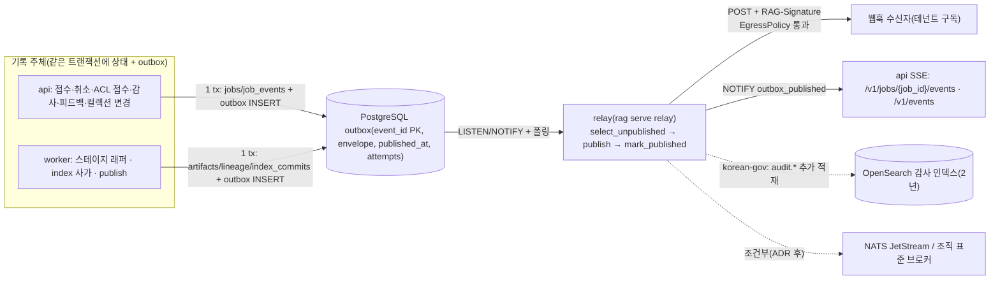
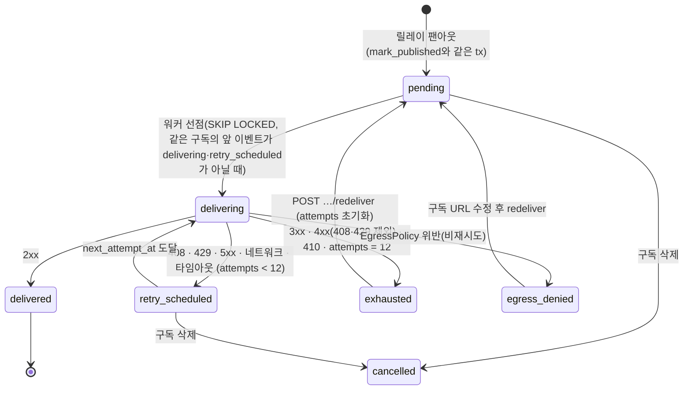
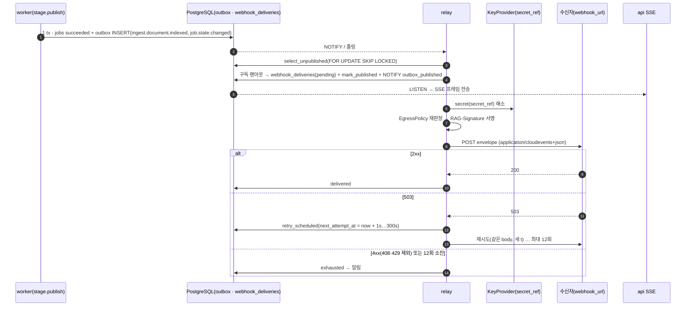

# 웹훅과 이벤트

## 목적

플랫폼이 도메인 이벤트(domain event)를 어떻게 발행하고, 테넌트가 웹훅(webhook)과 SSE(Server-Sent Events) 스트림으로 어떻게 받는지 API 관점에서 확정한다. 이벤트의 봉투(`CloudEventEnvelope`)·카탈로그·`data` 스키마는 [잡·이벤트·상태 계약](../03-contracts/12-jobs-events-and-status.md)이, 아웃박스 릴레이의 실행기와 원장 트랜잭션 경계는 [오케스트레이션과 워크플로우](../02-architecture/06-orchestration-and-workflows.md)가 소유한다. 이 문서는 그 두 문서가 05-api/07에 위임한 항목을 결정한다.

- 웹훅 구독 리소스와 엔드포인트(등록·조회·해지, 이벤트·컬렉션 필터, 활성 상태, 시크릿 발급·회전).
- 전달 요청 형식: CloudEvents HTTP 바인딩 모드(구조화 모드), 단건 전송, 헤더.
- 전달 보장의 API 계약: at-least-once, 순서 비보장, 재시도 백오프 스케줄, 소진(데드레터)과 재발행, 구독 단위 전달 상태.
- 서명(`RAG-Signature`)의 수신자 검증 절차와 키 회전.
- SSE 스트림의 프레임·필터·재접속(`Last-Event-ID`)·종료·한계.
- 소비자 멱등 처리 지침, 테스트 엔드포인트, 대량 이벤트 샘플링, 모니터링, 보안(URL 허용목록·SSRF 방어).

## 범위

- 포함: `GET/POST/DELETE /v1/subscriptions`, `/v1/subscriptions/{subscription_id}`, `GET /v1/jobs/{job_id}/events`, `GET /v1/events`(바이블 §14), 웹훅 전달 요청·응답 규약, 소비자 지침. 바이블 §14에 없는 보조 엔드포인트(수정·시크릿 회전·테스트·재발행·전달 목록)는 **제안**으로 표시하고 `## 미해결 이슈`에 등재한다.
- 제외: 이벤트 `data` 필드 정의와 JSON Schema([03-contracts/12](../03-contracts/12-jobs-events-and-status.md)), 아웃박스 기록 주체·트랜잭션([02-architecture/06 §6](../02-architecture/06-orchestration-and-workflows.md)), `EgressPolicy` 합성 규칙([03-contracts/15 §8](../03-contracts/15-collection-profile-and-policy-contracts.md)), 릴레이 배포·NetworkPolicy([배포 아키텍처](../02-architecture/08-deployment-architecture.md) §5.2, [보안·컴플라이언스 운영](../09-operations/05-security-and-compliance.md) §5), 런북 RB-08 절차([런북](../09-operations/06-runbooks.md) RB-08).
- 정본 관계: 이벤트 이름 25종(바이블 §5.7 1.3.0 AM-38 `tenant.policies.changed` 가산)·오류 코드·메트릭 이름·헤더 `RAG-Signature`·서명식은 바이블 §5.7·§6.2·§6.5·§10.3 E12·E16이 정본이다. 이 문서의 수치(재시도 횟수·타임아웃·보존 기간·연결 상한)는 모두 **초안 목표**이며 부하 테스트 후 프로파일 키로 확정한다.
- 용어: 아웃박스 행을 읽어 웹훅·SSE로 내보내는 구성요소는 바이블 §2.3의 명칭 **릴레이(relay)** 로 부른다. "디스패처(dispatcher)"는 바이블 §11.2에서 잡 승인(문서 단위 직렬화·테넌트 동시성) 구성요소를 가리키는 이름이므로 이 문서에서는 이벤트 전달에 쓰지 않는다.

---

## 1. 이벤트 발행 아키텍처

### 1.1 O-06 반영: 브로커 없는 v1

**결정:** v1은 메시지 브로커(내부 이벤트 버스)를 두지 않는다. 제어(취소·우선순위·진행 조회)는 Temporal 시그널·업데이트·쿼리이고, 도메인 이벤트는 `CloudEventEnvelope`(CloudEvents 1.0.2) + PostgreSQL 트랜잭셔널 아웃박스(transactional outbox) + 릴레이(웹훅·SSE)다. 릴레이 코어는 순수 함수 3개(`select_unpublished → publish → mark_published`)이며 `standard` 이상은 Temporal 액티비티가, `lite`는 Procrastinate 태스크가 감싼다. 소비자는 `id`(= `event_id`)로 멱등해야 한다. NATS JetStream은 (a) 외부 소비자 2개 이상 + 재생 요구, (b) `korean-gov` 감사 스트림 손실 불가·2년 보존, (c) 멀티 리전 팬아웃 조건에서만 ADR로 추가하며, 그때도 릴레이의 목적지만 바뀌고 봉투·아웃박스·이 문서의 웹훅 계약은 불변이다(바이블 §3.2 O-06, D-08; [ADR-0017](../06-adr/0017-event-delivery-outbox-cloudevents-no-broker.md)).

관측성 신호(OTLP 트레이스·메트릭·로그)는 도메인 이벤트가 아니다. 스팬에 이벤트를 싣거나 이벤트에 콘텐츠를 싣지 않는다(바이블 §10.3 E12·E13, [ADR-0022](../06-adr/0022-observability-genai-semconv-pin-and-license-boundary.md)).

### 1.2 구성 요소와 경로



| 구성 요소 | 위치 | 책임 | 정본 |
|-----------|------|------|------|
| 기록 주체(api·worker) | api 프로세스, 큐별 워커 | 상태 갱신과 `outbox INSERT … ON CONFLICT (event_id) DO NOTHING`을 **한 트랜잭션**으로 수행. `event_id`는 워크플로우가 1회 발급(재시도 불변), 워크플로우 밖은 기록 주체 발급 | 바이블 §11.4 (6), [06 §6.2](../02-architecture/06-orchestration-and-workflows.md) |
| `outbox` | PostgreSQL 원장(`tenant_id` + RLS `FORCE`) | 이벤트 정본. `envelope jsonb`는 전송 바이트의 원천이며 기록 후 불변 | 바이블 §13.1 |
| 릴레이 | `rag serve relay` 별도 프로세스(`standard` 이상은 태스크 큐 `relay`(**제안**, [06 미해결 이슈 3](../02-architecture/06-orchestration-and-workflows.md); 바이블 §11.2 큐 목록 미등재)의 Temporal 워커, `lite`는 Procrastinate 워커) | 미발행 행 배치 선택 → 테넌트 구독 팬아웃(`events[]`·컬렉션·샘플링 필터) → `EgressPolicy` 판정 → 서명 → POST → 응답 판정·전달 상태 기록 → `mark_published` + `NOTIFY outbox_published`(단계 순서와 `published_at`의 의미는 §1.3) | 바이블 §2.3·§12 `orchestration/outbox/`, [06 §6.4](../02-architecture/06-orchestration-and-workflows.md) |
| SSE 핸들러 | api 프로세스 | `LISTEN outbox_published`로 깨어나 `published_at IS NOT NULL` 행을 발행 순 커서로 읽어 연결된 클라이언트에 쓴다. 재접속 재생과 같은 코드 경로 | [06 §6.4](../02-architecture/06-orchestration-and-workflows.md), [12 §9](../03-contracts/12-jobs-events-and-status.md) |
| 수신자 | 테넌트 시스템 | 서명·타임스탬프 창 검증 → `id` 멱등 처리 → 2xx | 이 문서 §5·§7 |

### 1.3 릴레이 처리 순서(이벤트 1건)

코어 3함수와 이 문서 용어의 대응은 다음과 같다. `select_unpublished(tx, limit)` = 미발행 행 배치 선택. `publish(envelope, targets)` = 구독 팬아웃과 전달 대상별 전송 요청(서명 포함)의 **산출** — 순수 함수이므로 실제 HTTP POST와 응답 판정은 실행기 셸(Temporal 액티비티·Procrastinate 태스크)이 수행한다([ADR-0017 준수 표 9](../06-adr/0017-event-delivery-outbox-cloudevents-no-broker.md): 코어는 `httpx`를 임포트하지 않는다). `mark_published(tx, event_id)` = `published_at` 부여 + `NOTIFY outbox_published`. 현행 앵커(바이블 §13.1 `outbox(published_at NULL, attempts)`, [06 §6.4](../02-architecture/06-orchestration-and-workflows.md), [ADR-0017](../06-adr/0017-event-delivery-outbox-cloudevents-no-broker.md) 결정 다이어그램)의 순서는 `select_unpublished → publish(전송) → mark_published`이고 `outbox.attempts`는 이벤트의 전송 시도 수, `published_at`은 전달 완료 표식이다. 아래 순서는 이 앵커를 따른다. §6.4의 구독 단위 전달 원장 **제안**이 채택되면 4·5단계가 "전달 레코드 생성 → `mark_published` → 구독별 전달 루프"로 바뀌어 `published_at`이 전달 결과와 분리된다(그 순서는 §6.4·§6.6).

1. `select_unpublished(tx, limit)`: `published_at IS NULL` 행을 `SELECT … FOR UPDATE SKIP LOCKED`로 배치 선택(배치 내 `event_id` 오름차순). 재시도 대기 중(§6.3 백오프 시각 미도달; 바이블 §13.1 `outbox`에는 대기 시각 컬럼이 없어 저장 위치는 미해결 이슈 1과 함께 확정)인 행과 소진 행(`attempts` 포화)은 제외한다.
2. 봉투 검증: `subject`의 `tenant/{tenant_id}` = `tenantid`(불일치는 `contract.violation`으로 기록 자체가 거부되므로 여기서는 방어 검사), `type ∈ EventType`.
3. 팬아웃 대상 산출: 같은 `tenantid`의 `subscriptions` 중 `active=true`이고 `events[]`에 `type`이 있으며 컬렉션 필터·샘플링(§11)을 통과하는 구독. 잡 단위 콜백(`IngestRequest.callback`, §3.5)이 있으면 그 잡의 이벤트는 지정 구독·지정 이벤트로만 좁힌다. `korean-gov`는 이 단계에서 `audit.*` 이벤트를 OpenSearch 감사 인덱스에 추가 적재한다(바이블 §13.1 `audit_log` 행; 웹훅 샘플링은 이 적재에 영향을 주지 않는다).
4. 구독별 순차 전송: `EgressPolicy` 판정(§13) → `RAG-Signature` 서명(§5) → `POST` → 응답 판정(§4.3). 구독별 순서·재시도 차단 규칙은 §6.2·§6.4다.
5. `mark_published(tx, event_id)` + `NOTIFY outbox_published, '{tenant_id}:{event_id}'`: 팬아웃 대상 전부에 전달을 마쳤을 때(대상 0건이면 즉시) `published_at`을 부여한다. 이 시점부터 이벤트는 SSE에 보이고 `rag_outbox_lag_seconds`의 종점이 된다. 일시 실패는 `outbox.attempts += 1` 뒤 백오프 스케줄(§6.3)로 다음 배치에서 재시도하고, 소진·비재시도 거부는 `published_at=NULL`로 남겨 운영 알림·재발행(RB-08) 대상이 된다([09 F-19·F-37](../02-architecture/09-failure-modes-and-resilience.md)). 구독이 둘 이상이면 한 구독의 실패가 다른 구독·SSE의 가시성을 늦추는데, 이것이 §6.4 제안의 동기다([12 미해결 이슈 16](../03-contracts/12-jobs-events-and-status.md)).

---

## 2. 이벤트 카탈로그

바이블 §5.7의 25종(1.3.0 AM-38 `tenant.policies.changed` 가산)이 전부이며 이름 추가는 ADR(minor) + 바이블 §5.7 개정 + `common-types` `EventType` 갱신이 같은 PR이어야 한다(바이블 §1.2). `data` 타입은 [12 §6](../03-contracts/12-jobs-events-and-status.md)의 `$defs`이고 이 문서는 소비자 관점의 열(볼륨·샘플링 가능 여부·권장 용도)만 더한다. 볼륨 등급은 초안 추정이다: 저 = 문서(잡)당 1건 이하, 중 = 문서당 수 건, 고 = 질의당 1건(`standard` 50 req/s 한도 기준 최대 50건/s).

| `type` | 도메인 | `subject` entity | `source`(`urn:rag:{…}` 생략) | `data` 타입([12](../03-contracts/12-jobs-events-and-status.md)) | 발생 시점 | 볼륨 | 샘플링 | 권장 용도 |
|--------|--------|------------------|----------|------|-----------|------|--------|-----------|
| `ingest.document.fetched` | 수집 | `document` | `worker` | `IngestStageEventData` | `fetch` 산출물 저장 | 중 | 불가 | 진행 추적 |
| `ingest.document.parsed` | 수집 | `document` | `worker` | `IngestStageEventData` | `parse` 산출물 저장 | 중 | 불가 | 진행 추적, `page_count`·`block_count` 통계 |
| `ingest.document.normalized` | 수집 | `document` | `worker` | `IngestStageEventData` | `normalize` 산출물 저장 | 중 | 불가 | 진행 추적 |
| `ingest.document.chunked` | 수집 | `document` | `worker` | `IngestStageEventData`(`stage ∈ {chunk, recount}`) | `chunk`/`recount` 저장 | 중 | 불가 | 청크 수 통계 |
| `ingest.document.enriched` | 수집 | `document` | `worker` | `IngestStageEventData` | `enrich` 저장 | 중 | 불가 | LLM 토큰 사용량 |
| `ingest.document.embedded` | 수집 | `document` | `worker` | `IngestStageEventData` | `embed` 저장 | 중 | 불가 | 진행 추적 |
| `ingest.document.indexed` | 수집 | `document` | `worker` | `IngestDocumentIndexedData` | `publish` 종결(`succeeded`·`partial`) | 저 | 불가 | 잡 관점 **색인 완료**(부분 실패 포함) 신호. 수신 시점 이후의 질의는 새 세대를 본다(§7 C7, §8 예시 2) |
| `ingest.document.retried` | 수집 | `document` | `worker` | `IngestFailureEventData`(`retryable=true`) | 래퍼 재시도 | 저 | 불가 | 장애 조기 감지 |
| `ingest.document.failed` | 수집 | `document` | `worker` | `IngestFailureEventData` | `publish` 종결(`failed`) | 저 | 불가 | 재수집 판단(§8 예시 3) |
| `ingest.document.deleted` | 수집 | `document` | `worker` | `IngestDocumentDeletedData` | `delete.document.v1` 종결 | 저 | 불가 | 삭제 SLA 확인 |
| `job.state.changed` | 잡 | `job` | `api`(접수·취소) / `worker` | `JobStateChangedData` | 모든 상태 전이(대기 `queued → queued` 제외) | 중(문서당 약 9건) | 불가 | 잡 상태 기계 추적(§8 예시 1) |
| `index.commit.published` | 인덱스 | `document` | `worker` | `IndexCommitPublishedData` | 사가 `committed` 전이 | 저 | 불가 | **새 세대 검색 가시성** 시점(`committed` = 양 백엔드 `is_current` 플립 완료, 바이블 §11.4), 세대 추적·정합성 대조 |
| `index.commit.rolled_back` | 인덱스 | `document` | `worker` | `IndexCommitRolledBackData` | 사가 `rolled_back` 전이 | 저 | 불가 | 운영 알림 |
| `index.consistency.mismatch` | 인덱스 | `document` | `worker` | `IndexConsistencyMismatchData` | 보상 실패·정합성 검사 불일치 | 희 | 불가 | 운영 알림 |
| `acl.document.updated` | ACL·컬렉션 | `document` | `worker` | `AclDocumentUpdatedData` | `acl.update.v1` 종결 | 저 | 불가 | 권한 전파 완료 확인(§8 예시 4) |
| `collection.profile.changed` | ACL·컬렉션 | `collection` | `api` / `worker` | `CollectionProfileChangedData` | 컬렉션 변경 커밋·alias 교체 | 희 | 불가 | 클라이언트 캐시 무효화 |
| `collection.reindex.completed` | ACL·컬렉션 | `collection` | `worker` | `CollectionReindexCompletedData` | `reindex.collection.v1` 종결 | 희 | 불가 | 재색인 결과·게이트 통과 여부 |
| `tenant.policies.changed`(1.3.0 AM-38) | 테넌트 | `tenant` | `api` | `TenantPoliciesChangedData` | `PATCH /v1/tenants/{tenant_id}/policies` 커밋 | 희 | 불가 | 테넌트 정책·할당량·상태 변경 통지, 캐시 무효화 트리거(감사 이벤트와 별개, 바이블 §14 1.3.0) |
| `audit.query.executed` | 감사 | `query` | `api` | `AuditQueryExecutedData` | `render` 뒤(MCP `search` 포함) | **고** | **가능** | 사용 분석, 감사 미러(§8 예시 5, §11) |
| `audit.document.accessed` | 감사 | `document` | `api` | `AuditDocumentAccessedData` | 문서 조회·MCP `get_document` | 중~고 | 가능 | 접근 감사 |
| `audit.acl.changed` | 감사 | `document` | `api` | `AuditAclChangedData` | ACL 갱신 접수 | 저 | 불가 | 권한 변경 감사 |
| `audit.admin.action` | 감사 | 관리 자원 | `api` | `AuditAdminActionData` | 관리 행위(구독 CRUD 포함, 거부도 기록) | 저 | 불가 | 관리 감사 |
| `feedback.query.cited` | 피드백·평가 | `query` | `api` | `FeedbackQueryEventData`(`kind=cited`) | `POST /v1/feedback` | 중 | 가능 | 온라인 평가 |
| `feedback.query.rated` | 피드백·평가 | `query` | `api` | `FeedbackQueryEventData`(`kind ∈ {rated, corrected}`) | `POST /v1/feedback` | 중 | 가능 | 온라인 평가 |
| `eval.run.completed` | 피드백·평가 | `eval_run` | `worker` | `EvalRunCompletedData` | `eval.run.v1` 종결 | 희 | 불가 | 게이트 결과 통지 |

"내용 지시"에 언급된 `retrieval.query.completed`는 바이블 §5.7 카탈로그에 없다. 검색 경로의 유일한 도메인 이벤트는 `audit.query.executed`이며 이 문서는 그 이름만 쓴다(미해결 이슈 8).

**컬렉션 삭제(1.3.0 AM-37):** `DELETE /v1/collections/{collection_id}`(`JobKind.delete_collection`, 워크플로우 `collection.delete.v1`)는 전용 이벤트를 새로 만들지 않는다 — 논리 삭제 시점에 `collection.profile.changed`(구독자 캐시 무효화), 자식 `delete.document.v1` 팬아웃마다 `ingest.document.deleted`, 관리 행위 감사로 `audit.admin.action`을 재사용한다(바이블 §11.2 1.3.0). 구독 표에 별도 행은 없다.

봉투 필드 요약(바이블 §5.3, 정의는 [12 §5](../03-contracts/12-jobs-events-and-status.md)): `specversion="1.0"`, `id`(ULID `event_id`, 멱등 키), `source=urn:rag:{api|worker}`(생산자 컴포넌트 값은 `api`·`worker` 둘뿐 — 바이블 §6.5 1.3.0 결정, AM-13), `type`, `time`(아웃박스 기록 시각), `subject=tenant/{tenant_id}/{entity}/{id}`, `datacontenttype="application/json"`, `dataschema`(N, 25종 모두 생략 — `data`가 완전한 인스턴스일 때만 채우는 필드이고 카탈로그 어느 이벤트도 그 조건을 쓰지 않는다, CR-43), 확장 속성 `tenantid`, `data`(ID·해시·상태·계수만, 콘텍스트 본문 금지, 봉투 64KB).

---

## 3. 웹훅 구독 모델

### 3.1 리소스 `Subscription`

바이블 §13.1 `subscriptions` 표는 `subscription_id`, `tenant_id`, `webhook_url`, `events[]`, `secret_ref`만 정의하고 §5.1 인벤토리에는 대응 계약 타입이 없다. 이 문서는 API 응답 객체(바이블 §14 "웹훅 구독", [01 §9.3](01-api-design-guidelines.md) "구독 객체")를 다음과 같이 정의한다. 바이블 표에 없는 필드는 선택(N)이며 §5.1 인벤토리·§13.1 컬럼 추가를 제안한다(미해결 이슈 2).

| 필드 | 타입 | 필수 | 설명 | 예시 |
|------|------|------|------|------|
| `subscription_id` | string(ulid) | Y | 서버 발급 | `"01JAB5G0H1J2K3M4N5P6Q7R8S9"` |
| `tenant_id` | string(ulid) | Y | 토큰에서 도출(요청 본문에 오면 422, [01 §3.2](01-api-design-guidelines.md)) | `"01J9ZQ4K7X2M8N3P5R6S7T8V9W"` |
| `webhook_url` | string(uri) | Y | `https` 기본, `http`는 테넌트 옵트인(`EgressPolicy.allowed_schemes`). userinfo·프래그먼트 금지, ≤ 2,048자. 등록·전송 시 `EgressPolicy` 통과 | `"https://hooks.example.go.kr/rag/events"` |
| `events` | array<enum(EventType)> | Y | 바이블 §5.7 25종의 부분집합, 1..25, 중복 없음 | `["job.state.changed", "ingest.document.indexed"]` |
| `secret_ref` | string | Y | 서명 키의 간접 참조(`RAG_SECRETS__PROVIDER`, 바이블 §6.6). 값은 어디에도 기록되지 않는다 | `"subscriptions/01JAB5G0H1J2K3M4N5P6Q7R8S9/k1"` |
| `active` | boolean | N(기본 `true`) | `false`면 팬아웃 대상에서 제외(전달 레코드 미생성). `410 Gone` 수신 시 서버가 `false`로 내린다(§4.3) | `true` |
| `collection_ids` | array<string(ulid)> | N | 컬렉션 필터(FR-API-14). 생략 = 테넌트의 모든 컬렉션(구독은 `manage_subscriptions`를 가진 관리 역할만 만들 수 있으므로 컬렉션 인가 우회가 아니다, S4). `data.collection_id`(또는 `collection_ids[]`) 교집합이 비면 미전달. 컬렉션 없는 이벤트(`audit.admin.action`)는 필터가 있으면 미전달. 항목은 Cedar `allowed_collections` 안이어야 한다(403) | `["01J9ZQ5A1B2C3D4E5F6G7H8J9K"]` |
| `sampling` | object<EventType, number> | N | 이벤트 이름별 전달 비율 `0 < r ≤ 1`(§11). 샘플링 가능 이벤트(§2 표)만 키로 허용 | `{"audit.query.executed": 0.05}` |
| `description` | string | N | ≤ 256자, 콘텐츠·비밀 금지 | `"문서관리시스템 색인 완료 알림"` |
| `secret` | string | 조건 | **생성·회전 응답에만 1회 노출**되는 서명 비밀(§3.4). 조회 응답에는 없다 | `"rag_whs_…"` |
| `stats` | object | N | `{delivered_total, exhausted_total, last_delivered_at, last_failure_at}`(조회 시 전달 원장 집계, 초안) | — |
| `created_at`, `updated_at` | string(date-time) | Y | RFC 3339 UTC | `"2026-09-22T08:30:00.000Z"` |

### 3.2 엔드포인트

| 메서드 | 경로 | 성공 | 본문 | 정본 | 비고 |
|--------|------|------|------|------|------|
| GET | `/v1/subscriptions` | 200 | `{items: Subscription[], next_cursor}` | 바이블 §14 | 커서 페이지네이션([01 §7](01-api-design-guidelines.md)); 필터 `active=`, `event=`(포함) |
| POST | `/v1/subscriptions` | 201 + `Location` | `Subscription`(+ `secret` 1회) | 바이블 §14 | `Idempotency-Key` 선택; 등록 시 `EgressPolicy` 판정(§3.3) |
| GET | `/v1/subscriptions/{subscription_id}` | 200 | `Subscription` | 바이블 §14 | 다른 테넌트·부재 ID는 존재 비노출 규칙([01 §3.3](01-api-design-guidelines.md)) |
| DELETE | `/v1/subscriptions/{subscription_id}` | 204 | 없음 | 바이블 §14 | 미전달·재시도 중 레코드는 `cancelled`로 종결, 비밀 폐기 |
| PATCH | `/v1/subscriptions/{subscription_id}` | 200 | `Subscription` | **제안** | JSON Merge Patch(RFC 7396): `events`, `collection_ids`, `active`, `sampling`, `description`, `webhook_url`(재판정). FR-API-14 "수정" 요구 |
| POST | `/v1/subscriptions/{subscription_id}/rotate-secret` | 200 | `Subscription`(+ 새 `secret`) | **제안** | §3.4 키 회전(FR-SEC-11) |
| POST | `/v1/subscriptions/{subscription_id}/test` | 200 | 테스트 결과 객체 | **제안** | §10 |
| GET | `/v1/subscriptions/{subscription_id}/deliveries` | 200 | `{items: WebhookDelivery[], next_cursor}` | **제안** | §6.5 실패 목록(FR-API-15); 필터 `status=`, `event_type=`, `created_at_gte=` |
| POST | `/v1/subscriptions/{subscription_id}/redeliver` | 202 | `{accepted: integer}` | **제안** | §6.5 재발행([12 미해결 이슈 11](../03-contracts/12-jobs-events-and-status.md)) |

모든 엔드포인트는 한도 클래스 `admin`([01 §11](01-api-design-guidelines.md)), 인증은 `Authorization: Bearer`, 인가는 Cedar 액션 `manage_subscriptions`([07 §4.1 Cedar 매트릭스](../02-architecture/07-multi-tenancy-and-security-architecture.md): `/v1/subscriptions*`·`GET /v1/events`, `tenant_admin`·`platform_admin`만 허용, `service:` 주체는 `tenant_admin`이 될 수 없으므로 API 키로는 구독을 관리하지 못한다)이다. 엔드포인트별 세분 액션이 필요해지면 07 문서 갱신 요청으로 등재한다(미해결 이슈 17). 생성·수정·삭제·테스트·재발행은 `audit.admin.action{resource.type="subscription"}`을 같은 트랜잭션에 기록한다.

### 3.3 등록 검증

| # | 검사 | 실패 시 |
|---|------|---------|
| S1 | `webhook_url` 절대 URL, 스킴 `https`(또는 옵트인 `http`), userinfo·프래그먼트 없음, ≤ 2,048자 | 400 `contract.violation`(pointer `/webhook_url`) |
| S2 | `EgressPolicy` 판정(프로파일 AND 테넌트 합성, [15 §8](../03-contracts/15-collection-profile-and-policy-contracts.md)): 스킴 → `allowed_hosts` → `allowed_ports` → DNS 해석 IP 전부 × `deny_cidrs`. 등록 시점 판정은 **필요조건**이며 전송 시점마다 재판정한다(DNS 변경 대비) | 422 `outbox.egress_denied`(초안 상태 매핑; `errors[0].location.pointer = /webhook_url`, [13 §3.3](../03-contracts/13-error-model.md) 규칙에 따라 새 코드 없음) + `rag_egress_denied_total{component="api"}` |
| S3 | `events` 1..25, 모두 `EventType`, 중복 없음 | 400 `contract.violation`(pointer `/events/{i}`) |
| S4 | `collection_ids`가 명시되면 Cedar `allowed_collections`의 부분집합이어야 한다. 생략은 테넌트 전체를 뜻하며 `manage_subscriptions`를 가진 관리 역할(`tenant_admin`·`platform_admin`, [07 §4.1](../02-architecture/07-multi-tenancy-and-security-architecture.md))만 이 엔드포인트에 도달하므로 컬렉션 인가를 우회하지 않는다(07의 `unmask_pii` 행 "지정 시 C / 미지정 시 테넌트 전체"와 같은 규칙) | 403 `auth.forbidden` |
| S5 | `sampling` 키는 §2 표 "샘플링 가능" 이벤트만, 값 `0 < r ≤ 1`; 키가 `events`에 있어야 함 | 400 `contract.violation`(pointer `/sampling/{type}`) |
| S6 | 테넌트당 구독 수 ≤ 32(초안 목표) | 400 `contract.violation`(`detail="subscription quota exceeded"`). 요청 한도 초과인 429 `api.rate_limited`(바이블 §5.7)와 구분되는 자원 할당량 초과다. 전용 코드 `api.quota_exceeded`는 바이블 §5.7 1.3.0(AM-36)에 이미 등재됐으나 HTTP 상태(403 vs 429)가 05-api/01 §9·02-architecture/07 §10 확정 전이라([08 전파 지시서](../12-appendix/08-propagation-directives.md) 미해결 이슈 1과 동일 사안) 이 문서는 상태 확정·계약 카탈로그 반영 전까지 위 400 매핑을 잠정 유지한다(미해결 이슈 9) |
| S7 | 같은 `webhook_url` + 같은 `events` 집합의 활성 구독이 이미 있으면 중복 생성 거부 | 409 `api.idempotency_conflict` 오용 금지 → 400 `contract.violation`(`detail="duplicate subscription: {subscription_id}"`; 미해결 이슈 9) |

### 3.4 시크릿 발급·회전

**결정:** 서명 비밀은 **서버가 생성**한다(32바이트 CSPRNG, 표기 `rag_whs_` + 패딩 없는 base64url 43자 = 총 51자; 접두는 [01 §5.1](01-api-design-guidelines.md)의 API 키 접두 `rag_ak_`와 같은 방식의 제안). HMAC 입력 `secret`은 접두를 포함한 **표기 문자열 전체의 UTF-8 바이트**이며 base64url을 디코드하지 않는다(§3.6·§4.2의 예시 비밀은 이 형식을 따르는 테스트 벡터다). 값은 KeyProvider(`RAG_SECRETS__PROVIDER=env|openbao|aws_kms`, 바이블 §6.6)에 저장하고 원장에는 `secret_ref`만 남기며, 201 응답의 `secret` 필드로 **정확히 한 번** 반환한다. 클라이언트 지정 비밀은 받지 않는다 — 요청 본문에 비밀이 실리면 접근 로그·트레이스에 남을 경로가 생기고 강도 검증을 서버가 떠안게 된다.

| 단계 | 규약(초안 목표) |
|------|-----------------|
| 회전 요청 | `POST /v1/subscriptions/{subscription_id}/rotate-secret`(제안) → 새 키 버전 `k{n+1}` 생성, `secret_ref` 갱신, 새 `secret` 1회 반환 |
| 유예 기간 | 24h(초안) 동안 릴레이는 **두 키로 모두 서명**하고 헤더 하나에 `v1=`을 두 번 병기한다(`t={ts},v1={old},v1={new}`; [12 §8](../03-contracts/12-jobs-events-and-status.md) 초안과 동일, [09-operations/05 미해결 이슈 15](../09-operations/05-security-and-compliance.md)에 대한 답). 수신자는 어느 하나가 일치하면 수용. 09-operations/05 §4.1은 유예 7일을 제안하므로 값은 합의 후 고정(미해결 이슈 11) |
| 폐기 | 유예 후 이전 키 삭제. 구독 삭제 시 모든 키 즉시 삭제 |
| 로그 | 비밀 값·`RAG-Signature` 값은 로그·트레이스·이벤트에 기록하지 않는다(E13, 바이블 §6.6) |

### 3.5 잡 단위 콜백과의 관계

`IngestRequest.callback{webhook_url, events}`([01 §2.4](../03-contracts/01-ingest-request.md))는 새 구독을 만들지 않는다. `webhook_url`은 테넌트의 활성 구독과 **일치**해야 하고(불일치 400), 그 잡의 이벤트는 (a) 그 구독으로만, (b) `callback.events`(생략 시 `["job.state.changed"]`)로만 좁혀 전달된다. 다른 구독은 그 잡의 이벤트를 받지 않는다. 릴레이는 `data.job_id`로 잡의 콜백을 조회한다(저장 위치는 [01 미해결 이슈 8](../03-contracts/01-ingest-request.md)의 `callback.subscription_id` 제안과 함께 확정; 미해결 이슈 2).

### 3.6 예시

구독 생성 요청(`POST /v1/subscriptions`):

```json
{
  "webhook_url": "https://hooks.example.go.kr/rag/events",
  "events": ["job.state.changed", "ingest.document.indexed", "ingest.document.failed", "acl.document.updated"],
  "collection_ids": ["01J9ZQ5A1B2C3D4E5F6G7H8J9K"],
  "description": "문서관리시스템 색인 완료 알림"
}
```

201 응답(`Location: /v1/subscriptions/01JAB5G0H1J2K3M4N5P6Q7R8S9`; `secret`은 이 응답에만 존재):

```json
{
  "subscription_id": "01JAB5G0H1J2K3M4N5P6Q7R8S9",
  "tenant_id": "01J9ZQ4K7X2M8N3P5R6S7T8V9W",
  "webhook_url": "https://hooks.example.go.kr/rag/events",
  "events": ["job.state.changed", "ingest.document.indexed", "ingest.document.failed", "acl.document.updated"],
  "collection_ids": ["01J9ZQ5A1B2C3D4E5F6G7H8J9K"],
  "sampling": {},
  "active": true,
  "description": "문서관리시스템 색인 완료 알림",
  "secret_ref": "subscriptions/01JAB5G0H1J2K3M4N5P6Q7R8S9/k1",
  "secret": "rag_whs_PZ0I-w5HzUinY_XLe1BMIgc6c7hfQ7hpfCMXlxb0L_g",
  "created_at": "2026-09-22T08:30:00.000Z",
  "updated_at": "2026-09-22T08:30:00.000Z"
}
```

등록 거부(`webhook_url`이 클라우드 메타데이터 대역으로 해석됨; `application/problem+json`):

```json
{
  "type": "urn:rag:error:outbox.egress_denied",
  "title": "Webhook egress denied",
  "status": 422,
  "detail": "webhook_url resolves to an address in deny_cidrs (169.254.0.0/16)",
  "instance": "/v1/subscriptions",
  "code": "outbox.egress_denied",
  "retryable": false,
  "trace_id": "4bf92f3577b34da6a3ce929d0e0e4736",
  "request_id": "01JAB5F9Z8Y7X6W5V4T3S2R1Q0",
  "errors": [
    {
      "code": "outbox.egress_denied",
      "type": "urn:rag:error:outbox.egress_denied",
      "retryable": false,
      "stage": "api",
      "location": {"pointer": "/webhook_url"}
    }
  ]
}
```

---

## 4. 전달 요청 형식

### 4.1 바인딩 모드

**결정:** 웹훅 본문은 `CloudEventEnvelope` JSON **1건**(CloudEvents HTTP 프로토콜 바인딩 **구조화 모드**, `Content-Type: application/cloudevents+json; charset=utf-8`)이며 배치 전송은 없다. [ADR-0038](../06-adr/0038-outbound-egress-policy-and-webhook-signing.md)이 05-api/07에 위임한 모드 선택이고 [12 §8](../03-contracts/12-jobs-events-and-status.md)의 제안을 채택한다.

근거: (1) 서명은 전송 바이트에 대해 계산되므로 봉투 전체가 본문에 있어야 수신자가 저장한 본문만으로 서명·스키마 검증·재처리를 할 수 있다(바이너리 모드는 `ce-*` 헤더가 서명 밖에 놓인다). (2) 본문이 `outbox.envelope` 바이트와 같아 재전송 시 바이트 동일성이 보장된다(`RAG-Signature`의 `t`만 바뀐다). (3) 소비자가 `GET /v1/schemas/cloud-event-envelope`로 받은 스키마로 본문을 그대로 검증한다. (4) 배치는 부분 실패 의미론(어느 이벤트를 ack했는가)을 헤더나 응답 본문에 얹어야 해 소비자 멱등을 복잡하게 하고, 봉투 64KB 상한이 있어 단건 오버헤드가 작다. 기각 대안: 바이너리 모드(헤더 팬아웃, Knative `Broker` 목적지에 유리) — 목적지가 Knative일 때 릴레이가 바인딩을 변환하면 되므로 웹훅 계약을 바꿀 이유가 없다.

### 4.2 HTTP 요청

| 헤더 | 값 | 필수 | 정본 |
|------|----|------|------|
| `Content-Type` | `application/cloudevents+json; charset=utf-8` | Y | 이 문서 |
| `Content-Length` | 본문 바이트 수(≤ 65,536) | Y | 바이블 §5.1 |
| `RAG-Signature` | `t={unix_ts},v1={hex}`(회전 중 `v1` 2개) | Y | 바이블 §6.2, E16 |
| `User-Agent` | `rag-platform-relay/{version}` | Y | [12 §8](../03-contracts/12-jobs-events-and-status.md) |
| `traceparent` | W3C Trace Context. 릴레이 전달 스팬(§12)의 **새 트레이스**를 전파한다 — `outbox`(바이블 §13.1)와 봉투([12 §5](../03-contracts/12-jobs-events-and-status.md))에 기록 트랜잭션의 트레이스 컨텍스트가 없어 이어받을 원천이 없다. 기록 측 트레이스와의 상관은 `data.trace_id`(감사 이벤트)로만 가능하다. 원천 저장 제안은 미해결 이슈 15 | Y | [01 §14](01-api-design-guidelines.md), [12 미해결 이슈 7](../03-contracts/12-jobs-events-and-status.md) |
| `Authorization` 등 | 없음 — 수신자 인증은 서명으로만. URL 쿼리·헤더에 테넌트 비밀을 싣지 않는다 | — | [ADR-0038](../06-adr/0038-outbound-egress-policy-and-webhook-signing.md) 대안 4 |

아래 요청은 §8 예시 2의 봉투를 §3.6의 예시 비밀(`rag_whs_PZ0I-w5HzUinY_XLe1BMIgc6c7hfQ7hpfCMXlxb0L_g` — 32바이트를 base64url로 부호화한 43자 접미, §3.4 형식; HMAC 키는 이 51자 문자열의 UTF-8 바이트)로 `t=1790068447`(2026-09-22T09:14:07Z)에 서명한 것이다. 본문은 예시 2의 1행 직렬화 그대로(740바이트)이며, `v1` 값은 그 세 입력으로 재계산하면 같은 값이 나오므로 SDK 검증기·발급기(길이 검증 포함) 테스트 벡터로 쓸 수 있다.

```http
POST /rag/events HTTP/1.1
Host: hooks.example.go.kr
Content-Type: application/cloudevents+json; charset=utf-8
Content-Length: 740
User-Agent: rag-platform-relay/1.0.0
RAG-Signature: t=1790068447,v1=b0c9c668d7e01627c7ecec738f9500605e2dba051be01501f4b28743a26b2718
traceparent: 00-4bf92f3577b34da6a3ce929d0e0e4736-00f067aa0ba902b7-01

{"specversion":"1.0","id":"01JAB3EA0B1C2D3E4F5G6H7J8M","source":"urn:rag:worker","type":"ingest.document.indexed","time":"2026-09-22T09:14:03.611Z","subject":"tenant/01J9ZQ4K7X2M8N3P5R6S7T8V9W/document/01JAB3C4D5E6F7G8H9JKMNPQRS","datacontenttype":"application/json","tenantid":"01J9ZQ4K7X2M8N3P5R6S7T8V9W","data":{"job_id":"01JAB3C0D1E2F3G4H5J6K7M8N9","document_id":"01JAB3C4D5E6F7G8H9JKMNPQRS","collection_id":"01J9ZQ5A1B2C3D4E5F6G7H8J9K","stage":"index","doc_version":"cf266a7a804b27e9ed1133df8e05ef4eec7ea1a28f1ca63f61a1cf838c7f0118","quality":"full","commit_id":"01JAB3E9F0G1H2J3K4M5N6P7Q8","index_generation":3,"commit_hash":"4ac76a64e56e19ccb129349f1516da74259cdfd88bcfe086951e66f1d5a28bc2","record_count":2,"job_state":"succeeded"}}
```

요청 방식은 항상 `POST`이며 리다이렉트를 따라가지 않는다(§13). 응답 본문은 무시하되 최대 64KB(초안)만 읽고 연결을 닫는다. 응답 대기는 연결 5,000ms(`EgressPolicy.connect_timeout_ms`) + 응답 10s(초안)다.

### 4.3 응답 판정

| 수신자 응답 | 판정 | 다음 동작 |
|-------------|------|-----------|
| 2xx | 성공 | 전달 레코드 `delivered`; 본문 무시 |
| 408, 429, 5xx, 연결 실패, DNS 실패, TLS 실패, 타임아웃 | 일시 실패(`outbox.relay_failed`, 재시도) | §6.3 백오프. 429의 `Retry-After`(정수 초)가 있으면 그 값과 스케줄 값 중 큰 쪽(상한 300s) |
| 3xx | 수신자 오류(리다이렉트 미추종) | 즉시 `exhausted`(사유 `redirect_not_followed`) |
| 410 | 구독 종료 의사 | 즉시 `exhausted` + 구독 `active=false`(§3.1) |
| 그 외 4xx | 수신자 오류(요청은 도달했으나 거부) | 즉시 `exhausted`(재시도 없음) |
| `EgressPolicy` 위반(전송 시점 재판정) | `outbox.egress_denied`(비재시도, E16) | 즉시 `egress_denied` + `rag_egress_denied_total{component="relay"}` |

---

## 5. 서명과 재전송 방지

### 5.1 `RAG-Signature`

**결정:** 바이블 §6.2 그대로 — `RAG-Signature: t={unix_ts},v1={hex(HMAC-SHA256(secret, f"{unix_ts}.{body}"))}`. `secret`은 `subscriptions.secret_ref`가 가리키는 비밀, `body`는 전송 바이트 그대로(구조화 모드 본문 = `outbox.envelope` 직렬화 바이트), `unix_ts`는 **전송 시각**(초, 재시도 전송마다 새 값)이다. 수신자는 `t`가 현재 시각 ±300s 안인지 검증한다 — 이 문서는 이를 **타임스탬프 창**이라 부르며, SSE `Last-Event-ID` 재생의 **재생 보존 창**(§9.3, 7일)과는 다른 개념이다(E16, [ADR-0038](../06-adr/0038-outbound-egress-policy-and-webhook-signing.md)). 참조 구현(`sign_webhook`·`verify_webhook`)은 [12 §8](../03-contracts/12-jobs-events-and-status.md)에 있고 클라이언트 SDK([06 클라이언트 SDK](06-client-sdks.md))가 같은 검증기를 제공한다.

세 장치의 역할은 서로 다르다: HMAC 일치는 **위조**를, `t` 타임스탬프 창은 **재생 공격(replay attack)** 을, `id` 멱등은 **중복**을 막는다. 셋 중 하나만으로는 나머지를 대신할 수 없다.

### 5.2 수신자 검증 절차

| 순서 | 검사 | 실패 시 응답 |
|------|------|--------------|
| 1 | 헤더 파싱: `t`(정수) 1개, `v1` 1개 이상. 형식 오류는 실패 | 400(재시도 없음 — 릴레이 결함) |
| 2 | `|now - t| ≤ 300s`. 수신자 시계는 NTP 동기화 | 401(재시도 없음; 릴레이는 4xx를 재시도하지 않으므로 시계 오차가 크면 이벤트가 소진된다 → 운영 재발행) |
| 3 | 원문 바이트(파싱·재직렬화 전)로 `HMAC-SHA256(secret, f"{t}.{body}")` 계산, `v1` 각각과 **상수 시간 비교**, 하나라도 일치하면 통과 | 401 |
| 4 | 본문을 `CloudEventEnvelope`로 파싱, `specversion="1.0"`, `type` 처리 여부 판단(미지 `type`은 200으로 ack 후 무시) | 200(무시) |
| 5 | `id` 멱등 판정(§7) → 처리 → 2xx | — |

파싱 전에 서명을 검증한다(파서에 미검증 입력을 넣지 않는다). JSON을 파싱한 뒤 재직렬화한 문자열로 HMAC을 계산하면 키 순서·공백 차이로 불일치가 난다 — 반드시 수신한 바이트를 쓴다.

### 5.3 키 회전 중 검증

`v1`이 둘이면 각각에 대해 3단계를 수행한다. 수신자도 새 비밀을 받은 뒤 유예 기간 동안 두 비밀을 모두 시도해야 한다(SDK 검증기는 `secrets: list[bytes]`를 받는다). 회전 요청부터 24h(초안) 뒤 이전 비밀은 서명에서 빠지므로 그 안에 수신자 설정을 갱신한다.

---

## 6. 전달 보장

### 6.1 at-least-once와 멱등

**결정:** 전달은 **at-least-once**다. 같은 `id`의 이벤트가 같은 구독에 2회 이상 도달할 수 있다(릴레이 재시작, 응답 유실 후 재시도, 운영자 재발행, SSE 재접속 구간). 재전달의 본문 바이트는 동일하고 `RAG-Signature`의 `t`만 다르다. 소비자는 `id` 기준으로 멱등해야 한다(브리프 §7 "at-least-once + 멱등", FR-API-15).

### 6.2 순서

**결정:** 이벤트 간 **순서를 보장하지 않는다**. 릴레이는 배치 안에서 `event_id` 오름차순으로 구독별 순차 전달하지만, (a) `event_id`는 발급 시각의 ULID라 기록·발행 순서와 다를 수 있고(`publish` 재시도로 늦게 커밋된 행), (b) 같은 구독에서 재시도 중인 이벤트는 후속 이벤트를 막지만(구독 단위 FIFO, §6.4) 소진되면 건너뛰므로 그때 후속 이벤트가 먼저 도달하며, (c) 재접속·재발행 구간에서 과거 이벤트가 다시 온다([12 §7·I-18](../03-contracts/12-jobs-events-and-status.md)). 소비자는 `time`과 도메인 상태 기계의 단조성(`JobState` 전이는 [12 §3.2](../03-contracts/12-jobs-events-and-status.md)의 간선만 유효, `index_generation`·`attempts`는 비감소)으로 늦게 온 과거 이벤트를 무시한다.

시퀀스 번호: 봉투에는 시퀀스 필드가 없다. [12 미해결 이슈 16](../03-contracts/12-jobs-events-and-status.md)의 `outbox.published_seq`(단일 릴레이가 발행 순으로 부여)가 채택되면 이 값을 CloudEvents Sequence 확장 속성 `sequence`(문자열, `sequencetype="Integer"`)로 봉투에 실어 소비자가 테넌트 스코프 전역 순서를 복원할 수 있게 하는 안을 제안한다(미해결 이슈 3). 채택 전까지 소비자는 위의 단조성 규칙만 쓴다.

### 6.3 재시도 백오프 스케줄

**결정:** 일시 실패(§4.3)는 지수 백오프 `{initial 1s, max 5m, coefficient 2.0}`(`StagePolicy.backoff` 기본값과 동일, 바이블 §5.3)로 **최대 12회 시도** 후 소진한다([12 §8](../03-contracts/12-jobs-events-and-status.md) 초안 채택). 각 간격에 0~10%의 무작위 지터(초안)를 더해 동시 소진 후 재시작 시의 폭주를 분산한다.

| 시도 | 직전 실패 후 대기 | 누적 경과(지터 제외) | 비고 |
|------|-------------------|----------------------|------|
| 1 | 0 | 0 | 최초 전송(발행 직후) |
| 2 | 1s | 1s | |
| 3 | 2s | 3s | |
| 4 | 4s | 7s | |
| 5 | 8s | 15s | |
| 6 | 16s | 31s | |
| 7 | 32s | 63s | |
| 8 | 64s | 127s(약 2분) | |
| 9 | 128s | 255s(약 4분) | |
| 10 | 256s | 511s(약 8.5분) | |
| 11 | 300s(상한) | 811s(약 13.5분) | |
| 12 | 300s(상한) | 1,111s(약 18.5분) | 마지막 시도. 실패 시 `exhausted` |

이 스케줄은 수신자의 배포·재시작(수 분) 정도를 흡수하는 목표이며, 수 시간 장애는 소진 후 **운영 재발행**(§6.5)으로 복구한다. 값은 `Profile.runtime.relay{max_attempts, timeout_ms, backoff}`(제안 키, [12 미해결 이슈 9](../03-contracts/12-jobs-events-and-status.md))로 노출한다.

### 6.4 구독 단위 전달 상태

**제안(결정 보류):** 웹훅 전달 상태를 **구독 단위**로 추적하고, `outbox.published_at`은 "릴레이가 이 이벤트를 처리(팬아웃·SSE 가시화)했다"만 뜻하게 분리한다. 근거: 한 테넌트에 구독이 여럿일 때 이벤트 1건의 전달 결과는 구독마다 다르므로(A는 성공, B는 소진) `outbox` 행 하나의 `published_at`·`attempts`로는 표현할 수 없고, 웹훅 소진이 SSE 가시성을 막아서도 안 된다([12 미해결 이슈 16](../03-contracts/12-jobs-events-and-status.md)이 이 문서와 06 문서에 위임한 분리). 저장 위치로 원장 표 `webhook_deliveries`를 제안한다. 이 제안은 바이블 §13.1 `outbox` 컬럼(`published_at`, `attempts`)의 **의미 변경**이므로 바이블 §1.1에 따라 이 문서가 단독으로 결정할 수 없다 — 바이블 §13.1 patch(`webhook_deliveries` 표 추가, `outbox.attempts`의 의미 변경 또는 제거)와 [06 §6.4](../02-architecture/06-orchestration-and-workflows.md)·[09 F-19·F-37·C-14·RB-08](../02-architecture/09-failure-modes-and-resilience.md)·[12 §7·§8](../03-contracts/12-jobs-events-and-status.md)의 "소진 시 `published_at=NULL`" 규약 정정, [ADR-0017 준수 표 9](../06-adr/0017-event-delivery-outbox-cloudevents-no-broker.md)의 3함수 순서 검토가 선행되어야 결정된다(미해결 이슈 1). **채택 전 현행 규약**은 §1.3 그대로다: `published_at`은 팬아웃 대상 전부에 전달을 마쳤을 때 부여되고, `outbox.attempts`가 전송 시도 수이며, 소진 행은 `published_at=NULL`로 남아 운영 재발행(RB-08) 대상이 된다. 아래 컬럼 표·상태 기계·§6.5·§6.6은 제안의 저장 위치와 동작을 기술하며, 상태 값 자체(`delivered`·`exhausted`·`egress_denied`)는 현행 규약에서도 전달 원장 없이 같은 의미로 쓴다.

| `webhook_deliveries` 컬럼(제안) | 타입 | 의미 |
|-------------------------------|------|------|
| `(tenant_id, subscription_id, event_id)` | PK | RLS `FORCE` 대상 |
| `status` | enum[pending, delivering, retry_scheduled, delivered, exhausted, egress_denied, cancelled] | 아래 상태 기계 |
| `attempts`, `next_attempt_at` | integer / date-time \| null | 시도 수, 다음 예정 시각 |
| `last_status_code`, `last_error_code` | integer \| null / string \| null | 마지막 응답 상태, `outbox.relay_failed`·`outbox.egress_denied` |
| `created_at`, `delivered_at`, `exhausted_at` | date-time | 생성(=`published_at`), 성공, 소진 시각 |



구독 안의 동시성은 1(순차)이며 **재시도 중인 이벤트는 같은 구독의 후속 이벤트를 막는다(구독 단위 FIFO)**. 재시도 대기는 `next_attempt_at`로 표현되고, 그 구독의 후속 `pending` 행은 앞 이벤트가 `delivered`·`exhausted`·`egress_denied`로 종결될 때까지 선점되지 않는다. 소진(12회) 또는 비재시도 거부로 종결된 이벤트만 건너뛰어 다음으로 진행한다(포이즌 이벤트의 정체 전파 차단; [12 §7 순서 행](../03-contracts/12-jobs-events-and-status.md)·[06 §6.4](../02-architecture/06-orchestration-and-workflows.md)·[09 F-37](../02-architecture/09-failure-modes-and-resilience.md)과 같은 규약). 따라서 수신자 장애 1건은 같은 구독의 전달을 최대 §6.3 스케줄 길이(약 18.5분)만큼 지연시킬 수 있고, 그 지연은 다른 구독·SSE에 전파되지 않는다. 재시도 중에도 후속 이벤트를 계속 보내는 비차단 방식은 처리량은 높지만 순서를 더 약화시키고 12 §7 규약과 어긋나므로 채택하지 않았다 — 처리량 문제는 미해결 이슈 13(`subject` 단위 키 순서)에서 다룬다. §6.2의 소비자 규칙은 어느 방식에서도 전제다.

### 6.5 소진(데드레터)과 재발행

| 항목 | 규약 |
|------|------|
| 소진 정의 | `status ∈ {exhausted, egress_denied}`. 별도 큐로 옮기지 않고 전달 원장에 남는 **논리 데드레터**다(§6.4 제안; 채택 전 현행 규약에서는 `outbox.published_at=NULL` + `attempts` 포화 행이 같은 역할, [09 F-19](../02-architecture/09-failure-modes-and-resilience.md)) |
| 보존 | 7일(초안; `outbox` 보존과 동일, [12 §7](../03-contracts/12-jobs-events-and-status.md)) 뒤 `maintenance.cleanup.v1`이 정리. `delivered` 행도 7일 |
| 조회 | `GET /v1/subscriptions/{subscription_id}/deliveries?status=exhausted`(제안) → `{items: WebhookDelivery[], next_cursor}`; `WebhookDelivery = {event_id, type, subject, status, attempts, last_status_code, last_error_code, created_at, delivered_at, exhausted_at}`. 봉투 본문은 포함하지 않으며 `event_id`로 SSE 재생(`Last-Event-ID`) 또는 원 자원 조회(`GET /v1/jobs/{job_id}` 등)로 상태를 복원한다 |
| 재발행 | `POST /v1/subscriptions/{subscription_id}/redeliver`(제안) 본문 `{"event_ids": [...]}`(≤ 100) 또는 `{"status": "exhausted", "created_at_gte": "..."}`. `attempts=0`, `status=pending`으로 되돌리고 202 `{accepted: n}`. 운영자 경로는 런북 RB-08 |
| 알림 | `exhausted` 증가·`rag_outbox_lag_seconds` SLO 초과(§12) |
| 잡 상태와의 독립 | 릴레이·웹훅 실패는 잡 상태·`IndexCommit`에 영향을 주지 않는다(바이블 §4.2 `publish` 행) |

### 6.6 전달 시퀀스(§6.4 제안 채택 시)

현행 규약(§1.3)과의 차이는 4단계의 위치 하나다: 현행은 `mark_published`가 전달 완료 뒤에 오고 `webhook_deliveries` 행이 없다.



---

## 7. 소비자 멱등 처리 지침

| # | 지침 | 이유 |
|---|------|------|
| C1 | 서명·타임스탬프 창(±300s) 검증을 **파싱 전에**, 수신 바이트 그대로 수행한다(§5.2) | 위조·재생 공격 차단 |
| C2 | `(tenantid, id)`를 키로 처리 이력을 저장하고 이미 처리한 `id`는 2xx로 ack만 한다. 보존은 SSE 재생 보존 창(7일, §9.3) + 여유를 두어 **최소 8일** — 재발행·재접속으로 그 기간 안의 이벤트가 다시 올 수 있다 | at-least-once 중복 제거 |
| C3 | **빠르게 ack**한다: 수신 → 검증 → 내부 큐 적재 → 2xx를 10s 안에 끝내고 무거운 처리는 비동기로. 처리 실패를 5xx로 알리면 재시도 12회 뒤 소진되므로 "받았으나 아직 처리 못 함"은 2xx + 내부 재처리가 옳다 | 릴레이 타임아웃 10s, 재시도 예산 보호 |
| C4 | 순서를 전제하지 않는다. 잡 상태는 `data.to_state`의 전이 유효성과 `time`으로 판정하고, 문서 세대는 `data.index_generation`이 현재 값보다 작으면 무시한다 | §6.2 |
| C5 | 미지 `type`·미지 `data` 필드는 무시하고 2xx로 ack한다. `type` 목록은 minor 개정으로 늘어날 수 있다([14 §2.2 부류 C](../03-contracts/14-schema-versioning-and-compatibility.md)) | 전방 호환 |
| C6 | `data`에는 ID·해시·상태만 있다. 본문·메타가 필요하면 `GET /v1/jobs/{job_id}`, `GET /v1/documents/{document_id}`, `GET /v1/documents/{document_id}/commits`를 호출한다(문서 조회는 `audit.document.accessed`를 남긴다) | E12 |
| C7 | 두 신호를 구분한다. **검색 가시성**은 `index.commit.published`(`committed` = 양 백엔드 `is_current` 플립 완료, 바이블 §11.4) 또는 그 뒤에 기록되는 `ingest.document.indexed` 수신 시점부터다. **잡 완료 판정**(부분 실패 포함, 후속 잡 연쇄)은 `ingest.document.indexed`·종결 `job.state.changed(to_state ∈ {succeeded, partial, failed, cancelled})`로 한다 — 종결 트랜잭션은 잡 상태를 바꾸지 가시성을 바꾸지 않는다([12 §13](../03-contracts/12-jobs-events-and-status.md)) | 가시성·완료 시점 |
| C8 | `RAG-Signature`·비밀·`Authorization`을 로그에 남기지 않는다. 봉투 자체는 콘텍스트 본문이 없어 로그 가능 | 비밀 보호 |
| C9 | 시계를 NTP로 맞춘다. 타임스탬프 창(±300s)을 넘는 `t`는 거부하되 급증하면 자기 시계를 먼저 의심한다 | 타임스탬프 창 |
| C10 | 수신 엔드포인트는 릴레이의 아웃바운드 IP 대역(운영자가 [배포 가이드](../09-operations/01-deployment-guide.md)에 게시)만 허용하는 방화벽을 두되, 그것을 서명 검증의 대체로 삼지 않는다 | 이중 방어 |

```python
# 수신자 측 스케치(프레임워크 무관). verify_webhook은 03-contracts/12 §8의 참조 구현과 동일 시그니처.
import json

HANDLED_TYPES: frozenset[str] = frozenset({"job.state.changed", "ingest.document.indexed", "ingest.document.failed", "acl.document.updated"})  # 구독 events[](§3.6 예시)와 동일

def handle(request_body: bytes, signature_header: str, secrets: list[bytes], seen, queue) -> int:
    if not any(verify_webhook(s, request_body, signature_header) for s in secrets):   # C1: 파싱 전, 원문 바이트
        return 401
    envelope = json.loads(request_body)
    if envelope.get("specversion") != "1.0":
        return 400
    key = (envelope["tenantid"], envelope["id"])
    if not seen.add_if_absent(key, ttl_days=8):                                        # C2: (tenantid, id) 멱등
        return 200
    if envelope["type"] not in HANDLED_TYPES:                                          # C5: 미지 type은 ack 후 무시
        return 200
    queue.put(envelope)                                                                # C3: 빠른 ack, 처리는 비동기
    return 202
```

---

## 8. 페이로드 예시

모든 예시는 [12](../03-contracts/12-jobs-events-and-status.md)의 `cloud-event-envelope.schema.json`(`type` ↔ `data` 바인딩)에 유효하며 웹훅 본문(구조화 모드)과 SSE `data:` 행의 값이 그대로 이것이다. 테넌트·컬렉션·문서 ID는 12 예시와 같은 값을 쓴다.

예시 1 — `job.state.changed`: 접수된 잡이 첫 액티비티에서 `queued → running`(`to_state=running`이므로 `progress` 필수, 스테이지 경계 단위):

```json
{
  "specversion": "1.0",
  "id": "01JAB3C2A3B4C5D6E7F8G9H0J1",
  "source": "urn:rag:worker",
  "type": "job.state.changed",
  "time": "2026-09-22T09:12:01.250Z",
  "subject": "tenant/01J9ZQ4K7X2M8N3P5R6S7T8V9W/job/01JAB3C0D1E2F3G4H5J6K7M8N9",
  "datacontenttype": "application/json",
  "tenantid": "01J9ZQ4K7X2M8N3P5R6S7T8V9W",
  "data": {
    "job_id": "01JAB3C0D1E2F3G4H5J6K7M8N9",
    "kind": "ingest_document",
    "collection_id": "01J9ZQ5A1B2C3D4E5F6G7H8J9K",
    "from_state": "queued",
    "to_state": "running",
    "stage": "fetch",
    "attempts": 1,
    "progress": {"done": 0, "total": 8, "unit": "stage"},
    "document_id": "01JAB3C4D5E6F7G8H9JKMNPQRS"
  }
}
```

예시 2 — `ingest.document.indexed`: 행정안전부 HWPX 고시의 세대 3 커밋이 `committed`된 뒤 `publish` 종결 트랜잭션에서 기록(이 이벤트 수신 이후의 질의가 새 세대를 본다):

```json
{
  "specversion": "1.0",
  "id": "01JAB3EA0B1C2D3E4F5G6H7J8M",
  "source": "urn:rag:worker",
  "type": "ingest.document.indexed",
  "time": "2026-09-22T09:14:03.611Z",
  "subject": "tenant/01J9ZQ4K7X2M8N3P5R6S7T8V9W/document/01JAB3C4D5E6F7G8H9JKMNPQRS",
  "datacontenttype": "application/json",
  "tenantid": "01J9ZQ4K7X2M8N3P5R6S7T8V9W",
  "data": {
    "job_id": "01JAB3C0D1E2F3G4H5J6K7M8N9",
    "document_id": "01JAB3C4D5E6F7G8H9JKMNPQRS",
    "collection_id": "01J9ZQ5A1B2C3D4E5F6G7H8J9K",
    "stage": "index",
    "doc_version": "cf266a7a804b27e9ed1133df8e05ef4eec7ea1a28f1ca63f61a1cf838c7f0118",
    "quality": "full",
    "commit_id": "01JAB3E9F0G1H2J3K4M5N6P7Q8",
    "index_generation": 3,
    "commit_hash": "4ac76a64e56e19ccb129349f1516da74259cdfd88bcfe086951e66f1d5a28bc2",
    "record_count": 2,
    "job_state": "succeeded"
  }
}
```

예시 3 — `ingest.document.failed`: 암호화된 HWP 5.0 공문서가 `credentials_ref` 없이 `parse`에서 비재시도 실패(`StageError` 투영만, `detail`·`artifact_ref` 없음):

```json
{
  "specversion": "1.0",
  "id": "01JAB6H1J2K3M4N5P6Q7R8S9T0",
  "source": "urn:rag:worker",
  "type": "ingest.document.failed",
  "time": "2026-09-22T09:20:44.118Z",
  "subject": "tenant/01J9ZQ4K7X2M8N3P5R6S7T8V9W/document/01JAB6G0H1J2K3M4N5P6Q7R8S9",
  "datacontenttype": "application/json",
  "tenantid": "01J9ZQ4K7X2M8N3P5R6S7T8V9W",
  "data": {
    "job_id": "01JAB6G5A6B7C8D9E0F1G2H3J4",
    "document_id": "01JAB6G0H1J2K3M4N5P6Q7R8S9",
    "collection_id": "01J9ZQ5A1B2C3D4E5F6G7H8J9K",
    "stage": "parse",
    "code": "parse.document_encrypted",
    "retryable": false,
    "attempt": 1
  }
}
```

예시 4 — `acl.document.updated`: 담당 부서 그룹을 추가한 ACL 갱신이 양 백엔드 payload 갱신을 마친 뒤(주체 문자열 없이 `acl_hash`·열거만):

```json
{
  "specversion": "1.0",
  "id": "01JAB4F2A3B4C5D6E7F8G9H0J1",
  "source": "urn:rag:worker",
  "type": "acl.document.updated",
  "time": "2026-09-22T10:02:41.007Z",
  "subject": "tenant/01J9ZQ4K7X2M8N3P5R6S7T8V9W/document/01JAB3C4D5E6F7G8H9JKMNPQRS",
  "datacontenttype": "application/json",
  "tenantid": "01J9ZQ4K7X2M8N3P5R6S7T8V9W",
  "data": {
    "job_id": "01JAB4F0G1H2J3K4M5N6P7Q8R9",
    "document_id": "01JAB3C4D5E6F7G8H9JKMNPQRS",
    "collection_id": "01J9ZQ5A1B2C3D4E5F6G7H8J9K",
    "acl_hash": "5d7e9f3a4c1e7b0a5d7e9f3a4c1e7b0a5d7e9f3a4c1e7b0a5d7e9f3a4c1e7b0a",
    "previous_acl_hash": "9f3a4c1e7b0a5d7e9f3a4c1e7b0a5d7e9f3a4c1e7b0a5d7e9f3a4c1e7b0a5d7e",
    "visibility": "restricted",
    "classification": "internal",
    "backends_updated": ["index_backend.qdrant", "index_backend.opensearch"],
    "revocation_hint_recorded": true,
    "propagation_ms": 1840
  }
}
```

예시 5 — `audit.query.executed`: OIDC 사용자의 하이브리드 질의 1건(질의 원문 없이 `query_hash`만; 고볼륨 이벤트라 §11 샘플링 대상):

```json
{
  "specversion": "1.0",
  "id": "01JAB7K3M4N5P6Q7R8S9T0V1W2",
  "source": "urn:rag:api",
  "type": "audit.query.executed",
  "time": "2026-09-22T11:05:17.902Z",
  "subject": "tenant/01J9ZQ4K7X2M8N3P5R6S7T8V9W/query/01JAB7K0A1B2C3D4E5F6G7H8J9",
  "datacontenttype": "application/json",
  "tenantid": "01J9ZQ4K7X2M8N3P5R6S7T8V9W",
  "data": {
    "query_id": "01JAB7K0A1B2C3D4E5F6G7H8J9",
    "plan_id": "01JAB7K0B2C3D4E5F6G7H8J9K0",
    "pack_id": "01JAB7K2C3D4E5F6G7H8J9K0M1",
    "trace_id": "4bf92f3577b34da6a3ce929d0e0e4736",
    "auth_method": "oidc",
    "principal_hash": "a1b2c3d4e5f60718293a4b5c6d7e8f90a1b2c3d4e5f60718293a4b5c6d7e8f90",
    "collection_ids": ["01J9ZQ5A1B2C3D4E5F6G7H8J9K"],
    "query_hash": "0f1e2d3c4b5a69788796a5b4c3d2e1f00f1e2d3c4b5a69788796a5b4c3d2e1f0",
    "filters_effective_hash": "5e6f7a8b9c0d1e2f3a4b5c6d7e8f90a15e6f7a8b9c0d1e2f3a4b5c6d7e8f90a1",
    "security_context_hash": "9c8b7a6f5e4d3c2b1a0f9e8d7c6b5a499c8b7a6f5e4d3c2b1a0f9e8d7c6b5a49",
    "profile_hash": "9f3a6c1e2b7d4a8f0c5e9b3d7a1f6e2c4b8d0a9f3e7c1b5d2a6f8e0c4b9d3a7f",
    "returned": {"document_ids": ["01JAB3C4D5E6F7G8H9JKMNPQRS"], "chunk_count": 12},
    "omitted": {"acl_denied": 1, "risk_flagged": 0},
    "degraded": [],
    "latency_ms": 412
  }
}
```

---

## 9. SSE 스트림

### 9.1 엔드포인트와 필터

| 항목 | `GET /v1/jobs/{job_id}/events` | `GET /v1/events` |
|------|-------------------------------|------------------|
| 범위 | `data.job_id = job_id`인 **모든** 이벤트 — 잡 종류에 따라 `job.state.changed`, `ingest.document.*`, `index.commit.*`, `index.consistency.mismatch`(`consistency_check`), `acl.document.updated`(`acl_update`), `collection.reindex.completed`(`reindex_collection`). `eval.run.completed`는 `data`에 `job_id`가 없어 잡 스트림으로 관측할 수 없다([12 §6.5](../03-contracts/12-jobs-events-and-status.md); 미해결 이슈 18). 잡의 컬렉션 인가(E2) | 요청 테넌트(`tenantid`)의 모든 이벤트 |
| 필터(쿼리) | 없음 | `types=`(쉼표 구분 `EventType`, 미지 값 400 `contract.violation`), `collection_id=`(단일; 컬렉션 없는 이벤트는 필터 지정 시 제외). 샘플링 없음 — 필터는 `types=`로만 |
| 인증·인가 | `Authorization: Bearer`(쿼리 토큰·쿠키 없음, [01 §5.1](01-api-design-guidelines.md)); 브라우저는 fetch 기반 SSE 클라이언트. 인가는 Cedar `manage_jobs`(`GET /v1/jobs*`; `ingestor`는 자기 잡만, [07 §4.1](../02-architecture/07-multi-tenancy-and-security-architecture.md)) | 헤더 동일; 인가는 Cedar `manage_subscriptions`(`GET /v1/events`, `tenant_admin`·`platform_admin`만, [07 §4.1](../02-architecture/07-multi-tenancy-and-security-architecture.md)) |
| 한도 클래스 | `ingest`(연결 수) | `admin`(연결 수) |
| 연결 상한 | 테넌트당 동시 SSE 연결 100(초안; [01 §10.4](01-api-design-guidelines.md)) 초과 시 429 `api.rate_limited` | 동일(합산) |
| 응답 | 200 `text/event-stream; charset=utf-8`, `Cache-Control: no-store`, `X-Accel-Buffering: no`(구현 헤더) | 동일 |
| 접속 오류 | 401·403·400만 `ProblemDetails`; 스트림 안의 잡 실패는 이벤트 `data` 투영 | 동일 |

### 9.2 프레임

**결정:** 프레임은 `id: {event_id}` · `event: {type}` · `data: {CloudEventEnvelope JSON 1행}` · 빈 줄이다. 첫 프레임 앞에 `retry: 3000`(클라이언트 재접속 대기 ms), 15s(초안)마다 주석 `: keepalive`. `data:`의 JSON은 웹훅 본문과 같은 봉투 바이트(줄바꿈 없는 1행 직렬화)이며 서명은 없다(전송 채널이 인증된 HTTPS 응답이므로).

```text
retry: 3000

: keepalive

id: 01JAB3C2A3B4C5D6E7F8G9H0J1
event: job.state.changed
data: {"specversion":"1.0","id":"01JAB3C2A3B4C5D6E7F8G9H0J1","source":"urn:rag:worker","type":"job.state.changed","time":"2026-09-22T09:12:01.250Z","subject":"tenant/01J9ZQ4K7X2M8N3P5R6S7T8V9W/job/01JAB3C0D1E2F3G4H5J6K7M8N9","datacontenttype":"application/json","tenantid":"01J9ZQ4K7X2M8N3P5R6S7T8V9W","data":{"job_id":"01JAB3C0D1E2F3G4H5J6K7M8N9","kind":"ingest_document","collection_id":"01J9ZQ5A1B2C3D4E5F6G7H8J9K","from_state":"queued","to_state":"running","stage":"fetch","attempts":1,"progress":{"done":0,"total":8,"unit":"stage"},"document_id":"01JAB3C4D5E6F7G8H9JKMNPQRS"}}

event: gap
data: {"replay_from": "01JAB3C2A3B4C5D6E7F8G9H0J1", "reason": "last_event_id_outside_retention"}

```

`event: gap`은 재생 보존 창 밖의 `Last-Event-ID`를 받았을 때 보존된 첫 행부터 재생함을(`reason: last_event_id_outside_retention`), 또는 잡 스트림 첫 접속에서 잡이 보존 창 밖일 때 재생할 행이 없음을(`reason: job_outside_retention`, §9.3) 알리는 **제안** 프레임이다([12 §9](../03-contracts/12-jobs-events-and-status.md)). `type` 이름 공간(`EventType`)에 속하지 않는 SSE 전용 프레임이므로 `id:` 없이 보내며 소비자는 `event` 값이 `EventType`이 아닌 프레임을 제어 프레임으로 다룬다(미해결 이슈 4).

### 9.3 재접속(`Last-Event-ID`)

**결정:** 재접속 요청의 `Last-Event-ID: {event_id}` 헤더를 받으면 서버는 (1) 그 `event_id`를 `outbox` PK로 조회해 발행 커서 `(published_at, event_id)`를 얻고, (2) `published_at IS NOT NULL AND (published_at, event_id) > 커서`인 행을 그 순서로 재생한 뒤, (3) 실시간(`LISTEN outbox_published` + 5s 폴링 보정)으로 이어간다. 커서는 **발행 순**이며 `event_id`(발급 시각 ULID) 순이 아니다 — 늦게 커밋·발행된 행이 누락되지 않는다([12 §7 발행 커서·I-18](../03-contracts/12-jobs-events-and-status.md), [06 §6.4](../02-architecture/06-orchestration-and-workflows.md)). 처음 접속(헤더 없음)의 의미는 두 엔드포인트가 다르다([12 §9](../03-contracts/12-jobs-events-and-status.md)는 재접속만 정하고 첫 접속은 이 문서 몫이다). **테넌트 스트림**(`GET /v1/events`)은 접속 시각 이후 실시간만 전달하며 과거 재생은 하지 않는다 — 과거는 `GET /v1/jobs`·전달 원장 조회로 복원한다. **잡 스트림**(`GET /v1/jobs/{job_id}/events`)은 그 잡의 `published_at IS NOT NULL` 행(잡당 수십 건 이하, §2 볼륨)을 발행 순으로 먼저 재생한 뒤 실시간으로 이어간다. `jobs.state`가 이미 종결이면 종결 `job.state.changed`까지 재생한 뒤 즉시 닫는다. 이렇게 하지 않으면 202 응답을 받고 접속하기 전에 종결된 소형 문서 잡이나 이미 종결된 잡에 접속한 클라이언트가 종결 이벤트를 영원히 받지 못하고 keepalive만 흐르는 상태에 빠진다(SDK `wait_for_job`의 폴링 폴백은 우회일 뿐 계약의 결함을 가리지 못한다). 종결 뒤 재생 보존 창(7일)이 지난 잡은 `event: gap{reason: job_outside_retention}`(제안) 1프레임 뒤 즉시 닫으며 상태는 `GET /v1/jobs/{job_id}`로 조회한다.

| 상황 | 동작 |
|------|------|
| 잡 스트림 첫 접속(헤더 없음) | 그 잡의 발행된 행을 발행 순으로 재생 → 실시간. 잡이 종결 상태면 종결 `job.state.changed`까지 재생 후 닫음. 종결 뒤 보존 창 경과면 `event: gap{reason: job_outside_retention}` + 종료 |
| 테넌트 스트림 첫 접속(헤더 없음) | 접속 시각 이후 실시간만(과거 재생 없음) |
| `Last-Event-ID`가 다른 테넌트의 이벤트·부재 ID(창 밖) | 보존된 첫 행부터 재생 + `event: gap{reason: last_event_id_outside_retention}`(제안). 다른 테넌트 ID는 존재를 노출하지 않기 위해 부재와 같게 처리 |
| 재생량 | 재생은 10,000행(초안) 배치로 커서를 전진시키며 순차 전송하고, 재생이 끝날 때까지 실시간 행을 끼워 넣지 않는다(재생 완료 후 실시간 전환; 커서가 발행 순이므로 재생 중 새로 발행된 행은 재생의 꼬리에 자연히 포함된다). 총량 상한은 없으며 재생 보존 창이 실질 상한이다. 클라이언트는 `id`를 계속 갱신 |
| 재생 보존 창 | `outbox` 보존 7일(초안). 서명의 타임스탬프 창(§5.1, ±300s)과는 다른 개념 |
| 중복 | 재접속 경계에서 마지막 프레임이 중복될 수 있다 → `id` 멱등(§7 C2) |
| 서버 재배포 | 드레이닝 ≤ 30s 후 서버가 연결을 닫는다; 클라이언트는 `retry` 뒤 `Last-Event-ID`로 재접속 |

### 9.4 종료와 진행률

- 잡 스트림은 종결 `job.state.changed(to_state ∈ {succeeded, partial, failed, cancelled})`를 전달하고 그 잡의 미발행 행이 없을 때 서버가 닫는다(첫 접속 시 이미 종결된 잡은 §9.3 규칙으로 종결 이벤트까지 재생한 뒤 닫는다). 종결 트랜잭션의 결과 이벤트(`ingest.document.indexed | failed | deleted`)는 종결 `job.state.changed`보다 작은 `event_id`로 발급되어 같은 배치에서 먼저 도달한다([12 I-19](../03-contracts/12-jobs-events-and-status.md)). `retry`로 재개된 잡은 새 접속이 필요하다.
- 테넌트 스트림은 클라이언트가 닫을 때까지 유지된다.
- 진행률은 `job.state.changed.data.progress`의 **스테이지 경계 단위**만 이벤트로 나간다. 페이지·청크 단위 세분 진행률(하트비트 30s)은 `GET /v1/jobs/{job_id}` 폴링(≥ 2s) 전용이다 — `GET /v1/jobs/{job_id}/events`의 진행률 범위는 바이블 §14 1.3.0 AM-20 결정 그대로다([12 §4.1·I-20·미해결 이슈 15](../03-contracts/12-jobs-events-and-status.md)).
- SSE 전달은 릴레이의 `mark_published` 뒤에 일어나므로 SSE 지연 = 아웃박스 지연(`rag_outbox_lag_seconds`, SLO `lite` 30s / `standard` 5s / `korean-gov` 2s)이다. 웹훅 구독이 하나도 없는 테넌트의 이벤트도 릴레이가 처리(팬아웃 0건)하고 `published_at`을 부여하므로 SSE에 도달한다.
- 수천 브라우저 클라이언트 규모의 팬아웃은 앱 내 SSE의 범위 밖이며 Centrifugo 발행 API를 릴레이 목적지로 추가하는 경로가 예약되어 있다([ADR-0017 재검토 조건](../06-adr/0017-event-delivery-outbox-cloudevents-no-broker.md)).

---

## 10. 테스트 엔드포인트

**결정(제안 엔드포인트):** `POST /v1/subscriptions/{subscription_id}/test`는 두 가지를 수행한다. (1) `webhook_url`에 대한 `EgressPolicy` 판정을 **지금** 다시 실행해 결과(허용 여부, 해석된 IP, 위반 규칙)를 동기로 돌려준다. (2) 요청 본문 `{"deliver_latest": true}`(기본 `false`)면 그 테넌트에서 가장 최근 **발행된** 이벤트 중 구독 필터에 맞는 1건을 실제 서명으로 재전달하고 응답 결과를 돌려준다(재전달이므로 `id`는 기존 값 — 수신자는 §7 C2에 따라 중복으로 ack해도 된다). 합성 테스트 이벤트를 보내지 않는 이유는 `CloudEventEnvelope.type`이 카탈로그 값이어야 하고 `data`가 `additionalProperties: false`라 "테스트" 표식을 봉투에 넣을 수 없기 때문이다. 전용 이벤트 `subscription.delivery.tested`(제안)의 카탈로그 등재는 미해결 이슈 5다.

```json
{
  "egress": {
    "allowed": true,
    "scheme": "https",
    "host": "hooks.example.go.kr",
    "port": 443,
    "resolved_ips": ["203.0.113.24"],
    "policy_violations": []
  },
  "delivery": {
    "event_id": "01JAB3EA0B1C2D3E4F5G6H7J8M",
    "type": "ingest.document.indexed",
    "status_code": 200,
    "latency_ms": 143
  }
}
```

`delivery`는 `deliver_latest=false`이거나 조건에 맞는 이벤트가 없으면 `null`이다. 한도 클래스 `admin`, 테넌트당 분당 10회(초안). 결과는 `audit.admin.action{action="subscription.test"}`로 기록된다. 개발 모드(`rag up --profile lite`)에서는 `rag subscription test {subscription_id}` CLI가 같은 엔드포인트를 호출한다(CLI 서브커맨드는 바이블 §12 `cli/` 목록 밖의 제안).

---

## 11. 대량 이벤트 샘플링

**결정:** 샘플링은 **구독 단위, 이벤트 이름 단위**의 결정적(deterministic) 비율 필터이며 `Subscription.sampling{type: r}`(N)로 선언한다. 대상은 §2 표에서 "샘플링 가능"으로 표시한 `audit.query.executed`, `audit.document.accessed`, `feedback.query.cited`, `feedback.query.rated`만이다. 상태 기계·세대·권한을 나르는 이벤트(`job.state.changed`, `ingest.document.*`, `index.*`, `acl.*`, `collection.*`, `audit.acl.changed`, `audit.admin.action`, `eval.run.completed`)는 한 건이라도 빠지면 소비자 상태가 어긋나므로 샘플링을 허용하지 않는다(S5).

| 항목 | 규약 |
|------|------|
| 판정식 | `deliver ⇔ int(H("sample", subscription_id, id)[:13], 16) / 2^52 < r`. `H()`는 바이블 §6.2 결합식이며 라벨 `sample`은 §6.2 표 미등재(제안, 미해결 이슈 6) |
| 결정성 | 같은 `(subscription_id, id)`는 항상 같은 판정 → 재발행·재접속에서도 동일 집합이 전달되고, 같은 이벤트가 여러 구독에서 상관된 표본이 되지 않는다(구독마다 다른 표본) |
| 범위 | 웹훅만. SSE `GET /v1/events`는 `types=`로 제외하거나 받는다(샘플링 없음). `korean-gov` OpenSearch 감사 인덱스 적재는 전량 |
| 기록 | 표본 밖 이벤트는 전달 레코드를 만들지 않고 `rag_webhook_sampled_out_total{type}`(제안)만 증가 |
| 부하 근거 | `audit.query.executed`는 `standard` 한도(50 req/s)에서 최대 50건/s이고 구독 안 동시성 1·응답 ~100ms 기준 웹훅 처리량은 약 10건/s이므로 샘플링 없는 구독은 정상 부하에서도 적체된다. `r=0.05`면 2.5건/s(초안 권고 상한 `r ≤ 0.2`) |
| 등록 경고 | `audit.query.executed`·`audit.document.accessed`를 `sampling` 없이 구독하면 201은 성공하되 응답 헤더 `Warning`은 쓰지 않고(폐기 헤더) `description`과 무관한 응답 필드 `advisories[]`(제안, N)에 `"unsampled high-volume event type"`을 넣는다 |

전수 분석이 필요한 소비자는 웹훅 대신 (a) `GET /v1/events?types=audit.query.executed` SSE 전량 수신, (b) `korean-gov`의 OpenSearch 감사 인덱스, (c) 조건 (a)·(b)·(c) 충족 시 NATS JetStream 소비자(ADR 후) 중 하나를 쓴다.

---

## 12. 모니터링

전달 성공률은 `delivered / (delivered + exhausted + egress_denied)`로 파생한다. 라벨은 바이블 §6.5 허용 집합만 쓰고 `tenant_id`(해시 포함) 라벨은 금지다 — 테넌트별 실패는 전달 원장(§6.5)과 로그 `tenant_id_hash`로 본다.

| 메트릭 | 타입 | 라벨 | 의미 | 정본 |
|--------|------|------|------|------|
| `rag_outbox_lag_seconds` | histogram | `queue`([09-operations/03 §4.2](../09-operations/03-observability.md); 바이블 §6.5 허용 라벨) | `published_at − time`(아웃박스 기록 → `published_at` 부여; 현행 규약에서는 전달 완료 시점, §6.4 제안 채택 시 릴레이 처리 시점). SLO `runtime.outbox_lag_slo` | 바이블 §6.5 |
| `rag_egress_denied_total` | counter | `component ∈ {api, relay, fetch}` | `EgressPolicy` 위반(등록·전송·수집) | 바이블 §6.5 |
| `rag_webhook_delivery_total` | counter | `outcome ∈ {delivered, retried, exhausted, egress_denied}` | 구독 단위 전달 결과 | **제안** |
| `rag_webhook_delivery_latency_seconds` | histogram | `outcome` | 전송 → 응답 | **제안** |
| `rag_webhook_pending_count` | gauge | — | `status ∈ {pending, retry_scheduled}` 행 수(적체) | **제안** |
| `rag_webhook_sampled_out_total` | counter | `type`(카탈로그 25값, 저카디널리티) | 샘플링으로 미전달 | **제안**(라벨 `type`은 §6.5 허용 집합 밖 → 개정 요청) |
| `rag_api_sse_connections_count` | gauge | `route` | 현재 SSE 연결 수 | [01 §21.1](01-api-design-guidelines.md) 제안 |

알림 규칙의 배포 정본은 [09-operations/03 §8](../09-operations/03-observability.md)(`RagOutboxLagSlo`·`RagWebhookExhausted`·`RagWebhookBacklog`, 모두 RB-08로 연결)이며 아래는 그 요지다.

| 알림(초안 목표) | 조건 | 대응 |
|-----------------|------|------|
| 아웃박스 지연 | `rag_outbox_lag_seconds` p99 > `outbox_lag_slo` 5분 지속 | 릴레이 프로세스·PostgreSQL 확인, KEDA `postgresql` 스케일러 알림과 대조 |
| 전달 소진 | `rag_webhook_delivery_total{outcome="exhausted"}` 증가 | 전달 원장에서 구독·수신자 식별 → RB-08 재발행 |
| egress 거부 급증 | `rag_egress_denied_total{component="relay"}` 5분 합 > 10 | 구독 URL DNS 변경(리바인딩) 여부·정책 변경 확인 |
| 적체 | `rag_webhook_pending_count` > 10,000 | 고볼륨 구독 샘플링 유도, 수신자 지연 확인 |

스팬: 릴레이는 전달마다 `rag.outbox.publish`(제안 이름; 바이블 §6.5 `rag.{stage}` 규약의 `stage=outbox`)를 **새 트레이스의 루트**로 열고 그 컨텍스트를 `traceparent`로 웹훅 요청에 전파한다(§4.2). 기록 트랜잭션의 트레이스와는 이어지지 않는다 — `outbox`(바이블 §13.1)와 봉투([12 §5](../03-contracts/12-jobs-events-and-status.md))에 트레이스 컨텍스트가 저장되지 않기 때문이며, 기록 측과의 상관은 스팬 속성 `rag.event_id`(제안, 미해결 이슈 12)와 로그 `event_id`로 한다(원천 저장 제안은 미해결 이슈 15). 스팬 속성에 URL 호스트(`server.address`)는 허용, 비밀·서명·본문은 금지(E13). 로그는 structlog JSON `event="webhook.delivery"`, `tenant_id_hash`, `subscription_id`, `event_id`, `outcome`, `status`, `attempt`, `duration_ms`.

---

## 13. 보안

| # | 통제 | 규약 | 정본 |
|---|------|------|------|
| W1 | URL 허용목록 | 테넌트 정책 `policies.egress_policy.allowed_hosts`(`PATCH /v1/tenants/{tenant_id}/policies`; 접미 일치 `.go.kr` 또는 정확 일치, IP 리터럴 불가)와 프로파일 `runtime.egress`의 AND 합성. `korean-gov`는 `allowed_hosts` 지정 권장 | 바이블 §5.3, [15 §8](../03-contracts/15-collection-profile-and-policy-contracts.md) |
| W2 | SSRF 방어 | 등록 시·전송 시마다 스킴 → 호스트 → 포트 → **DNS 해석 IP 전부** × `deny_cidrs`(사설·루프백·링크로컬·`169.254.0.0/16` 등 9개 기본, 축소 불가) → 검사한 IP로 고정 연결(`resolve_pin`, SNI·`Host`는 원 호스트명). 위반은 `outbox.egress_denied` 비재시도 | E16, [ADR-0038](../06-adr/0038-outbound-egress-policy-and-webhook-signing.md) |
| W3 | 리다이렉트 | 릴레이는 3xx를 **따라가지 않는다**(수신자 오류로 소진). `EgressPolicy.max_redirects=3`은 `fetch`의 상한이며 릴레이는 0을 쓴다 — POST 리다이렉트는 메서드·본문 보존이 모호하고 서명된 본문을 다른 목적지로 흘릴 이유가 없다 | 이 문서 |
| W4 | 스킴·포트 | `https` + 443 기본. `http`·80은 테넌트 옵트인이고 프로파일이 먼저 열어야 한다(`standard` 정본은 `http` 미포함) | [15 §8](../03-contracts/15-collection-profile-and-policy-contracts.md) |
| W5 | TLS | 시스템 CA로 서버 인증서 검증, 검증 비활성 옵션 없음. 사설 CA 신뢰 추가는 운영자 배포 설정(미해결 이슈 7) | 이 문서 |
| W6 | 응답 처리 | 응답 본문 ≤ 64KB만 읽고 폐기, 응답 헤더 중 `Retry-After`만 해석. 수신자 응답으로 릴레이 동작이 바뀌는 경로는 §4.3 표가 전부 | 이 문서 |
| W7 | 비밀 | 서버 생성, `secret_ref` 간접 참조, 1회 노출, 회전 24h 유예. URL userinfo·쿼리 비밀 금지. 로그·스팬·이벤트에 값 없음 | 바이블 §6.6, E13 |
| W8 | 테넌트 격리 | 릴레이는 `tenantid`가 같은 구독에만 전달(E12); 구독·전달 원장은 `tenant_id` RLS `FORCE`; SSE는 토큰 테넌트 스코프 | E12, 바이블 §13.1 |
| W9 | 콘텐츠 최소화 | `data`는 ID·해시·상태만(I-14). 허용된 목적지라도 누출 표면은 식별자에 그친다 | E12 |
| W10 | 네트워크 이중 방어 | `relay` 파드 NetworkPolicy([08 §5.2 표 `rag-platform/relay` 행](../02-architecture/08-deployment-architecture.md)). **허용 egress**: PostgreSQL 5432(아웃박스 읽기·`mark_published`·`NOTIFY`), Temporal 7233(`standard` 이상, 큐 `relay` 폴링), OTel Collector 4317, KeyProvider(OpenBao/KMS; `secret_ref` 해소), Egress Gateway(또는 고정 IP NAT) 경유 공인 443(웹훅), `korean-gov`는 OpenSearch 9200(감사 인덱스 적재, §1.3). **차단**: 클러스터 내부 CIDR 직접 접속(Qdrant·Valkey·사이드카·`rag-platform/api`·`rag-serving`), `169.254.169.254/32`, 서비스 CIDR — `EgressPolicy.deny_cidrs`와 NetworkPolicy 양쪽에서 거부하며 둘 중 하나가 빠지면 `rag_egress_denied_total{component="relay"}` 0건이 정책 누락 신호다. 08 §5.2·[09-operations/05 §5.1](../09-operations/05-security-and-compliance.md) 표의 relay 행에는 KeyProvider·OpenSearch 목적지가 없어 정합 요청(미해결 이슈 17) | E16, [08 §5.2](../02-architecture/08-deployment-architecture.md), [09-operations/05 §5](../09-operations/05-security-and-compliance.md) |
| W11 | 감사 | 구독 CRUD·테스트·재발행은 `audit.admin.action`(거부 포함) | [12 §6.4](../03-contracts/12-jobs-events-and-status.md) |
| W12 | 계약 테스트 | `169.254.169.254`, RFC1918 3대역, `localhost`·`127.0.0.1`·`::1`, `0.0.0.0`, 공개 이름 → 사설 IP 해석(리바인딩 모의), `https` → `http://169.254.169.254` 302(미추종 확인), 운영 프로파일 `http` 미옵트인, 비허용 포트 — 모두 `outbox.egress_denied` + 카운터; 다른 테넌트 구독 미전달; `data`에 `text`·`context_prefix` 부재; 서명 왕복·`t` 창·1바이트 변조 거부 | [ADR-0038 준수 표](../06-adr/0038-outbound-egress-policy-and-webhook-signing.md), [ADR-0017 준수 표 8](../06-adr/0017-event-delivery-outbox-cloudevents-no-broker.md) |

---

## 결정 사항 요약

- **결정:** v1은 브로커 없는 아웃박스 + 릴레이(웹훅·SSE)이며 봉투는 CloudEvents 1.0.2 `CloudEventEnvelope`, 이벤트 이름은 바이블 §5.7 25종만이다(1.3.0 AM-38 `tenant.policies.changed` 가산). `retrieval.query.completed`는 카탈로그에 없으므로 쓰지 않고 검색 경로 이벤트는 `audit.query.executed`다(O-06, D-08; [ADR-0017](../06-adr/0017-event-delivery-outbox-cloudevents-no-broker.md)).
- **결정:** 웹훅 본문은 CloudEvents HTTP **구조화 모드** JSON 1건(`application/cloudevents+json`), 배치 없음, 헤더는 `Content-Type`·`RAG-Signature`·`User-Agent`·`traceparent`([ADR-0038](../06-adr/0038-outbound-egress-policy-and-webhook-signing.md) 위임 항목 확정).
- **결정:** 서명은 바이블 §6.2 `RAG-Signature: t={ts},v1=HMAC-SHA256(secret, "{ts}.{body}")`, 타임스탬프 창 ±300s(재생 공격 방지), 원문 바이트 검증, 상수 시간 비교. 비밀은 서버 생성(`rag_whs_` + base64url 43자, HMAC 키는 표기 문자열의 UTF-8 바이트)·`secret_ref` 간접 참조·1회 노출, 회전은 24h 이중 서명 유예(FR-SEC-11).
- **결정:** 전달은 at-least-once·순서 비보장·`id` 멱등. 구독 안 동시성 1·구독 단위 FIFO — 재시도 중인 이벤트는 같은 구독의 후속을 막고 소진 시에만 건너뛴다([12 §7](../03-contracts/12-jobs-events-and-status.md)·[09 F-37](../02-architecture/09-failure-modes-and-resilience.md)과 동일). 재시도는 `{1s, 5m, 2.0}` 지수 백오프 최대 12회(약 18.5분) 뒤 소진, 3xx·4xx(408·429 제외)는 즉시 소진, 410은 구독 비활성, `EgressPolicy` 위반은 비재시도(`outbox.egress_denied`).
- **제안(결정 보류):** 웹훅 전달 상태를 구독 단위 원장 `webhook_deliveries`로 추적하고 `outbox.published_at`을 릴레이 처리(SSE 가시성·지연 SLO 종점)만 뜻하게 분리한다. 바이블 §13.1 `outbox(published_at, attempts)` 의미 변경이므로 바이블 patch와 [06 §6.4](../02-architecture/06-orchestration-and-workflows.md)·[09 F-19·F-37](../02-architecture/09-failure-modes-and-resilience.md)·[12 §7·§8](../03-contracts/12-jobs-events-and-status.md) 정정이 선행되어야 결정된다(미해결 이슈 1). 채택 전 현행 규약(§1.3): `published_at` = 전달 완료, `attempts` = 전송 시도 수, 소진 행 `published_at=NULL` + RB-08. 소진 이벤트 복구 경로는 어느 규약에서도 `deliveries` 조회·`redeliver`(제안 엔드포인트)·RB-08이다(FR-API-15).
- **결정:** SSE 프레임은 `id`(=`event_id`)·`event`(=`type`)·`data`(봉투 1행), `retry: 3000`, keepalive 15s; 재접속 커서는 `Last-Event-ID`에서 얻은 발행 순 `(published_at, event_id)`, 재생 보존 창 7일, 재생은 10,000행 배치 순차(총량 상한 없음). 첫 접속은 테넌트 스트림만 실시간 전용이고, 잡 스트림은 그 잡의 발행 행을 재생한 뒤 실시간으로 이어가며 이미 종결된 잡은 종결 이벤트까지 재생 후 닫는다. 진행률은 스테이지 경계 단위([ADR-0018](../06-adr/0018-api-rest-sse-mcp-no-grpc-rfc9457.md)).
- **결정:** 구독 리소스 `Subscription`은 바이블 §13.1 컬럼(`webhook_url`, `events[]`, `secret_ref`)에 선택 필드 `active`·`collection_ids`·`sampling`·`description`·`stats`를 더한 API 객체다. 샘플링은 `audit.query.executed`·`audit.document.accessed`·`feedback.query.*`에만 허용되는 결정적 비율 필터이며 상태·세대·권한 이벤트는 샘플링 불가.
- **결정:** 릴레이는 리다이렉트를 따라가지 않고, 등록 시와 전송 시마다 `EgressPolicy`(프로파일 AND 테넌트, `allowed_hosts` 허용목록, `deny_cidrs`, `resolve_pin`)를 판정한다. 등록 시 위반은 422 `outbox.egress_denied`(초안 상태 매핑). 모든 수치는 초안 목표다.

## 미해결 이슈

| # | 이슈 | 제안 |
|---|------|------|
| 1 | 구독 단위 전달 원장 `webhook_deliveries`(§6.4 제안)는 바이블 §13.1에 없고, 제안은 `outbox.published_at`(전달 완료 → 릴레이 처리)·`outbox.attempts`(전송 시도 수 → 불필요)의 **의미를 바꾼다**. 채택되면 (i) 바이블 §13.1 `outbox.attempts`를 "릴레이 처리 시도 수"로 재정의하거나 제거, (ii) 릴레이 코어 순서가 `select_unpublished → publish(팬아웃·전달 레코드 산출) → mark_published → deliver(코어 밖 루프)`로 바뀌어 [ADR-0017 준수 표 9](../06-adr/0017-event-delivery-outbox-cloudevents-no-broker.md)의 "3함수" 서술과 [06 §6.4](../02-architecture/06-orchestration-and-workflows.md)의 정정(4함수화 또는 `publish` 재정의)이 필요, (iii) [12 §7·§8](../03-contracts/12-jobs-events-and-status.md)·[06 §6.4](../02-architecture/06-orchestration-and-workflows.md)·[09 F-19·F-37·C-14·RB-08](../02-architecture/09-failure-modes-and-resilience.md)의 "소진 시 `published_at=NULL`" 규약이 "구독 단위 `exhausted`"로 바뀐다 | ADR 발의(컬럼 의미 변경이므로 바이블 §1.2 major 절차) → 바이블 §13.1 표 추가·컬럼 재정의 → 세 문서 정정; 04-storage와 컬럼·보존(7일) 합의. 결정 전까지 §1.3 현행 규약으로 구현 |
| 2 | `Subscription` 타입이 바이블 §5.1 인벤토리에 없고 §13.1 `subscriptions`에 `active`·`collection_ids`·`sampling`·`description` 컬럼이 없다. 잡 단위 콜백의 저장 위치(`jobs.callback` 또는 `callback.subscription_id`)도 미정 | `Subscription` 1.0.0(`subscription.schema.json`, 소유 03-contracts/12 또는 15) 인벤토리 추가 + §13.1 컬럼 추가(minor); 콜백은 [01 미해결 이슈 8](../03-contracts/01-ingest-request.md)과 함께 확정 |
| 3 | 시퀀스 번호: `outbox.published_seq`([12 미해결 이슈 16](../03-contracts/12-jobs-events-and-status.md)) 채택 시 CloudEvents Sequence 확장 속성 `sequence`·`sequencetype`을 봉투 선택(N) 속성으로 추가 | 바이블 §5.3 `CloudEventEnvelope` 행·`common-types` `$defs` 갱신 ADR(minor); SSE 커서를 `published_seq`로 교체 |
| 4 | SSE 제어 프레임 `event: gap`은 `EventType` 밖의 이름이다. 제어 프레임 이름 공간(`gap`, 향후 `drain`)과 CI 열거 대조의 예외를 정해야 한다 | [12 §9](../03-contracts/12-jobs-events-and-status.md)와 공동으로 "SSE 제어 프레임은 `id:` 없이 전송, `EventType` 대조 제외" 규약을 05-api/openapi.yaml `x-rag-*` 확장에 명시 |
| 5 | 테스트 전용 이벤트 `subscription.delivery.tested`가 카탈로그에 없어 §10은 최근 이벤트 재전달로 대체한다 | 바이블 §5.7 이벤트 추가 ADR(minor); `data` 타입 `SubscriptionTestData{subscription_id, requested_by_hash}` 제안 |
| 6 | 샘플링 판정식의 해시 라벨 `H("sample", subscription_id, id)`는 바이블 §6.2 표 미등재다 | §6.2 해시 표 등재 patch; 확정 전 구현은 이 문서 식을 따른다 |
| 7 | 웹훅 TLS의 사설 CA 신뢰 추가·mTLS 클라이언트 인증서(수신자가 요구하는 경우)는 정하지 않았다 | 09-operations/05에서 운영자 설정(`RAG_RELAY__CA_BUNDLE` 제안)으로 확정; mTLS는 구독 필드 `client_cert_ref`(N) 제안 후 ADR |
| 8 | "내용 지시"의 `retrieval.query.completed`는 카탈로그에 없다. 검색 완료를 감사 이벤트(`audit.query.executed`)와 분리한 비감사 이벤트로 둘지 여부 | 현행 유지(감사 이벤트 1개). 분리 요구가 생기면 §5.7 추가 ADR |
| 9 | 구독 할당량 초과(S6)는 바이블 §5.7 1.3.0에 `api.quota_exceeded`(AM-36)가 이미 등재됐으나 HTTP 상태 미확정([08 전파 지시서](../12-appendix/08-propagation-directives.md) 미해결 이슈 1)과 [에러 모델](../03-contracts/13-error-model.md) 계약 카탈로그 미반영으로 아직 400 `contract.violation` + `detail`을 쓴다. 중복 구독(S7)·구독 상태 충돌은 전용 코드가 없어 같은 방식으로 응답한다 | 상태 확정 후 `api.quota_exceeded` 채택 반영(patch); 중복 구독은 [13 §3.3](../03-contracts/13-error-model.md) 제안 표에 `api.duplicate_resource`(409) 신규 제안 |
| 10 | 바이블 §14 미등재 엔드포인트: `PATCH /v1/subscriptions/{subscription_id}`, `POST …/rotate-secret`, `POST …/test`, `GET …/deliveries`, `POST …/redeliver`(모두 §3.2 제안). FR-API-14 "수정"·FR-API-15 "실패 목록"·FR-SEC-11 "키 회전"이 요구하므로 조기 채택이 필요하다 | 바이블 §14 표 갱신 ADR(minor, [ADR-0018](../06-adr/0018-api-rest-sse-mcp-no-grpc-rfc9457.md) 개정); 채택 전까지 `rag` CLI 운영 명령으로만 제공. 05-api/04·openapi.yaml 게시 후 `operationId` 대조는 미해결 이슈 16 |
| 11 | 초안 수치: 재시도 12회·응답 대기 10s·연결 5s·지터 10%·회전 유예 24h·보존 7일·재생 10,000행·연결 상한 100·구독 상한 32·샘플링 권고 `r ≤ 0.2`·응답 읽기 64KB | 부하 테스트([09-operations/04](../09-operations/04-scaling-and-performance.md)) 후 `Profile.runtime.relay{…}`·`security.webhook{…}` 키로 확정([12 미해결 이슈 9](../03-contracts/12-jobs-events-and-status.md)와 공동). 회전 유예는 이 문서 24h와 [09-operations/05 §4.1](../09-operations/05-security-and-compliance.md) 7일이 불일치하므로 05 문서와 합의해 하나로 고정 |
| 12 | 메트릭 `rag_webhook_*`·스팬 `rag.outbox.publish`·라벨 `type`은 바이블 §6.5 정본 목록·허용 라벨 밖이다 | §6.5 minor 개정(09-operations/03과 합의, [01 미해결 이슈 6](01-api-design-guidelines.md)과 공동) |
| 13 | 구독 안 동시성 1 + 구독 단위 FIFO(§6.4)는 순서를 약하게나마 유지하지만 처리량 상한(약 10건/s)을 만들고, 수신자 장애 1건이 그 구독을 최대 약 18.5분 지연시킨다. 대안 (a) `subject` 단위 키 순서(같은 문서·잡은 순차, 다른 주제는 병렬, 구독당 동시성 상한 8), (b) 재시도 중에도 후속을 계속 보내는 비차단(대기는 `next_attempt_at`만으로 표현; [12 §7 순서 행](../03-contracts/12-jobs-events-and-status.md)·[09 F-37](../02-architecture/09-failure-modes-and-resilience.md) 정정 필요) | 부하 테스트 후 결정; 채택 시 §6.2·§6.4 갱신 + 12 §7·06 §6.4·09 F-37 정합 요청 |
| 14 | 등록 응답의 `advisories[]`(§11)는 계약 인스턴스 응답 규약([01 §8](01-api-design-guidelines.md) "응답은 계약 인스턴스 그대로")과 충돌할 수 있다 | `Subscription`에 N 필드로 두거나 `Link` 헤더 안내로 대체; 03-contracts/12·15와 합의 |
| 15 | 웹훅 `traceparent`(§4.2·§12)의 원천이 없다: `outbox`(바이블 §13.1)에 트레이스 컨텍스트 컬럼이 없고 봉투에도 `traceparent` 확장 속성이 없어([12 §5·미해결 이슈 7](../03-contracts/12-jobs-events-and-status.md), [00 U-6](../03-contracts/00-contract-overview.md), [09-operations/03 §3.4·미해결 이슈 8](../09-operations/03-observability.md)) 릴레이는 새 트레이스만 전파한다 | (a) `outbox.traceparent`(nullable) 컬럼 추가(바이블 §13.1 patch, 04-storage 합의) 또는 (b) 봉투 선택(N) 확장 속성 `traceparent`·`tracestate`(12 이슈 7 ADR minor) 중 택1; 채택 전까지 "릴레이 새 트레이스 + `data.trace_id`·`event_id` 상관" 유지 |
| 16 | [02 수집 API](02-ingestion-api.md)·[04 관리 API](04-management-api.md)가 게시되어 대조를 마쳤다: 구독 객체(`Subscription`)·`deliveries`·`redeliver`·`test`·`rotate-secret`의 `operationId`(각 `list_subscription_deliveries`·`redeliver_subscription_events`·`test_subscription`·`rotate_subscription_secret`, 04 §1.2)는 이 문서 §3·§6.4~6.5·§10과 일치한다. 잡 단위 콜백은 `callback.subscription_id`가 아니라 `callback.webhook_url`이 활성 구독의 `webhook_url`과 문자열 일치해야 하는 방식이다(02 §4.6) — 이 문서 §1·§3.5 서술과 일치하므로 patch 불필요. [09-operations/03](../09-operations/03-observability.md)·[05](../09-operations/05-security-and-compliance.md)·[06](../09-operations/06-runbooks.md)도 대조 완료(03 §3.1 `rag.outbox.publish`·§4.2 `rag_webhook_*`·§8 알림, 05 §4.1 키 회전·§5.1 relay 행, 06 RB-08) | 남은 것은 절 번호 표기 보강뿐이다 — 이 문서 링크에 02·04의 구체 절 번호를 추가한다(patch) |
| 17 | 02-architecture·09-operations 정합 묶음: (a) [08 §5.2](../02-architecture/08-deployment-architecture.md)·[09-operations/05 §5.1](../09-operations/05-security-and-compliance.md) `relay` 행에 KeyProvider(OpenBao/KMS)와 `korean-gov` OpenSearch 감사 인덱스(§1.3) 목적지가 없다 — 감사 적재 주체를 릴레이로 둘지 별도 감사 싱크로 둘지도 07 문서 §8과 합의 필요, (b) [07 §4.1](../02-architecture/07-multi-tenancy-and-security-architecture.md) Cedar 액션은 `manage_subscriptions` 하나로 구독 CRUD·테스트·재발행·`GET /v1/events`를 모두 덮는다. 읽기 전용 구독 조회(`collection_admin`·모니터링 `service:` 주체)가 요구되면 세분 액션(예: `read_subscriptions`)이 필요하다 | (a) 08 §5.2·09-operations/05 §5.1 relay 행 patch 요청(KeyProvider·OpenSearch 9200 조건부 허용), (b) 요구 발생 시 07 Cedar 액션 표·매트릭스 갱신 ADR(minor); 그 전까지 `manage_subscriptions` 단일 액션 |
| 18 | `eval.run.completed`의 `data`(`EvalRunCompletedData`, [12 §6.5](../03-contracts/12-jobs-events-and-status.md))에 `job_id`가 없어 `evaluate` 잡의 SSE 잡 스트림(§9.1)으로 관측할 수 없다 | 12 정합 요청: `EvalRunCompletedData.job_id`(N, `string(ulid)`) 추가(minor, 가산) — 채택 전까지 `GET /v1/eval/runs/{run_id}` 폴링 또는 테넌트 스트림 `types=eval.run.completed` |

## 참조

- [설계 브리프](../00-vision/00-design-brief.md) — §3 원칙 3·4·9, §4 D-06·D-08·D-09·D-14·D-17, §5 O-06, §7 가용성·보안, §9.9 이벤트 명명
- [설계 바이블](../02-architecture/00-design-bible.md) — §1.2, §2.3(`api`·`relay`), §3.2 O-06, §3.3 0017·0038, §4.2 `publish`, §5.1·§5.3 `CloudEventEnvelope`·`EgressPolicy`, §5.7 이벤트 카탈로그·오류 코드, §6.2 웹훅 서명, §6.5, §6.6, §7.2 `outbox_lag_slo`, §10.3 E12·E16, §11.2·§11.5, §12 `orchestration/outbox`·`security/egress_policy`, §13.1 `outbox`·`subscriptions`, §13.4, §14
- [기술 지형 종합: 선정 매트릭스](../07-tech-landscape/00-summary-and-selection-matrix.md) — `event_bus`·`task_queue_light`·`api_framework` 행, O-06 권고; [오케스트레이션·메시징·API 프레임워크](../07-tech-landscape/08-orchestration-messaging-and-api-frameworks.md) — CloudEvents 1.0.2·SDK 2.x HTTP 바인딩, 트랜잭셔널 아웃박스·폴링 발행자, sse-starlette 3.4.x(확인일 2026-09)
- 계약: [00 계약 개요](../03-contracts/00-contract-overview.md) §4.12·§4.23·예시 8·I-16·I-17·U-6, [01 IngestRequest](../03-contracts/01-ingest-request.md) §2.4 `callback`, [12 잡·이벤트·상태](../03-contracts/12-jobs-events-and-status.md) §5~§9·I-12~I-20·미해결 이슈 9·11·15·16, [13 오류 모델](../03-contracts/13-error-model.md) `outbox.*`·§3.3, [14 스키마 버전 관리](../03-contracts/14-schema-versioning-and-compatibility.md) §2.2, [15 컬렉션·프로파일·정책](../03-contracts/15-collection-profile-and-policy-contracts.md) §8 `EgressPolicy` 합성
- 아키텍처: [06 오케스트레이션과 워크플로우](../02-architecture/06-orchestration-and-workflows.md) §1.2·§6·§10·미해결 이슈 3, [09 실패 모드와 복원력](../02-architecture/09-failure-modes-and-resilience.md) F-18·F-19·F-37·C-14·RB-08, [07 멀티테넌시·보안](../02-architecture/07-multi-tenancy-and-security-architecture.md) §4.1 Cedar 매트릭스(`manage_subscriptions`·`manage_jobs`), [08 배포 아키텍처](../02-architecture/08-deployment-architecture.md) §5.2 NetworkPolicy(`rag-platform/relay` 행)
- API: [01 API 설계 가이드라인](01-api-design-guidelines.md) §3·§5·§7·§9·§10·§11·§14·§21·미해결 이슈 12, [02 수집 API](02-ingestion-api.md) §4.6 `callback`, [04 관리 API](04-management-api.md) §1.2 구독 표면, [06 클라이언트 SDK](06-client-sdks.md)
- 요구사항: [기능 요구사항](../01-requirements/01-functional-requirements.md) FR-ING-14·FR-API-14·FR-API-15·FR-SEC-11
- ADR: [0017 이벤트 전달](../06-adr/0017-event-delivery-outbox-cloudevents-no-broker.md), [0038 egress 정책·웹훅 서명](../06-adr/0038-outbound-egress-policy-and-webhook-signing.md), [0018 API 규약](../06-adr/0018-api-rest-sse-mcp-no-grpc-rfc9457.md), [0026 세대 사가](../06-adr/0026-index-commit-generation-saga-and-ledger.md), [0027 강제 지점](../06-adr/0027-security-context-injection-and-acl-enforcement-points.md), [0036 명명 규약](../06-adr/0036-naming-and-identifier-conventions.md)
- 운영: [관측성](../09-operations/03-observability.md) §3.1 `rag.outbox.publish`·§3.4 트레이스 상관·§4.2 `rag_webhook_*`·§8 알림 규칙·미해결 이슈 8, [보안과 컴플라이언스 운영](../09-operations/05-security-and-compliance.md) §4.1 키 회전·§5 네트워크 정책·미해결 이슈 15, [런북](../09-operations/06-runbooks.md) RB-08 아웃박스 재발행·RB-09 시계 왜곡, [배포 가이드](../09-operations/01-deployment-guide.md), [확장성과 성능](../09-operations/04-scaling-and-performance.md)(부하 테스트)
