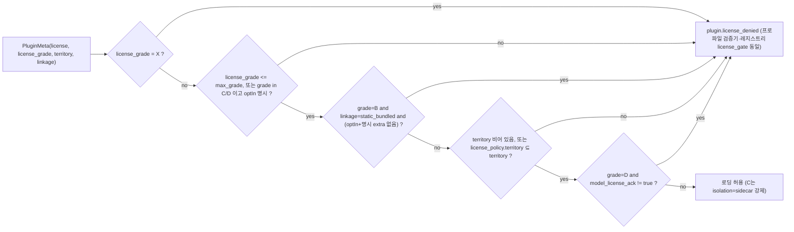

# ADR-0001: 라이선스 등급표 A/B/C/D/X와 D-02 해석 지침

> MADR(Markdown Any Decision Records) 형식. 우선순위는 브리프 > 바이블 > ADR(바이블 §1.1)이며, 본 문서는 바이블 §3.1 D-02(`amended`) 결정의 맥락·대안·근거·준수 방법을 기록한다. 바이블 §3.3 표의 번호·slug(`0001`, `license-grade-table-and-d02-interpretation`)를 따르고, 바이블 표를 바꾸지 않는다. 다른 P0 ADR(0002~0005, 0026, 0027, 0030, 0037)과 03-contracts·04-pipelines·10-development 문서가 본 결정을 전제로 삼는다.

## 맥락과 문제

브리프 D-02 원문(v1.0)은 "라이선스 Apache-2.0, GPL 라이브러리 링크 금지" 수준의 규칙만 두었다. 07-tech-landscape 조사(2026-09-18~22)는 이 규칙으로 판정할 수 없는 의존성·모델·이미지를 다수 확인했고, 선정 매트릭스는 이를 "D-02 (정책 공백)" 행과 ADR 발의 목록 P0 첫 항목으로 올렸다. 바이블 §15는 같은 문제를 리스크 #2 "라이선스 지뢰"(가능성 높음, 영향: Apache-2.0 채택성 훼손)로 등재했고, 매트릭스 종합 리스크 #2는 영향에 "한국 내 사용 비허가 모델 유입"을 추가로 든다.

| 규칙 공백 | 사례(07-tech-landscape 근거) | 원 규칙으로 판정 불가한 이유 |
|-----------|-------------------------------|-------------------------------|
| LGPL(Lesser GPL) | kiwipiepy 0.23.2 LGPL 정적 링크 wheel, Dramatiq, selectolax Modest 번들(매트릭스 D-02 행·J-7), fickling(12 §6.2, CI 도구) | 동적 링크·별도 프로세스와 정적 포함을 구분하는 규칙이 없어 "GPL 링크 금지"만으로는 허용·거부를 정할 수 없음 |
| GPL/AGPL/SSPL/ELv2/BUSL 서버·라이브러리 | PyMuPDF(AGPL, 인프로세스 `import`), pyhwp(AGPL-3.0+, 2020년 이후 무릴리스), H2Orestart(MIT 표기 오류, 실제 GPLv3), Redis 8(RSALv2/SSPLv1/AGPLv3), MinIO(2026-04 아카이브·AGPL), Elasticsearch·Typesense·Loki·Phoenix(ELv2)·Vault(BUSL)(12 §6.2, 매트릭스 D-14·D-18·D-11 행) | GPL **서버**를 네트워크 API로 호출하는 것의 허용 여부가 불명확(12 문서 "브리프와의 충돌" D-02 행) |
| MPL-2.0(Mozilla Public License) | LibreOffice, OpenBao, PyTerrier(dev 의존)(12 §6.2, 매트릭스 D-02 행) | 파일 단위 카피레프트가 어느 편에 속하는지 미정 |
| 모델 제한 라이선스 | jina-embeddings-v3/v5(CC-BY-NC-4.0), jina-v4(Qwen Research License), SPLADE-v3(CC-BY-NC-SA), Gemma 3 이하(Gemma Terms), Llama Community License(12 §6.2, 매트릭스 D-16 행) | 코드 라이선스 규칙은 가중치(weights) 라이선스에 적용되지 않음 |
| 지역 제한 | HunyuanOCR(대한민국 사용 비허가; 매트릭스 `license_scanner` 행, O-08) | 라이선스 자체는 "오픈"으로 보이나 배포 지역에서 사용 불가 |
| 매출 임계 | Surya·Marker 가중치의 수정 OpenRAIL-M(연매출·투자 500만 달러 미만 무상)(12 §6.2) | 사용자 조직 규모에 따라 허용 여부가 달라짐 |
| 귀속 의무·추가 조건 | MinerU Open Source License(12 §6.2·미해결 이슈 8), Docling 모델 CDLA-Permissive-2.0, NVIDIA Open Model License(매트릭스 미해결 이슈 7) | 법무 검토 전에는 등급을 단정할 수 없음 |

문제 정의: 의존성·플러그인·모델 가중치·컨테이너 이미지를 **하나의 기계 판정 가능한 규칙**으로 등급화하고, 그 등급을 계약(`PluginMeta`, `CollectionSpec`, `Profile`)에 기록해 프로파일 로딩 시점과 CI에서 강제하는 D-02 해석 지침이 필요하다. 지침이 없으면 매트릭스가 지적한 D-18(PyMuPDF·pyhwp), D-14(Redis 8·MinIO), D-16(jina), D-11(Grafana 계열·Phoenix)의 위반이 개별 문서마다 다른 기준으로 처리된다.

## 결정 동인(decision drivers)

- **Apache-2.0 채택성**(브리프 §1, D-02 근거): 코어 이미지·`rag-platform` 배포 패키지에 카피레프트·비상업 구성요소가 섞이면 플랫폼 채택이 막힌다.
- **Adapters over Forks·Pluggable Everywhere**(브리프 원칙 2·5, D-10): 오픈소스를 어댑터로 감싸는 구조이므로, 플러그인이 자기 라이선스 정보를 **스스로 선언**하고 플랫폼이 검증하는 방식이어야 한다.
- **매트릭스 판정 원칙 (b)**: "라이선스 등급이 정성 우위를 이긴다" — 성능이 좋아도 등급이 나쁘면 기본값이 될 수 없다는 규칙이 이미 선정 매트릭스 전체의 전제다.
- **기계 판정 가능성**: 바이블 §1.2는 열거값·오류 코드를 CI가 `schemas/`와 대조하도록 하고, §7.4는 프로파일 로딩 검증을 규정한다. 라이선스 규칙도 같은 방식으로 자동 판정되어야 한다.
- **Korean-First**(원칙 6)와 배포 지역: 기본 프로파일 `license_policy.territory: [KR]`(바이블 §7.3)에서 지역 제한 모델을 차단해야 한다.
- **격리 사다리와의 정합**(K7, ADR-0033): 인프로세스는 A 등급 순수 Python만(바이블 §12), 네트워크 분리가 필요한 구성요소는 `sidecar` 격리 + REST `POST /v1/convert`로 통일된다. 라이선스 등급은 격리 모드의 하한을 정한다.
- **법적 불확실성의 관리**: AGPL §13의 네트워크 분리 해석은 통상 해석이며 확정적 법 판단이 아니다(12 §6.4). 등급표는 공학적 지침이고, 법무 검토 대기 목록(매트릭스 미해결 이슈 7)은 별도로 유지한다.
- **운영 단순성**: 기본 프로파일은 어떤 `optIn` 없이 동작해야 하고, GPL/AGPL 산출물은 독립 빌드·태깅·릴리스가 가능해야 한다.

## 고려한 대안

### 대안 1 — 등급 없는 "Apache-2.0 호환만" 단일 규칙(기각)

- 설명: 의존성은 Apache-2.0 호환(Apache/MIT/BSD 계열)만 허용하고, 그 외는 일괄 금지한다. 라이선스 메타데이터 필드·등급·격리 연동 없이 pip-licenses 허용 목록 하나로 판정한다.
- 장점: 규칙이 한 줄이고 CI 구성이 단순하다. 코어 이미지의 순수성은 확실히 보장된다.
- 단점: (1) **LGPL 정적 링크 wheel을 판정할 수 없다** — kiwipiepy 0.23.2는 wheel 메타데이터만으로는 정적 포함 여부가 드러나지 않아 허용 목록 방식은 통과시키거나(위반) 전면 금지한다(플랫폼 측 한국어 분석기 상실, 매트릭스 J-7·리스크 #6). (2) **AGPL 사이드카를 표현할 수 없다** — PyMuPDF·pyhwp·`lo-sidecar`(H2Orestart)는 네트워크 분리 조건에서만 허용되는데 단일 규칙에는 "조건부 허용"이 없어 DOC/RTF/ODT 변환 폴백(D-18)과 HWP 최후 폴백(O-07)을 잃는다. (3) **모델 라이선스를 판정하지 못한다** — 가중치는 pip 의존성이 아니므로 스캐너에 잡히지 않고, CC-BY-NC·Qwen Research·Gemma Terms·OpenRAIL-M·지역 제한(HunyuanOCR)은 "호환/비호환" 이분법으로 표현되지 않는다(매트릭스 D-16 행, 12 §6.2). 바이블 §3.1 D-02 행이 근거로 든 7개 규칙 공백("LGPL·BSL/SSPL·GPL 서버·MPL·모델 제한·지역 제한(HunyuanOCR)·매출 임계(OpenRAIL-M)")은 위 세 범주(정적 링크 판정·조건부 허용·가중치 라이선스)로 귀결된다 — 이 묶음은 본 ADR의 정리다.

### 대안 2 — GPL/AGPL 이미지·플러그인을 코어 저장소에 포함(기각)

- 설명: `lo-sidecar`, `rag-plugin-pyhwp-sidecar`, `rag-plugin-pymupdf-sidecar`를 본 저장소 `sidecars/`·`plugins/`에 두고 기본 Helm 차트에서 `enabled: false`로만 끈다.
- 장점: 단일 저장소로 빌드·테스트·버전 관리가 단순하고, 코어와 사이드카의 계약(`ConvertRequest`/`ConvertResponse`) 변경을 한 PR에서 맞출 수 있다.
- 단점: 릴리스 아티팩트·소스 트리에 GPL/AGPL 코드와 Dockerfile이 포함되어 저장소 단위 LICENSE/NOTICE가 혼합 라이선스가 되고, 12 §6.4 배포 경계("우리 릴리스 아티팩트에 AGPL 바이너리 미포함", "별도 Dockerfile, 자기 LICENSE·소스 제공 고지 포함")를 위반한다. 사이드카 내부 라이브러리를 패치하는 PR이 코어 리뷰 흐름에 섞여 AGPL §13 소스 제공 의무를 유발할 위험이 커진다. 매트릭스 "어댑터·플러그인 공통 요구" 1항은 "GPL/AGPL 이미지는 별도 저장소·별도 고지·Helm opt-in"을 요구하며, 바이블 §6.7·§12는 이를 `rag-platform-gpl-sidecars`로 확정했다.

### 대안 3 — C 등급 전면 금지(네트워크 분리 서버 호출도 불허)(기각)

- 설명: GPL/AGPL/SSPL/ELv2/BUSL 구성요소는 사이드카·외부 서비스로도 허용하지 않는다.
- 장점: 법적 해석 리스크(12 §6.4 "확정적 법 판단은 아니다")를 완전히 회피한다.
- 단점: 사용자가 이미 운영하는 Redis 8·Elasticsearch·Grafana 스택·Loki에 연결할 수 없고(D-11·D-14의 "호환 옵션"·"OTLP 대상" 소멸), HWP 최후 폴백(`lo-sidecar`)과 DOC/RTF/ODT 변환 경로(D-18)가 없어진다. 수정하지 않은 서버를 네트워크 API로 호출하는 것은 통상적 해석상 허용되므로(12 §6.4) 과잉 금지다.

### 대안 4 — 라이선스 등급표 A/B/C/D/X + 계약 필드 + CI 게이트(채택)

- 설명: 12 문서 §6.1 판정 규칙을 D-02 해석 지침으로 채택하고, 등급을 `PluginMeta`·`CollectionSpec`·`Profile` 계약에 기록해 프로파일 로딩(§7.4 (1))과 CI 게이트에서 강제한다. B는 `linkage`로, C는 격리 모드·별도 저장소로, D는 `territory`·`model_license_ack`로 조건을 기계화한다.
- 장점: 위 세 대안이 놓친 사례(LGPL 정적 링크·AGPL 사이드카·모델 라이선스·지역·매출)를 모두 표현하고, 매트릭스 전체가 이미 이 등급으로 후보를 표기해 두어 선정 근거와 일관된다. 격리 사다리(K7)와 1:1로 대응한다.
- 단점: 플러그인 작성자가 4개 필드를 정확히 선언해야 하며(자기 선언의 한계), C 등급 운영은 별도 저장소·이미지·릴리스 트랙을 요구한다. 아래 "결과"에서 다룬다.

## 결정

**결정:** 라이선스 **Apache-2.0**. 의존성은 **라이선스 등급표 A/B/C/D/X**로 판정한다: A(Apache/MIT/BSD/MPL-2.0 파일 단위 카피레프트) 자유, B(LGPL) 동적 링크·선택 extra만(정적 링크 휠 기본 설치 금지), C(GPL/AGPL/SSPL/ELv2/BUSL 서버·라이브러리) 별도 컨테이너 + 네트워크 API만·코어 이미지 미포함·별도 저장소 고지·Helm opt-in, D(모델 제한 라이선스·지역 제한·매출 임계·귀속 의무) 기본 프로파일 금지 + `model_license_ack` 필수, X(사용 비허가) 금지. 플러그인·모델 메타데이터에 `license`·`license_grade`·`territory` 필수, CI 라이선스 게이트(pip-licenses + liccheck + SBOM + `models.lock`) (브리프 §4 D-02, 개정 v1.1; 바이블 §3.1 D-02 `amended`).

바이블이 확정한 정밀화(그대로 인용, 절 번호 병기):

- **계약 필드**(바이블 §5.6 `PluginMeta`): `license`(string(SPDX)), `license_grade`(enum(LicenseGrade)), `territory`(array<string>; 빈 `territory` = 제한 없음, `license_policy.territory`와 대조), `linkage`(enum(Linkage); "`license_grade=B`이고 `static_bundled`(LGPL 정적 링크 wheel 등)이면 기본 설치·기본 프로파일에서 거부(§7.4 (1))")는 모두 필수(Y). `model_ids`·`model_license_ack_required`(boolean)는 선택이며 "D 등급 모델 포함 시 `true`".
- **정책 필드**(바이블 §5.6): `CollectionSpec.license_policy{max_grade: enum(LicenseGrade)(X 불가), territory: array<string>}`, `Profile.license_policy{max_grade, territory}`. 기본 YAML 값은 `license_policy: {max_grade: B, territory: [KR]}`(§7.3).
- **로딩 검증**(바이블 §7.4 (1), `rag profile validate` / `POST /v1/profiles/validate`): "모든 `plugin` 값은 등록된 entry point이고 `PluginMeta.license_grade ≤ license_policy.max_grade`(C/D/X는 `optIn` 명시 필요, D 모델은 `model_license_ack: true`), `territory` 대조, **`license_grade=B`이고 `linkage=static_bundled`이면 거부**(명시 extra 설치 + `optIn` 필요 — kiwipiepy 0.23.2 등 LGPL 정적 링크 wheel)". 본 ADR은 이 문장을 다음 하나의 술어로 읽는다(스키마·검증기 표현은 [03-contracts/15](../03-contracts/15-collection-profile-and-policy-contracts.md) §3.9가 확정).
  - **등급 순서**: `≤`는 §5.7 나열 순(A < B < C < D < X)의 비교다. §5.7은 `Classification`에만 "(나열 순 = 등급 순)"을 적고 있으므로 `LicenseGrade` 행에도 같은 표기를 더하는 patch 개정(바이블 §1.2 1행 "설명 보강")을 제안한다.
  - **통과 술어**: `license_grade ≤ max_grade`, **또는** `license_grade ∈ {C, D}`이고 해당 플러그인·이미지에 대한 `optIn`이 명시된 경우. X는 `max_grade`·`optIn`과 무관하게 항상 거부다(`max_grade`에 X 불가, §5.6). 즉 기본 YAML `max_grade: B`(§7.3)에서 C 등급 `lo-sidecar`·pyhwp·pymupdf 사이드카는 `optIn` 명시로만 로딩되고, `max_grade`를 올릴 필요는 없다(ADR-0007 준수 표 `rag profile validate` 행·ADR-0033 sidecar 행·[02-architecture/05](../02-architecture/05-plugin-architecture.md) §6.3 `check_license` 검증 순서의 읽기와 동일). D는 여기에 `model_license_ack: true`가 추가로 필요하고, B∧`static_bundled`는 명시 extra 설치 + `optIn` 없이는 거부다.
  - **`optIn`의 소재**: 바이블은 `optIn`을 Helm·compose 배포 값 `optIn.*`(§6.7·§12)로만 정의하고 `Profile`(§5.6)·§7.3 YAML의 키로 두지 않는다. 배포 값이 검증기(`rag profile validate` / `POST /v1/profiles/validate` / `POST /v1/collections`)에 전달되는 형태(프로파일 오버레이 또는 런타임 입력)는 03-contracts/15와 [02-architecture/08](../02-architecture/08-deployment-architecture.md)이 확정한다.
  - **`territory` 대조**: 플러그인·모델의 `territory`는 라이선스가 사용을 **허가한** 지역의 ISO 3166-1 alpha-2 코드 열거(허용 목록)이며, 비어 있지 않으면 `license_policy.territory`의 모든 값이 그 안에 있어야 한다(`license_policy.territory ⊆ territory`; 빈 배열 = 제한 없음, §5.6). 라이선스가 제외 지역만 정의하는 경우(HunyuanOCR: Territory 정의에서 EU·영국·대한민국 제외, 07/02 문서)에는 허가 지역을 열거해 인코딩한다 — 예: `territory: ["US", "JP", "SG"]`(KR 미포함이므로 기본 정책 `[KR]`에서 거부). `models.lock`의 `territory` 열도 같은 의미다.
- **저장소 경계**(바이블 §6.7·§12): "GPL/AGPL 이미지·플러그인(`lo-sidecar`, `rag-plugin-pyhwp-sidecar`, `rag-plugin-pymupdf-sidecar`)은 **별도 저장소 `rag-platform-gpl-sidecars`**(별도 LICENSE/NOTICE, 코어 이미지 미포함, 독립 빌드·태깅·릴리스)에서 관리하고 본 저장소는 Helm `optIn.*` 값과 이미지 참조 링크만 둔다". 코어 `rag_platform`은 "A 등급 순수 Python만 인프로세스 의존"하고 `plugins/`의 별도 배포물은 "A/B 등급만".
- **열거·오류**(바이블 §5.7): `LicenseGrade` = `A, B, C, D, X`; `Linkage` = `pure_python, dynamic, static_bundled`. 오류 코드는 강제 지점이 아니라 **위반한 규칙**으로 정한다: §7.4 (1)의 라이선스 규칙(등급 비교·`optIn`·B∧`static_bundled`·`territory`·D `model_license_ack`) 위반은 프로파일 검증기에서든 레지스트리 `license_gate`에서든 `plugin.license_denied`(422, 재시도 없음)이고, `profile.invalid`는 §7.4의 나머지 규칙((3) `fusion.k`, (10) 라우터 커버리지 등) 위반에 쓴다([03-contracts/13](../03-contracts/13-error-model.md) 카탈로그, 03-contracts/15 §3.9 표와 일치). 검증기 응답은 RFC 9457 `ProblemDetails.errors[]`의 `StageError{stage: "loader"}`로 위반 위치를 가리킨다(바이블 §5.3).
- **모델 미러**(바이블 §13.3): `models/{repo}/{revision}/… + LICENSE + models.lock`. `models.lock` 행은 `id, revision, sha256, license, grade, territory`(매트릭스 `license_scanner` 행; 12 §6.3은 `territory` 없이 5열 — 매트릭스 표기를 따른다). `territory` 열의 의미와 대조 규칙은 위 "로딩 검증"의 `PluginMeta.territory`와 같다(허용 목록; 빈 값 = 제한 없음).

등급표(브리프 D-02 문구가 정본, 사례는 07-tech-landscape 근거):

| 등급 | 라이선스(브리프 D-02) | 허용 형태 | 계약·게이트 장치 | 사례(근거) |
|------|------------------------|-----------|-------------------|------------|
| A | Apache/MIT/BSD/MPL-2.0(파일 단위 카피레프트); 12 §6.1은 0BSD·ISC·PSF·PostgreSQL 포함 | 인프로세스 링크·번들·배포 자유 | `linkage` 무관; 코어·`plugins/` 인프로세스 허용 | Qdrant, OpenSearch, Valkey, python-hwpx, pypdfium2, Trafilatura ≥1.8, BGE-M3, KURE-v1, Qwen3-Embedding, OpenBao·LibreOffice(MPL-2.0), Gemma 4 |
| B | LGPL | 동적 링크·별도 프로세스·선택 extra만; 정적 포함 금지 | `linkage=static_bundled`이면 §7.4 (1) 거부(명시 extra + `optIn`으로만); `dynamic`·`pure_python`(네이티브 코드 없는 순수 Python LGPL — 정적 포함이 아님)은 `max_grade ≥ B`에서 허용. §5.7 `Linkage` 3값 모두에 판정이 있다 | kiwipiepy 0.23.2(`static_bundled`, `[kiwi]` extra + `optIn`), Dramatiq(`pure_python`; 법무 확인 전 제외), fickling(CI 실행만) |
| C | GPL/AGPL/SSPL/ELv2/BUSL 서버·라이브러리 | 별도 컨테이너 + 네트워크 API만; 코어 이미지 미포함; `rag-platform-gpl-sidecars`; Helm `optIn.*` | `isolation_supported`에 `sidecar`만; 기본 `max_grade: B` 초과분은 `optIn` 명시로만 통과, 없으면 `plugin.license_denied`; **사이드카 어댑터의 `license_grade`는 `sidecar_image`가 가리키는 호출 이미지의 등급을 대표한다**(`parser.office_lo_sidecar`·pyhwp·pymupdf 플러그인 = C; `parser.hwp5_java_sidecar`는 이미지 `parser-workers`가 Apache-2.0이므로 A — ADR-0007 `PluginMeta` 제약 행); import-linter로 `fitz`·`pymupdf`·`hwp5` 임포트 차단 | PyMuPDF, pyhwp, H2Orestart(`lo-sidecar`), Redis 8, MinIO, Elasticsearch, Typesense, Loki·Grafana·Tempo, Phoenix(ELv2), Vault(BUSL) |
| D | 모델 제한 라이선스·지역 제한·매출 임계·귀속 의무 | 기본 프로파일 금지; 사용자 자기 책임(`model_license_ack: true`) | `optIn` 명시 + `model_license_ack_required=true`, `territory` 대조(허용 목록), `models.lock` grade=D가 기본 프로파일에 있으면 CI 실패 | jina v3/v4/v5, SPLADE-v3, Gemma 3 이하, Llama Community, Surya·Marker 가중치(OpenRAIL-M), HunyuanOCR(라이선스 Territory에서 대한민국 제외 → `territory`에 KR 미포함으로 인코딩), MinerU(귀속 의무; 법무 검토 전 잠정 D, 매트릭스 미해결 이슈 7) |
| X | 사용 비허가(라이선스 불명·소스 비공개) | 금지 | `CollectionSpec.license_policy.max_grade`에 X 불가; liccheck `cautious`(불명 = 실패) | 라이선스 파일 없는 wheel·가중치 |

`PluginMeta` 예시(라이선스 관련 판정이 일어나는 B 등급 정적 링크 사례; SPDX 식별자는 배포 wheel 메타데이터 기준으로 확정):

```json
{
  "plugin_id": "normalizer.kiwi",
  "extension_point": "normalizer",
  "role": "korean_analyzer",
  "version": "0.1.0",
  "license": "LGPL-3.0-only",
  "license_grade": "B",
  "territory": [],
  "linkage": "static_bundled",
  "isolation_supported": ["in_process", "helper_process"],
  "model_ids": [],
  "model_license_ack_required": false,
  "sidecar_image": null,
  "contracts_compat": ">=1.0,<2.0",
  "capabilities": {
    "isolation_modes": ["in_process", "helper_process"],
    "supports_resumable": false,
    "contracts_compat": ">=1.0,<2.0"
  }
}
```

위 메타는 `standard`(`max_grade: B`)에서 등급 비교는 통과하지만 `license_grade=B ∧ linkage=static_bundled` 규칙으로 거부된다. `[kiwi]` extra를 명시 설치하고 `optIn`을 켠 프로파일에서만 로딩되며, kiwipiepy 0.24.0(Apache-2.0) wheel이 PyPI에 공개되면 `license=Apache-2.0`, `license_grade=A`로 갱신되어 기본 승격 대상이 된다(ADR-0021 개정 조건). A 등급에서는 `linkage` 값이 판정에 무관하므로 실제 값은 wheel 실측 후 기록한다(Kiwi C++ 코어 번들 여부, 확인 필요 as of 2026-09; 바이블 §7.1·§7.3 주석은 Apache-2.0 사실만 확인 대상으로 둔다).

## 결과

- 긍정
  - 리스크 #2 "라이선스 지뢰"의 완화 장치가 계약·로딩 검증·CI 세 층에 고정되어, 매트릭스가 지적한 D-18·D-14·D-16·D-11 위반이 개별 판단 없이 같은 규칙으로 처리된다(ADR-0006·0007·0009·0010·0011·0022가 본 등급표를 인용).
  - 격리 사다리(`in_process/helper_process/sidecar`)와 등급이 대응해, "C 등급이면 `sidecar`"라는 하나의 규칙으로 아키텍처 배치가 결정된다.
  - 플러그인 생태계에 명시적 진입 규칙(`PluginMeta` 4필드)이 생겨 서드파티 플러그인도 같은 게이트를 통과한다(ADR-0032 적합성 키트).
  - 지역 제한(`territory`)이 계약에 있어 한국 배포에서 HunyuanOCR류 모델이 기계적으로 차단된다.
- 부정
  - 플러그인 작성자의 선언 부담과 **자기 선언의 한계**: `linkage`는 wheel 메타데이터로 자동 검출되지 않으므로 코드 리뷰와 Trivy/ScanCode 스캔이 보완해야 한다.
  - C 등급 운영 비용: 별도 저장소·이미지·릴리스 트랙, Helm `optIn.*` 조합 테스트, 사이드카 가용성 오류(`parse.sidecar_unavailable`) 처리.
  - 등급표는 공학적 지침이며 법률 판단을 대체하지 않는다. AGPL §13 해석·MPL-2.0 dev 의존·CDLA·NVIDIA OML 등은 법무 검토 결과에 따라 등급 배치가 바뀔 수 있다.
- 중립
  - 브리프 D-02(개정 v1.1)는 12 §6.1의 표기(A 자유 / B 조건부 / C 네트워크 분리 / D 모델 제한 / X 금지)를 기반으로 D에 지역 제한·매출 임계·귀속 의무를, C에 "라이브러리"를 추가하고 X를 "사용 비허가"로 넓힌 확장이다(본 ADR 맥락 표의 지역·매출·귀속 행이 그 확장분). 본 ADR은 브리프 문구를 정본으로 쓰고 12 §6.1은 사례·도구 근거로만 인용한다.
  - `EvalDataset.license`(string(SPDX), 바이블 §5.6)는 등급 필드가 없다. 데이터셋 라이선스(KorQuAD CC BY-ND, AI Hub 재배포 불가 등)는 SPDX 문자열과 08-evaluation 문서의 정책으로 다루며, 등급 필드가 필요해지면 ADR-0023 개정으로 처리한다.

## 준수 확인 방법

| 강제 지점 | 장치 | 실패 시 | 정본 |
|-----------|------|---------|------|
| 스키마 | `plugin-meta.schema.json`에서 `license`·`license_grade`·`territory`·`linkage` `required`; `$defs/LicenseGrade`·`$defs/Linkage` 값 집합을 바이블 §5.7과 CI 대조; `collection-spec.schema.json` `license_policy.max_grade`는 X 제외 부분집합 | 빌드 실패(§1.2 열거 대조) | 바이블 §1.2·§5.6·§5.7, 03-contracts/15 |
| 프로파일 로딩 | `rag profile validate` (1) / `POST /v1/profiles/validate` / `POST /v1/collections`: X 거부, 통과 술어(`≤ max_grade` 또는 C/D `optIn`), B∧`static_bundled` 거부, `territory` 대조, D 모델 `model_license_ack: true` 확인 | `plugin.license_denied`(422, 로딩 중단; `ProblemDetails.errors[]`의 `StageError{stage: "loader"}`가 위치 지시). §7.4의 다른 규칙 위반은 `profile.invalid` | 바이블 §7.4 (1), §5.3, §14; 03-contracts/13·15 |
| 플러그인 레지스트리 | `rag_platform.plugins`의 `license_gate`가 entry point 로딩 시 같은 술어로 `PluginMeta` 검증; `rag plugin list --check-license`로 운영자 점검 | `plugin.license_denied`(재시도 없음) | 바이블 §5.7 오류 카탈로그, §12 |
| CI 의존성 게이트 | pip-licenses(`--fail-on` AGPL·GPL·SSPL·불명; LGPL은 `--allow-only` 예외로 통과시키되 정적 포함 여부는 `PluginMeta.linkage` 선언 + 코드 리뷰 체크리스트 1항 + Trivy/ScanCode로 판정 — pip-licenses는 라이선스 문자열만 대조하므로 링크 형태를 구분하지 못한다) + liccheck(`[tool.liccheck]` 허용·비허용 목록, `cautious`) + cyclonedx-bom SBOM(Software Bill of Materials); 보완: Syft(이미지 SBOM), Trivy(이미지 라이선스·시크릿), ScanCode 주간, REUSE SPDX 헤더 | 머지 차단 | 브리프 D-02, 12 §6.3, 10-development/05 |
| CI 모델 게이트 | `models.lock`(`id, revision, sha256, license, grade, territory`) 변경 시 검증: grade=D가 기본 프로파일(`base`·`lite`·`standard`·`premium`·`korean-gov`)에 포함되면 실패; safetensors 전용 + picklescan/ModelScan | 머지 차단 | 매트릭스 `license_scanner` 행, 12 §6.3, 바이블 §13.3 |
| 코드 경계 | import-linter 계층 규칙(D-01)에 `fitz`·`pymupdf`·`hwp5` 등 C 등급 모듈 임포트 금지 규칙 추가; `pipelines`·`retrieval`은 순수 Python만 | 린트 실패 | 12 §6.4, 바이블 §12 |
| 저장소·배포 경계 | 본 저장소 `sidecars/`·`plugins/`에 GPL/AGPL 코드·Dockerfile 부재 확인(경로 린트); Helm·compose 기본 values에서 `optIn.*` 전부 `false`; `rag-platform-gpl-sidecars` 각 이미지 README에 라이선스·원 소스 URL·수정 없음 선언 | 릴리스 차단 | 바이블 §6.7·§12, 12 §6.4, 02-architecture/08 |



다이어그램은 §7.4 (1) 라이선스 규칙만 그린다(다른 §7.4 규칙의 `profile.invalid`는 03-contracts/15 §3.9 표). 술어는 위 "결정 — 로딩 검증"과 같다.

코드 리뷰 체크리스트(PR 템플릿 항목):

1. 새 pip 의존성·extra 추가 시 PR 본문에 `license`·등급·`linkage` 표기와 12 §6.2 지도 갱신 여부. B 등급이면 동적 링크 근거(wheel 내 공유 라이브러리 포함 여부) 첨부.
2. 새 모델 참조(`model_ids`, 프로파일 `model`) 추가 시 `models.lock` 행과 미러 `LICENSE` 존재, D 등급이면 기본 프로파일에 없음을 확인.
3. 사이드카 PR은 `rag-platform-gpl-sidecars`로 보내고, 본 저장소에는 이미지 참조·`optIn.*` 값 변경만 남긴다. 사이드카 내부 GPL/AGPL 라이브러리 패치는 금지(12 §6.4 "수정 금지").
4. 문서·프로파일 예시에 D 등급 모델을 "교체 가능" 목록으로 적지 않는다(D-16 개정 취지). BYO 모델은 `model_license_ack` 문구와 함께만.
5. 한컴 고지 원문 문자열 검사(매트릭스 CI 게이트)와 REUSE 헤더(`SPDX-License-Identifier: Apache-2.0`) 누락 여부.

## 재검토 조건

- kiwipiepy 0.24.0(Apache-2.0) wheel의 PyPI 공개 확인(확인 필요, as of 2026-09; 매트릭스 리스크 #6) → 등급표는 불변, ADR-0021 개정으로 `normalizer.kiwi`를 `license=Apache-2.0`·`license_grade=A`로 갱신하고 §7.3 기본 승격(`linkage`는 A 등급 판정에 무관, wheel 실측값 기록).
- 제외 지역만 정의하는 라이선스(HunyuanOCR형)가 늘어 허용 목록 인코딩이 운영상 과도해지면, 거부 목록 필드 추가(선택 필드, §1.2 minor)를 03-contracts/15 미해결 이슈로 제안한 뒤 ADR을 발의한다. 그 전까지 `territory`의 의미는 허용 목록 하나다.
- 법무 검토 대기 목록(매트릭스 미해결 이슈 7: CDLA-Permissive-2.0, NVIDIA Open Model License, MinerU 추가 조건, Gemma Terms 승계, LGPL 정적 링크, Poppler CLI 서브프로세스, GPL 서버 네트워크 분리, MPL-2.0 dev 의존, spaCy ko CC BY-SA, 한컴 고지, `inference-free-splade-ko-v1`, LFM Open License, KoMT-Bench LGPL 데이터) 결과가 특정 구성요소의 등급을 바꾸면 12 §6.2 지도와 해당 ADR을 갱신한다. 등급 정의 자체(브리프 D-02 문구·등급별 허용 형태)가 바뀌면 바이블 §1.2 4행 "브리프 확정 결정(D-xx) 개정" 절차(ADR 발의 → 바이블 §3 `amended` → 브리프 §4 D-02 v1.x 갱신)로 처리한다; `LicenseGrade` 기존 값의 의미 변경은 §1.2 3행 major, 값 추가만 §1.2 2행 minor다(아래 불릿과 동일 기준).
- AGPL §13 네트워크 분리 해석 또는 LGPL 동적 링크 해석에 대한 법률 자문이 12 §6.4의 통상 해석과 다르면 C·B 등급의 허용 형태를 재검토한다(바이블 major 절차 가능).
- 새 라이선스 유형(예: 매출 임계가 없는 새 RAIL 변형, 데이터셋 전용 라이선스)이 A~X 어디에도 맞지 않으면 열거값 추가 ADR을 발의한다. `LicenseGrade` 값 추가는 바이블 §1.2 minor, 기존 값 의미 변경은 major.
- `EvalDataset`에 등급·지역 필드가 필요해지면(외부 골든셋 재배포 정책) ADR-0023 개정으로 처리하고 본 ADR을 참조로 연결한다.
- 12 §6.2 라이선스 지도의 "확인 필요" 항목(pypdfium2, bge-reranker-v2-m3, multilingual-e5, Docling, Unstructured, Temporal, LibreOffice)이 A가 아닌 것으로 확인되면 해당 기본값 ADR(0003 Temporal·0006 pypdfium2·0007/0033 LibreOffice `lo-sidecar`·0009 서빙·0010 BGE-M3/reranker·0020 Docling/Unstructured 잠금; 바이블 §3.3 표)을 즉시 재검토한다.

## 참조

- 설계 브리프 §4 D-02(개정 v1.1), D-11·D-14·D-16·D-18(라이선스 개정 근거), §3 원칙 2·5·6, §9.11 — [../00-vision/00-design-brief.md](../00-vision/00-design-brief.md)
- 설계 바이블 §1.1~1.2(우선순위·변경 절차), §3.1 D-02 행, §3.3 표 0001 행, §5.1(`PluginMeta`·`CollectionSpec`·`Profile` 인벤토리), §5.6(`CollectionSpec.license_policy`, `PluginMeta` 필드 표, `Profile.license_policy`), §5.7(`LicenseGrade`, `Linkage`, `IsolationMode`, `plugin.license_denied`, `profile.invalid`), §6.7(extras·별도 저장소 `rag-platform-gpl-sidecars`), §7.3(`license_policy` YAML), §7.4 (1), §12(모듈 맵 `plugins/` license_gate, `sidecars/`·`plugins/` 등급 제한), §13.3(모델 미러·`models.lock`), §15 리스크 #2, §16 용어 — [../02-architecture/00-design-bible.md](../02-architecture/00-design-bible.md)
- 기술 지형 종합: "브리프 수정 제안" D-02 (정책 공백) 행, "ADR 발의 목록" P0 첫 항목, 선정 매트릭스 `license_scanner` 행, "어댑터·플러그인 공통 요구" 1항, 종합 리스크 #2·#6, 미해결 이슈 7 — [../07-tech-landscape/00-summary-and-selection-matrix.md](../07-tech-landscape/00-summary-and-selection-matrix.md)
- 보안·멀티테넌시·PII·라이선스 컴플라이언스 §6.1 판정 규칙, §6.2 의존성 라이선스 지도, §6.3 도구 체인과 CI 게이트, §6.4 AGPL 네트워크 분리 경계, "브리프와의 충돌" — [../07-tech-landscape/12-security-multitenancy-pii-and-licensing.md](../07-tech-landscape/12-security-multitenancy-pii-and-licensing.md)
- 관련 ADR(바이블 §3.3 slug): [ADR-0006 PDF 고속 텍스트 경로](./0006-pdf-fast-path-pypdfium2-pdftext-replaces-pymupdf.md), [ADR-0007 HWP 5.0 기본 경로](./0007-hwp5-java-sidecar-first-pyhwp-demoted.md), [ADR-0009 임베딩 서빙](./0009-embedding-serving-vllm-pooling-tei-inprocess.md), [ADR-0010 BGE-M3 근거와 late_interaction 슬롯](./0010-bge-m3-rationale-and-late-interaction-slot.md), [ADR-0011 저장소 기본 이미지](./0011-kv-and-object-storage-valkey-rustfs-seaweedfs.md), [ADR-0021 한국어 분석기](./0021-korean-analyzer-kiwi-promotion-and-interim-mecab-kss.md), [ADR-0022 관측성 라이선스 경계](./0022-observability-genai-semconv-pin-and-license-boundary.md), [ADR-0023 평가 하네스](./0023-evaluation-qrels-answer-spans-and-linear-ndcg.md), [ADR-0032 플러그인 SDK](./0032-plugin-sdk-stage-protocol-and-conformance-kit.md), [ADR-0033 사이드카 convert 계약과 격리 사다리](./0033-sidecar-convert-contract-and-isolation-ladder.md)
- 후속 문서(문서 맵): [03-contracts/15 컬렉션·프로파일·정책 계약](../03-contracts/15-collection-profile-and-policy-contracts.md), [02-architecture/05 플러그인 아키텍처](../02-architecture/05-plugin-architecture.md), [02-architecture/08 배포 아키텍처](../02-architecture/08-deployment-architecture.md), [09-operations/05 보안·컴플라이언스](../09-operations/05-security-and-compliance.md), 10-development/05 CI/CD(`../10-development/05-ci-cd.md`, 미작성 — 작성 후 링크로 전환), [10-development/06 플러그인 개발 가이드](../10-development/06-plugin-development-guide.md), [03-contracts/13 오류 모델](../03-contracts/13-error-model.md)
