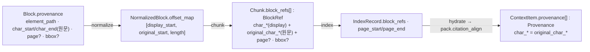

# ADR-0002: ParsedDocument provenance: element_path·char offset 필수, page/bbox nullable

> 상태 accepted(2026-09-22) · 우선순위 P0 · 관련 결정 D-04(`amended`, 브리프 v1.1) · 형식 MADR. 이 ADR은 설계 바이블 §3.1 D-04 행과 §5.3 `Provenance`·`BlockRef` 표에 이미 확정된 결정 하나를 근거·대안과 함께 기록한다. 바이블 표를 바꾸지 않으며(바이블 §1.1), 새 필드·열거값을 만들지 않는다.

## 맥락과 문제

브리프 v1.0의 D-04는 표준 문서 모델 `ParsedDocument`가 출처(provenance)를 "page/bbox/char offset/element path 필수 보존" 형태로 갖는다고 적었다(원문 인용: 기술 지형 01 §브리프와의 충돌, 03 §브리프와의 충돌). 기술 지형 조사(07-tech-landscape 01·02·03·11)는 이 문구가 D-18 파서 체인의 절반 이상에서 충족 불가능함을 확인했다.

- **흐름 포맷(flow format)에는 페이지와 경계 상자(bounding box, bbox)가 없다.** HWPX/HWP 5.0(OWPML 문단·표·각주 요소 경로만 존재, 페이지는 렌더링 의존), DOCX(OOXML 단락 인덱스), HTML(XPath), MD(markdown-it-py 토큰 `map` 줄 범위)는 본문이 페이지로 고정되지 않는다(01 §표준 모델 매핑, 03 §표준 모델 매핑 포인트 "페이지: 없음(흐름 문서)", 11 §표준 모델 매핑 "페이지 번호는 HWPX에 없음(렌더링 의존)"). 바이블은 이 포맷들을 `ParsedDocument.source_kind = flow`로 구분한다(§5.4, §5.7 `SourceKind`).
- **페이지 포맷의 벤더 출처 모델은 서로 다르다.** Docling은 `ProvenanceItem(page_no, bbox, charspan)`이며 bbox 원점이 좌하단이다(02 §어댑터 계약(요지) "Docling의 bottom-left 원점은 어댑터에서 변환"). pdftext는 블록/라인/스팬 계층, Unstructured는 `Element.metadata.coordinates`(포인트 또는 픽셀)를 준다(11 §표준 모델 매핑). 한 좌표 규약으로 정규화하지 않으면 인용 좌표가 파서마다 달라진다.
- **하류는 하나의 좌표계를 요구한다.** 바이블 K1 단일 좌표계(One Coordinate System, §2.1)는 인용 `segments`, 골든셋 `answer_spans`(D-12), 부모 확장, 문장 윈도우가 같은 좌표를 쓰고, 검색 핫패스 `hydrate`가 이 좌표를 인덱스 payload에서 읽어 PostgreSQL을 거치지 않는다고 정한다(§4.3, ADR-0034). D-06은 `block_id`가 문서 버전과 요소 경로에서 결정적으로 파생되기를 요구한다(§6.2).
- **정규화는 표시 텍스트 길이를 바꾼다.** `normalize`가 만드는 `display_text`는 NFC 합성과 제어·PUA·zero-width 제거로 원문 `Block.text`와 길이가 달라지므로 표시 텍스트 오프셋과 원문 오프셋이 어긋난다(§5.4 `NormalizedBlock.display_text`·`offset_map`; 한자 독음·띄어쓰기 교정(opt-in)은 `lexical_text`(NFKC)에만 적용되어 오프셋과 무관하다). 오프셋의 기준 텍스트를 정하지 않으면 재정규화마다 인용 좌표가 무효화된다.

따라서 결정할 문제는 다음과 같다. `Provenance`의 어느 필드를 필수로 두어야 D-18의 모든 파서 경로가 유효한 `ParsedDocument`를 낼 수 있고, `block_id`가 결정적으로 유지되며, 인용이 원문으로 역추적되는가.

## 결정 동인(decision drivers)

| # | 동인 | 출처 | 설계 함의 |
|---|------|------|-----------|
| DR1 | HWPX/HWP 1급 지원(R1)과 D-18의 **모든** 파서 경로가 같은 계약을 만족해야 한다 | 브리프 §2 R1, §4 D-18; 매트릭스 §브리프 수정 제안 D-04 행, §ADR 발의 목록(우선순위) P0 두 번째 행 | 어떤 포맷에도 존재하지 않는 값을 필수로 둘 수 없다 |
| DR2 | 결정적 `block_id = H("block", doc_version, element_path)[:32]` | 브리프 D-06; 바이블 §5.4 `Block`, §6.2 | 문서 내 유일하고 텍스트 내용과 무관한 경로가 필수여야 한다 |
| DR3 | 단일 좌표계 K1: 인용·평가·확장·윈도우가 한 좌표를 공유, 핫패스는 payload만 읽음 | 바이블 §2.1 K1, §4.3 `hydrate`, ADR-0030·ADR-0034 | `Provenance`는 `BlockRef`에서 결정적으로 생성 가능해야 한다 |
| DR4 | 골든셋 진실값은 문서 ID + 정답 문자 구간이며 재청킹·재정규화에 불변이어야 한다 | 브리프 D-12; 기술 지형 09 §메트릭 정의(공통 기준)("`Chunk.provenance`로 파생 계산" — 바이블 §5.4 `Chunk.block_refs`·§5.5 `RankedResult.block_refs`에 해당) | 오프셋 기준은 파서 산출 원문이어야 한다 |
| DR5 | Adapters over Forks·자체 소유 모델: 벤더 출처 모델은 어댑터가 변환한다 | 브리프 원칙 2, D-04; 기술 지형 02 §어댑터 계약(요지) 좌표 행 | bbox 원점·단위를 계약이 고정하고 어댑터가 변환한다 |
| DR6 | 멱등성·콘텐츠 주소화: 같은 바이트는 같은 출력 | 브리프 원칙 4, §7 재현성 | 렌더링 환경에 의존하는 값(추정 페이지)을 계약 필드로 삼지 않는다 |
| DR7 | 한국어 정규화로 표시 텍스트와 원문 오프셋이 어긋난다 | 바이블 §5.4 `offset_map`, §6.3 | 두 오프셋을 모두 운반하는 구조(`BlockRef`)가 필요하다 |

## 고려한 대안

### A1. `page`·`bbox`를 필수로 유지(브리프 v1.0 D-04 원문) — 기각

- 설명: 모든 블록이 페이지 번호와 bbox를 갖도록 강제한다.
- 장점: PDF 중심 UI가 균일한 페이지 포인터를 얻는다. 스키마가 단순하다(nullable 분기 없음).
- 단점: HWPX·HWP·DOCX·HTML·MD 파서가 계약을 만족할 수 없어 실패하거나 값을 조작(`page=1`, 영 bbox)해야 하며 조작된 값은 인용 의미를 훼손한다(01 §브리프와의 충돌 D-04 행, 03 §핵심 함의 1, 11 §미해결 4). 페이지를 얻기 위해 LibreOffice 렌더 경로(`lo-sidecar`, H2Orestart GPLv3 C 등급)를 기본 체인에 넣어야 하므로 D-18·ADR-0007의 "LibreOffice는 opt-in 최후 폴백"과 충돌한다. 매트릭스는 이를 P0 ADR 대상으로 지정했다(§ADR 발의 목록 P0 두 번째 행).

### A2. 문자 오프셋의 기준을 정규화 텍스트로 두는 안 — 기각

- 설명: `char_start/char_end`를 `normalize` 이후 표시 텍스트(NFC) 기준으로 정의한다(기술 지형 03 §핵심 함의 1의 "char_offset(정규화된 본문 텍스트 기준)" 제안).
- 장점: 청커·인용이 표시 텍스트 위에서 바로 동작하고 `offset_map`이 필요 없다.
- 단점: 원문 역추적이 불가능하다 — NFC 합성과 제어·PUA·zero-width 제거로 `display_text` 길이가 원문과 달라지므로(§5.4; 한자 독음·띄어쓰기 교정은 `lexical_text` 전용) 정규화 텍스트 오프셋만으로는 원문 `Block.text` 위치를 복원할 수 없다(DR4·DR7). `normalizer_fingerprint`(분석기·사전·PII 정책) 변경마다 모든 출처 좌표와 `answer_spans` 판정이 이동한다. `ParsedDocument`는 `normalize` 이전 산출물이므로 자기보다 뒤 스테이지의 텍스트를 기준으로 삼을 수 없다(D-05 스테이지 순서, 원칙 3 순수 스테이지). 바이블은 원문 기준 `Provenance`와 표시 기준 `BlockRef.char_*`를 분리하고 `original_char_*`로 잇는 방식(§6.3)으로 이 안을 대체했다.

### A3. 흐름 포맷의 페이지를 렌더링으로 추정해 채우는 안 — 기각(기본 경로)

- 설명: HWPX·DOCX를 PDF로 렌더해 페이지 번호를 추정하고 `page`에 넣는다(11 §미해결 4 "렌더링 기반 페이지 추정을 넣을지", 01 §표준 모델 매핑 "페이지가 필요한 소비자는 폴백(PDF 렌더) 경로의 결과를 결합").
- 장점: 사용자에게 페이지 UX를 제공한다.
- 단점: 페이지 수는 렌더러·글꼴·버전에 따라 달라져 같은 바이트가 다른 출력을 낳는다(DR6 위반). 기본 체인에 `lo-sidecar`(GPL 격리 컨테이너)가 필요하고 변환 비용이 모든 흐름 문서에 부과된다. 추정값을 실제 페이지와 같은 필드에 넣으면 소비자가 둘을 구분할 수 없다. 페이지가 꼭 필요한 소비자는 폴백 렌더 경로의 `derived` 산출물(§4.2)을 계약 밖에서 결합한다.

### A4. 벤더 출처 모델을 그대로 노출하는 안 — 기각

- 설명: Docling `ProvenanceItem(page_no, bbox, charspan)`이나 Unstructured `coordinates`를 변환 없이 `ParsedDocument`에 싣는다.
- 장점: PDF 경로의 매핑 비용이 없다.
- 단점: Docling bbox는 좌하단 원점, Unstructured는 포인트·픽셀 혼재라 좌표계가 파서마다 다르다(02 §어댑터 계약(요지), 11 §표준 모델 매핑). python-hwpx·markdown-it-py에는 벤더 출처 모델이 없어 어댑터가 어차피 합성해야 한다. D-04 "자체 소유 모델"과 원칙 2에 위배되며 K1의 결정적 `block_refs → Provenance` 변환이 성립하지 않는다.

### A5. `element_path`·`char_start/char_end` 필수, `page`·`bbox` nullable, `section_index` 선택 — 채택

- 설명: 아래 "결정" 절. 모든 포맷이 가진 것(요소 경로, 원문 문자 구간)만 필수로 두고, 페이지 포맷만 가진 것(페이지, bbox)은 nullable로 두되 값의 좌표 규약을 고정한다.
- 장점: D-18의 모든 파서 경로가 한 계약을 만족한다(DR1). `block_id`가 경로에서 결정적으로 파생된다(DR2). 원문 기준 오프셋으로 `answer_spans`가 재청킹·재정규화에 불변이다(DR4). `BlockRef`가 표시·원문 오프셋을 병기해 K1이 성립한다(DR3·DR7).
- 단점: 흐름 문서 소비자는 페이지 포인터를 받지 못한다. 어댑터가 포맷별 경로 규약과 bbox 변환을 책임진다. "결과" 절에서 다룬다.

## 결정

**결정:** **표준 문서 모델(ParsedDocument)은 자체 소유**. DoclingDocument·Unstructured Elements 등은 어댑터로 변환. 구조(계층 섹션·단락·표·그림·목록·각주·메타)와 **출처(provenance)** 를 필수 보존하되, `element_path`와 `char_start/char_end`(원문 유니코드 코드포인트 오프셋)는 **필수**, `page`/`bbox`는 **nullable**(HWP/HWPX·DOCX·HTML·MD 등 흐름 포맷은 null; bbox는 `[x0, y0, x1, y1]` 좌상단 원점·PDF 포인트) (개정 v1.1, 근거: ADR-0002) — 브리프 §4 D-04(v1.1) 원문. 바이블 §3.1 D-04 행 요지: "ParsedDocument 자체 소유; `element_path`·`char_start/char_end` **필수**, `page`/`bbox` **nullable**(흐름 포맷), bbox 좌상단 원점·PDF 포인트", 상태 `amended`, 근거 "HWP/HWPX·DOCX·HTML·MD는 페이지·bbox가 존재하지 않음(매트릭스 P0)".

결정이 고정하는 계약 표현은 바이블 §5.3·§5.4·§5.5·§6.2·§6.3의 다음 행이다(철자 그대로; 바이블 의미 열이 비어 있는 행은 그렇게 표기한다).

| 타입 | 필드 | 타입 | 필수 | 의미(바이블) |
|------|------|------|------|--------------|
| `Provenance` | `element_path` | string | Y | 원본 요소 경로(OWPML 경로·Docling `self_ref`·HTML XPath·pdftext 블록 경로). 문서 내 유일 |
| | `char_start`, `char_end` | integer | Y | 블록 `text` 기준 0-based 유니코드 코드포인트 오프셋, 끝 미포함 |
| | `page` | integer \| null | Y(nullable) | 1-based(흐름 포맷 null) |
| | `bbox` | array<number>[4] \| null | Y(nullable) | `[x0, y0, x1, y1]` 좌상단 원점·PDF 포인트(1/72 in) |
| | `section_index` | integer \| null | N | HWPX 구역(`secPr`) 인덱스 |
| `Block` | `block_id` | string(hex32) | Y | `H("block", doc_version, element_path)[:32]` — 결정적(§6.2) |
| | `provenance` | `Provenance` | Y | 바이블 의미 열 공란. 본 ADR 해석: 블록 전체 원문 구간(계약 불변식은 아님) |
| `TableCell` | `provenance` | `Provenance` | N | 셀 bbox·오프셋 |
| `BlockRef` | `block_id`, `element_path`, `char_start`, `char_end` | string(hex32) / string / integer / integer | Y | `Chunk.text`(display) 기준 코드포인트 오프셋(끝 미포함); `element_path`는 `Block.provenance.element_path` 복사 |
| | `original_char_start`, `original_char_end` | integer | Y | 원문 `Block.text` 기준 오프셋(`offset_map` 사상 결과; `Provenance` 생성용 §6.3) |
| | `page`, `bbox`, `section_index` | integer \| null / array<number>[4] \| null / integer \| null | Y(nullable)/Y(nullable)/N | 블록 값 복사. `Chunk.block_refs`·`IndexRecord.block_refs`·`RankedResult.block_refs`가 같은 구조 |
| `ContextItem` | `provenance` | array<Provenance> | Y | `block_refs[]`에서 결정적으로 생성: `element_path`·`page`·`bbox`·`section_index` 복사, `char_start/char_end = original_char_start/original_char_end` |
| `ParsedDocument` | `source_kind` | enum(SourceKind) | Y | `born_digital, scanned, mixed, pre_ocr, flow`; `flow` = HWP/HWPX/DOCX/HTML/MD |

오프셋 단위는 바이블 §6.3대로 **유니코드 코드포인트**(UTF-8 바이트도, UTF-16 코드 유닛도 아님), 0-based, 끝 미포함이다. 기준 텍스트는 `Provenance`가 원문 `Block.text`, `BlockRef.char_*`·`sentence_spans`·`segments`가 `display_text`/`Chunk.text`다. 좌표의 흐름은 다음과 같다.



HWPX 블록(흐름 포맷, `page`·`bbox` null)의 `Block` 예시. 본 예시의 `text`는 앞의 zero-width 문자 2개(U+200B)를 포함한 37 코드포인트이고 `char_end`는 그 길이와 같다. `normalize`가 두 문자를 제거하면 `display_text`는 35 코드포인트가 되어 이 블록의 `BlockRef`는 `char_* = 0..35`, `original_char_* = 2..37`이다(ADR-0030·ADR-0034 예시와 같은 블록).

```json
{
  "block_id": "9a0c2b3f9c1a7e0b2d4c6f8a1b3d5e7f",
  "type": "paragraph",
  "parent_block_id": "b7e2d9c4a1f0e8d6c5b4a3928170f6e5",
  "ordinal": 37,
  "text": "\u200b\u200b제3조(절차) ① 정보보호 업무는 다음 각 호의 절차에 따른다.",
  "furniture": false,
  "container": "body",
  "source": "text_layer",
  "confidence": null,
  "provenance": {
    "element_path": "/hml/body/section[0]/p[37]",
    "char_start": 0,
    "char_end": 37,
    "page": null,
    "bbox": null,
    "section_index": 0
  }
}
```

PDF 블록을 가리키는 `BlockRef` 예시(Docling `self_ref` 경로, 4쪽, 좌상단 원점 포인트 bbox; 정규화가 앞의 제어 문자 3개를 제거해 원문 오프셋이 3만큼 밀린 경우).

```json
{"block_id": "c4d8e2f6a0b1c3d5e7f9a2b4c6d8e0f1", "element_path": "#/texts/12",
 "char_start": 0, "char_end": 58, "original_char_start": 3, "original_char_end": 61,
 "page": 4, "bbox": [72.0, 96.5, 523.3, 131.8], "section_index": null}
```

## 결과

### 긍정

- D-18의 모든 파서 경로(HWPX·HWP 5.0→HWPX·PDF 레이아웃·PDF 고속·OCR·DOCX·DOC/RTF/ODT→DOCX·HTML·TXT/MD)가 값을 조작하지 않고 유효한 `ParsedDocument`를 낸다. `source_kind=flow`가 "null이 정상"임을 소비자에게 알린다.
- `block_id`가 `doc_version`과 `element_path`만으로 결정되므로 같은 바이트·같은 어댑터는 같은 블록 ID를 내고(원칙 4), `chunk_id`의 `span`이 이 ID 위에서 결정적으로 계산된다(ADR-0004).
- 원문 기준 오프셋 덕분에 골든셋 `answer_spans`(D-12, ADR-0023)와 `span_hit_rate@k` 판정(바이블 §5.6 `EvalReport.metrics`; 플러그인 `evaluator.span_hit`)이 재청킹·재정규화·임베더 교체에 불변이다.
- `BlockRef`가 표시·원문 오프셋을 병기하므로 `hydrate`·`pack`은 `offset_map`이나 PostgreSQL 없이 `block_refs → Provenance`를 생성한다(K1, ADR-0034). HWPX 문서도 `element_path` 기반 인용이 가능하다.
- bbox 규약(좌상단 원점·PDF 포인트)이 계약에 고정되어 Docling(좌하단)·OCR 픽셀 좌표의 변환 책임이 어댑터 한 곳에 모인다.

### 부정

- 흐름 문서 소비자는 페이지 포인터를 받지 못한다. `IndexRecord.page_start/page_end`가 null이 되어 사용자 필터 `page`(§5.7 `FilterableField`, `page_start <= v <= page_end` 변환)는 흐름 문서를 매칭하지 않는다. 페이지 기반 UI는 null 분기를 구현해야 한다.
- `element_path`의 포맷별 경로 규약(OWPML 경로·`self_ref`·XPath·pdftext 블록 경로)은 어댑터 계약이다. 같은 문서를 다른 파서 경로(예: Java 사이드카 → unhwp 폴백)로 파싱하면 경로가 달라 `block_id`·`chunk_id`가 바뀔 수 있다. `parser_chain[]`과 `parser_fingerprint`가 이를 감사 가능하게 하며, 파서 교체는 어차피 `stage_key` 변경 = 재처리다(§4.1).
- 오프셋 단위가 코드포인트이므로 UTF-16 문자열 모델을 쓰는 클라이언트 SDK(TypeScript)는 서로게이트 쌍을 고려한 변환이 필요하다. bbox가 포인트 단위이므로 페이지 이미지 위에 그리는 소비자는 렌더 DPI로 환산해야 한다.

### 중립

- `section_index`(HWPX `secPr` 구역)와 `TableCell.provenance`는 선택(N)이다. 흐름 문서에서 "위치"를 표현하려는 소비자는 `heading_path`·`numbering_path`·`section_index`를 쓴다.
- 기술 지형 02의 "0-based UTF-8 코드포인트 오프셋" 문구는 바이블 §6.3의 "유니코드 코드포인트"로 정정된 것으로 본다(UTF-8은 인코딩이고 오프셋 단위는 코드포인트다). 02 문서 개정 시 문구를 맞춘다.
- bbox를 청킹 신호로 쓰는 기법(기술 지형 04의 S2 Chunking류)은 bbox가 non-null인 페이지 포맷에서만 적용 가능하다. 이는 결정의 결과일 뿐 계약 변경 사유가 아니다.

## 준수 확인 방법

| 수단 | 검사 항목 | 위치·실패 시 |
|------|-----------|--------------|
| JSON Schema(`schemas/common-types.schema.json` `$defs/Provenance`·`$defs/BlockRef`; 03-contracts/00 소유) | `Provenance.required = [element_path, char_start, char_end, page, bbox]`, `page: {type: [integer, null], minimum: 1}`, `bbox: {type: [array, null], items: number, minItems: 4, maxItems: 4}`, `section_index` 선택; `BlockRef.required`에 `original_char_start`·`original_char_end` 포함; `block_id`는 `^[0-9a-f]{32}$` | 계약 산출물 로드 시 검증 실패 = `contract.violation`(§5.7) |
| CI 스키마·바이블 대조(§1.2) | `$defs/SourceKind` 값 집합이 §5.7과 일치(`flow` 포함); `Provenance`·`BlockRef` 필드 집합이 §5.3 표와 일치 | 불일치 = 빌드 실패 |
| 적합성 키트 `contract_roundtrip`(ADR-0032, §12 `testing/`) — 파서 어댑터 계약 코퍼스(HWPX·HWP·PDF 디지털/스캔·DOCX·HTML·MD) | (1) `element_path`가 문서 내 유일 (2) `block_id == H("block", doc_version, element_path)[:32]` (3) `0 <= char_start <= char_end <= len(Block.text)`(코드포인트) (4) `source_kind == flow`인 문서의 모든 블록에서 `page == null and bbox == null` (5) `bbox`가 non-null이면 `x0 <= x1`, `y0 <= y1` (6) `Provenance` JSON 직렬화 왕복 동일 | 어댑터 PR 병합 차단 |
| 적합성 키트 `idempotency` | 같은 바이트 + 같은 `parser_fingerprint` → 같은 `block_id` 집합·같은 `Provenance` | 병합 차단 |
| 적합성 키트 `renderer_citation_roundtrip`(§15 리스크 7) | `BlockRef.original_char_*`로 만든 `ContextItem.provenance`의 구간이 원문 `Block.text` 조각과 일치; 인용 `segments → cited_text` 역매핑 성공 | `rag_pack_citation_unresolved_total` 증가 = 게이트 실패 |
| 계약 테스트(`NormalizedBlock.offset_map`) | `offset_map`으로 display → 원문 사상 후 `BlockRef.original_char_*`가 `Block.provenance` 구간 안에 있음 | 병합 차단 |
| 코드 리뷰 체크리스트(04-pipelines/03~08 파서 문서) | 어댑터가 (a) 정규화 텍스트 기준 오프셋을 내지 않음 (b) 흐름 포맷에서 페이지를 추정·조작하지 않음(`page=1` 금지) (c) Docling 좌하단 bbox를 좌상단으로 변환하고 OCR 픽셀 좌표를 렌더 DPI로 포인트 환산 (d) `element_path`를 텍스트 해시가 아닌 벤더 요소 경로에서 만듦 (e) 계약 코퍼스에 포맷별 `element_path` 예시를 추가 | 리뷰 승인 조건 |
| 골든셋 게이트(D-12, §7.4) | `answer_spans` 기반 `span_hit_rate@k`가 재청킹·재정규화 전후 동일 문서에서 변하지 않음 | `EvalReport.gate_result` 실패 |

## 재검토 조건

1. 흐름 포맷에 대해 결정적이고 환경 독립적인 페이지 산출 방법이 검증되고 실제 소비자 요구가 확인될 때. 그 경우에도 `page`의 nullable 의미는 유지하고 별도 선택 필드 제안(minor, §1.2 "필드 추가(선택)")으로 다룬다.
2. `element_path`를 문서 내 유일하게 만들 수 없는 포맷(예: 구조가 없는 TXT, 반복 키의 JSON)이 나타날 때 — 필수성을 완화하지 않고 04-pipelines/08에서 해당 포맷의 경로 합성 규칙을 정의한다.
3. 오프셋 단위를 바꿔야 할 사유(그래핌 클러스터 등)가 생길 때 — 의미 변경이므로 major(§1.2), 영향 문서 일괄 개정.
4. Docling `ProvenanceItem`·pdftext 출력 구조가 바뀌어 `charspan`·bbox 의미가 달라질 때 — 어댑터 변경으로 흡수하며 계약은 불변. 어댑터 CI가 실패하면 본 ADR이 아니라 파서 문서를 갱신한다.
5. 골든셋(M1·M2)에서 `renderer_citation_roundtrip` 실패율 또는 `rag_pack_citation_unresolved_total`이 허용치를 넘을 때 — `offset_map` 설계(ADR-0030)와 함께 재검토.
6. 브리프 D-04가 다시 개정될 때(바이블 §1.2 "브리프 확정 결정 개정" 절차).

## 참조

- 설계 브리프 §2 R1, §3 원칙 2·4, §4 D-04(v1.1)·D-05·D-06·D-12·D-18, §7 재현성, §10 용어 — [00-design-brief](../00-vision/00-design-brief.md)
- 설계 바이블 §1.1~1.2, §2.1 K1, §3.1 D-04 행, §3.3 0002 행, §4.2 `parse`, §4.3 `hydrate`, §5.3 `Provenance`·`BlockRef`, §5.4 `ParsedDocument`·`Block`·`TableCell`·`NormalizedBlock.offset_map`, §5.5 `ContextItem.provenance`, §5.7 `SourceKind`·`FilterableField`, §6.2 `block_id`, §6.3 오프셋 규약, §9.5 예시, §12 `testing/`, §15 리스크 7 — [00-design-bible](../02-architecture/00-design-bible.md)
- 기술 지형 종합 §브리프 수정 제안 D-04 행, §ADR 발의 목록 P0, §계약 제안 묶음 `ParsedDocument` 행 — [00-summary-and-selection-matrix](../07-tech-landscape/00-summary-and-selection-matrix.md)
- 기술 지형 01 §표준 모델 매핑(OWPML → ParsedDocument), §브리프와의 충돌 D-04 — [01-document-parsing-hwpx-hwp](../07-tech-landscape/01-document-parsing-hwpx-hwp.md)
- 기술 지형 02 §어댑터 계약(요지)(좌표·문자 오프셋 행), §DoclingDocument → ParsedDocument 매핑 — [02-document-parsing-pdf-layout-ocr](../07-tech-landscape/02-document-parsing-pdf-layout-ocr.md)
- 기술 지형 03 §표준 모델 매핑 포인트, §핵심 함의 1, §브리프와의 충돌 D-04 — [03-document-parsing-office-html-text](../07-tech-landscape/03-document-parsing-office-html-text.md)
- 기술 지형 09 §메트릭 정의(공통 기준)(문서 ID + 정답 문자 구간, `Chunk.provenance` 파생 판정 — 바이블 `Chunk.block_refs`에 해당) — [09-evaluation-and-observability](../07-tech-landscape/09-evaluation-and-observability.md)
- 기술 지형 11 §표준 모델 매핑(외부 모델 표: Docling `prov`, Unstructured `coordinates`, python-hwpx), §미해결 4 — [11-existing-rag-platforms-gap-analysis](../07-tech-landscape/11-existing-rag-platforms-gap-analysis.md)
- 관련 ADR: [ADR-0004 결정적 chunk_id·block_id](../06-adr/0004-deterministic-chunk-id-scoped-record-id-and-ulid-exception.md), [ADR-0006 PDF 고속 텍스트 경로](../06-adr/0006-pdf-fast-path-pypdfium2-pdftext-replaces-pymupdf.md), [ADR-0007 HWP 5.0 기본 경로](../06-adr/0007-hwp5-java-sidecar-first-pyhwp-demoted.md), [ADR-0023 평가 하네스 answer_spans](../06-adr/0023-evaluation-qrels-answer-spans-and-linear-ndcg.md), [ADR-0030 단일 좌표계와 점수 원장](../06-adr/0030-single-coordinate-system-and-score-ledger.md), [ADR-0032 플러그인 SDK 적합성 키트](../06-adr/0032-plugin-sdk-stage-protocol-and-conformance-kit.md), [ADR-0034 검색 핫패스 hydrate](../06-adr/0034-retrieval-hot-path-postgres-independence-and-hydrate.md), [ADR 인덱스](../06-adr/README.md)
- 계약·파이프라인 문서(문서 맵): [03-parsed-document](../03-contracts/03-parsed-document.md), [04-normalized-document](../03-contracts/04-normalized-document.md), [05-chunk-set](../03-contracts/05-chunk-set.md), [07-embedded-chunk-set-and-index-record](../03-contracts/07-embedded-chunk-set-and-index-record.md), [11-context-pack](../03-contracts/11-context-pack.md), [04-parser-hwpx-and-hwp](../04-pipelines/04-parser-hwpx-and-hwp.md), [05-parser-pdf](../04-pipelines/05-parser-pdf.md), [06-parser-doc-and-docx](../04-pipelines/06-parser-doc-and-docx.md), [07-parser-html](../04-pipelines/07-parser-html.md), [08-parser-txt-md-and-others](../04-pipelines/08-parser-txt-md-and-others.md)
