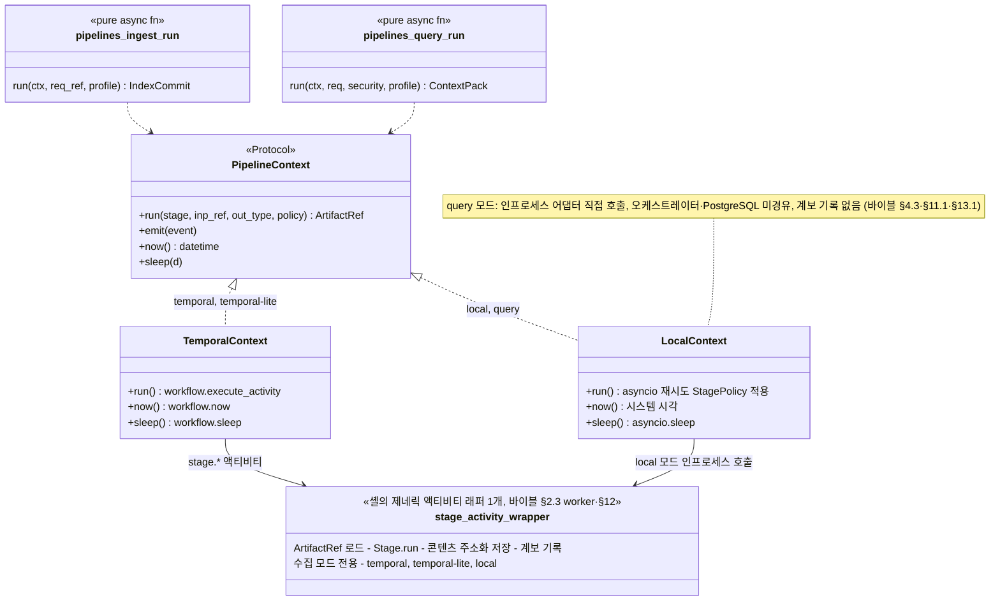

# ADR-0003: 오케스트레이터 중립 파이프라인과 비내구 LocalRunner

브리프 §4 확정 결정 D-17(오케스트레이션 Temporal + 인프로세스 러너)을 `amended`로 개정한 근거와 기각 대안을 기록하는 MADR(Markdown Any Decision Records) 문서다. 결정 문구의 정본은 브리프 §4 D-17(v1.1)과 설계 바이블 §11.1이며, 이 문서는 그것을 바꾸지 않고 설명한다(바이블 §1.1). 바이블 §3.3의 ADR 번호·slug(`0003`, `orchestrator-neutral-pipeline-and-non-durable-local-runner`)를 따른다.

## 맥락과 문제

- 브리프 v1.0의 D-17은 "Temporal 기본 + 인프로세스 러너(같은 워크플로우 정의 재사용)"라고만 적었다. 기술 지형 08 문서의 검증 결과, Temporal 워크플로우 코드(`@workflow.defn` 클래스)는 샌드박스 안에서 결정론 제약(`datetime.now`·난수·I/O 차단) 아래 실행되고 `workflow.execute_activity`는 Temporal 서버를 전제하므로, 그 클래스를 "그대로" 로컬에서 재사용하는 것은 실행 불가다. 또한 인프로세스 러너의 내구성(durability) 지위가 명시되지 않아 구현자가 이를 프로덕션 내구 실행기로 오해할 수 있었다. 선정 매트릭스는 이를 P0 ADR 발의 항목("파이프라인 정의의 오케스트레이터 중립성과 비내구 로컬 러너")으로 올렸다.
- 프로덕션 수집 경로는 내구성이 필수다. 스캔 PDF OCR처럼 수십 분 단위 액티비티(하트비트 기반 장애 감지·페이지 단위 재개), Qdrant + OpenSearch 이중 커밋의 보상(세대 사가, 바이블 §11.4), CPU/GPU/LLM 워커 풀의 태스크 큐 분리와 KEDA 확장, 문서별 취소·우선순위·진행률(시그널/업데이트/쿼리), 야간 재색인·평가 스케줄이 브리프 R1·R4·§7(스캔 PDF 100페이지 < 5min, at-least-once + 멱등)의 요구다.
- 반면 개발 5분 기동(바이블 §11.6), CI, 평가 하네스(D-12: 프로덕션과 동일한 인프로세스 스테이지 실행), 라이브러리 임베딩은 Temporal 서버 없이 같은 파이프라인 정의를 실행해야 한다.
- 리트리벌은 p95 800ms(브리프 §7)와 99.9% 가용성을 요구하므로 오케스트레이터와 PostgreSQL을 핫패스에 둘 수 없다(ADR-0034와 결합).
- Temporal은 단일 페이로드 2MB, 이벤트 히스토리 51,200 이벤트 또는 50MB, 대기 중 자식 워크플로우 2,000개 한계가 있다(08 문서 §Temporal 한계 수치). `ParsedDocument`(산출물 최대 256MB)·`ChunkSet`(청크 50,000) 같은 계약 인스턴스를 인자로 넘기면 실패한다(바이블 §5.1 한계 열).

따라서 결정할 질문은 다섯이다. (1) 파이프라인 정의를 어떤 추상에 묶는가, (2) 로컬 러너의 내구성 지위는 무엇인가, (3) 경량 프로덕션의 내구 실행기는 무엇인가, (4) 오케스트레이터 경계를 넘는 페이로드는 무엇인가, (5) 리트리벌 경로는 오케스트레이터를 거치는가.

## 결정 동인(decision drivers)

| 동인 | 출처 | 함의 |
|------|------|------|
| Pure Stages, Durable Orchestration — 상태·재시도·타임아웃은 오케스트레이터 책임 | 브리프 §3 원칙 3 | 파이프라인 정의와 스테이지는 내구성 장치를 직접 구현하지 않는다 |
| 멱등·콘텐츠 주소화 — 멱등성 키 = 캐시 키 = 산출물 경로 = `stage_key` | 브리프 §3 원칙 4, 바이블 §2.1 K5·§4.1 | 경계 페이로드는 참조(`ArtifactRef`)로 충분하고, 재시도·재처리는 산출물 캐시로 흡수된다 |
| Evaluation-Driven — 하네스는 프로덕션과 동일 코드 경로 | 브리프 §3 원칙 7, D-12 | 오케스트레이터 없이 같은 정의를 실행하는 셸이 필요하다 |
| Adapters over Forks·NIH 금지 — 자체 워크플로우 엔진을 만들지 않는다 | 브리프 §3 원칙 2, R2 | 로컬 러너에 재시도·체크포인트·사가를 재구현하지 않는다 |
| 라이선스 A 등급 우선 | D-02, ADR-0001 | A 등급(MIT·Apache-2.0·BSD) 후보만 비교(Temporal MIT, DBOS MIT, Dapr Apache-2.0, Hatchet MIT, Celery BSD-3, Prefect·Airflow·Dagster Apache-2.0); Restate(서버 BSL 1.1)·Inngest(서버 SSPL)·Windmill(AGPL 제품형)은 코어 의존 불가로 제외(08 문서 §Restate, Inngest, Windmill D-02 판정) |
| 계층 규칙 import-linter | D-01, 바이블 §12 | 중립성은 문서가 아니라 린트로 강제한다 |
| 저장소 PostgreSQL(Temporal 영속화는 별도 DB), 잡 정본은 `jobs` | D-14, D-08, 바이블 §13.1 | 경량 프로덕션도 PostgreSQL 위에서 내구성을 얻어야 한다 |
| 리트리벌 p95 800ms, 스캔 PDF 100p < 5min, 재현성(동일 입력 → 동일 `IndexCommit` 해시) | 브리프 §7 | 검색은 인프로세스, 수집은 내구 실행, 두 셸의 산출물은 동일해야 한다 |
| Temporal 한계 수치(페이로드 2MB, 히스토리 51,200 이벤트) | 08 문서 §Temporal | 페이로드 규약과 대량 재색인 패턴을 설계로 강제해야 한다 |
| 개발 5분 기동(`rag up --profile lite` → `rag ingest` 30s) | 바이블 §11.6 | 개발 모드에 Temporal 서버 기동을 요구할 수 없다 |

## 고려한 대안

| # | 대안 | 판정 | 근거 요약 |
|---|------|------|-----------|
| A | Temporal 워크플로우 코드(`@workflow.defn`) 직접 재사용 | 기각 | 로컬 실행 불가, 하네스가 Temporal 의존, 내구성 미명시(매트릭스 P0) |
| B | 로컬 러너를 내구 실행기로 취급(자체 체크포인트·재시도) | 기각 | 자체 워크플로우 엔진 재발명(NIH), 원칙 3 위반, 검증 도구 부재 |
| C | DBOS Transact 3.x를 경량 프로덕션 내구 러너로 채택 | 기각(현시점; 3.x 안정화 후 별도 ADR로 재검토) | 3.0.0 출시 직후, 실행자 간 복구 상용 의존 |
| D | 태스크 큐(Celery) 또는 데이터 오케스트레이터(Prefect·Dagster·Airflow)로 대체 | 기각 | 결정론 재생·하트비트 없음, 문서 단위 고빈도 잡 부적합 |
| E | Dapr Workflows·Hatchet·Restate·Inngest 등 다른 내구 엔진 | 기각(조건부 재평가) | 기능 얇음 또는 0.x 또는 D-02 위배 |
| F | 오케스트레이터 중립 `PipelineContext` + 두 셸 + `ArtifactRef` 전용 페이로드 + 리트리벌 인프로세스 | **채택** | 정의 1개, 셸 교체 가능, 결정론·한계 수치를 설계로 보장 |

### 대안 A: Temporal 워크플로우 코드 직접 재사용(기각)

- 설명: 브리프 v1.0 D-17의 문자적 해석. `ingest.document.v1` 워크플로우 클래스를 프로덕션과 로컬에서 동일하게 실행하고, 로컬은 `temporal server start-dev`(SQLite 단일 프로세스) 또는 `WorkflowEnvironment.start_local()`로 띄운다.
- 장점: 추상 계층이 없고 정의가 하나다. Temporal 테스트 도구(`WorkflowEnvironment`, `Replayer`)를 그대로 쓴다.
- 단점: 워크플로우 코드는 샌드박스에서 결정론 제약 아래 실행되고 `workflow.execute_activity`는 서버가 있어야 동작하므로 서버 없는 로컬 실행·라이브러리 임베딩이 불가능하다(08 문서 §Temporal 함정 1, §통합 설계 함의). 평가 하네스가 Temporal에 묶여 D-12 "동일 인프로세스 스테이지"와 5분 기동을 만족하지 못한다. 오케스트레이터를 바꾸면(DBOS·Dapr) 파이프라인을 다시 써야 한다. `start-dev`는 SQLite 개발 서버라 프로덕션 내구성이 아니다.
- 판정: 기각. 바이블 §3.1 D-17 근거 열의 문구("`@workflow.defn` 직접 재사용은 로컬 실행 불가, 내구성 미명시")가 그대로 적용된다(매트릭스 D-17 행·ADR 발의 P0 항목의 요약).

### 대안 B: 로컬 러너를 내구 실행기로 취급(기각)

- 설명: `LocalRunner`가 PostgreSQL `jobs`·`artifacts`에 스테이지 진행을 체크포인트하고 크래시 후 재개·재시도·타임아웃·보상을 스스로 수행해, 경량 프로덕션에서 Temporal 없이 운용한다.
- 장점: 경량 프로파일의 인프라가 가장 적다(Temporal 서버 제거).
- 단점: 재시도·하트비트·타임아웃·사가 보상·시그널·스케줄·실행자 간 잡 인수를 재구현하게 되어 "그 결과가 곧 자체 워크플로우 엔진"이 된다(08 문서 §태스크 큐). 결정론 재생 검증 도구(`Replayer` 상당)가 없고, 내구 보증을 주장하는 실행기가 둘이 되어 테스트 매트릭스가 두 배가 된다. 브리프 원칙 3(상태·재시도는 오케스트레이터 책임)에 어긋난다.
- 판정: 기각. `LocalRunner`는 비내구로 명시한다 — 크래시 시 잡은 `failed`, 재시도는 클라이언트 책임, 프로덕션 금지(바이블 §11.1).

### 대안 C: DBOS Transact 3.x를 경량 프로덕션 내구 러너로 채택(기각, 안정화 후 재검토)

- 설명: `dbos` 3.0.0(PyPI 2026-09-16, MIT)은 `@DBOS.workflow()`/`@DBOS.step()` 라이브러리로 PostgreSQL만으로 내구 실행을 제공한다(서버 없음). `PipelineContext`의 세 번째 구현으로 수용 가능하다.
- 장점: D-14 PostgreSQL 외 인프라 추가 없음, 가중 점수 4.00(2위, 운영 5점), 큐·레이트리밋·durable sleep·스케줄 내장, 공식 문서상 단일 PostgreSQL로 >40K workflows/steps per second 주장(08 문서 §DBOS).
- 단점: 3.0 메이저 출시 직후(스키마 마이그레이션 변경), 실행자(프로세스) 간 자동 복구·대시보드가 상용 Conductor에 의존, 3.0.0에서 HTTP 어드민 서버 제거(조회·재시작·포크는 CLI 또는 `DBOS.list_workflows/resume_workflow/fork_workflow`), 커뮤니티 규모 작음, 독립 벤치마크 확인 필요(as of 2026-09).
- 판정: 기각(현시점; DBOS 3.x 안정화 후 별도 ADR로 재검토). 바이블 §11.1 `temporal-lite` 행의 제약 "DBOS Transact 3.x는 안정화 후 ADR"을 따르고, 경량 프로덕션은 Temporal 단일 바이너리 + PostgreSQL(`start-dev` 아님)로 확정한다.

### 대안 D: 태스크 큐·데이터 오케스트레이터로 대체(기각)

- 설명: Celery 5.6(BSD-3, 가중 3.85) 같은 태스크 큐, 또는 Prefect 3(3.85)·Airflow 3(3.60)·Dagster(3.25) 같은 데이터 오케스트레이터로 수집 파이프라인을 구성한다.
- 장점: 조직 표준 도구와 운영 경험을 재사용할 수 있다.
- 단점: 결정론 재생이 없어 스테이지 중간 크래시 시 처음부터 재실행되고(Prefect는 플로우 재실행 + 캐시 건너뛰기), 장시간 액티비티의 하트비트가 없다. 문서 1건 = 잡 1건, 초당 수십 건 API 트리거 모델에 스케줄러·DAG run 오버헤드가 크다. Celery는 asyncio 네이티브가 아니고 상태 관리를 애플리케이션이 맡게 된다(대안 B의 문제로 귀결).
- 판정: 기각. 08 문서 판정대로 Celery는 조직 표준일 때 폴백, Prefect는 `evaluator` 실행기 어댑터 후보로만 남긴다.

### 대안 E: Dapr Workflows·Hatchet·Restate·Inngest(기각, 조건부 재평가)

- Dapr Workflows 1.18(Apache-2.0, 3.65): 사이드카(daprd) 전제, 시그널·쿼리·스케줄이 Temporal보다 얇고 액티비티 하트비트는 확인 필요(as of 2026-09), 결정론 검증 도구 없음. 조직이 Dapr를 표준 운영하면 `PipelineContext` 구현 하나로 수용하는 2순위 후보군이다.
- Hatchet 0.108(MIT, 3.70): 엔진 0.x, `durable_task`는 대기·자식 생성만 허용해 사가·시그널 상태 기계 표현력이 좁다.
- Restate(서버 BSL 1.1)·Inngest(서버 SSPL)·Windmill(AGPL 제품형): D-02 위배 또는 라이브러리 임베딩 부적합으로 제외.
- 판정: 기각. 단, 채택안의 중립 계약 덕분에 Dapr는 `PipelineContext` 구현 하나로 수용 가능하고(08 문서 §Dapr Workflows 등 추가 비교군 판정 열), Restate·Inngest는 사용자가 이미 운영 중일 때 플러그인으로만 수용한다(08 문서 §Restate, Inngest, Windmill D-02 판정). Hatchet은 08 문서에 흡수 가능성 평가가 없다(미평가). 어느 경우에도 계약(03-contracts)에는 영향이 없다.

### 대안 F: 오케스트레이터 중립 `PipelineContext` + 두 셸(채택)

- 설명: 파이프라인 정의는 `PipelineContext` 프로토콜에만 의존하는 순수 비동기 함수이고, Temporal 셸(`TemporalContext`)과 로컬 셸(`LocalContext`)이 컨텍스트를 주입한다. 수집 모드(`temporal`·`temporal-lite`·`local`)에서 스테이지 실행·`ArtifactRef` 로드·콘텐츠 주소화 저장·계보 기록은 셸의 제네릭 액티비티 래퍼 1개가 맡는다(바이블 §2.3 `worker`, §12 `orchestration/temporal/activities`; 다이어그램의 `stage_activity_wrapper`는 타입명이 아닌 설명 라벨). `query` 모드는 같은 `LocalContext`가 `api` 프로세스 안에서 인프로세스 어댑터를 직접 호출하며, 검색 핫패스는 PostgreSQL을 읽지 않으므로 `lineage` 기록이 없다(바이블 §4.3 `retrieve`·`fuse`·`hydrate` 캐시 키 "없음", §11.1 `query` 행, §13.1). `query` 모드의 경계 페이로드 형태와 저장 생략 규칙은 바이블이 정하지 않았으므로 아래 결과(부정)에 확정 필요 항목으로 남긴다.
- 장점: 정의 1개로 개발·CI·하네스·프로덕션을 덮는다. 파이프라인이 I/O·시간·난수를 직접 쓰지 않으므로 Temporal 샌드박스 결정론이 자동 보장된다. 페이로드가 `ArtifactRef`뿐이라 2MB 한계가 설계상 발생하지 않는다. 오케스트레이터 교체 비용이 컨텍스트 구현 1개로 한정된다.
- 단점: 추상 계층이 하나 늘고, 시그널/업데이트·자식 워크플로우·`continue_as_new` 같은 Temporal 고유 기능은 파이프라인 정의로 표현되지 않아 셸 코드에 남는다. `LocalRunner`는 크래시 시 잡을 잃으므로 허용 용도가 제한된다.
- 판정: 채택. 세 설계 제안(A·B·C) 중 C의 커널·SDK 골격을 바이블 §2.1 K5로 확정한 것과 일치한다.

## 결정

**결정:** 오케스트레이션 **Temporal**(내구성 워크플로우: 재시도·타임아웃·하트비트·사가·스케줄; 영속화·가시성 PostgreSQL). 파이프라인 정의는 오케스트레이터 중립 `PipelineContext`에만 의존하고(`temporalio` 임포트 금지 린트) 경계 페이로드는 `ArtifactRef`만. 개발·CI·평가 하네스는 **비내구 `LocalRunner`**(같은 파이프라인 정의를 다른 셸로 실행), 경량 프로덕션은 Temporal 단일 바이너리 + PostgreSQL. 리트리벌 경로는 오케스트레이터를 거치지 않는다(브리프 §4 D-17, 개정 v1.1).

바이블 §11.1 정본 문구: 파이프라인 정의(`rag_platform.pipelines.ingest.run(ctx, req_ref, profile) -> IndexCommit`, `pipelines.query.run(ctx, req, security, profile) -> ContextPack`)는 `PipelineContext` 프로토콜(`run(stage, inp_ref, out_type, policy) -> ArtifactRef`, `emit(event)`, `now()`, `sleep(d)`)에만 의존하는 순수 비동기 함수다. `TemporalContext`는 `workflow.execute_activity`, `LocalContext`는 `asyncio` + 재시도로 감싼다. `pipelines`·`retrieval`·`render` 패키지는 `temporalio`·`fastapi`를 임포트하지 않는다(import-linter). 검색 경로는 항상 `LocalContext`로 `api` 프로세스 안에서 실행된다.

바이블 §4.1 경계 페이로드: 오케스트레이터를 넘는 값은 `ArtifactRef`만(Temporal 2MB 한계). 셸(액티비티 래퍼)이 `ArtifactRef ↔ 계약 인스턴스` 변환·저장·계보 기록을 담당. 스테이지가 `requires_lineage: [schema_type…]`로 선언한 상류 산출물은 셸이 입력 봉투의 `lineage_refs`(§5.2)에서 함께 로드해 `ctx.lineage[schema_type]`로 제공한다(`index`: `EnrichedChunkSet`·`ChunkSet`·`SourceDocument`; 그 외 스테이지는 없음). 경계 페이로드는 여전히 `ArtifactRef` 1개다.

| 모드 | 실행기 | 내구성 | 용도 | 제약 |
|------|--------|--------|------|------|
| `temporal` | Temporal Server 1.32 + `temporalio` 1.33, `pydantic_data_converter`, `TracingInterceptor` | 내구(재시도·하트비트·사가·시그널·스케줄) | standard/premium/korean-gov 수집·재색인·평가·정합성 검사 | 페이로드 `ArtifactRef`만, 결정론(`Replayer` CI) |
| `temporal-lite` | Temporal 단일 바이너리 + PostgreSQL(`start-dev` 아님) | 내구 | `lite` 프로덕션 | DBOS Transact 3.x는 안정화 후 ADR |
| `local` | `LocalRunner`(asyncio) | **비내구**(크래시 시 `failed`, 재시도는 클라이언트) | 개발·CI·평가 하네스·라이브러리 임베딩 | 프로덕션 금지(`rag up --profile lite --durable`로 Temporal 추가) |
| `query` | `LocalContext` 인프로세스 | 무상태 | 모든 프로파일의 리트리벌 | 오케스트레이터·PostgreSQL 미경유 |

결정에 딸린 정본 세부(모두 바이블 인용, 이 문서가 새로 정하지 않는다; 의존 방향·셸 책임·발급 식별자·명명은 아래 준수 확인 표 1·7·9·10행의 강제 수단에 있다):

- 셸 책임(바이블 §2.3 `worker`): 제네릭 액티비티 래퍼 외에 하트비트·`Resumable`, 사이드카 호출, `index` 사가를 맡는다. `commit_id`·`event_id`는 Temporal 워크플로우가 `workflow.now()`·`workflow.random()`으로 1회 생성해 액티비티 인자로 전달하고 `LocalRunner`는 일반 생성한다(§11.2). `LocalRunner`는 `api`와 동일 프로세스다.
- 프로파일(바이블 §5.6 `Profile.runtime`, §7.1·§7.3): `runtime.orchestrator`는 `enum[local, temporal]`. `lite`는 `LocalRunner`(개발·CI) / Temporal 단일 바이너리 + PG(운영), 큐 `ingest` + `maintenance`, 부수 큐 Procrastinate; `standard` 이상은 Temporal frontend/history/matching 분리 + KEDA `temporal` 스케일러.
- 히스토리 한계 대응(바이블 §11.2 `reindex.collection.v1`): 부모가 문서 ID 페이지를 조회 → 자식 `ingest.document.v1` 슬라이딩 윈도우 50 → 1,000개마다 `continue_as_new`. 같은 "순수 코어 + 실행기 셸" 패턴을 아웃박스 릴레이(바이블 §3.2 O-06, ADR-0017)도 쓴다.

## 결과

### 긍정

- 파이프라인 정의 1개가 개발·CI·평가 하네스·프로덕션을 모두 덮어, D-12의 "프로덕션과 동일한 인프로세스 스테이지 실행"과 브리프 §7 재현성(동일 `IngestRequest` + 동일 프로파일 → 동일 `IndexCommit` 해시)이 같은 코드 경로에서 성립한다.
- 파이프라인이 `ctx.now()`·`ctx.sleep()`만 쓰므로 Temporal 결정론 위반이 구조적으로 어려워지고 `Replayer` 회귀가 안정된다.
- 페이로드 2MB·히스토리 51,200 이벤트 한계가 "발생 불가 설계"가 된다(`ArtifactRef` 전용 + 자식 워크플로우 + `continue_as_new`).
- 오케스트레이터 교체·추가(DBOS·Dapr 재평가) 비용이 컨텍스트 구현 1개로 한정되고 계약(03-contracts)은 불변이다.
- 리트리벌 핫패스의 지연·가용성이 Temporal·PostgreSQL 장애 반경과 분리된다(바이블 §15 리스크 10, ADR-0034).
- `rag up --profile lite` 5분 기동(바이블 §11.6)이 Temporal 없이 가능하다.

### 부정

- `LocalRunner`는 프로세스 크래시 시 진행 중 잡을 `failed`로만 남긴다. 완료된 스테이지 산출물은 `stage_key` 캐시로 재사용되지만 잡 재시도는 클라이언트 책임이며, 프로덕션 오용을 막는 규칙(아래 준수 확인 6)이 필요하다.
- 크래시한 프로세스는 스스로 `failed`를 원장에 기록할 수 없다. 크래시한 `LocalRunner` 잡을 `failed`로 전이시키는 주체·시점(예: `api` 재기동 시 또는 조정 스케줄에서 `state=running AND workflow_run_id IS NULL` 잡 정리)은 바이블 §11.1·§11.5가 정하지 않았으므로 02-architecture/06(잡 상태 기계)에서 확정한다. 이 문서는 방식을 정하지 않는다.
- `query` 모드에서 `ctx.run`의 경계 페이로드(`ArtifactRef` vs 인메모리 계약 인스턴스)와 `plan → retrieve → fuse → … → pack` 매 경계의 산출물 저장 생략 규칙은 바이블 §4.3(`retrieve`·`fuse`·`hydrate` 캐시 키 "없음")·§11.1(`query` 행 "무상태")이 정하지 않았다. p95 800ms 경로에 매 경계 저장을 강제할 수 없으므로 02-architecture/06·04-pipelines/01에서 확정한다(바이블 §11.1 시그니처 patch가 필요하면 그 문서의 미해결 이슈로 제안). 이 문서는 새 결정을 만들지 않는다.
- 두 셸의 동작 차이(재시도 백오프·하트비트·시그널 유무·`workflow_run_id` null)를 문서화하고 동등성을 테스트해야 한다.
- 취소·우선순위(시그널/업데이트), 자식 워크플로우, `continue_as_new`는 셸 전용이라 `reindex.collection.v1`처럼 오케스트레이션 로직이 Temporal 셸 코드에 존재한다. 파이프라인 정의와 셸 사이의 책임 경계를 코드 리뷰로 지켜야 한다.
- 경량 프로덕션도 Temporal 단일 바이너리를 운영해야 한다(DBOS는 현시점 기각, 안정화 후 재검토). 운영 부담은 PostgreSQL 단일 저장소(영속화 + advanced visibility)로 최소화한다.
- `PipelineContext.emit`이 Temporal 모드에서 로컬 액티비티로 실행될 때의 트랜잭션 경계(잡 상태 갱신과 동일 트랜잭션)는 02-architecture/06에서 확정해야 한다(08 문서 미해결 이슈 2).

### 중립

- 셸이 `ArtifactRef` 로드·저장·계보를 담당하므로 스테이지·어댑터는 저장소를 모른다. 어댑터 작성자는 오케스트레이터도 저장소도 신경 쓰지 않는다.
- `temporal server start-dev`(SQLite)는 Temporal 셸 통합 테스트 용도로는 여전히 쓸 수 있으나 프로덕션 모드가 아니다(`temporal-lite`는 단일 바이너리 + PostgreSQL). 평가 하네스(`eval/harness runner`)는 `LocalRunner`를 재사용하며 별도 검색 경로를 갖지 않는다(바이블 §2.3, §12).

## 준수 확인 방법

| # | 규칙 | 강제 수단 | 게이트·위치 |
|---|------|-----------|-------------|
| 1 | `pipelines`·`retrieval`·`render`는 `temporalio`·`fastapi`·`ledger`를 임포트하지 않는다 | import-linter 계층 계약(D-01), 바이블 §12 의존 방향 | CI 린트, 위반 = 빌드 실패 |
| 2 | 오케스트레이터 경계 페이로드는 `ArtifactRef` 1개(수집 모드) | `PipelineContext.run(...) -> ArtifactRef` 시그니처(mypy strict), `ArtifactRef{uri, blake3, media_type, size_bytes}` 필수·`schema_type/schema_version` 조건·`stage_key` 선택(바이블 §5.3), 액티비티 인자 타입은 `ArtifactRef`만; `requires_lineage` 상류 산출물 로드는 셸이 `lineage_refs`에서 수행하므로 다중 상류 입력(`index`)에도 페이로드는 1개(§4.1) | 계약 스냅샷 테스트, mypy; 2MB 초과는 계약 위반으로 CI 차단(08 문서 §실패 모드) |
| 3 | Temporal 워크플로우 결정론 | `Replayer` 히스토리 회귀(`tests/replay`), `WorkflowEnvironment.start_time_skipping()` 단위 테스트 | CI 필수 게이트(바이블 §11.6) |
| 4 | 스테이지 순수성 — I/O·시간·난수는 `ctx.token_counter`·`ctx.analyzer`·`ctx.now()`·`ctx.lineage[...]`만 | `Stage[In, Out]` 5멤버 프로토콜(바이블 §4.1), 적합성 키트 `contract_roundtrip`·`idempotency`(바이블 §12 `testing/`) | 적합성 키트 + 코드 리뷰 |
| 5 | 두 셸이 같은 정의로 동일 `IndexCommit` 해시를 낸다 | 브리프 §7 재현성(동일 `IngestRequest` + 동일 프로파일 → 동일 `IndexCommit` 해시), 바이블 §11.1 "두 실행기, 하나의 정의"; 적합성 키트 `idempotency`(바이블 §12 `testing/`) | CI 적합성 키트; 두 셸 교차 실행 검사는 아래 제안 (i) |
| 6 | `LocalRunner` 프로덕션 금지 | `Profile.runtime.orchestrator ∈ enum[local, temporal]`(바이블 §5.6); `rag up --profile lite`는 `local`, `--durable`이 Temporal을 추가(§11.1) | 프로파일 로딩 검증(바이블 §7.4) + 코드 리뷰; 매니페스트 검증은 아래 제안 (ii) |
| 7 | `workflow_run_id`는 Temporal 발급, `LocalRunner`는 null | `JobStatus.workflow_run_id: string(uuid) \| null`(바이블 §5.6), `run_id` 이름은 `EvalRun`만(§6.1) | 스키마·열거 CI 대조(바이블 §1.2) |
| 8 | 리트리벌은 오케스트레이터·PostgreSQL 미경유 | `retrieval`이 `ledger`·`temporalio`를 모른다(import-linter); `hydrate`는 인덱스 payload 1회 배치 조회(§4.3) | import-linter + ADR-0034 |
| 9 | 재시도 정책의 소유 | `StagePolicy{task_queue, start_to_close, heartbeat, max_attempts, backoff, non_retryable_error_codes, resumable, isolation}`(§5.3)는 프로파일이 선언, 재시도 여부는 오류 카탈로그 `retryable`(§5.7) | 오류 코드 CI 대조(§1.2); 스테이지 코드에 재시도 루프가 있으면 리뷰 거부 |
| 10 | 명명 | 워크플로우 타입 `{domain}.{entity}.v{n}`, 액티비티 `stage.{stage_name}`, 큐 kebab-case(§6.7) | 코드 리뷰, ADR-0036 |

제안(바이블 미명시, 결정 아님): (i) 같은 골든 입력을 `LocalRunner`와 Temporal(`WorkflowEnvironment.start_time_skipping()`)로 실행해 동일 `IndexCommit.commit_hash`를 확인하는 두 셸 동등성 검사를 적합성 키트 항목으로 10-development/04에서 확정한다. (ii) `deploy/{helm,compose}` 프로덕션 values에 `orchestrator: local`이 없음을 검증하는 규칙을 02-architecture/08에서 확정한다.

코드 리뷰 체크리스트(요약): (a) `pipelines/*.py`에 `temporalio`·`fastapi`·`ledger`·`storage` 임포트가 없는가, (b) 수집 파이프라인의 `ctx.run` 인자·반환이 `ArtifactRef`인가, (c) 스테이지 안에 `datetime.now`·`random`·직접 파일/네트워크 I/O·재시도 루프가 없는가, (d) 새 오케스트레이션 기능(시그널·자식 워크플로우)이 파이프라인 정의가 아니라 셸에 있는가, (e) `LocalRunner` 경로가 프로덕션 매니페스트에 노출되지 않는가.

## 재검토 조건

- DBOS Transact 3.x가 안정화되면(3.0.x 패치 안정, 실행자 간 복구의 오픈소스 범위 확인, 독립 벤치마크 확보) 경량 프로덕션 내구 러너로서 DBOS용 `PipelineContext` 구현(세 번째 구현; 이름은 그 ADR에서 정한다) 채택 여부를 별도 ADR로 판단한다. 조직이 Dapr를 표준 운영하는 경우의 Dapr Workflows 컨텍스트도 같은 ADR에서 검토한다(08 문서 결정 사항 요약).
- Temporal의 페이로드·히스토리 한계, 샌드박스 규칙, `temporalio` 메이저 버전이 바뀌어 `TemporalContext`·액티비티 래퍼 설계에 영향을 줄 때.
- 파이프라인 정의가 시그널/업데이트·자식 워크플로우·`continue_as_new`를 직접 표현해야 하는 요구가 누적되어 셸 코드 이중화가 문제가 되면 `PipelineContext` 프로토콜 확장을 ADR로 발의한다(바이블 §1.2 minor 변경 절차).
- 표준 프로파일 부하 테스트(`temporalio/omes` + `temporalio/benchmark-workers`, 08 문서 미해결 이슈 1)가 브리프 §7 처리량 목표·바이블 §11.6 기동 목표에 미달할 때.
- `LocalRunner`의 프로덕션 오용 사례가 확인되면 준수 확인 표 아래 제안 (ii)(매니페스트 검증)를 바이블 규칙으로 승격한다. 08 문서의 6개월 주기 개정에서 관찰 대상(Absurd·Resonate)의 성숙도가 바뀔 때도 함께 재검토한다.

## 참조

- [설계 브리프](../00-vision/00-design-brief.md) — §3 원칙 2·3·4·7, §4 D-01·D-02·D-08·D-12·D-14·D-17, §7 품질 목표
- [설계 바이블](../02-architecture/00-design-bible.md) — §1.1, §2.1 K5, §2.3, §3.1 D-17, §3.2 O-06, §3.3, §4.1, §4.3, §4.4, §5.3 `ArtifactRef`·`StagePolicy`, §5.6 `JobStatus`·`Profile.runtime`, §6.1, §6.7, §7.1, §11.1~§11.6, §12, §15
- [기술 지형 종합: 선정 매트릭스와 결정 권고](../07-tech-landscape/00-summary-and-selection-matrix.md) — 매트릭스 `orchestrator`·`task_queue_light` 행, 브리프 수정 제안 D-17, ADR 발의 목록 P0
- [오케스트레이션·메시징·API 프레임워크](../07-tech-landscape/08-orchestration-messaging-and-api-frameworks.md) — §Temporal, §DBOS Transact, §Prefect 3·Dagster·Airflow 3, §Dapr Workflows 등 추가 비교군, §태스크 큐, §선정 근거 점수표, §두 모드가 같은 파이프라인 정의를 공유하는 패턴, §페이로드·히스토리 한계 대응, §개방 결정에 대한 의견 D-17 검증
- 관련 ADR(바이블 §3.3 번호·slug): [ADR-0017 이벤트 전달](./0017-event-delivery-outbox-cloudevents-no-broker.md), [ADR-0018 API 규약](./0018-api-rest-sse-mcp-no-grpc-rfc9457.md), [ADR-0026 IndexCommit 세대 사가](./0026-index-commit-generation-saga-and-ledger.md), [ADR-0032 플러그인 SDK](./0032-plugin-sdk-stage-protocol-and-conformance-kit.md), [ADR-0033 사이드카 convert 계약](./0033-sidecar-convert-contract-and-isolation-ladder.md), [ADR-0034 검색 핫패스 PostgreSQL 미의존](./0034-retrieval-hot-path-postgres-independence-and-hydrate.md), [ADR-0036 명명 규약](./0036-naming-and-identifier-conventions.md), [ADR-0037 산출물 캐시 스코프](./0037-artifact-cache-scope-and-stage-key-composition.md)
- 이 결정을 전제로 하는 설계 문서(문서 맵): [오케스트레이션과 워크플로우](../02-architecture/06-orchestration-and-workflows.md), [파이프라인 프레임워크](../04-pipelines/01-pipeline-framework.md), [잡·이벤트·상태 계약](../03-contracts/12-jobs-events-and-status.md), [테스팅 전략](../10-development/04-testing-strategy.md), [배포 아키텍처](../02-architecture/08-deployment-architecture.md)
