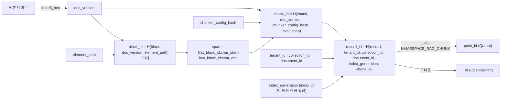

# ADR-0004: 결정적 chunk_id·block_id 해시, 스코프·세대 합성 record_id/point_id와 D-06 ULID 예외

## 맥락과 문제

브리프 D-06 원안은 모든 `*_id`를 시간 정렬 ULID(Universally Unique Lexicographically Sortable Identifier)로 발급하도록 했다. 그러나 청크의 정체성(identity)에는 원칙 4(Idempotent & Content-Addressed)와 브리프 §7 재현성 목표("동일 `IngestRequest` + 동일 프로파일 → 동일 `IndexCommit` 해시")가 걸려 있다. `commit_hash = H("commit", profile_hash, *sorted(f"{chunk_id}:{content_hash}:{embed_text_hash}"))`(바이블 §6.2)이므로 `chunk_id`가 실행 시각에 따라 달라지면 커밋 해시는 재현되지 않는다. ULID는 48비트 타임스탬프 + 80비트 난수로 **발급 시점에** 만들어지는 값이어서 콘텐츠에서 유도할 수 없고, 반대로 콘텐츠 해시는 시간 정렬 성질을 가질 수 없다. 두 요구는 한 형식으로 동시에 만족되지 않는다.

기술 지형 문서도 이 지점에서 엇갈렸다. 청킹 연구(07-tech-landscape/04 §통합 설계 함의 › 어댑터 계약의 `Chunker` 플러그인 인터페이스 제안)는 청커를 순수 함수로 두고 청크 ID를 `BLAKE3(document_hash + chunker_config_hash + block_path + char_range)`로 제안했지만, 인덱스 백엔드 연구(07-tech-landscape/06 §표준 `IndexRecord` → 백엔드 매핑)는 `chunk_id`를 D-06대로 ULID로 두고 Qdrant가 포인트 ID로 64비트 정수 또는 UUID만 허용한다는 확정 사실에 맞춰 `ulid_to_uuid` 변환을 제안했다. 세 설계 제안은 이 모순을 그대로 상속했다: 제안 A·B는 `chunk_id`를 결정적 해시로 두면서 Qdrant 포인트 ID를 정의되지 않은 `chunk_ulid`에서 변환했고, 제안 C는 해시 상위 비트로 ULID 시간 비트를 대체하는 `ulid_from_hash`를 썼다. 바이블 §목적은 이 둘을 세 제안의 치명 결함으로 지목하고 초판에서 제거했다.

설계 리뷰는 두 번째 결함을 blocker로 올렸고 D-06 개정 v1.2로 반영되었다(바이블 §3.1 D-06, §10.3 E17). 개정 전의 물리 키는 `point_id = uuid5(NAMESPACE_RAG_CHUNK, chunk_id)`, `record_id = chunk_id`였는데 `chunk_id`에는 테넌트·컬렉션·문서 스코프가 없다. 기본 격리 등급 `payload_filter`는 여러 테넌트가 물리 컬렉션 `rag_vec_{embedding_profile_hash[:12]}` 하나를 공유하므로(바이블 §10.4, §13.4; Qdrant 공식 가이드는 테넌트별 컬렉션을 예외적 수단으로 본다 — 07-tech-landscape/06 §심층 비교 › Qdrant, 멀티테넌시 단락) 동일 바이트 문서(공개 법령 PDF·표준 서식)를 두 테넌트(또는 한 테넌트의 두 컬렉션)가 같은 청커 설정으로 수집하면 `doc_version → block_id → chunk_id → point_id`가 모두 같아져 뒤 테넌트의 upsert가 앞 레코드의 `tenant_id`·`acl_*` payload를 덮어쓴다. 또한 청킹 전 단계가 동일한 재색인(`from_stage=enrich|embed`, `dedup_policy=reindex_always`, 임베더·ACL 정책 변경)은 `chunk_id` 집합이 같아 새 세대가 이전 세대 레코드를 제자리에서 덮어쓰고, `is_current=false`로 적재한 뒤 플립하고 실패 시 이전 세대를 복원하는 세대 사가(바이블 §11.4, ADR-0026)가 성립하지 않는다. 같은 리뷰에서 브리프 D-06의 `block_id` 식 `blake3(doc_version + element_path)`는 라벨 결합식 `H("block", …)`으로 정정되었다.

## 결정 동인(decision drivers)

- **재현성·멱등성(원칙 4, 브리프 §7)**: 같은 입력·설정은 같은 `block_id`·`chunk_id`·`commit_hash`를 내야 한다. 07-tech-landscape/00 §어댑터·플러그인 공통 요구 2("출력 ID는 BLAKE3 콘텐츠 주소")와 일치한다.
- **테넌트 격리(D-09, E5, E17)**: 공유 물리 컬렉션·인덱스에서 다른 테넌트·컬렉션의 레코드를 덮어쓸 수 있는 키는 허용되지 않는다.
- **세대 공존(K6, 바이블 §11.4)**: 새 세대는 검색에 보이지 않게 먼저 적재되고, 플립 후 실패 시 이전 세대를 복원해야 하므로 세대별 레코드가 물리적으로 공존해야 한다.
- **백엔드 제약**: Qdrant 포인트 ID는 u64 또는 UUID만(07-tech-landscape/06 §표준 `IndexRecord` → 백엔드 매핑, 확정), OpenSearch `_id`는 문자열이다. 변환은 결정적이어야 한다.
- **콘텍스트 재사용**: `exclude_ids`(이미 본 청크), `duplicates_of`, `commit_hash`, 평가 run의 문서 ID는 세대·스코프와 무관한 콘텐츠 주소 키를 필요로 한다(바이블 §5.4 `IndexRecord.chunk_id`).
- **발급형 ID의 이점 유지**: ULID의 시간 정렬은 커서 페이지네이션을 `id` 단독 키셋으로 단순화한다(07-tech-landscape/08 §심층 비교 › API 프레임워크와 HTTP 규약, 페이지네이션 항목). 예외는 콘텐츠 파생 키에 한정한다.
- **단일 결합식(K5)**: 해시 용도를 라벨로 구분하는 하나의 `H()`와 하나의 구현으로 모든 파생 키를 만든다.

## 고려한 대안

### 대안 1 — D-06 문자 그대로: `chunk_id`를 발급형 ULID로

- 설명: 청킹 시점에 서버가 ULID를 발급한다.
- 장점: D-06 규칙이 단일하고, 07-tech-landscape/06 §표준 `IndexRecord` → 백엔드 매핑의 `ulid_to_uuid` 변환을 그대로 쓸 수 있다.
- 단점: 재실행마다 ID가 바뀌어 `commit_hash` 재현(브리프 §7)·`exclude_ids`·`duplicates_of`·평가 run 기준이 모두 깨진다. 07-tech-landscape/04 §어댑터 계약의 `Chunker` 인터페이스 제안이 요구한 "동일 입력·설정 → 동일 `ChunkSet`"과 정면 충돌한다. 기각.

### 대안 2 — 제안 A·B: 결정적 `chunk_id` + 미정의 `chunk_ulid`에서 `ulid_to_uuid`

- 설명: `chunk_id`는 BLAKE3 해시로 두고, Qdrant 포인트 ID는 `ulid_to_uuid(chunk_ulid)`(A) 또는 `ulid_to_uuid(chunk_id 기반 ULID)`(B)로 만든다.
- 장점: 계약 골격(B)의 결정적 청크 정체성을 유지한다.
- 단점: 해시에서 ULID를 얻는 함수가 어디에도 정의되지 않았다(바이블 §목적 "`chunk_ulid` 미정의"). 정의하려면 대안 3이 되고, 발급하려면 대안 1이 된다. 바이블이 명시 기각.

### 대안 3 — 제안 C: `ulid_from_hash`(시간 비트를 해시 상위 비트로 대체)

- 설명: 256비트 해시의 상위 128비트를 ULID 형식으로 재해석해 D-06 형식을 유지한다.
- 장점: 모든 ID가 겉보기에 한 형식이고 `ulid_to_uuid`를 재사용한다.
- 단점: 시간 비트가 시간이 아니어서 D-06의 "시간 정렬" 의도를 위반한다(제안 C 스스로 미해결 이슈 4에 기록). 형식은 같지만 의미가 다른 두 종류의 ID가 섞여 도구·정렬·디버깅에서 오해를 낳고, 해시를 128비트로 절단해 콘텐츠 주소 키의 표현력을 잃는다. 바이블이 편법으로 명시 기각.

### 대안 4 — 제안 C 미해결 이슈: `chunk_id`(ULID 발급) + `chunk_key`(결정적 해시) 이중 필드

- 설명: 발급형 ULID와 콘텐츠 해시를 청크에 둘 다 둔다.
- 장점: D-06 형식 규칙을 문자 그대로 지키면서 결정성도 확보한다.
- 단점: 한 청크에 정체성이 둘이 되어 모든 소비자가 어느 쪽을 쓸지 선택해야 한다. `exclude_ids`·`duplicates_of`·`commit_hash`·평가는 결국 `chunk_key`만 쓰게 되어 `chunk_id`는 payload 바이트만 차지하는 사문이 되고, 단일 좌표계(K1)의 참조 필드 이름이 흔들린다. 바이블이 ADR 병기용 기각 대안으로 지정.

### 대안 5 — D-06 개정 v1.2 이전(바이블 초판): `record_id = chunk_id`, `point_id = uuid5(NAMESPACE_RAG_CHUNK, chunk_id)`

- 설명: 콘텐츠 주소 `chunk_id`를 그대로 물리 키로 쓰고 Qdrant용으로만 UUID v5로 변환한다.
- 장점: 키가 하나뿐이라 단순하고 `hydrate`·`exclude_ids`가 같은 값을 쓴다.
- 단점: 공유 물리 컬렉션에서 동일 바이트 문서의 교차 테넌트·교차 컬렉션 upsert가 payload(`tenant_id`, `acl_*`)를 덮어쓴다(E17 리뷰 blocker). 세대가 키에 없어 청킹 전 단계가 같은 재색인이 이전 세대를 제자리에서 덮어쓰고 §11.4 사가의 이전 세대 복원이 불가능하다. D-06 개정 v1.2에서 기각.

### 대안 6 — 스코프를 `chunk_id` 자체에 합성(본 ADR의 분석 대안)

- 설명: `chunk_id = H("chunk", tenant_id, collection_id, document_id, doc_version, …)`처럼 청킹 단계에서 스코프를 해시에 넣는다.
- 장점: 별도 물리 키 없이 교차 테넌트 충돌을 막는다.
- 단점: `index_generation`은 `index` 단계에서 원장 잠금 아래 할당되므로(바이블 §11.4 (6)) `chunk` 단계 산출물인 `ChunkSet`은 세대를 알 수 없어 세대 충돌은 남는다. 또한 같은 콘텐츠가 컬렉션마다 다른 `chunk_id`를 갖게 되어 "청킹 전 단계가 동일하면 `chunk_id` 집합이 같다"는 세대 사가의 판정 기준과 콘텐츠 주소성이 사라진다. 스코프는 산출물 쪽에서는 이미 `stage_key`의 `scope_key`(ADR-0037)가 담는다. 기각.

### 대안 7 — 채택: 결정적 `H()` 키 + 스코프·세대 합성 `record_id` + `point_id = uuid5(record_id)`, `_id = record_id`

- 설명: 콘텐츠 파생 키는 BLAKE3 소문자 hex, 물리 키는 스코프·세대를 합성한 별도 해시. `chunk_id`는 payload의 콘텐츠 주소 필드로 유지.
- 장점: 재현성·격리·세대 공존을 모두 만족하고, 논리 정체성(`chunk_id`)과 물리 정체성(`record_id`)을 역할로 분리한다. Qdrant·OpenSearch 제약을 결정적 변환 하나로 흡수한다.
- 단점: 레코드가 세 키(`record_id`, `point_id`, `chunk_id`)를 갖고, 세대별 레코드가 정리 지연 동안 2배 공존한다(아래 결과 참조).

## 결정

**결정:** 발급형 `*_id`는 ULID; **콘텐츠 파생 키(`block_id`, `chunk_id`, `stage_key`, `*_hash`, `doc_version`)는 BLAKE3 hex 예외**(결합식은 §6.2 `H()`); **물리 인덱스 키는 스코프·세대 합성** `record_id = H("record", tenant_id, collection_id, document_id, str(index_generation), chunk_id)`, Qdrant `point_id = uuid5(NAMESPACE_RAG_CHUNK, record_id)`, OpenSearch `_id = record_id`(바이블 §3.1 D-06, 상태 `amended(v1.2)`; 브리프 §4 D-06 개정 v1.2). `chunk_id`는 콘텐츠 주소 키로 payload 필드에 유지하며 `exclude_ids`·`commit_hash`·평가 run의 문서 ID·`duplicates_of`의 기준이다(바이블 §5.4 `IndexRecord`). 결합식은 바이블 §6.2 그대로 `H(label, *parts) = blake3_hex(utf8(label) + 0x1F + 0x1F.join(utf8(part) for part in parts))`이며, 라벨은 해시 용도를 구분하는 도메인 접두어다.

| 키 | 종류 | 정본 식(바이블 §6.1·§6.2) | 형식 | 비고 |
|----|------|---------------------------|------|------|
| `tenant_id`, `collection_id`, `document_id`, `job_id`, `commit_id`, `chunk_set_id`, `query_id`, `pack_id`, `event_id` 등 | 발급형 | 서버 발급 ULID | 26자 Crockford base32 대문자 | `commit_id`·`event_id`는 워크플로우가 1회 생성(§11.4) |
| `doc_version` | 콘텐츠 파생 | `= content_hash(문서) = blake3_hex(원본 바이트)` — 라벨 없음 | hex64 소문자 | ACL·메타데이터 제외(ADR-0005) |
| `block_id` | 콘텐츠 파생 | `H("block", doc_version, element_path)[:32]` | hex32 소문자 | 유일한 32자 절단 예외 |
| `chunk_id` | 콘텐츠 파생 | `H("chunk", doc_version, chunker_config_hash, str(level), span)`, `span = f"{first_block_id}:{char_start}-{last_block_id}:{char_end}"` | hex64 소문자 | 스코프·세대 무관; Qdrant payload 인덱스 keyword(§13.4) |
| `record_id` | 스코프·세대 합성 | `H("record", tenant_id, collection_id, document_id, str(index_generation), chunk_id)` | hex64 소문자 | OpenSearch `_id`; upsert 멱등 단위(§4.2 `index`) |
| `point_id` | 결정적 변환 | `uuid5(NAMESPACE_RAG_CHUNK, record_id)`, `NAMESPACE_RAG_CHUNK = uuid5(NAMESPACE_URL, "urn:rag:chunk")` | UUID v5 | Qdrant 포인트 ID(u64 또는 UUID 제약) |
| `stage_key` | 콘텐츠 파생(잡 스코프) | `H("stage", stage_name, scope_key, input_ref.blake3, fingerprint)`, `scope_key = f"{tenant_id}/{collection_id}/{document_id}"` | hex64 소문자 | 산출물 캐시 스코프(ADR-0037) |



참조 구현(바이블 §12 `sdk` `hash_of`; 모든 파생 키는 이 함수 하나로 계산한다):

```python
from blake3 import blake3  # rag_platform.sdk.hash_of 의 유일한 blake3 호출 지점(바이블 §12)

SEP = b"\x1f"

def H(label: str, *parts: str) -> str:  # sdk 공개 이름은 hash_of
    data = label.encode("utf-8") + SEP + SEP.join(p.encode("utf-8") for p in parts)
    return blake3(data).hexdigest()  # 소문자 hex 64자
```

아래 벡터는 위 정의로 계산한 값이다(`canonical_json` = 키 정렬·공백 없음·`ensure_ascii=false`; ULID 네 값은 형식 예시). `record_id_generation_2`는 `index_generation = 2`로, `record_id_other_collection`은 `collection_id` 대신 `collection_id_other`로 계산한 값이며, 그 외 입력은 같다. 적합성 키트의 고정 벡터로 쓴다.

```json
{
  "source_bytes_utf8": "RAG Platform ADR-0004 test vector\n",
  "doc_version": "4cf93d9ac740c93929421079b0ef91b9a703c978df6d7a637c8d2093c368565b",
  "element_path": "/body/sec[0]/p[3]",
  "block_id": "650f72efde5deeab20165112e8387e22",
  "chunker_config_canonical_json": "{\"leaf_max_tokens\":512,\"merge_min_tokens\":64,\"parent_max_tokens\":2048}",
  "chunker_config_hash": "149c63fad1744e0bc73c8ac4562d8fdc59f4260a4650a726dd1ae086fb635c97",
  "level": 0,
  "span": "650f72efde5deeab20165112e8387e22:0-650f72efde5deeab20165112e8387e22:120",
  "chunk_id": "7694bf848e17bb681a9b737256cf4a824412fa1dac61e29003b46fb39cf43e0a",
  "tenant_id": "01J9ZQ4K7X2M8N3P5R6S7T8V9W",
  "collection_id": "01J9ZQ5C0Q3N4P5R6S7T8V9WXY",
  "document_id": "01J9ZQ6D1R4P5R6S7T8V9WXYZ0",
  "index_generation": 1,
  "record_id": "c1b52951c8dba53646f6a5f25dbd48f3efd9797370667faf17f333a3cce8914a",
  "NAMESPACE_RAG_CHUNK": "4198d3e2-bdc6-5334-b170-0d5490f26cc7",
  "point_id": "ff147912-719c-595e-9d30-587d329e856f",
  "record_id_generation_2": "ef61d0055c4d8877c0bf391e84a5279ed39adec8cbbbf601e176aaefd49c6b28",
  "collection_id_other": "01J9ZQ7E2S5Q6R7S8T9V0WXYZ1",
  "record_id_other_collection": "2d6d27e543b4ca08dd3723234eba9e7b785ee21ab6db42e4e776522abb1dfee7"
}
```

## 결과

### 긍정

- 동일 입력·설정은 동일 `block_id`·`chunk_id`·`commit_hash`를 낸다. `index` 재시도는 같은 `record_id`로 upsert되어 멱등이고(바이블 §4.2), 같은 `commit_id`가 `committed`면 no-op이다.
- 두 테넌트(또는 같은 테넌트의 두 컬렉션)가 동일 바이트를 수집해도 `record_id`·`point_id`가 다르므로 공유 물리 컬렉션에서 서로 덮어쓰지 않는다(E17). 격리 등급 `payload_filter`가 기본으로 남을 수 있다(바이블 §10.4).
- 세대 N과 N+1이 같은 `chunk_id`로도 다른 `record_id`를 가져 공존한다. `is_current=false` 선적재 → 렉시컬 → 벡터 플립 → 실패 시 이전 세대 복원(바이블 §11.4)이 키 수준에서 보장된다.
- `chunk_id`는 세대·스코프와 무관하므로 멀티턴 `exclude_ids`, `duplicates_of`, 평가 run, `commit_hash`가 재색인·blue/green 뒤에도 같은 값을 가리킨다.
- Qdrant의 ID 타입 제약(u64 또는 UUID)을 어댑터 밖으로 노출하지 않는다. `point_id`는 `record_id`에서 언제나 재계산 가능하고 역변환은 필요 없다(`record_id`가 payload에 있다).

### 부정

- 레코드마다 `record_id`·`point_id`·`chunk_id` 세 키를 저장·전송한다(payload 32KB 한계 내 소량이나 0은 아니다).
- 세대별 레코드가 `maintenance.cleanup.v1`의 `cleanup_delay`(1h) 동안 문서당 2배 공존한다. 저장량·payload 인덱스 크기 영향은 바이블 미해결 이슈 17대로 04-pipelines/19에서 측정한다.
- `record_id`·`chunk_id`는 시간 정렬이 아니다. 시간순 열람·키셋 페이지네이션은 발급형 ULID(`commit_id`, `document_id`, `job_id`)로만 한다.
- `span` 형식·`str(level)`·라벨 문자열·`canonical_json` 규칙 중 하나라도 바뀌면 모든 `chunk_id`가 바뀐다. 이는 명명 규약 변경이므로 바이블 §1.2 major 절차와 전면 재색인을 요구한다.

### 중립

- `hydrate`는 융합된 `record_id`로 조회하므로 정확히 그 세대의 payload를 읽는다. 플립 경합으로 사라진 레코드는 후보 제외 + `degraded{hydrate, partial_result}`로 처리한다(바이블 §4.3).
- `exclude_ids`(`chunk_id` 기준)는 `point_id` 비교가 아니라 `chunk_id` payload 인덱스(바이블 §13.4)로 처리된다.
- `block_id`만 32자로 절단하는 것은 문서 내 유일성만 필요하기 때문이며(`element_path`가 문서 내 유일, 바이블 §5.3 `Provenance`), 다른 키는 절단하지 않는다.
- 해시 라벨(`block`, `chunk`, `record`, `stage`, `config`, …)은 바이블 §6.2 표가 정본이다. 새 라벨은 §6.2 표에 등재해야 하며 변경 등급은 바이블 §1.2 절차를 따른다(§1.2 표에 라벨 추가 행은 없으므로 등급 판정은 바이블 소유자에게 위임한다).

## 준수 확인 방법

| 강제 수단 | 내용 | 위치·근거 |
|-----------|------|-----------|
| 스키마 제약 | ULID 필드 `pattern: ^[0-9A-HJKMNP-TV-Z]{26}$`, `chunk_id`·`record_id`·`*_hash`·`doc_version` `pattern: ^[0-9a-f]{64}$`, `block_id` `pattern: ^[0-9a-f]{32}$`, `point_id` `format: uuid`. 열거·패턴은 CI가 바이블 §5.7·§6.1과 기계 대조(바이블 §1.2). 패턴 문자열은 03-contracts/00(`schemas/common-types.schema.json` 소유)이 확정한다 | `schemas/`, [계약 개요](../03-contracts/00-contract-overview.md) |
| 단일 구현 린트 | `rag_platform.sdk`의 `hash_of`(`H`)만 BLAKE3를 호출한다. `adapters`·`pipelines`·`retrieval`에서 `blake3` 직접 임포트·문자열 연결 해시 금지(ruff 금지 임포트 규칙 + import-linter 계약) | 바이블 §12, [코딩 표준](../10-development/03-coding-standards.md) |
| 고정 테스트 벡터 | 위 JSON 벡터를 `tests/contracts`에 고정한다. `H()`·`canonical_json`·`span`·`uuid5` 구현 변경은 벡터 불일치로 빌드 실패 | 적합성 키트 `contract_roundtrip`(바이블 §12 `testing/`) |
| 적합성 키트 `idempotency`(E17) | "두 테넌트(및 같은 테넌트의 두 컬렉션)가 동일 바이트를 수집해도 각자의 `tenant_id`·`collection_id`로 레코드·산출물이 생성되고 서로 덮어쓰지 않는다", "동일 `chunk_id` 재색인(`from_stage=embed`)에서 이전 세대가 플립 전까지 검색된다" | 바이블 §10.3 E17 |
| 어댑터 계약 테스트(E5) | 백엔드로 나가는 모든 레코드의 `record_id`가 `tenant_id`·`collection_id`·`document_id`·`index_generation`을 합성했는지 재계산 대조; `tenant_id`·`collection_id` 누락 1건이면 배치 전체 `index.security_fields_missing` | 바이블 §10.3 E5, [인덱싱](../04-pipelines/13-indexing.md) |
| 세대 사가 테스트 | 같은 커밋 재시도 → 같은 `record_id`(레코드 수 불변); 새 세대 → 다른 `record_id`(이전 세대 레코드 수 불변); `documents.current_generation ≥ N+1`이면 `index.generation_conflict` | 바이블 §11.4, ADR-0026 |
| 재현성 테스트 | `LocalRunner`로 동일 `IngestRequest`·프로파일을 2회 실행해 `commit_hash`와 `chunk_id` 집합이 같음을 확인 | 브리프 §7, [테스트 전략](../10-development/04-testing-strategy.md) |
| 필터 금지 스키마 테스트 | `FilterNode.field`에 `record_id`·`index_generation`·`is_current`·`tenant_id`·`collection_id`가 오면 `plan.filter_field_forbidden` | 바이블 §5.7 `FilterableField`, §10.3 E6 |
| 코드 리뷰 항목 | (1) 새 `*_id`는 ULID인가, 새 파생 키는 `H(label, …)`로 정의되고 바이블 §6.2 표에 라벨이 등재되었는가 (2) 백엔드 쓰기 경로가 `chunk_id`를 물리 키로 쓰지 않는가 (3) `chunk_id`·`record_id`를 정렬·페이지네이션 키로 쓰지 않는가 (4) `span`·`level` 직렬화가 정본 식과 일치하는가 | [CI/CD](../10-development/05-ci-cd.md) |

## 재검토 조건

- Qdrant 외 백엔드가 UUID를 포인트 ID로 받지 못하거나(u64 전용 등) `IndexBackendCapabilities`로 표현해야 할 ID 제약이 생기면 어댑터 측 변환 규칙을 ADR로 추가한다.
- `cleanup_delay` 동안의 2배 공존 비용(바이블 미해결 이슈 17) 또는 `index_generation_min` 필터 도입 여부(미해결 이슈 8)가 04-pipelines/19 실측에서 세대 합성 키의 재설계를 요구할 때.
- 블록·청크 단위 ACL(`Block.acl_override`·`Chunk.acl`, 바이블 §10.1 v1 미지원)이 도입되어 문서 단위 ACL 상속 전제가 바뀔 때. `record_id` 구성은 ACL과 무관하므로 원칙적으로 영향이 없어야 하며 이를 재확인한다.
- `span` 형식, `canonical_json` 규칙, 해시 라벨 체계, 또는 BLAKE3 구현체(Python 패키지·버전은 10-development에서 잠금, 확인 필요 as of 2026-09) 변경이 필요할 때 — 바이블 §1.2 major 절차.
- `index_per_tenant` 격리(바이블 §10.4)가 유일한 배포 형태가 되어 공유 컬렉션 충돌 전제가 사라져도 세대 합성은 남으므로 결정 자체는 유지하되 근거 서술을 갱신한다.

## 참조

- [설계 브리프](../00-vision/00-design-brief.md) §3 원칙 4, §4 D-06(개정 v1.2)·D-09, §7 재현성
- [설계 바이블](../02-architecture/00-design-bible.md) §목적(치명 결함 목록), §2.1 K1·K5·K6, §3.1 D-06, §3.3 0004 행, §4.1(`stage_key`), §4.2 `index`, §5.3 `Provenance`·`BlockRef`, §5.4 `Chunk`·`IndexRecord`·`IndexCommit`, §5.7 `FilterableField`, §6.1·§6.2, §10.3 E5·E17, §10.4, §11.4, §12, §13.4, §16, 미해결 이슈 8·17
- [기술 지형 종합: 선정 매트릭스](../07-tech-landscape/00-summary-and-selection-matrix.md) `vector_index` 행(ULID→UUID 결정적 변환), §계약 제안 묶음 `ChunkSet`·`IndexRecord`, §어댑터·플러그인 공통 요구 2
- [청킹 전략과 라이브러리](../07-tech-landscape/04-chunking-strategies-and-libraries.md) §통합 설계 함의 › 어댑터 계약(`Chunker` 플러그인 인터페이스 제안: 순수 함수, BLAKE3 청크 ID)
- [벡터·렉시컬 인덱스 백엔드](../07-tech-landscape/06-vector-and-lexical-index-backends.md) §표준 `IndexRecord` → 백엔드 매핑(Qdrant 포인트 ID u64/UUID), §심층 비교 › Qdrant 멀티테넌시 단락(payload 파티셔닝)
- [오케스트레이션·메시징·API 프레임워크](../07-tech-landscape/08-orchestration-messaging-and-api-frameworks.md) §심층 비교 › API 프레임워크와 HTTP 규약, 페이지네이션 항목(ULID 키셋)
- 설계 제안 [A](../12-appendix/design-proposals/proposal-A-operability-first.md) `IndexRecord.record_id`, [B](../12-appendix/design-proposals/proposal-B-retrieval-quality-first.md) `records[].point_id`, [C](../12-appendix/design-proposals/proposal-C-simplicity-and-extensibility-first.md) `chunk_id`·미해결 이슈 4
- 관련 ADR: [ADR-0005 doc_version은 콘텐츠 해시만](../06-adr/0005-doc-version-content-hash-only-and-acl-payload-update.md), [ADR-0026 IndexCommit 세대 사가](../06-adr/0026-index-commit-generation-saga-and-ledger.md), [ADR-0027 SecurityContext와 강제 지점 17개](../06-adr/0027-security-context-injection-and-acl-enforcement-points.md), [ADR-0030 단일 좌표계와 점수 원장](../06-adr/0030-single-coordinate-system-and-score-ledger.md), [ADR-0036 명명·식별자 규약](../06-adr/0036-naming-and-identifier-conventions.md), [ADR-0037 산출물 캐시 스코프](../06-adr/0037-artifact-cache-scope-and-stage-key-composition.md)
- 계약 문서: [ChunkSet](../03-contracts/05-chunk-set.md), [EmbeddedChunkSet과 IndexRecord](../03-contracts/07-embedded-chunk-set-and-index-record.md), [IndexCommit](../03-contracts/08-index-commit.md), [갱신·삭제·재색인](../04-pipelines/19-update-delete-and-reindexing.md), [멀티테넌시·보안 아키텍처](../02-architecture/07-multi-tenancy-and-security-architecture.md)
