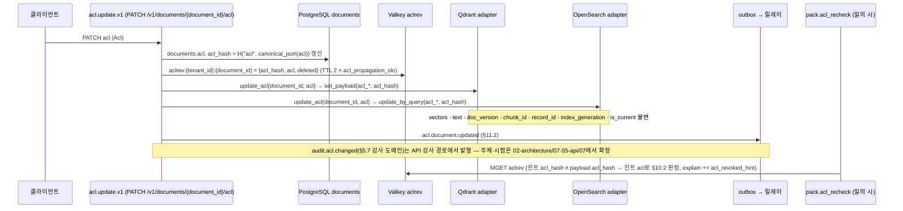

# ADR-0005: doc_version은 콘텐츠 해시만; ACL·메타데이터는 payload 갱신

## 맥락과 문제

문서 버전(document version) `doc_version`은 수집 파이프라인의 모든 콘텐츠 파생 키의 뿌리다. 바이블 §6.2는 `block_id = H("block", doc_version, element_path)[:32]`, `chunk_id = H("chunk", doc_version, chunker_config_hash, str(level), span)`로 정의하고, `ParsedDocument`부터 `IndexCommit`까지 모든 수집 측 계약이 `doc_version`을 필수 필드로 품는다(바이블 §5.4). 따라서 `doc_version`에 무엇을 넣는지가 "권한이나 메타데이터가 바뀌었을 때 무엇을 다시 계산해야 하는가"를 결정한다.

한편 D-09는 `tenant_id`·`collection_id`·`acl_*`·`acl_hash`가 모든 인덱스 레코드에 존재하고 리트리벌 시 사전 필터로 강제됨을 요구하며, 원천 권한 변경은 회수 전파 SLO(`runtime.acl_propagation_slo`: `lite` 15m / `standard` 5m / `premium` 5m / `korean-gov` 1m, 바이블 §7.2) 안에 반영되어야 한다(§10.3 E11). 글로서리는 이 긴장을 GL-12로 등재했다 — "내용(콘텐츠 해시)은 같고 메타데이터·ACL만 바뀐 재수집을 새 문서 버전으로 볼지, 기존 활성 커밋의 페이로드 갱신으로 볼지 미정. 재현성(브리프 §7)과 ACL 반영 지연 사이의 트레이드오프다."

세 설계 제안은 서로 다른 답을 냈다. 제안 B는 `doc_version = blake3(content_hash + metadata_hash + acl_hash)`를 "재현성 단위"로 정의했고, 제안 A는 "`blake3` 앞 16자 또는 `source_version`", 제안 C는 ContextPack 항목에서 "`commit_hash` 또는 버전 라벨"을 썼다. 심사는 제안 B의 방식을 세 제안의 치명 결함 중 하나("`doc_version`에 `acl_hash` 포함")로 지목했다(바이블 목적 절). ACL이 `doc_version`에 들어가면 권한 변경마다 `block_id`·`chunk_id`·하류 `stage_key`가 전부 바뀌어 재파싱·재청킹·재임베딩과 새 세대 적재가 일어나고, 콘텐츠 주소화(content-addressed) 캐시가 무효화된다. 즉 원칙 4(멱등·콘텐츠 주소화)와 D-09(ACL 신속 전파)가 정면으로 충돌한다.

본 ADR은 이 충돌을 해소하는 바이블의 결정(§5.4 `SourceDocument.doc_version`, §6.2, §10.3 E11, §11.2 `acl.update.v1`, §14, §16 "GL-12 해소")을 근거·대안과 함께 기록한다.

## 결정 동인(decision drivers)

| # | 동인 | 출처 |
|---|------|------|
| DR-1 | **원칙 4 멱등·콘텐츠 주소화**: 같은 입력은 같은 출력, 모든 산출물은 해시로 주소화되어 재사용된다. 원본 바이트가 같으면 `block_id`·`chunk_id`·파생물 키가 같아야 한다 | 브리프 §3 원칙 4, 바이블 §4.1·§6.2 |
| DR-2 | **D-09 ACL 신속 전파**: 회수(revocation)는 SLO 안에 반영되어야 하며, 전파 지연은 교차 테넌트 누출 리스크의 구성 요소다 | 브리프 D-09, 바이블 §7.2·§10.3 E11·§15 #3, 매트릭스 리스크 #4 |
| DR-3 | **재현성 목표**: 동일 `IngestRequest` + 동일 프로파일 → 동일 `IndexCommit` 해시. `commit_hash = H("commit", profile_hash, *sorted(f"{chunk_id}:{content_hash}:{embed_text_hash}"))`는 ACL과 접두어 무관 메타에는 불변이다. 접두어 영향 메타(`title` 등)는 `Enrichment.embed_text = deterministic + "\n" + … + text`(§5.4) → `embed_text_hash`를 거쳐 `commit_hash`에 반영되며, 이는 §14 `reprocess from_stage=enrich`가 새 `IndexCommit`을 만드는 것과 정합한다 | 브리프 §7, 바이블 §5.4·§6.2·§14 |
| DR-4 | **평가 안정성**: 골든셋은 문서 ID + `answer_spans`로 재청킹에 불변이어야 하고(D-12), `chunk_id`는 `exclude_ids`·`duplicates_of`·평가 run의 식별 기준이다(§5.4 `IndexRecord.chunk_id`). 권한 변경으로 식별자가 흔들리면 비교가 무효화된다 | 브리프 D-12, 바이블 §5.4 |
| DR-5 | **비용·용량**: 재임베딩은 `ingest-gpu-embed` 큐를 점유하고, 세대 플립은 `cleanup_delay`(1h) 동안 세대별 레코드를 2배 공존시킨다 | 바이블 §4.4·§7.2·미해결 이슈 17 |
| DR-6 | **백엔드 능력**: Qdrant `set_payload`, OpenSearch `update_by_query`가 부분 payload 갱신을 지원하므로 벡터를 건드리지 않는 ACL 갱신이 가능하다 | 07 문서 06 §IndexCommit 프로토콜, 12 §2.4 |
| DR-7 | **선례**: Onyx는 `Updatable(metadata_only)` 믹스인으로 "메타데이터 전용 갱신(ACL·boost)은 재임베딩 없이"를 분리하고, 12 문서는 `IndexBackend.update_acl(document_id, acl)`을 "재임베딩 없이 payload만 갱신" 불변식으로 제안했다 | 07 문서 11 §어댑터 계약 요구, 12 §통합 설계 함의 |
| DR-8 | **정본 단일화와 전파 창 폐쇄**: ACL 정본은 `documents.acl`과 백엔드 payload이며, 회수 힌트(revocation hint) `aclrev`는 백엔드 전파가 끝나기 전 창을 닫는 장치다 | 바이블 §9.1·§13.1 |

## 고려한 대안

### 대안 1 — `doc_version = content_hash`(원본 바이트 BLAKE3); ACL·메타데이터는 별도 해시 + payload 갱신 (채택)

- 설명: `doc_version`은 원본 바이트의 BLAKE3 hex(`= artifact.blake3`)만 반영한다. 접근 제어 목록(Access Control List, ACL)은 `acl_hash = H("acl", canonical_json(acl))`, 메타데이터는 `metadata_hash = H("meta", canonical_json(metadata))`로 따로 추적하고, 변경 시 백엔드 페이로드(payload)만 갱신한다.
- 장점: 콘텐츠 파생 키(`block_id`·`chunk_id`·`stage_key`·`H("derived")`)가 권한·메타 변경에 불변이고, 청크 임베딩 캐시 `H("embed", …, embed_text)`도 접두어에 영향 없는 변경에는 불변(DR-1); `update_acl` 한 번으로 SLO 충족(DR-2, DR-6); ACL·접두어 무관 메타 변경에 `commit_hash`·평가 run이 흔들리지 않음(DR-3, DR-4); 세대 플립·재임베딩 비용 없음(DR-5); 12·11 문서의 어댑터 불변식과 일치(DR-7).
- 단점: ACL 변경이 `IndexCommit` 이력으로 남지 않는다(감사는 `acl.document.updated` 이벤트(§11.2)와 `documents.acl`, API 감사 경로의 `audit.acl.changed`(§5.7 감사 도메인)로 수행); 정본(`documents.acl`)과 투영(payload) 사이에 전파 창이 생겨 `aclrev` 힌트와 `pack.acl_recheck`(E9)가 필요하다; `index`가 ACL을 계보 `SourceDocument` 산출물에서 읽으므로(§5.4) 재적재(replay)·재처리·진행 중 수집 경로가 옛 `acl`을 그대로 쓰면 갱신 전 ACL이 되살아날 수 있다(결과 절 부정 참조).

### 대안 2 — `doc_version = H(content, acl, metadata)` (제안 B; 기각)

- 설명: 제안 B §4.2의 `doc_version = blake3(content_hash + metadata_hash + acl_hash)`. "인덱스에 들어간 모든 입력"을 하나의 버전으로 표현해 재현성 단위로 삼는다.
- 장점: 한 키만 보면 콘텐츠·권한·메타 어느 것이 바뀌었는지 알 수 있고, 모든 변경이 세대 커밋으로 원장에 남는다.
- 단점: 권한 변경마다 `doc_version`이 바뀌어 `ParsedDocument` 이후 모든 산출물이 새 주소를 가지며 `block_id`·`chunk_id`가 전부 바뀐다 → 재파싱·재청킹·재임베딩·새 세대 플립(GL-12 결함). 콘텐츠 주소 캐시가 무효화되어 원칙 4 위배(DR-1). 회수 SLO 5m/1m을 100페이지 스캔 PDF(브리프 §7 목표 < 5min) 재처리 시간으로는 맞출 수 없다(DR-2). `chunk_id`가 바뀌어 `exclude_ids`·`duplicates_of`·평가 run·`commit_hash`가 모두 달라진다(DR-3, DR-4). GPU 재임베딩·세대 공존 저장 비용이 권한 변경 빈도에 비례한다(DR-5). 심사가 치명 결함으로 지목한 방식이다.

### 대안 3 — `doc_version`은 유지하되 ACL 변경 시 전체 재색인(새 `index_generation`) (기각)

- 설명: 파싱~임베딩 산출물은 `cache_hit`로 재사용하고, ACL 변경을 `index` 스테이지 재실행(`reprocess from_stage=index` 또는 `reindex_always`)으로 처리해 새 세대를 적재하고 플립한다.
- 장점: ACL 변경이 `index_commits` 원장에 커밋으로 남는다; 갱신 경로가 세대 사가 하나로 통일된다.
- 단점: 벡터·`text`(≤ 8,192바이트)·좌표를 포함한 전체 레코드를 두 백엔드에 다시 쓰는 쓰기 증폭(payload 몇 필드 갱신 대비); `is_current` 플립과 `cleanup_delay` 1h 동안 세대별 2배 공존(DR-5); 세대 사가 전체(적재 → 이중 플립 → 정리, §11.4)를 거치므로 payload 갱신 한 번보다 회수 지연이 길고 변동이 크다(DR-2) — 다만 디스패처 직렬화·오케스트레이터 가용성 종속은 채택안(`acl.update.v1`도 워크플로우·잡, §11.2·§5.7 `JobKind.acl_update`)과 같아 차별 요인이 아니다(결과 절 부정 참조); 정합성 검사 대상 세대가 늘어난다. 07 문서 11의 Onyx 선례가 `Updatable(metadata_only)`를 색인과 분리한 이유가 바로 이 비용이다(DR-7).

### 대안 4 — 원천 버전 라벨·`commit_hash`·절단 해시를 `doc_version`으로 (제안 A·C 변형; 기각)

- 설명: 제안 A의 "`blake3` 앞 16자 또는 `source_version`", 제안 C의 "`commit_hash` 또는 버전 라벨".
- 장점: 사람이 읽기 쉽고 원천 시스템의 버전 표기와 일치한다.
- 단점: 라벨은 바이트와 무관하다(같은 라벨·다른 바이트, 다른 라벨·같은 바이트가 모두 가능) → 멱등성 위배(DR-1); `commit_hash`는 `chunk_id`에, `chunk_id`는 `doc_version`에 의존하므로 순환 정의다; 16자 절단은 §6.1 콘텐츠 파생 키 규약(64자, `block_id`만 32자)과 어긋난다. 원천 라벨은 `SourceDocument.external_version`(§5.4)과 `ContextItem.header.doc_version_label`(§5.5)로 따로 보존하면 충분하다.

## 결정

**결정:** 바이블 §5.4·§6.2·§10.3·§11.2·§14·§16의 다음 문장을 그대로 채택한다.

- `SourceDocument.content_hash` `= artifact.blake3`; `doc_version` **`= content_hash`**(콘텐츠만; ACL·메타 변경은 버전을 바꾸지 않는다, ADR-0005) — 바이블 §5.4.
- `content_hash`(문서) `= blake3_hex(원본 바이트)` — 라벨 없음; `doc_version` `= content_hash`(문서) — 바이블 §6.2.
- `metadata_hash` / `acl_hash` `= H("meta", canonical_json(metadata))` / `H("acl", canonical_json(acl))` — 바이블 §6.2. ACL은 **문서 단위**(`SourceDocument.acl` 하나, `acl_hash`)다 — 바이블 §10.1.
- E11 ACL 갱신: `PATCH /v1/documents/{document_id}/acl` → `aclrev:` 회수 힌트 기록 → `update_acl` payload만 갱신(재임베딩·`doc_version` 변경 없음, `acl_hash` 갱신) → `acl.document.updated`, 회수 전파 SLO(§7.2) `rag_acl_propagation_seconds` — 바이블 §10.3.
- `acl.update.v1`(트리거 `PATCH /v1/documents/{document_id}/acl`): `documents.acl`·`acl_hash` 갱신 + `aclrev:{tenant_id}:{document_id}` 회수 힌트 기록(E9) → `update_acl` payload만 갱신(양 백엔드, `acl_*`·`acl_hash`) → `acl.document.updated`; 실패 시 재시도, SLO 감시 — 바이블 §11.2.
- `PATCH /v1/documents/{document_id}/metadata`: 메타 갱신(접두어 영향 시 `reprocess from_stage=enrich` 제안 응답) — 바이블 §14.
- 문서 버전(`doc_version`) = 콘텐츠 해시만(ACL·메타 제외) — GL-12 해소(ADR-0005) — 바이블 §16.

변경 종류별 영향은 다음과 같다(모두 바이블 §4.2·§5.4·§6.2·§11.2·§11.4·§14에서 도출).

| 변경 | `doc_version` | `block_id`·`chunk_id` | 재실행 스테이지 | `index_generation` | 경로·이벤트 |
|------|---------------|------------------------|-----------------|--------------------|-------------|
| 원본 바이트 | 변경 | 변경 | `fetch` → … → `index`(캐시 미스) | N+1, 세대 플립 | `ingest.document.v1`, `index.commit.published` |
| ACL | 불변 | 불변 | 없음 | 불변 | `acl.update.v1`: `documents.acl`·`acl_hash` → `aclrev` → `update_acl`(`acl_*`·`acl_hash`) → `acl.document.updated` |
| 메타데이터(접두어 무관: `doc_date`·`doc_type`·`department`·`tags`·`custom` 등) | 불변 | 불변 | 없음 | 불변 | `PATCH …/metadata`: `documents.metadata`·`metadata_hash` 갱신 + payload 갱신 |
| 메타데이터(접두어 영향: `title` 등 `context_prefix` 구성 요소) | 불변 | 불변 | 제안 응답에 따라 `reprocess from_stage=enrich` 이후(§11.2·§14; 접두어 생산 스테이지 표기 불일치는 재검토 조건 참조) | N+1(같은 `chunk_id` 집합, §11.2) | `reprocess.document.v1` |
| 메타데이터(스테이지 라우팅 영향: `genre` → 청커 장르 라우팅, §5.4 `IngestRequest.metadata.genre`·`ChunkSet.genre_route`) | 불변 | `block_id` 불변 / `chunk_id` 변경 가능(라우팅 결과에 따라 `chunker_config_hash`·`span`이 달라짐) | `reprocess {from_stage=chunk}`(§14 열거로 표현 가능)이 필요하나 제안 응답 범위는 바이블 §14가 `enrich`만 명시 — 미정(중립 절) | N+1 | `reprocess.document.v1` |

다이어그램의 W 단계는 바이블 §11.2 구성 순서를 그대로 옮긴 것이다. 각 단계의 액티비티 이름과 경계(`documents.acl`·`aclrev` 기록이 API 동기 경로인지 워크플로우 액티비티인지)는 바이블이 정하지 않았으므로 02-architecture/06에서 확정한다(결과 절 부정 참조).

## 결과

### 긍정

- 권한 변경 비용이 "문서의 레코드 수 × payload 몇 필드"로 고정되고 GPU·파서 사이드카를 쓰지 않는다. 회수 전파는 `rag_acl_propagation_seconds`로 계측되며 SLO(§7.2)를 세대 플립 없이 만족할 수 있다.
- `block_id`·`chunk_id`·`H("derived")`가 원본 콘텐츠 바이트(와 청커 설정·사이드카 이미지)에만 종속되어 원칙 4가 지켜진다. `stage_key = H("stage", stage_name, scope_key, input_ref.blake3, fingerprint)`(§4.1·§6.2, ADR-0037)는 `scope_key`·상류 산출물 바이트·지문에 종속되지만 ACL 갱신은 파이프라인을 재실행하지 않으므로 `stage_key` 재계산 자체가 없고, `content_hash`를 직접 입력으로 쓰는 `detect`·`parse` 키(§4.2)는 ACL·메타에 불변이다. 테넌트 내 파생물 캐시와 접두어 불변 시의 임베딩 캐시(`H("embed")`) 재사용률이 유지된다.
- `commit_hash`가 ACL·접두어 무관 메타에 불변이므로 브리프 §7 재현성 목표("동일 `IngestRequest` + 동일 프로파일 → 동일 `IndexCommit` 해시")가 권한 정책과 분리되어 검증 가능하다. 접두어 영향 메타는 `embed_text_hash`를 통해 `commit_hash`에 반영되며 이는 `reprocess from_stage=enrich`가 새 `IndexCommit`을 만드는 것과 정합한다(DR-3).
- 평가 run·`exclude_ids`·`duplicates_of`·`answer_spans`가 권한 변경에 영향을 받지 않아 A/B·회귀 비교가 안정적이다(D-12).
- 커넥터의 주기 조정(reconcile, 12 문서 §2.4)은 `Acl.source_acl_hash`(§5.3, 원천 ACL 변경 감지)를 이전 수집값과 비교해 변경분만 `PATCH /v1/documents/{document_id}/acl`로 밀어 넣을 수 있고, 이 경로는 재색인을 일으키지 않는다.

### 부정

- ACL 변경은 `IndexCommit`을 만들지 않으므로 커밋 원장에서 권한 이력을 재구성할 수 없다. 이력은 `documents.acl`(현재값)과 `acl.document.updated` 이벤트(§11.2, 아웃박스), 감사 도메인 이벤트 `audit.acl.changed`(§5.7; 발행 주체·시점은 바이블 미명시 — 02-architecture/07·05-api/07에서 확정)에 의존한다.
- 정본(`documents.acl`)과 투영(payload) 사이에 전파 창이 존재한다. 창을 닫는 장치는 `aclrev` 힌트(TTL 2 × `acl_propagation_slo`)와 `pack.acl_recheck`(E9)이며, Valkey 불가 시 `degraded{acl_recheck, unavailable}`로 창이 SLO 길이만큼 열린다(§9.1).
- `index` 스테이지는 `acl`·`acl_hash`를 `SourceDocument` 산출물(`requires_lineage`)에서 읽으므로(§5.4 `IndexRecord` 원천 열 SRC), 계보의 `SourceDocument`가 ACL 갱신보다 오래된 **모든** `index` 실행에서 갱신 전 ACL이 새 세대 레코드의 `acl_*`·`acl_hash`로 적재될 수 있다: (a) 산출물 재적재(replay), (b) `PATCH …/acl` 뒤의 `reprocess.document.v1`(`from_stage` 이전 산출물을 `cache_hit`로 재사용, §11.2)과 `POST /v1/jobs/{job_id}/retry`(캐시 산출물 재사용, §11.5), (c) PATCH 이전에 `fetch`를 끝낸 진행 중 `ingest.document.v1`. 세대 플립 뒤 `aclrev` 힌트 TTL이 만료되면 회수된 주체가 다시 접근할 수 있는 보안(D-09) 실패 모드다. 바이블 §9.1·§13.1은 `documents.acl`을 정본으로 선언하지만 `index`가 계보 값 대신 정본을 읽어야 한다는 규칙은 두지 않았다. 본 ADR은 "정본(`documents.acl`·`acl_hash`)이 계보 `SourceDocument.acl`보다 우선해야 한다"를 하류(03-contracts/07, 04-pipelines/13·19, ADR-0026)에 대한 요구로 남기고, 그 방법(셸이 `documents.acl`을 주입 / `index`가 원장 조회 / ACL 갱신 잡과의 직렬화)은 바이블 §1.2 절차로 확정한다. 또한 `maintenance.consistency.v1`의 대조 항목은 레코드 수·`content_hash` 집합(§11.2)이어서 `acl_hash` 불일치는 별도 검사 없이는 드러나지 않는다.
- `acl.update.v1`은 워크플로우이자 잡(§11.2, §5.7 `JobKind.acl_update`)이므로 디스패처 직렬화(§11.2)와 오케스트레이터 가용성(§11.5 Temporal 불가 시 API 503)에 종속된다. 같은 `document_id`의 활성 잡(예: 최대 60m의 OCR `parse`, §4.4)이 실행 중일 때 회수가 `queued`로 대기하면 `korean-gov` 1m SLO를 지킬 수 없고, 직렬화에서 면제하면 진행 중인 세대 사가와 경합한다(위 (c)). 어느 쪽인지, 그리고 Temporal 불가 시 `documents.acl`·`aclrev` 기록이 API 동기 경로에서 이루어지는지는 바이블 미정이며 02-architecture/06·04-pipelines/19가 §1.2 절차로 정밀화한다. 본 ADR은 `doc_version` 불변·payload 갱신 원칙만 고정한다.
- `update_acl`은 두 백엔드에 각각 실행되어 원자적이지 않다. 실패 시 재시도와 SLO 감시(§11.2)로 수렴시키며, 부분 실패 구간은 `aclrev` 힌트가 덮는다.

### 중립

- `SourceDocument`에는 `doc_version`과 별개로 `metadata_hash`·`acl_hash`가 필수이므로(§5.4), 하류 문서·스키마는 세 해시를 혼동 없이 다룰 수 있다. `IndexRecord.acl_hash`는 E9 회수 힌트 대조 키이며 사용자 필터 대상이 아니다(§5.7 `FilterableField` 금지 목록 `acl_*`). Qdrant payload 인덱스 대상이 아니라는 §13.4와 인덱싱 열을 `keyword`로 적은 §5.4 `IndexRecord` 표는 표기가 상이하므로(OpenSearch 매핑으로 읽힐 수 있음) 바이블 §1.2 patch 정정 대상이다; 본 ADR은 어느 쪽도 확정하지 않는다.
- 메타데이터 payload 갱신의 워크플로우 타입·어댑터 메서드는 바이블 §11.2·§14에 등재되어 있지 않다. 본 ADR은 원칙(`doc_version` 불변, payload 갱신, 접두어 영향 시 `reprocess from_stage=enrich` 제안)만 고정하고, 이름과 절차는 04-pipelines/19·05-api/04가 바이블 §1.2 절차로 정밀화한다. 제안 응답이 `enrich` 이외의 `from_stage`(예: `genre` → `chunk`)를 반환할지는 바이블 §14가 `enrich`만 명시하므로 미정이다.
- 접두어 영향 메타 갱신의 재처리는 `chunk_id` 집합이 같은 새 세대 적재다(§11.2). `record_id`가 세대를 포함하므로(ADR-0004) 이전 세대는 플립 전까지 그대로 검색된다. 다만 `Chunk.context_prefix.deterministic`은 §5.4에서 `ChunkSet` 필수 필드(생산 `chunk`)이고 §7.3·§12는 `enricher.deterministic_prefix`를 두어 생산 스테이지 표기가 갈린다. `from_stage=enrich` 경로에서 `ChunkSet`의 접두어(`IndexRecord.context_prefix` 원천 CS)가 갱신되지 않을 수 있으므로 바이블 §1.2 절차로 정리되어야 한다(재검토 조건 참조).

## 준수 확인 방법

| 강제 수단 | 내용 | 실패 시 |
|-----------|------|---------|
| 스키마 제약 | `source-document.schema.json`: `content_hash`·`doc_version`·`acl_hash`·`metadata_hash` 필수, `^[0-9a-f]{64}$`. `index-record.schema.json`: `doc_version`·`acl_hash`·`acl_allow`·`acl_visibility` 필수(E5). 03-contracts/02 불변식 "`doc_version == content_hash == artifact.blake3`" 계약 테스트 | 스키마 검증 실패 / `index.security_fields_missing` |
| CI 열거·이름 대조(§1.2) | `JobKind.acl_update`, 이벤트 `acl.document.updated`·`audit.acl.changed`, 메트릭 `rag_acl_propagation_seconds`, `ExplainCode.acl_revoked_hint`, `AclCheckSource.revocation_hint`, Valkey 키 접두 `aclrev:`가 바이블 §5.7·§6.5·§13.4 철자와 일치 | 빌드 실패 |
| 해시 결합 린트·단위 테스트 | `H("block", …)`·`H("chunk", …)`·`H("stage", …)` 입력에 `acl`·`metadata`·`acl_hash`·`metadata_hash`가 포함되면 실패; `doc_version` 대입은 `content_hash`에서만. 테스트: 같은 바이트·다른 ACL의 두 `SourceDocument` → 같은 `doc_version`·`block_id`·`chunk_id`, 다른 `acl_hash` | 테스트 실패 |
| 어댑터 계약 테스트(`IndexBackend.update_acl`) | 갱신 후 `acl_*`·`acl_hash`·`updated_at`만 변경; `vectors`·`text`·`doc_version`·`chunk_id`·`record_id`·`index_generation`·`commit_id`·`is_current` 불변; `index_commits` 신규 행 없음; `documents.current_generation` 불변. Qdrant·OpenSearch 어댑터와 적합성 키트(ADR-0032) 모두 적용 | 어댑터 배포 차단 |
| 워크플로우 테스트 | `WorkflowEnvironment` 단위 테스트에서 `acl.update.v1` 히스토리에 `stage.fetch`~`stage.index` 액티비티(§6.7 규약 `stage.{stage_name}`)가 없고 `index_commits` 신규 행이 없음; `acl.update.v1` 자체의 액티비티 이름은 02-architecture/06에서 확정. `Replayer` 회귀 통과 | CI 실패 |
| 골든 시나리오(E9) | "ACL 회수 → 백엔드 전파 완료 전 질의 → 미반환": `omitted.reason=acl_denied`, `explain += acl_revoked_hint`, `items[].acl.source=revocation_hint` | 릴리스 차단 |
| ACL 원천 정합성 테스트 | (1) ACL PATCH 후 산출물 재적재(replay), (2) ACL PATCH → `reprocess from_stage=enrich` → 새 세대 플립, (3) `fetch` 완료 후 PATCH → 진행 중 `ingest.document.v1` 완료 — 세 경우 모두 현재 세대 모든 레코드 `acl_hash == documents.acl_hash`. 추가 골든 시나리오(E9 시나리오와 별개): "PATCH 후 세대 플립 + `aclrev` 힌트 만료 후 질의 → 회수 주체에 미반환" | 테스트 실패 / 릴리스 차단 |
| 메트릭·알림 | `rag_acl_propagation_seconds`가 회수 전파 SLO(`runtime.acl_propagation_slo`, §7.2)를 초과하면 알림(E11); 백분위 정의는 09-operations/03에서 확정(초안 목표) | 운영 알림 |
| 코드 리뷰 체크리스트 | (1) `doc_version` 파생식 변경 없음, (2) ACL·메타 갱신 경로가 `ingest.document.v1`·`reprocess.document.v1`을 호출하지 않음(접두어 영향 메타의 제안 응답 제외), (3) `IndexRecord` payload 필드 추가 시 §5.4 "원천" 열과 갱신 경로(payload 갱신 vs 재처리)를 명시 | 리뷰 반려 |

## 재검토 조건

- 블록·청크 단위 ACL(`Block.acl_override`·`Chunk.acl`, 바이블 §10.1 v1 미지원)이 도입되어 ACL이 문서 단위 payload 갱신으로 표현되지 않게 될 때.
- `rag_acl_propagation_seconds`가 SLO를 반복 위반하거나, `aclrev` 힌트 창(2 × `acl_propagation_slo`)이 실측에서 부족한 것으로 드러나 회수 전파 설계 자체를 바꿔야 할 때.
- 기본 프로파일에 부분 payload 갱신을 지원하지 않는 `index_backend`가 들어올 때. 현재 `IndexBackendCapabilities`(§5.3)에는 해당 능력 플래그가 없으므로 능력 선언 추가는 바이블 §1.2 minor 절차의 ADR 대상이다.
- 규제·계약 요건이 ACL 변경을 커밋 원장 항목(`IndexCommit`)으로 남기도록 요구하거나, 브리프 §7 재현성 목표가 ACL을 포함한 해시로 재정의될 때.
- 바이블 §14의 `PATCH …/metadata` 제안 응답이 `enrich` 이외의 `from_stage`(예: `genre` → `chunk`, §5.4 청커 장르 라우팅)를 반환하도록 개정될 때.
- `Chunk.context_prefix.deterministic`의 생산 스테이지(§5.4 `ChunkSet` 필드 vs §7.3·§12 `enricher.deterministic_prefix`)가 바이블 §1.2 절차로 `chunk`로 확정되어 접두어 영향 메타의 재처리 시작점을 `from_stage=chunk`로 넓혀야 할 때.
- `index`의 ACL 원천(계보 `SourceDocument.acl` vs 정본 `documents.acl`)과 `acl.update.v1`의 디스패처 직렬화 관계·Temporal 불가 시 `aclrev` 기록 경로가 02-architecture/06·03-contracts/07·04-pipelines/13·19에서 확정되어 §5.4 `IndexRecord` 원천 열 또는 §11.2가 개정될 때(결과 절 부정 항목의 요구 반영 여부 확인).
- 같은 `content_hash` 재수집(`dedup_policy=skip_if_same_hash`)에 ACL·메타 차이가 동반되는 경우의 처리(payload 갱신 흡수 vs 거부)가 03-contracts/01·04-pipelines/19에서 정밀화될 때 `doc_version` 불변 원칙과 충돌하면 본 ADR을 개정한다.

## 참조

- [설계 브리프](../00-vision/00-design-brief.md) — §3 원칙 4·9, §4 D-06·D-09·D-12, §7 재현성·보안, §9.7 결정 표기
- [설계 바이블](../02-architecture/00-design-bible.md) — 목적 절(치명 결함 목록), §1.2, §3.1 D-06·D-09, §3.3 0005 행, §4.1·§4.2·§4.4, §5.2, §5.3 `Acl`, §5.4 `IngestRequest`·`SourceDocument`·`Chunk`·`Enrichment`·`IndexRecord`·`IndexCommit`, §5.7(`JobKind`·`FilterableField`·이벤트·`ExplainCode`·`AclCheckSource`), §6.1·§6.2·§6.7, §7.2 `runtime.acl_propagation_slo`, §7.3·§12 `enricher.deterministic_prefix`, §9.1 ACL 재검증, §10.1·§10.2·§10.3 E4·E5·E9·E11, §11.2 `acl.update.v1`·`reprocess.document.v1`·`maintenance.consistency.v1`, §11.4·§11.5, §13.1 `documents`, §13.4, §14, §16
- [용어집](../00-vision/03-glossary.md) — 문서 버전, GL-12
- [기술 지형 종합: 선정 매트릭스](../07-tech-landscape/00-summary-and-selection-matrix.md) — 어댑터·플러그인 공통 요구 2(결정성과 버전 고정)·7(보안 불변식), 종합 리스크 #4
- [벡터·렉시컬 인덱스 백엔드](../07-tech-landscape/06-vector-and-lexical-index-backends.md) — IndexCommit 프로토콜, `set_payload`·`update_by_query` 부분 갱신
- [기존 RAG 플랫폼 격차 분석](../07-tech-landscape/11-existing-rag-platforms-gap-analysis.md) — `index_backend` `Updatable(metadata_only)` 선례
- [보안·멀티테넌시·PII·라이선스](../07-tech-landscape/12-security-multitenancy-pii-and-licensing.md) — §2.1 ACL 필드, §2.4 소스 시스템 권한 동기화(푸시 갱신·reconcile·지연 허용치), 어댑터 계약 `update_acl`, 실패 모드 `rag_acl_propagation_seconds`
- 설계 제안 [A](../12-appendix/design-proposals/proposal-A-operability-first.md) §4.2 `SourceDocument`, [B](../12-appendix/design-proposals/proposal-B-retrieval-quality-first.md) §4.2 `doc_version` 정의(기각 대안), [C](../12-appendix/design-proposals/proposal-C-simplicity-and-extensibility-first.md) ContextPack 항목 `doc_version`
- 관련 ADR: [ADR-0004](./0004-deterministic-chunk-id-scoped-record-id-and-ulid-exception.md)(결정적 `chunk_id`·`block_id`, 스코프·세대 합성 `record_id`), [ADR-0026](./0026-index-commit-generation-saga-and-ledger.md)(세대 사가·commit ledger·재적재), [ADR-0027](./0027-security-context-injection-and-acl-enforcement-points.md)(강제 지점 17개, `aclrev` 회수 힌트), [ADR-0029](./0029-three-text-rule-and-deterministic-context-prefix.md)(결정적 `context_prefix` — 접두어 영향 메타의 범위), [ADR-0032](./0032-plugin-sdk-stage-protocol-and-conformance-kit.md)(적합성 키트), [ADR-0034](./0034-retrieval-hot-path-postgres-independence-and-hydrate.md)(`hydrate`가 payload ACL을 읽는 경로), [ADR-0037](./0037-artifact-cache-scope-and-stage-key-composition.md)(`stage_key` 스코프 합성)
- 하류 문서(문서 맵): [SourceDocument 계약](../03-contracts/02-source-document.md), [EmbeddedChunkSet·IndexRecord 계약](../03-contracts/07-embedded-chunk-set-and-index-record.md), [IndexCommit 계약](../03-contracts/08-index-commit.md), [인덱싱](../04-pipelines/13-indexing.md), [갱신·삭제·재색인](../04-pipelines/19-update-delete-and-reindexing.md), [관리 API](../05-api/04-management-api.md), [웹훅·이벤트](../05-api/07-webhooks-and-events.md), [오케스트레이션·워크플로우](../02-architecture/06-orchestration-and-workflows.md), [멀티테넌시·보안 아키텍처](../02-architecture/07-multi-tenancy-and-security-architecture.md), [관측성](../09-operations/03-observability.md)
