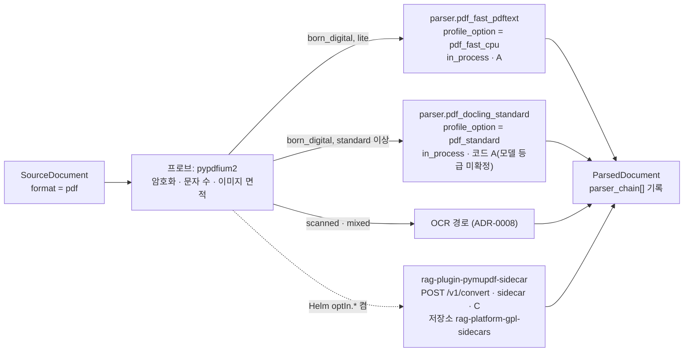

# ADR-0006: PDF 고속 텍스트 경로: PyMuPDF 제거, pypdfium2 + pdftext

> MADR 형식. 바이블 §3.3 표의 0006행이며 관련 결정은 D-18(브리프 §4 개정 v1.1, 바이블 §3.1 `amended`)이다. 이 ADR은 바이블의 결정 하나를 근거·대안과 함께 기록하고 바이블 표를 바꾸지 않는다(바이블 §1.1). 같은 D-18의 OCR 경로는 [ADR-0008](./0008-ocr-default-rapidocr-ppocrv5-korean.md), HWP 5.0 경로는 [ADR-0007](./0007-hwp5-java-sidecar-first-pyhwp-demoted.md), 라이선스 등급표는 [ADR-0001](./0001-license-grade-table-and-d02-interpretation.md)이 다룬다.

## 맥락과 문제

브리프 D-18 원안(v1.0)은 PDF 파서를 "Docling(레이아웃·표) + PyMuPDF(고속 텍스트) + OCR"로 정했다. 기술 지형 조사([02 PDF 파싱·레이아웃·OCR](../07-tech-landscape/02-document-parsing-pdf-layout-ocr.md), [12 보안·라이선스](../07-tech-landscape/12-security-multitenancy-pii-and-licensing.md), [선정 매트릭스](../07-tech-landscape/00-summary-and-selection-matrix.md) "브리프 수정 제안" D-18(PDF) 행)에서 다음 사실이 확정되었다.

| # | 사실 | 출처 |
|---|------|------|
| F1 | PyMuPDF(PyMuPDF/MuPDF) 1.28.2는 AGPL-3.0 또는 Artifex 상용 라이선스(듀얼)다. 파서 워커가 `import`하면 인프로세스 링크가 되어 D-02의 C 등급 규칙(요지: GPL/AGPL/SSPL/ELv2/BUSL 서버·라이브러리는 별도 컨테이너 + 네트워크 API만, 코어 이미지 미포함, 별도 저장소 고지, Helm opt-in)을 위반한다 | 브리프 §4 D-02, 02 §B, 12 §6.2, 매트릭스 D-18(PDF) 행 |
| F2 | Docling 자체는 PyMuPDF에 의존하지 않고 docling-parse(MIT) + pypdfium2(Apache-2.0 OR BSD-3-Clause)를 백엔드로 쓴다. PyMuPDF를 제거해도 `pdf_standard` 경로는 영향이 없다 | 02 §브리프와의 충돌 |
| F3 | 브리프 §7 "텍스트 PDF 100페이지 < 30s"는 Docling CPU 표준 파이프라인으로 충족·미달을 확정할 수 없다(공개 근거 0.79 s/page는 8 thread·EasyOCR·OCR 14% 혼합 코퍼스, OCR-off 추정 약 32 s로 경계선). 확실한 달성 경로는 고속 텍스트 경로 또는 GPU다 | 02 §처리량 요약, 매트릭스 "§7 처리량" 행 |
| F4 | `lite` 프로파일은 단일 노드·GPU 0·사이드카 0·컨테이너 5다. 사이드카를 전제로 하는 고속 경로는 `lite`에서 쓸 수 없다 | 바이블 §7.1 |
| F5 | 고속 경로도 `ParsedDocument`의 필수 provenance(`element_path`, `char_start/char_end`)와 PDF의 `page`(1-based)·`bbox`(`[x0, y0, x1, y1]` 좌상단 원점·PDF 포인트)를 채워야 하고, heading 추론에는 폰트 메타데이터가 필요하다 | D-04, 바이블 §5.3 `Provenance`, [ADR-0002](./0002-provenance-element-path-and-nullable-page-bbox.md) |

문제: 라이선스 등급 A 의존성만으로 §7 처리량을 달성하는 CPU 고속 텍스트 경로를 무엇으로 구성하고, PyMuPDF를 어떤 형태로만 허용할 것인가.

## 결정 동인(decision drivers)

| ID | 동인 | 내용 | 근거 |
|----|------|------|------|
| DR1 | 라이선스 | 코어 이미지·인프로세스 의존성은 A 등급만. C 등급은 별도 컨테이너·별도 저장소·Helm `optIn.*`로만 | D-02(개정 v1.1), ADR-0001, 바이블 §12 |
| DR2 | 처리량 | 텍스트 PDF 100p < 30s를 CPU 워커로 달성하는 경로가 하나는 있어야 한다(`lite`, 대량 백필) | 브리프 §7, 바이블 §7.1 |
| DR3 | 계약 충실성 | 벤더 모델을 `ParsedDocument`로 결정적 변환. 필수 provenance, `Block.source = text_layer`, 휴리스틱 heading은 `Block.heading_inferred = true` | D-04, 바이블 §5.4 `Block` |
| DR4 | 단일 PDF 엔진 | 스캔/디지털 판별 프로브·페이지 렌더·Docling 백엔드(docling-parse + pypdfium2)·고속 텍스트가 같은 PDFium 바인딩(pypdfium2)에 의존하면 네이티브 PDF 의존성이 하나로 수렴한다. 좌표 규약(D-04·ADR-0002)은 pdftext 어댑터와 Docling 어댑터가 각각 만족한다 | 02 §라우팅 흐름, 02 §B docling-parse 행, 원칙 2 Adapters over Forks |
| DR5 | 한국어·CJK | CJK 텍스트 추출, 한글 자모 분해(NFD)·음절 단위 공백 등 HWP 출력 PDF 특성 수용 | 원칙 6, 02 §스캔/디지털 판별 휴리스틱 |
| DR6 | 유지보수 | pin-and-bump 가능한 릴리스 주기, 빌드 불필요 wheel(pdftext는 순수 Python, pypdfium2는 PDFium 네이티브 바이너리를 번들한 바인딩 — `linkage = dynamic`; ctypes 로딩 방식은 07 문서 미기재로 확인 필요(as of 2026-09)), 파서 워커 이미지 Python 3.12/3.13 호환 | D-01, 02 §B, 매트릭스 §어댑터·플러그인 공통 요구 |

## 고려한 대안

| 대안 | 라이선스(등급) | 처리량(§7) | 구조 정보 | 판정 |
|------|----------------|-----------|-----------|------|
| A1 PyMuPDF 인프로세스 유지(브리프 원안) | AGPL-3.0 / Artifex 상용(C) | 최고 속도 | 블록·폰트·렌더 | **기각**(D-02 위반) |
| A2 pypdfium2 + pdftext 인프로세스 | Apache-2.0 OR BSD-3 / Apache-2.0(A) | 충족 예상(pdftext 벤더치 0.69 s/문서, 자체 측정 필요) | 블록/라인/스팬 + 폰트 메타 | **채택** |
| A3 Docling `PYPDFIUM2` 백엔드 네이티브 파이프라인 | 코드 MIT(A); 모델 CDLA-Permissive-2.0은 등급 미확정(법무 검토 대기) | 레이아웃 모델을 실행하므로 고속 아님 | 전체 | 2차(손상 PDF 백엔드 폴백) |
| A4 pdfplumber / pdfminer.six 단독 | MIT(A) | 느림(pdfplumber 3.40 s/문서, pdftext 벤치) | 선 기반 표, 레이아웃 휴리스틱 약함 | 기각(폴백 한정) |
| A5 Docling 단일 경로 | A3과 동일 | CPU 미확정(약 32 s 경계선) | 전체 | 기각(CPU 고속 경로 부재) |
| A6 PyMuPDF 사이드카를 기본 고속 경로로 | C(격리 시 허용) | 네트워크 홉·이미지 추가 | 블록·폰트·렌더 | 기각(`lite` 사이드카 0) |
| A7 Poppler `pdftotext` CLI 서브프로세스 | GPL-2.0/3.0(C) | 빠름 | `-bbox-layout` | 기각(GPL, 법무 확인 대기) |

- **A1 PyMuPDF 인프로세스 유지(바이블이 기각한 원안).** 설명: 브리프 v1.0 D-18의 "고속 텍스트" 구성요소를 그대로 둔다. 장점: 후보 중 최고 속도, 렌더링·주석·폰트 정보, CJK 양호, 성숙도 매우 높음(02 §B). 단점: AGPL-3.0/상용 듀얼이라 D-02 C 등급이며 파이썬 `import`가 인프로세스 링크다(12 §6.2 "인프로세스 사용 불가"). Apache-2.0 코어 이미지에 포함하면 플랫폼 채택성이 훼손된다(바이블 §15 리스크 #2). 02 문서 통합 파서 점수표에서 라이선스 1점으로 72점(pypdfium2 + pdftext 83점).
- **A2 pypdfium2 + pdftext 인프로세스(채택).** 설명: pypdfium2(PDFium 바인딩) 위에 pdftext(datalab)가 블록/라인/스팬과 폰트 메타데이터를 만들고, 어댑터가 폰트 크기 기반 heading 추론 후 `ParsedDocument`로 변환한다. 페이지 렌더는 하지 않는다(02 §프로파일별 조합 `pdf_fast_cpu`). 장점: 둘 다 A 등급(02 §B: pypdfium2 Apache-2.0 OR BSD-3-Clause, pdftext Apache-2.0; ADR-0001 등급표 A 행에 pypdfium2 명시, 단 12 §6.2는 "확인 필요" 표기 — 재검토 조건 7), CJK 지원 명시, Docling 백엔드와 같은 PDFium 엔진(DR4), 1 vCPU·1 GB 워커로 수평 확장(02 §리소스 요구), pdftext 벤더 벤치에서 PyMuPDF 대비 정렬 일치 97.54%. 단점: 벤더 벤치만 존재, RTL 미흡, pdftext 성숙도 "중상"(02 §B), 레이아웃·표 구조·2단 읽기 순서는 복원하지 않는다.
- **A3 Docling `PYPDFIUM2` 백엔드 네이티브 파이프라인(2차).** 설명: Docling의 `THREADED_DOCLING_PARSE` 대신 `PYPDFIUM2` 백엔드로 표준 파이프라인을 돌린다. 장점: 계약 매핑 코드가 `pdf_standard`와 같다. 단점: heron 레이아웃 모델(CPU 4 thread 643 ms/img)이 그대로 실행되어 고속 경로가 아니다. 손상 PDF에서 `THREADED_DOCLING_PARSE → PYPDFIUM2` 백엔드 폴백(02 §실패 모드)으로만 쓴다.
- **A4 pdfplumber / pdfminer.six 단독(기각).** 설명: 순수 Python MIT 라이브러리로 텍스트·폰트·색상 메타와 선(rule) 기반 표를 뽑는다. 장점: A 등급, CJK·세로쓰기 지원 명시, 시각 디버깅. 단점: 느림(pdftext 벤치 3.40 s/문서), 레이아웃 휴리스틱 한계, 스캔 불가. 디지털 PDF 표 구조 실패 시 선 기반 폴백으로만 남긴다(02 §실패 모드, 매트릭스 `pdf_text_parser` 폴백).
- **A5 Docling 단일 경로(기각).** 설명: 모든 디지털 PDF를 `pdf_standard`로만 처리한다. 장점: 경로 하나, 표·레이아웃·읽기 순서 항상 복원. 단점: F3대로 CPU에서 §7 충족이 미확정이고 `lite`는 GPU가 없다(F4). 자체 재측정 전까지 고속 경로 없이 §7을 보증할 수 없다.
- **A6 PyMuPDF 사이드카를 기본 고속 경로로(기각).** 설명: D-02 C 등급 규칙에 맞게 PyMuPDF를 별도 컨테이너(`POST /v1/convert`)로 두고 기본값으로 삼는다. 장점: 라이선스 규칙 자체는 충족. 단점: `lite`는 사이드카 0(F4), 기본 경로가 AGPL 컨테이너에 의존하면 "코어만 설치"가 성립하지 않고 네트워크 홉·이미지 운영 비용이 늘어난다. 옵트인으로만 허용한다.
- **A7 Poppler `pdftotext` CLI(기각).** 설명: GPL 바이너리를 서브프로세스로 호출한다. 장점: 배포판 표준, `-layout`·`-bbox-layout`. 단점: GPL-2.0/3.0이며 CLI 서브프로세스도 배포 이미지에 GPL 바이너리를 포함하므로 법무 확인 항목(매트릭스 미해결 이슈 7, 02 §브리프와의 충돌 D-02 행). 기본 프로파일은 Poppler 무의존을 유지한다.

## 결정

**결정:** 브리프 D-18(개정 v1.1)의 PDF 항목 그대로 — "**PDF → Docling(레이아웃·표) + pypdfium2/pdftext(고속 텍스트; PyMuPDF는 AGPL이라 인프로세스 제외, 옵트인 사이드카만)**"(OCR 항목은 ADR-0008). 프로파일 정본(바이블 §7.1 "PDF 디지털" 행)은 `lite` = "`pdf_fast_cpu`(pypdfium2 5.13 + pdftext 0.7)", `standard` = "`pdf_standard`(Docling 2.129.x heron + TableFormer ACCURATE, `OMP_NUM_THREADS=4`; egret-m 옵션)", `premium` = "`pdf_standard` GPU", `korean-gov` = "standard + 2단·공문서 골든셋 회귀"다. PyMuPDF는 바이블 §6.7대로 "GPL/AGPL 이미지·플러그인(`lo-sidecar`, `rag-plugin-pyhwp-sidecar`, `rag-plugin-pymupdf-sidecar`)은 **별도 저장소 `rag-platform-gpl-sidecars`**(별도 LICENSE/NOTICE, 코어 이미지 미포함, 독립 빌드·태깅·릴리스)에서 관리하고 본 저장소는 Helm `optIn.*` 값과 이미지 참조 링크만 둔다(D-02 C 등급, ADR-0001·0007)". 용어는 바이블 §16 "PyMuPDF → pypdfium2 + pdftext(PyMuPDF는 AGPL 옵트인 사이드카)"로 바뀐다.

| 프로파일 | `parser_fingerprint.profile_option` | `parser_fingerprint.parser_id` | 격리 모드 | 구성 요소(버전은 07 문서 확인일 기준, 잠금 파일이 정본) | 등급 |
|----------|-------------------------------------|--------------------------------|-----------|------------------------------------------------------------|------|
| `lite` | `pdf_fast_cpu` | `parser.pdf_fast_pdftext` | `in_process` | pypdfium2 5.13 + pdftext 0.7. 페이지 렌더 없음, 블록/라인/스팬 + 폰트 크기 기반 heading 추론(`heading_inferred = true`), `Block.source = text_layer`, `source_kind = born_digital` | A |
| `standard` · `premium` · `korean-gov` | `pdf_standard` | `parser.pdf_docling_standard` | `in_process` | Docling 2.129.x(docling-parse + pypdfium2 백엔드, heron, TableFormer ACCURATE, `OMP_NUM_THREADS=4`; `premium`은 GPU) | 코드 MIT(A); 모델 CDLA-Permissive-2.0은 등급 미확정(법무 검토 대기 — ADR-0001 맥락 표, 매트릭스 미해결 이슈 7; 재검토 조건 6) |
| 옵트인(모든 프로파일) | 사이드카 플러그인이 선언 | `rag-plugin-pymupdf-sidecar`가 §6.1 `parser.{implementation}` 규약으로 선언 | `sidecar`(`POST /v1/convert`, `ConvertRequest`/`ConvertResponse`) | PyMuPDF. 저장소 `rag-platform-gpl-sidecars`, Helm `optIn.*`, `parser_fingerprint.sidecar_image_digest` 필수 | C |

격리 모드는 바이블 §4.2 `parse` 행("HWPX·pdftext·Docling·DOCX·HTML·TXT in_process")과 §7.1대로 `in_process`다. pypdfium2가 PDFium 네이티브 바이너리를 번들한 바인딩(`linkage = dynamic`)이라 [ADR-0033](./0033-sidecar-convert-contract-and-isolation-ladder.md) 격리 사다리의 `in_process` 조건(`linkage = pure_python`; `dynamic`은 `helper_process`)과 문구가 맞지 않지만, ADR-0033 자체가 `parser.pdf_fast_pdftext`·`parser.pdf_docling_standard`를 `in_process` 예로 열거하므로 이 ADR은 바이블 배치를 그대로 기록하고 새 결정을 만들지 않는다(크래시 영향은 결과 부정, 승격 조건은 재검토 조건 8).

프로파일 라우터(바이블 §7.3 `ingest.parse.router.pdf`)에서 `standard` 정본 YAML은 `born_digital: parser.pdf_docling_standard`이고, `lite`는 §7.1에 따라 `born_digital`을 `parser.pdf_fast_pdftext`로 묶는다. `scanned`·`mixed` 분기와 `page_route`는 ADR-0008과 [04-pipelines/05](../04-pipelines/05-parser-pdf.md)의 범위다. `lite`의 `born_digital` 체인은 매트릭스 `pdf_text_parser` 행대로 `parser.pdf_fast_pdftext` → 2차 Docling `PYPDFIUM2` 백엔드(A3) → 폴백 pdfminer.six/pdfplumber(A4)이고, 오류 처리는 바이블 §4.2 `parse` 행을 따른다: 암호화 PDF는 `parse.document_encrypted`(비재시도), 그 외 실패는 `parse.conversion_failed` 후 체인 진행(폴백 소진 시 비재시도), 깨진 폰트 텍스트(PUA·제어문자 비율)는 OCR 경로(ADR-0008)로 넘기며 시도 순서는 `parser_chain[]`에 남는다(02 §실패 모드). 임계값·블록 매핑은 04-pipelines/05가 정한다.



## 결과

**긍정**

- 코어 이미지와 `uv.lock`의 인프로세스 의존성이 모두 A 등급으로 남아 Apache-2.0 플랫폼 채택성(바이블 §15 리스크 #2)이 보호된다.
- `lite`와 대량 백필에 §7 "텍스트 PDF 100p < 30s"를 확실히 달성할 CPU 경로가 생긴다(초안 목표; pdftext 벤더치 기준, 자체 측정은 재검토 조건 참조). 워커는 1 vCPU·1 GB로 수평 확장한다(02 §리소스 요구).
- 판별 프로브·고속 텍스트·Docling 백엔드(docling-parse + pypdfium2)가 모두 pypdfium2에 의존해 네이티브 PDF 의존성이 하나로 수렴한다(DR4). 좌표 규약(좌상단 원점·PDF 포인트, D-04·ADR-0002)은 pdftext 어댑터와 Docling 어댑터(bottom-left 원점 변환, 02 §어댑터 계약)가 각각 만족한다.
- 폰트 메타데이터 기반 heading이 `heading_inferred = true`로 표기되어 `StructureAwareChunker`(D-19)가 heading 경계와 `context_prefix`를 그대로 활용한다.
- `parser_chain[]`에 실제 시도 순서가 남아 어떤 경로가 문서를 만들었는지 감사할 수 있다(바이블 §5.4).

**부정**

- 고속 경로는 레이아웃·표 구조·2단 읽기 순서를 복원하지 않는다. 표 텍스트는 읽기 순서대로 단락 블록으로 남으며 셀 격자(`TableData`)가 필요한 컬렉션은 `pdf_standard`를 써야 한다. 블록 매핑 세부는 04-pipelines/05가 정한다.
- pdftext는 성숙도 "중상"이고 벤치마크가 벤더 자료만 있다. 릴리스 정체 시 대체 경로 평가가 필요하다(재검토 조건).
- PyMuPDF 고유 기능(주석·리댁션·폰트 임베딩 정보)은 옵트인 사이드카를 켠 배포에서만 쓸 수 있고, 사이드카는 별도 저장소에서 독립 릴리스되므로 버전 정합성 관리 부담이 생긴다.
- pdftext와 Docling(docling-parse 경로)이 모두 pypdfium2에 의존하므로 PDFium 바이너리는 pypdfium2 하나가 제공하지만, 세 곳의 pypdfium2 버전 제약(pdftext 핀·Docling 핀·자체 핀 5.13)이 잠금 파일에서 §7.1의 단일 버전으로 해소되는지, 범프 시 계약 코퍼스를 통과하는지 CI(`uv lock --check`)가 확인해야 한다(pin-and-bump, 매트릭스 §어댑터·플러그인 공통 요구 3).
- pypdfium2는 PDFium 네이티브 바이너리를 인프로세스로 로드하므로 PDFium 크래시(세그폴트)가 워커 프로세스를 죽여 같은 워커의 다른 액티비티까지 실패시킬 수 있다(ADR-0033 F2와 같은 유형; 바이블 §4.1 "ctypes·네이티브 크래시 위험"). 격리 모드가 바이블 §4.2·§7.1대로 `in_process`이므로 비정상 종료율 관측과 재검토 조건 8이 완화책이다.

**중립**

- `pdf_standard`(Docling)는 변경 없다. F2대로 Docling은 PyMuPDF 의존이 없다.
- `pdf_fast_cpu`·`pdf_standard`는 `ProfileTier`가 아니라 `parser_fingerprint.profile_option` 문자열이며, 파서 지문 `parser_fingerprint_hash = H("parser", parser_id, parser_version, ",".join(model_ids), sidecar_image_digest or "", profile_option)`(바이블 §6.2)에 포함되고, parse 스테이지 키는 `H("stage","parse", scope_key, content_hash, parser_fingerprint)`(바이블 §4.2 `parse` 행)이므로 경로가 바뀌면 `stage_key`가 바뀌고 재파싱된다.
- AGPL 수용이 가능한 조직은 `optIn.*`으로 PyMuPDF 사이드카를 켤 수 있다. 이때도 코어 이미지는 바뀌지 않는다.

## 준수 확인 방법

| 게이트 | 강제 내용 | 정의 위치 |
|--------|-----------|-----------|
| CI 라이선스 게이트(D-02, ADR-0001) | pip-licenses + liccheck + SBOM으로 코어 `uv.lock`의 모든 인프로세스 의존성이 A 등급인지 검사. 패키지 `PyMuPDF`/`pymupdf`(모듈 `fitz`)가 코어 잠금 파일·코어 이미지 SBOM에 나타나면 빌드 실패 | [10-development/05](../10-development/05-ci-cd.md) |
| 금지 임포트 린트 | `src/rag_platform/**`에서 `import fitz`, `import pymupdf` 금지(ruff banned-api + import-linter). 사이드카 호출은 `SidecarStage` + `ConvertRequest`만 허용 | [10-development/03](../10-development/03-coding-standards.md), 바이블 §12 |
| `rag profile validate` (1) | `PluginMeta.license_grade ≤ license_policy.max_grade`. 정본 YAML(§7.3)은 `max_grade: B`이므로 C 등급 사이드카 플러그인은 `optIn` 명시 없이는 거부된다 — 플러그인 등급 위반은 `plugin.license_denied`(ADR-0001 등급표 C 행), 프로파일 검증 실패 자체는 `profile.invalid`(두 코드 모두 바이블 §5.7 카탈로그, 비재시도) | 바이블 §7.4, §5.7 |
| 저장소 경계 검사 | 코어 저장소 `sidecars/`·`plugins/`·`deploy/`에 AGPL 산출물이 없고, `rag-plugin-pymupdf-sidecar`는 `rag-platform-gpl-sidecars`에서만 빌드·태깅된다. 코어는 Helm `optIn.*` 값과 이미지 참조 링크만 둔다 | 바이블 §6.7·§12, [02-architecture/08](../02-architecture/08-deployment-architecture.md) |
| `PluginMeta` 스키마 제약 | `parser.pdf_fast_pdftext`: `license_grade = A`, `linkage = dynamic`, `isolation_supported = [in_process]`(바이블 §4.2·§7.1 배치), `sidecar_image = null`. 사이드카 플러그인: `license_grade = C`, `isolation_supported = [sidecar]`, `sidecar_image` 비-null. `Producer.image_digest`는 사이드카 경로에서 필수 | 바이블 §5.6 `PluginMeta`, §5.3 `Producer` |
| 적합성 키트 | `parser.pdf_fast_pdftext`가 `contract_roundtrip`·`idempotency`를 통과. 검사 항목: `parser_fingerprint.parser_id = parser.pdf_fast_pdftext`, `profile_option = pdf_fast_cpu`, `Provenance.element_path` 문서 내 유일, `page` 1-based, `bbox` 좌상단 원점·PDF 포인트, `Block.source = text_layer`, `source_kind = born_digital`, 동일 바이트·동일 지문 → 동일 `ParsedDocument` 해시 | 바이블 §12 `testing/`, [03-contracts/03](../03-contracts/03-parsed-document.md) |
| 성능 회귀(초안 목표) | 하네스에서 텍스트 PDF 100페이지를 `pdf_fast_cpu` 1 vCPU 워커로 처리해 30 s 미만인지 측정하고 회귀를 경고한다(브리프 §7; 벤더치 기반이므로 자체 측정값으로 갱신) | [08-evaluation/05](../08-evaluation/05-benchmark-plan-and-baselines.md) |
| 코드 리뷰 체크리스트 | (a) PyMuPDF·Poppler 임포트/서브프로세스 없음 (b) pypdfium2·pdftext 버전은 잠금 파일 정확 고정, 범프 시 계약 코퍼스 통과 (c) 고속 경로 `Producer.model_ids = []`, `image_digest = null` (d) PDFium 좌표계 → 좌상단 원점 변환 단위 테스트 (e) `page_status[]`·`Resumable`(`heartbeat_details.page`) 지원 (f) `parser_chain[]` 기록 | [10-development/07](../10-development/07-contributing.md) |

고속 경로 플러그인의 `PluginMeta`(바이블 §5.6 필드, 값은 예시):

```json
{
  "plugin_id": "parser.pdf_fast_pdftext",
  "extension_point": "parser",
  "role": null,
  "version": "0.1.0",
  "license": "Apache-2.0",
  "license_grade": "A",
  "territory": [],
  "linkage": "dynamic",
  "isolation_supported": ["in_process"],
  "model_ids": [],
  "model_license_ack_required": false,
  "sidecar_image": null,
  "contracts_compat": ">=1.0,<2.0",
  "capabilities": {
    "isolation_modes": ["in_process"],
    "supports_resumable": true,
    "contracts_compat": ">=1.0,<2.0",
    "input_formats": ["pdf"],
    "model_ids": [],
    "requires_gpu": false,
    "extra": null
  }
}
```

`linkage = dynamic`과 `isolation_supported = [in_process]`의 조합은 "## 결정" 절의 격리 모드 문단대로 바이블 §4.2·§7.1 배치를 따른 것이며, ADR-0033 사다리 조건 문구와의 정합은 재검토 조건 8에서 다룬다.

## 재검토 조건

1. PyMuPDF(MuPDF)가 A 등급 라이선스로 재라이선스되면 인프로세스 채택을 재평가한다. 그때까지 사이드카 외 형태는 없다.
2. pdftext가 12개월 이상 릴리스가 없거나 pypdfium2 주 버전 변경으로 파손되면, Docling `PYPDFIUM2` 백엔드 네이티브 경로(A3)와 Xberg(MIT, 02 §A)를 `pdf_fast_cpu` 대안으로 한국어 골든셋에서 비교한다.
3. Docling CPU 표준 프로파일 재측정(RapidOCR·heron, 4/8 thread, egret-m; 02 미해결 이슈 11)에서 텍스트 PDF 100p < 30 s가 확인되면 `lite`의 PDF 디지털 기본을 `pdf_standard`로 바꿀지 게이트(§7.4)와 함께 재검토한다. 고속 경로는 그 경우에도 백필 옵션으로 남는다.
4. 한국어 PDF 골든셋(D-12)에서 `pdf_fast_cpu`의 heading·읽기 순서 품질이 `pdf_standard` 대비 프로파일 `gate` 임계를 넘는 회귀를 보이면 `lite` 기본을 재검토한다.
5. Poppler CLI 서브프로세스의 D-02 해석(법무)이 허용으로 확정되어도 기본 프로파일은 Poppler 무의존을 유지하며, 폴백 후보 추가 여부만 재검토한다.
6. D-02 등급표(ADR-0001) 개정으로 C 등급 배포 규칙이 바뀌면 사이드카 저장소·Helm `optIn.*` 규약을 맞춘다. Docling 모델 CDLA-Permissive-2.0의 법무 판정(매트릭스 미해결 이슈 7)이 `parser.pdf_docling_standard`의 `license_grade`를 확정·변경하면 결정 표와 A3 행의 등급 열을 갱신한다.
7. pypdfium2 라이선스가 12 §6.2 "확인 필요" 상태에서 A 등급이 아닌 것으로 확인되면 ADR-0001 재검토 조건대로 본 ADR을 즉시 재검토한다(현재 근거: 02 §B Apache-2.0 OR BSD-3-Clause, ADR-0001 등급표 A 행).
8. `pdf_fast_cpu` 워커의 비정상 종료(PDFium 네이티브 크래시)율이 운영 임계(초안 목표; 수치는 [08-evaluation/05](../08-evaluation/05-benchmark-plan-and-baselines.md)·운영 문서가 정함)를 넘으면 ADR-0033 사다리대로 `helper_process` 승격을 재검토한다(`isolation_supported`에 `helper_process` 병기, 라우터 `isolation: helper_process`). ADR-0033 사다리 조건(`linkage = pure_python`)과 바이블 §4.2 배치의 문구 정합도 같은 개정에서 처리한다.

## 참조

- [설계 브리프](../00-vision/00-design-brief.md) §4 D-01·D-02·D-04·D-18(개정 v1.1), §7 품질 목표, §9 문서 규약
- [설계 바이블](../02-architecture/00-design-bible.md) §1.1, §3.1 D-18 행, §3.3 0006행, §4.1 격리 모드, §4.2 `parse` 행, §5.3 `Provenance`·`Producer`·`Capabilities`, §5.4 `ParsedDocument`·`Block`, §5.6 `PluginMeta`·`ConvertRequest`/`ConvertResponse`, §5.7 `BlockSource`·`SourceKind`·`IsolationMode`·`LicenseGrade`·`Linkage`, §6.1·§6.2·§6.7, §7.1·§7.3·§7.4, §12, §15 리스크 #2, §16
- [기술 지형 종합: 선정 매트릭스](../07-tech-landscape/00-summary-and-selection-matrix.md) `pdf_text_parser`·`pdf_layout_parser` 행, "브리프 수정 제안" D-18(PDF)·§7 처리량 행, ADR 발의 목록 P1
- [02 PDF 파싱·레이아웃 분석·OCR](../07-tech-landscape/02-document-parsing-pdf-layout-ocr.md) §B 디지털 PDF 텍스트 추출 라이브러리, §처리량 요약, §1차/2차/폴백, §프로파일별 조합, §실패 모드, §브리프와의 충돌
- [12 보안·멀티테넌시·PII·라이선스](../07-tech-landscape/12-security-multitenancy-pii-and-licensing.md) §6.1 등급표, §6.2 의존성 라이선스 지도(PyMuPDF 행)
- 관련 ADR: [ADR-0001 라이선스 등급표](./0001-license-grade-table-and-d02-interpretation.md), [ADR-0002 provenance](./0002-provenance-element-path-and-nullable-page-bbox.md), [ADR-0007 HWP 5.0 경로](./0007-hwp5-java-sidecar-first-pyhwp-demoted.md), [ADR-0008 OCR 기본값](./0008-ocr-default-rapidocr-ppocrv5-korean.md), [ADR-0033 사이드카 convert 계약](./0033-sidecar-convert-contract-and-isolation-ladder.md), [ADR-0035 Python 버전 고정](./0035-python-version-and-toolchain-pins.md)
- 하위 설계 문서: [04-pipelines/03 파싱 라우터](../04-pipelines/03-parsing-router-and-format-detection.md), [04-pipelines/05 PDF 파서](../04-pipelines/05-parser-pdf.md), [03-contracts/03 ParsedDocument](../03-contracts/03-parsed-document.md), [ADR 인덱스](./README.md)
