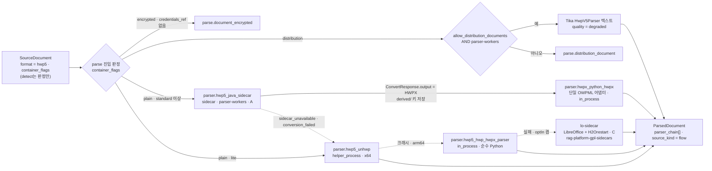

# ADR-0007: HWP 5.0 기본 경로: Apache-2.0 Java 사이드카, pyhwp 강등, H2Orestart GPL 격리

> MADR 형식. 바이블 §3.3 표의 0007행이며 관련 결정은 D-18(브리프 §4 개정 v1.1, 바이블 §3.1 `amended`)과 O-07(바이블 §3.2 `resolved`)이다. 이 ADR은 바이블의 결정 하나를 근거·대안과 함께 기록하고 바이블 표를 바꾸지 않는다(바이블 §1.1). 같은 D-18의 PDF 경로는 [ADR-0006](./0006-pdf-fast-path-pypdfium2-pdftext-replaces-pymupdf.md), OCR 경로는 [ADR-0008](./0008-ocr-default-rapidocr-ppocrv5-korean.md), 라이선스 등급표는 [ADR-0001](./0001-license-grade-table-and-d02-interpretation.md), 사이드카 `convert` 계약은 [ADR-0033](./0033-sidecar-convert-contract-and-isolation-ladder.md)이 다룬다.

## 맥락과 문제

브리프 R1은 한국 공공·기업 문서 특성상 HWPX/HWP **1급 지원**을 요구하고, 브리프 D-18 원안(v1.0)은 HWP 5.0 바이너리 파서를 "pyhwp/hwp5 + LibreOffice(H2Orestart) 폴백"으로 정했다. 개방 결정 O-07은 HWP 5.0 지원 범위와 LibreOffice 변환 의존 여부를 물었다. 기술 지형 조사([01 HWPX/HWP 파싱](../07-tech-landscape/01-document-parsing-hwpx-hwp.md), [12 보안·라이선스](../07-tech-landscape/12-security-multitenancy-pii-and-licensing.md), [선정 매트릭스](../07-tech-landscape/00-summary-and-selection-matrix.md) 판정 J-1·"브리프 수정 제안" D-18(HWP 5.0) 행)에서 다음 사실이 확정되었다. 버전·일자는 07 문서 확인일(2026-09-18~22) 기준이며 잠금 파일이 정본이다.

| # | 사실 | 출처 |
|---|------|------|
| F1 | pyhwp(`hwp5`) 0.1b15는 **AGPL-3.0-or-later**, 최신 릴리스 2020-05-30, 문서상 Python ≤3.8, 미해결 이슈 72건. D-02 C 등급이며 인프로세스 `import`는 위반, 사이드카로 격리해도 정체된 컴포넌트가 기본 경로가 된다 | 01 §후보 B, 12 §6.2 의존성 표, 매트릭스 D-18(HWP 5.0) 행 |
| F2 | H2Orestart v0.7.14는 일부 집계 사이트의 MIT 표기와 달리 **GPL-3.0**(GitHub·LibreOffice Extensions 포털 모두). LibreOffice 26.8은 MPL-2.0이며 내장 `hwpfilter`는 HWP 2.0/2.1/3.0만 열고 HWP 5.0/HWPX는 확장 없이는 열리지 않는다. 렌더 기반 임포트라 표 병합·각주·개요 정보가 근사된다 | 01 §후보 D, 12 §6.2 |
| F3 | hwplib 1.1.11(Maven Central 2026-09-09) + hwp2hwpx(2026-08-31) + hwpxlib 1.0.9(2026-01-23)는 모두 **Apache-2.0**이고 HWP 5.0 전체 객체 모델(표·각주·머리말·필드·수식·글상자)을 HWPX 객체로 변환한다. 암호화 HWP는 미지원, 배포용 문서는 예외로 거부, hwp2hwpx × hwpxlib 1.0.9 조합은 미검증 | 01 §후보 C, 매트릭스 `hwp5_parser` 행 |
| F4 | unhwp 0.11.0(MIT)은 heading·셀 span·각주·수식 LaTeX를 내지만 `ctypes` 인프로세스 네이티브 로딩이라 패닉이 워커를 죽이고 **linux-arm64 미지원**. hwp-hwpx-parser 1.0.0(Apache-2.0)은 `olefile` 단일 의존 순수 Python이나 표를 2차원 텍스트 배열로만 내고 heading 추론이 없다 | 01 §후보 E, 매트릭스 리스크 #3 |
| F5 | Docling·Unstructured 오픈소스판·LlamaIndex `HWPReader`는 HWP/HWPX 1차 파서가 될 수 없다(미지원 또는 `PARA_TEXT` 평문 전용, provenance 불가). 기존 RAG 플랫폼 중 HWPX/HWP를 네이티브 지원하는 오픈소스는 0개 | 01 §후보 F·G, 11 §격차 표 |
| F6 | Apache Tika `HwpV5Parser`(Apache-2.0)는 평문 전용이지만 배포용 문서 `ViewText` AES 복호화 코드가 있어 Apache-2.0으로 배포용 텍스트를 뽑을 수 있는 유일한 JVM 후보다(최신 한컴 배포용 문서 성공률은 실측 필요) | 01 §후보 G |
| F7 | JPype 인프로세스 통합은 프로세스당 JVM 1개·재기동 불가·모든 파서 워커 이미지에 JDK 포함·mypy strict 불일치라 배제되었고, 내부 사이드카 프로토콜은 REST `POST /v1/convert` + `ArtifactRef`로 통일되었다(J-6) | 01 §JPype vs 사이드카, 바이블 §3.2 O-10 |
| F8 | HWP 계열은 흐름 포맷이라 `Provenance.page`/`bbox`가 null이고 `element_path` + 문자 오프셋이 필수다. `lite` 프로파일은 단일 노드·GPU 0·**사이드카 0**이다 | [ADR-0002](./0002-provenance-element-path-and-nullable-page-bbox.md), 바이블 §7.1 |

문제: 라이선스 등급 A 의존성만으로 HWP 5.0을 1급(구조 보존·provenance 충족)으로 지원하는 기본 경로를 무엇으로 구성하고, `lite`(JVM 없음)·arm64·사이드카 장애·배포용·암호화·HWP 3.x 각 조건에서 어떤 폴백과 타입드 오류를 낼 것인가. 그리고 AGPL(pyhwp)·GPL(H2Orestart) 구성요소를 어떤 형태로만 허용할 것인가.

## 결정 동인(decision drivers)

| ID | 동인 | 내용 | 근거 |
|----|------|------|------|
| DR1 | 라이선스 | 코어 이미지·인프로세스 의존성은 A 등급만. C 등급(GPL/AGPL)은 별도 컨테이너 + 네트워크 API·별도 저장소·Helm `optIn.*`로만. 라이선스 등급이 정성 우위를 이긴다 | D-02(개정 v1.1), ADR-0001, 바이블 §12, 매트릭스 판정 원칙 (b) |
| DR2 | 구조 보존 | heading 계층·셀 span·각주 앵커·수식 스크립트가 `StructureAwareChunker`(D-19)와 표 행 그룹 청킹의 입력이다. 평문 추출기는 1급 지원이 아니다 | D-04, D-19, 바이블 §5.4 `Block`·`TableData`, J-1 |
| DR3 | 단일 어댑터 | HWP 5.0을 HWPX로 변환하면 OWPML 어댑터 하나가 두 포맷을 처리해 코드 중복과 매핑 편차가 없다 | 원칙 2 Adapters over Forks, 01 §후보 C 출력 형식 (1) |
| DR4 | 격리 사다리 | 순수 Python만 `in_process`, ctypes 네이티브는 `helper_process`, JVM·LibreOffice·GPL/AGPL은 `sidecar`. 경계 밖 크래시는 타입드 오류로 변환 | K7, 바이블 §4.1 격리 모드, §5.7 `IsolationMode`, 매트릭스 공통 요구 1 |
| DR5 | `lite` 자립 | JVM·사이드카 없이, linux-arm64 노드에서도 HWP 5.0이 동작해야 한다 | 바이블 §7.1 `lite` 열, F4 |
| DR6 | 재현성·멱등 | 변환본은 콘텐츠 주소화되어 재변환을 생략하고, 파서 지문에 사이드카 이미지 digest가 들어가 경로 변경이 재파싱을 유발한다 | 원칙 4, 바이블 §4.1·§6.2 `derived`·`parser_fingerprint_hash` |
| DR7 | 정책·보안 | 비밀번호는 `credentials_ref`로만, 배포용 문서 복호화는 테넌트 옵트인 + 감사, 실패는 비재시도 타입드 오류 | 바이블 §5.4 `IngestRequest`, §5.7 오류 카탈로그, §13.1 `tenants.policies` |
| DR8 | 유지보수 | 활발한 업스트림(2026-09 커밋)과 pin-and-bump 가능한 릴리스 주기, 파서 워커 Python 3.12/3.13 호환 | D-01, 바이블 §15 리스크 #4, 매트릭스 공통 요구 3 |

## 고려한 대안

| 대안 | 라이선스(등급) | 구조 보존 | `lite` 동작 | 판정 |
|------|----------------|-----------|-------------|------|
| A1 pyhwp 1차 + LibreOffice 폴백(브리프 원안) | AGPL-3.0+(C) / MPL + GPL-3.0(C) | 레코드 XML → 재구성 비용 큼 | 불가(사이드카 필수) | **기각**(바이블 §3.1 D-18 `amended`) |
| A2 LibreOffice + H2Orestart 변환을 기본 의존 | MPL-2.0 + GPL-3.0(C) | 렌더 근사(표 병합·각주 손실) | 불가 | **기각**(O-07 "LibreOffice는 opt-in 최후 폴백") |
| A3 HWP 5.0 미지원(HWPX만) | — | — | — | **기각**(R1 1급 요구, O-07 "1급 지원") |
| A4 Apache-2.0 Java 사이드카(hwplib + hwp2hwpx + hwpxlib) → HWPX → 단일 OWPML 어댑터 | Apache-2.0(A) | 전체 객체 모델 | 해당 없음(사이드카) | **채택**(`standard` 1차) |
| A5 JPype로 hwplib 인프로세스 | Apache-2.0(A) | 전체 | JDK 포함 시 가능 | 기각(F7) |
| A6 unhwp 1차(11 문서 권고) | MIT(A) | heading·span·각주 | x64만 | 부분 채택(`standard` 2차, `lite` 1차) |
| A7 Java 사이드카가 자체 JSON 중간 표현 출력 | Apache-2.0(A) | 전체 | — | 기각(어댑터 2개, DR3 위반) |
| A8 순수 Python 평문·경량 파서 1차(hwp-hwpx-parser, hwpkit, LlamaIndex `HWPReader`) | Apache-2.0 / MIT(A) | 표 2차원 배열, heading 없음 / 평문 | 가능 | 기각(1차); hwp-hwpx-parser는 최종 인프로세스 폴백 |
| A9 Tika `HwpV5Parser` 1차 | Apache-2.0(A) | 평문 전용 | 불가(JVM) | 기각(1차); 배포용 텍스트 전용 역할 |
| A10 Hancom 상용 SDK | 상용(X 상당) | 완전 호환 | — | 기각(오픈소스 기본값 불가) |

- **A1 pyhwp 1차 + LibreOffice 폴백(바이블이 기각한 원안).** 설명: 브리프 v1.0 D-18 그대로 pyhwp를 기본 HWP 5.0 파서로, H2Orestart를 폴백으로 둔다. 장점: 스펙 기반 완전 레코드 모델, `hwp5proc diststream`으로 배포용 스트림 디코드, 진단 도구 풍부(01 §후보 B). 단점: AGPL이라 항상 사이드카가 필요하고(D-02 C), 2020년 이후 무릴리스·Python ≤3.8 문서·미해결 이슈 72건으로 신규 한컴 문서의 미지 레코드에 대응할 주체가 없다. 정체된 AGPL 컴포넌트가 기본 경로면 라이선스 회피 비용과 유지보수 리스크를 동시에 진다(매트릭스 "ADR 필수(라이선스·정체)"). 폴백 H2Orestart의 MIT 표기도 오류였다(F2). 점수표 220/500 최하위(01 §점수표).
- **A2 LibreOffice + H2Orestart 변환을 기본 의존(12·03 문서 의견, J-1에서 기각).** 설명: DOC 변환용 `lo-sidecar`가 어차피 필요하므로 HWP 5.0도 같은 컨테이너로 흡수한다. 장점: 한계 비용 최소, 컨테이너 재사용. 단점: 렌더 기반 임포트라 표 병합·각주·개요가 ODT 구조로 근사되어 D-19 청킹 품질을 잃고(DR2), GPL-3.0 확장을 기본 의존으로 두면 "코어만 설치"가 성립하지 않는다. `lite`는 사이드카가 없다(DR5). 프로세스 기동 비용·좀비 프로세스 문제도 있다(03 §lo-sidecar). 점수표 285/500.
- **A3 HWP 5.0 미지원.** 설명: HWPX만 1급으로 두고 HWP 5.0은 `parse.unsupported_format`으로 거부한다. 장점: JVM·사이드카 제로. 단점: 한국 공공·기업 아카이브의 상당수가 HWP 5.0이며 R1이 HWP 1급을 명시한다. 기각.
- **A4 Java 사이드카 → HWPX → 단일 OWPML 어댑터(채택).** 설명: `parser-workers` 이미지(Java 21)가 `HWPReader.fromInputStream → Hwp2Hwpx.toHWPX → HWPXWriter`로 HWPX 바이트를 만들어 `derived` 산출물로 저장하고, Python `parser.hwpx_python_hwpx` OWPML 어댑터가 `ParsedDocument`를 만든다. Java 코드는 "변환기"로 최소화된다. 장점: 전부 Apache-2.0(A), HWP 5.0 전체 객체 모델(F3), 어댑터 코드 경로 하나(DR3), 상태 없는 변환기라 멱등·재시도(D-17)와 궁합이 좋고 같은 이미지에 Tika `HwpV5Parser`를 동거시켜 배포용 텍스트 폴백을 추가 컨테이너 없이 얻는다(F6). 점수표 425/500(HWP 5.0 후보 1위). 단점: JVM 힙 512MB~2GB(초안 목표)·컨테이너 1개 추가, hwp2hwpx 변환 손실(글꼴·도형 일부)과 hwpxlib 1.0.9 조합 미검증(재검토 조건), 암호화·배포용은 라이브러리가 거부하므로 사전 판정이 필요하다.
- **A5 JPype 인프로세스.** 장점: 호출 지연 최소, 객체 모델 직접 순회. 단점: F7(JVM 재기동 불가, 모든 워커 이미지에 JDK, 장애 격리 없음, mypy strict 불일치). 기각.
- **A6 unhwp 1차(11 문서 권고, 부분 채택).** 설명: MIT Rust 파서를 `multiprocessing spawn` 헬퍼 프로세스로 호출한다. 장점: JVM 없음, heading·셀 span·각주·수식 LaTeX 보존, 병렬 섹션 파싱. 단점: 12 stars·단일 메인테이너, ctypes 크래시가 워커를 죽여 헬퍼 프로세스 격리가 필수, linux-arm64 미지원, JSON 스키마 안정성 미보장(F4). 점수표 375/500이나 2차 경로의 목적이 구조 보존이므로 hwp-hwpx-parser(380)보다 앞에 둔다(01 §2차 순위의 정성 근거). `standard`에서는 사이드카 장애·변환 실패 시 2차, `lite`에서는 1차.
- **A7 사이드카 자체 JSON 중간 표현.** 장점: HWPX 직렬화·재파싱 비용 절감. 단점: 중간 표현 스키마를 별도로 소유·버전 관리해야 하고 OWPML 어댑터와 매핑이 이원화된다(DR3). 기각.
- **A8 순수 Python 경량·평문 파서 1차.** 설명: hwp-hwpx-parser·hwpkit·LlamaIndex `HWPReader`를 인프로세스로 쓴다. 장점: 사이드카·네이티브 없음, arm64 포함. 단점: 표 span·heading이 없거나 평문 전용이라 D-04 provenance·D-19 구조를 채울 수 없다(F4·F5). hwp-hwpx-parser만 "unhwp 실패 시와 arm64에서의 최종 인프로세스 경로"로 남긴다.
- **A9 Tika `HwpV5Parser` 1차.** 단점: `PARA_TEXT` 평문 전용(표·heading·각주 없음). 배포용 문서 텍스트 전용 폴백(`quality=degraded`)으로 역할을 한정한다(F6).
- **A10 Hancom 상용 SDK.** 완전 호환이나 비공개 상용이라 오픈소스 플랫폼 기본값이 될 수 없다. `korean-gov` 선택 플러그인 후보로만 남긴다(매트릭스 프로파일 표).

## 결정

**결정:** 브리프 D-18(개정 v1.1)의 HWP 5.0 항목 그대로 — "**HWP 5.0 → Apache-2.0 Java 사이드카(hwplib + hwp2hwpx + hwpxlib) → HWPX → 동일 OWPML 어댑터**, 폴백 unhwp(헬퍼 프로세스, x64) → hwp-hwpx-parser(순수 Python) → LibreOffice + H2Orestart(GPLv3, 격리 컨테이너 `lo-sidecar`, opt-in); pyhwp는 AGPL 선택 플러그인; 배포용 문서는 테넌트 옵트인 시 Tika `HwpV5Parser` 텍스트 전용(`quality=degraded`), 암호화 문서는 `credentials_ref` 없으면 `parse.document_encrypted`".

O-07 해결(바이블 §3.2)은 "1급 지원, LibreOffice는 opt-in 최후 폴백. `standard` 체인: Java 사이드카 → HWPX → 단일 OWPML 어댑터 → unhwp(헬퍼) → hwp-hwpx-parser → `lo-sidecar`. `lite`: unhwp → hwp-hwpx-parser. 배포용은 테넌트 `allow_distribution_documents` 시 Tika `HwpV5Parser` 텍스트(`quality=degraded`); 암호화는 `credentials_ref` 없으면 `parse.document_encrypted`. 변환본은 `derived` 산출물로 콘텐츠 주소화(재변환 생략). `ParsedDocument.parser_chain[]`에 실제 시도 순서 기록"이다.

HWP 3.x는 전 프로파일에서 `parse.unsupported_variant`(바이블 §7.3 `hwp3` 라우터). pyhwp·H2Orestart는 바이블 §6.7대로 "GPL/AGPL 이미지·플러그인(`lo-sidecar`, `rag-plugin-pyhwp-sidecar`, `rag-plugin-pymupdf-sidecar`)은 **별도 저장소 `rag-platform-gpl-sidecars`**(별도 LICENSE/NOTICE, 코어 이미지 미포함, 독립 빌드·태깅·릴리스)에서 관리하고 본 저장소는 Helm `optIn.*` 값과 이미지 참조 링크만 둔다(D-02 C 등급, ADR-0001·0007)". 용어는 바이블 §16 "pyhwp(hwp5) → AGPL 선택 플러그인; HWP 5.0 1차는 Java 사이드카"와 "H2Orestart 라이선스 표기 MIT → GPLv3(C 등급)"로 바뀐다.

`standard` 체인의 각 단계(플러그인 ID는 바이블 §6.1·§12, 격리 모드는 §5.7 `IsolationMode`, 오류 코드는 §5.7 카탈로그):

| 순서 | 단계 | 격리 · 등급 | 구성(잠금 파일이 정본) | 출력 | 다음 단계로 넘어가는 조건 |
|------|------|-------------|--------------------------|------|----------------------------|
| 0 | `detect`(`parser` role `format_detector`) | `in_process` · A | puremagic 2.2 + 자체 OLE `FileHeader` 스니퍼 | `SourceDocument.format = hwp5`(HWP 3.x 시그니처는 `hwp3`), `container_flags.{encrypted, distribution, compressed, hwp_version}` — `detect`는 판정만 하고 오류를 내지 않는다(바이블 §4.2 `detect` 행; 자체 오류는 `parse.unsupported_format`·`parse.corrupt_container`만) | 라우터 진입 시 `parse` 스테이지가 플래그로 판정: `encrypted`이고 `credentials_ref` 없음 → `parse.document_encrypted`(비재시도); `distribution` → 배포용 경로; `format = hwp3` → `parse.unsupported_variant`(비재시도); 그 외 → 순서 1 |
| 1 | `parser.hwp5_java_sidecar` | `sidecar`(`parser-workers`) · A | Java 21: hwplib 1.1.11 + hwp2hwpx + hwpxlib 1.0.9, `POST /v1/convert`(`ConvertRequest`/`ConvertResponse`) | HWPX 바이트 = `ConvertResponse.output`(주 산출물 1개; 바이블 §13.3 `tenants/{tenant_id}/derived/derived_source/` 키에 콘텐츠 주소화 저장, `ParsedDocument.artifacts[].kind = derived_source`), 변환 보고서 등 부속 파생물만 `ConvertResponse.derived[]` → `parser.hwpx_python_hwpx` OWPML 어댑터 → `ParsedDocument` | `parse.sidecar_unavailable` 재시도(§4.4 `max_attempts` 3) 소진 후 폴백; `parse.conversion_failed`는 즉시 폴백 |
| 2 | `parser.hwp5_unhwp` | `helper_process` · A(MIT) | unhwp 0.11, x64 노드만, 문서당 단기 `spawn` 프로세스 | `ParsedDocument`(heading·셀 span·각주·수식) | 비정상 종료·패닉·arm64 `OSError` → `parse.conversion_failed` → 폴백(arm64 노드는 로딩 시 비활성 + 경고) |
| 3 | `parser.hwp5_hwp_hwpx_parser` | `in_process` · A | hwp-hwpx-parser 1.0(순수 Python, `olefile`) | `ParsedDocument`(표 2차원 배열, heading 추론 없음; 구조 손실은 `warnings[]`) | 실패 → `lo-sidecar` 미설치이면 `parse.conversion_failed`(폴백 후 비재시도) |
| 4 | `lo-sidecar`(opt-in) | `sidecar` · C | LibreOffice + H2Orestart GPLv3, 저장소 `rag-platform-gpl-sidecars`, Helm `optIn.*` | 렌더 변환본 → Docling 경로(대상 포맷·매핑은 [04-pipelines/04](../04-pipelines/04-parser-hwpx-and-hwp.md)) | 실패 → `parse.conversion_failed`(비재시도) |
| 배포용 | Tika `HwpV5Parser`(`parser-workers` 동거) | `sidecar` · A | Tika `org.apache.tika.parser.hwp.HwpV5Parser`, `ViewText` 복호화 | 평문 `ParsedDocument`, `quality = degraded`, 표 구조 손실 경고 | 조건: `allow_distribution_documents`(테넌트 정책 AND `IngestRequest`) 참이고 `parser-workers` 존재. 그 외 → `parse.distribution_document`(비재시도) |

배포용 텍스트 경로는 바이블 §7.3 라우터에 별도 항목이 없고 별도 `plugin_id`도 정의되어 있지 않다. 이 경로를 `parser_chain[]`·`PluginMeta`·`ingest.parse.router.hwp5`에 어떻게 표현하는지(같은 `parser-workers` 이미지의 `parser.hwp5_java_sidecar`가 `parser_fingerprint.profile_option`으로 구분하는 방식, 또는 별도 플러그인 ID)는 [04-pipelines/04](../04-pipelines/04-parser-hwpx-and-hwp.md)가 확정하며, 어느 쪽이든 `parser_chain[]`에는 그 식별자가 기록되어야 한다(관측성 요구, ## 결과 긍정). 이 ADR은 새 플러그인 ID를 만들지 않는다.

| 프로파일 | HWP 5.0 체인(바이블 §7.1 "HWP 5.0" 행) | 배포용 문서 | 컨테이너 |
|----------|------------------------------------------|-------------|----------|
| `lite` | unhwp 0.11(`helper_process`, x64) → hwp-hwpx-parser 1.0; linux-arm64 노드는 hwp-hwpx-parser만 | `parse.distribution_document`(사이드카 0) | Python 워커만 |
| `standard` | Java 사이드카(hwplib 1.1.11 + hwp2hwpx + hwpxlib 1.0.9) → unhwp → hwp-hwpx-parser → `lo-sidecar`(opt-in) | 테넌트 옵트인 시 Tika 텍스트(`degraded`)(주석 1) | + `parser-workers`(A), 선택 `lo-sidecar`(C) |
| `premium` | 동일 | 동일 | 동일 |
| `korean-gov` | standard + `spacing_corrector` opt-in(§7.1 표기는 "+ Tika `HwpV5Parser` 배포용 텍스트(옵트인, degraded)"를 이 열에 둔다, 주석 1) | standard와 같은 옵트인 + 배포용·암호 플래그 처리의 감사 로그 정책(§7.1 포맷 판별 행) | standard 동일(`parser-workers`가 암호화 HWPX도 담당, §2.3; HWPX 경로는 이 ADR 범위 밖) |

주석 1. Tika 배포용 텍스트는 `parser-workers`가 존재하는 `standard` 이상에서 테넌트 `allow_distribution_documents` 옵트인으로 동작한다(바이블 §3.2 O-07, §2.3 `parser-workers` 행 — 프로파일 제한 없음). `korean-gov`는 여기에 배포용·암호 플래그 처리의 감사 로그 정책을 더한다. 바이블 §7.1 "HWP 5.0" 행이 Tika를 `korean-gov` 열에만 표기한 것은 이 옵트인 정책의 소유 프로파일을 가리키는 표기로 읽되, §3.2·§2.3과 표기 차이가 있으므로 바이블 patch(§1.2 "설명 보강") 대상으로 지목한다. 이 ADR은 §3.2·§2.3을 따른다.

정본 YAML(바이블 §7.3)의 `ingest.parse.router.hwp5`는 `[{plugin: parser.hwp5_java_sidecar, isolation: sidecar, image: parser-workers}, {plugin: parser.hwp5_unhwp, isolation: helper_process}, {plugin: parser.hwp5_hwp_hwpx_parser}]`이고 `hwp3: parse.unsupported_variant`다. `lo-sidecar`는 `optIn` 꺼짐이 기본이라 정본 YAML의 `hwp5` 라우터 항목에는 없으며(§7.3; `doc`/`rtf`/`odt` 라우터에는 `{plugin: parser.office_lo_sidecar, isolation: sidecar, image: lo-sidecar, then: docx}` 항목이 있다), 켤 때 `hwp5` 라우터에 덧붙이는 항목 형식(DOC 라우터 항목과 같은 꼴인지)은 04-pipelines/04와 [02-architecture/08](../02-architecture/08-deployment-architecture.md)이 확정한다.



## 결과

**긍정**

- 코어 이미지·`uv.lock`의 인프로세스 의존성과 본 저장소 `sidecars/parser-workers`가 모두 A 등급으로 남아 Apache-2.0 채택성(바이블 §15 리스크 #2)이 보호된다. AGPL 컨테이너 배포 자체를 금지하는 조직도 기본 경로를 쓸 수 있다.
- HWP 5.0이 HWPX와 같은 OWPML 어댑터를 지나므로 heading·셀 span·각주 앵커·수식 `script`가 `ParsedDocument`에 그대로 실려 `StructureAwareChunker`(D-19)·표 행 그룹 청킹·`context_prefix`가 두 포맷에서 동일하게 동작하고, 매핑 코드가 하나다.
- 변환본이 `H("derived", content_hash, sidecar_image_digest)`로 콘텐츠 주소화되어(바이블 §6.2, §13.3 `tenants/{tenant_id}/derived/`) 같은 원본·같은 이미지의 재파싱·재청킹(프로파일 변경, blue/green)은 JVM 변환을 생략한다.
- 3중 폴백(Java 사이드카 / unhwp / hwp-hwpx-parser)이 프로파일 값이라 리스크 #4(HWP 생태계 취약)에 단일 실패점이 없고, `lite`는 JVM 없이, arm64에서도 순수 Python 경로로 동작한다.
- `parser_chain[]`에 실제 시도 순서가, `parser_fingerprint.sidecar_image_digest`에 변환기 버전이 남아 어떤 경로가 어떤 문서를 만들었는지 감사·회귀 분석이 가능하다.
- 배포용·암호화·HWP 3.x가 사전 판정 기반 타입드 오류(`parse.distribution_document`·`parse.document_encrypted`·`parse.unsupported_variant`, 비재시도)로 정의되어 재시도 낭비와 라이브러리 예외 의존이 사라진다.

**부정**

- `standard` 이상은 JVM 사이드카 1개(힙 512MB~2GB, 초안 목표; 01 §리소스 요구)와 네트워크 홉이 추가되고, 사이드카 이미지 digest가 지문에 들어가므로 이미지 범프는 기존 HWP 문서의 재변환·재파싱을 유발한다(설계 의도이나 대량 코퍼스에서는 비용).
- hwp2hwpx 변환 손실(글꼴·도형 일부)과 hwpxlib 1.0.9 조합 미검증은 골든셋 실측 전까지 남는 리스크다. `Preview/PrvText` 유사도 경고로 손실을 감지하지만 복원하지는 못한다.
- unhwp는 linux-arm64에서 쓸 수 없어 arm64 `lite` 노드는 hwp-hwpx-parser만 남고 표 span·heading을 잃는다. unhwp JSON 스키마 안정성도 미보장이라 어댑터 계약 코퍼스로 매 릴리스 검증해야 한다.
- 배포용 텍스트 폴백은 Tika `ViewText` 복호화의 최신 한컴 문서 성공률이 실측되지 않았고, 성공해도 표·구조 없는 `degraded` 결과다.
- pyhwp·H2Orestart를 쓰는 조직은 별도 저장소의 독립 릴리스를 추적해야 하며, 코어와 사이드카 버전 정합성 관리 부담이 생긴다.

**중립**

- 어댑터 계약(`SourceDocument → ParsedDocument`)과 HWPX 1차 경로(python-hwpx `>=6.4,<7` + OWPML 어댑터)는 변경 없다. HWP 5.0 경로가 HWPX 어댑터에 의존하므로 python-hwpx pin-and-bump 계약 코퍼스는 HWP 5.0 변환본 표본을 포함해야 한다.
- `parse` 스테이지의 `StagePolicy`(§4.4: `ingest-cpu`, 15m, 하트비트 60s, 3회, 비재시도 코드 목록)는 그대로다. 사이드카 호출 시간은 이 액티비티 타임아웃 안에 든다.
- `lo-sidecar`는 DOC/RTF/ODT 변환(ADR 대상 아님, D-18 그대로)과 HWP 렌더 최후 폴백을 한 이미지로 맡는다(J-1). H2Orestart 라이선스 정정은 사실 정정이며 격리 방식(별도 컨테이너·프로세스 실행)은 원안과 같다.
- 변환 경로별 `Block.source` 배정(`text_layer` 또는 `converted`)과 hwp-hwpx-parser 경로의 `quality` 판정 규칙은 04-pipelines/04가 정한다.

## 준수 확인 방법

| 게이트 | 강제 내용 | 정의 위치 |
|--------|-----------|-----------|
| CI 라이선스 게이트(D-02, ADR-0001) | pip-licenses + liccheck + SBOM으로 코어 `uv.lock`·코어 이미지·`sidecars/parser-workers` 이미지의 의존성이 A 등급인지 검사. 패키지 `pyhwp`(모듈 `hwp5`), H2Orestart `.oxt`/`libreoffice-h2orestart`, LibreOffice 바이너리가 코어 산출물에 나타나면 빌드 실패 | [10-development/05](../10-development/05-ci-cd.md)(작성 예정; 그때까지 임시 정본은 바이블 §12 CI 게이트·ADR-0001 준수 표) |
| 금지 임포트 린트 | `src/rag_platform/**`에서 `import hwp5`, `import jpype` 금지(ruff banned-api + import-linter). JVM·LibreOffice 호출은 `SidecarStage` + `ConvertRequest`만, unhwp 호출은 헬퍼 프로세스 래퍼만(직접 `ctypes` 로딩 금지) | [10-development/03](../10-development/03-coding-standards.md), 바이블 §12 |
| `rag profile validate` (1)·(10) | `PluginMeta.license_grade ≤ license_policy.max_grade`(정본 `max_grade: B`) → C 등급 `lo-sidecar`·pyhwp 플러그인은 `optIn` 명시 없이 `profile.invalid`; `parse.router`는 `SourceFormat` 전 값(`hwp5`·`hwp3` 포함)을 키로 가져야 하며 `hwp3`는 `parse.unsupported_variant` | 바이블 §7.4 |
| 저장소 경계 검사 | `sidecars/parser-workers`(hwplib·hwp2hwpx·hwpxlib·Tika, 모두 Apache-2.0)만 본 저장소. `lo-sidecar`·`rag-plugin-pyhwp-sidecar`는 `rag-platform-gpl-sidecars`에서만 빌드·태깅. 코어는 Helm `optIn.*` 값과 이미지 참조 링크만 | 바이블 §6.7·§12, [02-architecture/08](../02-architecture/08-deployment-architecture.md) |
| `PluginMeta` 스키마 제약 | `parser.hwp5_java_sidecar`: `license_grade = A`, `isolation_supported = [sidecar]`, `sidecar_image = parser-workers`, `Producer.image_digest` 필수. `parser.hwp5_unhwp`: `linkage ∈ {dynamic, static_bundled}`(ctypes 네이티브 로딩, F4; 정확한 값은 [04-pipelines/04](../04-pipelines/04-parser-hwpx-and-hwp.md)가 확정), `isolation_supported = [helper_process]`. "`linkage ≠ pure_python`인 `parser` 플러그인이 `in_process`를 선언하면 거부"는 바이블 §4.1 격리 모드 규칙에서 파생한 **검증 제안**이며(§7.4 (1)~(12)에는 없음), 정본 규칙은 04-pipelines/04·§7.4 개정에서 확정한다. `parser.hwp5_hwp_hwpx_parser`: `linkage = pure_python`, `isolation_supported = [in_process]`. pyhwp 플러그인: `license_grade = C`, `isolation_supported = [sidecar]` | 바이블 §5.6 `PluginMeta`, §5.3 `Producer`·`Capabilities` |
| 적합성 키트 | 세 HWP 5.0 플러그인이 `contract_roundtrip`·`idempotency` 통과. 검사 항목: `parser_chain[]`은 실제 시도 순서이며 **마지막 원소** = 성공 플러그인 = `parser_fingerprint.parser_id`, 앞 원소들은 실패한 시도(실패 코드는 `warnings[]`에 기록; 바이블 §5.4 예시 `["parser.hwp5_java_sidecar", "parser.hwp5_unhwp"]` = 사이드카 실패 후 unhwp 성공), `source_kind = flow`, `Provenance.page`/`bbox` = null, `element_path` 문서 내 유일, `parser_fingerprint.sidecar_image_digest`(사이드카 경로 비-null), (같은 테넌트 내) 동일 바이트 + 동일 이미지 digest → `derived` 캐시 히트로 변환 생략, 다른 테넌트는 재변환(`derived/`는 `tenants/{tenant_id}/` 접두, §13.3·E17)이며 두 테넌트가 같은 HWP를 수집해도 `stage_key`는 각자 | 바이블 §12 `testing/`, §10.3 E17, [03-contracts/03](../03-contracts/03-parsed-document.md) |
| 정책·오류 계약 테스트 | `distribution` 비트 + 옵트인 없음 → `parse.distribution_document`; 옵트인 + `parser-workers` → `quality = degraded` + Tika 경로; `encrypted` + `credentials_ref` 없음 → `parse.document_encrypted`; HWP 3.x → `parse.unsupported_variant`; `IngestRequest` 스키마에 비밀번호 필드가 없으므로(바이블 §5.4 "본문 평문 금지", `credentials_ref`만) 비밀번호 평문 등 미정의 필드는 계약 검증 실패 `contract.violation`(§5.7)으로 거부하며 HTTP 상태 매핑은 [03-contracts/13](../03-contracts/13-error-model.md)·[03-contracts/01](../03-contracts/01-ingest-request.md)이 정본; 배포용·암호 플래그 처리는 `korean-gov`에서 감사 로그에 기록(바이블 §7.1 포맷 판별 행) | 바이블 §5.4 `IngestRequest`, §5.7 오류 카탈로그, §13.1 `tenants.policies` |
| 사이드카 이미지 빌드 게이트(초안 목표) | `parser-workers` 이미지 빌드 시 공공문서 골든셋 200건 변환 테스트(표 셀 수·각주 수·그림 수 일치율, 01 미해결 이슈 4·11)와 `PrvText` 유사도 임계 통과. 실제 고정 버전(hwplib 1.1.11 / hwpxlib 1.0.9 / hwp2hwpx 커밋)을 이미지 라벨에 기록 | [08-evaluation/05](../08-evaluation/05-benchmark-plan-and-baselines.md), 매트릭스 O-07 게이트 |
| 한컴 고지 CI | 어댑터 패키지 `NOTICE`·운영 문서에 원문 "본 제품은 한컴의 HWP 문서 파일(.hwp) 공개 문서를 참고하여 개발하였습니다." 문자열 존재 검사(변형 문구는 실패) | 01 §어댑터 계약, 바이블 §7.1 `korean-gov` HWPX 행 |
| 운영 메트릭 | `rag_parser_sidecar_unavailable_total` 증가 + `parser_chain[]`에 2차 이하 경로 비율을 대시보드로 감시(사이드카 장애로 구조 손실 경로가 기본이 되는 상황 탐지) | 바이블 §6.5, [09-operations/03](../09-operations/03-observability.md) |
| 코드 리뷰 체크리스트 | (a) pyhwp·JPype·LibreOffice 임포트/서브프로세스 없음 (b) 사전 판정(`container_flags`)으로 오류를 내고 라이브러리 예외 타입에 의존하지 않음 (c) 변환본(HWPX)은 `ConvertResponse.output`으로 반환하고 §13.3 `derived/` 키에 저장, 부속 파생물만 `ConvertResponse.derived[]`(ADR-0033) (d) unhwp는 헬퍼 프로세스 + arm64 비활성 (e) `parser_chain[]`·`warnings[]` 기록 (f) 버전은 잠금 파일 정확 고정, 범프 시 계약 코퍼스 통과 | [10-development/07](../10-development/07-contributing.md) |

Java 사이드카 플러그인의 `PluginMeta`(바이블 §5.6 필드, 값은 예시):

```json
{
  "plugin_id": "parser.hwp5_java_sidecar",
  "extension_point": "parser",
  "role": null,
  "version": "0.1.0",
  "license": "Apache-2.0",
  "license_grade": "A",
  "territory": [],
  "linkage": "pure_python",
  "isolation_supported": ["sidecar"],
  "model_ids": [],
  "model_license_ack_required": false,
  "sidecar_image": "parser-workers",
  "contracts_compat": ">=1.0,<2.0",
  "capabilities": {
    "isolation_modes": ["sidecar"],
    "supports_resumable": false,
    "contracts_compat": ">=1.0,<2.0",
    "input_formats": ["hwp5"],
    "model_ids": [],
    "requires_gpu": false,
    "extra": null
  }
}
```

## 재검토 조건

1. pyhwp가 A 등급으로 재라이선스되거나 Python 3.12/3.13을 지원하는 릴리스를 재개하면 인프로세스 폴백 후보로 재평가한다. 그때까지 `rag-platform-gpl-sidecars`의 선택 플러그인 외 형태는 없다.
2. H2Orestart가 A 등급으로 재라이선스되면 C 등급 격리 요건은 해제되지만 LibreOffice 프로세스 특성상 사이드카 형태는 유지하고, 저장소 이동 여부만 재검토한다.
3. `parser-workers` 이미지 빌드 게이트(공공문서 200건 일치율)에서 hwp2hwpx × hwpxlib 1.0.9가 실패하면 hwpxlib 1.0.5(hwp2hwpx 자체 의존)로 하향 고정하거나, 통과할 때까지 `standard` 1차를 unhwp로 임시 전환하는 ADR 개정을 발의한다.
4. unhwp가 linux-arm64 휠과 JSON 스키마 안정성 보장을 제공하고 12개월 릴리스 추적을 통과하면 `lite` arm64 체인과 `standard` 2차 위치를 재검토한다. 반대로 12개월 이상 무릴리스면 ADR 개정을 발의해 재검토한다(후보: hwp-hwpx-parser를 2차로 승격).
5. Tika `HwpV5Parser`의 `ViewText` 복호화가 최신 한컴 배포용 문서에서 실측 실패하면 ADR 개정을 발의해 재검토한다(후보: 배포용 텍스트 폴백을 hanpama/hwp `hwpcat`(MIT, Go 바이너리) 사이드카 동거로 교체, 또는 배포용 지원을 `parse.distribution_document`로 되돌림).
6. Docling 또는 Unstructured 오픈소스판이 HWP/HWPX 네이티브 백엔드를 추가하면 어댑터 계약 불변 아래 어댑터 교체만 재검토한다.
7. HWP 3.x 수요가 확인되면 ADR 개정을 발의해 `hwp3: parse.unsupported_variant`(바이블 §7.3)를 재검토한다(후보: `lo-sidecar`의 LibreOffice 내장 `hwpfilter` 경로를 opt-in 변환으로 추가).
8. python-hwpx가 상한 `<7`을 넘는 메이저를 내거나 Alpha 상태에서 파괴적 변경을 하면 HWP 5.0 경로도 함께 영향을 받으므로 OWPML 어댑터의 lxml 직접 경로 비중을 재검토한다.
9. D-02 등급표(ADR-0001) 개정으로 C 등급 배포 규칙이 바뀌면 사이드카 저장소·Helm `optIn.*` 규약을 맞춘다.

## 참조

- [설계 브리프](../00-vision/00-design-brief.md) §2 R1, §3 원칙 2·4·6, §4 D-01·D-02·D-04·D-17·D-18(개정 v1.1)·D-19, §5 O-07, §9 문서 규약
- [설계 바이블](../02-architecture/00-design-bible.md) §1.1, §2.3 `parser-workers`·`lo-sidecar` 행, §3.1 D-18 행, §3.2 O-07 행, §3.3 0007행, §4.1 격리 모드·`derived` 캐시, §4.2 `detect`·`parse` 행, §4.4 parse 정책, §5.3 `Producer`·`Capabilities`, §5.4 `IngestRequest`(`allow_distribution_documents`·`credentials_ref`)·`SourceDocument`(`container_flags`)·`ParsedDocument`(`parser_chain`·`artifacts`), §5.6 `PluginMeta`·`ConvertRequest`/`ConvertResponse`·`CollectionSpec.policies`, §5.7 `SourceFormat`·`SourceKind`·`Quality`·`IsolationMode`·`LicenseGrade`·`Linkage`·오류 카탈로그, §6.1·§6.2·§6.5·§6.7, §7.1 "HWP 5.0" 행·§7.3 `hwp5`/`hwp3` 라우터·§7.4, §10.3 E17, §12, §13.1 `tenants`·§13.3 파생물 키, §15 리스크 #2·#4, §16
- [기술 지형 종합: 선정 매트릭스](../07-tech-landscape/00-summary-and-selection-matrix.md) 판정 J-1·J-6, `hwp5_parser`·`hwpx_parser`·`doc_converter` 행, 프로파일별 기본 조합 "HWP 5.0" 행, 개방 결정 권고 O-07, "브리프 수정 제안" D-18(HWP 5.0) 행, ADR 발의 목록 P1, 리스크 #2·#3
- [01 HWPX/HWP 문서 파싱](../07-tech-landscape/01-document-parsing-hwpx-hwp.md) §후보 B·C·D·E·F·G, §JPype vs 사이드카, §프로파일별 조합, §1차/2차/폴백, §선정 근거 점수표, §어댑터 계약, §실패 모드, §리소스 요구, §브리프와의 충돌, §미해결 이슈 4·5·11·12
- [03 DOCX/DOC/HTML/TXT 파싱](../07-tech-landscape/03-document-parsing-office-html-text.md) §lo-sidecar 설계, §개방 결정 O-07 의견(J-1에서 기각된 pyhwp 1차 전제)
- [11 기존 RAG 플랫폼 격차 분석](../07-tech-landscape/11-existing-rag-platforms-gap-analysis.md) HWP 파서 후보 표, O-07 의견(unhwp 1순위 — `lite`에 채택), 격차 표 "HWPX/HWP 네이티브 지원 0개"
- [12 보안·멀티테넌시·PII·라이선스](../07-tech-landscape/12-security-multitenancy-pii-and-licensing.md) §6.1 등급표, §6.2 의존성 라이선스 지도(pyhwp·H2Orestart·LibreOffice 행), §6 사이드카 경계 규칙
- 관련 ADR: [ADR-0001 라이선스 등급표](./0001-license-grade-table-and-d02-interpretation.md), [ADR-0002 provenance](./0002-provenance-element-path-and-nullable-page-bbox.md), [ADR-0006 PDF 고속 경로](./0006-pdf-fast-path-pypdfium2-pdftext-replaces-pymupdf.md), [ADR-0008 OCR 기본값](./0008-ocr-default-rapidocr-ppocrv5-korean.md), [ADR-0020 기본 청커](./0020-default-chunker-structure-aware-and-dependency-locks.md), [ADR-0032 플러그인 SDK](./0032-plugin-sdk-stage-protocol-and-conformance-kit.md), [ADR-0033 사이드카 convert 계약](./0033-sidecar-convert-contract-and-isolation-ladder.md), [ADR-0037 산출물 캐시 스코프](./0037-artifact-cache-scope-and-stage-key-composition.md)
- 하위 설계 문서: [04-pipelines/03 파싱 라우터](../04-pipelines/03-parsing-router-and-format-detection.md), [04-pipelines/04 HWPX/HWP 파서](../04-pipelines/04-parser-hwpx-and-hwp.md), [03-contracts/02 SourceDocument](../03-contracts/02-source-document.md), [03-contracts/03 ParsedDocument](../03-contracts/03-parsed-document.md), [03-contracts/16 사이드카 계약](../03-contracts/16-eval-feedback-and-sidecar-contracts.md), [ADR 인덱스](./README.md)(작성 예정; 목록 정본은 바이블 §3.3)
