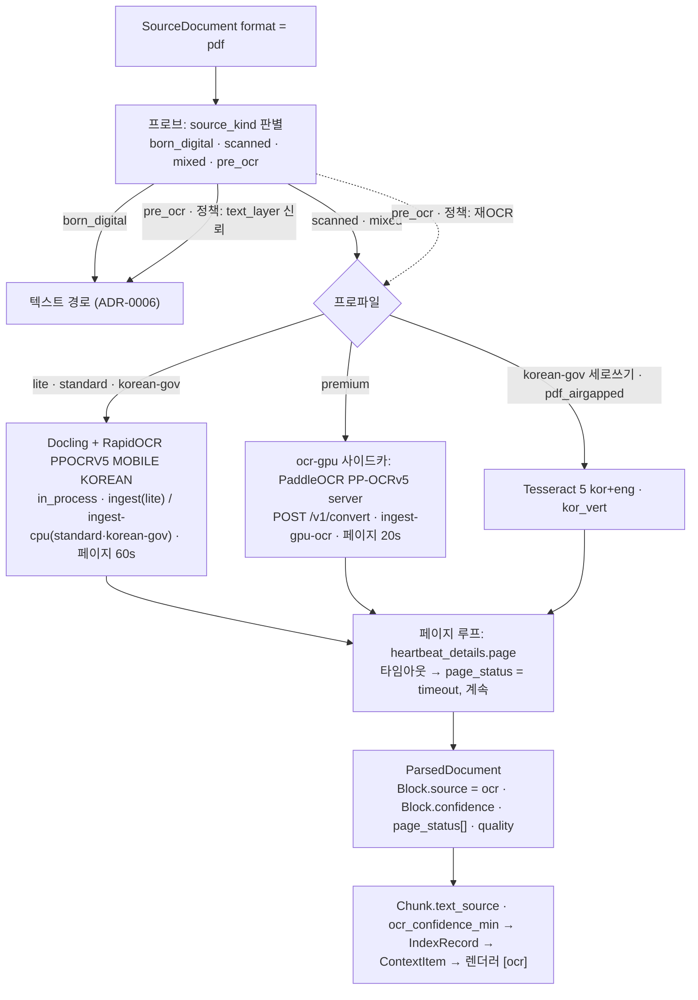

# ADR-0008: OCR 기본값 RapidOCR PP-OCRv5 korean / GPU PaddleOCR / 폴백 Tesseract

> MADR 형식. 바이블 §3.3 표의 0008행이며 관련 결정은 D-18(브리프 §4 개정 v1.1, 바이블 §3.1 `amended`)과 O-08(바이블 §3.2 `resolved`)이다. 이 ADR은 바이블의 결정 하나를 근거·대안과 함께 기록하고 바이블 표를 바꾸지 않는다(바이블 §1.1). 같은 D-18의 PDF 고속 텍스트 경로는 [ADR-0006](./0006-pdf-fast-path-pypdfium2-pdftext-replaces-pymupdf.md), HWP 5.0 경로는 [ADR-0007](./0007-hwp5-java-sidecar-first-pyhwp-demoted.md), 라이선스 등급표는 [ADR-0001](./0001-license-grade-table-and-d02-interpretation.md), 사이드카 `POST /v1/convert` 계약은 [ADR-0033](./0033-sidecar-convert-contract-and-isolation-ladder.md)이 다룬다.

## 맥락과 문제

브리프 D-18 원안(v1.0)은 스캔 PDF의 광학 문자 인식(OCR, Optical Character Recognition) 후보를 "PaddleOCR/Tesseract-kor/RapidOCR"로 병렬 나열했고 우선순위·조건이 없었다([선정 매트릭스](../07-tech-landscape/00-summary-and-selection-matrix.md) "브리프 수정 제안" D-18(OCR) 행, 문서 간 상충 판정 J-4). 브리프 §5 O-08은 "한국어 정확도·라이선스·GPU 요구"를 기준으로 기본 엔진을 확정하라고 요구한다. 기술 지형 조사([02 PDF 파싱·레이아웃·OCR](../07-tech-landscape/02-document-parsing-pdf-layout-ocr.md), [13 한국어 NLP](../07-tech-landscape/13-korean-nlp-tokenization-and-language-resources.md), [12 보안·라이선스](../07-tech-landscape/12-security-multitenancy-pii-and-licensing.md))에서 다음 사실이 확정되었다.

| # | 사실 | 출처 |
|---|------|------|
| F1 | RapidOCR 3.9.0+의 기본 모델은 PP-OCRv6 small(det/rec)이며 PP-OCRv6 통합 50개 언어 인식기는 **한국어를 포함하지 않는다**. 한국어 모델은 `Rec.ocr_version=OCRVersion.PPOCRV5` + `Rec.model_type=ModelType.MOBILE` + `Rec.lang_type=LangRec.KOREAN`을 명시해야 선택된다(열거형은 `rapidocr/utils/typings.py` 소스 확인) | 02 §C, §RapidOCR, 미해결 이슈 5(해결); 13 "브리프와의 충돌" D-18 행 |
| F2 | PaddleOCR의 한국어 인식 모델은 `korean_PP-OCRv5_mobile_rec`(14 MB, 벤더 5,007 라인 정확도 88.0) **단일**이고 `PP-OCRv5_server_rec`는 중·영·일 전용이다. 따라서 RapidOCR와 PaddleOCR의 한국어 인식 가중치는 동일하며, GPU 네이티브 경로의 이점은 언어 무관 server 검출 모델·방향/왜곡 전처리(UVDoc)·처리량에 한정된다 | 02 §PaddleOCR; 매트릭스 J-4 행 |
| F3 | 공개 한국어 라인 OCR 비교는 KORIE(영수증 748장, 2026-01)만 있다: PaddleOCR CER 15.84 / EasyOCR 17.36 / Tesseract 25.43(%). 사용 PP-OCR 버전 미기재·영수증 도메인 한정이라 일반화할 수 없고, 문서 수준(레이아웃·표·읽기 순서) 한국어 벤치마크는 존재하지 않는다 | 02 §벤치마크 종합; 바이블 §15 리스크 #1 |
| F4 | 라이선스: RapidOCR·PaddleOCR·Tesseract·EasyOCR는 Apache-2.0(A 등급). Surya는 코드 Apache-2.0이나 **가중치 modified OpenRAIL-M(연매출·투자 5M USD 임계)** → D 등급. HunyuanOCR는 **대한민국 사용 비허가**(지역 제한) → D 등급 + `territory` 불일치. Nemotron-OCR v2는 NVIDIA Open Model License(D 상당, 법무 검토) + Linux x86_64·Python 3.12·CUDA 13.x 한정 | 12 §6.1 등급표, §6.2 Surya 행; 02 §C(Surya·Nemotron 행), §D(HunyuanOCR 행), §리스크 및 완화(지역 제한); D-02(개정 v1.1) |
| F5 | Docling `OcrAutoOptions`는 Linux + onnxruntime 환경에서 RapidOCR를 자동 선택하지만 `feat-ocr-nemotron` extra가 있으면 **Nemotron-OCR를 RapidOCR보다 먼저** 잡는다. 엔진 자동 선택은 라이선스 미검토 모델의 유입 경로다 | 02 §C Nemotron 행, §리스크 및 완화 |
| F6 | Tesseract 5는 배포판 패키지·CPU 전용·에어갭 친화이며 세로쓰기 한국어 `kor_vert.traineddata`를 **유일하게** 제공한다. 반면 한국어 CER은 비교군 최악(F3)이고 이진화·기울기 보정 전처리에 의존한다 | 02 §Tesseract 5; 13 D-18 행 |
| F7 | EasyOCR 1.7.2는 2024-09 이후 릴리스가 없고(정체) 한국어 품질이 저조하다. docTR/OnnxTR는 `korean` vocab만 있고 사전학습 인식 체크포인트가 없다. PORORO는 5년 무릴리스다 | 02 §C, §EasyOCR / docTR |
| F8 | PaddlePaddle은 CUDA 버전과 결합된 대용량 wheel이라 파서 워커와 분리한 OCR 컨테이너가 권장된다. 바이블은 이를 사이드카 이미지 `ocr-gpu`(본 저장소 `sidecars/`, `POST /v1/convert`)로 확정했다 | 02 §PaddleOCR 함정; 바이블 §2.3, §6.7, §12 |
| F9 | RapidOCR 3.9.2는 Python 3.8~3.13이다. 파서 워커 이미지를 3.12/3.13으로 고정한 D-01 개정([ADR-0035](./0035-python-version-and-toolchain-pins.md))의 근거 중 하나다 | 02 "브리프와의 충돌" D-01 행; 바이블 §3.1 D-01 |
| F10 | 처리량(벤더): PP-OCRv5 mobile은 V100 0.62 s/img, Xeon Gold 6271C CPU 1.75 s/img. 브리프 §7 "스캔 PDF 100p < 5min(GPU OCR)"은 GPU에서 여유 있게 충족하나 CPU p95 꼬리(02 인용 16.3 s)는 페이지 단위 타임아웃으로 관리해야 한다 | 02 §처리량 요약, §실패 모드 |
| F11 | `lite`는 단일 노드·GPU 0·사이드카 0·컨테이너 5다. 기본 OCR은 CPU 인프로세스로 동작해야 한다 | 바이블 §7.1 |

문제: 한국어 스캔 PDF에 대해 (a) GPU 없이 동작하고 (b) A 등급 라이선스만 쓰며 (c) 한국어 모델이 확실히 선택되는 기본 OCR 경로를 무엇으로 하고, GPU 프로파일·폴백·제외 대상과 페이지 단위 내구성·출처 표기 계약을 어떻게 고정할 것인가.

## 결정 동인(decision drivers)

| ID | 동인 | 내용 | 근거 |
|----|------|------|------|
| DR1 | 라이선스 | 코어 이미지·인프로세스 의존성은 A 등급만. D 등급(모델 제한·지역 제한·매출 임계)은 기본 프로파일 금지 + `model_license_ack` 필수, `territory` 대조 | D-02(개정 v1.1), ADR-0001, 바이블 §7.4 (1) |
| DR2 | 한국어 정확도 | 공개 근거상 PP-OCRv5 계열이 소폭 우위(F3)이나 결정적 격차가 아니므로 정확도는 골든셋 게이트로 재확정하고, 기본값 선정의 주 근거는 라이선스·통합·운영 비용으로 둔다 | 원칙 6·7, 02 §O-08 의견 "근거 요약" |
| DR3 | GPU 비의존 기본 | `lite`·`standard` 기본 경로는 CPU 인프로세스여야 한다(F11). GPU는 인식 가중치가 같으므로(F2) 검출·전처리·처리량이 중요한 `premium`에서만 가치가 크다 | 바이블 §7.1, O-08 "GPU 요구" |
| DR4 | 통합 비용 | Docling이 이미 PDF 레이아웃·표 파서(D-18)이므로 OCR은 Docling 플러그형 옵션으로 붙여 단일 파이프라인을 유지한다. 엔진 자동 선택은 금지(F5) | ADR-0006 DR4, 02 §라우팅 흐름 |
| DR5 | 페이지 단위 내구성 | 장시간 OCR은 페이지 하트비트·타임아웃·재개(`Resumable`)와 부분 성공(`page_status[]`, `quality=degraded`)으로 문서 전체 실패를 막는다 | D-17, 바이블 §4.1 "부분 성공", §4.4 parse(OCR) |
| DR6 | 출처 투명성 | OCR 텍스트는 `Block.source=ocr` + `Block.confidence`로 시작해 청크·레코드·팩까지 전파되고 렌더러가 `[ocr]`을 표기한다(LLM이 신뢰도를 알고 인용) | 원칙 8·10, 바이블 §5.4, §9.3 |
| DR7 | 커버리지 | 세로쓰기(`kor_vert`)·폐쇄망(`pdf_airgapped`) 요구를 `korean-gov`에서 충족하는 폴백이 있어야 한다(F6) | 바이블 §7.1 korean-gov 행, 13 §리스크 |
| DR8 | 재현성 | 엔진·버전·모델이 `parser_fingerprint`·`Producer.model_ids`에 들어가 바뀌면 `stage_key`가 바뀌고 재파싱된다 | 원칙 4, 바이블 §6.2 |

## 고려한 대안

| 대안 | 라이선스(등급) | GPU 요구 | 한국어 근거 | 판정·근거 |
|------|----------------|----------|-------------|-----------|
| A1 PaddleOCR 네이티브를 전 프로파일 기본(11·13 문서 원안, "생태계 수렴") | Apache-2.0(A) | server 검출·방향/왜곡·텍스트라인 방향 전처리는 GPU 권장; PaddlePaddle이 CUDA 버전과 결합된 대용량 wheel(F8) | F2(인식은 mobile 단일, RapidOCR와 동일 가중치) | **기각** — 파서 워커 이미지에 넣을 수 없고 `lite`의 GPU 0·사이드카 0을 위반(F11); 기본값에서 얻는 정확도 이득 없음(02 점수표 85점 vs RapidOCR 87점) → `premium` 사이드카로 한정 |
| A2 RapidOCR PP-OCRv5 korean mobile(ONNX Runtime, CPU) 기본 + `premium` PaddleOCR server 사이드카 + 폴백 Tesseract | Apache-2.0(A) ×3 | 기본 없음(선택 `onnxruntime-gpu`) | F2 동일 가중치, F3 | **채택** — 단일 wheel + ONNX로 프레임워크 의존 없음, Docling 플러그형 엔진이라 통합 비용이 0에 가깝다(02 §O-08 의견). 단점: 변환 1회당 단일 언어(한·영 동시 인식은 가능), 초회 모델 다운로드(에어갭은 사전 번들), F1 함정은 프로파일 필수 키 + 어댑터의 모델 명시로 차단(Docling `RapidOcrOptions`가 버전·모델 타입을 노출하는 방식은 확인 필요 as of 2026-09 — 준수 확인 "금지 API 린트·모델 지정" 행) |
| A3 Tesseract 5 기본(브리프 원안 병렬 후보; 배포판 `tesseract-ocr-kor` + Docling `TesseractCliOcrOptions(lang=["kor","eng"])`) | Apache-2.0(A) | 없음 | KORIE CER 25.43 최악(F3) | **기각** — 성숙도·CPU 전용·에어갭 친화·`kor_vert` 유일(F6)이나 한글+숫자 혼합 소형 텍스트 취약, 전처리 의존, 레이아웃 분석 약함(02 점수표 74점) → Docling 레이아웃 뒤의 세로쓰기·에어갭 폴백으로만 |
| A4 EasyOCR(또는 docTR·PORORO) 기본 | Apache-2.0(A) | PyTorch | 정체·품질 저조·체크포인트 없음(F7) | **기각·제외** — EasyOCR 2년 무릴리스·SK 평가 "매우 떨어짐", docTR는 한국어 체크포인트 없이 파인튜닝 전제, PORORO 5년 정체; 브리프 D-18 개정에 "EasyOCR 제외" 명시 |
| A5 HunyuanOCR | 대한민국 사용 비허가(D, 지역 제한) | 필수 | — | **기각·제외** — D-02 `territory` 규칙상 `license_policy.territory: [KR]` 프로파일에서 `rag profile validate` (1)이 거부하므로 옵트인도 불가(F4); 브리프 D-18 개정에 "HunyuanOCR 제외" 명시 |
| A6 Surya 2(650M VLM; 레이아웃·OCR·표·읽기 순서) 기본 | 코드 Apache-2.0, 가중치 modified OpenRAIL-M(D) | 필수(vLLM 또는 llama.cpp 서버) | 벤더 내부 86.7%, olmOCR-bench 83.3(벤더) | **기각** — 가중치 매출 임계(5M USD)가 Apache-2.0 플랫폼 기본값으로 부적합(02 §Marker(+Surya) 함정, 12 §6.2 Surya 행) → D 등급 옵트인 플러그인(`model_license_ack: true`) |
| A7 Docling `OcrAutoOptions` 자동 선택 | 환경 의존 | 환경 의존 | — | **기각·금지** — Linux에서 Nemotron-OCR가 RapidOCR보다 먼저 선택되어(F5) 라이선스 미검토 D 상당 모델이 기본 경로에 들어옴; 매트릭스 `pdf_layout_parser` 행도 금지 명시 |
| A8 Nemotron-OCR v2 multilingual(Docling `NemotronOcrOptions` 내장, 83.9M)을 GPU 기본 | NVIDIA OML(D 상당) | CUDA 13.x·Linux x86_64·Python 3.12 한정 | 한국어 명시, 정량 없음 | **기각** — 법무 검토 전(F4), 에어갭·CPU 불가(02 점수표 56점) → 법무 검토 후 GPU 골든셋 비교 대상만 |
| A9 VLM end-to-end(PaddleOCR-VL 0.9B·MonkeyOCRv2-B-Parsing)를 OCR 기본 | Apache-2.0(A) | 필수(L4 24 GB 이상) | 벤더 in-house edit distance 0.052, 문서 수준 벤치 최상위 | **기각** — 환각 위험·신뢰도 부재(02 §실패 모드 "VLM 환각"), 1순위 미확정 → 골든셋 비교 후 `pdf_vlm_gpu` 프로파일로만 승격(바이블 §7.1 `premium` "골든셋 후"); 디지털 페이지 텍스트 레이어 대체 금지 |

## 결정

**결정:** 브리프 D-18(개정 v1.1)의 OCR 항목 그대로 — "**OCR(기본 RapidOCR PP-OCRv5 korean mobile ONNX, GPU 프로파일 PaddleOCR PP-OCRv5 server, 폴백 Tesseract 5 `kor+eng`·`kor_vert`; Surya 옵트인, EasyOCR·HunyuanOCR 제외)**". O-08 해결(바이블 §3.2): "RapidOCR 3.9.x(`OCRVersion.PPOCRV5` + `ModelType.MOBILE` + `LangRec.KOREAN` 명시, ONNX Runtime) 기본; `premium` GPU PaddleOCR PP-OCRv5 server(`ocr-gpu`); 폴백 Tesseract 5 `kor+eng`(+`kor_vert`, `pdf_airgapped`). Surya 옵트인, EasyOCR·HunyuanOCR 제외, Docling `OcrAutoOptions` 금지. 페이지 단위 하트비트·타임아웃(CPU 60s / GPU 20s), `Resumable`, `page_status[]`·`Block.source`·`Block.confidence`. 프로파일 YAML `ocr: {plugin, lang, version, model}` 필수 키". 프로파일 정본(바이블 §7.1 "PDF 스캔" 행)은 `lite` = "RapidOCR PP-OCRv5 korean mobile(CPU)", `standard` = "동일(비트맵 영역만)", `premium` = "`pdf_scanned_gpu`(PaddleOCR server) / `pdf_vlm_gpu`(골든셋 후)", `korean-gov` = "+ `kor_vert` 세로쓰기 라우팅 + `pdf_airgapped`(Tesseract, 모델 번들)"이다.

| 프로파일 | OCR 엔진(버전은 07 문서 확인일 기준, 잠금 파일이 정본) | `parser_fingerprint.profile_option` | 격리 모드 | `StagePolicy.task_queue` | 페이지 타임아웃 | 등급 |
|----------|------------------------------------------------------------|-------------------------------------|-----------|--------------------------|-----------------|------|
| `lite` | RapidOCR 3.9.x PP-OCRv5 korean mobile, ONNX Runtime CPU(Docling 플러그형 OCR) | `pdf_standard`(스캔·혼합 페이지; 바이블 §7.1은 엔진만 고정하고 문자열·파서 ID `parser.pdf_docling_standard`는 [04-pipelines/05](../04-pipelines/05-parser-pdf.md) §1.2·§6.1이 확정 — 디지털 페이지는 `pdf_fast_cpu`, ADR-0006) | `in_process` | `ingest`(lite 단일 큐, §7.1) | 60s(`cpu`) | A |
| `standard` | 동일, 비트맵 영역만 OCR | `pdf_standard` | `in_process` | `ingest-cpu` | 60s(`cpu`) | A |
| `premium` | PaddleOCR 3.7 PP-OCRv5 server det + korean mobile rec + 방향/왜곡 전처리 | `pdf_scanned_gpu` | `sidecar`(`ocr-gpu`, `POST /v1/convert`) | `ingest-gpu-ocr` | 20s(`gpu`) | A |
| `korean-gov` | standard + 세로쓰기 감지 시 Tesseract 5.5 `kor_vert`(판정 신호·임계는 [04-pipelines/05](../04-pipelines/05-parser-pdf.md) §6.6 — 프로브 `vertical_hint`·OCR 라인 종횡비, 초안; 결과는 `parser_fingerprint.model_ids`에 반영); 폐쇄망은 Tesseract `kor+eng` 모델 번들(Docling `TesseractCliOcrOptions`, 워커 이미지 내 CLI) | `pdf_standard` / `pdf_airgapped`(폐쇄망 전용, 프로파일 `ocr.plugin: tesseract`) | `in_process`(Tesseract는 CLI 서브프로세스 — ADR-0033 격리 사다리 분류는 확인 필요 as of 2026-09) | `ingest-cpu` | 60s(`cpu`) | A |
| 옵트인(모든 프로파일) | Surya 등 D 등급 플러그인 | 플러그인 선언 | 플러그인 선언 | — | — | D(`optIn` + `model_license_ack: true`) |

정본 YAML(바이블 §7.3 `standard`, OCR 관련 키만 발췌)은 다음과 같다. `premium`은 `runtime.queues.ocr`을 `ingest-gpu-ocr`로 오버라이드하고 `ocr` 값이 `ocr-gpu` 사이드카를 가리킨다. `premium`·`pdf_airgapped`의 `ocr.plugin` 문자열은 바이블에 고정되어 있지 않으므로 [03-contracts/15](../03-contracts/15-collection-profile-and-policy-contracts.md)가 `profile.schema.json`과 함께 확정하되 네 키의 필수성은 바꾸지 못한다.

```yaml
runtime:
  queues: {fetch: ingest-io, parse: ingest-cpu, ocr: ingest-cpu, normalize: ingest-cpu, chunk: ingest-cpu, enrich: ingest-cpu, enrich_llm: ingest-llm, embed: ingest-gpu-embed, index: ingest-io}
ingest:
  parse:
    router:
      pdf:  {born_digital: parser.pdf_docling_standard, scanned: parser.pdf_docling_standard, mixed: page_route}
    options:
      ocr: {plugin: rapidocr, lang: [korean], version: PPOCRV5, model: MOBILE}   # 필수 키(v3.9+ 기본 PP-OCRv6 차단)
      page_timeout: {cpu: 60s, gpu: 20s}
```



계약 전파(모두 바이블 §5.4~§5.7·§9.3의 기존 필드·열거이며 이 ADR이 새로 만드는 것은 없다):

- 라우팅 키는 `ParsedDocument.source_kind`(`SourceKind = born_digital, scanned, mixed, pre_ocr, flow`)이고 `mixed`는 `page_route`로 페이지 단위 분기한다. `pre_ocr`(숨은 텍스트 레이어가 있는 스캔 PDF)의 처리 정책 — `text_layer` 신뢰 또는 `ocr` 재OCR — 는 [03-contracts/03](../03-contracts/03-parsed-document.md) §5.1 정의를 따르고 선택 키는 [04-pipelines/05](../04-pipelines/05-parser-pdf.md)가 확정한다(이 ADR은 `pre_ocr`를 무조건 재OCR하지 않으며 새 프로파일 키를 만들지 않는다). `page_status[]{page, status: enum(PageStatus), ocr_confidence}`, `PageStatus = ok, timeout, ocr_failed, skipped`.
- OCR 블록은 `Block.source = ocr`(`BlockSource = text_layer, ocr, vlm, converted`)이고 `Block.confidence`는 `source ∈ {ocr, vlm}`이면 필수다. `NormalizedBlock.text_source`·`confidence`가 이를 복사하고, `Chunk.text_source`는 포함 블록의 최저 신뢰 등급(`text_layer > converted > vlm > ocr`; OCR 블록이 하나라도 있으면 `ocr`), `Chunk.ocr_confidence_min`은 최소 `confidence`(`text_source ∈ {ocr, vlm}`이면 non-null)다. `IndexRecord.text_source`(keyword)·`ocr_confidence_min`(float)로 색인되어 `hydrate`가 읽고 `ContextItem`으로 전파되며, 렌더러는 `title` 끝에 `[ocr]`을 붙이고 `expose_confidence=true`면 `ocr_confidence_min`을 소수 2자리로 병기한다(§9.3 공통 규칙 (2)).
- 지문: `parser_fingerprint.model_ids`에 OCR 모델(PP-OCRv5 korean mobile 등), `profile_option`, 사이드카 경로는 `sidecar_image_digest`가 들어가 `H("parser", …)`와 `stage_key`를 바꾼다(DR8). 실제 시도 순서는 `parser_chain[]`에 남는다.
- 오류·정책: `parse.page_timeout`(재시도 yes, 해당 페이지 `page_status=timeout`으로 기록 후 계속), `parse.sidecar_unavailable`(재시도 후 폴백 체인), `parse.conversion_failed`(폴백 체인). 실패 페이지는 `ocr_failed`, 문서는 `quality=degraded` + `warnings[]`로 부분 성공한다. `StagePolicy` parse(OCR) 행(§4.4): `start_to_close 60m`, `heartbeat 60s`, `max_attempts 3`, `resumable yes(heartbeat_details.page)`, 큐는 `ingest-gpu-ocr`(premium) / `ingest-cpu`(standard).

`ParsedDocument`의 OCR 관련 필드 발췌(봉투·나머지 필수 필드는 [03-contracts/03](../03-contracts/03-parsed-document.md) 예시를 따른다; 값은 예시):

```json
{
  "source_kind": "mixed", "page_count": 14, "quality": "degraded",
  "warnings": [{"code": "parse.page_timeout", "message": "page OCR exceeded cpu page_timeout 60s", "page": 13}],
  "page_status": [{"page": 12, "status": "ok", "ocr_confidence": 0.91}, {"page": 13, "status": "timeout", "ocr_confidence": null}],
  "blocks": [{
    "block_id": "3f9c2a7b1d4e5f60718293a4b5c6d7e8", "type": "paragraph", "parent_block_id": null, "ordinal": 3,
    "text": "제3조(절차) 이 규정에 따른 신청은 서면으로 한다.", "furniture": false, "container": "body",
    "source": "ocr", "confidence": 0.91,
    "provenance": {"element_path": "#/texts/3", "char_start": 0, "char_end": 29, "page": 12, "bbox": [72.0, 140.5, 523.2, 158.0], "section_index": null}
  }]
}
```

## 결과

**긍정**

- `lite`·`standard`가 GPU·사이드카·PaddlePaddle 없이 한국어 스캔 PDF를 처리하고, 코어 잠금 파일의 OCR 의존성(`rapidocr`, `onnxruntime`)이 A 등급으로 남는다(바이블 §15 리스크 #2).
- 프로파일 필수 키 `ocr: {plugin, lang, version, model}`이 F1 함정(v3.9+ 기본 PP-OCRv6, 한국어 미포함)을 로딩 시점에 차단한다(§7.4 (6)). 엔진 자동 선택 금지로 라이선스 미검토 모델 유입 경로(F5)도 닫힌다.
- CPU 기본과 GPU `premium`이 같은 한국어 인식 가중치(F2)를 쓰므로 프로파일 간 인식 품질 편차가 없고, GPU 경로는 검출·전처리·처리량(§7 "스캔 100p < 5min")만 개선한다. 골든셋 비교 변수가 준다.
- 페이지 단위 하트비트·타임아웃·`Resumable`로 p95 꼬리(F10)가 문서 전체 실패로 확대되지 않고, 재시도는 완료 페이지를 건너뛴다(DR5).
- `Block.source`·`confidence` → `text_source`·`ocr_confidence_min` → `[ocr]` 표기로 LLM이 OCR 출처와 신뢰도를 알고 인용한다(DR6). `ocr_confidence` 저조 페이지는 `visual-pages` 보완 채널의 폴백 후보가 된다(매트릭스 `visual_page_retriever` 행).

**부정**

- 정확도 근거가 영수증 라인 벤치와 벤더 수치뿐이다(F3). 기본값은 한국어 스캔 골든셋 CER/WER 재측정 후 재확정해야 하며 그때까지 "초안"이다(재검토 조건 1).
- RapidOCR는 변환 1회당 단일 언어라 한·영 외 다국어 페이지 인식이 떨어진다. 다국어 문서는 페이지 언어 힌트 또는 `pdf_vlm_gpu`가 필요하다(02 §리스크).
- GPU 경로가 한국어 인식 정확도 자체를 높이지 않는다(F2). 인식 정확도 상향은 VLM 프로파일(`pdf_vlm_gpu`) 골든셋 결과에 달려 있다.
- Tesseract 폴백은 품질 하향을 감수한다(`quality=degraded`). 세로쓰기·한자 품질은 미검증이다(13 §리스크).
- `ocr-gpu` 이미지는 PaddlePaddle CUDA 결합으로 빌드가 취약하다. 이미지 태그·digest 고정과 `Producer.image_digest` 기록이 필수이고, 사이드카 네트워크 홉이 추가된다.
- 초회 모델 다운로드 때문에 에어갭은 모델 번들 이미지가 필요하고, RapidOCR `≤3.13`이 Python 3.14 채택을 늦춘다(F9).

**중립**

- Docling `pdf_standard`(레이아웃·표) 경로는 변경 없다. OCR은 비트맵 영역(스캔·혼합 페이지)에만 적용된다. `lite`는 스캔·혼합 페이지에 한해 Docling `pdf_standard`를 인프로세스로 쓰므로(04-pipelines/05 §3.2) lite 이미지에 Docling(heron·TableFormer 모델 포함)이 들어가고, 디지털 PDF는 ADR-0006대로 `pdf_fast_cpu`다.
- `pdf_scanned_gpu`·`pdf_airgapped`는 `ProfileTier`가 아니라 `parser_fingerprint.profile_option` 문자열이며, 경로가 바뀌면 지문·`stage_key`가 바뀌어 재파싱된다.
- Surya 등 D 등급 옵트인은 코어 이미지를 바꾸지 않는다. `ocr-gpu`는 A 등급이므로 GPL 사이드카 저장소가 아닌 본 저장소 `sidecars/`에 둔다(§6.7).

## 준수 확인 방법

| 게이트 | 강제 내용 | 정의 위치 |
|--------|-----------|-----------|
| `rag profile validate` (6) | `ingest.parse.options.ocr`의 `lang`·`version`·`model` 누락 → `profile.invalid`(§7.4 (6)); `plugin` 키의 필수성은 O-08 문구(`ocr: {plugin, lang, version, model}` 필수 키)에 따르고 그 값의 유효성(등록·`license_grade`·`territory`)은 (1) 행이 담당한다. `plugin: rapidocr`일 때 `version`·`model`은 RapidOCR 열거형 이름과 문자열 일치(`PPOCRV5`, `MOBILE`); 그 외 플러그인(`paddleocr`·`tesseract` 등)의 값 집합은 [03-contracts/15](../03-contracts/15-collection-profile-and-policy-contracts.md) `OcrOptions`가 정한다 | 바이블 §3.2 O-08, §7.4 (6), 03-contracts/15 |
| `rag profile validate` (1) | OCR 플러그인 `PluginMeta.license_grade ≤ license_policy.max_grade`(정본 `B`). Surya 등 D 등급은 `optIn` + `model_license_ack: true` 없이는 `plugin.license_denied`; HunyuanOCR는 `territory`가 `license_policy.territory: [KR]`과 불일치해 거부 | 바이블 §7.4 (1), §5.6 `PluginMeta`, ADR-0001 |
| CI 열거 대조(§1.2) | `schemas/*.schema.json`의 `BlockSource`·`SourceKind`·`PageStatus` 값 집합을 바이블 §5.7과 기계 대조(불일치 = 빌드 실패). 오류 코드 `parse.page_timeout`·`parse.sidecar_unavailable`·`parse.conversion_failed`도 동일 | [10-development/05](../10-development/05-ci-cd.md) |
| 스키마 제약 | `Block.confidence`는 `source ∈ {ocr, vlm}`이면 필수(JSON Schema `if/then`); `Chunk.ocr_confidence_min`·`IndexRecord.ocr_confidence_min`은 `text_source ∈ {ocr, vlm}`이면 non-null; `page_status[].status`는 `enum(PageStatus)` | [03-contracts/03](../03-contracts/03-parsed-document.md), [03-contracts/05](../03-contracts/05-chunk-set.md), [03-contracts/07](../03-contracts/07-embedded-chunk-set-and-index-record.md) |
| 금지 API 린트·모델 지정 | `src/rag_platform/**`에서 Docling `OcrAutoOptions` 임포트·사용 금지(ruff banned-api). F1 차단 메커니즘(확인 필요 as of 2026-09): (a) RapidOCR를 직접 생성하는 경로는 `Rec.ocr_version=OCRVersion.PPOCRV5`·`Rec.model_type=ModelType.MOBILE`·`Rec.lang_type=LangRec.KOREAN`을 프로파일 값에서 항상 `params`로 전달한다; (b) Docling `RapidOcrOptions` 경로는 옵션이 `lang`·`backend`만 노출하므로(02 §Docling) 어댑터가 번들·미러된 PP-OCRv5 korean mobile ONNX 모델 파일 경로를 명시하고, 모델 경로 필드가 없으면 RapidOCR 인스턴스를 직접 생성해 Docling OCR 플러그인 엔진으로 주입한다. 단위 테스트는 `params` 검사에 더해 실제 적재된 인식 모델(`parser_fingerprint.model_ids`에 PP-OCRv5 korean mobile 포함)을 검증한다. `docling[feat-ocr-nemotron]` extra·`paddlepaddle`·`paddleocr`·`surya-ocr`는 코어 `uv.lock`·코어 이미지 SBOM에 나타나면 빌드 실패(PaddleOCR는 `sidecars/ocr-gpu` 이미지에만) | [10-development/03](../10-development/03-coding-standards.md), [04-pipelines/05](../04-pipelines/05-parser-pdf.md) §6.3, CI 라이선스 게이트(ADR-0001) |
| 적합성 키트 | OCR 경로 파서가 `contract_roundtrip`·`idempotency`를 통과: 동일 바이트·동일 지문 → 동일 `ParsedDocument` 해시; `Capabilities.supports_resumable = true`; `parser_fingerprint.model_ids`에 OCR 모델 포함; 느린 페이지 주입 시 `page_status=timeout` 기록·잡 계속·`quality=degraded`; `renderer_citation_roundtrip`에서 `text_source=ocr` 항목의 `[ocr]` 표기 확인 | 바이블 §12 `testing/`, ADR-0032 |
| 사이드카·에어갭 헬스체크 | `ocr-gpu`는 `GET /healthz`에서 모델 적재를 확인하고 `ConvertResponse.producer.image_digest`를 채운다. `korean-gov` 워커 이미지(에어갭 빌드)는 RapidOCR PP-OCRv5 korean ONNX와 Tesseract `kor`·`kor_vert` traineddata를 번들하며 모델 부재 시 워커 기동이 실패해 조기 노출된다(02 §실패 모드). `pdf_airgapped`는 프로파일이 `ocr.plugin: tesseract`를 지정한 폐쇄망 배포에서만 선택되고 기본은 여전히 RapidOCR `pdf_standard`다(04-pipelines/05 §1.2) | [02-architecture/08](../02-architecture/08-deployment-architecture.md), [09-operations/01](../09-operations/01-deployment-guide.md), ADR-0033 |
| 평가 게이트(초안 목표) | 한국어 스캔 골든셋(공문서·보고서·영수증·2단 논문)에서 엔진별 CER/WER·처리량을 측정하고 M2 "OCR 기본값 재확정(CER/WER)" 게이트로 기록한다. 수치 목표는 실측 전 두지 않는다 | [08-evaluation/03](../08-evaluation/03-golden-dataset-construction.md), [08-evaluation/05](../08-evaluation/05-benchmark-plan-and-baselines.md) |
| 코드 리뷰 체크리스트 | (a) `OcrAutoOptions` 없음 (b) RapidOCR `PPOCRV5`·`MOBILE`·`KOREAN` 명시 (c) 페이지 루프가 페이지 시작 직전과 완료 직후에 하트비트(`heartbeat_details.page`)를 보내고(`heartbeat 60s`가 `page_timeout.cpu 60s`와 같아 완료 시점만 보내면 정당한 장기 페이지가 하트비트 타임아웃에 걸린다) `page_timeout.cpu/gpu`를 적용하며, 사이드카 호출은 `ConvertRequest.deadline_ms`로 `page_timeout.gpu`를 전파(ADR-0033) (d) OCR 블록마다 `source=ocr`·`confidence` 채움 (e) `parser_chain[]`·`model_ids`·`sidecar_image_digest` 기록 (f) Tesseract는 `kor_vert` 라우팅·`pdf_airgapped`에서만 (g) 디지털 페이지 텍스트 레이어를 OCR·VLM 출력으로 덮어쓰지 않음 | [10-development/07](../10-development/07-contributing.md) |

## 재검토 조건

1. D-12 하네스의 한국어 스캔 골든셋에서 CER/WER·처리량을 재측정한 결과, 다른 A 등급 엔진이 RapidOCR PP-OCRv5 korean mobile을 프로파일 `gate` 임계 이상으로 앞서면 이 ADR을 개정한다(바이블 §3.2 O-08 "CER/WER 재측정 후 ADR 갱신", 매트릭스 M2 게이트 목록).
2. PaddleOCR/RapidOCR가 한국어를 포함한 PP-OCRv6 인식기 또는 한국어 server 인식 모델을 공개하면 `ocr.version`·`ocr.model` 기본값을 재검토한다. 값 변경은 프로파일 `version` 증가 → `profile_hash` 변경 → 컬렉션 blue/green이다(§7.4).
3. Nemotron-OCR v2의 NVIDIA Open Model License 법무 검토가 끝나면 GPU 정확도 프로파일 골든셋 비교(PaddleOCR server와 병행)에 포함한다. 등급이 D로 유지되면 옵트인을 넘지 못한다.
4. Surya 가중치가 A 등급으로 재라이선스되면 기본값 후보로 재평가한다. 그때까지 D 등급 옵트인 플러그인이다.
5. PaddleOCR-VL과 MonkeyOCRv2-B-Parsing의 한국어 골든셋 비교로 `pdf_vlm_gpu` 1순위가 확정되면 `premium` 스캔 경로의 기본을 재검토한다. 디지털 페이지의 텍스트 레이어를 VLM 텍스트로 대체하는 결정은 어떤 경우에도 하지 않는다.
6. RapidOCR가 Python 3.14를 지원하면 D-01·ADR-0035의 파서 워커 이미지 고정을 재검토한다.
7. (a) PaddleOCR/RapidOCR 계열이 세로쓰기 한국어를 지원하는 것으로 확인되면(13 §O-08 "확인 필요") `korean-gov`의 세로쓰기 Tesseract 라우팅을 재검토한다. (b) Tesseract `kor_vert`·`kor+chi_tra`의 세로쓰기·한자 품질 측정(13 미해결 이슈 9) 결과에 따라 한자 병기 문서의 폴백 언어 조합을 재검토한다.
8. Docling `RapidOcrOptions`가 OCR 버전·모델 타입(또는 모델 파일 경로)을 노출하는 방식이 바뀌면(02 §Docling "OCR 엔진" 행 — v2.109.0부터 RapidOCR 기본이 PP-OCRv6로 전환; 02 미해결 이슈 5 RapidOCR 열거형; 확인 필요 as of 2026-09) 어댑터의 프로파일 키 → `params`·모델 경로 매핑을 재검토한다. 네 키의 필수성은 유지한다.

## 참조

- [설계 브리프](../00-vision/00-design-brief.md) §4 D-01·D-02·D-17·D-18(개정 v1.1), §5 O-08, §7 품질 목표(스캔 PDF 100p < 5min), §9 문서 규약
- [설계 바이블](../02-architecture/00-design-bible.md) §1.1, §2.3 `ocr-gpu`, §3.1 D-18 행, §3.2 O-08 행, §3.3 0008행, §4.1 "부분 성공", §4.2 `parse` 행, §4.4 parse(OCR) 행, §5.3 `Producer`·`Provenance`·`Warning`·`Capabilities`·`StagePolicy`, §5.4 `ParsedDocument`·`Block`·`NormalizedBlock`·`Chunk`·`IndexRecord`, §5.6 `PluginMeta`·`ConvertRequest`/`ConvertResponse`, §5.7 `BlockSource`·`SourceKind`·`PageStatus`·`LicenseGrade`·오류 카탈로그, §6.1·§6.2·§6.7, §7.1 "PDF 스캔" 행, §7.3 `ingest.parse.options.ocr`, §7.4 (1)(6), §9.3 공통 규칙 (2), §11.2 태스크 큐, §12 `sidecars/`, §15 리스크 #1·#2
- [기술 지형 종합: 선정 매트릭스](../07-tech-landscape/00-summary-and-selection-matrix.md) 판정 J-4, `ocr_engine`·`pdf_layout_parser`·`visual_page_retriever` 행, "프로파일별 기본 조합" PDF 스캔 행, O-08 행, "브리프 수정 제안" D-18(OCR)·D-01 행, ADR 발의 목록 P1, M2 평가 게이트 목록
- [02 PDF 파싱·레이아웃 분석·OCR](../07-tech-landscape/02-document-parsing-pdf-layout-ocr.md) §C OCR 엔진, §D(HunyuanOCR 행), §Docling(OCR 엔진 행), §PaddleOCR·§RapidOCR·§Tesseract 5·§EasyOCR / docTR·§Marker(+Surya), §스캔/디지털 판별 휴리스틱(`pre_ocr`), §벤치마크 종합, §처리량 요약, §선정 근거 점수표 — OCR 엔진 역할(O-08), §1차/2차/폴백, §프로파일별 조합, §실패 모드, §리소스 요구, §O-08 의견, §브리프와의 충돌, 미해결 이슈 4·5·11
- [13 한국어 NLP·토크나이제이션](../07-tech-landscape/13-korean-nlp-tokenization-and-language-resources.md) 한국어 OCR(O-08 관련) 행, "브리프와의 충돌" D-18 행, 리스크(한자·세로쓰기), 미해결 이슈 9
- [12 보안·멀티테넌시·PII·라이선스](../07-tech-landscape/12-security-multitenancy-pii-and-licensing.md) §6.1 등급표(D 등급 OpenRAIL-M·지역 제한), Surya 행, O-08 행
- 관련 ADR: [ADR-0001 라이선스 등급표](./0001-license-grade-table-and-d02-interpretation.md), [ADR-0002 provenance](./0002-provenance-element-path-and-nullable-page-bbox.md), [ADR-0003 오케스트레이터 중립 파이프라인](./0003-orchestrator-neutral-pipeline-and-non-durable-local-runner.md), [ADR-0006 PDF 고속 텍스트 경로](./0006-pdf-fast-path-pypdfium2-pdftext-replaces-pymupdf.md), [ADR-0007 HWP 5.0 경로](./0007-hwp5-java-sidecar-first-pyhwp-demoted.md), [ADR-0031 프로파일 스키마](./0031-profile-schema-extends-and-quality-gates.md), [ADR-0032 플러그인 SDK](./0032-plugin-sdk-stage-protocol-and-conformance-kit.md), [ADR-0033 사이드카 convert 계약](./0033-sidecar-convert-contract-and-isolation-ladder.md), [ADR-0035 Python 버전 고정](./0035-python-version-and-toolchain-pins.md)
- 하위 설계 문서: [04-pipelines/03 파싱 라우터](../04-pipelines/03-parsing-router-and-format-detection.md), [04-pipelines/05 PDF 파서](../04-pipelines/05-parser-pdf.md), [03-contracts/03 ParsedDocument](../03-contracts/03-parsed-document.md), [03-contracts/15 프로파일 계약](../03-contracts/15-collection-profile-and-policy-contracts.md), [ADR 인덱스](./README.md)
