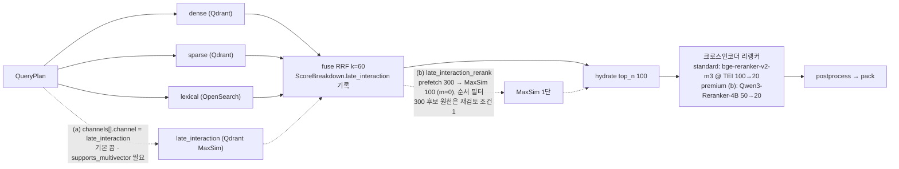

# ADR-0010: BGE-M3 유지 근거 재기술과 late_interaction 슬롯 분리

> MADR 형식. 바이블 §3.3 표의 0010행이며 관련 결정은 D-16(브리프 §4 개정 v1.1, 바이블 §3.1 `amended`)과 O-04(바이블 §3.2 `resolved`)다. 이 ADR은 바이블의 결정을 근거·대안과 함께 기록하고 바이블 표를 바꾸지 않는다(바이블 §1.1). 같은 D-16의 서빙 스택(vLLM pooling + TEI + 인프로세스, Infinity 제외, 코사인 ≥0.9999 동등성 게이트)은 [ADR-0009](./0009-embedding-serving-vllm-pooling-tei-inprocess.md), sparse 표현(O-02)은 [ADR-0014](./0014-sparse-representation-bge-m3-lexical-leg-kept.md), 라이선스 등급표는 [ADR-0001](./0001-license-grade-table-and-d02-interpretation.md)이 다룬다.

## 맥락과 문제

브리프 D-16 원안(v1.0)은 기본 임베딩을 "BGE-M3(dense + sparse, 선택적 colbert)"로 정하고 근거를 dense 품질에 두었으며, 교체 후보에 jina 계열을 나열했다. 기술 지형 조사([05 임베딩·스파스·멀티벡터 모델과 서빙](../07-tech-landscape/05-embedding-models-and-serving.md), [07 리트리벌 기법](../07-tech-landscape/07-retrieval-techniques-fusion-reranking.md), [14 고급 RAG](../07-tech-landscape/14-advanced-rag-graph-raptor-agentic-multimodal.md), [선정 매트릭스](../07-tech-landscape/00-summary-and-selection-matrix.md) 판정 J-2와 `dense_embedder`·`late_interaction_model`·`reranker` 행)에서 다음 사실이 확정되었다.

| # | 사실 | 출처 |
|---|------|------|
| F1 | 한국어 dense 리더보드(MTEB-ko)에서 KURE-v1 80.76·snowflake-arctic-embed-l-v2.0-ko 82.14·PIXIE-Rune 81.57(v1.0 등재; v1.5 등재 여부 확인 필요, as of 2026-09)·Qwen3-Embedding-4B 81.37이 bge-m3 79.30을 앞선다. "dense 품질"은 더 이상 BGE-M3 유지 근거가 되지 못한다 | 매트릭스 `dense_embedder` 행, 05 §후보 표·§한국어 특화 dense |
| F2 | BGE-M3(568M, 1024d, 8192 토큰, MIT)는 dense(`[CLS]`)·sparse(`vocab_id=xlm-roberta-250k`)·colbert를 **한 패스**로 내고 서빙 지원이 가장 넓으며(vLLM pooling·FlagEmbedding·TEI dense), KURE-v1·dragonkue/BGE-m3-ko 등 동일 아키텍처·토크나이저 한국어 파인튠은 **모델 ID만 바꾸는 드롭인** 교체다. 단, 한국어 파인튠은 dense 헤드만 재학습되어 sparse/colbert 헤드 품질은 보증되지 않는다 | 05 §BGE-M3(함정 5), 매트릭스 `dense_embedder`·`embedding_server` 행 |
| F3 | BGE-M3 colbert는 토큰당 **1024d**다. 평균 300토큰 청크 100만 개를 fp16으로 저장하면 약 **614GB**(계산)로 인덱스 단계 저장이 비현실적이다. 128d 한국어 late interaction 모델 KURE-v2(Apache-2.0, 154M, 8192 토큰)는 같은 조건에서 약 77GB, turbo4 약 19GB, 1-bit + 토큰 풀링 수 GB대다(dense 1024d fp16은 약 2GB) | 05 §저장량 계산, 14 §late interaction, 매트릭스 J-2 |
| F4 | 07 문서의 O-04 의견("리랭크 단계 전용")은 "허용 라이선스 한국어 128d 모델 부재"를 전제했고 05·14의 재조사로 전제가 철회되었다. 07의 결론은 BGE-M3 colbert에 한정해 유지한다. KURE-v2는 공개 1개월·카드 자체 보고(MTEB(kor,v2) 0.8160)라 채택 근거로 쓸 수 없다 | 매트릭스 J-2·O-04 권고·판정 원칙 (d)·리스크 #9 |
| F5 | jina-embeddings v3/v5·jina-colbert-v2·jina-reranker-v2/v3은 CC-BY-NC-4.0, jina-embeddings v4는 Qwen Research License로 D 등급이다. Apache-2.0 플랫폼의 권장 목록에 둘 수 없다(D-02) | 05 §후보 표, 07 §리랭커 표, 매트릭스 "브리프 수정 제안" D-16(교체 후보) 행 |
| F6 | 멀티벡터 MaxSim은 Qdrant 1.10+(`MultiVectorConfig(MAX_SIM)`, `hnsw_config.m=0` 재점수 전용, turbo4/TurboQuant)·Milvus·Weaviate가 지원하고 pgvector 0.8.6은 미지원이다. 백엔드 교체(D-15) 시 채널이 자동으로 꺼져야 한다 | 14 §백엔드 multivector 표, 매트릭스 `vector_index` 행 |
| F7 | 설계 제안 B는 `late_interaction_rerank` 2단 리랭크 필드를 두고 이를 선호했으나 한국어 골든셋 근거가 없다. 원칙 7(Evaluation-Driven)과 바이블 §7.4 "품질 기본값은 게이트 없이 바뀌지 않는다"에 따라 사전 선호를 결정으로 승격할 수 없다 | 바이블 §3.2 O-04 근거 열, §7.4 |

문제: (1) BGE-M3를 기본으로 유지한다면 어떤 근거로 유지하고 어떤 조건에서 교체하는가, (2) late interaction(지연 상호작용, ColBERT 계열 MaxSim)을 BGE-M3의 "선택적 출력"으로 묶어 둘지 별도 슬롯으로 분리할지, (3) 분리한다면 인덱스 단계와 리랭크 단계 중 어디에 두고 계약·프로파일·백엔드 능력에 어떻게 표현하는가.

## 결정 동인(decision drivers)

| ID | 동인 | 내용 | 근거 |
|----|------|------|------|
| DR1 | 라이선스 | 기본·권장 모델은 A/B 등급만. D 등급(CC-BY-NC·Qwen Research 등)은 BYO + `model_license_ack`로만 | D-02(개정 v1.1), ADR-0001, 바이블 §7.4 (1) |
| DR2 | 평가 주도 | 모든 품질 기본값은 골든셋 `gate`로 정당화한다. 사전 선호·리더보드·카드 자체 보고 수치는 후보 선별에만 쓴다 | 원칙 7, 바이블 §7.4, 매트릭스 판정 원칙 (c)(d) |
| DR3 | 단일 패스 비용 | 수집 처리량(브리프 §7)과 `standard` GPU 1장 안에서 dense·sparse를 한 번의 인코딩으로 얻는다. 별도 sparse 인코더는 `ko-quality` 옵션 | D-07 3-way 하이브리드, 바이블 §7.1, ADR-0014 |
| DR4 | 저장량·지연 | 100만 청크 기준 인덱스 크기와 p95 800ms(리랭크 예산 250ms)를 넘지 않는다. 질의 시 후보 재인코딩은 금지 | 브리프 §7, 바이블 §8.3, 매트릭스 O-04 권고 |
| DR5 | 계약 표현력 | 계약은 아직 확정되지 않은 두 위치(인덱스 채널·리랭크 단계)를 모두 표현하되 기본은 끈다. 점수는 `ScoreBreakdown`에 남는다(K3) | 바이블 §3.2 O-04, §5.3 `ScoreBreakdown`, [ADR-0030](./0030-single-coordinate-system-and-score-ledger.md) |
| DR6 | 백엔드 이식성 | `IndexBackend.capabilities()`로 멀티벡터 미지원 백엔드에서 자동 비활성 + `degraded`. 모델 종속 이름(`colbert`)을 벡터 이름에 쓰지 않는다 | D-15, 바이블 §5.3 `IndexBackendCapabilities`, §16 GL-07 |
| DR7 | 교체 용이성 | 임베딩 교체 = `embedding_space_ids` 변경 = `embedding_profile_hash` 변경 = 컬렉션 blue/green이므로 교체 조건을 수치 게이트로 고정한다 | 바이블 §6.2, §7.4 |

## 고려한 대안

| 대안 | 라이선스(등급) | 저장량(100만 청크, fp16 계산) | 게이트 근거 | 판정 |
|------|----------------|------------------------------|-------------|------|
| A1 BGE-M3 dense+sparse 유지, 근거 재기술 + `late_interaction` 별도 슬롯(기본 끔) | MIT(A) | dense 약 2GB + sparse | 유지는 게이트 불필요, 교체는 +2p | **채택** |
| A2 B 제안의 2단 리랭크(`late_interaction_rerank`)를 기본으로 승격 | MIT / Apache-2.0(A) | + 약 77GB(KURE-v2) 또는 + 약 614GB(colbert) | 없음(사전 선호) | **기각**(바이블 기각) |
| A3 BGE-M3 colbert 1024d를 인덱스 단계 named vector로 저장(브리프 v1.0 "선택적 colbert") | MIT(A) | + 약 614GB | 없음 | **기각**(바이블 기각) |
| A4 jina 계열(embeddings v3/v4/v5, jina-colbert-v2, jina-reranker-v2/v3)을 권장 후보로 유지 | CC-BY-NC-4.0 / Qwen Research(D) | — | — | **기각**(바이블 기각) |
| A5 기본 dense를 한국어 리더보드 상위(KURE-v1·arctic-ko·PIXIE-Rune·Qwen3-Embedding-4B)로 즉시 교체 | MIT / Apache-2.0(A) | 동일(MRL 1024 절단 시) | 리더보드만(골든셋 없음) | 기각(프로파일 옵션 + M2 게이트) |
| A6 KURE-v2를 인덱스 단계 4번째 채널로 기본 켬 | Apache-2.0(A) | + 약 77GB(turbo4 약 19GB) | 없음(카드 자체 보고) | 기각(`premium` M2 비교 슬롯) |
| A7 기본 리랭커를 Qwen3-Reranker-0.6B/4B로 승격 | Apache-2.0(A) | — | MMTEB-R 카드 수치만, p95 미실측 | 기각(`premium`만) |

- **A1 BGE-M3 유지 + 슬롯 분리(채택).** 설명: dense·sparse는 BGE-M3 한 패스로 생산하고(서빙은 ADR-0009), late interaction은 BGE-M3의 출력이 아니라 모델 중립 named vector `late_interaction`(기본 끔)으로 분리한다. 장점: F2의 세 근거(3-in-1 단일 패스·생태계·드롭인 한국어 파인튠)는 리더보드 순위와 무관하게 성립하고, 05 문서 점수표 상위 4개가 2점 이내로 밀집해 점수가 아닌 결정 논리로 확정한다(05 §결정 논리). 슬롯 분리로 128d 모델 교체가 `embedding_space_id` 변경으로 끝난다. 단점: 한국어 dense 단독 품질 1.5~2.8p 열세를 M2 게이트까지 감수한다(F1).
- **A2 2단 리랭크 기본 승격(바이블이 기각한 B 선호).** 설명: `late_interaction_rerank`(prefetch 300 → MaxSim 100 → 크로스인코더)를 `standard` 기본으로 켠다. 장점: 크로스인코더 입력을 줄여 리랭커 GPU 병목(바이블 §15 #6)을 완화하고, MaxSim은 저장 벡터 연산만이라 저지연이다(07 §3.4). 단점: 한국어 골든셋 근거가 없고(F7), 모든 컬렉션에 멀티벡터 저장(+77GB/100만 청크)을 강제하며, `supports_multivector=false` 백엔드에서 기본 경로가 깨진다. 계약 필드는 채택하되 `premium` 실험 슬롯으로만 둔다.
- **A3 colbert 1024d 색인(바이블이 기각한 원안).** 설명: 브리프 v1.0 "선택적 colbert"를 named vector로 저장한다. 장점: 추가 모델 없이 dense·sparse와 동일 패스, 모델 카드 권고 가중치(dense 0.4/sparse 0.2/colbert 0.4) 재현(05 §BGE-M3). 단점: 약 614GB(F3)로 128d 모델의 8배이고 벡터 이름이 모델에 종속된다(GL-07). BGE-M3 colbert는 리랭크 단계의 비교 기준(하네스 측정)으로만 남긴다.
- **A4 jina 계열 유지(바이블이 기각한 원안).** 설명: 브리프 v1.0 교체 후보 "jina-v3/v4"와 jina-colbert-v2·jina-reranker를 권장 목록에 둔다. 장점: late chunking·멀티모달(v4)·94개 언어 ColBERT, v5 MTEB-ko 80.29(05). 단점: D 등급(F5)이라 05 점수표에서 라이선스 1점으로 탈락(330점). BYO 모델로 `model_license_ack` 시에만 로드한다.
- **A5 한국어 상위 dense로 즉시 교체(기각).** 설명: `standard` 기본 `ingest.embed` 모델을 KURE-v1·arctic-ko·PIXIE-Rune·Qwen3-Embedding-4B(MRL 1024) 중 하나로 지금 바꾸고 sparse는 별도 인코더로 생산한다. 장점: 한국어 dense +1.5~+2.8p(F1). 단점: KURE-v1·arctic-ko·PIXIE-Rune은 sparse 헤드가 없어 별도 sparse 인코더(PIXIE-Splade-v1.5)가 필요하고(DR3), 학계·개인·신규 기업 유지라는 성숙도 리스크가 있으며, arctic-ko는 `"query: "` 프리픽스 필수·약 1,300 토큰 초과 저하, Qwen3-Embedding-4B는 처리량이 bge-m3 대비 약 1/7이다(05). 골든셋 없이는 교체 불가(DR2) → `ko-quality`·`quality-max` 프로파일 + M2 게이트 +2p.
- **A6 KURE-v2 인덱스 채널 기본 켬(기각).** 설명: `standard` 기본 채널을 dense·sparse·lexical·`late_interaction` 4-way로 바꾸고 KURE-v2 128d 멀티벡터를 전 컬렉션에 HNSW 유지(1차 검색용)로 저장한다. 장점: 128d + turbo4/1-bit로 저장량이 dense의 수 배~수십 배로 내려와 "비교 대상"이 된다(F3). 단점: 3-way → 4-way 파이프라인 변경이라 골든셋 근거 없이 기본값 변경 금지(매트릭스 `late_interaction_model` 행), 공개 1개월·카드 자체 보고(F4), vLLM `token_embed` 서빙은 실측 확인 필요(as of 2026-09).
- **A7 Qwen3-Reranker 기본 승격(기각).** 설명: `standard`의 `query.rerank`를 bge-reranker-v2-m3 @ TEI에서 Qwen3-Reranker-0.6B 또는 4B @ vLLM/SGLang으로 바꾼다. 장점: 0.6B가 MMTEB-R 66.36으로 bge-reranker-v2-m3 58.36 대비 +8.0(07). 단점: TEI 미지원(PR #835 진행 중), 디코더 지연 미실측, 카드 수치만. `default`는 bge-reranker-v2-m3(TEI, 100→20), `premium`은 Qwen3-Reranker-4B(50→20)로 이원화하고 승격은 골든셋 +3pt & p95 800ms 실측 후 별도 ADR(07 §리랭커 결정).

## 결정

**결정:** 브리프 D-16(개정 v1.1) 그대로 — "기본 임베딩 **BGE-M3**(dense 1024d + sparse 단일 패스; 유지 근거는 "3-in-1 단일 패스 + 생태계 + 드롭인 한국어 파인튠"), 서빙은 **vLLM pooling(BGE-M3 3-in-1) + TEI(dense 전용 모델·리랭커) + 인프로세스(개발·lite)**(Infinity는 sparse 미지원·릴리스 정체로 제외; 같은 공간 내 서빙 교체는 코사인 ≥0.9999 동등성 게이트). 리랭커 기본 **bge-reranker-v2-m3**. late interaction은 별도 `late_interaction` 슬롯(기본 끔, KURE-v2 128d 후보; BGE-M3 colbert 1024d는 인덱스 저장 불가). 교체 후보는 A/B 등급만(multilingual-e5, Qwen3-Embedding/Reranker, KURE-v1, PIXIE, snowflake-arctic-embed-ko 등; jina 계열은 CC-BY-NC/Qwen Research로 제외, BYO 모델은 `model_license_ack`). `ko-quality` 교체 게이트 nDCG@10 +2p"(서빙 문장의 근거는 ADR-0009). O-04는 바이블 §3.2 그대로 — "기본 끔, 별도 `late_interaction` 슬롯. BGE-M3 colbert(1024d)는 리랭크 비교 기준만. KURE-v2(128d)는 M2 골든셋에서 (a) 인덱스 단계 채널 `late_interaction` vs (b) 리랭크 단계 `late_interaction_rerank`(Qdrant `m=0` 저장 + prefetch top-300 → MaxSim top-100 → 크로스인코더 50→20)를 비교 후 ADR 개정. 계약은 두 위치를 모두 표현(`channels[].channel=late_interaction`, `QueryPlan.late_interaction_rerank`). `capabilities.supports_multivector=false` 백엔드는 로딩 시 자동 비활성 + `degraded`. `visual-pages`는 별도 컬렉션·인덱스 단계 필수. 저장 바이트는 `rag_index_bytes_total{vector="late_interaction"}` 별도 계량".

| 항목 | 정본 값 | 위치 |
|------|---------|------|
| 기본 임베딩 | `embedder.vllm_pooling_bge_m3`, `model_id: BAAI/bge-m3`, `dim: 1024`, `normalized: true`; sparse `vocab_id: xlm-roberta-250k`; `lite`는 bge-m3 dense ONNX int8 in_process + `sparse_bm25`([ADR-0012](./0012-lite-profile-qdrant-only-client-bm25.md)) | 바이블 §7.1 임베딩·서빙 행, §7.3 `ingest.embed` |
| 기본 리랭커 | `reranker.tei_cross_encoder`, `BAAI/bge-reranker-v2-m3`, `backend: tei`, 100→20, `max_tokens_per_text` 512, 300ms, `sigmoid`, `gate{candidate: dragonkue/bge-reranker-v2-m3-ko, min_delta_pt: 2}`; `lite`는 gte-multilingual-reranker-base @ TEI CPU(30→10) 또는 생략 | §7.1 리랭커 행, §7.3 `query.rerank`, §8.1 10단계 |
| `late_interaction` 슬롯 | `ingest.embed.late_interaction: {enabled: false}`(전 프로파일); named vector `late_interaction`(`MultiVectorConfig(MAX_SIM)`, `m=0` 옵션); `VectorBundle.late_interaction{name, dim: 128, count, offset}`(N); `embedding_space_ids.late_interaction?`; BGE-M3 colbert(1024d)와 같은 named vector에 혼합 금지(05 §실패 모드 "멀티벡터 차원 혼합", 바이블 §6.2 `embedding_space_id`에 `dim` 포함, 14 §계약 필드 제안) | §7.3, §13.4, §5.4, §5.7 `VectorName`, §6.2 |
| 위치 (a) 인덱스 채널 | `QueryPlan.channels[].channel = late_interaction`(`enum(Channel)`), `CandidateSet.candidates[].score`(MaxSim), `ScoreBreakdown.late_interaction`(`ChannelScore`, 불변식 `Σ contribution = fused_score`), `channels_hit[]`; 1차 검색용이므로 멀티벡터 HNSW 유지(`m>0`; 14 §개방 결정 O-04); 다른 채널과 같이 `filters.security`·`filters.strategy` 사전 필터(§10.2) | §5.5, §5.7 `Channel`, §10.2, ADR-0030 |
| 위치 (b) 리랭크 단계 | `QueryPlan.late_interaction_rerank{enabled, model_id, top_n_in, top_n_out}`(N), `RankedSet.late_interaction_rerank{applied, model_id, top_n_in, top_n_out, took_ms}`(N), `RerankBackend = qdrant_maxsim`, `ExplainCode = late_interaction_pass`, `score_breakdown.late_interaction` 기록; 재점수 전용이므로 `hnsw_config.m=0`(14 §Late interaction: 텍스트); prefetch·MaxSim 요청에도 `filters.security` 사전 필터(§10.2, E7); 현재는 순서 필터(재융합 없음) | §5.5, §5.7, §8.1 11단계, §10.3 E7 |
| 프로파일 값 | `premium`: `late_interaction` KURE-v2(M2), 선택 KURE-v2 MaxSim 1단(300→100), `hydrate.top_n` 100(MaxSim 뒤 100), `rerank` (300→100 MaxSim 옵션) → 50→20 / 1024 / 600, Qdrant multivector(turbo4); `lite`·`standard`·`korean-gov`: 끔 | §7.1, §7.2 |
| 자동 비활성 | `IndexBackendCapabilities.supports_multivector=false` → `late_interaction` 채널·`late_interaction_rerank` 로딩 시 비활성 + `degraded`(`component ∈ {channel.late_interaction, late_interaction_rerank}`, `reason = capability_unsupported`); `max_multivector_elements`·`max_vector_dim`은 같은 §7.4 (2) 대조 항목 | §5.3, §7.4 (2), §5.7 `DegradedComponent`·`DegradedReason` |
| 계량 | `rag_index_bytes_total{vector="late_interaction"}`, `EmbeddedChunkSet.stats.bytes_late_interaction`, `IndexCommit.stats.bytes_late_interaction` → `usage_ledger` | §6.5, §5.4 |
| 교체 후보·게이트 | A/B 등급만: `ko-quality`(KURE-v1 + PIXIE-Splade-v1.5), `quality-max`(Qwen3-Embedding-4B MRL 1024), multilingual-e5, snowflake-arctic-embed-ko, Qwen3-Reranker, dragonkue ko 리랭커; 게이트 nDCG@10 +2p; 가중치·LICENSE 자체 미러링(`models.lock`) | §7.1, 매트릭스 `dense_embedder`·`reranker` 행 |



## 결과

**긍정**

- BGE-M3 유지 근거가 리더보드 순위에서 독립되어 F1 같은 변동에 흔들리지 않고, 교체 조건이 수치 게이트(`ko-quality` nDCG@10 +2p)로 고정된다(DR2·DR7).
- `late_interaction`이 모델 중립 named vector가 되어 KURE-v2·colbert-ko-en-v2·mLateOn 등 128d 모델을 `embedding_space_id`만 바꿔 실험할 수 있고, BGE-M3 colbert와의 혼합이 계약 수준에서 금지된다(GL-07 해소).
- 계약이 두 위치를 모두 표현하므로 M2 비교가 코드 변경 없이 프로파일 값으로 이루어지고, 점수는 `ScoreBreakdown.late_interaction`에 보존된다(K3).
- 저장량이 `rag_index_bytes_total{vector="late_interaction"}`로 분리 계량되어 멀티벡터 비용 폭주(바이블 §15 #10)를 감시할 수 있다.
- jina 계열이 문서·프로파일 예시에서 사라져 라이선스 지뢰(바이블 §15 #2)가 하나 줄고, `supports_multivector=false` 백엔드에서도 3-way 하이브리드가 그대로 동작한다.

**부정**

- 한국어 dense 단독 품질 1.5~2.8p 열세(F1)를 M2 게이트까지 감수한다.
- 기본 프로파일에서 쓰이지 않는 선택 필드(`late_interaction_rerank`, `Channel.late_interaction`, `VectorBundle.late_interaction`)가 계약에 남아 스키마·적합성 테스트 표면이 커진다.
- `premium` 실험 슬롯은 Qdrant multivector·turbo4 등 백엔드 기능에 의존하고, KURE-v2의 vLLM `token_embed` 서빙은 실측 확인 필요(as of 2026-09)다. vLLM pooling API는 빠른 릴리스 의존성 파손 리스크(바이블 §15 #9)에 노출되어 있으므로 `uv lock --check`와 어댑터 계약 스냅샷으로 고정한다.
- 드롭인 한국어 파인튠은 dense 헤드만 보증되므로(F2) 교체 시 sparse 헤드 품질을 골든셋에서 별도 확인해야 한다.

**중립**

- 서빙 스택(ADR-0009), sparse 표현(ADR-0014), 융합 규칙([ADR-0013](./0013-fusion-rrf-k60-then-convex-combination-and-postprocess-order.md))은 바뀌지 않는다.
- `visual-pages`(`page_multivector`·`pooled_page_multivector`·`page_dense`, `item_kind=page_image`, `strategy=visual_pages`)는 별도 컬렉션·별도 named vector이며 이 슬롯과 무관하다.
- `embedding_profile_hash = H("spaces", …)`에 `late_interaction` 공간이 포함되므로 슬롯을 켜고 끄는 것은 컬렉션 blue/green 재색인이다(바이블 §6.2, §7.4).

## 준수 확인 방법

| 게이트 | 강제 내용 | 정의 위치 |
|--------|-----------|-----------|
| CI 열거 대조(바이블 §1.2) | `schemas/*.schema.json`의 `VectorName`·`Channel`·`DegradedComponent`·`RerankBackend`·`ExplainCode` 값 집합을 §5.7과 기계 대조. `late_interaction`, `channel.late_interaction`, `late_interaction_rerank`, `qdrant_maxsim`, `late_interaction_pass`가 정확한 철자로 존재하고 `colbert`라는 벡터 이름·채널 값은 없어야 한다 | [10-development/05](../10-development/05-ci-cd.md), [03-contracts/00](../03-contracts/00-contract-overview.md) |
| CI 라이선스 게이트(D-02, ADR-0001) | `models.lock`(id, revision, sha256, license, grade, territory)에 D 등급 모델(jina 계열 등)이 기본 프로파일 참조로 나타나면 실패. `PluginMeta.license_grade ≤ license_policy.max_grade`(정본 `B`), D 모델은 `model_license_ack: true` 필수 | 바이블 §7.4 (1), 10-development/05 |
| `rag profile validate` (2)·(8)·(11) | (2) `IndexBackendCapabilities.supports_multivector=false`면 `late_interaction` 채널·`late_interaction_rerank`를 비활성하고 `degraded` 기록; (8) `embedding_space_ids` 재계산 일치(`late_interaction` 공간 포함); (11) `hydrate.top_n ≥ max(rerank.top_n_in, pack.k_max)` — (b) 구성은 MaxSim 뒤 100 | 바이블 §7.4, [03-contracts/15](../03-contracts/15-collection-profile-and-policy-contracts.md) |
| 스키마 제약 | `VectorBundle.late_interaction.dim`·`count` 필수(존재 시); `embedding_space_id = H("space", model_id, revision, str(dim), …)`(§6.2)이므로 `late_interaction` 벡터의 `dim`·모델이 컬렉션 공간과 다르면 색인·질의 모두 `embed.space_mismatch`(비재시도, §3.2 O-02와 동일 규칙); `late_interaction_rerank`·`Channel.late_interaction`은 선택(N)이며 기본 프로파일 YAML은 `enabled: false` | 바이블 §5.4, §5.5, §5.7 오류 카탈로그, [03-contracts/07](../03-contracts/07-embedded-chunk-set-and-index-record.md), [03-contracts/09](../03-contracts/09-query-request-and-query-plan.md) |
| 품질 게이트(§7.4) | `query.rerank.gate{candidate: dragonkue/bge-reranker-v2-m3-ko, min_delta_pt: 2}`, `ko-quality` 교체 +2p, `ingest.embed.equivalence_gate{cosine_min: 0.9999, sample: 1000}`(ADR-0009)는 `EvalReport.gate_result.passed` 없이 값 변경 금지 | 바이블 §7.3·§7.4, [ADR-0031](./0031-profile-schema-extends-and-quality-gates.md), [08-evaluation/05](../08-evaluation/05-benchmark-plan-and-baselines.md) |
| 계량·알람 | `rag_index_bytes_total{vector="late_interaction"}`가 `vector` 라벨로 분리 노출되고 `IndexCommit.stats.bytes_late_interaction`과 일치; 컬렉션 크기 알람은 이 라벨 기준 | 바이블 §6.5, [09-operations/03](../09-operations/03-observability.md) |
| 적합성 키트 | `fuser_equivalence`: `late_interaction` 채널이 켜진 런에서도 `Σ contribution = fused_score`·ranx 일치; (b) 구성에서 `RankedSet.late_interaction_rerank.applied=true`이면 `explain[]`에 `late_interaction_pass`가 있고 `fused_rank` 순서는 재융합되지 않는다 | 바이블 §12 `testing/`, [03-contracts/10](../03-contracts/10-candidate-set-and-ranked-set.md) |
| 어댑터 계약 테스트(보안 필터, 바이블 §10.3 E7·E10) | `late_interaction` 채널 런과 `RerankBackend = qdrant_maxsim`의 prefetch·MaxSim 요청에 `QueryPlan.filters.security`(§10.2 (a): `tenant_id`·`collection_id`·`is_current`·`acl_*`·`as_of`·`classification_max`)와 `filters.strategy`가 **사전 필터**로 그대로 들어가고(사후 필터 금지), `CandidateSet.security_context_hash`(§6.2)가 서명된다; `tenant_id` 부재 → `retrieve.security_context_missing`; MaxSim 뒤 `hydrate` 100건도 같은 (a) 조건으로 재조회(E10). 새 채널·새 리랭크 백엔드가 기존 dense·sparse 어댑터 테스트("백엔드 요청에 `tenant_id` 필터 존재")를 그대로 상속한다 | 바이블 §10.2, §10.3 E7·E10, 브리프 원칙 9·D-09, [03-contracts/09](../03-contracts/09-query-request-and-query-plan.md), [04-pipelines/15](../04-pipelines/15-hybrid-search-and-fusion.md) |
| 코드 리뷰 체크리스트 | (a) 질의 시 후보 재인코딩 없음(저장 토큰 벡터에만 MaxSim) (b) `late_interaction`과 BGE-M3 colbert를 같은 named vector에 넣지 않음 (c) 벡터 이름·채널·플러그인 ID에 `colbert` 미사용 (d) `visual-pages`는 별도 컬렉션 (e) 모델은 `{repo}@{revision}` 표기 + `models.lock` 등재 + 가중치·LICENSE 미러링 (f) 임베더 교체 시 `token_counts` 키 누락이면 `recount`(재청킹 아님) (g) `late_interaction` 채널과 MaxSim prefetch 요청도 `filters.security`·`filters.strategy`를 축소 없이 전송하고 `filters_applied`에 구분 기록 | [10-development/07](../10-development/07-contributing.md), 바이블 §6.1, §3.2 O-09, §10.2 |

`premium` 위치 (b) 실험 구성의 `QueryPlan` 발췌(바이블 §5.5 필드; 값은 예시, `retriever_id`는 `rag-plugin-kure-late-interaction`이 §6.1 규약으로 선언하는 값):

```json
{
  "late_interaction_rerank": {
    "enabled": true,
    "model_id": "nlpai-lab/KURE-v2@<sha>",
    "top_n_in": 300,
    "top_n_out": 100
  },
  "channels": [
    {
      "channel": "late_interaction",
      "collection_id": "01J9ZQ4K7X2M8N3P5R6S7T8V9W",
      "retriever_id": "retriever.kure_late_interaction",
      "backend_id": "index_backend.qdrant",
      "collection_alias": "col_01J9ZQ4K7X2M8N3P5R6S7T8V9W_vec",
      "embedding_profile_hash": "<hex64>",
      "index_generation_min": 1,
      "top_k": 150,
      "timeout_ms": 250,
      "weight": 1.0,
      "embedding_space_id": "<hex64>",
      "enabled": false
    }
  ]
}
```

## 재검토 조건

1. M2 골든셋에서 (a) 인덱스 채널 vs (b) 2단 리랭크를 같은 한국어 골든셋으로 nDCG@10·p95·인덱스 크기(멀티벡터 HNSW 메모리 `m>0` vs `m=0` 포함) 비교 — 인덱스 단계는 dense+sparse 융합 대비 +2p 이상일 때, 리랭크 단계는 크로스인코더 GPU 병목(§15 #6)의 대안으로 실측될 때 승격 검토. MaxSim 기여의 재융합 여부(현재 순서 필터)도 함께 확정한다(바이블 미해결 이슈 3). (b)의 300 후보 원천(플랫폼 fused 상위 300 vs Qdrant 서버 prefetch — O-01은 dense·sparse에 prefetch를 쓰지 않음)과 fuse 절단 하한을 `max(hydrate.top_n, late_interaction_rerank.top_n_in)`으로 두는 §7.4 검증 규칙 추가 여부는 새 결정을 만들지 않고 M2 비교와 함께 확정한다. 결과는 이 ADR 개정과 바이블 §3.2 O-04 갱신으로 기록한다.
2. `ko-quality`(KURE-v1 + PIXIE-Splade-v1.5)가 골든셋 nDCG@10 +2p 이상이면 기본 임베딩을 교체한다(ADR 개정 → 바이블 §3.1 D-16 → 브리프 §4 v1.x; 컬렉션 blue/green).
3. `dragonkue/bge-reranker-v2-m3-ko`가 +2pt면 `query.rerank.model_id`만 교체(서빙 경로 동일). Qwen3-Reranker가 골든셋 +3pt이고 p95 800ms 이내로 실측되거나 TEI PR #835가 병합되면 기본 리랭커 승격을 별도 ADR로 재검토한다.
4. KURE-v2는 12개월 관찰 + 골든셋 재현 게이트 후에만 후보에서 승격한다(매트릭스 리스크 #9). 07 문서는 KURE-v2를 MIT로, 05·14·매트릭스는 Apache-2.0으로 표기하므로 `models.lock` 등재 전 모델 카드를 재확인한다(확인 필요, as of 2026-09).
5. Qdrant multivector의 scalar/binary 양자화 지원, `max_multivector_elements`(포인트당 1,048,576 원소) 변경, pgvector 등 타 백엔드의 멀티벡터 지원이 바뀌면 `IndexBackendCapabilities` 선언과 자동 비활성 규칙을 갱신한다.
6. jina 계열 등 D 등급 모델이 A/B 등급으로 재라이선스되면 교체 후보 목록에 재편입을 검토한다. 그때까지는 BYO + `model_license_ack`만이다.

## 참조

- [설계 브리프](../00-vision/00-design-brief.md) §3 원칙 5·6·7·9, §4 D-02·D-07·D-09·D-15·D-16(개정 v1.1), §5 O-02·O-04, §7 품질 목표, §9 문서 규약
- [설계 바이블](../02-architecture/00-design-bible.md) §1.1·§1.2, §2.1 K3, §3.1 D-16 행, §3.2 O-01·O-04 행, §3.3 0010행, §5.3 `ScoreBreakdown`·`DegradedEntry`·`IndexBackendCapabilities`, §5.4 `EmbeddedChunkSet`·`VectorBundle`·`IndexRecord`·`IndexCommit`, §5.5 `QueryPlan`(`filters.security`·`late_interaction_rerank`)·`CandidateSet`(`security_context_hash`)·`RankedSet`, §5.7 `VectorName`·`Channel`·`RerankBackend`·`ExplainCode`·`DegradedComponent`·`DegradedReason`, §6.1·§6.2·§6.5, §7.1·§7.2·§7.3·§7.4, §8.1 5·7·10·11단계, §8.3, §10.2, §10.3 E7·E10, §12, §13.4, §15 #2·#6·#9·#10, §16 GL-07, 미해결 이슈 3
- [기술 지형 종합: 선정 매트릭스](../07-tech-landscape/00-summary-and-selection-matrix.md) 판정 J-2, `dense_embedder`·`sparse_encoder`·`late_interaction_model`·`embedding_server`·`reranker`·`vector_index` 행, 개방 결정 권고 O-04, "브리프 수정 제안" D-16(서빙·교체 후보·colbert·근거) 행, ADR 발의 목록 P1, 종합 리스크 #2·#9·#10
- [05 임베딩·스파스·멀티벡터 모델과 서빙](../07-tech-landscape/05-embedding-models-and-serving.md) §후보 표(dense·sparse·late interaction), §BGE-M3, §한국어 특화 dense, §Late interaction·저장량 계산, §서빙 지원 표, §프로파일 표(`ko-quality`·`ko-late-interaction`·`quality-max`), §결정 논리, §실패 모드("멀티벡터 차원 혼합")
- [07 리트리벌 기법: 질의 이해·융합·리랭킹·후처리](../07-tech-landscape/07-retrieval-techniques-fusion-reranking.md) §리랭커 후보 표, §3.4 Late interaction 리랭킹, §개방 결정 O-04, §브리프와의 충돌 D-16
- [14 고급 RAG: GraphRAG·RAPTOR·에이전틱·멀티모달·late interaction](../07-tech-landscape/14-advanced-rag-graph-raptor-agentic-multimodal.md) §Late interaction: 텍스트, §`IndexBackend.capabilities.multivector`, §계약 필드 제안, §개방 결정 O-04
- 관련 ADR: [ADR-0001 라이선스 등급표](./0001-license-grade-table-and-d02-interpretation.md), [ADR-0009 임베딩 서빙](./0009-embedding-serving-vllm-pooling-tei-inprocess.md), [ADR-0012 경량 프로파일 BM25](./0012-lite-profile-qdrant-only-client-bm25.md), [ADR-0013 융합·후처리 순서](./0013-fusion-rrf-k60-then-convex-combination-and-postprocess-order.md), [ADR-0014 sparse 표현](./0014-sparse-representation-bge-m3-lexical-leg-kept.md), [ADR-0023 평가 하네스](./0023-evaluation-qrels-answer-spans-and-linear-ndcg.md), [ADR-0030 점수 원장](./0030-single-coordinate-system-and-score-ledger.md), [ADR-0031 프로파일 게이트](./0031-profile-schema-extends-and-quality-gates.md)
- 하위 설계 문서: [04-pipelines/12 임베딩](../04-pipelines/12-embedding.md), [04-pipelines/15 하이브리드 검색·융합](../04-pipelines/15-hybrid-search-and-fusion.md), [04-pipelines/16 리랭킹](../04-pipelines/16-reranking.md), [03-contracts/07](../03-contracts/07-embedded-chunk-set-and-index-record.md), [03-contracts/09](../03-contracts/09-query-request-and-query-plan.md), [03-contracts/10](../03-contracts/10-candidate-set-and-ranked-set.md), [08-evaluation/05 벤치마크 계획](../08-evaluation/05-benchmark-plan-and-baselines.md), [ADR 인덱스](./README.md)
