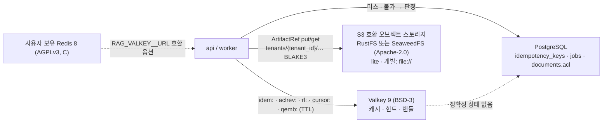

# ADR-0011: 저장소 기본 이미지: Valkey, RustFS 또는 SeaweedFS

> MADR 형식. 바이블 §3.3 표의 0011행이며 관련 결정은 D-14(브리프 §4 개정 v1.1, 바이블 §3.1 `amended`)다. 이 ADR은 바이블의 결정 하나를 근거·대안과 함께 기록하고 바이블 표를 바꾸지 않는다(바이블 §1.1). D-14의 나머지 구성요소는 다른 ADR이 다룬다 — PostgreSQL 원장·아웃박스는 [ADR-0026](./0026-index-commit-generation-saga-and-ledger.md)·[ADR-0017](./0017-event-delivery-outbox-cloudevents-no-broker.md), 멱등 키 판정은 [ADR-0017](./0017-event-delivery-outbox-cloudevents-no-broker.md), 벡터·렉시컬 인덱스(D-15)는 [ADR-0012](./0012-lite-profile-qdrant-only-client-bm25.md), 산출물 캐시 스코프는 [ADR-0037](./0037-artifact-cache-scope-and-stage-key-composition.md), 라이선스 등급표는 [ADR-0001](./0001-license-grade-table-and-d02-interpretation.md).

## 맥락과 문제

브리프 D-14 원안(v1.0)은 저장소를 "PostgreSQL + S3 호환 오브젝트 스토리지(로컬은 MinIO) + Redis"로 정했다. 기술 지형 조사([08 오케스트레이션·메시징·API](../07-tech-landscape/08-orchestration-messaging-and-api-frameworks.md), [12 보안·멀티테넌시·PII·라이선스](../07-tech-landscape/12-security-multitenancy-pii-and-licensing.md), [선정 매트릭스](../07-tech-landscape/00-summary-and-selection-matrix.md) "브리프 수정 제안" D-14(Redis)·D-14(MinIO) 행)에서 다음 사실이 확정되었다.

| # | 사실 | 출처 |
|---|------|------|
| F1 | Redis Open Source는 8.0부터 RSALv2 / SSPLv1 / AGPLv3 삼중 라이선스다(7.2 이하만 BSD-3). D-02 등급표에서 AGPLv3를 선택하면 C 등급 — 별도 컨테이너 + 네트워크 API로는 허용되지만 기본 배포 매니페스트에 두면 컴플라이언스 설명 부담이 생긴다 | 08 §브리프와의 충돌 D-14 행(Redis `LICENSE.txt` 2026-09-18 확인), 12 §6.2 |
| F2 | Valkey 9.1.2(2026-08-31)는 BSD-3-Clause, Linux Foundation 산하, Redis 7.2 프로토콜 호환이다. 12 점수표는 Valkey 88 > Redis 8 84 | 12 §격리 및 저장 계층, §선정 근거 점수표 |
| F3 | MinIO community 저장소는 2026-04-25 아카이브되고 소스 전용 배포(AGPL-3.0)로 전환되었다. 유지보수 종료 + C 등급이며 12 점수표 60(제외) | 12 §격리 및 저장 계층, §브리프와의 충돌 |
| F4 | 대체 후보는 RustFS(Apache-2.0, S3 호환, 신생·일부 기능 Preview, 성숙도 3)와 SeaweedFS(Apache-2.0, 광범위한 S3 API, 성숙도 5)다. 12 점수는 SeaweedFS 82 > RustFS 81(근소)인데 12의 1차 권고는 RustFS라 어긋나므로 매트릭스가 "ADR에서 두 후보를 실측 후 확정"으로 판정했다 | 매트릭스 `object_store_local` 행·미해결 이슈 2, 바이블 미해결 이슈 6 |
| F5 | 플랫폼이 KV에 두는 상태는 모두 캐시·힌트·핸들이다. 멱등 판정 정본은 PostgreSQL `idempotency_keys(tenant_id, key)`, 잡 상태 정본은 `jobs`, ACL 정본은 `documents.acl`과 인덱스 payload다 | D-08(개정 v1.1), 바이블 §2.3 Valkey 행, §9.1 `acl_recheck`, §13.1 |
| F6 | 오브젝트 스토리지는 원본·산출물·파생물·모델 미러를 BLAKE3 콘텐츠 주소화로 보관하고 모든 테넌트 스코프 키는 `tenants/{tenant_id}/` 접두를 갖는다. 개발은 `file://` | 원칙 4, 바이블 §2.3 Object Storage 행, §13.3, §10.3 E5, §11.6 |

문제: (1) Redis 호환 KV와 로컬 S3 호환 오브젝트 스토리지의 **기본 이미지**를 A 등급 안에서 무엇으로 두는가, (2) KV가 정확성에 관여하지 않도록 책임 경계를 어디에 긋는가, (3) 로컬 오브젝트 스토리지 후보 둘 중 하나를 어떤 절차로 확정하는가.

## 결정 동인(decision drivers)

| ID | 동인 | 내용 | 근거 |
|----|------|------|------|
| DR1 | 라이선스 | 코어 이미지·기본 배포 매니페스트의 인프라 컴포넌트는 A 등급. C 등급(AGPL·SSPL)은 사용자 보유 인스턴스 연동 옵션으로만 | D-02(개정 v1.1), ADR-0001, 바이블 §15 리스크 #2 |
| DR2 | 유지보수 생존성 | 아카이브·릴리스 정체 컴포넌트를 기본값으로 두지 않는다 | 매트릭스 리스크 #2, 12 §격리 및 저장 계층 |
| DR3 | 정확성 분리 | KV는 캐시·레이트리밋·힌트·핸들만 갖고, 멱등·ACL·잡 상태 정본은 PostgreSQL이다. KV 불가 시 PG 판정 또는 `degraded` | D-08, 바이블 §2.3, §9.1, §13.1 |
| DR4 | 테넌트 스코프 | 테넌트 스코프 KV 키는 `{tenant}` 접두, 오브젝트 키는 `tenants/{tenant_id}/` 접두. 콘텐츠 해시 키(`qemb`·`tok`·`rr`)만 예외이며, 컬렉션 스펙 캐시 `collspec:{collection_id}`는 테넌트 스코프 키가 아닌 컬렉션 ULID 전역 키다(접근 통제는 `allowed_collections`, E2·E14) | 바이블 §13.3·§13.4, §10.3 E2·E5·E14·E17, ADR-0037 |
| DR5 | 프로토콜 호환 | 클라이언트(`limits`, Redis 프로토콜 클라이언트)와 키 규약은 Redis 프로토콜 기준이며 서버 구현체 교체가 코드 변경 없이 가능해야 한다 | 매트릭스 `cache_kv_store`·`api_framework` 행, 바이블 §7.3 `rate_limit: {store: valkey}` |
| DR6 | S3 호환·`file://` 동형 | `ArtifactRef.uri`는 `s3://` 또는 `file://`. `lite`·개발은 `file://`로 동작하고 운영은 S3 호환 서버로 바꿔도 키 규약이 같다 | 바이블 §5.3 `ArtifactRef`, §7.1, §11.6 |
| DR7 | 운영 무게 | `lite`는 단일 노드·컨테이너 5(app, PostgreSQL, Qdrant, Valkey, 오브젝트 스토리지)다. 오브젝트 스토리지는 소규모 단일 컨테이너로 기동 가능해야 한다 | 바이블 §7.1, 12 §격리 및 저장 계층(Apache Ozone "소규모 로컬 배포에는 과함") |

## 고려한 대안

### KV(Redis 호환) 계층

| 대안 | 라이선스(등급) | 12 점수 | 판정 |
|------|----------------|--------:|------|
| K1 Redis 8(브리프 원안) | RSALv2 / SSPLv1 / AGPLv3(AGPLv3 선택 시 C) | 84 | **기각**(기본 이미지); 호환 옵션으로만 허용 |
| K2 Valkey 9 | BSD-3-Clause(A) | 88 | **채택** |
| K3 PostgreSQL 단독(KV 없음) | PostgreSQL License(A) | — | 기각(불가 시 폴백 경로로만) |
| K4 인메모리(프로세스 로컬) | — | — | 기각(단일 노드 폴백만) |
| K5 Valkey를 멱등·ACL 판정 정본으로 사용 | A | — | **기각**(정확성 분리 위반) |

- **K1 Redis 8(바이블이 기각한 원안).** 설명: 브리프 v1.0 D-14의 "Redis"를 최신 공식 이미지로 둔다. 장점: 사실상 표준, 성숙도·커뮤니티 최고(12 점수표 성숙도 5·커뮤니티 5), 클라이언트 생태계. 단점: F1의 삼중 라이선스라 AGPLv3 선택 시 C 등급 — 기본 매니페스트에 두면 Apache-2.0 플랫폼 채택성이 훼손된다(바이블 §15 리스크 #2). 덧붙여 RediSearch로 `lite`의 인덱스를 겸하려는 안도 한국어 형태소 분석기 부재로 이미 기각되었다([06 인덱스 백엔드](../07-tech-landscape/06-vector-and-lexical-index-backends.md) "기타 후보"). 사용자가 자기 Redis 8 인스턴스를 `RAG_VALKEY__URL`로 지정하는 호환 옵션으로만 남긴다(D-14 "Redis 8은 호환 옵션").
- **K2 Valkey 9(채택).** 설명: BSD-3, Redis 7.2 프로토콜 호환 포크. 장점: A 등급, 매트릭스 `cache_kv_store` 1차 선택, `limits` 레이트리밋 백엔드·Redis 프로토콜 클라이언트를 그대로 사용(DR5), 12 점수표 1위(88). 단점: Redis 8 신기능 일부 비호환 가능(12 §격리 및 저장 계층) — 플랫폼 키 빌더(`storage/valkey`, §13.4)와 `limits` 레이트리밋 스토리지가 쓰는 명령은 Redis 7.2 명령 집합 범위로 한정한다(§13.4 키 규약에 Redis 8 신규 자료구조를 요구하는 키는 없다; 자료형은 §13.4가 규정하지 않으며 준수 확인 표 코드 리뷰 (c)가 명령 집합을 감시한다).
- **K3 PostgreSQL 단독(기각).** 설명: 캐시·레이트리밋·커서를 모두 PostgreSQL 테이블로 둔다. 장점: 인프라 하나 감소. 단점: 검색 핫패스는 PostgreSQL을 읽지 않는다는 규칙(바이블 §13.1, ADR-0034)과 충돌하고, 레이트리밋 카운터·질의 임베딩 캐시가 원장 DB의 쓰기 부하가 된다. 매트릭스 `cache_kv_store` 2차 폴백으로만 둔다(Valkey 불가 시 멱등 판정은 이미 PG).
- **K4 인메모리(기각).** 설명: api 프로세스 메모리에 캐시. 장점: 의존성 0. 단점: 다중 복제본에서 레이트리밋·`Idempotency-Key` 조회 캐시·MCP 커서(`cursor:{tenant}:{ulid}`)가 복제본 간 공유되지 않는다. 매트릭스대로 단일 노드 폴백에 한정한다.
- **K5 Valkey를 멱등·ACL 판정 정본으로(바이블이 기각).** 설명: `idem:`·`aclrev:` 키를 판정 정본으로 삼아 PostgreSQL 왕복을 없앤다. 장점: 지연 최소. 단점: TTL 만료·재시작·장애 시 중복 접수(`Idempotency-Key` 200/409/422 의미론 붕괴)와 회수된 ACL의 재노출이 생긴다. D-08(개정 v1.1)은 판정 정본을 `idempotency_keys(tenant_id, key)`로, 바이블 §9.1은 ACL 정본을 `documents.acl`과 payload로 고정했고 Valkey는 조회 캐시·회수 힌트다.

### 로컬 S3 호환 오브젝트 스토리지

| 대안 | 라이선스(등급) | 성숙도(12) | 12 점수 | 판정 |
|------|----------------|-----------|--------:|------|
| S1 MinIO community(브리프 원안) | AGPL-3.0(C), 2026-04-25 아카이브 | 1(유지보수 종료) | 60 | **기각** |
| S2 RustFS | Apache-2.0(A) | 3 | 81 | **후보**(실측 후 택1) |
| S3 SeaweedFS | Apache-2.0(A) | 5 | 82 | **후보**(실측 후 택1) |
| S4 Apache Ozone | Apache-2.0(A) | 높음(ASF) | — | 기각(대규모 대안) |
| S5 클라우드 S3만(로컬 이미지 없음) | — | — | — | 기각 |
| S6 `file://`를 운영에도 사용 | — | — | — | 기각(개발·`lite` 한정) |

- **S1 MinIO community(바이블이 기각한 원안).** 설명: 브리프 v1.0 "로컬은 MinIO". 장점: 익숙함, 도구·문서 풍부(12 점수표 통합 5). 단점: F3의 아카이브·소스 전용 AGPL 전환으로 유지보수 종료 컴포넌트가 기본 로컬 스토리지가 된다(DR1·DR2 동시 위반). 12 점수표 60(제외).
- **S2 RustFS(후보).** 설명: Rust 구현 S3 호환 서버, "AGPL 제약 회피"를 명시(12). 장점: A 등급, 12 1차 권고, 통합·운영비용 5점. 단점: 신생, 기능 일부 Preview, 성숙도 3점; 버전 1.0.1은 확인 필요(as of 2026-09).
- **S3 SeaweedFS(후보).** 설명: master·volume·filer 구성의 분산 파일시스템 + S3 게이트웨이. 장점: A 등급, 성숙도 5점, IAM/STS를 포함한 광범위한 S3 API(12), 12 점수 82로 1위. 단점: 운영 모델이 MinIO형 단일 서버와 다르다; 릴리스는 확인 필요(as of 2026-09).
- **S4 Apache Ozone(기각).** 설명: Hadoop 생태계 오브젝트 스토어 + S3 게이트웨이. 장점: ASF, 대용량. 단점: JVM·운영 무게로 소규모 로컬 배포에는 과함(12) — DR7 위반. 매트릭스대로 대규모 대안으로만 남긴다.
- **S5 클라우드 S3만(기각).** 설명: 로컬 이미지 없이 운영은 클라우드 S3 호환 서비스만 지원. 장점: 유지할 이미지 0. 단점: 에어갭·온프레미스(`korean-gov`)·CI·`lite` 단일 노드가 성립하지 않는다. 클라우드 S3는 매트릭스대로 폴백(운영 선택지)이다.
- **S6 `file://` 운영 사용(기각).** 설명: 공유 파일시스템으로 다중 워커를 운영. 장점: 서버 0. 단점: D-14는 `file://`를 개발용으로 한정하고 바이블 §7.1도 `lite`(단일 노드)에만 허용한다. 다중 노드 공유 파일시스템의 일관성·잠금은 지원 범위가 아니다.

## 결정

**결정:** 브리프 D-14(개정 v1.1) 그대로 — "저장소: **PostgreSQL**(메타·잡·원장·아웃박스·레지스트리·Temporal 영속화(별도 DB)), **S3 호환 오브젝트 스토리지**(원본·산출물 BLAKE3 콘텐츠 주소화; 로컬은 **RustFS 또는 SeaweedFS**(둘 다 Apache-2.0, ADR 실측 후 택1; MinIO는 2026-04 아카이브·AGPL 소스 전용 전환으로 제외), 개발은 `file://`), **Valkey**(BSD-3, Redis 프로토콜 호환; 캐시·레이트리밋·멱등 키·MCP 커서·질의 임베딩 캐시; Redis 8은 호환 옵션), 벡터/렉시컬 인덱스는 D-15에 따름". 용어는 바이블 §16 "Redis → Valkey(Redis 호환 KV)", "MinIO → RustFS / SeaweedFS"로 바뀐다.

Valkey의 책임 경계는 바이블 §2.3 Valkey 행 그대로다 — 소유: "질의 임베딩(24h)·토큰 카운트·플랜 캐시, 레이트리밋, `Idempotency-Key` **조회 캐시**(판정 정본은 PostgreSQL `idempotency_keys`, 미스 시 PG 판정), ACL 회수 힌트 `aclrev:`(E9), MCP 커서 핸들(10분), 그룹 확장 캐시(5~15분), 부모 텍스트 캐시"; 소유하지 않는 것: "정확성에 관여하는 상태(멱등 판정·ACL 정본·잡 상태는 PostgreSQL; Valkey 불가 시 PG 판정 또는 `degraded`)". 키 규약은 바이블 §13.4 Valkey 행이며 "모든 테넌트 스코프 키는 `{tenant}` 접두 필수(`qemb`·`tok`·`rr`는 콘텐츠 해시 키라 예외)". 설정은 `RAG_VALKEY__URL`, `RAG_OBJECT_STORE__URI`(바이블 §6.6), 프로파일 `security.rate_limit: {store: valkey, fail_mode}`(§7.3)다.

| 키(§13.4) | TTL | 용도(강제 지점) | 정본 | Valkey 불가 시 |
|-----------|-----|-----------------|------|----------------|
| `qemb:{space}:{hash}` | 24h | 질의 임베딩 캐시 | 없음 | 임베딩 서버 재호출 |
| `plan:{tenant}:{profile_hash}:{hash}` | 5m | `QueryPlan` 캐시 | 없음 | 재계획 |
| `tok:{tokenizer_id}:{hash}` | 7d | 토큰 카운트 캐시(§9.1 `exact_api`) | 없음 | 재카운트 |
| `ptxt:{tenant}:{chunk_set_blake3}` | 24h | 부모 텍스트 번들 캐시(§13.2) | 오브젝트 스토리지 `derived/parent_texts/…` | 번들 재로드 |
| `rr:{model}:{hash}` | 60s | 리랭크 점수 캐시 | 없음 | 재리랭크 |
| `idem:{tenant}:{key}` | 24h | `Idempotency-Key` 조회 캐시 | PostgreSQL `idempotency_keys(tenant_id, key)` | PG 판정(200/409/422 불변) |
| `aclrev:{tenant}:{document_id}` | 2 × `acl_propagation_slo` | ACL 회수 힌트(E9·E11) | `documents.acl` + 인덱스 payload `acl_hash` | payload 판정 + `degraded{acl_recheck, unavailable}` + 폴백 코드 `pack.acl_hint_unavailable`(§5.7) |
| `rl:{tenant}:{window}` | 윈도 | 레이트리밋(E3) | 없음 | `fail_mode=closed`(운영) → 429 `api.rate_limited`; `open`(개발) → 통과 |
| `cursor:{tenant}:{ulid}` | 10m | MCP 커서 핸들(E14, ADR-0025) | 없음 | 커서 만료와 동일 처리 |
| `groups:{tenant}:{subject}` | 5~15m | 그룹 확장 캐시 | IdP `groups` 클레임 | 재확장 |
| `collspec:{collection_id}` | 없음(`collection.profile.changed` 이벤트 무효화) | 컬렉션 스펙 캐시(§13.1, ADR-0034); 비테넌트 스코프 | PostgreSQL `collections` | api 인메모리 사본, 없으면 기동 시 PG 1회 로드 |

오브젝트 스토리지의 책임은 바이블 §2.3 "원본·산출물·파생물·모델 가중치 미러(BLAKE3 주소화)"이고 키 규약은 §13.3이다. `ArtifactRef`(§5.3) 예시 — 버킷 이름은 `RAG_OBJECT_STORE__URI`가 정하는 배포 값이며 여기서는 예시다:

```json
{
  "uri": "s3://rag-artifacts/tenants/01J9ZQ4K7X2M8N3P5R6S7T8V9W/artifacts/parsed-document/9f/9f3a5c7e1b2d4f6a8c0e2b4d6f8a1c3e5a7c9e1b3d5f7a9c1e3b5d7f9a1c3e5b.json",
  "blake3": "4d2c8a6e0f1b3d5c7e9a1b3d5f7092b4d6f8a0c2e4b6d8fa1c3e5a7c9e0b2d4f",
  "media_type": "application/vnd.rag.parsed-document+json",
  "schema_type": "ParsedDocument",
  "schema_version": "1.0.0",
  "size_bytes": 184320,
  "stage_key": "9f3a5c7e1b2d4f6a8c0e2b4d6f8a1c3e5a7c9e1b3d5f7a9c1e3b5d7f9a1c3e5b"
}
```

RustFS와 SeaweedFS의 택1은 다음 실측 항목으로 확정하고 결과를 이 ADR의 개정(바이블 미해결 이슈 6)으로 기록한다. 수치 목표는 두지 않으며 측정값을 기록한다.

| 항목 | 검사 내용 | 정본 |
|------|-----------|------|
| S3 API 적합성 | `storage/artifact_store` 어댑터 적합성 스위트: PUT/GET/HEAD/DELETE, 접두 리스트(`tenants/{tenant_id}/`), 멀티파트 업로드(원본 상한 200MB, §5.1 `fetch.max_bytes`), 조건부 요청, presigned URL | 바이블 §5.1·§13.3, [02-architecture/04](../02-architecture/04-storage-architecture.md) |
| 콘텐츠 주소화·스코프 | 같은 바이트 재업로드 = 같은 키·무변경; 두 테넌트(또는 두 컬렉션)가 같은 바이트를 수집해도 각자 키(E17 적합성 키트 `idempotency`) | 바이블 §4.1, §10.3 E17, ADR-0037 |
| 스냅샷·복원 | `snapshots/{backend_id}/{physical_name}/{timestamp}` 키 규약에 따른 백업·복원과 산출물 재적재(replay) | 바이블 §13.3, §2.1 K6, [09-operations/07](../09-operations/07-backup-and-disaster-recovery.md) |
| 운영 모델 | `lite` compose에서 단일 컨테이너 기동 여부(SeaweedFS는 master·volume·filer·S3를 한 프로세스로 묶는 모드 확인 필요 as of 2026-09), x64·arm64 이미지, 저장 암호화(SSE) 지원(`korean-gov` 요구) | 바이블 §7.1, §11.6, 매트릭스 프로파일별 기본 조합 "저장소" 행 |
| 성숙도·릴리스 | 확인일 기준 릴리스 주기·보안 패치·문서·Preview 기능 범위 | 12 §격리 및 저장 계층, 매트릭스 리스크 #2 |
| 성능 | 산출물 put/get p95와 처리량(측정값 기록, 초안 목표 없음) | [08-evaluation/05](../08-evaluation/05-benchmark-plan-and-baselines.md) |



## 결과

**긍정**

- 기본 배포 매니페스트의 데이터 계층이 모두 A 등급(PostgreSQL License, BSD-3, Apache-2.0)으로 남아 Apache-2.0 플랫폼 채택성(바이블 §15 리스크 #2)이 보호되고, 매트릭스가 지적한 D-14 라이선스 충돌 2건이 해소된다.
- Redis 프로토콜을 유지하므로 `limits`·클라이언트 코드·§13.4 키 규약이 서버 구현체와 무관하다. Redis 8을 이미 운영하는 조직은 호환 옵션으로 연결할 수 있다.
- Valkey가 정확성 상태를 갖지 않아 영속화 없이 운영할 수 있고(`collspec:`(이벤트 무효화, 소량; api 인메모리 사본·기동 시 PG 1회 로드)을 제외한 모든 키에 TTL — [02-architecture/04](../02-architecture/04-storage-architecture.md) §6.2 `maxmemory-policy volatile-lru`; 손실 시 재계산 또는 PG 판정), `lite`에서 1 vCPU·1 GB(12 §리소스 요구, 초안)로 충분하다.
- 오브젝트 키 규약(§13.3)이 `s3://`·`file://`에 동형이라 `rag up --profile lite`(§11.6)의 `file://./.rag/artifacts`에서 운영 S3 호환 서버로 옮겨도 `ArtifactRef`·`stage_key`·계보가 바뀌지 않는다.

**부정**

- 로컬 오브젝트 스토리지가 두 후보인 기간 동안 compose·Helm 값과 배포 문서를 두 벌 유지해야 한다(택1 시점은 재검토 조건 1).
- Valkey는 Redis 7.2 호환이므로 Redis 8 신기능(새 자료구조·명령)을 코드에서 쓸 수 없다. 코드 리뷰가 명령 집합을 감시해야 한다.
- SeaweedFS는 운영 모델(master·volume·filer)이 MinIO형 단일 서버와 달라 학습 비용이 있고, RustFS는 신생·Preview 기능 리스크가 있다. 둘 다 MinIO 시절의 도구·운영 경험을 그대로 옮길 수 없다.
- Redis 8 호환 옵션을 쓰는 사용자는 AGPLv3 컴플라이언스를 스스로 부담한다. 플랫폼 문서는 이를 명시할 뿐 대신하지 않는다.

**중립**

- PostgreSQL(원장·아웃박스·Temporal 별도 DB)과 D-15 인덱스(Qdrant·OpenSearch)는 이 ADR로 바뀌지 않는다.
- 부수 작업 큐는 `lite`에서 Procrastinate(PostgreSQL), `standard` 이상에서 Temporal 액티비티라 Valkey는 브로커 역할을 갖지 않는다(ADR-0017). Redis Streams(Valkey) 이벤트 버스는 ADR-0017 대안 E로 기각(폴백·후속)되었고, 조건부 도입 대상은 O-06(바이블 §3.2)의 NATS JetStream이다 — 둘 다 이 ADR 범위 밖이다.
- 운영에서 클라우드 S3 호환 서비스를 쓰면 로컬 이미지 택1은 개발·CI·온프레미스에만 영향한다.

## 준수 확인 방법

| 게이트 | 강제 내용 | 정의 위치 |
|--------|-----------|-----------|
| CI 이미지·라이선스 게이트(D-02, ADR-0001 "저장소·배포 경계") | `deploy/{helm,compose}` 기본 값의 이미지 참조를 Syft/Trivy 이미지 SBOM으로 검사. Redis 8 이상 공식 이미지·`minio/minio` 계열이 기본 값에 나타나면 릴리스 차단. 허용 목록은 Valkey 9.x, RustFS, SeaweedFS(택1 후 1개) | [10-development/05](../10-development/05-ci-cd.md), [02-architecture/08](../02-architecture/08-deployment-architecture.md) |
| 설정 검증 | `RAG_VALKEY__URL`은 Redis 프로토콜 URL 하나(서버 구현체 미검사 — 호환 옵션 허용), `RAG_OBJECT_STORE__URI`는 `s3://` 또는 `file://`만. `file://`는 D-14대로 개발·`lite` 용도이며 다중 노드 배포 지원 범위가 아님을 배포 가이드에 명시 | 바이블 §6.6, §7.1, [09-operations/01](../09-operations/01-deployment-guide.md)·[09-operations/02](../09-operations/02-configuration-reference.md) |
| 키 규약 단위 테스트 | `storage/valkey` 키 빌더만 키를 만든다(원시 문자열 키 금지). 테스트: §13.4 표의 접두 전부와 일치, 테넌트 스코프 키는 `{tenant}` 위치 필수, 콘텐츠 해시 예외는 `qemb`·`tok`·`rr`만, `collspec:{collection_id}`는 비테넌트 스코프 컬렉션 ULID 전역 키로 분류(DR4; 바이블 §13.4 예외 목록에 `collspec` 명시를 §1.2 patch "설명 보강"으로 제안); `storage/keys`는 §13.3 키를 생성하고 테넌트 스코프 키가 `tenants/{tenant_id}/`로 시작함을 검사(E5) | 바이블 §12 `storage/`, §13.3·§13.4, §10.3 E5, [02-architecture/04](../02-architecture/04-storage-architecture.md) §6 |
| 정확성 분리 계약 테스트 | Valkey를 정지한 채 (a) `Idempotency-Key` 재전송이 PG 판정으로 200/409/422 동일, (b) `acl_recheck`가 payload 판정 + `degraded{acl_recheck, unavailable}` + 폴백 코드 `pack.acl_hint_unavailable`, (c) 운영 `fail_mode=closed`에서 429 `api.rate_limited`·개발 `open`에서 통과, (d) `GET /v1/jobs/{job_id}` 무영향, (e) 관측: 레이트리밋 백엔드 불가 카운터(12 §실패 모드 `rag_ratelimit_backend_unavailable`; 바이블 §6.5 정본 목록에 없어 등재 제안) 증가와 `degraded[]` 기록을 단언하고, `aclrev` 손실 창은 `rag_acl_propagation_seconds` SLO 알림(E11)으로 관측. import-linter는 바이블 §12 의존 방향을 그대로 쓰고 새 계약을 추가하지 않는다 — `ledger.begin_delete`·`ledger.update_acl` 액티비티가 백엔드 갱신 **전에** `aclrev:` 힌트를 기록하므로([02-architecture/06](../02-architecture/06-orchestration-and-workflows.md) §2.3·§2.4) "`ledger`는 `storage/valkey`를 모른다"류 계약은 E9·E11과 충돌한다. Valkey 접근은 `storage/valkey` 키 빌더·클라이언트 경유만 허용(정적 검사, 04 §6.2 격리 행) | 바이블 §10.3 E3·E9·E11, §9.1, §13.1, §12 의존 방향, 12 §실패 모드, 적합성 키트 `security_invariants` |
| 오브젝트 스토리지 어댑터 적합성 | 위 실측 표의 S3 API·콘텐츠 주소화·스코프 항목을 compose 기반 CI에서 실행. 택1 전에는 RustFS·SeaweedFS 둘 다, 택1 후에는 1차를 PR CI에서·2차를 주기 실행으로 유지(대안 생존성 확인). `file://` 구현도 같은 스위트를 통과 | 바이블 §12 `testing/`, [10-development/04](../10-development/04-testing-strategy.md) |
| 콘텐츠 주소화 검증 | `ArtifactRef.blake3`는 다운로드 바이트 재해시와 일치(`contract_roundtrip`); 두 테넌트 동일 바이트 → 각자 `tenants/{tenant_id}/sources/…` 키(`idempotency`, E17) | 바이블 §5.3, §6.2, §10.3 E17 |
| 코드 리뷰 체크리스트 | (a) Valkey에 새 키를 추가하면 §13.4 표 갱신 + TTL(또는 `collspec`처럼 이벤트 무효화 규칙) + 정본·불가 시 동작 명시 (b) 판정 로직이 Valkey 값만으로 결정을 끝내지 않음 (c) Redis 7.2 명령 집합만 사용 (d) 오브젝트 키는 `storage/keys`로만 생성 (e) 새 이미지·버전은 12 §6.2 지도와 잠금 파일 갱신 | [10-development/07](../10-development/07-contributing.md), [10-development/03](../10-development/03-coding-standards.md) |

## 재검토 조건

1. RustFS vs SeaweedFS 실측(위 표)이 끝나면 이 ADR을 개정해 택1을 기록하고 바이블 미해결 이슈 6을 닫는다. 두 후보가 모두 기준을 통과하면 12 점수(SeaweedFS 82 > RustFS 81)와 성숙도를 타이브레이크로 쓴다.
2. 택1된 오브젝트 스토리지가 릴리스 정체(매트릭스 리스크 #2 판정; 초안 기준 12개월 무릴리스, 실측 시 확정)에 빠지거나 라이선스를 A 등급 밖으로 바꾸면 2차 후보로 전환한다. Apache Ozone·클라우드 S3는 대규모·관리형 요구에서만 재검토한다.
3. Valkey의 라이선스·거버넌스 변경, 또는 Redis 7.2 호환 범위가 `limits`·클라이언트 라이브러리의 요구와 어긋나면 KV 기본 이미지를 재평가한다. Redis가 A 등급으로 재라이선스되어도 Valkey 유지가 기본이며 호환 옵션 문구만 조정한다.
4. KV 요구가 캐시·힌트·핸들을 넘어서면(예: 이벤트 버스 조건 성립, 세션 상태) 이 ADR이 아니라 ADR-0017 또는 별도 ADR로 다룬다. Valkey에 정확성 상태를 두는 변경은 D-08·바이블 §2.3 개정(§1.2 "브리프 확정 결정(D-xx) 개정" 절차: ADR 발의 → 바이블 §3 `amended` → 브리프 §4 행 갱신, 바이블 minor)이 필요하다.
5. `korean-gov`의 저장 암호화 요구(OpenBao Transit 테넌트 DEK, 매트릭스 프로파일 표)가 서버 측 암호화(SSE)를 전제하게 되면 택1 기준에 SSE 지원을 필수 항목으로 올린다.
6. D-02 등급표(ADR-0001) 개정으로 C 등급 배포 규칙이 바뀌면 Redis 8 호환 옵션의 허용 형태를 맞춘다.

## 참조

- [설계 브리프](../00-vision/00-design-brief.md) §3 원칙 4·9, §4 D-02·D-08·D-14(개정 v1.1)·D-15·D-17, §7 품질 목표(가용성·보안), §9 문서 규약
- [설계 바이블](../02-architecture/00-design-bible.md) §1.1·§1.2, §2.2·§2.3(Object Storage·Valkey 행), §3.1 D-14 행, §3.3 0011행, §4.1(멱등성 키 = 캐시 키 = 산출물 경로), §5.3 `ArtifactRef`, §5.7 `DegradedComponent`·`DegradedReason`·오류 카탈로그(`api.rate_limited`, `pack.acl_hint_unavailable`), §6.6, §7.1·§7.2 `security.rate_limit.fail_mode`·§7.3, §9.1 `acl_recheck`, §10.3 E3·E5·E9·E11·E14·E17, §11.6, §12 `storage/`, §13.1~§13.4, §15 리스크 #2, §16, 미해결 이슈 6
- [기술 지형 종합: 선정 매트릭스](../07-tech-landscape/00-summary-and-selection-matrix.md) `cache_kv_store`·`object_store_local` 행, 프로파일별 기본 조합 "저장소" 행, "브리프 수정 제안" D-14(Redis)·D-14(MinIO) 행, ADR 발의 목록 P1, 종합 리스크 #2, 미해결 이슈 2
- [08 오케스트레이션·메시징·API 프레임워크](../07-tech-landscape/08-orchestration-messaging-and-api-frameworks.md) §브리프와의 충돌 D-14 행, 이벤트 버스 비교(Redis Streams / Valkey), 리소스 요구(Valkey)
- [12 보안·멀티테넌시·PII·라이선스](../07-tech-landscape/12-security-multitenancy-pii-and-licensing.md) §격리 및 저장 계층(Valkey·Redis·RustFS·SeaweedFS·MinIO·Ozone), §6.2 의존성 라이선스 지도, §1차/2차/폴백, §선정 근거 점수표, §어댑터 계약 `RateLimiter`, §실패 모드 "Valkey 불가", §브리프와의 충돌
- [06 벡터·렉시컬 인덱스 백엔드](../07-tech-landscape/06-vector-and-lexical-index-backends.md) "기타 후보" Redis 8 RediSearch 기각 근거
- 관련 ADR: [ADR-0001 라이선스 등급표](./0001-license-grade-table-and-d02-interpretation.md), [ADR-0012 경량 프로파일 Qdrant 단독](./0012-lite-profile-qdrant-only-client-bm25.md), [ADR-0017 이벤트 전달·테넌트 스코프 멱등 키](./0017-event-delivery-outbox-cloudevents-no-broker.md), [ADR-0025 MCP 커서](./0025-mcp-cursor-pagination-and-tool-set.md), [ADR-0026 IndexCommit 세대 사가](./0026-index-commit-generation-saga-and-ledger.md), [ADR-0027 SecurityContext·ACL 강제 지점](./0027-security-context-injection-and-acl-enforcement-points.md), [ADR-0034 검색 핫패스 PG 미의존](./0034-retrieval-hot-path-postgres-independence-and-hydrate.md), [ADR-0037 산출물 캐시 스코프](./0037-artifact-cache-scope-and-stage-key-composition.md)
- 하위 설계 문서: [02-architecture/04 저장소 아키텍처](../02-architecture/04-storage-architecture.md) §6 Valkey 용도, [02-architecture/06 오케스트레이션·워크플로우](../02-architecture/06-orchestration-and-workflows.md) §2.3·§2.4(`aclrev:` 힌트 기록 순서), [02-architecture/08 배포 아키텍처](../02-architecture/08-deployment-architecture.md), [09-operations/01 배포 가이드](../09-operations/01-deployment-guide.md), [09-operations/07 백업·재해 복구](../09-operations/07-backup-and-disaster-recovery.md), [ADR 인덱스](./README.md)
