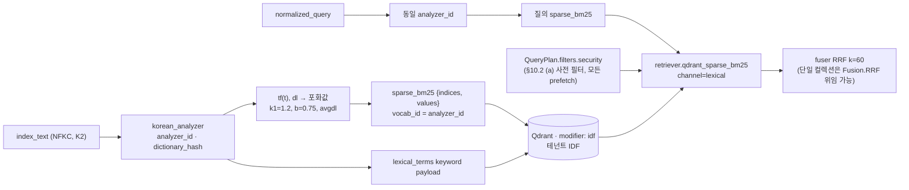

# ADR-0012: 경량 프로파일 Qdrant 단독 BM25 계약(sparse_bm25)

## 맥락과 문제

브리프 D-15 원안은 경량 프로파일을 "Qdrant 단독(sparse BM25 포함)"으로 적었다. 이 문구는 두 가지 확정 사실과 어긋난다. 첫째, Qdrant 오픈소스 서버는 BM25(Best Matching 25)를 계산하지 않는다. sparse 벡터의 `indices`·`values`는 클라이언트가 만들고, 컬렉션 sparse 설정 `modifier: idf`를 켜면 서버는 역문서빈도(IDF, inverse document frequency)만 곱한다. 항 빈도(TF, term frequency) 포화와 문서 길이 정규화(k1, b, avgdl)는 전적으로 클라이언트 책임이며, 이를 생략하고 TF를 그대로 넣으면 결과는 BM25가 아니라 TF×IDF로 퇴화한다(07-tech-landscape/06 §Qdrant; MIRACL-ko 연구의 경고 인용). 둘째, Qdrant 공식 빌드의 payload `text` 인덱스(`multilingual` 토크나이저)는 charabia의 `korean` 피처를 켜지 않아 한국어를 유니코드 경계로만 분절한다. 형태소 분석 없는 한국어 BM25는 MIRACL-ko 10K 문서 실험에서 nDCG@10 0.36(Qdrant charabia)·0.41(Vespa ICU)에 그쳤고, 형태소 분석(MeCab·Nori)은 0.61~0.64였다(06 §한국어 렉시컬 분석기 비교와 recall 근거; 13 §BM25 토크나이징 전략 비교). 기본 FastEmbed `Qdrant/bm25`도 공백·구두점 분할 + Snowball 스테머라 한국어 형태소를 처리하지 못하고 `avg_len`을 상수 256.0으로 고정한다(06 §Qdrant, §브리프와의 충돌 1).

`lite` 프로파일(단일 노드, GPU 0, 사이드카 0, 컨테이너 4(개발): app, PostgreSQL, Qdrant, Valkey, 오브젝트 스토리지 / 5~6(운영 `--durable`: + Temporal 단일 바이너리, RustFS·SeaweedFS 동거 시 6) — 바이블 1.3.0 §7.1)은 OpenSearch를 포함하지 않으므로 서버 측 Nori 분석기도 없다. 그런데 D-07은 lexical(BM25, 한국어 형태소) 레그를 3-way 하이브리드의 필수 채널로 두고, O-02는 learned sparse가 BM25의 대체가 아니라 제3 레그라고 판정했다(바이블 §3.2 O-02; 13 §개방 결정 O-02: 서브워드와 형태소는 단위가 다르다). 따라서 `lite`에서 렉시컬 레그를 어떻게 실현하고, 그 벡터를 계약(named vector·채널·점수 원장·프로파일 검증)에서 어떻게 표현하는지가 정해져야 03-contracts/07·09·10과 04-pipelines/12·13·15를 작성할 수 있다. 선정 매트릭스는 이를 "문구 정밀화(ADR 권고)" P1 항목으로 등록했다(07-tech-landscape/00 §브리프 수정 제안 D-15, §ADR 발의 목록 P1).

## 결정 동인(decision drivers)

- **한국어 렉시컬 품질(원칙 6, D-07)**: 형태소 토큰화 유무가 BM25 nDCG@10에 절대값 0.2 이상 차이를 낸다(06 §한국어 렉시컬 분석기 비교). `lite`도 브리프 §7 품질 목표의 하향판(`eval.gates.ndcg@10.min 0.70 / recall@20.min 0.85`, 바이블 §7.2)을 통과해야 한다.
- **진짜 BM25(리스크 #5)**: 포화식 생략은 TF×IDF 퇴화, `avgdl` 상수 고정은 긴 청크 과대·과소 점수를 낳는다(06 §Qdrant 함정 (6)). 바이블 §15 리스크 #5는 "`sparse_bm25` 포화식 강제 + bm25s 일치 테스트"를 완화 장치로 지정했다.
- **경량 배포 제약(K7, §7.1)**: GPU 0·컨테이너 4(개발)/5~6(운영)을 유지해야 한다. OpenSearch(JVM, 힙·오프힙 산정 — 06 §리스크)나 임베딩 서버를 추가할 수 없고, `lite`의 기본 서빙 구성(sentence-transformers ONNX int8 dense 인프로세스)은 `sparse_learned`를 포함하지 않는다(바이블 §7.1 임베딩·서빙 행 "bge-m3 dense ONNX int8 in_process + `sparse_bm25`"; ADR-0009 인프로세스 행 — BGE-M3 sparse는 vLLM pooling 또는 FlagEmbedding 참조 구현·폴백에서만).
- **점수 원장 보존(K3, 원칙 8)**: 채널 원점수·순위·기여분이 `ScoreBreakdown`에 남아야 한다. Qdrant 서버 융합은 prefetch별 점수를 반환하지 않는다(06 §Qdrant 출력 형식).
- **색인·질의 토큰화 일관성**: BM25 점수가 자기 일관적이려면 색인과 질의가 같은 `analyzer_id`·`dictionary_hash`를 써야 한다(07-tech-landscape/00 §어댑터·플러그인 공통 요구 6).
- **교체 가능성(D-15, D-10)**: `IndexBackend` + `capabilities()` 뒤에 두어 `lite`의 구현 방식이 다른 백엔드(Solr·pg_textsearch·Milvus 등)를 막지 않아야 한다.
- **라이선스(D-02)**: 기본 설치 분석기(python-mecab-ko + kss, ADR-0021)는 A 등급 wheel만으로 구성한다(바이블 §12 "코어는 A 등급 순수 Python만 인프로세스 의존"). B 등급은 §7.4 (1) 조건부다 — `license_grade ≤ license_policy.max_grade`이면 허용되되, `license_grade=B` ∧ `linkage=static_bundled`(kiwipiepy 0.23.2 LGPL 정적 링크 wheel)는 기본 설치 거부이고 명시 `[kiwi]` extra + `optIn`에서만 허용된다(바이블 §7.4 (1), ADR-0001, ADR-0021).

## 고려한 대안

### 대안 1 — `lite`에 OpenSearch(analysis-nori) 포함(바이블 기각)

- 설명: `standard`처럼 Qdrant + OpenSearch 두 백엔드를 두고 렉시컬 레그를 서버 Nori로 처리한다.
- 장점: 서버 측 형태소 분석·DLS 이중 방어·`standard`와 동일 코드 경로. 06 §권고안은 OpenSearch + Nori를 렉시컬 1차로 선정했다.
- 단점: JVM 컨테이너 1개가 추가되어 "컨테이너 4(개발)/5~6(운영)·단일 노드" 전제가 깨지고 힙 ≤ 32GB·샤드 산정 등 운영 부담이 따른다(06 §리스크 OpenSearch JVM). 두 백엔드 정합성(부분 커밋·alias 비원자성) 리스크를 경량 배포에까지 확장한다(바이블 §15 #5). `lite`의 존재 이유(단일 컨테이너 온프레미스 소규모, 06 §프로파일별 조합)와 상충한다. 바이블 §7.1이 `lite` 인프라에서 OpenSearch를 제외해 기각.

### 대안 2 — Qdrant 서버가 BM25를 계산한다고 전제(브리프 원문, 바이블 기각)

- 설명: 브리프 D-15 원안 "Qdrant 단독(sparse BM25 포함)"을 문자 그대로 읽어 FastEmbed `Qdrant/bm25` 기본 설정 또는 payload `text` 인덱스에 맡긴다.
- 장점: 플랫폼 코드가 가장 적다.
- 단점: 실현되지 않는다. 서버는 IDF만 곱하고(06 §Qdrant), FastEmbed 기본 토크나이저는 한국어 형태소 미처리·`avg_len` 상수 256.0(06 §브리프와의 충돌 1), `text` 인덱스는 유니코드 경계 분절만(06 §브리프와의 충돌 2; 13 §BM25 토크나이징 전략 비교 — nDCG@10 0.36). 선정 매트릭스 D-15 행이 "문구 정밀화" 대상으로 지정했고 바이블 §3.1 D-15가 `amended`로 기각.

### 대안 3 — `lite`는 `dense` + `sparse_learned`만(렉시컬 레그 생략, 바이블 기각)

- 설명: BGE-M3 sparse를 렉시컬 대용으로 삼아 2-way 하이브리드로 운용한다.
- 장점: 추가 분석기·BM25 어댑터가 필요 없고 임베딩 한 패스로 끝난다.
- 단점: GPU 없는 노드의 기본 서빙 구성(sentence-transformers ONNX int8 dense 인프로세스)은 `sparse_learned`를 포함하지 않는다(바이블 §7.1 임베딩·서빙 행 `lite` = "bge-m3 dense ONNX int8 in_process + `sparse_bm25`"; ADR-0009 F4·인프로세스 행 — "sentence-transformers ONNX int8 dense + 플랫폼 `sparse_bm25`; FlagEmbedding 1.4.x는 sparse 참조 구현·폴백"). 생산하더라도 XLM-R 서브워드 가중치는 형태소 BM25와 단위가 달라 정확 매칭·고유명사·수치 recall을 대체하지 못한다(13 §개방 결정 O-02; 06 §개방 결정 O-02 "BM25 형태소 레그는 항상 유지"). D-07의 3-way·O-02의 "제3 레그" 결정과 충돌한다. 바이블 §7.1은 `sparse_learned`를 "GPU 없이 생성 가능 노드는 추가"하는 선택 항목으로만 둔다.

### 대안 4 — 단일 엔진 백엔드로 교체(Milvus 내장 BM25 + lindera ko-dic, pg_textsearch + textsearch_ko)

- 설명: BM25와 한국어 분석기를 서버에 내장한 엔진을 `lite`의 벡터·렉시컬 단일 백엔드로 삼는다.
- 장점: 서버가 BM25를 계산하므로 클라이언트 포화식·IDF 관리가 불필요하다. Milvus 2.6은 BM25 Function + lindera ko-dic, pg_textsearch는 PostgreSQL License BM25(k1/b + Block-Max WAND)를 제공한다(06 §후보 목록, §프로파일별 조합 postgres-only).
- 단점: Milvus는 etcd·오브젝트 스토리지·Woodpecker 등 분산 컴포넌트가 많아 경량 전제에 맞지 않고(06 §후보 목록), textsearch_ko는 유지보수 정체로 PG 16/17 빌드 검증이 선행되어야 한다(06 §리스크). Qdrant는 벡터 인덱스 가중 점수 1위(07-tech-landscape/00 `vector_index` 행)이며 `standard`와 같은 벡터 백엔드를 쓰는 편이 프로파일 상속(`base → lite → standard`, 바이블 §7)에 유리하다. 기본이 아닌 `IndexBackend` 교체 대상으로 남긴다(D-15 목록).

### 대안 5 — 채택: 플랫폼 계산 `sparse_bm25` + `modifier: idf`(테넌트별 IDF) + `lexical_terms` keyword payload

- 설명: 플랫폼 측 한국어 형태소 분석기(`korean_analyzer`)가 `index_text`(K2 렉시컬 뷰)를 토큰화하고, 어댑터가 BM25 TF 포화값을 계산해 named sparse vector `sparse_bm25`로 적재한다. 서버는 `modifier: idf`로 IDF를 곱한다. 한국어 키워드 필터·부스트는 형태소 토큰 keyword 배열 `lexical_terms`로 처리한다.
- 장점: 서버 변경 없이 한국어 형태소 BM25가 동작한다(06 §Qdrant "이것이 D-15 경량 프로파일의 실제 구현 방식이다"). 컨테이너 수·GPU 0 유지. 분석기·사전이 `analyzer_id`·`dictionary_hash`로 기록되어 `standard`와 같은 일관성 규칙을 공유한다.
- 단점: 포화식·`avgdl`·IDF 범위를 플랫폼이 책임지므로 구현 오류가 곧 품질 퇴화다(리스크 #5). 서버 `text` 인덱스 기반 구문 검색은 없다. 아래 준수 확인 방법으로 강제한다.

## 결정

**결정:** 경량 프로파일은 Qdrant 단독: Qdrant는 BM25를 계산하지 않으므로 플랫폼이 한국어 형태소 분석기로 토큰화하고 BM25 TF 포화값(k1=1.2, b=0.75)을 계산한 `sparse_bm25` 벡터를 `modifier: idf`(테넌트별 IDF)로 적재하며, 한국어 키워드 필터는 형태소 `lexical_terms` keyword payload를 쓴다(플랫폼 측 `korean_analyzer` 필수) — 브리프 §4 D-15(개정 v1.1), 바이블 §3.1 D-15 `amended`("경량 = Qdrant 단독, 플랫폼이 형태소 토큰화 + BM25 TF 포화값 계산 → `sparse_bm25` `modifier: idf`"). 벡터·렉시컬 인덱스는 둘 다 `IndexBackend` 인터페이스 + `capabilities()` 선언 뒤에 두어 Milvus/Weaviate/pgvector+pg_textsearch/Vespa/Apache Solr/LanceDB로 교체 가능하며, Elasticsearch는 공식 이미지 라이선스상 어댑터 호환만이다. 관련 ADR: [ADR-0021 한국어 분석기](../06-adr/0021-korean-analyzer-kiwi-promotion-and-interim-mecab-kss.md), [ADR-0013 융합](../06-adr/0013-fusion-rrf-k60-then-convex-combination-and-postprocess-order.md), [ADR-0014 sparse 표현](../06-adr/0014-sparse-representation-bge-m3-lexical-leg-kept.md).

계약 요소는 바이블의 철자를 그대로 쓴다.

| 요소 | 정본 값 | 바이블 |
|------|---------|--------|
| named vector 이름 | `sparse_bm25`(`VectorName`); Qdrant sparse 설정 `modifier: idf`(`sparse_learned`는 `modifier: none`) | §5.7, §13.4 |
| `VectorBundle.sparse_bm25` | `{name, vocab_id: analyzer_id, indices[], values[]}`, `lite`에서 필수(`Y(lite)`); `values`는 클라이언트 TF 포화값 | §5.4 `EmbeddedChunkSet` |
| 포화식(D-15 고정; 변경은 §7.4 게이트 + §1.2 절차) | `values[t] = tf(t) · (k1 + 1) / (tf(t) + k1 · (1 − b + b · dl / avgdl))`, `k1 = 1.2`, `b = 0.75`; `tf`·`dl`은 `index_text`의 형태소 토큰 기준. `k1`·`b`·`avgdl`의 스키마 위치는 바이블 §7.3 YAML·§5.6 `CollectionSpec`에 없어 미정 — 06 §미해결 이슈 9 제안 `bm25_params{k1, b, avgdl_policy}`; [프로파일 계약](../03-contracts/15-collection-profile-and-policy-contracts.md)·[임베딩](../04-pipelines/12-embedding.md)이 확정(선택 필드 추가는 §1.2 minor) | D-15; 07-tech-landscape/06 §Qdrant, §미해결 이슈 9 |
| IDF | 서버 `modifier: idf`; 통계 범위는 테넌트(Qdrant 1.19 per-query IDF corpus, 06 §Qdrant) | D-15, §7.1 |
| 토큰화 입력·분석기 | `Enrichment.index_text`(K2 렉시컬 뷰 + 접두어, NFKC); `korean_analyzer`(공백기 기본 `mecab-ko:1.3.7:ko-dic-2.1.1`, `[kiwi]` extra 시 Kiwi); 색인·질의 동일 `analyzer_id`·`dictionary_hash` | §2.1 K2, §5.4 `IndexRecord`, §6.1, §7.1 |
| 공간 ID | `embedding_space_ids.sparse_bm25 = H("space", …, vocab_id)`; `IndexRecord.analyzer_id`·`dictionary_hash` 필수 | §5.4, §6.2 |
| 질의 채널 | 항상 `channel=lexical`(`retriever.qdrant_sparse_bm25`, `fusion.weights.lexical`, `ScoreBreakdown.lexical`); `sparse`는 `sparse_learned`만 | §5.7 `Channel`, §8.1 7단계 |
| 한국어 키워드 필터·부스트 | `lexical_terms` keyword 배열 payload(`keywords[].term`), payload 인덱스 등재; Qdrant `text` 인덱스 미사용 | §5.4, §13.4 |
| 융합 | 단일 컬렉션 질의는 Qdrant `Fusion.RRF`(`k=60` 명시) 위임 가능(Qdrant `Fusion.RRF`의 `k` 파라미터 지원 여부는 확인 필요, as of 2026-09 — 아래 재검토 조건); 다중 컬렉션·`explain`은 플랫폼 `fuser`(`fusion.k` 필수). 위임 시에도 보안 사전 필터는 모든 prefetch에 포함(아래 준수 확인 "보안 불변식") | §3.2 O-01, §7.1, §10.2 |
| 검증 | `IndexBackendCapabilities.korean_analyzer=false`(Qdrant) 단독이면 플랫폼 측 `korean_analyzer` 필수; `lite`는 무조건 필수 | §5.3, §7.4 (2)·(9) |



`VectorBundle` 예시(`dl = 300`, `avgdl = 400`, `tf = [2, 1, 1]`; `indices`의 토큰 → 정수 사상과 `avgdl` 원천은 `sparse_bm25`를 생산하는 `embed` 측 문서 04-pipelines/12가 확정하는 값이며 아래 정수는 형식 예시):

```json
{
  "sparse_bm25": {
    "name": "sparse_bm25",
    "vocab_id": "mecab-ko:1.3.7:ko-dic-2.1.1",
    "indices": [1046527, 2231093, 3401201],
    "values": [1.4790, 1.1139, 1.1139]
  }
}
```

## 결과

### 긍정

- `lite`가 GPU 0·컨테이너 4(개발)/5~6(운영)을 유지하면서 D-07 하이브리드의 `dense` + `lexical` 두 레그를 기본으로 실현하고, `sparse_learned` 생산 가능 노드에서는 `sparse`가 더해져 3-way가 된다(바이블 §7.1 인덱스 행 "GPU 없이 sparse_learned 생성 가능 노드는 추가", §5.7 `Channel`). 형태소 BM25 레그가 있으므로 한국어 렉시컬 recall이 유니코드 경계 수준(nDCG@10 0.36대)으로 떨어지지 않는다(13 §프로파일별 조합 lite).
- `sparse_bm25`가 `channel=lexical`로 고정되어 `fusion.weights`·`ScoreBreakdown`·`ExplainCode`(`lexical_only_hit`)가 `standard`와 같은 키를 쓴다. 프로파일 상속(`lite → standard`)에서 채널 의미가 바뀌지 않는다.
- 색인·질의 토큰화가 같은 `analyzer_id`·`dictionary_hash`에 묶이고 불일치는 `degraded{channel.lexical, analyzer_mismatch}`로 드러난다(바이블 §5.5 `QueryPlan`). 사전 변경은 `dictionary_hash` 변경 → 렉시컬 재색인으로 이어진다.
- 백엔드 능력이 `supports_server_bm25`·`korean_analyzer`로 선언되므로 서버 BM25를 가진 백엔드(Milvus·Solr·pg_textsearch)는 같은 `IndexRecord.index_text`를 받아 서버 계산으로 대체할 수 있다(06 §표준 `IndexRecord` → 백엔드 매핑).

### 부정

- `analyzer_id` 변경(예: 공백기 mecab-ko → Kiwi 승격, ADR-0021)은 `embedding_space_ids.sparse_bm25 = H("space", …, vocab_id)`를 재계산시켜 `sparse_bm25` 공간 ID가 바뀐다. 같은 공간 ID를 전제하는 Qdrant named vector는 재사용할 수 없으므로 사전·분석기 교체는 (위 긍정 절의 `dictionary_hash` 변경에 따른 렉시컬 재색인과 같은 경로로) 항상 Qdrant 컬렉션 blue/green 재색인을 유발한다.
- 포화식·`avgdl`·IDF 범위를 플랫폼이 책임진다. 구현 오류는 조용한 TF×IDF 퇴화로 나타나므로 참조 구현(bm25s) 일치 테스트가 없으면 감지되지 않는다(리스크 #5).
- 형태소 토큰 수만큼 `indices`가 늘어 `EmbeddedChunkSet` 산출물과 Qdrant sparse 인덱스 크기가 증가한다. `rag_index_bytes_total{vector="sparse_bm25"}`로 계량한다(바이블 §6.5).
- Qdrant 서버 융합에 위임하면 prefetch별 점수가 반환되지 않아 점수 분해가 소실된다. 그래서 위임은 단일 컬렉션·`explain=false`에 한정되며, 이 조건 분기가 검색 경로에 남는다.
- `standard`의 OpenSearch 경로에 있는 DLS 이중 방어·`cjk_bigram` 보조 필드·`context_prefix` 필드 가중이 `lite`에는 없다. Qdrant는 `payload_filter` 등급에서 사전 필터 단일 방어다(바이블 §15 #3 잔여 리스크). 따라서 `lite` 전용 검색 경로(`retriever.qdrant_sparse_bm25`, `Fusion.RRF` 위임)에서 §10.2 (a) 보안 불변식이 유일한 방어선이며 아래 준수 확인 "보안 불변식" 행으로 강제한다.

### 중립

- `avgdl` 정책(컬렉션 통계 주기 갱신 vs 청크 토큰 예산에서 유도한 프로파일 상수 — 06 §Qdrant 함정 (6))은 바이블이 확정하지 않았다. 두 안 모두 포화식은 같고 `avgdl` 원천만 다르다. 확정 문서는 `indices` 해시와 같이 `sparse_bm25`를 생산하는 `embed` 측 문서 04-pipelines/12로 통일하고(바이블 §12 `adapters/embed/sparse_bm25`), 04-pipelines/13이 골든셋 실측으로 검증한다 — 06 §미해결 이슈 7은 04-pipelines/15를 지정했으나 값 생성 위치(§12 embed)에 따라 12로 둔다. (b) 프로파일 상수안에서는 사용 값이 재색인 시에만 바뀌고, (a) 컬렉션 통계 갱신안의 갱신 주기·기존 벡터와의 정합성은 미정이다.
- 질의 측 `sparse_bm25` 벡터의 `values` 규약과 `indices` 해시 함수는 이 ADR이 정하지 않는다. `indices` 해시는 04-pipelines/12가, 질의 측 `values` 규약은 `retriever.qdrant_sparse_bm25`를 소유하는 04-pipelines/15가 아래 준수 확인 (b) 통합 테스트를 만족하도록 확정한다. 제약은 하나다: 같은 `analyzer_id`로 색인·질의를 토큰화하고, bm25s 참조 점수·순위와 일치해야 한다. 04-pipelines/15 §3.5는 이 규약을 `values[t] = tf_q(t)`(질의 토큰 빈도)로 확정해 자기 문서·04-pipelines/13 §6이 초안으로 게시했던 `values = 1.0`(질의 TF 무시)을 대체 대상으로 표시했다(04-pipelines/12·13 patch 권고, 확정은 bm25s 일치 테스트로).
- `sparse_learned`는 GPU 없이 생산 가능한 노드에서 `lite`에 추가될 수 있으며 그때도 `channel=sparse`로 별도 채널이다(바이블 §7.1). `sparse_bm25`와 병존해도 채널 열거는 겹치지 않는다.
- Kiwi 승격(kiwipiepy 0.24.0 Apache-2.0 PyPI 공개 확인 필요, as of 2026-09)은 ADR-0021의 재검토 조건이며 `analyzer_id` 변경 → 렉시컬 재색인만 유발한다. 본 결정의 구조는 바뀌지 않는다.

## 준수 확인 방법

| 강제 수단 | 내용 | 위치·근거 |
|-----------|------|-----------|
| 프로파일 로딩 검증 | `rag profile validate`: (2) 요구 능력 ↔ `IndexBackendCapabilities` 대조 — `korean_analyzer=false` 백엔드 단독이면 플랫폼 측 `korean_analyzer` 필수, (3) `fusion.k` 필수, (8) `embedding_space_ids` 재계산 일치, (9) `lite`는 플랫폼 측 `korean_analyzer` 필수. 위반 시 `profile.invalid`, 능력 불일치는 `plugin.capability_unsupported` | 바이블 §7.4, [프로파일 계약](../03-contracts/15-collection-profile-and-policy-contracts.md), [설정 레퍼런스](../09-operations/02-configuration-reference.md) |
| 스키마 제약 | `VectorName`·`Channel`·`FusionMethod` 열거는 §5.7 철자와 CI 기계 대조(§1.2); `VectorBundle.sparse_bm25`는 `tier=lite`에서 필수, `vocab_id`는 `analyzer_id` 형식 `{engine}:{version}:{dictionary}`; `IndexRecord.analyzer_id`·`dictionary_hash`·`lexical_terms` 필수 | [EmbeddedChunkSet·IndexRecord](../03-contracts/07-embedded-chunk-set-and-index-record.md), [계약 개요](../03-contracts/00-contract-overview.md) |
| 포화식 강제(리스크 #5) | `adapters/index/qdrant/bm25_sparse`·`adapters/embed/sparse_bm25`는 `tf`를 그대로 `values`에 쓰는 경로를 두지 않는다(포화 함수 단일 구현). 일치 테스트는 2단이다 — (a) 단위: `adapters/embed/sparse_bm25`의 `values`가 참조 포화 함수 `tf·(k1+1)/(tf+k1·(1−b+b·dl/avgdl))`(k1=1.2, b=0.75, 동일 `avgdl`)와 일치, 허용 오차는 float32 상대 오차 1e-6(초안 목표; [테스트 전략](../10-development/04-testing-strategy.md)이 확정); (b) 통합: 한국어 고정 코퍼스(MIRACL-ko dev 표본)에서 동일 형태소 토큰·동일 코퍼스 범위(테넌트)·동일 IDF 식(Qdrant `modifier: idf`와 같은 변형을 bm25s에 지정; bm25s 옵션은 확인 필요, as of 2026-09) 조건으로 Qdrant 종단 상위 k 순위가 bm25s와 일치. `avgdl` 상수 고정 시 참조도 같은 값을 쓴다 | 바이블 §12, §15 #5("일치 테스트"만 요구); [임베딩](../04-pipelines/12-embedding.md), [인덱싱](../04-pipelines/13-indexing.md), [테스트 전략](../10-development/04-testing-strategy.md) |
| 보안 불변식 | `retriever.qdrant_sparse_bm25`의 `query_points`와 `Fusion.RRF` 위임 요청은 **모든 prefetch**에 `QueryPlan.filters.security`(§10.2 (a): `tenant_id`·`collection_id`·`is_current`·`acl_*`·embargo·expires·classification)를 포함한다 — 최상위 필터가 prefetch에 전파된다고 가정하지 않는다. 사후 필터 금지, `CandidateSet.security_context_hash` 서명, 필터에 `tenant_id` 부재 시 `retrieve.security_context_missing` 예외. 적합성 키트 `security_invariants`가 "백엔드 요청(각 prefetch 포함)에 `tenant_id` 필터 존재"를 대조 | 바이블 §10.2, §10.3 E7·E8(Qdrant 사전 필터 단일 방어), §12 `testing/`, §15 #3; ADR-0032 적합성 키트 |
| 능력 선언 테스트 | `index_backend.qdrant`의 `capabilities().extra`는 `supports_server_bm25=false`, `korean_analyzer=false`를 선언한다. 적합성 키트가 선언과 실제 동작(서버 텍스트 BM25 호출 없음)을 대조 | 바이블 §5.3, ADR-0032 적합성 키트 |
| 채널 매핑 테스트 | `retriever.qdrant_sparse_bm25`가 만든 `channel_runs[].channel`은 `lexical`이고 `sparse`가 아니다; `ScoreBreakdown.lexical`에 기록, `fusion.weights.lexical` 적용; `sparse_bm25` 질의를 `channel=sparse`로 보고하면 계약 위반 | 바이블 §5.7 `Channel`, §8.1 7단계, [후보·랭크 계약](../03-contracts/10-candidate-set-and-ranked-set.md) |
| 토큰화 일관성 | 색인 `IndexRecord.analyzer_id`·`dictionary_hash`와 `QueryPlan.analyzer_id`·`dictionary_hash` 불일치 → `degraded{channel.lexical, analyzer_mismatch}`; `vocab_id` 불일치는 색인·질의 모두 `embed.space_mismatch`(비재시도) | 바이블 §3.2 O-02, §5.5 `QueryPlan` |
| 서버 융합 조건 | 단일 컬렉션·`explain=false`에서만 `Fusion.RRF` 위임, 요청에 `k=60` 명시(Qdrant 기본 k=2 금지; Qdrant `Fusion.RRF`의 `k` 파라미터 지원 여부는 확인 필요, as of 2026-09 — 미확인·미지원이면 위임 경로를 켜지 않고 플랫폼 `fuser`만 쓴다); 다중 컬렉션 또는 `explain=true`면 채널별 `query_points` 호출 + 플랫폼 `fuser`. 적합성 키트 `fuser_equivalence`가 같은 런에 대해 서버 RRF와 플랫폼 RRF 순위 일치를 확인 | 바이블 §3.2 O-01, §12 `testing/`, [하이브리드 검색·융합](../04-pipelines/15-hybrid-search-and-fusion.md) |
| 골든셋 게이트 | `lite` `eval.gates.ndcg@10.min 0.70 / recall@20.min 0.85`(초안 목표); 렉시컬 레그 단독 회귀(MIRACL-ko dev 213 질의)가 형태소 기준선 아래로 떨어지면 실패 | 바이블 §7.2, §7.4; [리트리벌 메트릭·하네스](../08-evaluation/02-retrieval-metrics-and-harness.md) |
| 라이선스 게이트 | `korean_analyzer` 플러그인 `license_grade ≤ license_policy.max_grade`; `license_grade=B` + `linkage=static_bundled`(kiwipiepy 0.23.2) 거부 | 바이블 §7.4 (1), ADR-0001, ADR-0021 |
| 코드 리뷰 항목 | (1) 한국어 키워드 조건에 Qdrant `text` payload 인덱스를 쓰지 않는가(`lexical_terms` keyword만) (2) `sparse_bm25`를 `modifier: none`으로 만들지 않는가 (3) `k1`·`b`는 프로파일/`CollectionSpec` 값에서, `avgdl`은 `avgdl_policy`(프로파일 상수 또는 컬렉션 통계)에 따라 읽으며 어느 쪽이든 코드 상수로 박지 않는가 — 키 경로는 미정(06 §미해결 이슈 9 `bm25_params{k1, b, avgdl_policy}` 제안; 03-contracts/15·04-pipelines/12가 확정) (4) 분석기·사전 변경이 `analyzer_id`·`dictionary_hash` 변경으로 이어지는가 (5) `fusion.k`가 요청에 명시되는가 (6) `Fusion.RRF` 위임 요청에서 보안 필터가 prefetch마다 복제되는가 | [CI/CD](../10-development/05-ci-cd.md) |

## 재검토 조건

- Qdrant 공식 빌드가 서버 측 BM25 계산 또는 한국어 형태소 분석(charabia `korean` 피처 활성)을 제공하면 `supports_server_bm25`·`korean_analyzer` 선언과 함께 클라이언트 계산 필요성을 재평가한다(06 §리스크 "업스트림 요청은 별도 트랙").
- kiwipiepy 0.24.0(Apache-2.0)의 PyPI 공개가 확인되어 ADR-0021이 개정되면 `analyzer_id` 기본값과 예시를 갱신한다(구조 불변, 재색인만).
- 한국어 골든셋에서 `lite` 렉시컬 레그가 게이트를 통과하지 못하거나 bm25s 일치 테스트를 유지할 수 없으면 대안 4(Milvus 내장 BM25 + lindera ko-dic, pg_textsearch + textsearch_ko)를 `lite` 기본으로 재검토한다.
- `avgdl` 정책 실측(04-pipelines/12 확정, 04-pipelines/13 검증)이 컬렉션 통계 갱신을 요구하면 `IndexCommit`·`CollectionSpec`에 기록 필드 추가(선택 필드, minor)를 ADR로 제안한다.
- Qdrant `Fusion.RRF`의 `k` 파라미터가 지원되지 않는 것으로 확인되면(확인 필요, as of 2026-09) `lite` 단일 컬렉션 서버 융합 위임 허용을 재검토한다(그때까지 위임 경로는 켜지 않고 플랫폼 `fuser`가 유일한 경로; ADR-0013 재검토 조건 4와 정합).
- Qdrant per-query IDF(테넌트 범위 IDF)의 API·성능이 확인 결과 기대와 다르면(확인 필요, as of 2026-09) IDF 범위를 컬렉션 전역으로 두는 대신 `index_per_tenant` 격리를 `lite` 옵션으로 검토한다.
- GPU 없는 노드에서 `sparse_learned` 생산이 기본 서빙에 포함되어 `lite`가 `dense`·`sparse`·`lexical` 3채널이 되면 §7.1·§7.2 채널 표를 갱신한다(본 결정의 `sparse_bm25` 계약은 유지).
- Qdrant 서버 융합이 prefetch별 점수를 반환하게 되면 `explain` 시 플랫폼 fuser 강제 규칙을 완화할 수 있다.

## 참조

- [설계 브리프](../00-vision/00-design-brief.md) §3 원칙 5·6·8, §4 D-07·D-15(개정 v1.1)·D-16, §7 검색 품질
- [설계 바이블](../02-architecture/00-design-bible.md) §2.1 K2·K3, §2.3(Qdrant 행), §3.1 D-15·D-16, §3.2 O-01·O-02, §3.3 0012 행, §4.3, §5.1, §5.3 `IndexBackendCapabilities`·`ScoreBreakdown`, §5.4 `EmbeddedChunkSet`·`VectorBundle`·`IndexRecord`, §5.5 `QueryPlan`·`CandidateSet`, §5.7 `VectorName`·`Channel`·`FusionMethod`·`DegradedReason`·`ExplainCode`, §6.1 `analyzer_id`, §6.2 `embedding_space_id`·`lexical_profile_hash`·`security_context_hash`, §7.1·§7.2·§7.3·§7.4, §8.1, §10.2·§10.3 E7·E8, §12, §13.4, §15 #3·#5, §16
- [기술 지형 종합: 선정 매트릭스](../07-tech-landscape/00-summary-and-selection-matrix.md) J-7, `korean_tokenizer`·`vector_index`·`lexical_index`·`fusion_default` 행, §프로파일별 기본 조합, §브리프 수정 제안 D-15, §ADR 발의 목록 P1, §어댑터·플러그인 공통 요구 5·6, §종합 리스크 #5·#6
- [벡터·렉시컬 인덱스 백엔드](../07-tech-landscape/06-vector-and-lexical-index-backends.md) §Qdrant(한국어 렉시컬·BM25 sparse·함정), §한국어 렉시컬 분석기 비교와 recall 근거, §프로파일별 조합, §`IndexBackend` 어댑터 계약, §표준 `IndexRecord` → 백엔드 매핑, §개방 결정에 대한 의견 O-01·O-02, §브리프와의 충돌 1·2·6, §리스크 및 완화, §미해결 이슈 7·9
- [한국어 NLP](../07-tech-landscape/13-korean-nlp-tokenization-and-language-resources.md) §BM25 토크나이징 전략 비교, §1차/2차/폴백, §프로파일별 조합(lite), §개방 결정 O-01·O-02, §브리프와의 충돌 D-15
- 관련 ADR: [ADR-0001 라이선스 등급표](../06-adr/0001-license-grade-table-and-d02-interpretation.md), [ADR-0009 임베딩 서빙](../06-adr/0009-embedding-serving-vllm-pooling-tei-inprocess.md), [ADR-0013 융합](../06-adr/0013-fusion-rrf-k60-then-convex-combination-and-postprocess-order.md), [ADR-0014 sparse 표현](../06-adr/0014-sparse-representation-bge-m3-lexical-leg-kept.md), [ADR-0021 한국어 분석기](../06-adr/0021-korean-analyzer-kiwi-promotion-and-interim-mecab-kss.md), [ADR-0026 세대 사가](../06-adr/0026-index-commit-generation-saga-and-ledger.md), [ADR-0030 점수 원장](../06-adr/0030-single-coordinate-system-and-score-ledger.md), [ADR-0031 프로파일 게이트](../06-adr/0031-profile-schema-extends-and-quality-gates.md), [ADR-0032 적합성 키트](../06-adr/0032-plugin-sdk-stage-protocol-and-conformance-kit.md)
- 계약·파이프라인 문서: [EmbeddedChunkSet·IndexRecord](../03-contracts/07-embedded-chunk-set-and-index-record.md), [QueryRequest·QueryPlan](../03-contracts/09-query-request-and-query-plan.md), [임베딩](../04-pipelines/12-embedding.md), [인덱싱](../04-pipelines/13-indexing.md), [하이브리드 검색·융합](../04-pipelines/15-hybrid-search-and-fusion.md), [정규화](../04-pipelines/09-normalization-and-cleaning.md), [저장소 아키텍처](../02-architecture/04-storage-architecture.md), [배포 아키텍처](../02-architecture/08-deployment-architecture.md)
