# ADR-0013: 융합 RRF k=60 → convex combination 2단계 전략, 다중 컬렉션 융합 규칙, 후처리 고정 순서와 pack 내부 순서

> MADR 형식. 바이블 §3.3 표의 0013행이며 관련 결정은 O-01(바이블 §3.2 `resolved`)과 D-07(브리프 §4 개정 v1.2, 바이블 §3.1 `amended(v1.2)`)이다. 이 ADR은 바이블의 결정을 근거·대안과 함께 기록하고 바이블 표를 바꾸지 않는다(바이블 §1.1). 점수 원장 계약(`ScoreBreakdown`, `Σ contribution = fused_score`)의 골격은 [ADR-0030](./0030-single-coordinate-system-and-score-ledger.md), `hydrate` 서브스텝은 [ADR-0034](./0034-retrieval-hot-path-postgres-independence-and-hydrate.md), 경량 프로파일의 `sparse_bm25` 렉시컬 레그는 [ADR-0012](./0012-lite-profile-qdrant-only-client-bm25.md), `litm_alternating` 공식과 렌더러는 [ADR-0024](./0024-context-pack-ordering-and-anthropic-search-result-renderer.md), 융합 튠에 쓰는 평가 하네스는 [ADR-0023](./0023-evaluation-qrels-answer-spans-and-linear-ndcg.md)이 다룬다.

## 맥락과 문제

브리프 D-07 원안(v1.0)은 3-way 하이브리드 뒤의 융합을 "RRF(기본)"으로만 적고 O-01(RRF vs 가중 정규화 vs DBSF)을 개방 결정으로 남겼으며, 후처리는 "중복 제거 → 부모 확장 → MMR" 순서로 나열했다. 바이블 1.0.0(D-07 개정 v1.1)은 07 문서 권고에 따라 후처리 순서를 바꾸고 `reorder`·`citation_align`을 후처리 끝에 두었으나, 설계 리뷰에서 두 단계가 `pack`의 절단 앞에 있으면 무효가 된다는 major 지적이 나와 D-07 개정 v1.2(바이블 1.1.0)에서 `pack` 내부로 이동했다(바이블 §범위 변경 이력, §3.1 D-07 `amended(v1.2)`; v1.x는 브리프 D-07 행의 개정 표기이고 1.x.0은 바이블 문서 버전이다). 기술 지형 조사([07 리트리벌 기법](../07-tech-landscape/07-retrieval-techniques-fusion-reranking.md), [06 인덱스 백엔드](../07-tech-landscape/06-vector-and-lexical-index-backends.md), [09 평가](../07-tech-landscape/09-evaluation-and-observability.md), [10 LLM 컨텍스트 최적화](../07-tech-landscape/10-llm-context-optimization-and-mcp.md), [선정 매트릭스](../07-tech-landscape/00-summary-and-selection-matrix.md) `fusion_default`·`postprocessor_compression`·`vector_index` 행)와 리뷰에서 다음 사실이 확정되었다.

| # | 사실 | 출처 |
|---|------|------|
| F1 | Bruch, Gai, Ingber(ACM TOIS 2023): 튠된 convex combination(CC)은 in-domain·out-of-domain 모두 RRF를 상회하고, RRF는 통념과 달리 `k`에 민감하며, CC는 정규화 방식(min-max/z-score)에 둔감하고 단일 파라미터를 소량 예제로 튠할 수 있다. 단, CC에는 튠 데이터(qrels)가 필요하고 신규 컬렉션에는 골든셋이 없다 | 07 §2.1·§2.2, 매트릭스 O-01 권고 |
| F2 | 세 채널이 두 백엔드에 걸친다(Qdrant `dense`·`sparse_learned`, OpenSearch BM25). Qdrant Query API는 `prefetch` + `Fusion.RRF/DBSF`로 서버 융합을 제공하지만 **개별 prefetch 점수를 반환하지 않아** 점수 분해(원칙 8)가 사라지고, RRF 상수 `k` 기본값이 **2**(문헌 60)다. OpenSearch `z_score`는 `arithmetic_mean` 결합만 | 06 §Qdrant Query API·출력 형식, 07 §2.1 표, 매트릭스 `vector_index` 행 |
| F3 | `ranx`(MIT)는 RRF·CombSUM/CombMNZ·가중합 등 20종 이상의 융합 함수와 qrels 기반 `optimize_fusion`을 제공한다(numba 의존). 온라인 `fuser`는 자체 구현하고 ranx는 오프라인 튠과 자체 구현의 동일 입력 결과 일치 검증에만 쓴다 | 07 §2.1, 09 후보 표 `ranx` 행·§개방 결정 O-01 행, 매트릭스 `ir_metrics` 행 |
| F4 | multi-query(RAG-Fusion) 변형 질의는 off-topic 변형이 최종 순위를 오염시키므로 원 질의 1.0, 변형 0.5 가중이 권고된다 | 07 §1.1·§2.2 표 |
| F5 | 브리프 v1.0 순서 "중복 제거 → 부모 확장 → MMR"은 확장된 큰 텍스트 간 유사도로 MMR의 다양성 판단이 둔화되고 부모-자식 중복이 재발한다. 권고는 `dedup → mmr → parent_expand → dedup`(확장 후 2차 dedup) | 07 §4 표·권고 순서·§브리프와의 충돌 D-07 행 |
| F6 | `reorder`(`litm_alternating`)는 최종 K개에 대한 위치 배치이고 `cite_id`는 관련도순으로 고정되어 렌더 위치와 분리되어야 한다(LlamaIndex `LongContextReorder`는 정렬 방향을 빠뜨리면 1위가 중앙에 놓이는 함정). 두 단계가 `pack`의 `k_max`·토큰 예산 절단 앞에 오면 절단 뒤 `position`이 무효가 되고 `cite_id`가 후처리·`pack` 양쪽에서 이중 부여된다(리뷰 major) | 07 §4 "순서 재배치" 행, 10 §A1·R11, 바이블 §3.1 D-07 v1.2 |
| F7 | `QueryRequest.collection_ids`는 1..20이고 채널 런은 채널 × 컬렉션 × 변형 단위로 분리된다. 물리 키 `record_id`가 컬렉션 스코프를 포함하므로(D-06 v1.2) 같은 `chunk_id`가 두 컬렉션에 있으면 별개 후보다. CC는 채널별 min-max로 점수 공간을 맞추므로 컬렉션 간 `embedding_profile_hash`·`analyzer_id`가 다르면 같은 채널의 점수가 비교 불가능하다 | 바이블 §5.5 `QueryRequest`·`CandidateSet`, §6.1 `record_id`, §8.1 6단계 |
| F8 | 설계 제안 C는 Qdrant `prefetch=[dense, sparse_learned]` **한 요청**으로 두 채널을 검색하고, 제안 B는 `query_points` **두 호출**(prefetch 미사용, `lite`만 서버 융합)을 규칙으로 두었다. 바이블은 채널 분리를 위해 B 규칙을 택했다 | [제안 B](../12-appendix/design-proposals/proposal-B-retrieval-quality-first.md), [제안 C](../12-appendix/design-proposals/proposal-C-simplicity-and-extensibility-first.md), 바이블 §3.2 O-01 |

문제: (1) 골든셋이 없는 초기 컬렉션과 골든셋이 쌓인 컬렉션에 같은 융합 기본값을 강요할 수 있는가, (2) 융합을 어디서(플랫폼 `fuser` vs 백엔드 서버) 수행해 점수 원장(K3)을 지키는가, (3) 다중 컬렉션 질의에서 런을 어떻게 결합하고 CC를 언제 허용하는가, (4) 후처리 단계의 순서를 무엇으로 고정하는가, (5) `reorder`·`citation_align`을 후처리와 `pack` 중 어디에 두는가.

## 결정 동인(decision drivers)

| ID | 동인 | 내용 | 근거 |
|----|------|------|------|
| DR1 | 점수 원장 | 채널 원점수·순위 → `score_breakdown`(`Σ contribution = fused_score`) → `confidence_tier`로 점수가 소실되지 않아야 하며 각 후보가 왜 뽑혔는지 설명 가능해야 한다 | 원칙 8, 바이블 §2.1 K3, ADR-0030 |
| DR2 | 평가 주도 | 모든 품질 기본값은 골든셋 `gate`로 정당화한다. 튠이 필요한 방법은 튠 데이터가 확보된 컬렉션에서만 켠다 | 원칙 7, 바이블 §7.4, 매트릭스 O-01 게이트 |
| DR3 | 무튠 강건성 | 신규 컬렉션은 점수 분포가 다른 세 레그(cosine·dot·BM25)를 파라미터 학습 없이 결합해야 한다 | 07 §2.2 표 "골든셋 없음" 행 |
| DR4 | 다중 컬렉션·격리 | 컬렉션마다 프로파일·인덱스 세대·분석기가 다를 수 있고, 후보는 정확히 한 컬렉션에 속하며 보안 필터는 채널마다 사전 적용된다 | D-09, 바이블 §5.5, §8.1 6·7단계, §10.2 |
| DR5 | 인용 안정성 | `cite_id`는 관련도순·팩 확정 후 불변이며 렌더 위치(`position`)와 분리된다. 둘 다 예산 절단 뒤의 **최종 K개** 기준이어야 한다 | D-20, 바이블 §2.1 K4, §5.5 `ContextItem.cite_id`, §9.1 |
| DR6 | 결정성·재현성 | 같은 `CandidateSet`·설정이면 같은 `RankedSet`·`content_hash`가 나와야 한다(타이브레이크·고정 순서·dedup 파라미터 고정) | 원칙 4, 바이블 §9.1 결정성, §7.2 `dedup.minhash` |
| DR7 | 지연 예산 | `fuse` 5ms, `postprocess` 60ms, `pack` 40ms(초안). 융합은 인프로세스 순수 함수여야 하고 후처리·패킹은 예산 초과 시 스스로 축소한다 | 바이블 §4.3, §8.3 |
| DR8 | 백엔드 이식성 | 서버 융합은 `IndexBackendCapabilities.supports_server_fusion`이 선언한 백엔드·프로파일에서만 최적화로 쓰고, 기본 경로는 백엔드 조합에 독립이어야 한다 | D-15, 바이블 §5.3 `IndexBackendCapabilities`, §7.1 융합 행 |

## 고려한 대안

| 대안 | 튠 데이터 | 점수 분해 보존 | 백엔드 독립 | 판정 |
|------|-----------|----------------|-------------|------|
| A1 플랫폼 `fuser` RRF(k=60, 1:1:1, 변형 0.5) → 골든셋 ≥200 qrels 시 `convex_minmax` 전환(2단계) | 1단계 불필요 / 2단계 필요 | 예 | 예 | **채택** |
| A2 서버 융합 기본(Qdrant `prefetch` + `Fusion.RRF`, OpenSearch normalization-processor) | 불필요 | **아니오**(F2) | 아니오(백엔드마다 다름, 3-way는 두 백엔드에 걸침) | **기각**(바이블 기각) |
| A3 min-max/z-score CC 즉시 기본 채택 | 필요(없음) | 예 | 예 | **기각**(바이블 기각) |
| A4 DBSF 기본 채택 | 불필요 | 서버 위임 시 아니오 | 아니오(Qdrant 전용, 공개 학술 비교 부재) | **기각**(바이블 기각; sparse 롱테일 컬렉션 옵션) |
| A5 제안 C의 Qdrant `prefetch=[dense, sparse_learned]` 단일 요청 | 불필요 | **아니오**(채널 원점수·순위 소실) | 아니오 | **기각**(바이블 기각 → B 규칙 두 호출) |
| A6 CombMNZ / 학습 기반 융합(LTR) | 없음 / 대량 필요 | 예 | 예 | 기각(CombMNZ는 RRF에 열위; LTR은 qrels ≥2,000에서 재검토) |
| A7 후처리 순서 브리프 v1.0 "중복 제거 → 부모 확장 → MMR" | — | — | — | **기각**(바이블 기각, F5) |
| A8 `reorder`·`citation_align`을 후처리 끝에 두고 `pack`이 절단만 수행(바이블 1.0.0 / D-07 개정 v1.1, 07 권고 순서) | — | — | — | **기각**(D-07 개정 v1.2·바이블 1.1.0 기각, F6) |
| A9 후처리 `relevance_gate → dedup → mmr → parent_expand → dedup → sentence_window → compress` + `pack` `acl_recheck → budget_cut → reorder → citation_align` | — | — | — | **채택** |

- **A1 2단계 융합(채택).** 설명: 컬렉션에 골든셋이 없으면 RRF, 컬렉션 골든셋이 ≥200 qrels면 ranx `optimize_fusion`으로 채널 가중을 튠한 `convex_minmax`를 프로파일 값으로 고정하고 `version` 증가 → `profile_hash` 변경 → 게이트 → blue/green으로 전환한다. 장점: 신규 컬렉션의 무튠 강건성(DR3)과 Bruch et al.의 CC 우위(F1)를 모두 취하고, 전환이 코드 변경 없이 프로파일 값과 게이트(§7.4)로 이루어진다(DR2). 단점: 컬렉션별로 융합 방법이 달라져 다중 컬렉션 질의에서 강등 규칙이 필요하고(F7), 골든셋 구축 전까지 CC 이득을 포기한다.
- **A2 서버 융합 기본(바이블이 기각).** 설명: Qdrant `prefetch` + `Fusion.RRF`(또는 OpenSearch 하이브리드 프로세서)에 융합을 위임한다. 장점: 네트워크 왕복 1회, 구현 단순, 분산 컬렉션에서 샤드 병합이 서버 책임. 단점: 세 채널이 두 백엔드에 걸쳐 있어 `standard`에서는 성립하지 않고(F2), 융합 결과에 prefetch별 점수가 없어 `ScoreBreakdown`·`explain`을 채울 수 없으며(DR1), Qdrant 기본 `k=2` 함정이 있다. 바이블은 `lite`의 **단일 컬렉션 질의**에서 `k=60`을 명시한 `Fusion.RRF` 위임만 허용한다(§7.1 융합 행; 다중 컬렉션·`explain`은 플랫폼 `fuser`).
- **A3 CC 즉시 채택(바이블이 기각).** 장점: 튠되면 RRF보다 일관되게 우수(F1), 정규화 방식에 둔감. 단점: 가중을 학습할 qrels가 없는 컬렉션에서는 임의 가중(예: 1/3씩)이 되어 우위가 재현되지 않고(06 §O-01 의견), 컬렉션 간 점수 공간이 다르면 비교 불가(F7). 2단계의 후반부로만 채택한다.
- **A4 DBSF 기본(바이블이 기각).** 장점: 3-sigma 정규화로 이상치 완화, 무튠. 단점: Qdrant 전용 구현이라 기본값으로 부적합하고 공개 학술 비교가 없다(07 §2.1 "확인 필요"). sparse 점수 분포 왜곡이 확인된 컬렉션의 옵션(`FusionMethod.dbsf`, `convex_zscore`)으로만 남긴다.
- **A5 제안 C의 단일 prefetch 요청(바이블이 기각).** 장점: Qdrant 호출 1회. 단점: dense·sparse가 서버에서 합쳐져 채널 런(`channel_runs[]`)이 생기지 않고 `ChannelScore.rank`가 없어 RRF 자체가 계산 불가(DR1·DR4). B 규칙 — dense·sparse는 `query_points` **두 호출**, prefetch 미사용 — 으로 대체한다(§8.1 7단계).
- **A6 CombMNZ / 학습 기반 융합(LTR)(기각).** 설명: CombMNZ는 정규화 점수 합에 등장 리트리버 수를 곱하고, LTR은 LightGBM LambdaMART 등으로 채널 점수와 피처를 학습 결합한다. 장점: CombMNZ는 무튠이며 다채널 동시 적중 후보에 보너스를 준다; LTR은 점수 외 피처를 쓸 수 있어 품질 상한이 가장 높다. 단점: Cormack et al. 2009에서 RRF가 CombMNZ를 상회하고 CombMNZ는 정규화 방식에 의존한다(07 §2.1 표); LTR은 골든셋 규모에 비례해 qrels가 대량 필요하고 소량이면 CC가 더 효율적이다(Bruch et al., 07 §2.1 표). `combmnz`는 `FusionMethod` 열거 옵션으로만 남기고 LTR은 컬렉션 qrels ≥2,000에서 재검토한다(07 §개방 결정 O-01, 재검토 조건 2).
- **A7 브리프 v1.0 순서(바이블이 기각).** 장점: 단계 수가 최소(`dedup` 1회)여서 후처리 지연이 가장 짧고, 브리프 v1.0 원문 그대로여서 문서 간 정합 비용이 없다. 단점: 부모 확장 뒤 MMR은 2048 토큰 부모 간 코사인으로 다양성을 판단해 둔화되고, 흡수되지 않은 자식과 부모가 함께 남아 중복이 재발한다(F5). MMR을 확장 앞에 두고 확장 뒤 2차 `dedup`으로 부모-자식·부모 간 중복을 제거한다.
- **A8 후처리 내 `reorder`·`citation_align`(D-07 개정 v1.2·바이블 1.1.0이 기각).** 장점: `pack`이 예산 절단만 하는 얇은 단계가 된다. 단점: `budget_cut`이 `k_max`·토큰 예산으로 항목을 제거하면 K 의존 `position`이 무효가 되고, 후처리에서 부여한 `cite_id`가 `d1..dK` 연속을 깨뜨려 `pack`이 재부여해야 하므로 이중 부여가 된다(F6, DR5). 두 단계를 `pack` 내부 `PackStep`으로 옮기고 `budget_cut` **뒤**에 고정한다.
- **A9 채택 순서(채택).** 별도 근거를 두지 않는다 — 융합은 A1 불릿, 후처리 순서는 A7 불릿(F5), `pack` 내부 순서는 A8 불릿(F6)이 근거이며 정본 값은 결정 절 표와 다이어그램에 있다.

## 결정

**결정:** 브리프 D-07(개정 v1.2) 그대로 — "기본 검색 파이프라인: **dense + sparse(learned) + lexical(BM25, 한국어 형태소)** 3-way 하이브리드 → **플랫폼 측 `fuser` RRF(k=60, 채널 가중 1:1:1, 변형 질의 0.5)** 기본, 컬렉션 골든셋 ≥200 qrels 확보 시 min-max convex combination으로 프로파일 전환(점수 분해 보존을 위해 서버 융합은 경량 프로파일의 단일 컬렉션 질의만) → `hydrate`(상위 후보 payload 1회 배치 조회) → **크로스인코더 리랭킹**(top-100→20) → 후처리 **고정 순서** `relevance_gate → dedup → mmr → parent_expand → dedup → sentence_window(옵션) → compress(옵션)` → 토큰 예산 패킹(`pack` 스테이지) 내부 고정 순서 `acl_recheck → budget_cut → reorder(litm_alternating) → citation_align`". O-01은 바이블 §3.2 그대로 — "RRF `k=60`, 채널 가중 `1:1:1`, 변형 질의 `0.5`를 플랫폼 `fuser`에서 수행. `contribution = w/(k+rank)`, 불변식 `Σ contribution = fused_score`, 타이브레이크 `record_id` 오름차순. 컬렉션 골든셋 ≥200 qrels 확보 시 `convex_minmax`로 프로파일 전환(ranx `optimize_fusion`, 프로파일 버전 증가 → `profile_hash` 변경 → 게이트 통과 후 blue/green). `fusion.k` 필수(로딩 시 검증). 서버 융합은 `lite`의 **단일 컬렉션 질의**(Qdrant `Fusion.RRF`, `k=60` 명시)만. **다중 컬렉션 융합 규칙**: 런은 (채널 × 컬렉션 × 변형)이고 후보는 정확히 한 컬렉션에 속하므로 RRF에 그대로 투입(컬렉션 차원은 중복 기여하지 않음); `convex_*`는 질의 내 모든 컬렉션이 같은 `embedding_profile_hash`·`analyzer_id`일 때만, 아니면 플래너가 `rrf`로 강등 + `degraded{fusion, profile_mismatch}`".

| 항목 | 정본 값 | 위치 |
|------|---------|------|
| RRF 식 | `contribution = w_run / (k + rank)`, `w_run = channel_weight × (1.0 원 질의 \| 0.5 변형)`, `fused_score = Σ contribution`; 정렬 `(-fused_score, record_id)`; `channels_hit`·`variant_ids` 기록; 상위 `hydrate.top_n`으로 절단; `plugin_id = fuser.rrf` | 바이블 §8.1 8단계, §6.1 |
| CC 식 | 채널별 min-max → `Σ w_c · norm`(동일 프로파일 컬렉션만); `FusionMethod ∈ {rrf, convex_minmax, convex_zscore, dbsf, combmnz}` | §8.1 8단계, §5.7 `FusionMethod` |
| 프로파일 YAML | `query.fusion: {method: rrf, k: 60, weights: {dense: 1.0, sparse: 1.0, lexical: 1.0}, variant_query_weight: 0.5, gate: {promote_to: convex_minmax, min_qrels: 200, tool: ranx.optimize_fusion}}`; `lite`·`korean-gov`는 `rrf / 60`, `standard`·`premium`은 `rrf → CC(게이트)` | §7.2 융합 행, §7.3 |
| 런 단위 | `QueryPlan.channels[]`는 채널 × 컬렉션(`collection_id`, `collection_alias`, `embedding_profile_hash`, `weight`), 변형은 `rewritten_queries[].channels`로 결합; `CandidateSet.channel_runs[]` = 채널 × 컬렉션 × 변형, `channel_run_id = "{channel}:{collection_id}:{variant_id}"`; `original` 변형 `weight 1.0`·`variant_id = query_id`, 변형 `0.5` | §5.5 `QueryPlan`·`CandidateSet`, §6.1 |
| 다중 컬렉션 강등 | 플래너(§8.1 6단계)가 컬렉션 간 `embedding_profile_hash`·`analyzer_id` 불일치 시 `fusion.method = rrf` + `degraded[] += {component: fusion, reason: profile_mismatch}`; `RankedSet.fusion.downgraded_from`에 원 방법 기록; `analyzer_id` 불일치는 별도 `degraded{channel.lexical, analyzer_mismatch}` | §5.5 `QueryPlan.fusion`·`RankedSet.fusion`, §5.7 `DegradedComponent`·`DegradedReason` |
| 서버 융합 허용 | `lite` **단일 컬렉션** 질의만 Qdrant `Fusion.RRF(k=60)` 위임 가능(`supports_server_fusion ∋ rrf`); `sparse_bm25` 질의는 `channel=lexical`; 다중 컬렉션·`explain=true`는 플랫폼 `fuser` | §7.1 융합 행, §5.7 `Channel`, ADR-0012 |
| 후처리 고정 순서 | `PostprocessStep = relevance_gate, dedup, mmr, parent_expand, dedup, sentence_window, compress`; `QueryPlan.postprocess.order[]`(옵션 단계 생략 가능), `RankedSet.postprocess_report.steps[]`; `standard` 값 `tau 0.3` / `dedup 0.95 + minhash{128, 42, affine32, 0.8}` / `mmr λ 0.7` / `parent_expand 0.5 / 2048 / artifact_store` / `sentence_window n 2`(`flat_text`만) / `compress` 끔 | §5.7 `PostprocessStep`, §7.2, §8.2 |
| `pack` 내부 고정 순서 | `PackStep = acl_recheck, budget_cut, reorder, citation_align`; `budget_cut` = `k_max`(20) 컷 → 대상 LLM 토크나이저 재카운트 → `max_context_tokens − reserved_answer_tokens`(24,000 − 4,000) 초과 시 `overflow_policy [downgrade_tables, truncate]`; `reorder`는 최종 K개에 `litm_alternating`; `citation_align`은 `cite_id = d1..dK` 연속 부여 + `segments`·`provenance`·`tables`·`conflicts_with` 확정; `ContextPack.diagnostics.pack_steps[]` | §5.7 `PackStep`, §8.1 13단계, §8.2, §9.1 |
| 오류·경고 | `fuse.k_missing`(비재시도; 프로파일 로딩에서 사전 차단), `profile.invalid`; `pack.budget_overflow`는 경고(`overflow_policy` 적용 후 정상 종료) | §5.7 오류 카탈로그, §4.3 |

```mermaid
flowchart LR
    R["retrieve: 런 = 채널 × 컬렉션 × 변형<br/>dense·sparse Qdrant query_points 두 호출<br/>lexical OpenSearch (lite: sparse_bm25)"] --> F["fuse (fuser.rrf)<br/>contribution = w_run/(k+rank), k=60<br/>정렬 (-fused_score, record_id)"]
    F --> H["hydrate top_n 100"] --> RR["rerank 100→20"]
    RR --> P1["relevance_gate"] --> P2["dedup"] --> P3["mmr"] --> P4["parent_expand"] --> P5["dedup"] --> P6["sentence_window (옵션)"] --> P7["compress (옵션)"]
    P7 --> K1["pack: acl_recheck"] --> K2["budget_cut (k_max · 토큰)"] --> K3["reorder (litm_alternating, 최종 K)"] --> K4["citation_align (d1..dK)"]
```



두 컬렉션 질의에서 플래너가 `convex_minmax`를 `rrf`로 강등한 `RankedSet(stage=fused)` 발췌(바이블 §5.3·§5.5 필드; 값은 예시, 소수는 6자리로 절단했으며 `dense` 1위 `1/61`과 `sparse` 3위 `1/63`의 합이 `fused_score`다):

```json
{
  "stage": "fused",
  "hydrated": false,
  "degraded": [{"component": "fusion", "reason": "profile_mismatch"}],
  "fusion": {"method": "rrf", "k": 60, "weights": {"dense": 1.0, "sparse": 1.0, "lexical": 1.0}, "variant_query_weight": 0.5, "candidates_in": 587, "candidates_out": 100, "downgraded_from": "convex_minmax"},
  "results": [
    {
      "record_id": "<hex64>", "chunk_id": "<hex64>", "collection_id": "01J9ZQ4K7X2M8N3P5R6S7T8V9W", "document_id": "01J9ZQ4K7X2M8N3P5R6S7T8VA0", "doc_version": "<hex64>", "item_kind": "text", "level": 0, "parent_chunk_id": null,
      "final_rank": 1, "final_score": 1.0, "fused_score": 0.032266, "fused_rank": 1,
      "score_breakdown": {
        "dense": {"score": 0.8123, "rank": 1, "contribution": 0.016393, "variant_ids": ["01J9ZQ4K7X2M8N3P5R6S7T8V9X"]},
        "sparse": {"score": 12.37, "rank": 3, "contribution": 0.015873, "variant_ids": ["01J9ZQ4K7X2M8N3P5R6S7T8V9X"]},
        "lexical": null, "graph": null, "tree": null, "visual": null, "late_interaction": null,
        "fused": 0.032266, "fused_rank": 1, "rerank_raw": null, "rerank_normalized": null, "normalization": "identity"
      },
      "channels_hit": ["dense", "sparse"], "variant_ids": ["01J9ZQ4K7X2M8N3P5R6S7T8V9X"], "explain": ["multi_channel_hit"]
    }
  ],
  "stats": {"n_in": 587, "n_out": 100, "hydrated_n": 0, "gate_passed": null}
}
```

## 결과

**긍정**

- 신규 컬렉션은 튠 없이 RRF로 시작하고, 골든셋이 쌓인 컬렉션은 게이트를 통과한 CC로 전환되므로 "모든 기본값은 골든셋으로 정당화"(원칙 7)가 융합에도 성립한다. 전환은 프로파일 `version`·`profile_hash`·blue/green이라는 기존 장치만 쓴다(DR2).
- 융합이 플랫폼 순수 함수이므로 `ScoreBreakdown`·`channels_hit`·`explain`이 백엔드 조합과 무관하게 채워지고(DR1), `standard`(Qdrant + OpenSearch)·`lite`(Qdrant 단독)·플러그인 백엔드가 같은 `fuser`를 공유한다(DR8).
- 런 = 채널 × 컬렉션 × 변형 규칙으로 다중 컬렉션 질의가 별도 융합 단계 없이 처리되고, `record_id` 스코프(ADR-0004)와 결합해 두 컬렉션의 같은 청크가 별개 후보로 남아 1차 `dedup`이 `content_hash`로 병합한다(DR4).
- `position`·`cite_id`가 항상 `budget_cut` 뒤의 최종 K개 기준이라 `d1..dK` 연속·불변이 보장되고, 렌더러 인용 역매핑(`citation_map`)과 `content_hash` 결정성이 유지된다(DR5·DR6).
- `PostprocessStep`·`PackStep`이 열거 정본이므로 값 집합 위반(예: `PostprocessStep`에 `reorder`가 남아 있거나 `PackStep`이 4값이 아닌 경우)은 CI 열거 대조(바이블 §1.2)에서 기계적으로 잡힌다. 단, §1.2 CI는 `$defs` 값 집합만 대조하므로 순서 위반과 `dedup` 2회 출현은 잡지 못한다 — 순서는 계약 테스트(`postprocess.order[]`가 §5.7 고정 순서의 부분열인지)·`pack_steps[].step` 스키마 순서 제약(`prefixItems`)·적합성 키트로 강제하고, 프로파일 로딩 검증 항목 추가는 제안으로 남긴다(준수 확인 방법 표).

**부정**

- 융합 방법이 컬렉션 프로파일에 묶여 있어 프로파일이 다른 컬렉션을 함께 질의하면 CC 이득을 잃고 `rrf`로 강등된다. 강등은 `degraded`로 드러나지만 사용자는 조정할 수 없다.
- 서버 융합을 포기해 `standard`는 채널 수만큼의 백엔드 호출과 인프로세스 융합 비용을 진다(초안 예산 `fuse` 5ms, 바이블 §8.3). `lite`도 다중 컬렉션·`explain`에서는 위임을 쓸 수 없다.
- `lite` 단일 컬렉션 질의를 Qdrant `Fusion.RRF`에 위임하면 서버가 prefetch별 점수를 반환하지 않아(F2) `score_breakdown`의 채널 열(`ChannelScore.score`·`rank`·`contribution`)을 채울 수 없고 불변식 `Σ contribution = fused_score`를 검증할 입력이 없다. 바이블은 위임 경로의 `score_breakdown` 표현 규칙을 정하지 않았고 이 ADR도 새 규칙을 만들지 않는다 — 제안(03-contracts/10 불변식 절에서 확정): 채널 열은 `null`, `fused`·`fused_rank`만 기록하며 `Σ` 검증은 플랫폼 `fuser` 산출(`Producer.plugin_id = fuser.*`)에만 적용한다(재검토 조건 4).
- 후처리 2차 `dedup`과 `pack`의 재카운트로 단계 수가 늘어 `postprocess` 60ms·`pack` 40ms 예산(§8.3)이 빠듯하다. 예산 초과 시 `parent_expand` 생략·근사 카운트로 축소한다.
- RRF `k=60`·가중 `1:1:1`·변형 `0.5`·`tau 0.3`·`λ 0.7`은 모두 초안 목표이며 한국어 골든셋 실측 전이다(바이블 §15 #1).

**중립**

- `hydrate`가 `fuse` 내부 서브스텝이라는 점(ADR-0034), 리랭커 선택·2단 리랭크 슬롯(ADR-0010), `litm_alternating` 공식(ADR-0024)은 이 ADR로 바뀌지 않는다.
- `dbsf`·`convex_zscore`·`combmnz`는 열거에 남아 컬렉션 옵션으로 선택 가능하지만 어떤 프로파일의 기본값도 아니다.
- 계약 `schema_version`은 1.0.0을 유지한다(D-07 개정 v1.2를 반영한 바이블 1.1.0은 하위 문서·스키마 미게시 상태의 개정, 바이블 §범위 변경 이력).

## 준수 확인 방법

| 게이트 | 강제 내용 | 정의 위치 |
|--------|-----------|-----------|
| CI 열거 대조(바이블 §1.2) | `schemas/*.schema.json`의 `FusionMethod`·`PostprocessStep`·`PackStep`·`DegradedComponent`·`DegradedReason`·`ExplainCode` 값 집합을 §5.7과 기계 대조. `PostprocessStep`에 `reorder`·`citation_align`이 없고 `PackStep`에 정확히 4값이 있어야 한다 | [10-development/05](../10-development/05-ci-cd.md), [03-contracts/00](../03-contracts/00-contract-overview.md) |
| `rag profile validate` (3)·(11) | (3) `query.fusion.k` 필수(누락 → `profile.invalid`; 런타임 `fuse.k_missing`은 발생하지 않아야 함), `fusion.gate{promote_to, min_qrels, tool}`가 붙은 `method`는 `EvalReport.gate_result.passed` 없이 변경 불가; (11) `hydrate.top_n ≥ max(rerank.top_n_in, pack.k_max)`; **(제안)** `postprocess.order[]`의 §5.7 고정 순서(부분열) 위반 → `profile.invalid`를 §7.4 검증 항목 (13)으로 추가 — 바이블 §7.4 (1)~(12)에 없는 항목이므로 §1.2 절차(ADR 발의 → 바이블 표 갱신; ADR-0031 개정 대상, 재검토 조건 7)로 확정되기 전까지는 기존 게이트가 아니며, 그동안은 아래 계약 테스트 행과 적합성 키트 `contract_roundtrip`으로만 강제한다 | 바이블 §7.4, [03-contracts/15](../03-contracts/15-collection-profile-and-policy-contracts.md), [ADR-0031](./0031-profile-schema-extends-and-quality-gates.md) |
| 스키마 제약(JSON Schema 2020-12) | `QueryPlan.fusion.k` `required`; `RankedSet`의 단계별 조건 필수는 `stage`·`hydrated` 기반 `if/then`(바이블 §5.5 서두); `RankedSet.fusion.downgraded_from`이 존재하면 `fusion.method`는 `const rrf`이고 `degraded[]`가 `{component: fusion, reason: profile_mismatch}`를 `contains`(`if/then`); `ContextItem.cite_id` 패턴 `^d[1-9][0-9]*$`; `ContextPack.diagnostics.pack_steps[].step`은 `prefixItems`로 `PackStep` 순서 4항목 고정. 스키마는 산술·항목 간 교차 제약을 표현할 수 없으므로 `Σ contribution = fused_score`와 `cite_id` 연속은 아래 계약 테스트 행이 맡는다 | 바이블 §5.5, [03-contracts/09](../03-contracts/09-query-request-and-query-plan.md), [03-contracts/10](../03-contracts/10-candidate-set-and-ranked-set.md), [03-contracts/11](../03-contracts/11-context-pack.md) |
| 계약 테스트·Pydantic 검증기(`model_validator`) | (1) `Σ contribution = fused_score`(부동소수 허용 오차는 03-contracts/10 불변식 절) — ADR-0030 §준수 확인 방법 계약 테스트 (3)과 동일 항목이며 플랫폼 `fuser` 산출(`Producer.plugin_id = fuser.*`)에 적용한다(`lite` 서버 융합 위임 경로는 재검토 조건 4) (2) `fused_rank`가 `(-fused_score, record_id)` 정렬과 일치(ADR-0030 (4)) (3) `ContextItem.cite_id`가 `items` 안에서 `d1..dK` 연속(K = 항목 수)이고 `rank` 오름차순과 일치 (4) `QueryPlan.postprocess.order[]`·`RankedSet.postprocess_report.steps[].step`이 §5.7 `PostprocessStep` 고정 순서의 부분열(생략만 허용, 재배열·중복 삽입 불가) | [03-contracts/10](../03-contracts/10-candidate-set-and-ranked-set.md) 불변식 절, [03-contracts/11](../03-contracts/11-context-pack.md), [03-contracts/09](../03-contracts/09-query-request-and-query-plan.md); 위반 = 병합 차단 |
| 적합성 키트(바이블 §12 `testing/`) | `fuser_equivalence`: 동일 `CandidateSet`에 대해 `fuser.rrf`·`convex_minmax` 결과가 ranx `fuse(method="rrf")`·`wsum`과 순위 일치, `Σ contribution = fused_score`, 동점은 `record_id` 오름차순; 다중 컬렉션 입력에서 컬렉션 차원 중복 기여 없음; `litm_order`: K=1..5 테스트 벡터(`r1` 마지막, `r2` 처음); `renderer_citation_roundtrip`: `budget_cut`으로 항목이 빠진 뒤에도 `cite_id`가 연속이고 `citation_map`이 역매핑됨 | 바이블 §12, [10-development/04](../10-development/04-testing-strategy.md) |
| 하네스 게이트(ADR-0023) | `convex_minmax` 승격은 컬렉션 qrels ≥200, ranx `optimize_fusion` 그리드(`rrf_k ∈ {10, 30, 60, 100}` × CC 가중 0.05 단위) → 홀드아웃 과적합 확인 → Fisher p<0.05(다중 비교는 Holm) → `EvalReport.gate_result.passed` | [08-evaluation/02](../08-evaluation/02-retrieval-metrics-and-harness.md), [08-evaluation/05](../08-evaluation/05-benchmark-plan-and-baselines.md) |
| 계량·알람 | `rag_postprocess_latency_seconds`·`rag_pack_latency_seconds`가 §8.3 예산(60ms·40ms) 초과 시 경고; `rag_pack_citation_unresolved_total` 증가 = `citation_align` 결함; `degraded{fusion, profile_mismatch}` 빈도는 스팬 속성 `rag.degraded_count`로 추적 | 바이블 §6.5, [09-operations/03](../09-operations/03-observability.md) |
| 코드 리뷰 체크리스트 | (a) dense·sparse는 Qdrant `query_points` 두 호출, `prefetch` 융합은 `lite` 단일 컬렉션 경로에만 존재하고 `k=60`을 명시 (b) `fuser`는 I/O 없는 순수 함수, 정렬 키 `(-fused_score, record_id)` (c) `cite_id`·`position` 부여 코드는 `pack.citation_align`·`pack.reorder`에만 존재 (d) `reorder`는 `budget_cut` 결과(최종 K)만 입력으로 받음 (e) `text`를 바꾸는 후처리 단계(`parent_expand`·`sentence_window`·`compress`)는 `block_refs`·`sentence_spans`를 함께 재계산 (f) 변형 질의 가중은 `rewritten_queries[].weight`에서만 읽고 하드코딩 금지 | [10-development/07](../10-development/07-contributing.md), 바이블 §8.2 |

## 재검토 조건

1. 컬렉션 골든셋이 ≥200 qrels에 도달하면 하네스 게이트를 통해 `convex_minmax`로 전환한다 — 이는 본 결정에 내장된 절차이며 ADR 개정이 아니다. 여러 컬렉션에서 특정 `rrf_k`나 채널 가중(예: `lexical` 하향)이 일관되게 우세하면 §7.2 기본값 변경을 ADR 개정으로 기록한다(바이블 §1.2 minor).
2. sparse 점수 분포 왜곡(롱테일)이 확인된 컬렉션에서 `dbsf`·`convex_zscore`가 게이트를 통과하면 해당 컬렉션 프로파일 옵션으로 켠다(기본값 불변). 컬렉션 qrels ≥2,000이면 학습 기반 융합(LTR)을 재검토한다(07 §개방 결정 O-01).
3. O-04 결과로 `late_interaction`이 인덱스 단계 4번째 채널로 승격되거나 MaxSim 기여를 재융합하기로 하면(바이블 미해결 이슈 3, ADR-0010) `fusion.weights` 표와 `ScoreBreakdown` 불변식 검증 범위를 갱신한다.
4. Qdrant Query API가 융합 결과에 prefetch별 점수를 반환하게 되거나 OpenSearch가 결합 전 정규화 점수를 노출하면 `lite` 외 프로파일의 서버 융합 위임(점수 분해 보존 조건부)을 재검토한다(확인 필요, as of 2026-09). 그 전이라도 `lite` 위임 경로의 `score_breakdown` 표현 규칙(채널 열 `null`·`fused`만 기록, `Σ contribution = fused_score` 검증 범위)은 03-contracts/10 불변식 절에서 확정하고, 확정되면 준수 확인 표의 계약 테스트 (1) 적용 범위를 갱신한다.
5. `hydrate.with_vectors=true`로 `dedup` 벡터 재조회를 병합할지(바이블 미해결 이슈 12)는 04-pipelines/15 실측으로 정한다. 순서는 바뀌지 않으며 `dedup` 비용만 달라진다.
6. 한국어 골든셋에서 `parent_expand` 이득이 미미하거나(07 §4 LlamaIndex 평가) MMR 위치를 바꾼 변형이 유의하게 우세하면 후처리 순서를 게이트 근거와 함께 ADR 개정으로 다룬다. `litm_alternating` vs `relevance_desc`·`r1` 위치 A/B는 ADR-0024의 재검토 조건이다.
7. `postprocess.order[]` 고정 순서 검증을 바이블 §7.4 검증 항목 (13)으로 추가할지는 ADR-0031 개정(바이블 §1.2 minor 절차)으로 다룬다. 추가되면 준수 확인 표 `rag profile validate` 행의 (제안) 표기를 제거하고 계약 테스트 (4)는 이중 방어로 유지한다.

## 참조

- [설계 브리프](../00-vision/00-design-brief.md) §3 원칙 4·7·8·10, §4 D-06·D-07(개정 v1.2)·D-09·D-15·D-20, §5 O-01, §7 품질 목표, §9 문서 규약
- [설계 바이블](../02-architecture/00-design-bible.md) §범위 변경 이력, §1.1·§1.2, §2.1 K1·K3·K4, §3.1 D-07 행, §3.2 O-01 행, §3.3 0013행, §4.3 `retrieve`·`fuse`·`hydrate`·`postprocess`·`pack`, §5.3 `ChannelScore`·`ScoreBreakdown`·`DegradedEntry`·`IndexBackendCapabilities`, §5.5 `QueryRequest`·`QueryPlan`·`CandidateSet`·`RankedSet`·`ContextPack`·`ContextItem`, §5.7 `FusionMethod`·`Channel`·`PostprocessStep`·`PackStep`·`ExplainCode`·`DegradedComponent`·`DegradedReason`·오류 카탈로그, §6.1·§6.2·§6.5, §7.1 융합 행, §7.2·§7.3·§7.4, §8.1 6·7·8·12·13단계, §8.2, §8.3, §9.1, §12 `testing/`, §15 #1·#7, 미해결 이슈 3·12
- [기술 지형 종합: 선정 매트릭스](../07-tech-landscape/00-summary-and-selection-matrix.md) `fusion_default`·`postprocessor_compression`·`vector_index`·`lexical_index`·`ir_metrics`·`context_packer` 행, 개방 결정 권고 O-01, ADR 발의 목록 P1 "융합 기본값 RRF k=60 → CC 2단계 전략"
- [07 리트리벌 기법: 질의 이해·융합·리랭킹·후처리](../07-tech-landscape/07-retrieval-techniques-fusion-reranking.md) §1.1 multi-query, §2.1 알고리즘 비교, §2.2 3-way 함의, §4 후처리·권고 순서, §개방 결정 O-01, §브리프와의 충돌 D-07 행, §실패 모드(`fusion.k` 미설정)
- [06 벡터·렉시컬 인덱스 백엔드](../07-tech-landscape/06-vector-and-lexical-index-backends.md) §Qdrant Query API·출력 형식(prefetch 점수 미반환), §권고안 프로파일별 조합 표, §개방 결정 O-01
- [09 평가와 관측성](../07-tech-landscape/09-evaluation-and-observability.md) `ranx`·`ir_measures` 행, §CI 게이트 정책(Fisher·Holm), §개방 결정 O-01
- [10 LLM 컨텍스트 최적화와 MCP](../07-tech-landscape/10-llm-context-optimization-and-mcp.md) §A1 순서 전략(`litm_alternating`), R11, `cite_id` 규약, `overflow_policy`
- 설계 제안: [제안 B 검색 품질 우선](../12-appendix/design-proposals/proposal-B-retrieval-quality-first.md)(두 호출·prefetch 미사용 규칙), [제안 C 단순성·확장성 우선](../12-appendix/design-proposals/proposal-C-simplicity-and-extensibility-first.md)(단일 prefetch 요청, 기각)
- 관련 ADR: [ADR-0004 스코프·세대 합성 record_id](./0004-deterministic-chunk-id-scoped-record-id-and-ulid-exception.md), [ADR-0010 late_interaction 슬롯](./0010-bge-m3-rationale-and-late-interaction-slot.md), [ADR-0012 경량 프로파일 BM25](./0012-lite-profile-qdrant-only-client-bm25.md), [ADR-0014 sparse 표현](./0014-sparse-representation-bge-m3-lexical-leg-kept.md), [ADR-0023 평가 하네스](./0023-evaluation-qrels-answer-spans-and-linear-ndcg.md), [ADR-0024 Context Pack 순서·렌더러](./0024-context-pack-ordering-and-anthropic-search-result-renderer.md), [ADR-0027 SecurityContext·ACL 강제 지점](./0027-security-context-injection-and-acl-enforcement-points.md), [ADR-0030 점수 원장](./0030-single-coordinate-system-and-score-ledger.md), [ADR-0031 프로파일 게이트](./0031-profile-schema-extends-and-quality-gates.md), [ADR-0034 hydrate](./0034-retrieval-hot-path-postgres-independence-and-hydrate.md)
- 하위 설계 문서: [04-pipelines/15 하이브리드 검색·융합](../04-pipelines/15-hybrid-search-and-fusion.md), [04-pipelines/16 리랭킹](../04-pipelines/16-reranking.md), [04-pipelines/17 후처리·컨텍스트 패킹](../04-pipelines/17-post-processing-and-context-packing.md), [03-contracts/09](../03-contracts/09-query-request-and-query-plan.md), [03-contracts/10](../03-contracts/10-candidate-set-and-ranked-set.md), [03-contracts/11](../03-contracts/11-context-pack.md), [03-contracts/15](../03-contracts/15-collection-profile-and-policy-contracts.md), [08-evaluation/02](../08-evaluation/02-retrieval-metrics-and-harness.md), [ADR 인덱스](./README.md)
