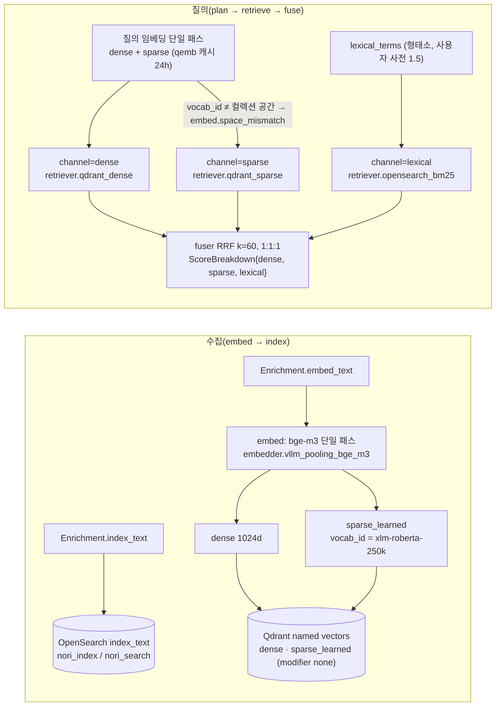

# ADR-0014: sparse 표현: BGE-M3 sparse 기본, lexical 레그 유지

> MADR 형식. 바이블 §3.3 표의 0014행이며 관련 결정은 O-02(바이블 §3.2 `resolved`)다. 이 ADR은 바이블의 결정을 근거·대안과 함께 기록하고 바이블 표를 바꾸지 않는다(바이블 §1.1). 임베딩 모델 선택과 `late_interaction` 슬롯(D-16, O-04)은 [ADR-0010](./0010-bge-m3-rationale-and-late-interaction-slot.md), 서빙 스택은 [ADR-0009](./0009-embedding-serving-vllm-pooling-tei-inprocess.md), 경량 프로파일의 `sparse_bm25`(BM25 레그) 계약은 [ADR-0012](./0012-lite-profile-qdrant-only-client-bm25.md), 융합 규칙은 [ADR-0013](./0013-fusion-rrf-k60-then-convex-combination-and-postprocess-order.md), 한국어 분석기는 [ADR-0021](./0021-korean-analyzer-kiwi-promotion-and-interim-mecab-kss.md)이 다룬다.

## 맥락과 문제

브리프 D-07은 기본 검색 파이프라인을 dense + sparse(learned) + lexical(BM25, 한국어 형태소) 3-way 하이브리드로 확정했고, D-16은 기본 임베딩을 BGE-M3(dense + sparse 단일 패스)로 정했다. 그러나 학습 희소 표현(learned sparse)의 구체 표현 — 어떤 모델의 어휘(vocabulary) 공간을 쓰고, lexical 레그와 어떤 관계에 있는가 — 는 브리프 §5 O-02("BGE-M3 sparse vs SPLADE-v3 vs OpenSearch neural sparse")로 열려 있었다. 기술 지형 조사([05 임베딩·스파스·멀티벡터 모델과 서빙](../07-tech-landscape/05-embedding-models-and-serving.md), [06 벡터·렉시컬 인덱스 백엔드](../07-tech-landscape/06-vector-and-lexical-index-backends.md), [13 한국어 NLP](../07-tech-landscape/13-korean-nlp-tokenization-and-language-resources.md), [선정 매트릭스](../07-tech-landscape/00-summary-and-selection-matrix.md) `sparse_encoder` 행)에서 다음 사실이 확정되었다.

| # | 사실 | 출처 |
|---|------|------|
| F1 | BGE-M3 sparse(lexical weights)는 dense와 **동일 패스**에서 나오고(추가 인코더 없음, 추가 비용 0) 어휘는 XLM-R 250k, MIT. MIRACL-ko sparse 단독 nDCG@10 61.5(BM25 37.1), dense+sparse 71.3; MLDR 장문에서 sparse 62.2 > dense 52.5. 단독 품질은 dense보다 낮고 TEI/Infinity로는 생산할 수 없다 | 05 §Learned sparse 표·비교 표, 매트릭스 `sparse_encoder` 행 |
| F2 | `naver/splade-v3`는 CC BY-NC-SA 4.0(D 등급)이고 영어 BERT 기반이라 한국어 지원이 없다 | 05 §Learned sparse, 12 §라이선스 표("O-02 기본 불가") |
| F3 | `opensearch-neural-sparse-encoding-multilingual-v1`(Apache-2.0, 105,879차원, 15개 언어)은 MIRACL-ko 0.607(BM25 0.371)이지만 한국어 절대 품질은 A.X-Encoder 파생 SPLADE 계열보다 크게 낮다(7셋 평균 0.5383). 질의 측 inference-free(토크나이저 + IDF 룩업), OpenSearch `rank_features` + `neural_sparse` 네이티브 | 05 비교 표, 06 §OpenSearch |
| F4 | `telepix/PIXIE-Splade-v1.5`(Apache-2.0, 149M, 출력 50,000차원, 5,632 토큰, 2026-04-22)는 MTEB(ko) nDCG@10 0.7671·OnAnd0n sparse 리더보드 78.19(1위)로 한국어 최상위 learned sparse이나 신규(5개월)·도메인 편차(STELLA-ko 0.4821)가 있고 별도 인코더가 필요하다. `yjoonjang/splade-ko-v1`(Apache-2.0, 8192 토큰)과 `inference-free-splade-ko-v1`(라이선스 태그 미기재, 확인 필요 as of 2026-09)은 같은 `skt/A.X-Encoder-base` 어휘라 `vocab_id`를 `ax-encoder-50k` 하나로 통합할 수 있다(2026-09-22 `tokenizer.json` 직접 비교) | 05 §Learned sparse 비교 표, §표준 모델 매핑 |
| F5 | BGE-M3 sparse는 XLM-R 서브워드 가중치이므로 형태소 BM25와 **단위가 다르다**. 서브워드는 OOV·오타에, 형태소는 정밀 매칭(정확 일치·고유명사·코드·수치, 사용자 사전)에 강해 두 레그는 상호 보완적이다 → O-02는 "BM25 대체"가 아니라 "제3 레그"다 | 13 §O-02 의견, 06 §개방 결정 O-02, 매트릭스 `sparse_encoder` 행 |
| F6 | 어휘가 다른 sparse 벡터의 내적은 무의미하다(bge-m3 250k / A.X-Encoder 50k / OpenSearch 105,879). 같은 어휘라도 가중치가 다른 모델(PIXIE-Splade-v1.5 인덱스에 splade-ko-v1 질의)의 점수 혼합 역시 무의미하다 | 05 §계약 요소 표 `SparseVector.vocab_id`, §실패 모드 "sparse 어휘 혼합" |
| F7 | O-02 판정 지표는 1차 검색 단계 Recall@100·`Judged@100`이며 MIRACL-ko·LawIRKo·자체 공공문서 셋 3종 이상에서 일관 우세일 때만 교체한다 | 09 §개방 결정 O-02, 매트릭스 O-02 게이트 |
| F8 | 세 설계 제안(A·B·C)은 O-02에 대해 동일한 결론(BGE-M3 sparse 기본, lexical 유지)을 냈다 | 바이블 §3.2 O-02 근거 열 |

문제: (1) `standard` 기본 learned sparse를 어떤 모델·어휘로 고정하고 계약(`vocab_id`, named vector, `embedding_space_id`)에 어떻게 표현하는가, (2) sparse가 lexical(BM25) 레그를 대체할 수 있는가, (3) 프로파일별 대안(`ko-quality`, `unified-opensearch`)과 교체·불일치 시 동작을 어떻게 정하는가.

## 결정 동인(decision drivers)

| ID | 동인 | 내용 | 근거 |
|----|------|------|------|
| DR1 | 단일 패스 비용 | `standard` GPU 1장·수집 처리량(브리프 §7) 안에서 dense·sparse를 한 번의 인코딩으로 얻는다. 별도 sparse 인코더는 색인·질의 양쪽에 모델 하나를 추가한다 | D-16, 바이블 §7.1 임베딩·서빙 행, §8.1 5단계(질의 임베딩 40ms) |
| DR2 | 라이선스 | 기본·권장 모델은 A/B 등급만. D 등급은 BYO + `model_license_ack` | D-02(개정 v1.1), [ADR-0001](./0001-license-grade-table-and-d02-interpretation.md) |
| DR3 | 한국어 상보성 | 서브워드 sparse와 형태소 BM25는 단위가 달라 상보적이다. 정확 일치·사용자 사전(`UserDictEntry` → Nori/Kiwi, `lexical_terms` 가중 1.5)·고유명사·코드·수치 recall은 lexical 레그의 책임이다 | 원칙 6, D-07, D-15, F5 |
| DR4 | 점수 원장·설명 가능성 | 세 채널의 원점수·기여가 `ScoreBreakdown{dense, sparse, lexical}`에 남고 `sparse_only_hit`/`lexical_only_hit`로 설명된다. 융합은 플랫폼 `fuser` | 원칙 8, K3, [ADR-0013](./0013-fusion-rrf-k60-then-convex-combination-and-postprocess-order.md), [ADR-0030](./0030-single-coordinate-system-and-score-ledger.md) |
| DR5 | 공간 안전성 | 어휘·모델이 다른 sparse 벡터를 절대 내적하지 않는다. 공간 식별은 `embedding_space_id`(`vocab_id` 포함)이며 교체는 컬렉션 blue/green | K6, 바이블 §6.2, §7.4, F6 |
| DR6 | 평가 주도 | 기본값 교체는 골든셋 게이트(F7, `ko-quality` nDCG@10 +2p)로만 | 원칙 7, 바이블 §7.4 |
| DR7 | 백엔드 이식성 | learned sparse 필드가 없는 백엔드 — Weaviate(06 §표준 `IndexRecord` → 백엔드 매핑 표 `vectors.sparse_learned` 행 "미지원(BM25로 대체)"), Apache Solr 10(06 §기타 후보 "learned sparse 필드는 없다", §프로파일별 조합 `unified-solr` 행) — 에서도 dense + lexical로 동작해야 하므로 lexical 레그가 선택 사항이 되어서는 안 된다 | D-15, 06 |

## 고려한 대안

| 대안 | 라이선스(등급) | 한국어 근거(05·06) | 추가 인코더 | 판정 |
|------|----------------|---------------------|-------------|------|
| A1 BGE-M3 sparse 기본 + lexical 제3 레그 유지 | MIT(A) | MIRACL-ko sparse 61.5, dense+sparse 71.3 | 없음 | **채택** |
| A2 SPLADE-v3(naver) 기본 | CC BY-NC-SA 4.0(D) | 없음(영어) | 필요 | **기각**(바이블 기각) |
| A3 OpenSearch neural sparse multilingual-v1 기본 | Apache-2.0(A) | MIRACL-ko 0.607, 7셋 평균 0.5383 | 필요(색인 측) | **기각**(바이블 기각; `unified-opensearch` 폴백만) |
| A4 learned sparse로 lexical(BM25) 레그 대체(2-way) | — | 단위 상이(F5) | — | **기각**(바이블 기각; D-07 위반) |
| A5 PIXIE-Splade-v1.5를 `standard` 기본으로 즉시 채택 | Apache-2.0(A) | MTEB(ko) 0.7671, 리더보드 1위 | 필요 | 기각(`ko-quality` 옵션 + 게이트) |
| A6 inference-free-splade-ko-v1을 `unified-opensearch` 1차로 즉시 확정 | 미기재(채점 불가) | 리더보드 76.75 | 문서 측만 | 보류(라이선스 확인 후 1차 비교) |
| A7 Qdrant BM25/BM42(fastembed) 통계 sparse를 learned sparse로 사용 | Apache-2.0(A) | 형태소 미적용 | 없음 | 기각(learned 아님; `lite`의 `sparse_bm25`는 lexical 레그) |
| A8 sparse 레그 생략(dense + BM25 2-way) | — | MLDR 장문 sparse 62.2 > dense 52.5 | — | 기각(D-07 3-way 확정) |

- **A1 BGE-M3 sparse + lexical 유지(채택).** 설명: `standard`는 BGE-M3 한 패스에서 dense·sparse를 얻어 Qdrant named vector `sparse_learned`(`modifier: none`)에 적재하고, BM25는 OpenSearch Nori의 `index_text`가 맡는다. 장점: 추가 인코더·GPU 비용 0(F1, DR1), 서빙 지원이 가장 넓다(vLLM pooling 3-in-1, ADR-0009), 세 제안 일치(F8), 형태소 레그와 상보(F5). 단점: sparse 단독 품질이 dense보다 낮고(F1), dense 모델을 바꾸면 sparse도 함께 사라진다(05 §함정) — `ko-quality`처럼 dense를 KURE-v1로 바꾸면 sparse 인코더를 별도로 둬야 한다.
- **A2 SPLADE-v3(바이블이 기각).** 설명: 브리프 O-02가 나열한 SPLADE 참조 구현. 장점: 성숙도 높음, 문헌 기준선. 단점: CC BY-NC-SA 4.0으로 D 등급(기본 프로파일 금지, D-02)이고 영어 BERT 어휘라 한국어 토큰을 의미 있게 분절하지 못한다(F2). 재라이선스되어도 영어 전용이라 후보가 되지 못한다.
- **A3 OpenSearch neural sparse 기본(바이블이 기각).** 설명: 색인 측 인코더로 `rank_features`를 만들고 질의는 inference-free로 처리한다. 장점: Apache-2.0·기업 유지, 질의 지연 최소, OpenSearch 단일 엔진에서 hybrid + normalization processor로 서버 융합 가능(06 §OpenSearch). 단점: 한국어 절대 품질이 BGE-M3 sparse·A.X 파생 SPLADE보다 크게 낮고(F3), `standard`는 Qdrant + OpenSearch 두 엔진이므로 sparse를 OpenSearch에 두면 플랫폼 `fuser`의 채널 분리·점수 분해(DR4)와 어긋난다. `unified-opensearch` 구성의 **폴백**으로만 남긴다.
- **A4 sparse로 lexical 대체(바이블이 기각).** 설명: learned sparse가 "lexical weights"이므로 BM25 채널을 제거해 2-way로 단순화한다. 장점: OpenSearch 제거로 인프라·이중 커밋 사가(바이블 §15 #5)가 단순해진다. 단점: 서브워드 가중치는 정확 일치·사용자 사전·고유명사·수치·코드 recall을 보장하지 못하고(F5, DR3), `korean-gov`의 컬렉션 사용자 사전 필수 요건(D-15)을 충족할 수 없으며, learned sparse 필드가 없는 백엔드에서 하이브리드가 붕괴한다(DR7). D-07(브리프 확정)을 뒤집는 결정이라 이 ADR 범위 밖이다.
- **A5 PIXIE-Splade-v1.5 즉시 기본(기각).** 장점: 한국어 최상위 수치(F4), Apache-2.0, `vocab_id=ax-encoder-50k`로 splade-ko-v1과 어휘 공유. 단점: 신규 5개월·도메인 편차(F4, 매트릭스 리스크 #9), 색인·질의에 인코더 추가(DR1), 5,632 토큰 상한(8192 필요 시 splade-ko-v1), 골든셋 없이 기본값 변경 금지(DR6). → `ko-quality`(KURE-v1 + PIXIE-Splade-v1.5) 옵션과 M2 게이트.
- **A6 inference-free-splade-ko-v1 즉시 확정(보류).** 장점: OpenSearch neural sparse 경로에서 한국어 품질이 multilingual-v1보다 훨씬 높고(7셋 평균 0.7206 vs 0.5383) 질의 측이 정적 룩업이라 추론 지연이 없다. 단점: HF 라이선스 태그 미기재로 D-02 채점 불가(F4), 개인 유지·데이터셋 편차(PublicHealthQA 49.38). 라이선스 확인 후 1차 비교, 미확인 시 multilingual-v1.
- **A7 fastembed BM25/BM42(기각).** 설명: 모델 없는 통계 sparse. 장점: 인코더 불필요·경량. 단점: learned sparse가 아니고 기본 토크나이저가 한국어 형태소를 처리하지 못한다(05 §Learned sparse). 형태소 토큰 + BM25 TF 포화값을 플랫폼이 계산하는 `sparse_bm25`는 이미 `lite`의 **lexical 레그**(`channel=lexical`)로 확정되어 있어(ADR-0012) sparse 레그의 대안이 아니다.
- **A8 sparse 생략(기각).** 장점: 파이프라인 단순화. 단점: 장문(MLDR)에서 sparse가 dense를 앞서고 dense+sparse 71.3이 각 단독을 크게 상회하므로(F1) recall 손실이 크며, D-07이 3-way를 확정했다.

## 결정

**결정:** 바이블 §3.2 O-02 그대로 — "BGE-M3 sparse(`vocab_id=xlm-roberta-250k`, 동일 패스) 기본. lexical 레그는 항상 유지(제3 레그). `ko-quality` PIXIE-Splade-v1.5(`ax-encoder-50k`), `unified-opensearch` inference-free-splade-ko-v1(라이선스 확인 후) → opensearch multilingual-v1. SPLADE-v3 제외. `vocab_id` 불일치는 색인·질의 모두 `embed.space_mismatch`(비재시도). sparse 모델 교체 = `embedding_space_ids.sparse_learned` 변경 = blue/green". 물리 표현은 바이블 §13.4 그대로 Qdrant named vector `sparse_learned`(`modifier: none`)이며, `sparse` 채널은 learned sparse만 가리키고 `lite`의 `sparse_bm25`는 항상 `channel=lexical`이다(§5.7 `Channel`).

| 항목 | 정본 값 | 위치 |
|------|---------|------|
| 색인 벡터 | `VectorBundle.sparse_learned{name, vocab_id: "xlm-roberta-250k", indices[], values[]}`(Y(standard)); `IndexRecord.vectors.sparse_learned?`; Qdrant named vector `sparse_learned`(`modifier: none`) | 바이블 §5.4, §13.4, §5.7 `VectorName` |
| 입력 텍스트 | dense·sparse 입력은 `Enrichment.embed_text`, BM25 입력은 `Enrichment.index_text`(3-텍스트 규칙 K2; 혼용 금지) | §2.1 K2, §5.4 `Enrichment`, [ADR-0029](./0029-three-text-rule-and-deterministic-context-prefix.md) |
| 공간 식별 | `embedding_space_ids.sparse_learned = H("space", model_id, revision, str(dim), str(normalized), prompt_hash, quantization, vocab_id or "")`; `embedding_profile_hash = H("spaces", *sorted(f"{name}={space_id}"))`가 컬렉션 바인딩 단위(`CollectionSpec`) | §6.2, §5.4 `EmbeddedChunkSet`, §5.6 |
| 프로파일 YAML | `ingest.embed.sparse: {plugin: embedder.vllm_pooling_bge_m3, vocab_id: xlm-roberta-250k}`; Qdrant 백엔드 `named_vectors: [dense, sparse_learned]`; `query.channels`에 `{channel: sparse, retriever: retriever.qdrant_sparse, top_k: 100, timeout_ms: 250}`과 `{channel: lexical, retriever: retriever.opensearch_bm25, …}`; `fusion.weights {dense: 1.0, sparse: 1.0, lexical: 1.0}` | §7.3 |
| 질의 측 | 5단계 질의 임베딩 = bge-m3 단일 패스 → dense + sparse(Valkey `qemb:{embedding_space_id}:{H(normalized_query)}` 24h); 7단계 dense·sparse는 Qdrant `query_points` **두 호출**, lexical은 OpenSearch `match(index_text) + terms(lexical_terms)`; 6단계 예산 저하 순서의 "채널 축소"에서도 **lexical 유지** | §8.1 5·6·7단계, §13.4 Valkey 키 |
| 오류 | `embed.space_mismatch`(비재시도) — 색인(`embed` 스테이지 `non_retryable_error_codes`)·질의 모두; RFC 9457 `type = urn:rag:error:embed.space_mismatch` | §4.2 `embed` 행, §4.4, §5.7 오류 카탈로그 |
| 점수·설명 | `ScoreBreakdown.sparse`·`.lexical`(`ChannelScore`), `channels_hit[]`, `ExplainCode` `sparse_only_hit`·`lexical_only_hit`·`multi_channel_hit`, `DegradedComponent` `channel.sparse`·`channel.lexical` | §5.3, §5.7 |
| 키워드 원천 | `Enrichment.keywords[].source`의 `sparse_top`(BGE-M3 sparse 상위 토큰, 선택)은 `analyzer_nng`/`analyzer_nnp`/`user_dict`와 병존 | §5.7 `KeywordSource` |
| 계량 | `EmbeddedChunkSet.stats.bytes_sparse`, `IndexCommit.stats.bytes_sparse`·`bytes_lexical`, `CollectionSpec.stats`, `rag_index_bytes_total{vector}`, `rag_retrieve_latency_seconds{channel}` | §5.4, §5.6, §6.5 |

프로파일별 두 레그(바이블 §7.1·§7.2; `unified-opensearch`는 매트릭스·06 문서의 구성):

| 프로파일 | sparse 레그(`channel=sparse`) | lexical 레그(`channel=lexical`) |
|----------|-------------------------------|---------------------------------|
| `lite` | 기본 없음(GPU 없이 `sparse_learned`를 생성할 수 있는 노드는 추가) | Qdrant `sparse_bm25`(`modifier: idf`, 테넌트 IDF; 플랫폼 형태소 + BM25 TF 포화값, `retriever.qdrant_sparse_bm25`; ADR-0012) |
| `standard` | bge-m3 sparse @ vLLM 0.29 pooling → `sparse_learned`, `retriever.qdrant_sparse` top_k 100 / 250ms | OpenSearch 3.8 Nori `mixed`/`discard`, `retriever.opensearch_bm25` top_k 100 / 250ms, 사용자 사전 파이프라인 |
| `premium` `ko-quality` | PIXIE-Splade-v1.5(`ax-encoder-50k`; 8192 토큰 필요 시 splade-ko-v1 동일 어휘) — 별도 `SparseEncoder` 경로, 서빙 세부는 ADR-0009 | standard 동일 |
| `korean-gov` | standard 동일(가중치·LICENSE 자체 미러링 필수) | standard + 컬렉션 사용자 사전 **필수** |
| `unified-opensearch` | inference-free-splade-ko-v1(라이선스 확인 후) → multilingual-v1, OpenSearch `rank_features` + `neural_sparse` | 동일 인덱스 Nori |



`standard`의 `VectorBundle` 발췌(바이블 §5.4 필드; 값은 예시, `indices`는 XLM-R 토큰 id):

```json
{
  "dense": {"name": "dense", "dim": 1024, "offset": 0},
  "sparse_learned": {
    "name": "sparse_learned",
    "vocab_id": "xlm-roberta-250k",
    "indices": [6, 1523, 20489, 118873],
    "values": [0.1873, 0.0921, 0.2544, 0.0417]
  },
  "embed_text_hash": "<hex64>",
  "truncated": false
}
```

`vocab_id` 불일치 시 `StageError`(바이블 §5.3·§5.7; `detail`에 콘텐츠 없음):

```json
{
  "code": "embed.space_mismatch",
  "type": "urn:rag:error:embed.space_mismatch",
  "retryable": false,
  "stage": "embed",
  "plugin_id": "embedder.vllm_pooling_bge_m3",
  "detail": "sparse_learned vocab_id=ax-encoder-50k does not match collection embedding_space_ids.sparse_learned (vocab_id=xlm-roberta-250k)"
}
```

## 결과

**긍정**

- `standard`의 sparse 레그가 추가 모델·GPU 없이 확보되어 수집 처리량과 질의 임베딩 예산(40ms)이 dense 단독과 같다(DR1).
- 세 레그의 역할이 분리된다: dense(의미), sparse(서브워드 가중치·OOV·오타·장문), lexical(정확 일치·사용자 사전·고유명사·수치). 점수 원장(`ScoreBreakdown`)과 `ExplainCode`가 이 분리를 그대로 드러낸다(DR4).
- `vocab_id`가 `embedding_space_id`의 구성 요소이므로 어휘 혼합·모델 혼합(F6)이 계약 수준에서 차단되고, sparse 모델 교체가 `embedding_profile_hash` 변경 → 컬렉션 blue/green이라는 기존 절차에 포섭된다(DR5).
- A.X-Encoder 파생 SPLADE 계열이 `ax-encoder-50k` 하나의 `vocab_id`를 공유하므로 `ko-quality` 안에서 PIXIE-Splade-v1.5 ↔ splade-ko-v1 교체는 토큰 id 공간 호환이 보장된다(점수 호환은 `embedding_space_id`가 별도 구분).
- lexical 레그가 상수로 유지되어 learned sparse 필드가 없는 백엔드(Weaviate·Apache Solr 10; 출처는 DR7)·`lite`(Qdrant 단독)에서도 하이브리드가 동작한다(DR7).

**부정**

- BGE-M3 sparse 단독 품질은 dense보다 낮아(F1) sparse 레그의 기여는 융합 안에서만 의미가 있다. 골든셋에서 채널 ablation을 3-way로 수행해야 기여를 판정할 수 있다(13 문서 권고).
- dense 모델과 sparse가 한 패스에 묶여 있어 dense 교체(`ko-quality` KURE-v1, `quality-max` Qwen3-Embedding-4B)는 sparse 인코더 추가를 수반한다. `quality-max`의 sparse 레그 구성은 바이블 §7.1에 명시되지 않았다(재검토 조건 4).
- `ko-quality`는 색인·질의에 `SparseEncoder` 워커가 추가되어 서빙 표면이 늘고, PIXIE-Splade-v1.5의 5,632 토큰 상한과 `standard` 청크 예산(자식 512·부모 2048)은 무관하나 8192 토큰 입력이 필요한 경우 splade-ko-v1로 바꿔야 한다.
- `inference-free-splade-ko-v1`은 라이선스 확인 전까지 채택할 수 없고, 개인 유지 저장소라 가중치·LICENSE 미러링(바이블 §13.3 모델 미러 `models/{repo}/{revision}/…` + `LICENSE` + `models.lock`)이 전제다(05 §리스크).

**중립**

- 임베딩 모델·서빙(ADR-0009·0010), 융합 규칙(ADR-0013), `lite` BM25 계약(ADR-0012), 한국어 분석기(ADR-0021)는 바뀌지 않는다.
- `unified-opensearch`는 바이블 §3.2와 매트릭스가 이름으로 참조하지만 §7.1 컴포넌트 표(`lite`/`standard`/`premium`/`korean-gov`)에는 없다. 구성은 06 문서 프로파일 표를 따르며 `profile_id`·`extends`·`tier`는 [03-contracts/15](../03-contracts/15-collection-profile-and-policy-contracts.md)에서 정의될 때 확정한다(확인 필요, as of 2026-09).
- `RetrievalMode`(`hybrid, dense, sparse, lexical`)의 단일 채널 모드는 진단·평가용 요청 옵션이며 기본 파이프라인(`hybrid`)의 3-way 구성을 바꾸지 않는다.

## 준수 확인 방법

| 게이트 | 강제 내용 | 정의 위치 |
|--------|-----------|-----------|
| CI 열거 대조(바이블 §1.2) | `schemas/*.schema.json`의 `VectorName`(`sparse_learned`, `sparse_bm25`)·`Channel`(`sparse`, `lexical`)·`KeywordSource`(`sparse_top`)·`ExplainCode`(`sparse_only_hit`, `lexical_only_hit`)·`DegradedComponent`(`channel.sparse`, `channel.lexical`)·오류 코드 `embed.space_mismatch`를 §5.7과 기계 대조. `sparse` 채널에 `sparse_bm25`를 매핑하는 스키마·코드는 실패 | [10-development/05](../10-development/05-ci-cd.md), [03-contracts/00](../03-contracts/00-contract-overview.md) |
| 스키마 제약 | `VectorBundle.sparse_learned`는 `standard`에서 필수(Y(standard)), `vocab_id`·`indices`·`values` 필수; `IndexRecord.index_text`(OpenSearch 필수)·`lexical_terms`(필수)는 sparse 유무와 무관하게 존재; `EmbeddedChunkSet.mode`는 `const document` | 바이블 §5.4, [03-contracts/07](../03-contracts/07-embedded-chunk-set-and-index-record.md) |
| `rag profile validate` | (3) `fusion.k` 필수; (8) `embedding_space_ids` 재계산 일치 — `sparse_learned` 공간의 `vocab_id`가 `ingest.embed.sparse.vocab_id`와 다르면 `profile.invalid`; (9) `lite`는 플랫폼 측 `korean_analyzer` 필수(lexical 레그 전제); (1) `ko-quality`·`unified-opensearch`의 sparse 인코더 플러그인도 `PluginMeta.license_grade ≤ license_policy.max_grade`(C/D/X는 `optIn`, D 모델은 `model_license_ack: true`; §7.3 예시 `standard`는 `max_grade: B`, D-02) — 모델 가중치는 §13.3 모델 미러(`models/{repo}/{revision}/…` + `LICENSE` + `models.lock`)에서 로드하며, inference-free-splade-ko-v1은 라이선스 등급이 확정되기 전에는 `license_grade`를 채점할 수 없어 로드 거부 | 바이블 §7.4, §13.3, [ADR-0031](./0031-profile-schema-extends-and-quality-gates.md), [03-contracts/15](../03-contracts/15-collection-profile-and-policy-contracts.md) |
| 제안(바이블 §7.4 미명시) | `strategy=hybrid` 프로파일의 `query.channels`에 `channel=lexical` 항목이 없으면 `profile.invalid`로 거부하는 검증 규칙 — "lexical 레그 항상 유지"의 기계적 강제. 채택 여부는 ADR-0031·03-contracts/15에서 결정 | — |
| 색인·질의 공간 검사 | `embed` 스테이지: `VectorBundle.sparse_learned.vocab_id` ≠ 컬렉션 `embedding_space_ids.sparse_learned`의 `vocab_id` → `embed.space_mismatch`(비재시도, `StagePolicy.non_retryable_error_codes`). 질의 측: `QueryPlan.channels[].embedding_space_id`와 질의 sparse 벡터의 공간이 다르면 같은 코드(컬렉션 간 공간이 다르면 §8.1 6단계대로 공간별 질의 임베딩) | 바이블 §4.2, §4.4, §8.1 5·6단계, [03-contracts/09](../03-contracts/09-query-request-and-query-plan.md) |
| 적합성 키트 | `fuser_equivalence`: 3채널 런에서 `Σ contribution = fused_score`·ranx 일치, `channels_hit`에 `sparse`·`lexical`이 독립 기록; 어댑터 테스트: `vocab_id`가 다른 질의 벡터를 `retriever.qdrant_sparse`에 넣으면 검색 전에 `embed.space_mismatch`; `sparse_bm25` 질의는 `ScoreBreakdown.lexical`에만 기록 | 바이블 §12 `testing/`, [03-contracts/10](../03-contracts/10-candidate-set-and-ranked-set.md), [ADR-0032](./0032-plugin-sdk-stage-protocol-and-conformance-kit.md) |
| 평가 게이트 | 채널 ablation은 3-way 기준으로 수행(lexical 레그를 끄고 sparse만 비교하지 않음); O-02 교체 판정은 Recall@100·`Judged@100`, 3종 셋 일관 우세(F7); `ko-quality` 교체는 nDCG@10 +2p(D-16) — `EvalReport.gate_result.passed` 없이 값 변경 금지 | 바이블 §7.4, [08-evaluation/05](../08-evaluation/05-benchmark-plan-and-baselines.md), [ADR-0023](./0023-evaluation-qrels-answer-spans-and-linear-ndcg.md) |
| 계량·알람 | `rag_index_bytes_total{vector="sparse_learned"}`와 `IndexCommit.stats.bytes_sparse` 일치; `rag_retrieve_latency_seconds{channel="sparse"|"lexical"}` 분리 노출; `channel.lexical` `degraded` 비율 알람 | 바이블 §6.5, [09-operations/03](../09-operations/03-observability.md) |
| 코드 리뷰 체크리스트 | (a) sparse 입력은 `embed_text`, BM25 입력은 `index_text` — 교차 사용 금지 (b) `vocab_id`가 다른 sparse 벡터를 내적하는 코드 경로 없음 (c) `sparse_bm25`를 `channel=sparse`·`fusion.weights.sparse`에 연결하지 않음 (d) 질의 임베딩 캐시 키에 `embedding_space_id` 포함 (e) PIXIE-Splade 계열은 `encode_query`/`encode_document` 비대칭 경로를 어댑터가 `EmbeddingMode`로 선택 (f) 모델은 `{repo}@{revision}` + `models.lock` + 가중치·LICENSE 미러링(§13.3) | [10-development/07](../10-development/07-contributing.md), 바이블 §6.1, §5.7 `EmbeddingMode`, §13.3 |

## 재검토 조건

1. `ko-quality`(KURE-v1 + PIXIE-Splade-v1.5)가 M2 골든셋에서 nDCG@10 +2p 이상이고 sparse 레그가 Recall@100·`Judged@100`에서 MIRACL-ko·LawIRKo·자체 공공문서 셋 3종 모두 일관 우세이면 `standard` 기본 sparse를 교체한다(이 ADR 개정 → 바이블 §3.2 O-02 갱신 → 컬렉션 blue/green). 우세가 일부 셋에 한정되면 `ko-quality` 옵션으로 유지한다.
2. `yjoonjang/inference-free-splade-ko-v1`의 라이선스가 A/B 등급으로 확인되면 `unified-opensearch` 1차 비교를 수행하고, 확인되지 않거나 D/X이면 `opensearch-neural-sparse-encoding-multilingual-v1`만 남긴다(05 미해결 이슈 #16).
3. 기본 dense 모델이 BGE-M3에서 다른 모델로 바뀌면(ADR-0010 재검토 조건 2) BGE-M3 sparse도 함께 사라지므로 sparse 레그 결정을 동시에 재검토한다.
4. `quality-max`(Qwen3-Embedding-4B) 프로파일의 sparse 레그 구성(BGE-M3 sparse 병행 인코딩 vs PIXIE-Splade-v1.5 vs 생략)은 바이블 §7.1에 없으므로 프로파일 정의 시 ADR-0031 게이트와 함께 확정한다.
5. TEI `/embed_sparse`가 ModernBERT SPLADE(PIXIE-Splade 계열)를 지원하거나 vLLM `bge_m3_sparse_plugin` 경로가 바뀌면 `ko-quality`의 sparse 서빙 경로를 ADR-0009에서 갱신한다(확인 필요, as of 2026-09).
6. lexical 레그 자체의 제거·선택화는 브리프 D-07(확정 결정)의 개정이므로 이 ADR이 아니라 D-07 개정 ADR(바이블 §1.2 절차)로만 가능하다. 3-way ablation에서 lexical 기여가 3종 셋 모두에서 0에 가깝더라도 사용자 사전·정확 일치 요구(`korean-gov`)를 함께 평가한 뒤 발의한다.
7. 새 한국어 learned sparse 모델은 매트릭스 리스크 #9에 따라 12개월 관찰 + 골든셋 재현 게이트 후에만 후보로 승격하며, 새 어휘가 등장하면 `vocab_id` 값(`xlm-roberta-250k`, `ax-encoder-50k`, `opensearch-ms-105879`)을 03-contracts/07에 추가한다.

## 참조

- [설계 브리프](../00-vision/00-design-brief.md) §3 원칙 5·6·7·8, §4 D-02·D-07·D-15·D-16(개정 v1.1), §5 O-02, §7 품질 목표, §9 문서 규약
- [설계 바이블](../02-architecture/00-design-bible.md) §1.1·§1.2, §2.1 K2·K3·K6, §3.1 D-07·D-15·D-16 행, §3.2 O-01·O-02 행, §3.3 0014행, §4.2 `embed` 행, §4.4, §5.3 `ScoreBreakdown`·`DegradedEntry`·`StageError`·`IndexBackendCapabilities`, §5.4 `Enrichment`·`EmbeddedChunkSet`·`VectorBundle`·`IndexRecord`·`IndexCommit`, §5.5 `QueryPlan`·`CandidateSet`·`RankedSet`, §5.6 `CollectionSpec`, §5.7 `VectorName`·`Channel`·`KeywordSource`·`ExplainCode`·`DegradedComponent`·`RetrievalMode`·`EmbeddingMode`·오류 카탈로그, §6.1·§6.2·§6.5, §7.1·§7.2·§7.3·§7.4, §8.1 5·6·7단계, §12, §13.3·§13.4, §15 #5·#9, §16 GL-07·GL-13·GL-14
- [기술 지형 종합: 선정 매트릭스](../07-tech-landscape/00-summary-and-selection-matrix.md) `sparse_encoder`·`dense_embedder`·`lexical_index`·`vector_index`·`korean_tokenizer` 행, 개방 결정 권고 O-02, 종합 리스크 #9, 미해결 이슈 7(`inference-free-splade-ko-v1` 라이선스)
- [05 임베딩·스파스·멀티벡터 모델과 서빙](../07-tech-landscape/05-embedding-models-and-serving.md) §Learned sparse 표·비교 표, §계약 요소 표(`SparseVector.vocab_id`), §표준 모델 매핑, §실패 모드, §리스크, §결정(권고) O-02, 미해결 이슈 #16
- [06 벡터·렉시컬 인덱스 백엔드](../07-tech-landscape/06-vector-and-lexical-index-backends.md) §Qdrant, §OpenSearch(neural sparse), §기타 후보(Apache Solr 10 — learned sparse 필드 없음), §프로파일별 조합 표(`standard`·`lite`·`unified-opensearch`·`unified-solr`), §표준 `IndexRecord` → 백엔드 매핑 표(Qdrant·OpenSearch·Milvus·Weaviate·pgvector 5열), §개방 결정 O-01·O-02
- [09 평가·관측성](../07-tech-landscape/09-evaluation-and-observability.md) §개방 결정 O-02(Recall@100·`Judged@100`), [12 보안·멀티테넌시·PII·라이선스](../07-tech-landscape/12-security-multitenancy-pii-and-licensing.md) §라이선스 표(SPLADE-v3 D 등급), [13 한국어 NLP](../07-tech-landscape/13-korean-nlp-tokenization-and-language-resources.md) §O-02 의견(서브워드 vs 형태소), [07 리트리벌 기법](../07-tech-landscape/07-retrieval-techniques-fusion-reranking.md) §1.1 기법별 동작과 진입점 표 "키워드 추출(BM25용)" 행(kiwipiepy 품사 기반 추출 + 선택적 BGE-M3 sparse 가중치 상위 토큰 → `lexical_terms[]`; 열거값 `sparse_top`은 07 문서가 아니라 바이블 §5.7 `KeywordSource`가 정본)
- 관련 ADR: [ADR-0001](./0001-license-grade-table-and-d02-interpretation.md), [ADR-0009](./0009-embedding-serving-vllm-pooling-tei-inprocess.md), [ADR-0010](./0010-bge-m3-rationale-and-late-interaction-slot.md), [ADR-0012](./0012-lite-profile-qdrant-only-client-bm25.md), [ADR-0013](./0013-fusion-rrf-k60-then-convex-combination-and-postprocess-order.md), [ADR-0021](./0021-korean-analyzer-kiwi-promotion-and-interim-mecab-kss.md), [ADR-0023](./0023-evaluation-qrels-answer-spans-and-linear-ndcg.md), [ADR-0029](./0029-three-text-rule-and-deterministic-context-prefix.md), [ADR-0030](./0030-single-coordinate-system-and-score-ledger.md), [ADR-0031](./0031-profile-schema-extends-and-quality-gates.md), [ADR-0032](./0032-plugin-sdk-stage-protocol-and-conformance-kit.md)
- 하위 설계 문서: [04-pipelines/12 임베딩](../04-pipelines/12-embedding.md), [04-pipelines/13 인덱싱](../04-pipelines/13-indexing.md), [04-pipelines/15 하이브리드 검색·융합](../04-pipelines/15-hybrid-search-and-fusion.md), [03-contracts/07](../03-contracts/07-embedded-chunk-set-and-index-record.md), [03-contracts/09](../03-contracts/09-query-request-and-query-plan.md), [03-contracts/10](../03-contracts/10-candidate-set-and-ranked-set.md), [03-contracts/15](../03-contracts/15-collection-profile-and-policy-contracts.md), [08-evaluation/05](../08-evaluation/05-benchmark-plan-and-baselines.md), [ADR 인덱스](./README.md)
