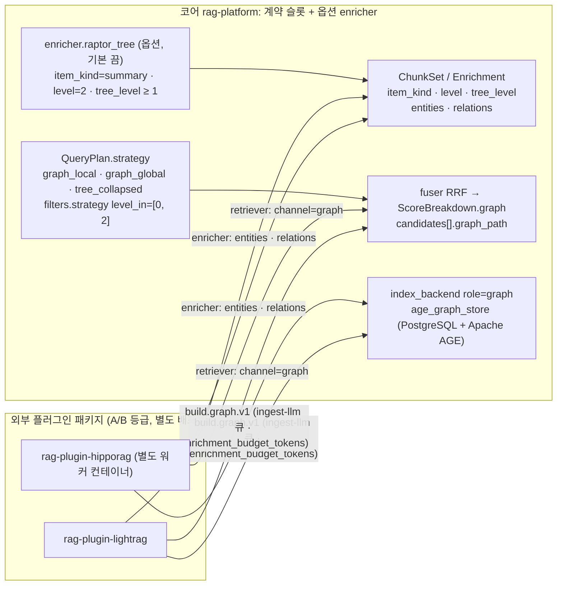

# ADR-0015: GraphRAG 외부 플러그인 / RAPTOR 코어 옵션 이분

> MADR 형식. 바이블 §3.3 표의 0015행이며 관련 결정은 O-03(브리프 §5, 바이블 §3.2 `resolved`)이다. 이 ADR은 바이블의 결정을 근거·대안과 함께 기록하고 바이블 표를 바꾸지 않는다(바이블 §1.1). 그래프·요약 계층이 의존하는 LLM 보강 비용 정책(O-05, `enrichment_budget_tokens`)은 [ADR-0016](./0016-llm-enrichment-default-off-and-budget-policy.md), 채널 융합·점수 원장은 [ADR-0013](./0013-fusion-rrf-k60-then-convex-combination-and-postprocess-order.md)·[ADR-0030](./0030-single-coordinate-system-and-score-ledger.md), 플러그인 SDK는 [ADR-0032](./0032-plugin-sdk-stage-protocol-and-conformance-kit.md), 라이선스 등급표는 [ADR-0001](./0001-license-grade-table-and-d02-interpretation.md)이 다룬다.

## 맥락과 문제

브리프 R4는 "모든 기술"을 **모두 기본 켬이 아니라 모두 플러그인으로 수용 가능한 확장 지점**으로 해석하고, GraphRAG·RAPTOR를 프로파일/플러그인 선택 기법으로 명시했다. 브리프 §5 O-03은 "GraphRAG/LightRAG·RAPTOR를 코어 옵션 모듈로 둘지, 외부 플러그인으로 둘지"를 개방 결정으로 남겼다. 기술 지형 조사([14 고급 RAG](../07-tech-landscape/14-advanced-rag-graph-raptor-agentic-multimodal.md), [선정 매트릭스](../07-tech-landscape/00-summary-and-selection-matrix.md) 판정 J-8·`graph_module` 행·O-03 권고)에서 다음 사실이 확정되었다.

| # | 사실 | 출처 |
|---|------|------|
| F1 | 질의당 프롬프트 토큰(GraphRAG-Bench Fig. 9, Novel/Medical)은 기본 RAG 879/954를 기준으로 HippoRAG 2 약 1.1배, RAPTOR 약 4배, MS GraphRAG local 약 42배, LightRAG(기본 `mix`) 약 105배, MS GraphRAG global 약 350배다. 초기 그래프 구축은 5.08M 토큰 코퍼스에서 약 14M 토큰(코퍼스의 약 2.8배, 14 문서 계산)이다. "LightRAG = 저비용"이라는 통념은 성립하지 않는다 | 14 §GraphRAG 계열 공통(비용 표), 매트릭스 리스크 #10 |
| F2 | 두 독립 평가(arXiv 2502.11371, 2506.05690)가 일치한다: 단일 홉 사실 질의는 **기본 RAG**가 같거나 우세하고 그래프는 잡음을 더한다. 다중 홉·비교·시간 추론은 HippoRAG 2·GraphRAG local이, 코퍼스 수준 요약 질의는 global search가 우세하다. 따라서 그래프는 컬렉션 단위로 켜고 질의 시점에 라우팅 또는 채널 융합으로 결합해야 한다 | 14 §GraphRAG 계열 공통(질의 유형 표·결론) |
| F3 | 각 프레임워크는 자체 저장소·LLM 추상화를 강제한다. LightRAG(MIT, `lightrag-hku` 1.5.7)는 KV/vector/graph/doc-status 4종 저장소 플러그인(PostgreSQL+AGE·Qdrant 주입 가능)이고, HippoRAG 2(MIT, `hipporag` 2.0.0a4 알파)는 `torch==2.5.1`·`transformers==4.45.2`·`pydantic==2.10.4` 등 정확 버전 고정으로 우리 프로세스에 둘 수 없어 별도 워커 컨테이너가 필요하며, MS GraphRAG(MIT, 3.1.2)는 자체 벡터 스토어(LanceDB 기본)로 Qdrant와 이중 저장이 된다 | 14 §후보 A, §LightRAG·§HippoRAG 2·§Microsoft GraphRAG 함정 |
| F4 | RAPTOR collapsed tree는 "요약 노드를 일반 청크와 같은 인덱스에 넣는 것"과 동일하다. 새 리트리버·저장소가 필요 없고 `enricher`가 생성하는 파생 청크(`item_kind=summary`, `tree_level=n`)로 수용되며 검색·융합·리랭킹·패킹은 기본 파이프라인을 그대로 쓴다. 참조 구현은 커밋 20개로 유지보수가 중단되었고 `llama-index-packs-raptor`는 deprecated 명시라 알고리즘 자체 구현이 불가피하다 | 14 §RAPTOR와 요약 계층(설계 함의), §후보 A |
| F5 | 그래프 저장소 라이선스: PostgreSQL + Apache AGE(v1.8.0) Apache-2.0·D-14 PostgreSQL 동일 인스턴스, NetworkX BSD-3(인메모리), Neo4j Community 서버 **GPLv3**(드라이버 Apache-2.0; 네트워크 분리 서비스로만 조건부, 법무 확인), FalkorDB **SSPLv1**·Memgraph **BSL**은 D-02 부적합 | 14 §후보 B, §지식그래프 저장소 선택 |
| F6 | 14 문서 점수표에서 LightRAG 405 vs HippoRAG 2 400은 오차 범위이고, GraphRAG-Bench 본문 서술과 Fig. 9 실측치가 약 10배 어긋난다. 11 문서의 "LightRAG 1차, Cognee 병행" 의견은 J-8에서 기각되고 14의 "자체 코퍼스 측정 후 확정"이 채택되었다. 코어에는 계약 슬롯만 두므로 보류 비용이 없다 | 매트릭스 J-8, 14 §선정 근거 점수표 |
| F7 | 세 설계 제안(A·B·C)이 모두 "GraphRAG 외부 플러그인 + RAPTOR 코어 옵션 `enricher`" 이분에 일치했고, 심사단도 O-03을 신뢰도 높음으로 확정 권고했다(1차 엔진만 낮음) | 바이블 §3.2 O-03 근거 열, 매트릭스 O-03 권고·결정 사항 요약 |

문제: (1) 그래프 RAG(GraphRAG, LightRAG, HippoRAG 2)와 요약 계층(RAPTOR)을 코어 옵션 모듈과 외부 플러그인 중 어디에 두는가, (2) 코어 계약은 어떤 슬롯을 예약해야 어떤 그래프 엔진도 같은 계약으로 결과를 실을 수 있는가, (3) 그래프 저장소와 인덱싱 잡을 D-14·D-17·O-05 정책 안에서 어떻게 배치하는가, (4) 1차 그래프 엔진을 지금 확정할 것인가.

## 결정 동인(decision drivers)

| ID | 동인 | 내용 | 근거 |
|----|------|------|------|
| DR1 | 비용·지연 목표 | 기본 배포는 브리프 §7(리트리벌 p95 800ms, 텍스트 PDF 100페이지 30s)을 지켜야 한다. 질의당 수십~수백 배 토큰(F1)·코퍼스 수 배의 인덱싱 비용은 기본 프로파일에 들어올 수 없다 | 브리프 §7, 바이블 §8.3, §15 #10 |
| DR2 | 질의 유형 의존성 | 단일 홉에서 기본 RAG보다 못하므로(F2) 켬/끔은 컬렉션 프로파일 단위이며 기본은 끔이다. 모든 품질 기본값은 골든셋 `gate`로 정당화한다 | 원칙 7, 바이블 §7.4 |
| DR3 | 벤더 독립성 | 자체 저장소·LLM 추상화·고정 의존(F3)을 코어에 결합하면 원칙 2(Adapters over Forks)·D-04 표준 모델 소유가 훼손된다. 코어는 A 등급 순수 Python만 인프로세스 의존한다 | 원칙 2, D-04, 바이블 §12 |
| DR4 | 라이선스 | 기본·권장 구성은 A/B 등급만. GPL 서버·SSPL·BSL 그래프 DB(F5)는 기본 배포 제외 | D-02(개정 v1.1), ADR-0001, 바이블 §7.4 (1) |
| DR5 | 저장소 최소화 | D-14·D-15 인프라(PostgreSQL·S3 호환·Valkey / Qdrant·OpenSearch) 밖의 새 데이터베이스를 도입하지 않는다 | D-14, D-15, 바이블 §13 |
| DR6 | 계약 우선 | 그래프·요약 항목이 나중에 추가되면 열거값 추가는 minor지만 스테이지 경계·타입 변경은 major다. 슬롯을 지금 예약해야 플러그인이 코어 개정 없이 결과를 싣는다 | 원칙 1, 바이블 §1.2, §5.7 `ItemKind` 단일 열거 |
| DR7 | 비용 정책 일관성 | LLM 기반 관계 추출·커뮤니티 요약·RAPTOR 요약은 모두 O-05 정책(`ingest-llm` 큐, `enrichment_budget_tokens`, `corpus_multiplier_max`, `partial` 종료)을 따른다 | 바이블 §3.2 O-05, §4.4, §7.2, ADR-0016 |
| DR8 | 점수 원장·설명 가능성 | 그래프 채널 점수는 `ScoreBreakdown.graph`에 남고 경로는 `graph_path`로 설명된다(원칙 8, K3) | 바이블 §2.1 K3, §5.3, §5.5, ADR-0030 |
| DR9 | 멀티테넌시 | level 2 파생 항목도 `IndexRecord`이므로 보안 불변식(사전 필터·`acl_*`)을 예외 없이 따른다 | D-09, 바이블 §10.2, §10.3 |

## 고려한 대안

| 대안 | 배치 | 라이선스(등급) | 질의당 비용(F1) | 판정 |
|------|------|----------------|-----------------|------|
| A1 이분: GraphRAG 외부 플러그인 + 코어 계약 슬롯, RAPTOR 코어 옵션 `enricher`, PostgreSQL + Apache AGE, 별도 잡 `build.graph.v1`, 1차 엔진 보류 | 플러그인 / 코어 옵션 | MIT·Apache-2.0(A) | 기본 프로파일 1배(끔) | **채택** |
| A2 GraphRAG 코어 내장(LightRAG 또는 MS GraphRAG를 `adapters/`에 포함, 프로파일 옵션) | 코어 | MIT(A) | 켬 시 약 42~105배 | **기각**(바이블 기각) |
| A3 RAPTOR 외부 플러그인(`rag-plugin-raptor`) | 플러그인 | MIT 알고리즘(A) | 약 4배 | **기각**(바이블 기각) |
| A4 별도 그래프 DB 도입(Neo4j CE / FalkorDB / Memgraph / LadybugDB) | 인프라 추가 | GPLv3 서버(C) / SSPL(X) / BSL(X) / MIT(A, 성숙도 주의) | — | **기각**(바이블 기각) |
| A5 1차 엔진 즉시 확정(LightRAG 1차, Cognee 병행 — 11 문서 의견) | 플러그인 | MIT / Apache-2.0(A) | 약 105배(LightRAG `mix`) | 기각(J-8) |
| A6 그래프·요약 슬롯 없이 3-way 하이브리드만(계약에 예약 없음) | — | — | 1배 | 기각 |
| A7 그래프 인덱싱을 `ingest.document.v1`의 `enrich` 스테이지에 인라인(별도 잡 없음) | 코어 | — | 문서마다 코퍼스 수 배 | 기각 |

- **A1 이분(채택).** 설명: GraphRAG 계열은 `retriever`(채널 `graph`) + `enricher`(엔티티·관계) 확장 지점을 구현하는 외부 패키지 `rag-plugin-lightrag`·`rag-plugin-hipporag`로 두고, 코어는 `item_kind`·`Enrichment.entities/relations`·`channel=graph`·`QueryPlan.strategy`·`graph_path`·`ScoreBreakdown.graph` 슬롯만 예약한다. RAPTOR collapsed tree는 코어 `enricher.raptor_tree`(기본 끔)가 `item_kind=summary` 파생 청크를 만들고 기존 채널이 `tree_collapsed` 전략 필터로 회수한다. 장점: 기본 배포 비용이 0이고(DR1), 어떤 엔진도 같은 계약으로 결과를 싣며(DR6·DR8), 저장소는 D-14 PostgreSQL 인스턴스의 AGE 확장으로 끝난다(DR5). RAPTOR는 새 리트리버·저장소가 없어(F4) 코어 옵션으로도 결합 비용이 없다. 단점: 코어 계약에 기본 프로파일이 쓰지 않는 열거값·선택 필드가 남고, 두 어댑터를 모두 작성해야 하며 1차 엔진 확정이 자체 측정 뒤로 미뤄진다.
- **A2 GraphRAG 코어 내장(바이블이 기각한 대안).** 설명: 11 문서의 "LightRAG 1차" 관점을 확장해 LightRAG(또는 MS GraphRAG)를 코어 어댑터로 포함한다. 장점: 설치 한 번으로 그래프 프로파일이 켜지고 RAG-Anything 같은 상위 계층을 그대로 얹을 수 있다. 단점: LightRAG의 4종 저장소·LLM 함수 주입이 코어 의존이 되어 원칙 2·D-04를 훼손하고(F3, DR3), 코어 이미지에 그래프 컴포넌트가 들어가 "코어 매니페스트에 그래프 컴포넌트 없음"(바이블 §11.2)과 충돌하며, 기본 `mix` 모드 컨텍스트 폭증(F1)을 `ContextPack` 예산으로 강제하는 책임이 코어로 넘어온다. HippoRAG 2는 고정 의존 때문에 내장 자체가 불가능하다.
- **A3 RAPTOR 외부 플러그인(바이블이 기각한 대안).** 설명: 그래프와 대칭적으로 RAPTOR도 `rag-plugin-raptor`로 분리한다. 장점: 코어 `adapters/enrich/`가 작아지고 LLM 요약 코드가 코어 밖에 놓인다. 단점: collapsed tree는 `enricher`가 요약 청크를 더하는 일이라(F4) D-19 "문맥 보강(요약 부착)"의 자연 확장이며 플러그인 경계로 얻는 격리 이득이 없다. 참조 구현이 중단되어 어차피 자체 구현이므로 외부 저장소·릴리스를 따로 운영할 이유도 없다. 14 문서 점수표에서도 "RAPTOR as `enricher`(자체 구현)"가 통합 5점으로 그래프 후보와 동점(400)이다.
- **A4 별도 그래프 DB 도입(바이블이 기각한 대안).** 설명: 그래프 생태계 최대 백엔드 Neo4j CE 또는 GraphBLAS 기반 FalkorDB·Memgraph를 표준 그래프 저장소로 채택한다. 장점: 모든 프레임워크가 지원하고 Cypher 생태계·운영 도구가 성숙하다. 단점: Neo4j 서버는 GPLv3(C 등급, 분리 컨테이너·법무 확인 필요), FalkorDB SSPL·Memgraph BSL은 X 등급(F5, DR4)이고, D-14 밖의 클러스터를 하나 더 운영해야 한다(DR5). PostgreSQL + AGE는 Apache-2.0·동일 인스턴스·LightRAG 공식 지원으로 세 요건을 모두 만족한다. Neo4j CE는 사용자가 운영하는 외부 서비스로 연결만 허용한다(14 §브리프와의 충돌 D-02 행·매트릭스 `graph_module` 행의 권고; C 등급 "별도 컨테이너 + 네트워크 API만" 규칙을 따르되, GPL 서버 네트워크 분리의 허용 범위 명문화는 ADR-0001 법무 검토 대기 목록에 있으므로 재검토 조건 7에서 문구를 맞춘다).
- **A5 1차 엔진 즉시 확정(기각).** 장점: 어댑터 하나만 먼저 작성해 M2 이전에 `graph` 프로파일을 시험할 수 있다. 단점: 405 vs 400은 오차 범위이고 비용 근거가 10배 어긋나(F6) 매트릭스 판정 원칙 (c)(d)와 원칙 7에 위배된다. 두 어댑터를 모두 작성하고 우리 코퍼스에서 LightRAG `mix` 프롬프트 토큰·HippoRAG 2 PPR 다중 홉 nDCG를 측정한 뒤 확정한다.
- **A6 슬롯 없이 3-way만(기각).** 장점: 계약이 가장 작다. 단점: 나중에 `item_kind`·`Channel`·`Strategy`를 추가하는 것은 minor지만 `filters.strategy`(level 2 회수)·`ScoreBreakdown` 키·`graph_path`를 추가하려면 `CandidateSet`·`RankedSet`·전략 필터 규칙이 바뀌어 하위 문서 일괄 개정이 된다(DR6). 세 제안이 모두 슬롯 예약을 선택했다(F7).
- **A7 인라인 그래프 인덱싱(기각).** 장점: 잡 종류가 늘지 않는다. 단점: 엔티티·관계 추출과 커뮤니티 재구축은 문서 단위가 아니라 컬렉션 단위 배치이고 코퍼스 수 배의 LLM 비용이라(F1) `ingest.document.v1`의 `StagePolicy`(enrich LLM 30m)와 문서 단위 직렬화에 맞지 않는다. 별도 워크플로우 `build.graph.v1`을 `ingest-llm` 큐·예산 정책 아래 둔다(DR7).

## 결정

**결정:** 바이블 §3.2 O-03 그대로 — "이분. GraphRAG 계열(LightRAG, HippoRAG 2, MS GraphRAG)은 **외부 플러그인 패키지**(`rag-plugin-lightrag`, `rag-plugin-hipporag`; `retriever` 채널 `graph` + `enricher`), 코어는 계약 슬롯(`item_kind`, `enrichment.entities/relations`, `channel=graph`, `QueryPlan.strategy`, `graph_path`)만. RAPTOR collapsed tree는 코어 옵션 `enricher`(`item_kind=summary`, 기본 끔). 저장소 PostgreSQL + Apache AGE. 그래프 인덱싱은 별도 잡 `build_graph`(`ingest-llm` 큐·예산 정책). 1차 엔진은 자체 측정까지 보류".

| 항목 | 정본 값 | 위치 |
|------|---------|------|
| 외부 플러그인 패키지 | `rag-plugin-lightrag`, `rag-plugin-hipporag`(import `rag_plugin_lightrag`·`rag_plugin_hipporag`, entry point 그룹 `rag_platform.retriever`·`rag_platform.enricher`, A/B 등급만, 별도 배포물). HippoRAG 2는 고정 의존 때문에 별도 워커 컨테이너. MS GraphRAG는 글로벌 요약 질의 전용 폴백·알고리즘 참조이며 바이블 패키지 맵에 패키지가 없다 | 바이블 §6.7, §12 `plugins/`; 매트릭스 `graph_module` 행 |
| 코어 계약 슬롯(그래프) | `ItemKind ∋ community_report, entity`(`level=2`), `Enrichment.entities`(Y, 기본 GLiNER2)·`Enrichment.relations`(N, 그래프 플러그인만; `Relation{subject_id, predicate, object_id, weight, evidence_chunk_ids}`), `Channel.graph`, `QueryPlan.strategy ∈ {graph_local, graph_global}`, `filters.strategy = {level_in: [0, 2], item_kinds: 기본 + community_report, entity}`, `CandidateSet.candidates[].graph_path`(N), `ScoreBreakdown.graph`(`ChannelScore` \| null), `IndexRecord.entity_ids`(N)·`BoostKind.entity`, `DegradedComponent.channel.graph`, `CollectionSpec.backends[].role = graph` | 바이블 §5.3, §5.4, §5.5, §5.6, §5.7, §10.2 |
| RAPTOR 코어 옵션 | `enricher.raptor_tree`(`adapters/enrich/raptor_tree.py`), 파생 청크 `item_kind=summary`, `level=2`, `tree_level ≥ 1`(리프 0), `child_chunk_ids`, `ChunkSet.stats.summary_count`; **기본 끔**(전 프로파일; `premium`의 `advanced` 옵션); `strategy=tree_collapsed`의 전략 필터 `{level_in: [0, 2], item_kinds: 기본 + summary}`에서만 직접 후보. 요약 LLM 호출은 O-05 정책 적용 | 바이블 §5.4 `ChunkSet`·`Chunk`, §5.7 `ItemKind`·`ChunkLevel`·`Strategy`, §7.1 청킹 행, §10.2, §12 |
| 그래프 저장소 | PostgreSQL + Apache AGE, 코어 어댑터 `adapters/index/age_graph_store.py`(`index_backend` 역할 `graph`); D-14 PostgreSQL 인스턴스 위의 확장이라 새 데이터베이스 컨테이너가 없다 | 바이블 §3.2, §5.6 `backends[].role`, §12, §13; 14 §지식그래프 저장소 선택 |
| 그래프 인덱싱 잡 | Temporal 워크플로우 `build.graph.v1`(트리거: 컬렉션 정책(`graph` 플러그인)), `JobKind.build_graph`, 태스크 큐 `ingest-llm`(LLM 보강·그래프·판정, 동시성 상한), 예산 `policies.enrichment_budget_tokens`·`corpus_multiplier_max`, 초과 시 `enrich.budget_exceeded` → 잡 `partial`; **코어 매니페스트에 그래프 컴포넌트 없음** | 바이블 §5.7 `JobKind`, §11.2, §7.2, §4.4 enrich(LLM) 행 |
| 1차 엔진 | 보류. `rag-plugin-lightrag`·`rag-plugin-hipporag` 어댑터를 모두 작성하고 우리 코퍼스 측정 후 확정. Cognee는 후속 비교 후보 | 바이블 §3.2; 매트릭스 J-8 |
| 공개 게이트 | `graph` 프로파일 공개 = MultiHop-RAG·KoStrategyQA 다중 홉 회귀에서 `default` 대비 유의 개선 + 우리 코퍼스 질의당 프롬프트 토큰 측정(초안 목표; `EvalReport.gate_result.passed`) | 매트릭스 O-03 권고; 바이블 §7.1 평가 행(`premium` O-03 ablation), §7.4 |



`graph` 프로파일 컬렉션의 `QueryPlan` 발췌(바이블 §5.5 필드; 값은 예시, `retriever_id`·`backend_id`는 플러그인·어댑터가 §6.1 `{extension_point}.{implementation}` 규약으로 선언하는 값):

```json
{
  "strategy": "graph_local",
  "filters": {
    "strategy": {
      "level_in": [0, 2],
      "item_kinds": ["text", "list_group", "code", "table", "table_part", "figure", "community_report", "entity"]
    }
  },
  "channels": [
    {
      "channel": "graph",
      "collection_id": "01J9ZQ4K7X2M8N3P5R6S7T8V9W",
      "retriever_id": "retriever.lightrag_graph",
      "backend_id": "index_backend.age_graph_store",
      "collection_alias": "col_01J9ZQ4K7X2M8N3P5R6S7T8V9W_vec",
      "embedding_profile_hash": "<hex64>",
      "index_generation_min": 1,
      "top_k": 50,
      "timeout_ms": 300,
      "weight": 1.0,
      "enabled": true
    }
  ]
}
```

그래프 채널이 반환하는 `CandidateSet.channel_runs[]` 발췌(`payload_slim` 등 나머지 필수 필드는 생략; `graph_path`는 시드 엔티티 → hop 경로의 설명 문자열):

```json
{
  "channel_run_id": "graph:01J9ZQ4K7X2M8N3P5R6S7T8V9W:01J9ZQ4K7X2M8N3P5R6S7T8VA0",
  "channel": "graph",
  "collection_id": "01J9ZQ4K7X2M8N3P5R6S7T8V9W",
  "variant_id": "01J9ZQ4K7X2M8N3P5R6S7T8VA0",
  "status": "ok",
  "candidates": [
    {
      "record_id": "<hex64>",
      "chunk_id": "<hex64>",
      "collection_id": "01J9ZQ4K7X2M8N3P5R6S7T8V9W",
      "document_id": "01J9ZQ4K7X2M8N3P5R6S7T8VB1",
      "doc_version": "<hex64>",
      "item_kind": "community_report",
      "level": 2,
      "parent_chunk_id": null,
      "score": 0.83,
      "rank": 1,
      "graph_path": ["entity:국민연금공단", "predicate:운영", "entity:기초연금", "community:17"]
    }
  ]
}
```

## 결과

**긍정**

- 기본 프로파일(`lite`·`standard`·`korean-gov`)의 수집·질의 비용과 지연 예산이 그래프 계열의 영향을 받지 않는다(DR1). `graph` 켬은 컬렉션 정책 한 줄이며 끔 상태에서는 코어 이미지·매니페스트에 그래프 컴포넌트가 없다.
- 계약 슬롯이 엔진 중립이어서 LightRAG·HippoRAG 2·MS GraphRAG·Cognee 어느 것도 코어 개정 없이 `CandidateSet(channel=graph)`·`Enrichment.relations`로 결과를 싣고, 점수는 `ScoreBreakdown.graph`·경로는 `graph_path`로 보존된다(DR6·DR8). 1차 엔진 보류에 비용이 들지 않는다(F6).
- RAPTOR가 `enricher` 파생 청크로 수용되어 요약 노드가 dense·sparse·lexical 채널·융합·리랭크·패킹의 기존 경로를 그대로 지나가고, `tree_collapsed` 전략 필터 밖에서는 리프 후보를 밀어내지 않는다(F2·F4).
- 그래프 저장소가 D-14 PostgreSQL의 AGE 확장이라 새 클러스터·새 라이선스 등급이 없고(DR4·DR5), 관계 추출·요약의 LLM 비용은 O-05의 예산·큐·`partial` 규칙 하나로 통제된다(DR7).
- 어떤 엔진을 쓰든 level 2 레코드가 `IndexRecord`이므로 D-09 사전 필터·`acl_*`·`is_current`·세대 사가가 예외 없이 적용된다(DR9).

**부정**

- 기본 프로파일이 쓰지 않는 열거값(`community_report`, `entity`, `summary`, `graph`, `graph_local`, `graph_global`, `tree_collapsed`, `build_graph`)과 선택 필드(`relations`, `graph_path`, `tree_level`, `entity_ids`)가 계약·스키마·적합성 테스트 표면에 남는다(`Channel.tree`는 바이블 §5.7 예약분으로 본 ADR에 귀속되지 않는다 — 아래 중립 둘째 불릿).
- 두 어댑터(`rag-plugin-lightrag`, `rag-plugin-hipporag`)를 모두 작성·유지해야 하고, HippoRAG 2는 알파(2.0.0a4)·고정 의존이라 별도 워커 컨테이너 운영 비용이 있다(F3). 1차 엔진 확정과 `graph` 프로파일 공개는 자체 측정 뒤로 미뤄진다.
- LightRAG 기본 `mix` 모드의 컨텍스트 폭증(F1)을 플러그인이 `top_k`·토큰 상한으로 `ContextPack` 예산에 맞춰 강제해야 하며, 한국어 엔티티 정규화(조사·띄어쓰기·약칭 변형)는 플러그인 내부 서브스텝으로 해결해야 한다(14 §엔티티/관계 추출 전략).
- RAPTOR 자체 구현(UMAP + GMM 클러스터링 + LLM 요약)이 코어 유지 부담이 되고, 정밀 질의에서 요약 노드가 리프를 밀어내는 회귀는 평가로만 감지된다(14 §실패 모드).

**중립**

- 3-way 하이브리드·RRF·후처리 순서(ADR-0013), 임베딩·리랭커(ADR-0010), 세대 사가는 바뀌지 않는다. `graph` 채널은 융합의 한 런(채널 × 컬렉션 × 변형)으로 들어가며 `fusion.weights.graph`는 프로파일 값이다.
- 바이블 §5.7은 `Channel.tree`·`ScoreBreakdown.tree`·`DegradedComponent.channel.tree`를 예약하지만, 본 결정의 collapsed tree는 요약 노드를 기존 세 채널로 회수하므로 `tree` 채널을 쓰지 않는다. tree traversal 리트리버는 이 ADR이 정하지 않는다.
- 14 문서는 개발·`lite`용 NetworkX(GraphML 산출물)를 2차 저장소로 권고하지만 바이블은 PostgreSQL + AGE만 확정했다. 플러그인 내부 저장소 선택은 [04-pipelines/18](../04-pipelines/18-advanced-retrieval-graph-raptor-agentic.md)·[02-architecture/04](../02-architecture/04-storage-architecture.md)가 바이블 §13 안에서 정한다.
- 기본 프로파일의 엔티티 추출(GLiNER2, `EntityExtractor.gliner2`)은 필터·부스트용으로 그대로 켜져 있으며 이 ADR과 무관하다(O-05). 그래프 프로파일만 `EntityExtractor.llm` 구조화 추출로 교체한다.

## 준수 확인 방법

| 게이트 | 강제 내용 | 정의 위치 |
|--------|-----------|-----------|
| CI 열거 대조(바이블 §1.2) | `schemas/*.schema.json`의 `ItemKind`(`summary`, `community_report`, `entity`), `ChunkLevel`, `Channel`(`graph`), `Strategy`(`graph_local`, `graph_global`, `tree_collapsed`), `JobKind`(`build_graph`), `DegradedComponent`(`channel.graph`), `EntityExtractor`(`llm`), `BoostKind`(`entity`) 값 집합을 §5.7과 기계 대조. 엔진 이름(`lightrag`, `hipporag`, `graphrag`, `raptor`)이 열거값·채널·벡터 이름에 나타나면 실패 | [10-development/05](../10-development/05-ci-cd.md), [03-contracts/00](../03-contracts/00-contract-overview.md) |
| 스키마 제약(레벨·전략) | `Chunk.item_kind ∈ {summary, community_report, entity} → level = 2`, `tree_level ≥ 1 → level = 2`, `level ≥ 1 → child_chunk_ids` 조건 필수; `Enrichment.relations`·`candidates[].graph_path`·`IndexRecord.entity_ids`·`Chunk.tree_level`은 선택(N); `QueryPlan.filters.strategy`는 `strategy`별 고정값(`graph_*` = `{[0, 2], 기본 + community_report, entity}`, `tree_collapsed` = `{[0, 2], 기본 + summary}`, `hybrid` = `{[0], 기본}`)이고 `filters.relaxable_keys`에 전략 키가 있으면 스키마 위반(§7.4 (7)) | 바이블 §5.4, §5.5, §5.7, §10.2; [03-contracts/05](../03-contracts/05-chunk-set.md), [03-contracts/06](../03-contracts/06-enriched-chunk-set.md), [03-contracts/09](../03-contracts/09-query-request-and-query-plan.md), [03-contracts/10](../03-contracts/10-candidate-set-and-ranked-set.md) |
| 코어 의존성·매니페스트 게이트 | 코어 `pyproject.toml` 의존성·extras와 `deploy/{helm,compose}` 코어 값에 그래프 엔진 패키지(`lightrag-hku`, `hipporag`, `graphrag`)와 그래프 워커 컨테이너가 없어야 한다("코어 매니페스트에 그래프 컴포넌트 없음"). import-linter: `rag_platform.*`는 `lightrag`·`hipporag`·`graphrag`를 임포트하지 않는다. 그래프 엔진은 `plugins/rag-plugin-{name}`에서 entry point 그룹 `rag_platform.retriever`·`rag_platform.enricher`로만 등록 | 바이블 §6.7, §11.2, §12; [10-development/06](../10-development/06-plugin-development-guide.md), [02-architecture/05](../02-architecture/05-plugin-architecture.md) |
| CI 라이선스 게이트(D-02, ADR-0001) | `PluginMeta.license_grade`가 `rag-plugin-lightrag`(MIT)·`rag-plugin-hipporag`(MIT)는 A; 그래프 저장소 의존은 Apache AGE(Apache-2.0)만. Neo4j 서버(GPLv3, C)·FalkorDB(SSPL, X)·Memgraph(BSL, X)가 코어·플러그인 의존이나 기본 매니페스트에 나타나면 `plugin.license_denied`(Neo4j CE는 사용자 제공 외부 서비스 연결만; 법무 확인 전 잠정, 재검토 조건 7) | 바이블 §7.4 (1), §5.7 `LicenseGrade`; 10-development/05 |
| `rag profile validate` (1)·(2) | `query.channels[].channel = graph`는 등록된 `retriever` 플러그인이 있어야 하며 없으면 로딩 시 채널 비활성 + `degraded{channel.graph, capability_unsupported}`; 기본 프로파일 YAML(`lite`·`standard`·`korean-gov`)에는 `enrich`에 `enricher.raptor_tree`가, `query.channels`에 `graph`가 없어야 한다; RAPTOR·LLM 관계 추출 활성화는 컬렉션 `policies.llm_enrichment_allowed = true`이고 `enrichment_budget_tokens > 0`일 때만(정본 `lite`/`standard`/`korean-gov` 0, `premium` 20,000) | 바이블 §7.2, §7.3, §7.4, §5.6; [03-contracts/15](../03-contracts/15-collection-profile-and-policy-contracts.md), [ADR-0016](./0016-llm-enrichment-default-off-and-budget-policy.md) |
| 잡·큐·예산 | `build.graph.v1`은 `JobKind.build_graph`로 `jobs`에 기록되고 액티비티는 `task_queue = ingest-llm`·enrich(LLM) `StagePolicy`(30m / 60s / 5)를 쓴다; `enrich.budget_exceeded`는 비재시도이며 잡을 `partial`로 종료, `budget_used`는 `usage_ledger`로, `rag_enrich_llm_tokens_total`·`rag_enrich_llm_cost_usd_total`로 계량 | 바이블 §4.4, §5.7 오류 카탈로그, §6.5, §11.2, §13.1; [03-contracts/12](../03-contracts/12-jobs-events-and-status.md), [02-architecture/06](../02-architecture/06-orchestration-and-workflows.md), [09-operations/03](../09-operations/03-observability.md) |
| 보안 불변식(§10.2) | level 2 레코드(`summary`·`community_report`·`entity`)도 `tenant_id`·`collection_id`·`acl_*`·`acl_hash`·`is_current`·`index_generation`을 갖지 않으면 배치 전체 `index.security_fields_missing`; 그래프 리트리버의 검색에 `tenant_id` 사전 필터가 없으면 `retrieve.security_context_missing`이고 `CandidateSet.security_context_hash`로 서명; `filters_applied`에 `strategy` 그룹 구분 기록 | 바이블 §5.5, §5.7, §10.2, §10.3; [ADR-0027](./0027-security-context-injection-and-acl-enforcement-points.md), [02-architecture/07](../02-architecture/07-multi-tenancy-and-security-architecture.md) |
| 적합성 키트 | `security_invariants`: 플러그인 리트리버가 위 사전 필터 규칙을 지킨다; `fuser_equivalence`: `graph` 채널이 켜진 런에서도 `Σ contribution = fused_score`·ranx 일치, `ScoreBreakdown.graph`에 `ChannelScore` 기록; `contract_roundtrip`: `Relation`·`graph_path`·`tree_level` 왕복 | 바이블 §12 `testing/`, [ADR-0032](./0032-plugin-sdk-stage-protocol-and-conformance-kit.md), [ADR-0030](./0030-single-coordinate-system-and-score-ledger.md) |
| 품질 게이트(§7.4) | `graph` 프로파일·RAPTOR 켬은 `EvalReport.gate_result.passed`(다중 홉 회귀 유의 개선 + 질의당 프롬프트 토큰 상한) 없이 공개·기본값 변경 금지; `premium` 평가에 O-03 ablation 포함 | 바이블 §7.1, §7.4; [ADR-0031](./0031-profile-schema-extends-and-quality-gates.md), [08-evaluation/05](../08-evaluation/05-benchmark-plan-and-baselines.md) |
| 코드 리뷰 체크리스트 | (a) 그래프 엔진 코드·의존은 `plugins/`에만, 코어 `adapters/`에는 `raptor_tree`·`age_graph_store`만 (b) 플러그인은 `channel=graph`와 `Enrichment.entities/relations` 슬롯만 채우고 새 계약 필드를 만들지 않는다 (c) 요약·커뮤니티·엔티티 항목은 `level=2`이며 `filters.strategy` 밖에서 직접 후보가 되지 않는다 (d) LLM 호출은 `ingest-llm` 큐·예산·`llm_enrichment_allowed` 확인 뒤에만 (e) 플러그인 컨텍스트 상한은 `ContextPack` 예산에서 파생 (f) `plugin_id`는 `{extension_point}.{implementation}` | [10-development/07](../10-development/07-contributing.md), 바이블 §6.1, §12 |

## 재검토 조건

1. **1차 엔진 확정.** `rag-plugin-lightrag`·`rag-plugin-hipporag`를 우리 코퍼스에서 측정(LightRAG `mix` 모드 질의당 프롬프트 토큰, HippoRAG 2 PPR 다중 홉 nDCG@10, 인덱싱 토큰/코퍼스 배수)한 뒤 1차/2차를 정하고 이 ADR 개정과 바이블 §3.2 O-03 갱신으로 기록한다. Cognee(Apache-2.0)는 후속 비교 후보다.
2. **`graph` 프로파일 공개.** MultiHop-RAG·KoStrategyQA 다중 홉 회귀에서 `default` 대비 유의 개선(Holm 보정, ADR-0023)과 질의당 프롬프트 토큰 상한을 동시에 만족할 때 공개한다. 단일 홉 nDCG 하락이 관찰되면 `complexity=single_step`에서 `summary` 가중치 하향·제외 정책을 04-pipelines/18에서 정하고 필요 시 이 ADR을 보완한다.
3. **HippoRAG 2 정식 릴리스.** 2.0.0 GA와 의존 고정 완화가 확인되면 별도 워커 컨테이너 필요성을 재검토한다. LightRAG의 PostgreSQL+AGE 저장소 지원이나 Apache AGE의 PostgreSQL 버전 지원이 바뀌면 저장소 결정을 재검토한다(확인 필요, as of 2026-09).
4. **코퍼스 수준 항목의 ACL.** `community_report`처럼 여러 문서에서 파생된 level 2 항목의 `acl_*` 파생 규칙(바이블 §10.1은 문서 단위 ACL만 정의)이 04-pipelines/18·02-architecture/07에서 확정되면 준수 확인 표를 갱신한다.
5. **RAPTOR 요약 청크의 스테이지 배치.** 요약 청크가 `ChunkSet.chunks`(`stats.summary_count`)에 포함되는 시점과 `enrich` 스테이지 출력(`EnrichedChunkSet`은 `chunk_set_ref` 참조만) 사이의 산출물 규칙을 04-pipelines/11·03-contracts/05·06이 바이블 §5.4 안에서 확정하면 본 ADR의 정본 값 표를 갱신한다.
6. **tree traversal·`Channel.tree`.** collapsed tree 외의 트리 순회 리트리버 요구가 생기면 `Channel.tree`·`ScoreBreakdown.tree` 사용 규칙을 별도 ADR 또는 이 ADR 개정으로 정한다.
7. **GPL 그래프 서버 조항.** ADR-0001 법무 검토 대기 목록의 "GPL 서버 네트워크 분리" 항목이 확정되어 GPL 서버의 "네트워크 분리 서비스" 허용 범위가 명문화되면 Neo4j CE 연결 옵션의 문구(고려한 대안 A4·준수 확인 표 라이선스 게이트 행)를 맞춘다.

## 참조

- [설계 브리프](../00-vision/00-design-brief.md) §2 R4, §3 원칙 1·2·5·7·8·9, §4 D-02·D-04·D-09·D-10·D-14·D-17·D-19, §5 O-03·O-05, §7 품질 목표, §9 문서 규약
- [설계 바이블](../02-architecture/00-design-bible.md) §1.1·§1.2, §2.1 K3, §3.2 O-03·O-05 행, §3.3 0015행, §4.2·§4.4 enrich 행, §5.3 `Entity`·`Relation`·`ScoreBreakdown`·`DegradedEntry`, §5.4 `ChunkSet`·`Chunk`·`EnrichedChunkSet`·`Enrichment`·`IndexRecord`, §5.5 `QueryPlan`·`CandidateSet`, §5.6 `CollectionSpec`, §5.7 `ItemKind`·`ChunkLevel`·`Channel`·`Strategy`·`JobKind`·`DegradedComponent`·`EntityExtractor`·`BoostKind`·오류 카탈로그, §6.1·§6.7, §7.1·§7.2·§7.3·§7.4, §10.2·§10.3, §11.2, §12, §13, §15 #10
- [기술 지형 종합: 선정 매트릭스](../07-tech-landscape/00-summary-and-selection-matrix.md) 판정 J-8, `enricher`·`index_backend`·`retriever` 역할 매핑, `graph_module` 행, 프로파일 표 "그래프·요약 계층" 행, 개방 결정 권고 O-03·O-05, ADR 발의 목록 P2, 종합 리스크 #10
- [14 고급 RAG: GraphRAG·RAPTOR·에이전틱·멀티모달·late interaction](../07-tech-landscape/14-advanced-rag-graph-raptor-agentic-multimodal.md) §후보 A·B·C, §GraphRAG 계열 공통, §Microsoft GraphRAG·§LightRAG·§HippoRAG 2, §RAPTOR와 요약 계층, §지식그래프 저장소 선택, §엔티티/관계 추출 전략, §선정 근거 점수표, §역할별 1차/2차/폴백, §프로파일별 조합, §확장 지점 매핑, §표준 모델 매핑, §실패 모드 요약, §개방 결정에 대한 의견 O-03·O-05, §브리프와의 충돌(D-02와 Neo4j)
- 관련 ADR: [ADR-0001 라이선스 등급표](./0001-license-grade-table-and-d02-interpretation.md), [ADR-0010 late_interaction 슬롯](./0010-bge-m3-rationale-and-late-interaction-slot.md), [ADR-0013 융합·후처리 순서](./0013-fusion-rrf-k60-then-convex-combination-and-postprocess-order.md), [ADR-0016 LLM 보강 기본 끔·예산](./0016-llm-enrichment-default-off-and-budget-policy.md), [ADR-0017 이벤트 전달](./0017-event-delivery-outbox-cloudevents-no-broker.md), [ADR-0023 평가 하네스](./0023-evaluation-qrels-answer-spans-and-linear-ndcg.md), [ADR-0027 보안 컨텍스트·강제 지점](./0027-security-context-injection-and-acl-enforcement-points.md), [ADR-0030 점수 원장](./0030-single-coordinate-system-and-score-ledger.md), [ADR-0031 프로파일 게이트](./0031-profile-schema-extends-and-quality-gates.md), [ADR-0032 플러그인 SDK](./0032-plugin-sdk-stage-protocol-and-conformance-kit.md)
- 하위 설계 문서: [04-pipelines/11 보강](../04-pipelines/11-enrichment.md), [04-pipelines/18 고급 리트리벌: 그래프·RAPTOR·에이전틱](../04-pipelines/18-advanced-retrieval-graph-raptor-agentic.md), [02-architecture/04 저장소](../02-architecture/04-storage-architecture.md), [02-architecture/05 플러그인](../02-architecture/05-plugin-architecture.md), [02-architecture/06 오케스트레이션](../02-architecture/06-orchestration-and-workflows.md), [03-contracts/05](../03-contracts/05-chunk-set.md), [03-contracts/06](../03-contracts/06-enriched-chunk-set.md), [03-contracts/09](../03-contracts/09-query-request-and-query-plan.md), [03-contracts/10](../03-contracts/10-candidate-set-and-ranked-set.md), [03-contracts/15](../03-contracts/15-collection-profile-and-policy-contracts.md), [08-evaluation/05 벤치마크 계획](../08-evaluation/05-benchmark-plan-and-baselines.md), [ADR 인덱스](./README.md)(작성 예정; 목록 정본은 바이블 §3.3)
