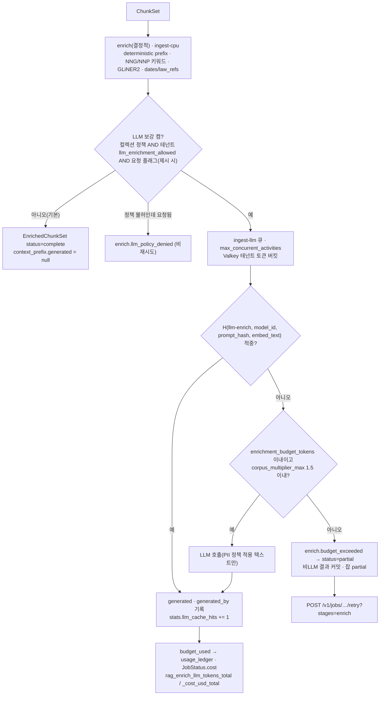

# ADR-0016: LLM 보강 기본 끔과 비용 정책(enrichment_budget_tokens)

## 맥락과 문제

브리프 D-19 원안은 청킹 기본에 "문맥 보강(contextual enrichment)"을 포함했고, 브리프 O-05는 "LLM 기반 보강(요약·가상 질문 생성)의 기본 켬/끔과 비용 정책"을 개방 결정으로 남겼다. 두 문장을 함께 읽으면 "문맥 보강 기본"이 LLM 요약을 뜻하는지가 모호해지고, LLM 요약으로 읽으면 O-05가 열려 있는 상태에서 기본값을 선점하는 충돌이 생긴다(07-tech-landscape/00 §브리프 수정 제안 D-19; 바이블 §3.1 D-19 `amended` 사유). 바이블은 이를 **결정적 `context_prefix`(기본 켬) + LLM 접두어·문서/섹션 요약(O-05 정책, 기본 끔)** 으로 분리해 해소했고(브리프 §4 D-19 개정 v1.1), 본 ADR은 그중 O-05 쪽 결정 — LLM 보강의 기본값과 비용 정책 — 을 근거·대안과 함께 기록한다.

연구 문서의 의견은 갈렸다. 10 문서(LLM 문맥 최적화)는 Anthropic Contextual Retrieval의 top-20 검색 실패율 감소(5.7% → 3.7% → 2.9% → 1.9%, 최대 -67%)와 문서 100만 토큰당 약 $1.02(프롬프트 캐싱 가정) 비용을 들어 "수집 시 1회 기본 켬"을 권고했다(10 §개방 결정 O-05). 04(청킹)·07(검색)·11(기존 플랫폼)·14(고급 RAG) 문서는 재현 연구의 비용(약 20GB VRAM 또는 $1.02/M 토큰)·문서 내 검색 저하 보고·비결정성(원칙 4)을 들어 "결정적 접두어만 켬, LLM 보강은 기본 끔"을 권고했다(04 §11·§O-05 의견; 11 §O-05: Onyx도 비LLM 보강이 기본이고 문서 요약 contextual RAG는 옵션; 14 §O-05: 그래프 인덱싱 약 14M 토큰/5M 토큰 코퍼스). 선정 매트릭스는 J-3에서 다수 의견(기본 끔)을 채택하고 승격 게이트를 09 문서 기준(nDCG@10 +0.03 이상 & 문서당 보강 비용 상한 이하)으로 정했다(07-tech-landscape/00 §문서 간 상충 판정 J-3, §개방 결정 권고 O-05).

설계 경쟁에서는 제안 B가 `premium` 프로파일에서 LLM 보강 기본 켬을, 제안 A가 `usage_ledger` 집계를 각각 제시했다. 바이블 §3.2 O-05는 B의 `premium` 기본 켬을 불채택하고(J-3 다수 의견, 원칙 4·7), B의 계약 구조(`context_prefix.generated_by`, `EnrichedChunkSet.budget_used`, `status: partial`)와 A의 `usage_ledger` 집계는 채택했다. 이 결정이 확정되어야 03-contracts/06(`EnrichedChunkSet`), 03-contracts/15(`CollectionSpec.policies`), 04-pipelines/11(보강), 02-architecture/06(큐·StagePolicy), 09-operations/02(설정)가 같은 필드·열거·기본값을 쓸 수 있다. 바이블 §15 리스크 #10(비용 폭주)의 완화 장치가 바로 이 정책이다.

## 결정 동인(decision drivers)

- **재현성(원칙 4, K5)**: 기본 수집 경로는 같은 입력에 같은 산출물을 내야 한다(브리프 §7 "동일 `IngestRequest` + 동일 프로파일 → 동일 `IndexCommit` 해시"). LLM 출력은 비결정적이므로 기본 경로에 두면 멱등성 키 = 캐시 키 = 산출물 경로 규칙(바이블 §4.1)이 약해진다(07-tech-landscape/00 J-3 근거).
- **평가 주도(원칙 7, §7.4)**: 모든 품질 기본값은 골든셋 게이트로 정당화된다. 한국어 문서 수준 골든셋이 아직 없고(바이블 §15 #1) Anthropic 수치는 자체 영어 평가셋이므로, 한국어 코퍼스에서 켬/끔 ablation을 통과하기 전에는 켤 근거가 없다(09 §O-05).
- **비용 상한(리스크 #10)**: LLM 보강·그래프·판정 LLM은 코퍼스 토큰의 수 배를 소비할 수 있고 증분 갱신에도 상한이 없다(14 §O-05). 켜더라도 테넌트·컬렉션·문서 단위 상한과 `partial` 종료가 있어야 한다.
- **비LLM 보강의 가치 보존(D-19, K2)**: 결정적 접두어(제목·heading 경로·캡션)는 비용 0으로 Contextual BM25 효과의 상당 부분을 얻고(04 §O-02 의견), GLiNER2 엔티티·형태소 키워드·날짜/조항 파생 메타는 필터·부스트의 원천이다. 이들은 LLM과 무관하게 항상 켜야 한다.
- **3-텍스트 규칙(K2)**: `context_prefix.deterministic`·`generated`는 `text`와 분리 저장되고 `embed_text`·`index_text`는 조립 결과이므로, LLM 접두어를 켜고 끄는 일이 `text`·`chunk_id`·인용 좌표를 바꾸지 않는다(바이블 §5.4 `Chunk` 불변식 (3)).
- **개인정보(원칙 9, E4)**: 외부 LLM API로 나가는 텍스트는 `pii_policy` 적용 후여야 하고, 외부 전송 자체가 테넌트의 명시 동의(옵트인) 사항이다(12 §O-05).
- **운영 격리(D-17, §11.2)**: LLM 호출은 외부 HTTP·장시간·장애 전파 위험이 있어 CPU 스테이지와 같은 큐에 두면 수집 처리량(브리프 §7)을 해친다. 별도 큐와 동시성 상한이 필요하다(08 §StagePolicy enrich(LLM)).
- **과금 관측(K6)**: 소비 토큰·비용은 원장(`usage_ledger`)과 메트릭으로 집계되어 테넌트 조회·알림이 가능해야 한다.

## 고려한 대안

### 대안 1 — 모든 프로파일에서 LLM 문맥 접두어 기본 켬(10 문서 권고, 바이블 기각)

- 설명: 수집 시 청크마다 1회 LLM으로 50~100 토큰 문맥 헤더를 생성해 임베딩·BM25 입력에 붙인다(Anthropic Contextual Retrieval 방식, 프롬프트 캐싱).
- 장점: 공개 수치가 강하다 — 문맥 임베딩만 -35%, 문맥 BM25 결합 -49%, 리랭킹 결합 -67%의 top-20 검색 실패율 감소(04 §11; 07 §Contextual Retrieval 행; 10 §O-05). 같은 헤더가 생성 단계의 출처·시점 판별에도 도움이 된다(10 §문맥 헤더).
- 단점: 비결정적 출력이 기본 경로에 들어와 원칙 4와 충돌한다. 재현 연구(Reconstructing Context)는 약 20GB VRAM 소요와 문서 내 검색 저하를 보고했다(04 §11, §O-05 의견). 비용은 문서 100만 토큰당 약 $1.02(캐싱 가정)로 코퍼스가 크면 선형 증가하며, 한국어 코퍼스에서의 이득은 미측정이다(09 §O-05). 매트릭스 J-3이 다수 의견으로 기각했고 바이블 §3.2 O-05가 "모든 프로파일 기본 끔"으로 확정했다.

### 대안 2 — `premium` 프로파일만 기본 켬(설계 제안 B, 바이블 기각)

- 설명: GPU·`ingest-llm` 워커를 갖춘 `premium`에서는 `generated_prefix.enabled: true`를 기본으로 두고, `lite`·`standard`·`korean-gov`는 끔.
- 장점: 인프라가 준비된 프로파일에서만 켜므로 비용 부담이 제한적이고, 운영자가 "품질 우선" 프로파일을 고르는 행위가 곧 동의라는 해석이 가능하다. B의 계약 구조(`generated_by`, `budget_used`, `status: partial`)는 그대로 유용하다.
- 단점: 프로파일 상속 체인 `base → lite → standard → premium`(바이블 §7)에서 `premium`만 기본이 달라지면 같은 컬렉션을 프로파일 간 이동할 때 `embed_text`가 바뀌어 재색인이 필요하고, 게이트 없는 품질 기본값이 하나 생긴다(§7.4 "품질 기본값은 게이트 없이 바뀌지 않는다"). 켜는 비용은 컬렉션 정책 값 하나이므로 기본을 보수적으로 두어도 잃는 것이 없다(J-3 근거). 바이블 §3.2 O-05가 "B의 `premium` 기본 켬 불채택(J-3 다수 의견, 원칙 4·7)"으로 기각했다. 구조만 채택: `premium`은 `enrichment_budget_tokens` 20,000을 미리 배정하되 `generated_prefix.enabled`는 `false`(바이블 §7.2).

### 대안 3 — LLM 보강 전면 금지(코어에서 제거, 바이블 기각)

- 설명: `enricher` 확장 지점에서 LLM 호출 플러그인을 코어 배포에서 빼고 결정적 보강만 남긴다.
- 장점: 비용·비결정성·PII 유출 경로가 원천 제거된다. 코어 이미지가 LLM 클라이언트 의존을 갖지 않는다.
- 단점: R4("모든 기술을 플러그인으로 수용")와 D-10 `enricher` 확장 지점의 취지에 어긋난다. Contextual Retrieval·RAPTOR 요약(`item_kind=summary`, ADR-0015)·그림 캡션·관계 추출은 고가치 컬렉션에서 검증된 옵션이며(14 §O-05), 매트릭스 `contextual_enricher` 행은 `context_prefix.generated`를 `contextual_llm` 프로파일·컬렉션 예산 정책으로 켜는 구성을 선정했다. 금지하면 O-05 ablation 자체를 하네스에서 수행할 수 없어 원칙 7과도 충돌한다.

### 대안 4 — 컬렉션 옵트인만 두고 예산 상한 없음(바이블 기각)

- 설명: `llm_enrichment_allowed`로 켬/끔만 제어하고, 토큰 예산·배수 상한·큐 분리는 두지 않는다.
- 장점: 계약·프로파일이 단순하다.
- 단점: 켜진 컬렉션의 대량 재색인·그래프 구축은 상한 없이 토큰을 소비한다(14 §O-05 "증분 갱신은 상한이 없으므로 예산 정책이 필요"). LLM 지연·장애가 `ingest-cpu` 큐를 점유해 비LLM 수집까지 느려진다. 바이블 §15 #10은 "O-05 기본 끔 + `enrichment_budget_tokens` + 토큰 버킷 + `partial`"을 완화 장치로 명시했다.

### 대안 5 — 채택: 비LLM 보강만 기본 켬, LLM 보강은 전 프로파일 기본 끔 + 컬렉션 정책·테넌트 옵트인 + 다층 비용 정책 + 승격 게이트

- 설명: 결정적 `context_prefix`, `ctx.analyzer`(Kiwi 또는 mecab-ko) NNG/NNP 키워드, GLiNER2 엔티티, 날짜·조항 파생 메타는 항상 켬. `generated_prefix`·`contextual_doc_summary`·`hypothetical_questions`는 `premium` 포함 모든 프로파일에서 끔이며, 컬렉션 정책과 테넌트 `llm_enrichment_allowed` 옵트인으로 켠다. 비용은 큐·워커·테넌트·컬렉션·문서 다섯 층으로 제한하고 초과 시 잡 `partial`로 종료한다. 켜기 승격은 ablation 게이트를 요구한다.
- 장점: 기본 경로가 결정적이고(원칙 4), 켜는 결정이 골든셋 근거를 갖고(원칙 7), 비용이 모든 층에서 상한을 갖는다(#10). 계약은 B의 구조를, 집계는 A의 원장을 그대로 쓴다.
- 단점: 켜기 전까지 Contextual Retrieval의 이득을 기본에서 얻지 못한다. `partial` 잡과 `retry?stages=enrich` 경로, 두 종류의 `enrich` StagePolicy가 운영 표면에 남는다. 아래 결과·준수 확인에서 다룬다.

## 결정

**결정:** 비LLM 보강만 기본 켬(결정적 `context_prefix`, 형태소 분석기(`ctx.analyzer`: Kiwi 또는 공백기 mecab-ko) NNG/NNP 키워드, GLiNER2 엔티티, 날짜·조항 파생 메타). **LLM 보강은 모든 프로파일 기본 끔**(`premium` 포함), 컬렉션 정책으로 켬. `contextual_doc_summary`(dsRAG AutoContext식 문서·섹션 1회 요약)를 저비용 기준선으로 병행 평가. 비용 정책: `ingest-llm` 큐 + `max_concurrent_activities` + Valkey 테넌트 토큰 버킷 + 컬렉션 `enrichment_budget_tokens` + 코퍼스 1.5배 상한 초과 시 잡 `partial`. 게이트 nDCG@10 +0.03 & 문서당 비용 상한 이하. 외부 LLM에는 PII 정책 적용 텍스트만, 테넌트 `llm_enrichment_allowed` 옵트인 — 바이블 §3.2 O-05 `resolved`. 청킹 측 문구는 브리프 §4 D-19(개정 v1.1) "문맥 보강 = 결정적 `context_prefix`(문서 제목·heading 경로·캡션, 기본 켬, 본문과 분리 저장) + LLM 접두어·문서/섹션 요약(O-05 정책, 기본 끔)"을 따른다. 관련 ADR: [ADR-0020 기본 청커](../06-adr/0020-default-chunker-structure-aware-and-dependency-locks.md), [ADR-0029 3-텍스트 규칙](../06-adr/0029-three-text-rule-and-deterministic-context-prefix.md), [ADR-0015 GraphRAG/RAPTOR](../06-adr/0015-graph-rag-external-plugin-raptor-core-option.md), [ADR-0031 프로파일 게이트](../06-adr/0031-profile-schema-extends-and-quality-gates.md).

계약·프로파일 요소는 바이블의 철자를 그대로 쓴다.

| 요소 | 정본 값 | 바이블 |
|------|---------|--------|
| 기본 켬 보강기(`ingest.enrich.deterministic`) | `enricher.deterministic_prefix`, `enricher.korean_keywords`(`ctx.analyzer` 위임, `KeywordSource` `analyzer_nng`/`analyzer_nnp`), `enricher.gliner2_entities`(`EntityExtractor` `gliner2`), `enricher.derived_meta`(`Enrichment.dates`, `law_refs`) | §5.4 `Enrichment`, §5.7, §7.3 |
| LLM 보강기(기본 끔) | `generated_prefix: {enabled: false, plugin: enricher.llm_context_prefix, gate: {metric: ndcg@10, min_delta: 0.03, max_cost_per_doc_usd: 0.05}}`, `contextual_doc_summary: {enabled: false, plugin: enricher.doc_summary_autocontext}`; `hypothetical_questions`는 옵션이며 `index_text`에만 부착(`embed_text`·`text` 미포함) | §5.4 `Enrichment`, §7.3 |
| 프로파일 기본값(`ingest.enrich.generated_prefix.enabled` / `enrichment_budget_tokens` / `corpus_multiplier_max`) | `lite` false / 0 / 1.5 · `standard` false / 0 / 1.5 · `premium` **false**(컬렉션 옵트인) / 20,000 / 1.5 · `korean-gov` false / 0 / 1.5(LLM은 온프레미스 Qwen3만, 외부 API 테넌트 옵트인) | §7.1, §7.2 |
| 켬 조건(모두 AND) | `CollectionSpec.policies.llm_enrichment_allowed` ∧ `tenants.policies.llm_enrichment_allowed` ∧ `IngestRequest.llm_enrichment_allowed`(선택 필드; 제시되면 그 값이 AND 항으로 추가되고, 생략되면 이 항은 조건에 참여하지 않는다 — 요청 플래그는 컬렉션·테넌트 정책을 덮어쓰지 못하며 좁히기만 한다, 바이블 §5.4 "외부 LLM 보강 옵트인(테넌트 정책과 AND)"). 예산 값은 `CollectionSpec.policies{enrichment_budget_tokens, corpus_multiplier_max}`. 요청 `profile_overrides`는 허용 키 `enrich.generated_prefix`만. 불허 상태에서 LLM 보강 요청 → `enrich.llm_policy_denied`(비재시도) | §5.4 `IngestRequest`, §5.6 `CollectionSpec`, §5.7, §13.1 `tenants` |
| 큐·정책 | `enrich(결정적)`: `ingest-cpu`, 5m/60s/3회 · `enrich(LLM)`: `ingest-llm`(`runtime.queues.enrich_llm`), 30m/60s/5회(최대 간격 5m), `resumable` `heartbeat_details.chunk_offset`; 워커 `max_concurrent_activities` 고정 슬롯 | §4.4, §7.3, §11.2 |
| 예산 초과 | `enrich.budget_exceeded` → `EnrichedChunkSet.status=partial`, 비LLM 결과는 커밋, 잡 `JobState` `partial`, `POST /v1/jobs/{job_id}/retry?stages=enrich`로 재개 | §4.2, §11.3, §11.5, §14 |
| 캐시 | 결정적: `stage_key = H("stage","enrich", scope_key, chunk_set.blake3, fingerprint)`; LLM: 청크 단위 `H("llm-enrich", model_id, prompt_hash, embed_text)`(봉투 없음, 재청킹·타 컬렉션에도 테넌트 내 재사용) | §4.1, §4.2, §6.2 |
| 기록·집계 | `Chunk.context_prefix.generated`(기본 null)·`generated_by`(`{model_id}@{revision}`); `EnrichedChunkSet.budget_used{provider, model_id, llm_tokens_in, llm_tokens_out, cost_usd, calls, budget_remaining_tokens}` → `usage_ledger(tenant_id, day, meter)`; `JobStatus.cost{llm_tokens_in, llm_tokens_out, cost_usd, gpu_seconds}`; `IndexCommit.stats.llm_tokens`; 메트릭 `rag_enrich_llm_tokens_total`, `rag_enrich_llm_cost_usd_total`(`tenant_id` 라벨 금지) | §5.4, §5.6, §6.5, §13.1, §14 `GET /v1/tenants/{tenant_id}/usage` |
| 개인정보 | LLM 입력은 `NormalizedDocument` 단계에서 `pii_policy`가 적용된 텍스트(`ChunkSet.pii_policy_applied`)만; 트레이스 콘텐츠 캡처 기본 끔 | §10.3 E4·E13 |



`EnrichedChunkSet` 일부 예시(예산 소진으로 `partial` 종료; 모델 식별자·수치는 형식 예시):

```json
{
  "status": "partial",
  "budget_used": {
    "provider": "vllm",
    "model_id": "<llm-repo>@<revision>",
    "llm_tokens_in": 18400,
    "llm_tokens_out": 1600,
    "cost_usd": 0.021,
    "calls": 37,
    "budget_remaining_tokens": 0
  },
  "stats": {
    "chunks_enriched": 120,
    "llm_cache_hits": 14,
    "entities_total": 310
  }
}
```

## 결과

### 긍정

- 기본 수집 경로가 결정적이다. 같은 `ChunkSet`과 같은 `enricher_fingerprint`는 같은 `EnrichedChunkSet`을 내고, `stage_key` 캐시 적중이 품질 회귀 없이 성립한다(바이블 §4.1, §15 #8). "문맥 보강 기본"의 LLM 해석으로 인한 O-05 충돌이 사라진다(D-19 `amended`).
- 비용이 다섯 층(큐 분리 → 워커 동시성 → 테넌트 토큰 버킷 → 컬렉션 예산 → 문서 배수 1.5)에서 상한을 갖고, 초과는 실패가 아니라 `partial`이다. 비LLM 결과는 커밋되므로 검색은 즉시 가능하고, LLM 접두어는 `retry?stages=enrich`로 뒤늦게 채울 수 있다(바이블 §11.3 `partial` 분류).
- 결정적 접두어가 `embed_text`·`index_text`에 항상 들어가므로 Contextual BM25 효과의 일부(제목·heading 경로 매칭)를 비용 0으로 얻는다(04 §O-02 의견). GLiNER2 엔티티·형태소 키워드·날짜/조항 메타는 필터·부스트(`BoostKind` `entity`·`recency`, `FilterableField` `entity_ids`·`doc_date`)의 원천으로 남는다.
- LLM 접두어를 켜고 끄는 일이 `text`·`chunk_id`·`block_refs`·인용 좌표를 바꾸지 않는다(K2). 바뀌는 것은 `embed_text`와 그 파생(`embedding`, `commit_hash`)뿐이다.
- 청크 단위 `H("llm-enrich", …)` 캐시가 봉투 없이 테넌트 내 공유되므로 재청킹·컬렉션 이동·재색인에서 같은 `embed_text`의 LLM 출력을 다시 사지 않는다(바이블 §4.2). `budget_used → usage_ledger` 집계로 테넌트 과금·알림(`GET /v1/tenants/{tenant_id}/usage`)이 가능하다.
- 게이트 형식이 프로파일 공통(`gate{metric, min_delta, dataset, max_cost_per_doc_usd}`, §7.4)이므로 O-05 승격이 다른 품질 기본값과 같은 절차(하네스 `EvalReport.gate_result.passed` + ADR 개정)를 따른다.

### 부정

- 기본 배포는 Anthropic이 보고한 top-20 실패율 감소(-35~-67%)를 얻지 못한다. 고가치 컬렉션마다 운영자가 ablation을 돌리고 정책을 켜야 하며, 이는 한국어 골든셋(§15 #1)이 준비된 뒤에야 가능하다.
- `enrich`가 두 개의 `StagePolicy`(`ingest-cpu` 결정적 / `ingest-llm` LLM)로 나뉘어 프로파일 `runtime.queues`에 `enrich`·`enrich_llm` 두 키가 있고, 워크플로우 `ingest.document.v1`의 `stage.enrich`가 내부적으로 두 액티비티로 실행된다. 셸 코드와 대시보드가 이 분기를 안다.
- `partial`은 성공도 실패도 아닌 제3 상태다. 클라이언트는 `JobState` `partial`과 `EnrichedChunkSet.status`를 해석해야 하고, 재시도 경로(`retry?stages=enrich`)가 API·런북에 남는다.
- 컬렉션 정책으로 LLM 보강을 켜면 `policy_hash` → `enricher_fingerprint` → `embed_text`가 바뀌어 해당 컬렉션은 `enrich`부터 재실행·재임베딩된다(`PATCH /v1/collections/{collection_id}` 정책 변경 → blue/green, 바이블 §14). 끄는 방향도 같다.
- 외부 LLM API를 쓰는 테넌트는 PII 정책 적용 후 텍스트라도 문서 본문이 외부로 나간다. 옵트인이 곧 데이터 반출 동의이므로 `korean-gov`는 온프레미스 Qwen3만 기본이다(§7.1).

### 중립

- 게이트 값 `min_delta: 0.03`·`max_cost_per_doc_usd: 0.05`와 `corpus_multiplier_max: 1.5`는 초안 목표다(바이블 §범위 "실측 전 값은 모두 초안 목표"). 변경은 §1.2 minor 절차(ADR + 게이트 근거)를 따른다.
- `contextual_doc_summary`(문서·섹션 1회 요약, `Enrichment.summary`)는 청크마다 호출하는 `generated_prefix`보다 호출 수가 적은 저비용 기준선으로 병행 평가하며(04 §11 dsRAG AutoContext), 둘 중 어느 것도 기본으로 승격되지 않았다.
- Valkey 테넌트 토큰 버킷의 리필 속도·용량 산정과 `corpus_multiplier_max`의 분모(문서 토큰의 토크나이저·범위) 정의는 본 ADR이 정하지 않는다. 04-pipelines/11과 09-operations/02가 확정하되, 초과 시 동작(`enrich.budget_exceeded` → `partial`)과 집계 필드는 위 표에 고정된다.
- `hypothetical_questions`·proposition 계열은 04 §13이 코어 옵션에서 제외하고 플러그인 `enricher` 자리만 남겼으므로, 본 결정의 예산·큐·옵트인 규칙이 그대로 적용되고 계약은 `index_text` 부착만 허용한다.
- 그래프 인덱싱(`build.graph.v1`)·RAPTOR 요약도 `ingest-llm` 큐와 `enrichment_budget_tokens` 정책을 공유한다(바이블 §3.2 O-03, §11.2). 별도 예산 필드를 두지 않는다.

## 준수 확인 방법

| 강제 수단 | 내용 | 위치·근거 |
|-----------|------|-----------|
| 프로파일 로딩 검증 | `rag profile validate`: `ingest.enrich.generated_prefix`·`contextual_doc_summary`는 `gate` 형식 값이며, `enabled: true`로 바꾼 프로파일은 `EvalReport.gate_result.passed`(같은 `dataset`, `min_delta` 충족, 문서당 비용 ≤ `max_cost_per_doc_usd`) 없이는 `profile.invalid`; `budget.queue`는 `ingest-llm`이고 `runtime.queues.enrich_llm`과 일치; `korean-gov`에서 외부 LLM 플러그인은 테넌트 옵트인 없이 로드 불가 | 바이블 §7.3, §7.4; [프로파일·정책 계약](../03-contracts/15-collection-profile-and-policy-contracts.md), [설정 레퍼런스](../09-operations/02-configuration-reference.md) |
| 스키마 제약 | `EnrichStatus` = `complete, partial`; `EnrichedChunkSet.status`·`budget_used`(7키 모두)·`stats.llm_cache_hits` 필수; `Chunk.context_prefix.generated`·`generated_by` nullable 필수(기본 null); `Enrichment.hypothetical_questions`·`summary` 선택(N); `CollectionSpec.policies`에 `llm_enrichment_allowed`·`enrichment_budget_tokens`·`corpus_multiplier_max` 포함; `IngestRequest.profile_overrides`는 허용 키 외 422. 열거·오류 코드·메트릭 이름은 §5.7 표와 CI 기계 대조 | 바이블 §1.2, §5.4, §5.6, §5.7; [EnrichedChunkSet](../03-contracts/06-enriched-chunk-set.md), [ChunkSet](../03-contracts/05-chunk-set.md), [IngestRequest](../03-contracts/01-ingest-request.md) |
| 정책 강제 테스트 | (a) 테넌트 `llm_enrichment_allowed=false` + 컬렉션 켬 → `enrich.llm_policy_denied`, LLM 호출 0건, 잡 `failed`가 아닌 계약대로 종료 (b) 전 프로파일 기본값으로 수집 → `budget_used.calls=0`, `generated=null`, `status=complete` (c) 예산을 소진하도록 구성 → `enrich.budget_exceeded`, `status=partial`, `IndexCommit` `committed`(비LLM 결과), `JobState` `partial`, `retry?stages=enrich` 후 `complete` | 바이블 §4.2, §11.3, §11.5; [테스트 전략](../10-development/04-testing-strategy.md), [잡·이벤트 계약](../03-contracts/12-jobs-events-and-status.md) |
| 큐 격리 | `enrich(LLM)` 액티비티는 `ingest-llm` 워커에서만 실행되고 `ingest-cpu` 워커 이미지에는 LLM 클라이언트 호출 경로가 없다(import-linter 계층 규칙 + 큐 라우팅 테스트); `max_concurrent_activities`는 프로파일 값이며 리소스 튜너와 상호 배타 | 바이블 §4.4, §11.2, §12; [오케스트레이션](../02-architecture/06-orchestration-and-workflows.md) |
| 개인정보 경계 | LLM 요청 본문에 `pii_policy` 적용 전 텍스트가 없음을 확인하는 계약 테스트(마스킹 전 표본 문자열 부재); 외부 엔드포인트 호출은 테넌트 정책 `llm_enrichment_allowed=true`일 때만; 스팬에 프롬프트·응답 본문 미기록(E13) | 바이블 §10.3 E4·E13; [보안·컴플라이언스](../09-operations/05-security-and-compliance.md) |
| 캐시·멱등성 | LLM 캐시 키는 `H("llm-enrich", model_id, prompt_hash, embed_text)` 단일 구현; 같은 `embed_text`를 두 컬렉션이 보강하면 두 번째는 `llm_cache_hits`로 계수되고 LLM 호출 0건; `model_id` 또는 `prompt_hash` 변경 시 미스. 적합성 키트 `idempotency`에 포함 | 바이블 §4.1, §6.2, ADR-0032, ADR-0037 |
| 계량 일치 | 잡 종료 시 `EnrichedChunkSet.budget_used.llm_tokens_in + llm_tokens_out` = `JobStatus.cost` 증분 = `usage_ledger(meter=llm_tokens)` 일자 증분 = `rag_enrich_llm_tokens_total` 증분(허용 오차 0); 메트릭 라벨에 `tenant_id` 없음 | 바이블 §5.6, §6.5, §13.1; [관측성](../09-operations/03-observability.md) |
| 골든셋 게이트 | 컬렉션 켬 요청은 하네스 ablation(끔 vs `generated_prefix` vs `contextual_doc_summary`, 동일 `profile_hash` 외 조건 고정)에서 nDCG@10 +0.03 이상(Holm 보정 p<0.05)과 문서당 비용 ≤ 0.05 USD(초안 목표)를 동시에 만족해야 한다 | 바이블 §3.2 O-05, §7.4; [리트리벌 메트릭·하네스](../08-evaluation/02-retrieval-metrics-and-harness.md), [벤치마크 계획](../08-evaluation/05-benchmark-plan-and-baselines.md) |
| 코드 리뷰 항목 | (1) 새 `enricher` 플러그인이 LLM을 호출하면 `PluginMeta.model_ids`를 선언하고 `ingest-llm` 정책을 요구하는가 (2) `context_prefix.generated`가 non-null이면 `generated_by`가 채워지는가 (3) `hypothetical_questions`를 `embed_text`·`text`에 넣지 않는가 (4) 예산 초과를 예외(`failed`)로 올리지 않고 `partial`로 내리는가 (5) `enrichment_budget_tokens`·`corpus_multiplier_max`가 컬렉션 정책 값이며 코드 상수가 아닌가 (6) 프롬프트 변경이 `prompt_hash` 변경으로 이어지는가 | [CI/CD](../10-development/05-ci-cd.md), [보강 파이프라인](../04-pipelines/11-enrichment.md) |

## 재검토 조건

- 한국어 골든셋(바이블 §15 #1, D-12) ablation에서 `generated_prefix` 또는 `contextual_doc_summary`가 다수 컬렉션·다수 장르에서 nDCG@10 +0.03 이상과 문서당 비용 ≤ 0.05 USD를 동시에 만족하면, `premium`(또는 `contextual_llm` 파생 프로파일)의 기본값 승격을 ADR 개정으로 검토한다. 그 경우에도 `lite`·`standard`·`korean-gov` 기본은 유지한다.
- 온프레미스 LLM(`ingest-llm` GPU 워커, Qwen3 계열)에서 문서당 비용이 GPU 초 단위로만 발생해 `max_cost_per_doc_usd` 게이트가 무의미해지면 게이트 지표를 `gpu_seconds` 기준으로 보완하는 개정을 검토한다(`JobStatus.cost.gpu_seconds`, `usage_ledger` `gpu_seconds` 미터 활용).
- `contextual_doc_summary` 기준선이 `generated_prefix`와 동등한 이득을 더 낮은 호출 수로 낸다는 결과가 나오면 켜기 권고 순서와 `premium` 예산 기본값(20,000)을 재산정한다.
- Valkey 토큰 버킷·`corpus_multiplier_max` 실측(04-pipelines/11, 09-operations/04)에서 1.5배 상한이 정상 문서를 자주 `partial`로 보내거나 반대로 상한 역할을 못 하면 값을 §1.2 minor 절차로 조정한다.
- Anthropic Contextual Retrieval의 한국어 재현 결과(문서 내 검색 저하 여부 포함)가 공개되거나 자체 측정되면 대안 1의 근거를 재평가한다.
- `hypothetical_questions`·proposition 플러그인이 한국어 골든셋에서 `index_text` 부착만으로 유의한 이득을 보이면 코어 옵션 편입(계약 변경 없음)을 검토한다(04 §13).
- 테넌트 옵트인 없이도 안전한 LLM 경로(테넌트 전용 온프레미스 엔드포인트, egress 정책 E16 내부)가 표준화되면 `llm_enrichment_allowed`의 의미를 "외부 API 옵트인"으로 좁히는 개정을 검토한다.

## 참조

- [설계 브리프](../00-vision/00-design-brief.md) §3 원칙 4·7·9, §4 D-10·D-17·D-19(개정 v1.1), §5 O-05, §7 재현성·보안
- [설계 바이블](../02-architecture/00-design-bible.md) §2.1 K2·K5·K6, §3.1 D-19, §3.2 O-03·O-05, §3.3 0016 행, §4.1, §4.2 `enrich` 행, §4.4 `enrich(결정적)`·`enrich(LLM)`, §5.1, §5.4 `IngestRequest`·`Chunk`·`EnrichedChunkSet`·`Enrichment`, §5.6 `JobStatus`·`CollectionSpec`·`Profile`, §5.7 `KeywordSource`·`EntityExtractor`·`EnrichStatus`·`JobState`·오류 카탈로그 `enrich.*`, §6.2 `enricher_fingerprint`·LLM 보강 캐시, §6.5 메트릭, §7.1 청킹·보강 행, §7.2, §7.3 `ingest.enrich`, §7.4, §10.3 E4·E13, §11.2, §11.3, §11.5, §13.1 `tenants`·`jobs`·`usage_ledger`, §14, §15 #1·#8·#10
- [기술 지형 종합: 선정 매트릭스](../07-tech-landscape/00-summary-and-selection-matrix.md) §문서 간 상충 판정 J-3, §매트릭스 `contextual_enricher`·`pii_detector` 행, §프로파일별 기본 조합 청킹·그래프·LLM 행, §개방 결정 권고 O-05, §브리프 수정 제안 D-19, §ADR 발의 목록 P3, §계약 제안 `IngestRequest`·`EnrichedChunkSet`, §종합 리스크 #10
- [청킹 전략·라이브러리](../07-tech-landscape/04-chunking-strategies-and-libraries.md) §11 Anthropic Contextual Retrieval, §13 Proposition, §비용 표, §리스크(LLM 문맥 접두어 비용 폭증), §개방 결정 O-05·O-02 의견
- [검색 기법·융합·리랭킹](../07-tech-landscape/07-retrieval-techniques-fusion-reranking.md) §Contextual Retrieval 행, §O-05 의견(질의 측 LLM은 `default` 끔)
- [오케스트레이션·메시징·API](../07-tech-landscape/08-orchestration-messaging-and-api-frameworks.md) §StagePolicy `enrich(LLM)` 행
- [평가·관측성](../07-tech-landscape/09-evaluation-and-observability.md) §O-05 의견(ablation·채택 기준), `rag_enrich_llm_tokens_total`
- [LLM 문맥 최적화·MCP](../07-tech-landscape/10-llm-context-optimization-and-mcp.md) §문맥 헤더 근거·비용, §O-05 의견(기본 켬 권고 — J-3에서 소수 의견)
- [기존 RAG 플랫폼 격차 분석](../07-tech-landscape/11-existing-rag-platforms-gap-analysis.md) §문맥 보강 패턴(Onyx), §O-05
- [보안·멀티테넌시·PII·라이선스](../07-tech-landscape/12-security-multitenancy-pii-and-licensing.md) §O-05(PII 정책 적용 텍스트·`llm_enrichment_allowed`)
- [고급 RAG](../07-tech-landscape/14-advanced-rag-graph-raptor-agentic-multimodal.md) §O-05 권고(예산·배수 상한·`partial`), RAPTOR·그래프 비용
- 관련 ADR: [ADR-0001 라이선스 등급표](../06-adr/0001-license-grade-table-and-d02-interpretation.md), [ADR-0003 LocalRunner](../06-adr/0003-orchestrator-neutral-pipeline-and-non-durable-local-runner.md), [ADR-0015 GraphRAG/RAPTOR](../06-adr/0015-graph-rag-external-plugin-raptor-core-option.md), [ADR-0017 이벤트 전달](../06-adr/0017-event-delivery-outbox-cloudevents-no-broker.md), [ADR-0020 기본 청커](../06-adr/0020-default-chunker-structure-aware-and-dependency-locks.md), [ADR-0021 한국어 분석기](../06-adr/0021-korean-analyzer-kiwi-promotion-and-interim-mecab-kss.md), [ADR-0023 평가 하네스](../06-adr/0023-evaluation-qrels-answer-spans-and-linear-ndcg.md), [ADR-0027 SecurityContext](../06-adr/0027-security-context-injection-and-acl-enforcement-points.md), [ADR-0029 3-텍스트 규칙](../06-adr/0029-three-text-rule-and-deterministic-context-prefix.md), [ADR-0031 프로파일 게이트](../06-adr/0031-profile-schema-extends-and-quality-gates.md), [ADR-0032 적합성 키트](../06-adr/0032-plugin-sdk-stage-protocol-and-conformance-kit.md), [ADR-0037 산출물 캐시 스코프](../06-adr/0037-artifact-cache-scope-and-stage-key-composition.md)
- 계약·파이프라인·운영 문서: [EnrichedChunkSet](../03-contracts/06-enriched-chunk-set.md), [ChunkSet](../03-contracts/05-chunk-set.md), [IngestRequest](../03-contracts/01-ingest-request.md), [잡·이벤트·상태](../03-contracts/12-jobs-events-and-status.md), [프로파일·정책 계약](../03-contracts/15-collection-profile-and-policy-contracts.md), [보강 파이프라인](../04-pipelines/11-enrichment.md), [오케스트레이션](../02-architecture/06-orchestration-and-workflows.md), [관리 API](../05-api/04-management-api.md), [설정 레퍼런스](../09-operations/02-configuration-reference.md), [관측성](../09-operations/03-observability.md), [보안·컴플라이언스](../09-operations/05-security-and-compliance.md), [리트리벌 메트릭·하네스](../08-evaluation/02-retrieval-metrics-and-harness.md)
