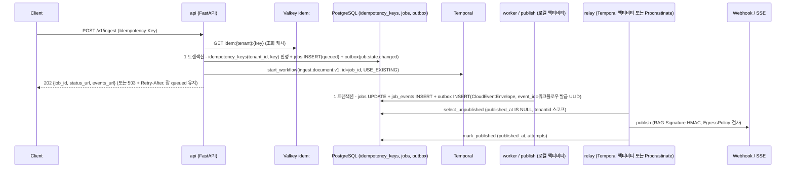

# ADR-0017: 이벤트 전달: 브로커 없는 v1(아웃박스 + CloudEvents), 테넌트 스코프 멱등 키, NATS 추가 조건

> MADR(Markdown Architectural Decision Record) 형식. 바이블 §3.3 표의 0017행(slug `event-delivery-outbox-cloudevents-no-broker`, P2)이며 관련 결정은 개방 결정 O-06(바이블 §3.2 `resolved`)과 브리프 확정 결정 D-08(브리프 §4 개정 v1.1, 바이블 §3.1 `amended`)이다. 이 ADR은 바이블의 결정을 근거·대안과 함께 기록하고 바이블 표를 바꾸지 않는다(바이블 §1.1). 웹훅 HMAC 서명과 아웃바운드 egress는 [ADR-0038](./0038-outbound-egress-policy-and-webhook-signing.md), 오케스트레이터 중립 셸은 [ADR-0003](./0003-orchestrator-neutral-pipeline-and-non-durable-local-runner.md), `IndexCommit` 원장과 `commit_id`·`event_id` 발급은 [ADR-0026](./0026-index-commit-generation-saga-and-ledger.md), Valkey의 책임 경계는 [ADR-0011](./0011-kv-and-object-storage-valkey-rustfs-seaweedfs.md)이 다룬다.

## 맥락과 문제

브리프 v1.0의 D-08은 "수집은 비동기 잡, `POST /v1/ingest`는 `Idempotency-Key` 필수, 동기 응답 `202 {job_id, status_url, events_url}`, 상태 전이는 웹훅·SSE(Server-Sent Events)로 통지"까지만 적었고, 잡 상태의 조회 정본(읽기 모델), 멱등 키의 스코프·판정 저장소, 오케스트레이터 불가 시 조정(reconcile) 절차가 비어 있었다(설계 제안 A §6 D-08 지적; 바이블 §3.1 D-08 `amended` 사유). 개방 결정 O-06은 "Temporal 시그널만으로 충분한가, NATS/Kafka를 추가하는가"를 물었다. 기술 지형 조사에서 다음 사실이 확정되었다.

| # | 사실 | 출처 |
|---|------|------|
| F1 | 이벤트 버스 일반 점수표(가중 합): PostgreSQL 아웃박스 4.55 > Redis Streams(Valkey) 4.25 > Kafka 4.20 > NATS JetStream 4.00 > RabbitMQ 3.90. 브로커를 반드시 추가하는 조건의 점수표: NATS 4.15 > Kafka 자체 운영 4.05; 조직 표준 클러스터 재사용 시 Kafka 4.50·Pulsar 4.35가 NATS를 앞선다. Redpanda(BSL 1.1)는 D-02 위배로 제외 | 08 문서 §선정 근거 점수표, 매트릭스 `event_bus` 행 |
| F2 | CloudEvents 스펙 v1.0.2(CNCF 졸업, Apache-2.0). Python SDK 2.x(`cloudevents>=2.2,<3`)는 `cloudevents.core.*`로 재작성되어 Pydantic 통합이 없으므로 봉투 모델은 자체 Pydantic v2 `CloudEventEnvelope`로 정의하고 SDK는 HTTP 바인딩 경계에서만 쓴다 | 08 문서 §이벤트·메시징, §결정 사항 요약 |
| F3 | `Idempotency-Key` 헤더는 draft-ietf-httpapi-idempotency-key-header-07(2025-10-15, 만료 상태이나 관행으로 안정): 키 누락 400, 같은 키에 다른 지문 422, 처리 중 재시도 409, 완료 후 재시도는 저장된 응답 재전송; 서버 측 복합 키를 권고 | 08 문서 §D, §API 프레임워크와 HTTP 규약 |
| F4 | 경량 프로파일의 부수 작업 큐 1순위는 Procrastinate 3.9(MIT, PostgreSQL 단독 `LISTEN/NOTIFY` + `SKIP LOCKED`). 릴레이 구현이 Temporal 액티비티와 Procrastinate 태스크로 갈라지므로 코어를 순수 함수 `select_unpublished → publish → mark_published`로 두고 두 실행기가 감싼다 | 매트릭스 `task_queue_light` 행, 08 문서 미해결 이슈 7 |
| F5 | 감사 로그·ACL 갱신 이벤트는 손실 불가·순서 보장이 필요해 Temporal 시그널만으로는 부족할 수 있고, 규제 프로파일에는 NATS JetStream을 조건부 권고. 개인정보 안전성 확보조치 기준상 접속기록 보존 1년(조건부 2년) | 12 문서 §3.5 감사 로그, §개방 결정 O-06 의견 |
| F6 | 관측성 신호(OTLP 트레이스·메트릭·로그)와 도메인 이벤트(웹훅·상태 전이·피드백)는 분리한다 | 매트릭스 `event_bus` 행(09 문서 인용) |
| F7 | Valkey는 캐시·힌트·핸들만 갖고 정확성에 관여하는 상태(멱등 판정·ACL 정본·잡 상태)는 PostgreSQL에 둔다 | 바이블 §2.3 Valkey 행, ADR-0011 |

따라서 결정할 질문은 다섯이다. (1) 도메인 이벤트를 어떤 봉투·저장·전달 경로로 내보내는가, (2) 제어(취소·우선순위·진행률)와 도메인 이벤트를 어떻게 나누는가, (3) `Idempotency-Key`의 스코프와 판정 정본은 무엇인가, (4) 잡 상태의 조회 정본과 Temporal 불가 시 조정 절차는 무엇인가, (5) 브로커(NATS JetStream)는 언제 추가하는가.

## 결정 동인(decision drivers)

| 동인 | 출처 | 함의 |
|------|------|------|
| Pure Stages, Durable Orchestration — 상태·재시도는 오케스트레이터, 정본은 원장 | 브리프 §3 원칙 3, 바이블 §2.1 K6 | 잡 상태·이벤트의 진실은 PostgreSQL 원장(`jobs`, `outbox`)이고 Temporal은 실행 엔진이다 |
| 수집 at-least-once + 멱등 | 브리프 §7 가용성 행, 원칙 4 | 이벤트는 중복 전달이 허용되고 소비자가 `event_id`로 멱등해야 한다; 수집 요청은 재전송이 안전해야 한다 |
| 멀티테넌시 1급, 교차 테넌트 누출 방지 | 브리프 §3 원칙 9, D-09, 바이블 §10.3 E12·E17, §15 리스크 3 | 멱등 키·이벤트·구독은 모두 테넌트 스코프여야 한다 |
| 저장소는 D-14 안에서(PostgreSQL·오브젝트 스토리지·Valkey) — 인프라 추가 금지 | D-14, 바이블 §2.3, 매트릭스 `event_bus`·`task_queue_light` | 브로커 없이 PostgreSQL 아웃박스로 시작한다 |
| 두 실행기, 하나의 정의(`LocalRunner`에는 Temporal이 없다) | D-17, ADR-0003, 바이블 §11.1 | 이벤트 경로는 오케스트레이터에 의존하면 안 되므로 시그널은 도메인 이벤트가 될 수 없다 |
| 라이선스 A 등급 우선 | D-02, ADR-0001 | CloudEvents·NATS·Kafka·Procrastinate(Apache-2.0/MIT)만 후보, Redpanda(BSL) 제외 |
| 표준 우선(HTTP 규약) | 바이블 §14, 매트릭스 `api_framework` | CloudEvents 1.0.2, RFC 9457, `Idempotency-Key` draft-07 의미론 |
| 콘텍스트 본문은 이벤트에 싣지 않는다 | 바이블 §5.1 `CloudEventEnvelope` 한계 열, §10.3 E12·E13 | `data`는 ID·해시·상태만(64KB) |
| 검색 핫패스는 PostgreSQL·오케스트레이터 미경유 | ADR-0034, 바이블 §11.1 | 아웃박스·릴레이 장애는 수집 통지만 지연시키고 리트리벌에 영향이 없어야 한다 |
| 규제 프로파일의 감사 스트림 보존 | 12 문서 §3.5, 바이블 §13.1 `audit_log` 행, §7.2 | `korean-gov`의 손실 불가·2년 보존은 브로커 추가 조건으로 명시한다 |

## 고려한 대안

| # | 대안 | 판정 | 근거 요약 |
|---|------|------|-----------|
| A | NATS JetStream 또는 Kafka를 v1에 도입 | 기각(조건부 재검토) | 일반 점수표에서 아웃박스 4.55가 1위; D-14 외 인프라 추가; 외부 소비자·재생 요구가 아직 없다 |
| B | Temporal 시그널/업데이트/쿼리만으로 도메인 이벤트 대체 | 기각 | 시그널은 워크플로우 내부 제어이며 외부 전달·재생·감사가 없다; `LocalRunner`에는 Temporal이 없다 |
| C | 글로벌 스코프 멱등 키(`key` 단독 유일) | 기각 | 테넌트 간 키 충돌이 409/422 오응답·선점 공격·정보 누출이 된다; draft-07은 서버 측 복합 키를 권고 |
| D | Valkey를 멱등 판정 정본으로 | 기각 | 축출·TTL·장애 시 중복 수집; `jobs` INSERT와 원자적이지 않다; Valkey는 정확성에 관여하지 않는다(F7) |
| E | Redis Streams(Valkey) 이벤트 버스 / CDC 릴레이(Debezium·Sequin) | 기각(폴백·후속) | 일반 2위지만 재생이 `MAXLEN`에 의존; CDC는 NATS/Kafka 도입 시점에 함께 결정 |
| F | CloudEvents 봉투 + PostgreSQL 트랜잭셔널 아웃박스 + 릴레이(웹훅·SSE), 테넌트 스코프 멱등 키, NATS 조건부 | **채택** | 세 설계 제안(A·B·C) 동일, 매트릭스 O-06 권고와 일치 |

### 대안 A: NATS JetStream / Kafka v1 도입(기각)

- 설명: 도메인 이벤트를 처음부터 브로커 스트림에 발행하고 웹훅·SSE는 브로커 소비자로 구현한다.
- 장점: 컨슈머별 오프셋·재생·보존 정책이 내장된다(NATS: 스트림 보존 limits/interest/work-queue, `Nats-Msg-Id` 중복 창 기본 `2m0s`; Kafka: 오프셋·멱등 프로듀서). 외부 소비자가 많아질 때 팬아웃 비용이 플랫폼에 남지 않는다.
- 단점: D-14 밖의 인프라(NATS 단일 바이너리라도 3노드 권장, Kafka KRaft 브로커 3+ + 스키마 레지스트리)를 모든 프로파일이 운영해야 한다. `lite`의 5분 기동(바이블 §11.6)과 충돌한다. 일반 점수표에서 운영 항목이 낮아(Kafka 2, NATS 4 대 아웃박스 5) 총점이 뒤진다(F1). 트랜잭셔널 아웃박스 없이는 상태 갱신과 발행이 원자적이지 않아 결국 아웃박스가 다시 필요하다.
- 판정: 기각. 브로커 추가는 아래 재검토 조건 (a)·(b)·(c)에서만 ADR로 다루며, 그 경우 순위는 조건부 점수표(NATS 4.15; 조직 표준 클러스터가 있으면 Kafka 4.50·Pulsar 4.35 우선, Dapr 표준 조직은 Dapr pub/sub)를 따른다. 봉투를 CloudEvents로 고정하므로 도입 시 바뀌는 것은 릴레이의 목적지만이다(08 문서 §개방 결정 O-06).

### 대안 B: Temporal 시그널·업데이트·쿼리만으로 도메인 이벤트 대체(기각)

- 설명: 상태 전이 통지를 워크플로우 시그널/쿼리로 노출하고 API가 `handle.query(get_status)`로 읽어 SSE로 흘린다.
- 장점: 추가 테이블·릴레이가 없다. 취소·우선순위·진행률 조회는 실제로 이 프리미티브가 적합하다(바이블 §11.5 API 매핑).
- 단점: 시그널은 워크플로우 **내부**로 들어가는 제어 채널이고 밖으로 나가는 팬아웃·보존·재생·감사가 없다. 잡 상태 정본은 PostgreSQL `jobs`이며 Temporal 히스토리는 조회 정본이 아니다(D-08, 바이블 §2.3 Temporal 행). `LocalRunner`(개발·CI·하네스)와 검색 경로의 `audit.query.executed`에는 워크플로우가 없어 이벤트 경로가 둘로 갈라진다. 감사·ACL 갱신 이벤트의 손실 불가·순서 보장 요구를 충족하지 못한다(F5).
- 판정: 기각. 제어 = Temporal 시그널/업데이트/쿼리, 도메인 이벤트 = 아웃박스로 **역할을 분리**한다.

### 대안 C: 글로벌 스코프 멱등 키(기각)

- 설명: `idempotency_keys(key)` 단독 유일. 클라이언트가 UUID를 쓰면 충돌하지 않을 것이라는 가정.
- 장점: 인덱스가 단순하고 테넌트 해석 전에 판정할 수 있다.
- 단점: 키는 클라이언트 입력이므로 테넌트 A가 B의 키를 선점하면 B는 409(`api.idempotency_conflict`)·422(`api.idempotency_payload_mismatch`)를 받아 서비스 거부·존재 여부 누출이 된다. 저장된 응답 재전송(200)이 교차 테넌트로 새는 경로가 생긴다. draft-07 자체가 서버 측 복합 키를 권고한다(F3). 바이블 §10.3 E17은 `jobs`·`idempotency_keys`를 `(tenant_id, key)` 유일로 고정했다.
- 판정: 기각. 판정 정본은 `idempotency_keys(tenant_id, key)`(§13.1), `jobs.idempotency_key`도 `UNIQUE(tenant_id, idempotency_key)`다.

### 대안 D: Valkey를 멱등 판정 정본으로(기각)

- 설명: `SET idem:{tenant}:{key} NX EX 86400`로 판정하고 PostgreSQL에는 잡만 기록한다.
- 장점: 판정 지연이 가장 낮다.
- 단점: 판정과 `jobs` INSERT가 서로 다른 저장소에 있어 그 사이 크래시·경합에서 "키는 잡혔는데 잡이 없다" 또는 "잡은 둘인데 키는 하나"가 생긴다. 메모리 축출·TTL 만료·Valkey 장애 시 재전송이 중복 수집으로 이어져 브리프 §7 "at-least-once + 멱등"의 멱등 절반이 깨진다. 바이블은 Valkey를 "정확성에 관여하지 않는 상태"로 한정했다(F7).
- 판정: 기각. Valkey `idem:{tenant}:{key}`(24h)는 **조회 캐시**이며 미스·불가 시 PostgreSQL이 판정한다(바이블 §13.4).

### 대안 F: CloudEvents 봉투 + 트랜잭셔널 아웃박스 + 릴레이, 테넌트 스코프 멱등 키(채택)

- 설명: 잡 상태 갱신과 이벤트 삽입을 같은 PostgreSQL 트랜잭션에 넣고, 릴레이가 미발행 행을 읽어 웹훅·SSE로 전달한다. 릴레이 코어는 순수 함수 3개이고 Temporal(standard 이상)/Procrastinate(lite)가 감싼다. 멱등 판정은 `idempotency_keys(tenant_id, key)`와 `jobs` INSERT를 한 트랜잭션에서 수행한다.
- 장점: D-14 외 인프라가 없고, 원자성(상태 = 이벤트)이 저장소 트랜잭션으로 보장되며, `LocalRunner`·검색 경로·워커가 같은 `outbox` 테이블에 쓴다. 봉투가 표준이라 목적지(웹훅·SSE·향후 NATS/Knative Broker)만 바꾸면 된다.
- 단점: 릴레이 지연이 존재하고(SLO로 관리), at-least-once라 소비자 멱등이 전제이며, PostgreSQL이 원장·아웃박스·Temporal 영속화를 겸해 장애 반경이 커진다(바이블 §15 리스크 10).
- 판정: 채택.

## 결정

**결정:** 수집은 **비동기 잡**. `POST /v1/ingest`는 `Idempotency-Key` 필수(draft-07 의미론: 재전송 200/409/422), 동기 응답은 `202 {job_id, status_url, events_url}`. 잡 상태 정본은 PostgreSQL `jobs`(Temporal은 실행 엔진), 상태 전이·도메인 이벤트는 CloudEvents 1.0.2 봉투로 트랜잭셔널 아웃박스에 기록 후 웹훅·SSE로 릴레이(v1 브로커 없음), 오케스트레이터 불가 시 503 + `Retry-After`와 조정 스케줄(브리프 §4 D-08, 개정 v1.1).

바이블 §3.2 O-06 정본 문구: v1 브로커 없음. 제어 = Temporal 시그널/업데이트/쿼리, 도메인 이벤트 = `CloudEventEnvelope`(1.0.2) + PostgreSQL 트랜잭셔널 아웃박스(상태 갱신과 동일 트랜잭션) + 릴레이(웹훅·SSE). 릴레이 코어 순수 함수 3개를 Temporal/Procrastinate 실행기가 감싼다. 소비자 멱등 `event_id`. NATS JetStream은 (a) 외부 소비자 ≥2 + 재생, (b) `korean-gov` 감사 스트림 손실 불가·2년 보존, (c) 멀티 리전 조건에서만 ADR. 아웃박스 지연 SLO lite 30s / standard 5s / korean-gov 2s.

바이블 §3.1 D-08 요지: 비동기 잡; `Idempotency-Key` 필수(draft-07 의미론; 판정 정본은 `idempotency_keys(tenant_id, key)` **테넌트 스코프**, `jobs` INSERT와 동일 트랜잭션, Valkey는 조회 캐시), `202 {job_id, status_url, events_url}`; 잡 상태 정본 = PostgreSQL `jobs`; 문서 단위 잡 직렬화·테넌트 동시성은 디스패처(§11.2); 이벤트 = CloudEvents + 아웃박스 + 릴레이.

결정에 딸린 정본 세부(모두 바이블 인용, 이 문서가 새로 정하지 않는다):

- 봉투(바이블 §5.3 `CloudEventEnvelope`, §6.5): `specversion="1.0"`, `id = event_id`(ULID, 소비자 멱등 키), `source = urn:rag:{component}`, `type`은 §5.7 이벤트 카탈로그(`domain.entity.action`, 과거형 동사), `subject = tenant/{tenant_id}/{entity}/{id}`, `datacontenttype = application/json`, `dataschema = urn:rag:schema:{name}:{major}`(N), 확장 속성 `tenantid`(Y), `data`는 ID·해시·상태만(콘텍스트 본문 금지, 64KB). 08 문서의 `source = urn:rag:{tenant_id}:{service}` 제안은 채택하지 않으며 테넌트는 `tenantid`·`subject`에만 둔다. 필드 정의와 `data` 페이로드는 03-contracts/12가 소유한다.
- 이벤트 카탈로그(바이블 §5.7): 수집 `ingest.document.{fetched, parsed, normalized, chunked, enriched, embedded, indexed, retried, failed, deleted}`, 잡 `job.state.changed`, 인덱스 `index.commit.{published, rolled_back}`·`index.consistency.mismatch`, ACL·컬렉션 `acl.document.updated`·`collection.profile.changed`·`collection.reindex.completed`, 감사 `audit.{query.executed, document.accessed, acl.changed, admin.action}`, 피드백·평가 `feedback.query.{cited, rated}`·`eval.run.completed`. 검색 경로의 `audit.query.executed`도 아웃박스에 ID·해시만 기록한다(§8.1 14단계).
- 원장(바이블 §13.1): `outbox(event_id PK, type, subject, envelope jsonb, published_at NULL, attempts)`, `idempotency_keys((tenant_id, key) PK, request_hash, job_id, expires_at)`, `jobs.idempotency_key UNIQUE(tenant_id, idempotency_key)`, `job_events`, `subscriptions(subscription_id, tenant_id, webhook_url, events[], secret_ref)`. 모든 표는 `tenant_id` + RLS `FORCE`.
- `publish` 스테이지(바이블 §4.2·§4.4): 입력 `IndexCommit` → 출력 `CloudEventEnvelope[]`, 로컬 액티비티(원장 갱신과 동일 트랜잭션), `start_to_close` 10s, `max_attempts` 10, `event_id`는 워크플로우가 `workflow.now()`·`workflow.random()`으로 1회 발급해 인자로 전달(재시도에도 불변, `LocalRunner`는 일반 생성; §11.2). `IndexCommit.events_emitted[]`가 outbox `event_id`를 가리킨다(§5.4).
- 릴레이(바이블 §2.3 `relay`, §12 `orchestration/outbox/`): 순수 코어 3함수 `relay_core`를 `temporal_relay`(standard 이상, KEDA `postgresql` 스케일러)·`procrastinate_relay`(lite)가 감싼다; 테넌트별 구독만 전달(E12), 웹훅은 `RAG-Signature` HMAC-SHA256(§6.2, ADR-0038), 대상 URL은 `EgressPolicy` 검사(E16; 위반 `outbox.egress_denied` 비재시도, 전송 실패 `outbox.relay_failed` 재시도). 릴레이 지연은 `rag_outbox_lag_seconds`(§6.5).
- SSE(바이블 §14): `GET /v1/jobs/{job_id}/events`(`job.state.changed`, 진행률), `GET /v1/events`(테넌트 스코프 CloudEvents 스트림). SSE `id:`는 `event_id`이며 `Last-Event-ID` 재접속 재생 규칙은 05-api/07이 08 문서 §API 프레임워크의 패턴으로 확정한다.
- 멱등 판정(바이블 §13.1·§13.4, 03-contracts/13): 누락 400 `contract.violation`, 같은 키·다른 `request_hash` 422 `api.idempotency_payload_mismatch`, 처리 중 재시도 409 `api.idempotency_conflict`(`instance = /v1/jobs/{job_id}`), 완료 후 재전송 200(저장된 응답). Valkey `idem:{tenant}:{key}`(24h)는 조회 캐시, 미스·불가 시 PostgreSQL 판정. `expires_at` 기본 24h는 초안 목표(08 문서).
- 잡 상태와 조정(바이블 §11.5): `GET /v1/jobs/{job_id}`는 `jobs` 읽기 모델, 불일치 시 `handle.query(get_status)`; Temporal 불가 시 API 503 + `Retry-After`, 잡 `queued` 유지, 조정 스케줄이 미시작 워크플로우를 재시작(`start_workflow(id=job_id, id_conflict_policy=USE_EXISTING)`로 시작 자체가 멱등). 문서 단위 직렬화(`jobs.waiting_for`)·테넌트 동시성은 디스패처(§11.2).

| 프로파일(바이블 §7.2 `runtime.outbox_lag_slo`, 초안 목표) | `lite` | `standard` | `premium` | `korean-gov` |
|---|---|---|---|---|
| 아웃박스 → 소비자 전달 지연 SLO(`rag_outbox_lag_seconds`) | 30s | 5s | 5s | 2s |
| 릴레이 실행기 | Procrastinate 태스크 | Temporal 액티비티 + KEDA `postgresql` | 동일 | 동일 + NATS JetStream 조건부(감사 스트림) |

표기 주: 바이블 §7.2 행 `runtime.acl_propagation_slo / outbox_lag_slo`의 `korean-gov` 값 `1m(푸시) / 2s`에서 `(푸시)`는 `acl_propagation_slo` 1m에 붙은 수식어(ACL 전파를 폴링이 아니라 푸시로 한다는 뜻)이며, `outbox_lag_slo`는 `2s`만이다(§3.2 O-06 "korean-gov 2s"와 동일).

## 결과

### 긍정

- 상태 갱신과 이벤트 삽입이 한 트랜잭션이므로 "상태는 바뀌었는데 이벤트가 없다" 또는 그 반대가 구조적으로 불가능하다. 잡 조회·SSE·웹훅이 모두 같은 원장에서 나온다.
- D-14 밖의 인프라가 없어 `lite` 5분 기동(바이블 §11.6)이 유지되고, `LocalRunner`·워커·검색 경로(`audit.query.executed`)가 동일한 `outbox` 경로를 쓴다.
- 멱등 키가 테넌트 스코프이고 판정이 `jobs` INSERT와 원자적이어서 재전송·경합·Valkey 장애에서도 중복 수집이 없다(브리프 §7 "at-least-once + 멱등").
- 봉투가 CloudEvents 1.0.2로 고정되어 NATS·Kafka·Knative Broker·Centrifugo 등 목적지 추가가 릴레이 구현 하나로 끝나고 계약(03-contracts)은 불변이다.
- `event_id`가 워크플로우 1회 발급이라 액티비티 재시도에도 같은 `id`가 나가고 소비자 멱등이 단순해진다.

### 부정

- 릴레이 지연이 존재한다(SLO lite 30s / standard·premium 5s / korean-gov 2s; 바이블 §7.2·§3.2 O-06). `korean-gov` 2s는 폴링 간격·`LISTEN/NOTIFY` 깨우기·릴레이 복제 수로 맞춰야 하며 미달 시 조건 (b)의 NATS 재검토를 앞당긴다.
- at-least-once라 웹훅 수신자는 `id`(= `event_id`) 기준 중복 제거를 구현해야 한다(05-api/07 소비자 규약).
- 릴레이가 Temporal 액티비티 버전과 Procrastinate 태스크 버전으로 존재해 동등성 테스트가 필요하다(코어 순수 함수 3개로 차이를 실행기 어댑터에 한정).
- PostgreSQL이 원장·아웃박스·Temporal 영속화(별도 DB)를 겸해 단일 장애 반경이 커진다(바이블 §15 리스크 10). 완화는 Temporal 전용 DB 분리, 원장 append-only, PG HA, 검색 핫패스 PG 미의존(ADR-0034).
- `outbox`가 append-only로 자라므로 `published_at` 행 정리(`maintenance.cleanup.v1`)와 `korean-gov` 감사 보존(OpenSearch 감사 인덱스 2년) 정책을 09-operations에서 코드화해야 한다.

### 중립

- 제어(취소·우선순위·진행률 조회)는 여전히 Temporal 시그널/업데이트/쿼리다(바이블 §11.5). 이 ADR은 그것을 대체하지 않고 도메인 이벤트와 역할을 나눈다.
- 관측성 신호(OTLP)는 이벤트가 아니다(F6). 스팬·메트릭에 도메인 이벤트를 싣거나 이벤트에 콘텐츠를 싣지 않는다(E12·E13).
- 분산 추적 확장 속성(`traceparent`·`tracestate`)은 03-contracts/00 미해결 이슈 U-6의 제안대로 12 문서가 선택(N) 속성으로 다룰 수 있으며 이 ADR은 결정하지 않는다.

## 준수 확인 방법

| # | 규칙 | 강제 수단 | 게이트·위치 |
|---|------|-----------|-------------|
| 1 | `CloudEventEnvelope.type`은 §5.7 이벤트 카탈로그 값만 | 스키마 `$defs/EventType` ↔ 바이블 §5.7 기계 대조(불일치 = 빌드 실패) | CI 열거 대조(바이블 §1.2) |
| 2 | 봉투 필수 필드·`specversion` 고정·`tenantid` 필수·`subject`의 `tenant/{tenant_id}` = `tenantid` | `cloud-event-envelope.schema.json`(바이블 §5.1, 1.0.0; 정의는 `common-types.schema.json` `$defs/CloudEventEnvelope`의 `const "1.0"`·`required`, 파일은 03-contracts/00 §2 정제 래퍼 — `$defs` 참조 + `oneOf`로 `type` ↔ `data`·`subject` 바인딩), 불변식 I-17 | 계약 스냅샷 테스트(03-contracts/00), 래퍼 게이트(03-contracts/00 §10.3: 봉투 필드 재정의 시 실패) |
| 3 | `data`에 문서·청크 본문 문자열이 없다(64KB 상한) | 불변식 I-16 "본문 문자열 미포함" 계약 테스트, 실패 이벤트 `data`는 투영 `{job_id, document_id, stage, code, retryable, attempt}`만(03-contracts/13 J3) | 계약 테스트(E12), 크기 초과 `contract.violation` |
| 4 | 상태 갱신·`job_events`·`outbox` INSERT는 동일 트랜잭션 | `ledger` 리포지토리가 단일 트랜잭션 API만 노출; `publish`는 로컬 액티비티 | 코드 리뷰 + 트랜잭션 경계 통합 테스트(02-architecture/06) |
| 5 | 멱등 판정 정본은 `idempotency_keys(tenant_id, key)`, `jobs` INSERT와 동일 트랜잭션 | PK `(tenant_id, key)`, `jobs UNIQUE(tenant_id, idempotency_key)`, RLS `FORCE`; Valkey 코드 경로는 캐시 미스 시 PG로 폴백 | 마이그레이션 검사, 적합성 키트 `idempotency`(E17: 두 테넌트 동일 키 → 각자 202), "Valkey 정지 상태에서 재전송 → 200/409/422 동일" 테스트 |
| 6 | HTTP 의미론 400/422/409/200 | `api.idempotency_conflict`(409)·`api.idempotency_payload_mismatch`(422)·`contract.violation`(400)만 사용, 새 코드 금지 | 오류 코드 CI 대조(§1.2), API 계약 테스트 |
| 7 | `event_id`는 워크플로우 1회 발급, 재시도 불변 | 액티비티 인자로 전달, `Replayer` 히스토리 회귀에서 재시도 시 동일 `id` 확인 | CI `Replayer`(바이블 §11.6), ADR-0026 |
| 8 | 릴레이는 테넌트 구독만 전달하고 대상 URL은 `EgressPolicy`를 통과 | `subscriptions` 등록 시·전송 시 검사, `outbox.egress_denied` 비재시도, `RAG-Signature` 서명 | 계약 테스트(`169.254.169.254`, RFC1918, 리다이렉트 우회), `rag_egress_denied_total{component="relay"}`(E16, ADR-0038) |
| 9 | 릴레이 코어 3함수는 순수(I/O 없음), 실행기 2종 동등 | `orchestration/outbox/relay_core`는 `temporalio`·`procrastinate`·`httpx`를 임포트하지 않는다(import-linter) | CI 린트; 같은 미발행 행 집합에 대해 두 실행기가 동일 발행 순서·`mark_published` 결과(제안: 10-development/04 적합성 항목) |
| 10 | 아웃박스 지연 SLO | `rag_outbox_lag_seconds` 히스토그램, 프로파일 `runtime.outbox_lag_slo` 초과 알림 | 09-operations/03 알림 규칙, 부하 테스트 |
| 11 | 관측성 신호와 도메인 이벤트 분리, 스팬 콘텐츠 캡처 끔 | OTel Collector redaction, "본문 문자열이 스팬에 없음" 테스트 | E13, ADR-0022 |

코드 리뷰 체크리스트(요약): (a) 상태를 바꾸는 코드가 같은 트랜잭션에서 `outbox`에 쓰는가, (b) 새 이벤트 이름이 §5.7 카탈로그에 먼저 추가되었는가(ADR 발의, minor), (c) `data`에 `text`·`context_prefix`·본문 유사 필드가 없는가, (d) 멱등 판정을 Valkey 결과만으로 끝내는 경로가 없는가, (e) 이벤트 발행에 Temporal 시그널을 쓰거나 릴레이가 브로커 클라이언트를 직접 임포트하지 않는가.

## 재검토 조건

- NATS JetStream 추가 ADR 발의 조건(바이블 §3.2 O-06): (a) 플랫폼 외부 소비자 2개 이상이 재생(replay)을 요구, (b) `korean-gov`(규제) 프로파일에서 감사 스트림 손실 불가·순서 보장·2년 보존 요구가 확정, (c) 멀티 리전 팬아웃. 이때 조직 표준 브로커(Kafka·Pulsar·Dapr pub/sub)가 있으면 그것을 우선하고, K8s 표준 조직은 Knative Eventing Broker를 릴레이 HTTP 목적지로 검토한다(08 문서 §개방 결정 O-06). CDC(Debezium; Sequin은 2026-02 이후 무릴리스로 제외) 릴레이는 같은 ADR에서 결정한다.
- 아웃박스 지연 SLO(특히 `korean-gov` 2s)가 부하 테스트에서 폴링 + `LISTEN/NOTIFY`로 달성되지 않을 때.
- 다수 브라우저 클라이언트(수천 SSE 연결)가 잡 이벤트를 구독하는 포털형 UI가 생겨 앱 내 SSE가 부족할 때 — Centrifugo 발행 API를 릴레이 목적지로 추가(계약 불변, 08 문서 §API 프레임워크).
- `Idempotency-Key` 초안이 RFC로 승격되거나 의미론(400/422/409)이 바뀔 때(헤더 이름은 설정화, 08 문서 리스크 표), CloudEvents 스펙 1.1/2.0 또는 Python SDK 3.x가 나와 봉투·바인딩 경계에 영향을 줄 때.
- PostgreSQL 단일 장애 반경(원장·아웃박스·Temporal)이 수집 가용성 목표를 위협하거나, DBOS Transact 채택(ADR-0003 재검토)으로 실행기 구성이 바뀔 때.
- 바이블 §1.2 절차에 따라 이벤트 이름 추가는 minor(ADR 발의 + §5.7 갱신), 봉투 필드 제거·의미 변경은 major다.

## 참조

- [설계 브리프](../00-vision/00-design-brief.md) — §3 원칙 3·4·9, §4 D-02·D-08·D-09·D-14·D-17, §5 O-06, §7 가용성·보안, §9 규약 9(명명: 이벤트 `domain.entity.action`)
- [설계 바이블](../02-architecture/00-design-bible.md) — §1.1~1.2, §2.1 K6, §2.3(`api`·`relay`·Valkey·Temporal 행), §3.1 D-08, §3.2 O-06, §3.3 0017행, §4.2 `publish`, §4.4, §5.1 `CloudEventEnvelope`·`JobStatus`, §5.3 `CloudEventEnvelope`, §5.4 `IndexCommit.events_emitted`, §5.6 `JobStatus`·`Profile.runtime`, §5.7 이벤트 카탈로그·오류 코드, §6.1 `event_id`, §6.2 웹훅 서명, §6.5, §7.2 `outbox_lag_slo`, §8.1 14단계, §10.3 E12·E16·E17, §11.2, §11.5, §12 `orchestration/outbox`, §13.1, §13.4, §14, §15 리스크 3·10
- [기술 지형 종합: 선정 매트릭스와 결정 권고](../07-tech-landscape/00-summary-and-selection-matrix.md) — 매트릭스 `event_bus`·`task_queue_light`·`api_framework`·`cache_kv_store` 행, 프로파일별 기본 조합 "이벤트·API" 행, 개방 결정 권고 O-06, ADR 발의 목록 P2
- [오케스트레이션·메시징·API 프레임워크](../07-tech-landscape/08-orchestration-messaging-and-api-frameworks.md) — §C 이벤트·메시징, §D API 프레임워크·HTTP 규약, §이벤트·메시징(비교표·CloudEvents 매핑·SDK 2.x·트랜잭셔널 아웃박스), §선정 근거 점수표(일반·조건부), §잡 상태 기계와 Temporal 프리미티브, §수집 요청 처리 순서, §실패 모드, §개방 결정에 대한 의견 O-06, §미해결 이슈 2·4·7
- [보안·멀티테넌시·PII·라이선스](../07-tech-landscape/12-security-multitenancy-pii-and-licensing.md) — §3.5 레이트 리밋과 감사 로그(보존 기간), §개방 결정 O-06 의견
- [계약 개요](../03-contracts/00-contract-overview.md) — §2 인벤토리(`cloud-event-envelope.schema.json` 정제 래퍼 예외), §4.12 `CloudEventEnvelope`, 예시 8, §10.3 래퍼 게이트, 불변식 I-16·I-17, 미해결 이슈 U-6; [오류 모델](../03-contracts/13-error-model.md) — `api.idempotency_*`, `outbox.*`, J3 실패 이벤트 투영
- 관련 ADR(바이블 §3.3 번호·slug): [ADR-0003 오케스트레이터 중립 파이프라인](./0003-orchestrator-neutral-pipeline-and-non-durable-local-runner.md), [ADR-0011 Valkey·오브젝트 스토리지](./0011-kv-and-object-storage-valkey-rustfs-seaweedfs.md), [ADR-0018 API 규약](./0018-api-rest-sse-mcp-no-grpc-rfc9457.md), [ADR-0026 IndexCommit 세대 사가](./0026-index-commit-generation-saga-and-ledger.md), [ADR-0027 SecurityContext·강제 지점](./0027-security-context-injection-and-acl-enforcement-points.md), [ADR-0034 검색 핫패스 PostgreSQL 미의존](./0034-retrieval-hot-path-postgres-independence-and-hydrate.md), [ADR-0036 명명 규약](./0036-naming-and-identifier-conventions.md), [ADR-0038 egress 정책·웹훅 서명](./0038-outbound-egress-policy-and-webhook-signing.md)
- 이 결정을 전제로 하는 설계 문서(문서 맵): [잡·이벤트·상태 계약](../03-contracts/12-jobs-events-and-status.md), [웹훅과 이벤트](../05-api/07-webhooks-and-events.md), [수집 API](../05-api/02-ingestion-api.md), [오케스트레이션과 워크플로우](../02-architecture/06-orchestration-and-workflows.md), [실패 모드와 복원력](../02-architecture/09-failure-modes-and-resilience.md), [관측성](../09-operations/03-observability.md)
