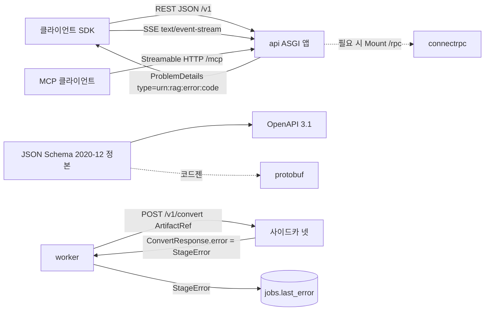

# ADR-0018: API 규약: REST + SSE + MCP, gRPC 미제공, RFC 9457·Idempotency-Key

브리프 §5 개방 결정 O-10(gRPC 제공 여부)의 해결과, 그에 딸린 API 규약(오류 모델 1개, `Idempotency-Key`, `RateLimit`·`Deprecation`·`Sunset` 헤더, 사이드카 프로토콜)의 근거와 기각 대안을 기록하는 MADR(Markdown Architectural Decision Record) 문서다. 결정 문구의 정본은 설계 바이블 §3.2 O-10·§4.1 오류 모델·§6.7 엔드포인트 명명·§14 API 표면이며, 이 문서는 그것을 바꾸지 않고 설명한다(바이블 §1.1). 바이블 §3.3의 ADR 번호·slug(`0018`, `api-rest-sse-mcp-no-grpc-rfc9457`)를 따른다.

## 맥락과 문제

- 브리프 v1.0은 D-01(FastAPI + Pydantic v2), D-08(비동기 잡, `Idempotency-Key`, `202 {job_id, status_url, events_url}`, 웹훅·SSE 릴레이), D-13(MCP 서버)을 확정하고 O-10 "gRPC 제공 여부(REST 우선)"만 열어 두었다. 열린 질문은 셋이었다. (1) v1 외부 표면에 gRPC를 1차로 추가하는가, (2) 내부 사이드카(바이블 §4.1 격리 모드 `sidecar` — JVM `parser-workers`, LibreOffice `lo-sidecar`, CUDA `ocr-gpu`, GPL/AGPL 이미지(별도 저장소, §6.7); Rust 네이티브 헬퍼 unhwp는 `helper_process`라 사이드카 계약 대상이 아니다)는 어떤 프로토콜로 통일하는가, (3) 스테이지 오류와 API 오류를 하나의 모델로 두는가.
- 기술 지형 문서 사이에 상충(J-6)이 있었다. 01 문서는 내부 사이드카에 gRPC(바이너리 페이로드·스트리밍·타입드 스키마)를 권고했고, 03·08 문서는 REST(FastAPI) 우선·필요 시 ConnectRPC를, 06 문서는 Qdrant 클라이언트 `prefer_grpc=True`를 말했다. 선정 매트릭스는 "REST 기본(03·08 채택)"으로 판정했다 — 사이드카 요청·응답은 오브젝트 스토리지 참조(`ArtifactRef`)만 주고받아 gRPC 스트리밍 이득이 작고, 런타임 넷에 계약 하나(REST + RFC 9457)를 두는 운영 단순성이 우선한다.
- 세 설계 제안(A·B·C)은 모두 REST + SSE + MCP, gRPC v1 미제공으로 같았다(바이블 §3.2 "세 제안 동일(J-6)"). 심사는 추가로 오류 모델을 하나로 확정했다: 스테이지 `StageError`와 API `ProblemDetails`가 `type = urn:rag:error:{code}`로 1:1 대응한다.
- HTTP 규약의 표준 지위(08 문서 §D): RFC 9457 Problem Details는 2023-07 발행 표준(RFC 7807 대체, `application/problem+json`, 확장 멤버 허용). `Idempotency-Key`는 draft-ietf-httpapi-idempotency-key-header-07(2025-10-15, 만료 상태)이지만 400/422/409 의미론은 관행으로 안정적. `RateLimit`·`RateLimit-Policy`는 draft-ietf-httpapi-ratelimit-headers-11(2026-05-23, 활성). `Deprecation`은 RFC 9745(2025-03), `Sunset`은 RFC 8594. uvicorn은 HTTP/2 미지원이라 TLS·HTTP/2는 인그레스가 종단하고 SSE는 HTTP/1.1 청크 응답으로 동작한다.
- 리트리벌 지연 예산(바이블 §8.3, 초안)은 `render + 직렬화` 15ms / p95 800ms이고 `ContextPack` 인라인 한계는 512KB(§5.1), 통상 수십 KB(08 문서)다. protobuf 직렬화 이득은 이 안의 일부에 그칠 것으로 예상되므로, 측정 없이 두 번째 프로토콜을 정당화할 수 없다.

따라서 결정할 질문은 다섯이다. (1) v1 외부 표면 집합, (2) gRPC가 필요해질 때의 추가 방식, (3) 내부 사이드카 프로토콜과 스트리밍 대체, (4) 오류 모델의 수와 매핑 규칙, (5) 멱등·한도·폐기 헤더 규약과 판정 정본.

## 결정 동인(decision drivers)

| 동인 | 출처 | 함의 |
|------|------|------|
| Contracts First — 모든 경계는 JSON Schema 2020-12로 게시 | 브리프 §3 원칙 1, D-05 | 계약 정본은 하나. OpenAPI 3.1은 Pydantic에서, protobuf가 필요하면 JSON Schema에서 코드젠. 손으로 두 번 쓰지 않는다 |
| Adapters over Forks·NIH 금지 | 브리프 §3 원칙 2, R2 | 자체 오류 봉투·자체 한도 헤더 대신 IETF 표준(RFC 9457, `RateLimit`, `Deprecation`/`Sunset`)을 쓴다 |
| 재시도 여부는 오류 카탈로그가 결정, 셸은 정책만 적용 | 바이블 §4.1, §5.7, §11.3 | API 계층이 재시도 가능성을 재해석하면 셸 정책과 클라이언트 백오프가 어긋난다 → 모델 1개 |
| Idempotent — 비동기 잡, `Idempotency-Key` 필수, 판정 정본 PostgreSQL | 브리프 §3 원칙 4, D-08, 바이블 §13.1 | 멱등 판정은 `idempotency_keys(tenant_id, key)`·`jobs` INSERT와 동일 트랜잭션, Valkey는 조회 캐시만 |
| LLM-Native Output — 에이전트 인터페이스는 MCP | 브리프 §3 원칙 10, D-13, R6 | MCP는 JSON-RPC over Streamable HTTP이므로 에이전트 경로는 JSON이다(10·14 문서 "REST + MCP로 충분") |
| 경계 페이로드는 `ArtifactRef`만 | 바이블 §2.1 K5, §4.1 | 사이드카에 대용량 바이너리를 전달할 필요가 없어 gRPC 스트리밍의 전제가 사라진다 |
| 격리 사다리 — 사이드카 넷(JVM·LibreOffice·CUDA·GPL/AGPL; GPL/AGPL 이미지는 별도 저장소 §6.7). Rust 헬퍼(unhwp)는 `helper_process`라 REST 사이드카 계약 대상이 아님 | 바이블 §2.1 K7, §4.1 격리 모드, §6.7, §7.1 | 헬스체크·오류 매핑·타임아웃·OTel 계측을 계약 하나로 만든다 |
| 리트리벌 p95 800ms, §8.3 예산 분배 | 브리프 §7, 바이블 §8.3 | 프로토콜 추가는 핫패스 p95 측정으로만 정당화 |
| 멀티테넌시 1급, 인증·인가 경로 하나(`PrincipalResolver` → `SecurityContext`) | D-09, 바이블 §2.3 `api`, 12 문서 | 어떤 프로토콜을 추가해도 인증·필터 경로는 REST와 동일해야 한다 |
| 라이선스 A 등급 | D-02, ADR-0001 | FastAPI(MIT)·sse-starlette(BSD-3)·connectrpc(Apache-2.0)·grpcio(Apache-2.0) 모두 A → 라이선스는 결정 요인이 아니다 |
| 레이트리밋 fail-closed | 바이블 §2.3, §8.3 | 표준 헤더로 클라이언트가 백오프할 수 있어야 한다 |

## 고려한 대안

| # | 대안 | 판정 | 근거 요약 |
|---|------|------|-----------|
| A | gRPC를 v1 1차 외부 API로 제공(REST와 병행) | 기각 | 조사한 기존 플랫폼 전부 REST(+MCP)만(11 문서); 직렬화 이득 미측정; 별도 포트·이중 정본(08 문서) |
| B | 내부 사이드카를 gRPC 스트리밍으로 통일 | 기각 | 01 문서 권고였으나 `ArtifactRef` 설계로 전제 해소(J-6); 런타임 넷에 계약 둘 |
| C | 스테이지 오류와 API 오류의 이중 모델 | 기각 | 재시도 판정 분기, 클라이언트 파서 둘, §1.2 CI 대조 대상 둘 |
| D | 자체 오류 봉투 · WebSocket 잡 스트림 · `X-RateLimit-*` 자체 헤더 | 기각 | 표준 우선(08 문서 권고안); 양방향 불필요 |
| E | gRPC 요구 발생 시 `grpcio`/`grpclib` 독립 서버 | 기각 | 별도 포트·HTTP/2 전제·asyncio 통합 복잡; `grpclib` 정체 |
| F | REST + SSE + MCP, gRPC 미제공, 필요 시 `connectrpc` 마운트 + JSON Schema → protobuf 코드젠, 사이드카 REST + `ArtifactRef` + RFC 9457, 오류 모델 1개 | **채택** | 세 제안 동일(J-6) |

### 대안 A: gRPC 1차 제공(기각)

- 설명: `/v1` REST 옆에 `grpcio` 1.84.0 서버를 별도 포트로 열고 `IngestRequest`·`QueryRequest`·`ContextPack`을 protobuf로 정의해 클라이언트 SDK가 gRPC를 기본으로 쓴다.
- 장점: 바이너리 직렬화, HTTP/2 멀티플렉싱, 양방향 스트리밍, 강타입 코드젠(08 문서 §D grpcio 행: 성숙도 매우 높음).
- 단점: 별도 포트·서버가 필요하고 브라우저·프록시 제약이 있으며 `grpc.aio`는 C 코어 위 래퍼라 asyncio 통합이 복잡하다(08 문서 §D). 계약 정본이 JSON Schema(D-05)인데 protobuf를 손으로 쓰면 이중 정본이 된다. 리트리벌 응답(`ContextPack` 수십 KB)의 직렬화 이득은 §8.3 예산 15ms 안의 일부로 "미미 예상"(08 문서 O-10 의견). 11 문서가 조사한 모든 플랫폼이 REST(+MCP)만 공개하고, 에이전트 경로(MCP)는 어차피 JSON-RPC다(10·14 문서).
- 판정: 기각. gRPC가 필요해지면 대안 F의 `connectrpc` 경로로만 추가한다.

### 대안 B: 사이드카 gRPC 스트리밍(기각)

- 설명: 01 문서 권고 — Java 라이브러리(hwplib·hwp2hwpx·hwpxlib)를 상태 없는 gRPC 사이드카로 두고 원본 바이트를 스트리밍하며, proto 스키마로 Java·Python 타입을 공유한다. Tika 4.0은 `apache/tika-grpc` 이미지도 제공한다(03 문서).
- 장점: 오브젝트 스토리지 왕복 없이 바이트를 직접 전달하고, 페이지 단위 진행을 서버 스트림으로 받을 수 있다.
- 단점: 바이블 §4.1은 경계 페이로드를 `ArtifactRef`만으로 확정했고 `ConvertRequest.input`·`ConvertResponse.output`도 `ArtifactRef`(§5.6)다. 사이드카는 참조를 받아 스토리지에서 직접 읽으므로 01 문서의 대용량 전달 전제가 사라진다(J-6 근거). 사이드카 런타임이 넷이라 계약이 둘이면 헬스체크·오류 매핑·타임아웃·OTel 계측을 두 번 만든다. 페이지 단위 진행이 필요한 OCR은 부분 산출물을 페이지 단위로 저장하고 폴링하면 O-08의 `page_status[]`·`Resumable`·하트비트와 같은 모델을 쓴다. 03 문서도 Tika를 REST 이미지로 통일했다.
- 판정: 기각. Qdrant `prefer_grpc=True`(06 문서: 대량 업서트 지연 감소)와 Temporal 클라이언트의 gRPC는 라이브러리 내부 설정이므로 이 결정의 대상이 아니다.

### 대안 C: 스테이지 오류와 API 오류의 이중 모델(기각)

- 설명: 워커는 `StageError`를, API는 별도 카탈로그(예: 08 문서 예시의 `error_code` 확장 멤버와 `https://…/problems/{name}` URL `type`)를 쓰고, API 계층이 매핑 표를 유지한다.
- 장점: API 오류를 HTTP 관점(4xx/5xx)으로 독립 설계할 수 있고 내부 코드 변경이 외부에 바로 노출되지 않는다.
- 단점: 재시도 가능 여부를 두 곳이 판단해 셸 정책(§4.1 "카탈로그가 결정")과 클라이언트 백오프가 어긋날 수 있다. §1.2 CI는 오류 코드를 §5.7 카탈로그와 기계 대조하는데 카탈로그가 둘이면 대조 대상이 둘이다. `JobStatus.last_error`(§5.6)·`ConvertResponse.error`(§5.6)·`ProblemDetails.errors[]`(§5.3)가 모두 `StageError`라 클라이언트는 어차피 `StageError`를 파싱한다. 세 제안 심사가 "오류 모델 1개"를 채택했다(§3.2 O-10 근거 열).
- 판정: 기각. `type = urn:rag:error:{code}`가 코드에서 결정적으로 파생되고 `code`·`retryable`이 확장 멤버로 그대로 실린다.

### 대안 D·E: 자체 봉투·WebSocket·자체 한도 헤더·독립 gRPC 서버(기각)

- 자체 오류 봉투(`{error: {code, message}}`): 08 문서 권고안은 "에러·멱등·페이지·한도·폐기 = 표준 우선". RFC 9457은 확장 멤버를 허용해 `code`·`retryable`·`trace_id`·`errors[]`를 수용하므로 자체 봉투의 이점이 없다.
- WebSocket 잡 스트림: 취소·우선순위 변경은 `POST /v1/jobs/{job_id}/cancel`·`PATCH /v1/jobs/{job_id}`(바이블 §11.5)로 처리되어 양방향 채널이 불필요하다(08 문서 §잡 상태 스트리밍). SSE는 uvicorn의 HTTP/1.1 청크 응답으로 충분하며 브라우저 동일 오리진 6연결 한계는 인그레스 HTTP/2가 완화한다.
- `X-RateLimit-*` 자체 헤더: 바이블 §6.7·§14가 IETF draft-11 `RateLimit`·`RateLimit-Policy` 구조화 필드를 확정했다. 초안 변동 리스크는 헤더 직렬화를 단일 모듈에 격리해 완화한다(08 문서 리스크 표).
- `grpcio` 독립 서버·`grpclib`: gRPC 요구가 생겨도 별도 포트·HTTP/2 전제는 같고 `grpclib` 0.4.9는 단일 메인테이너·9개월 무릴리스(08 문서 §D). `connectrpc` 0.12.1(Apache-2.0)은 Connect/gRPC/gRPC-Web 세 프로토콜을 하나의 ASGI 앱·단일 포트·HTTP/1.1 호환으로 제공하고 FastAPI 옆에 `Mount("/rpc", …)`로 공존한다(08 문서 §API 프레임워크). 단점은 0.x·사용자 적음 → v1 미도입, 도입 시 코드젠으로 재생성 가능하게 둔다.

### 대안 F: REST + SSE + MCP, 오류 모델 1개, 사이드카 REST(채택)



- 설명: 외부 표면은 REST(`/v1/{plural-kebab}`, JSON) + SSE + MCP(`/mcp`) 하나의 ASGI 앱이다. 오류는 어디서 나든 `StageError` 하나로 표현되고 API 경계에서 RFC 9457 `ProblemDetails`로 1:1 감싼다. 사이드카는 `POST /v1/convert`로 `ArtifactRef`를 교환한다. gRPC는 v1에 없고, 필요해지면 `connectrpc`를 같은 앱에 마운트하며 protobuf는 JSON Schema에서 생성한다.
- 장점: 정본 하나(JSON Schema), 오류 카탈로그 하나(§5.7), 인증·필터 경로 하나(`PrincipalResolver`), 사이드카 계약 하나. 포트·서버·계측이 늘지 않는다. 클라이언트 SDK(Python/TypeScript, 바이블 §12 `sdk/`)는 JSON Schema 코드젠 하나로 충분하다.
- 단점: 대량 배치·고빈도 내부 호출에서 JSON 직렬화 비용을 감수한다. `Idempotency-Key`·`RateLimit` 초안이 바뀌면 헤더 직렬화 모듈을 손봐야 한다. 페이지 단위 스트리밍이 필요한 사이드카는 폴링 지연을 감수한다.
- 판정: 채택. 세 제안 동일(J-6)이며 매트릭스 신뢰도 "높음".

## 결정

**결정:** REST + SSE + MCP 확정, gRPC v1 미제공. 필요 시 `connectrpc`를 같은 ASGI 앱에 마운트, protobuf는 JSON Schema 정본에서 코드젠. 내부 사이드카도 REST `POST /v1/convert` + `ArtifactRef` + RFC 9457. Qdrant `prefer_grpc=True`·Temporal 클라이언트 gRPC는 라이브러리 설정. 스트리밍 필요 사이드카는 부분 산출물 페이지 단위 저장 + 폴링. 도입 전 리트리벌 p95 측정으로 정당화(바이블 §3.2 O-10, resolved). 오류 모델 1개(`StageError` ↔ RFC 9457 `type` URN 1:1).

결정에 딸린 정본 세부(모두 바이블 인용, 이 문서가 새로 정하지 않는다):

- 오류 모델(바이블 §4.1): `StageError{code: "stage.reason", retryable, stage, plugin_id}` ↔ RFC 9457 `type = urn:rag:error:{code}` 1:1. 재시도 가능 여부는 **오류 카탈로그(§5.7)가 결정**하고 셸은 정책만 적용. 필드(§5.3): `StageError{code, type, retryable, stage}` 필수 + `plugin_id, detail, artifact_ref` 선택; `ProblemDetails{type, title, status}` 필수 + `detail, instance` 선택 + 확장 `code, retryable, trace_id` 필수, `errors[]: array<StageError>` 선택(다중 오류·검증). 코드는 `{stage}.{reason}` snake_case, 접두 22종(`fetch … outbox`, §5.7). 매체 타입은 `application/problem+json`(RFC 9457). 예시(503, `hydrate.backend_error` 1회 재시도 후 `retrieve.unavailable`, §5.7):

```json
{
  "type": "urn:rag:error:retrieve.unavailable",
  "title": "Retrieval backend unavailable",
  "status": 503,
  "detail": "hydrate failed after one retry; the query was not served.",
  "instance": "/v1/query",
  "code": "retrieve.unavailable",
  "retryable": true,
  "trace_id": "4bf92f3577b34da6a3ce929d0e0e4736",
  "errors": [
    {
      "code": "hydrate.backend_error",
      "type": "urn:rag:error:hydrate.backend_error",
      "retryable": true,
      "stage": "hydrate",
      "plugin_id": "index_backend.qdrant"
    }
  ]
}
```

- 엔드포인트 명명(바이블 §6.7): REST 경로 `/v1/{plural-kebab}`, 액션은 하위 POST(`/v1/jobs/{job_id}/cancel`), 경로 변수 `{snake_id}`, 쿼리 파라미터 snake_case, 헤더 `Idempotency-Key`, `RateLimit`, `RateLimit-Policy`, `Deprecation`, `Sunset`. 사이드카 `POST /v1/convert`, `GET /healthz`. MCP `/mcp`. 상태·계량 `GET /healthz`, `GET /readyz`, `GET /metrics`. 표면 전체는 §14 표.
- `Idempotency-Key`(D-08 v1.1, 바이블 §3.1 D-08·§13.1·§5.7): `POST /v1/ingest` 필수, draft-07 의미론. 판정 정본은 PostgreSQL `idempotency_keys(tenant_id, key)`(PK; `request_hash`, `job_id`, `expires_at`) **테넌트 스코프**, `jobs` INSERT와 동일 트랜잭션(`jobs.idempotency_key UNIQUE(tenant_id, idempotency_key)`). Valkey `idem:`은 조회 캐시, 미스 시 PG 판정.

| 상황 | 응답 | 오류 코드(§5.7) | 출처 |
|------|------|-----------------|------|
| 신규 키 | `202 {job_id, status_url, events_url}` | — | D-08, §14 |
| 동일 키·동일 `request_hash`, 처리 완료 | 200(재전송) | — | D-08 |
| 동일 키, 원 요청 처리 중 | 409 | `api.idempotency_conflict` | §5.7 |
| 동일 키·다른 `request_hash` | 422 | `api.idempotency_payload_mismatch` | §5.7 |
| 키 누락 | 400 | 전용 코드 없음 → `contract.violation`(400) 사용(제안, 바이블 미명시) | 08 문서 draft-07 의미론 |

- 한도·폐기 헤더(바이블 §6.7·§14, 08 문서): `RateLimit`(잔여)·`RateLimit-Policy`(정책) 구조화 필드, 초과 시 429 `api.rate_limited` + `Retry-After`, 운영 fail-closed(§2.3, §8.3 첫 행). 폐기 예정 엔드포인트·버전에는 RFC 9745 `Deprecation`(구조화 필드 Date) + RFC 8594 `Sunset`(HTTP-date)을 함께 내린다. 최소 유예 기간과 `Link rel="deprecation"` 안내는 05-api/01이 확정한다.
- SSE(바이블 §14): `GET /v1/jobs/{job_id}/events`(`job.state.changed`, 진행률), `GET /v1/events`(테넌트 스코프 CloudEvents 스트림). 페이로드는 `CloudEventEnvelope`(§5.3, `data`에 콘텍스트 본문 금지). 재접속 재생(`id:` = `event_id`, `Last-Event-ID` → `job_events` 재생)은 08 문서 제안이며 05-api/07이 확정한다.
- MCP(D-13, ADR-0025 소유): `/mcp`, `mcp>=2,<3`, Streamable HTTP, 도구 `search`·`get_document`·`list_collections`, `cursor`/`next_cursor`, 외부 OIDC AS + RFC 9728 PRM(`/.well-known/oauth-protected-resource`, §14).
- 사이드카(바이블 §5.6, ADR-0033 소유): `ConvertRequest{input: ArtifactRef, options?, tenant_id, document_id, deadline_ms, trace_id, credentials_ref?}` → `ConvertResponse{output: ArtifactRef | null, derived[], warnings[], error?: StageError, took_ms, producer}`, `output=null`이면 `error` 필수. 비밀은 `credentials_ref` 간접 참조만.
- 오케스트레이터 불가(바이블 §11.5): API 503 + `Retry-After`, 잡 `queued` 유지, 조정 스케줄이 미시작 워크플로우 재시작.

## 결과

### 긍정

- 계약 정본(JSON Schema) 하나에서 OpenAPI 3.1·클라이언트 SDK·(필요 시) protobuf가 파생되어 D-05·원칙 1이 API 표면까지 이어진다.
- 오류 코드 카탈로그(§5.7) 하나가 셸 재시도 정책, `JobStatus.last_error`, 사이드카 `ConvertResponse.error`, API `ProblemDetails`를 모두 지배한다. 클라이언트는 `code`·`retryable` 두 필드로 백오프를 결정하고, `type` URN은 코드에서 결정적으로 파생되므로 문서 URL 관리가 필요 없다.
- 사이드카 넷(JVM·LibreOffice·CUDA·GPL/AGPL — 바이블 §4.1 격리 모드 `sidecar`; GPL/AGPL 이미지는 별도 저장소 `rag-platform-gpl-sidecars`, §6.7)에 계약·헬스체크·오류 매핑·계측이 하나다. Rust 네이티브 헬퍼(unhwp)는 `helper_process`(`multiprocessing spawn`)로 격리되어 이 REST 사이드카 계약의 대상이 아니다(§7.1). `ArtifactRef` 교환이라 Temporal 2MB 한계와도 정합하다(ADR-0003).
- 멱등 판정이 PostgreSQL 트랜잭션 안에 있어 Valkey 장애가 정확성에 관여하지 않는다(바이블 §2.3 Valkey 행).
- 인증·인가·레이트리밋·`SecurityContext` 주입 경로가 하나라 강제 지점(§10.3) 우회 표면이 늘지 않는다.

### 부정

- 대량 배치·고빈도 내부 호출에서 JSON 직렬화·파싱 비용을 감수한다. 08 문서 지침(`model_validate_json`, `Response(content=model.model_dump_json())`로 재검증 회피)을 05-api/01이 규정해야 한다.
- `Idempotency-Key`(만료 초안)·`RateLimit`(활성 초안)의 이름·직렬화가 바뀔 수 있다. 의미론(400/422/409, 429)은 유지하고 헤더 직렬화를 단일 모듈에 격리한다.
- 페이지 단위 스트리밍이 필요한 OCR 사이드카는 폴링 지연을 감수한다. §7 처리량 목표(스캔 PDF 100페이지 < 5min) 미달이 확인되면 재검토 조건이다.
- `RateLimit-Policy`·`Deprecation`·`Sunset`을 손으로 붙이면 누락된다. OpenAPI `deprecated: true`와 코드젠으로 자동 부착해야 한다(08 문서).
- 키 누락(400)의 전용 오류 코드가 §5.7에 없다. `contract.violation`으로 표현하되 별도 코드가 필요하면 §1.2 minor 절차(열거값 추가)를 따른다.

### 중립

- Qdrant `prefer_grpc=True`·Temporal 클라이언트·OTLP 내보내기의 gRPC 사용은 라이브러리 설정이며 이 결정과 무관하다. OTLP는 Langfuse가 HTTP만 받으므로 Collector 경유가 표준(09 문서).
- 다수 브라우저 클라이언트에 잡 이벤트를 팬아웃해야 하면 아웃박스 릴레이 목적지에 외부 팬아웃 서버를 추가하면 되고 계약은 바뀌지 않는다(08 문서, ADR-0017).
- `POST /v1/collections/{collection_id}/reindex` 등 다른 쓰기 엔드포인트로 `Idempotency-Key`를 확대할지는 05-api/01이 결정한다(08 문서 제안; 바이블 §14는 `/v1/ingest`만 필수).

## 준수 확인 방법

| # | 규칙 | 강제 수단 | 게이트·위치 |
|---|------|-----------|-------------|
| 1 | 모든 4xx/5xx 응답은 `ProblemDetails`(`problem-details.schema.json`, `application/problem+json`) | 예외 핸들러 단일 모듈 `api/problems`(바이블 §12); OpenAPI의 모든 오류 응답이 이 스키마를 참조 | OpenAPI 스키마 검사(제안, 05-api/openapi.yaml); 코드 리뷰: 라우트에서 `HTTPException(detail=str)` 직접 사용 금지 |
| 2 | 오류 코드는 §5.7 카탈로그 철자만, `type`은 `urn:rag:error:{code}`로 파생 | `contracts/enums.py` 단일 소스(§12), `schemas/*.schema.json` ↔ §5.7 기계 대조(§1.2) | CI 필수(불일치 = 빌드 실패) |
| 3 | `retryable`은 카탈로그 조회값, API·셸이 임의 지정 금지 | `StageError`·`ProblemDetails` 생성 함수가 카탈로그에서 채움; `StagePolicy.non_retryable_error_codes`는 카탈로그 코드만(§5.3) | 계약 스냅샷 테스트 + 코드 리뷰 |
| 4 | `StageError` ↔ `ProblemDetails` 1:1 라운드트립 | 적합성 키트 `contract_roundtrip`(§12 `testing/`)에 카탈로그 전 코드의 왕복 동치 항목 | 제안(바이블 미명시): 10-development/04에서 확정 |
| 5 | `POST /v1/ingest`는 `Idempotency-Key` 필수, 판정은 PG 트랜잭션 | 라우트 의존성으로 헤더 필수; `idempotency_keys(tenant_id, key)` PK + `jobs UNIQUE(tenant_id, idempotency_key)`(§13.1); `api/idempotency` 모듈이 `jobs` INSERT와 같은 트랜잭션 | 스키마 제약 + 통합 테스트(200/409/422 3경로); 코드 리뷰: Valkey `idem:` 미스 시 PG 판정 |
| 6 | 한도·폐기 헤더 표준 | `RateLimit`·`RateLimit-Policy` 직렬화 단일 모듈(`security/rate_limit`), 429 + `Retry-After`, fail-closed; `Deprecation`·`Sunset`은 OpenAPI `deprecated: true`에서 자동 부착 | 헤더 스냅샷 테스트; 코드 리뷰: `X-RateLimit-*` 단독 사용 금지 |
| 7 | 경로 명명 `/v1/{plural-kebab}`, 액션 하위 POST, `{snake_id}` | OpenAPI 경로 린트(제안), ADR-0036 | CI 경고 → 05-api/01 확정 후 실패 |
| 8 | gRPC 미제공 | 코어 의존성에 `grpcio`·`grpclib`·`connectrpc` 직접 의존 없음(`uv lock --check`, D-01); `api`·`retrieval`·`pipelines`에서 `grpc` 직접 임포트 금지(import-linter, 제안) | CI 린트; Qdrant·Temporal 클라이언트의 gRPC는 라이브러리 내부라 대상 아님 |
| 9 | 사이드카는 `POST /v1/convert` + `GET /healthz`, 오류는 `StageError` | `sidecars/*` 공통 계약(§12), `ConvertResponse.error: StageError`, `output=null → error 필수`(§5.6) | 사이드카 계약 테스트(ADR-0033 소유) |
| 10 | SSE 페이로드는 `CloudEventEnvelope`, `data`에 콘텍스트 본문 금지 | `api/events(SSE)` 모듈이 `cloud-event-envelope.schema.json`으로 직렬화; 계약 테스트 "문서 내용 문자열이 이벤트에 없음"(매트릭스 CI 게이트) | 스키마 CI + 계약 테스트 |
| 11 | protobuf 도입 시 JSON Schema에서만 생성 | 손편집 `.proto` 금지, 코드젠 산출물은 CI에서 재생성·diff | 도입 ADR에 리트리벌 p95 측정 첨부(재검토 조건) |

코드 리뷰 체크리스트(요약): (a) 새 오류가 §5.7 카탈로그에 있는가, `retryable`을 코드가 직접 정하지 않는가, (b) 라우트가 `ProblemDetails` 외 형식으로 오류를 반환하지 않는가, (c) 쓰기 라우트의 멱등 판정이 PG 트랜잭션 안에 있는가, (d) 새 경로가 `/v1/{plural-kebab}`·하위 POST 액션 규약을 따르는가, (e) 사이드카 호출이 `ArtifactRef` 외 페이로드를 보내지 않는가, (f) `grpc`·`.proto` 파일이 코어에 들어오지 않는가.

## 재검토 조건

- 리트리벌 핫패스 p95 측정(바이블 §8.3 `render + 직렬화` 15ms, 네트워크·GC 여유 225ms)에서 JSON 직렬화가 예산의 유의미한 비율을 차지함이 골든셋 부하 테스트로 입증될 때 → `connectrpc` 마운트(같은 ASGI 앱, 인증은 동일 `PrincipalResolver`) + JSON Schema → protobuf 코드젠을 별도 ADR로 발의한다. `connectrpc`가 1.0에 도달하면 함께 재평가한다.
- 스트리밍 필요 사이드카의 "페이지 단위 부분 산출물 + 폴링"이 §7 처리량(스캔 PDF 100페이지 < 5min GPU OCR)에 미달할 때(ADR-0033과 공동 재검토).
- draft-ietf-httpapi-idempotency-key-header 또는 ratelimit-headers의 상태·의미론이 바뀔 때(RFC 승격, 필드 개명) → 헤더 직렬화 모듈 갱신, 의미론 유지.
- MCP 스펙이 전송 계층(Streamable HTTP)을 바꾸거나 세션 모델을 되돌릴 때(ADR-0025 소유, 표면 집합에 영향 시 이 ADR 병행 개정).
- 오류 코드 접두·확장 멤버(예: `retry_after_seconds`) 추가 요구가 누적되면 §1.2 minor 절차로 §5.7·`ProblemDetails`를 개정한다.
- 외부 고처리량 소비자(대량 배치 클라이언트, 다른 언어 SDK)가 gRPC를 명시 요구하고 REST 배치(`POST /v1/ingest/batch` 100건)로 충족되지 않을 때.

## 참조

- [설계 브리프](../00-vision/00-design-brief.md) — §3 원칙 1·2·4·10, §4 D-01·D-02·D-05·D-08·D-09·D-13, §5 O-10, §7 품질 목표, §9.9 명명
- [설계 바이블](../02-architecture/00-design-bible.md) — §1.1~1.2, §2.1 K5·K7, §2.3 `api`·Valkey, §3.1 D-08·D-13, §3.2 O-10, §3.3, §4.1 오류 모델·격리 모드, §5.1, §5.3 `StageError`·`ProblemDetails`·`CloudEventEnvelope`·`ArtifactRef`, §5.6 `JobStatus`·`ConvertRequest`/`ConvertResponse`, §5.7 오류 코드 카탈로그, §6.4 미디어 타입, §6.7 엔드포인트·GPL/AGPL 별도 저장소, §7.1 컴포넌트 표(unhwp `helper_process`), §8.3, §10.3, §11.3, §11.5, §12 `api/`·`sidecars/`·`sdk/`, §13.1 `jobs`·`idempotency_keys`·`job_events`, §14
- [기술 지형 종합: 선정 매트릭스와 결정 권고](../07-tech-landscape/00-summary-and-selection-matrix.md) — 상충 판정 J-6, 매트릭스 `api_framework`·`mcp_sdk` 행, 개방 결정 권고 O-10, ADR 발의 목록 P2 "API 규약"
- [오케스트레이션·메시징·API 프레임워크](../07-tech-landscape/08-orchestration-messaging-and-api-frameworks.md) — §D API 프레임워크·HTTP 규약 표, §API 프레임워크와 HTTP 규약(gRPC vs ConnectRPC, SSE, RFC 9457, 멱등성 키, 레이트 리밋, 폐기 규약), §권고안 RPC·에러 행, §개방 결정에 대한 의견 O-10, §리스크 및 완화
- 기술 지형 개별 문서: [01 HWPX/HWP 파싱](../07-tech-landscape/01-document-parsing-hwpx-hwp.md)(사이드카 gRPC 권고 — 기각 대안 B), [03 DOC/DOCX·HTML·TXT 파싱](../07-tech-landscape/03-document-parsing-office-html-text.md)(REST 우선, Tika REST 통일), [06 벡터·렉시컬 인덱스 백엔드](../07-tech-landscape/06-vector-and-lexical-index-backends.md)(Qdrant `prefer_grpc`), [09 평가·관측성](../07-tech-landscape/09-evaluation-and-observability.md)(OTLP Collector 경유), [10 LLM 컨텍스트 최적화·MCP](../07-tech-landscape/10-llm-context-optimization-and-mcp.md), [11 기존 RAG 플랫폼 갭 분석](../07-tech-landscape/11-existing-rag-platforms-gap-analysis.md), [12 보안·멀티테넌시·PII·라이선스](../07-tech-landscape/12-security-multitenancy-pii-and-licensing.md)(동일 `PrincipalResolver`), [14 고급 RAG](../07-tech-landscape/14-advanced-rag-graph-raptor-agentic-multimodal.md)
- 관련 ADR(바이블 §3.3 번호·slug): [ADR-0003 오케스트레이터 중립 파이프라인](./0003-orchestrator-neutral-pipeline-and-non-durable-local-runner.md), [ADR-0017 이벤트 전달](./0017-event-delivery-outbox-cloudevents-no-broker.md), [ADR-0025 MCP 커서 페이지네이션과 도구 집합](./0025-mcp-cursor-pagination-and-tool-set.md), [ADR-0027 SecurityContext 서버 주입](./0027-security-context-injection-and-acl-enforcement-points.md), [ADR-0033 사이드카 convert 계약](./0033-sidecar-convert-contract-and-isolation-ladder.md), [ADR-0034 검색 핫패스 PostgreSQL 미의존](./0034-retrieval-hot-path-postgres-independence-and-hydrate.md), [ADR-0036 명명 규약](./0036-naming-and-identifier-conventions.md), [ADR-0038 아웃바운드 egress 정책과 웹훅 서명](./0038-outbound-egress-policy-and-webhook-signing.md)
- 이 결정을 전제로 하는 설계 문서(문서 맵): [API 설계 지침](../05-api/01-api-design-guidelines.md), [수집 API](../05-api/02-ingestion-api.md), [리트리벌 API](../05-api/03-retrieval-api.md), [MCP 서버](../05-api/05-mcp-server.md), [클라이언트 SDK](../05-api/06-client-sdks.md), [웹훅과 이벤트](../05-api/07-webhooks-and-events.md), [오류 모델](../03-contracts/13-error-model.md), [잡·이벤트·상태 계약](../03-contracts/12-jobs-events-and-status.md), [평가·피드백·사이드카 계약](../03-contracts/16-eval-feedback-and-sidecar-contracts.md)
