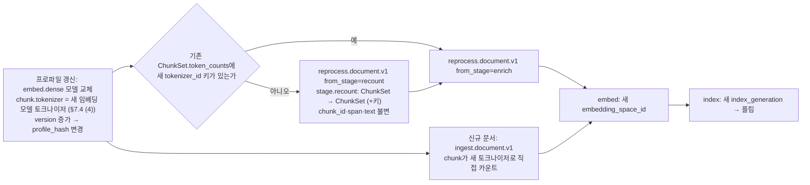

# ADR-0019: 청크 크기·토크나이저 기본값과 recount 스테이지

> MADR 형식. 바이블 §3.3 표의 0019행이며 관련 결정은 O-09(브리프 §5 "청크 크기·오버랩 기본값(토큰 기준) 및 한국어 토크나이저(모델 토크나이저 vs cl100k)", 바이블 §3.2 `resolved`)다. 수치 기본값 자체는 브리프 D-19(개정 v1.1)가 확정한 512/2048/64·표 256을 그대로 쓰며, 이 ADR은 그 수치를 **어느 토크나이저로 재는가**, 오버랩·폴백·문장 윈도우 값, 세 종류 토큰 카운터의 역할 분리, 그리고 임베더 교체 시 재청킹 대신 `recount` 스테이지를 두는 이유를 기록한다. 바이블 표는 바꾸지 않는다(바이블 §1.1). 청커 알고리즘과 semchunk·tiktoken 잠금은 [ADR-0020](./0020-default-chunker-structure-aware-and-dependency-locks.md), 결정적 `chunk_id`는 [ADR-0004](./0004-deterministic-chunk-id-scoped-record-id-and-ulid-exception.md), 팩 예산의 대상 LLM 재카운트는 [ADR-0024](./0024-context-pack-ordering-and-anthropic-search-result-renderer.md), 한국어 형태소 분석기는 [ADR-0021](./0021-korean-analyzer-kiwi-promotion-and-interim-mecab-kss.md), 게이트를 돌리는 하네스는 [ADR-0023](./0023-evaluation-qrels-answer-spans-and-linear-ndcg.md)이 다룬다.

## 맥락과 문제

브리프 D-19는 "토큰 예산 병합(자식 512 / 부모 2048 / 병합 하한 64, 임베딩 모델 토크나이저 기준)"과 "표 행 그룹 청킹(256 토큰)"을 확정했지만, 어떤 토크나이저(tokenizer)로 토큰을 세는지, 오버랩(overlap)을 얼마로 두는지, 임베딩 모델을 바꾸면 이미 색인된 청크를 어떻게 하는지는 O-09로 남겼다. 기술 지형 조사([04 청킹 전략](../07-tech-landscape/04-chunking-strategies-and-libraries.md), [13 한국어 NLP·토크나이제이션](../07-tech-landscape/13-korean-nlp-tokenization-and-language-resources.md), [선정 매트릭스](../07-tech-landscape/00-summary-and-selection-matrix.md) J-5·O-09 권고·교차 함의 4)와 세 설계 제안에서 다음 사실이 확정되었다.

| # | 사실 | 출처 |
|---|------|------|
| F1 | 13 문서 직접 측정(4개 한국어 표본, 2026-09-18, 경향 확인용): 같은 내용의 한국어/영어 토큰 비가 `cl100k_base` **2.6배**, `o200k_base` 1.55배, `BAAI/bge-m3`(XLM-R 어휘, `multilingual-e5`·KURE-v1·arctic-l-v2와 동일) **1.05배**, Qwen3-Embedding 1.8배. 같은 한국어 텍스트가 cl100k에서는 bge-m3의 약 1.8배 토큰이다. 외부 참고치(jangwook.net 285문서 쌍 cl100k 1.82배·o200k 1.38배·Claude 1.88배, tonybaloney Tatoeba cl100k 2.36배)와 방향이 일치한다 | 13 §토큰 팽창률, 04 §17 |
| F2 | 잘림(truncation)을 결정하는 것은 임베딩 모델 토크나이저다. cl100k 기준 512토큰 예산은 bge-m3 기준 약 280토큰만 채워 임베딩 용량을 과소 활용하고, 반대 방향은 LLM 컨텍스트에서 1.8배 초과한다. bge-m3 기준 512토큰 ≈ 한국어 900~1,000자(공백 포함) ≈ 법령 1개 조·개조식 소절 하나 | 13 §함의 표, 매트릭스 J-5 |
| F3 | 청크 크기 실증 연구는 모두 영어다: Chroma 200~400토큰이 precision·IoU 우위, 같은 400토큰에서 오버랩 200→0이 IoU 3.3→3.6·recall 88.1→89.5(구조 없는 재귀 분할에서도 오버랩 이득 없음); Wang et al. 512 최고(2048은 80.37); NVIDIA 토큰 기반 256~2048 평균 0.603~0.645로 크기 간 차이가 작고 구조 경계 없는 토큰 청킹에서 오버랩 10/15/20% 중 **15%** 최선 | 04 §15 표·종합 |
| F4 | 세 설계 제안은 O-09에 대해 동일한 결론(J-5)을 냈다. 연구 문서 04·13은 자식 512 / 부모 2048(bge-m3 토크나이저), 11 문서는 Dify 관행 인용으로 자식 256 / 부모 1024를 제시했고 매트릭스는 04·13을 채택하되 11의 값을 그리드 {256, 384, 512, 768}에 포함했다 | 매트릭스 J-5, 바이블 §3.2 O-09 |
| F5 | 토큰 카운터는 세 종류를 구분해야 한다 — 청크 예산은 임베딩 모델 토크나이저, 리랭커 절단은 리랭커 토크나이저, ContextPack 예산은 대상 LLM 토크나이저(Anthropic은 `count_tokens` API만, 근사 카운터 금지). 구성 검증에서 공급자·카운터 불일치는 거부한다 | 매트릭스 교차 함의 4·`context_packer` 행, 바이블 §9.1 이중 카운트 |
| F6 | 렉시컬(BM25) 색인 단위는 형태소(morpheme)이며 어절·서브워드와 목적이 다르다(MIRACL-ko 10K: 유니코드 경계 0.36 vs 형태소 0.61~0.64). 예산 카운트용 서브워드 토크나이저와 BM25용 형태소 분석기는 역할이 다르므로 혼용하면 두 쪽 모두 왜곡된다 | 13 §토큰화 단위 비교, 매트릭스 `korean_tokenizer` 행 |
| F7 | `chunk_id = H("chunk", doc_version, chunker_config_hash, str(level), span)`은 토큰 수를 포함하지 않는다. 임베더 교체 시 `token_counts`에 새 임베더의 `tokenizer_id`가 없으면 "재청킹 대신 재카운트 스테이지"가 04 문서 실패 모드 표의 처리 방식이며, `TokenCounter` 인터페이스(`count(text) -> int`, `tokenizer_id`)와 청크당 `token_counts: {tokenizer_id: int}` 다중 기록이 그 전제다 | 04 §실패 모드·§계약 제안, 바이블 §6.2 |
| F8 | Docling `HuggingFaceTokenizer`/`OpenAITokenizer`, Chonkie, semchunk `token_counter`는 모두 호출 가능 객체 주입을 지원하므로 하나의 `TokenCounter` 어댑터로 통일할 수 있다. tiktoken은 docling-core 상한 때문에 0.12.0으로 잠그지만 `o200k_base`는 0.7.0부터 있어 기능 차이가 없다(ADR-0020) | 04 §17, 매트릭스 `chunker_default` 행 |

문제: (1) 청크 예산 토크나이저를 임베딩 모델 토크나이저로 하는가, LLM 생태계 표준 `cl100k_base`로 하는가, (2) 자식·부모·병합 하한·표 행 그룹·폴백 분할·오버랩·문장 윈도우 기본값을 무엇으로 두고 어떻게 정당화하는가, (3) 청크 예산·리랭커 절단·팩 예산·렉시컬 토큰화의 네 가지 토큰화를 어떻게 분리하는가, (4) 임베더 교체 시 기존 `ChunkSet`을 재청킹하는가 재카운트하는가, (5) 초안 값을 어떤 절차로 갱신하는가.

## 결정 동인(decision drivers)

| ID | 동인 | 내용 | 근거 |
|----|------|------|------|
| DR1 | 잘림 방지와 용량 활용 | `level=0` 청크는 임베딩 모델 입력 한도 안에 들어가되 예산을 절반만 쓰는 낭비가 없어야 한다. 이는 실제 임베딩 토크나이저로만 판정할 수 있다(F1·F2) | 원칙 6, D-16, 바이블 §5.4 `ChunkSet` 불변식 (2) |
| DR2 | 한국어 우선 | 한국어 팽창률이 토크나이저마다 1.05~2.6배로 달라 영어 기준 관행값을 그대로 쓸 수 없다. 문자 수 환산 계수는 한국어 골든셋으로 재측정해 프로파일에 고정한다 | 원칙 6, 13 §함의, 바이블 미해결 이슈 4 |
| DR3 | 평가 주도 | 참고 연구가 전부 영어이므로 모든 크기·오버랩 값은 초안 목표이며 `gate`가 붙은 값은 하네스 결과 없이 바뀌지 않는다 | 원칙 7, D-12, 바이블 §7.4 |
| DR4 | 결정성·콘텐츠 주소화 | `chunk_id`·`span`·`text`는 토크나이저에 독립이어야 임베더 교체가 청크 정체성을 바꾸지 않는다. 토큰 수는 청크의 속성(`token_counts`)이지 정체성이 아니다 | 원칙 4, D-06, ADR-0004, 바이블 §6.2 |
| DR5 | LLM 네이티브 출력 | 팩 예산은 소비 LLM의 토크나이저로 재계산해야 하며(이중 카운트) 청크 예산 토크나이저를 대신 쓰면 공급자마다 1.3~1.9배 오차가 난다 | 원칙 10, D-20, 바이블 §9.1 |
| DR6 | 순수 스테이지·경계 불변 | 재카운트는 `ChunkSet → ChunkSet` 변환이어야 13개 경계 계약(D-05)에 타입을 추가하지 않고, `ctx.token_counter`만 써서 I/O 없는 순수 함수로 남는다 | D-05, 바이블 §3.1 D-05 행, §4.1 |
| DR7 | 재색인 비용 | 재청킹은 모든 `chunk_id`를 바꿔 전체 재임베딩·부모 번들 재생성·세대 교체를 강제한다. 어휘가 같은 모델 간 교체(XLM-R 계열)에서는 토큰 수조차 같아 재청킹이 무의미하다 | 13 §측정 표, 바이블 §11.2 `reprocess.document.v1`, §13.2 |
| DR8 | 역할 분리 | 렉시컬 토큰화(`analyzer_id`)와 예산 카운트(`tokenizer_id`)는 다른 식별자·다른 컨텍스트 핸들(`ctx.analyzer` / `ctx.token_counter`)로 분리되어 서로를 대체할 수 없어야 한다 | F6, 바이블 §4.1, §6.1, ADR-0021 |

## 고려한 대안

| 대안 | 잘림 판정 정확 | 한국어 용량 활용 | 임베더 교체 비용 | 판정 |
|------|----------------|------------------|------------------|------|
| A1 예산 토크나이저 = `hf:BAAI/bge-m3`(임베딩 모델), `tiktoken:o200k_base` 병기; 512/2048/64, 구조 오버랩 0, 폴백 384·10%, 표 256, 문장 윈도우 ±2; 임베더 교체 시 `recount` | 예 | 예 | 재카운트만(CPU) | **채택** |
| A2 `cl100k_base` 단일 토크나이저 | **아니오**(F1·F2) | **아니오**(약 절반) | 없음(모델 독립) | **기각**(바이블 기각) |
| A3 임베더 교체 시 재청킹 | 예(새 토크나이저 기준 불변식 보장) | 예 | **전체 재임베딩·세대 교체**(DR7) | **기각**(바이블 기각) |
| A4 구조 청크 고정 오버랩(10~15%) | — | 중복 토큰만큼 감소 | — | **기각**(바이블 기각; 폴백 `flat_text`에만 오버랩) |
| A5 자식 256 / 부모 1024(11 문서, Dify 관행) | 예 | 예 | — | 기각(그리드 후보로만 유지, J-5) |
| A6 문자 수 × 언어별 계수 근사 예산 | 아니오(개조식·표에서 계수 편차) | 부분 | 없음 | 기각(측정 폴백으로만, 04 §토큰 카운팅 표 3차) |
| A7 형태소 분석기 토큰으로 예산 카운트(혼용) | 아니오(임베더 입력과 무관) | 아니오 | — | 기각(DR8) |
| A8 임베더 교체 시 카운트 갱신 없이 `embed`의 절단에 위임 | 아니오(사후 `truncated=true`만) | 아니오 | 없음 | 기각(패킹 사전 예산 `token_count_primary` 불일치, `embed.tokenizer_missing`) |

- **A1(채택).** 설명: `StructureAwareChunker`가 `ctx.token_counter`(프로파일 `ingest.chunk.tokenizer`, 기본 `hf:BAAI/bge-m3`)로 `leaf_max_tokens`·`merge_min_tokens`·`parent_max_tokens`·`table_row_group_tokens`를 판정하고, 각 청크의 `token_counts`에 primary와 `secondary_tokenizers`(`tiktoken:o200k_base`)를 병기한다. 구조 청크는 heading·단락·표 경계가 문맥 경계이므로 오버랩 0, 구조가 빈약한 TXT/HTML의 `flat_text` 폴백만 384토큰·오버랩 10%·문장 윈도우 ±2를 쓴다. 임베더 교체는 `recount`로 흡수한다. 장점: 잘림 판정이 정확하고(DR1) 한국어 페널티가 거의 없는 XLM-R 어휘로 512 예산을 온전히 쓴다(F1). `o200k_base` 병기로 공급자 중립 LLM 예산 근사와 OpenAI `exact_local` 카운트가 재계산 없이 나온다. 단점: 임베딩 모델마다 `tokenizer_id`가 달라 `token_counts` 키가 늘고, 어휘가 같은 모델(KURE-v1 등)도 `tokenizer_id`가 다르면 `recount`가 돈다.
- **A2 `cl100k_base` 단일 토크나이저(바이블이 기각).** 설명: LLM 생태계 관행대로 tiktoken `cl100k_base` 하나로 청크·팩 예산을 모두 센다. 장점: 모델 독립, 빠르고 의존성이 하나, 청크·팩 카운트가 같은 단위. 단점: 한국어에서 bge-m3 대비 약 1.8배(영어 대비 2.6배) 팽창하므로 512 예산이 임베더 기준 약 280토큰만 채워 용량을 절반만 쓰고(F2), 임베더별 잘림 여부를 판정할 수 없으며, `o200k_base`보다도 한국어 효율이 낮다(F1). 브리프 O-09가 명시한 "모델 토크나이저 vs cl100k" 중 후자를 기각한다.
- **A3 임베더 교체 시 재청킹(바이블이 기각).** 설명: 새 임베더의 토크나이저로 `chunk` 스테이지를 다시 실행한다. 장점: `level=0 → token_counts[primary] ≤ leaf_max_tokens` 불변식이 새 토크나이저 기준으로도 성립한다. 단점: `chunker_config_hash`가 바뀌어 모든 `chunk_id`·`parent_chunk_id`·부모 번들 키(`chunk_set_blake3`)가 바뀌고 전체 재임베딩과 세대 교체가 필요하다(DR4·DR7). bge-m3 → KURE-v1처럼 어휘가 같은 교체에서는 토큰 수가 동일해 얻는 것이 없다. 재청킹은 프로파일 `chunk.*` 값 변경(`version` 증가 → `profile_hash` 변경 → blue/green)의 결과로만 일어난다.
- **A4 구조 청크 고정 오버랩(바이블이 기각).** 장점: 경계에 걸친 문장의 recall 보전. 단점: 구조 경계가 있으면 오버랩의 이득이 작고 IoU를 해치며(Chroma, F3), 중복 토큰이 팩 예산과 `dedup`을 어지럽힌다. NVIDIA의 15% 우위는 구조 경계 없는 토큰 청킹 전제라 `flat_text` 폴백의 그리드 후보 {0, 10%, 15%}로만 남긴다.
- **A8 절단 위임(기각).** `embed`의 `embed.token_overflow` 절단은 마지막 안전장치일 뿐이며, `IndexRecord.token_count_primary`(패킹 사전 예산)·`payload_slim.token_count_primary`가 실제 임베딩 입력과 어긋나고 `embed.tokenizer_missing`(비재시도)이 계약상 존재한다.

## 결정

**결정:** 바이블 §3.2 O-09 그대로 — "예산 토크나이저 = `hf:BAAI/bge-m3`, `token_counts`에 `tiktoken:o200k_base` 병기. 자식 512(병합 하한 64) / 부모 2048(반환 단위만) / 구조 청크 오버랩 0 / 폴백 분할 오버랩 10% / 표 행 그룹 256 / `flat_text` 문장 윈도우 ±2. 렉시컬 토큰화는 형태소 분석기(혼용 금지). ContextPack 예산은 대상 LLM 토크나이저 재계산(이중 카운트), 리랭커 절단은 리랭커 토크나이저. `TokenCounter{tokenizer_id}` 단일 인터페이스. 임베더 교체 시 `token_counts` 키 누락이면 `recount` 스테이지(재청킹 아님). M2 그리드 {256, 384, 512, 768} × {0, 10%, 15%}". `recount`는 바이블 §4.2 그대로 — 입력 `ChunkSet` → 출력 `ChunkSet`(`token_counts`에 키 추가), 확장 지점 `chunker`(role `token_counter`), in_process, `stage_key = H("stage","recount", scope_key, chunk_set.blake3, tokenizer_id)`, "임베더 교체로 `token_counts`에 새 `tokenizer_id`가 없을 때만 실행(재청킹 아님)", `reprocess.document.v1`에서만(§11.2).

| 항목 | 정본 값(초안 목표) | 위치 |
|------|--------------------|------|
| `ingest.chunk.tokenizer` / `secondary_tokenizers` | `hf:BAAI/bge-m3` / `[tiktoken:o200k_base]`(`lite`·`standard`·`korean-gov`); `premium`은 프로파일 임베딩 모델 토크나이저 | 바이블 §7.2, §7.3 |
| `leaf_max_tokens` / `parent_max_tokens` / `merge_min_tokens` | 512 / 2048 / 64(전 프로파일 동일); `leaf_max_tokens`에 `gate: {metric: ndcg@10, grid: [256, 384, 512, 768], dataset: ko-public-v1}` | §7.2, §7.3, D-19 |
| `table_row_group_tokens` | 256(헤더 행 반복) | §7.2, D-19 |
| 구조 청크 오버랩 | 0 — `chunker.structure_aware`에는 오버랩 파라미터가 없다 | §3.2 O-09, §7.3 |
| `fallback` | `{plugin: chunker.flat_text, max_tokens: 384, overlap_ratio: {value: 0.10, gate: {grid: [0, 0.10, 0.15]}}, sentence_window_n: 2}` | §7.3 |
| `ChunkSet` 필드 | `primary_tokenizer_id`(`hf:BAAI/bge-m3`), `secondary_tokenizer_ids`(`["tiktoken:o200k_base"]`), `Chunk.token_counts: TokenCounts`(`{tokenizer_id: integer}`, primary + secondary 병기); 불변식 (2) `level=0 → token_counts[primary_tokenizer_id] ≤ leaf_max_tokens` | §5.3 `TokenCounts`, §5.4 `ChunkSet`·`Chunk` |
| `tokenizer_id` 표기 | `hf:{repo}`, `tiktoken:{encoding}`, `anthropic:{model}`, `gemini:{model}` | §6.1 |
| 지문·캐시 | `chunk` fingerprint에 `chunker_config_hash`·`primary_tokenizer_id` 포함; `recount` `stage_key`는 fingerprint 대신 `tokenizer_id`; 토큰 카운트 캐시 Valkey `tok:{tokenizer_id}:{H(text)}` 7d(콘텐츠 해시 키, 테넌트 접두 예외) | §4.2, §13.4 |
| 정책 | `chunk / recount`: 큐 `ingest-cpu`, `start_to_close` 5m, `max_attempts` 3, 비재시도 `chunk.tokenizer_missing`·`contract.violation`; 모듈 `pipelines/chunk/recount.py` | §4.4, §11.2, §12 |
| API | `POST /v1/documents/{document_id}/reprocess {from_stage}`에 `recount` 포함(`from_stage ∈ [parse, normalize, chunk, recount, enrich, embed, index]`) | §14 |

네 가지 토큰화의 역할 분리(혼용 금지):

| 토큰화 | 식별자 | 용도 | 실행 위치·핸들 | 불일치·실패 처리 |
|--------|--------|------|----------------|------------------|
| 청크 예산 | `tokenizer_id` primary `hf:BAAI/bge-m3`(+ `tiktoken:o200k_base` 병기) | `leaf_max_tokens`·`merge_min_tokens`·`parent_max_tokens`·`table_row_group_tokens`·`fallback.max_tokens` 판정, `Chunk.token_counts`, `IndexRecord.token_count_primary`(패킹 사전 예산), `payload_slim.token_count_primary` | `chunk`·`recount`, `ctx.token_counter` | `chunk.tokenizer_missing`(비재시도); `embed`는 자기 토크나이저 키가 없으면 `embed.tokenizer_missing`(비재시도), 한도 초과는 `embed.token_overflow` 절단 + 경고(`VectorBundle.truncated`) |
| 리랭커 절단 | 리랭커 모델 토크나이저(`hf:{repo}` 표기) | `context_prefix + "\n" + text`를 `max_tokens_per_text`(standard 512, premium 1024)로 절단 | `rerank`(§8.1 10단계), 어댑터 소유 | 카운트는 저장하지 않음; 타임아웃은 fused 순서 폴백 |
| 팩 예산 | 대상 LLM 토크나이저(`anthropic:{model}` `exact_api`, `tiktoken:o200k_base` `exact_local`, `gemini:{model}`, 로컬 `hf:{repo}`) | `budget_cut`에서 최종 K개를 재카운트해 `max_context_tokens − reserved_answer_tokens` 판정; `items[].token_count`, `token_count_rendered`, `count_method` | `pack`·`render`, `query.pack.tokenizer{provider, model, count_method, calibration_ratio, safety_margin}` | `pack.tokenizer_mismatch` 구성 거부(§7.4 (4)); `pack.count_api_failed` → `approximate` + `calibration_ratio` + `degraded{token_count, approximate_count}` |
| 렉시컬 토큰화(카운터가 아님) | `analyzer_id`(`mecab-ko:…`, `kiwi:…`, `nori:…`) | BM25 색인 단위·`lexical_terms`·`sparse_bm25`·형태소 키워드 | `normalize`·`enrich`·`index`, `ctx.analyzer` | 예산 카운트에 사용 금지; 색인·질의 `analyzer_id` 불일치는 `degraded{channel.lexical, analyzer_mismatch}` |

임베더 교체 시 경로(바이블 §4.2 `recount` 행, §7.4 (4), §11.2 `reprocess.document.v1`):



`recount` 전후의 `Chunk.token_counts` 발췌(값은 예시; 비율은 13 문서 표본 경향을 따르되 실측이 아니다. `token_counts_before`/`token_counts_after`는 설명용 라벨이며 계약 필드는 `token_counts` 하나다). `chunk_id`·`span`·`text`·`block_refs`는 바뀌지 않고 키 하나만 추가된다:

```json
{
  "chunk_id": "9f3a1c0e5b7d2f4a8c6e0b1d3f5a7c9e2b4d6f8a0c1e3b5d7f9a2c4e6b8d0f1a",
  "level": 0,
  "item_kind": "text",
  "primary_tokenizer_id": "hf:BAAI/bge-m3",
  "token_counts_before": {"hf:BAAI/bge-m3": 487, "tiktoken:o200k_base": 640},
  "token_counts_after": {"hf:BAAI/bge-m3": 487, "tiktoken:o200k_base": 640, "hf:Qwen/Qwen3-Embedding-4B": 745}
}
```

## 결과

**긍정**

- `level=0` 청크의 잘림 여부와 예산 충족이 실제 임베딩 입력과 같은 단위로 판정되고(DR1), XLM-R 어휘의 한국어 팽창률 1.05배로 512 예산을 온전히 쓴다. 결정적 접두어 50~100토큰을 더해도 BGE-M3 8192 한도에 여유가 있다(04 §O-09 권고).
- `chunk_id`가 토큰 수와 독립이므로 임베더 교체가 청크 정체성·부모 번들·`answer_spans` 판정을 건드리지 않고, `recount`는 `ingest-cpu` 큐의 5분짜리 순수 스테이지로 끝난다(DR4·DR6·DR7). 경계 타입이 늘지 않아 D-05 13 계약이 유지된다.
- 세 카운터와 형태소 분석기가 서로 다른 식별자·핸들로 분리되어 있어, `cl100k`로 팩을 세거나 형태소 수로 예산을 재는 류의 혼용이 구성 검증(§7.4 (4))과 코드 리뷰에서 기계적으로 잡힌다(DR8).
- `o200k_base` 병기로 OpenAI 계열 팩 예산은 재계산 없이 `exact_local`이 되고, 공급자 중립 근사치가 `IndexRecord`·`payload_slim`을 거치지 않고 `ChunkSet`에서 바로 나온다.
- 모든 크기·오버랩 값이 `gate`가 붙은 프로파일 값이므로 M2 그리드 결과가 코드 변경 없이 프로파일 `version`·`profile_hash`·blue/green으로 반영된다(DR3).

**부정**

- 512/2048/64/256/384/10%/±2는 전부 영어 연구와 4개 표본 측정에 근거한 초안 목표다(바이블 §15 #1). 한국어 골든셋 그리드 전까지 잘못된 기본값이 고착될 수 있다.
- 임베더 교체 뒤 기존 `ChunkSet`의 `primary_tokenizer_id`는 청킹 당시 토크나이저(bge-m3)로 남고 불변식 (2)도 그 기준이다. 새 토크나이저가 더 팽창하면(Qwen3-Embedding 약 1.5배) 리프가 새 기준 512를 넘을 수 있다. 8192 한도는 여유가 있어 잘림은 없지만 튠된 크기와 어긋나므로 `embed.token_overflow`·리프 분포를 관찰해야 한다(재검토 조건 3).
- 어휘가 같은 모델 간 교체(bge-m3 → KURE-v1)에서도 `tokenizer_id`가 다르면 `recount`가 실행된다. 결과는 동일한 수치이며 비용은 CPU 수 초 수준이지만 불필요한 스테이지 실행이다.
- `token_counts` 키가 임베더 이력만큼 늘어나 `ChunkSet` 산출물과 부모 번들이 커진다(청크당 키 하나에 수십 바이트).
- Anthropic 팩 예산은 `count_tokens` API 의존이라 RPM 한도·장애 시 `approximate` 강등이 필요하다(바이블 미해결 이슈 7; ADR-0024 범위).

**중립**

- `recount`가 `secondary_tokenizer_ids`에도 새 키를 추가하는지, `token_counts`에만 추가하는지는 바이블이 "`token_counts`에 키 추가"만 명시하므로 [03-contracts/05](../03-contracts/05-chunk-set.md)가 스키마로 확정한다. 이 ADR은 어느 쪽도 강제하지 않는다.
- 한국어 문자 수 환산 계수(bge-m3 기준 512토큰 ≈ 900~1,000자)를 프로파일의 어느 필드에 고정하는지는 [03-contracts/15](../03-contracts/15-collection-profile-and-policy-contracts.md)가 정한다(바이블 미해결 이슈 4).
- 청커 알고리즘·semchunk 3.2.5·tiktoken 0.12.0 잠금·Docling 어댑터 extra(ADR-0020), `litm_alternating`·렌더러(ADR-0024), 형태소 분석기 승격(ADR-0021)은 이 ADR로 바뀌지 않는다.
- 계약 `schema_version`은 1.0.0을 유지한다(가산 키 추가는 필드 구조 변경이 아니다).

## 준수 확인 방법

| 게이트 | 강제 내용 | 정의 위치 |
|--------|-----------|-----------|
| CI 열거·오류 코드 대조(바이블 §1.2) | `chunk.tokenizer_missing`·`embed.tokenizer_missing`·`pack.tokenizer_mismatch`·`pack.count_api_failed`·`embed.token_overflow`가 오류 카탈로그와 일치; `CountMethod = {exact_api, exact_local, approximate}`; `DegradedComponent ∋ token_count`, `DegradedReason ∋ approximate_count, analyzer_mismatch` | [10-development/05](../10-development/05-ci-cd.md), [03-contracts/00](../03-contracts/00-contract-overview.md), [03-contracts/13](../03-contracts/13-error-model.md) |
| `rag profile validate` (4)·(5) | (4) `ingest.chunk.tokenizer`가 `ingest.embed.dense.model_id`의 토크나이저와 일치하고 `query.pack.tokenizer.provider`와 카운터가 일치(불일치 → `profile.invalid`; 런타임 `pack.tokenizer_mismatch`는 발생하지 않아야 함); (5) late chunking ↔ mean pooling; `leaf_max_tokens`·`fallback.overlap_ratio`처럼 `gate`가 붙은 값은 `EvalReport.gate_result.passed` 없이 변경 불가; `secondary_tokenizers`·`tokenizer` 값은 §6.1 `tokenizer_id` 문법 | 바이블 §7.4, [03-contracts/15](../03-contracts/15-collection-profile-and-policy-contracts.md), [ADR-0031](./0031-profile-schema-extends-and-quality-gates.md) |
| 스키마 제약 | `ChunkSet.primary_tokenizer_id`·`secondary_tokenizer_ids` 필수, `tokenizer_id`는 `^(hf|tiktoken|anthropic|gemini):` 패턴; `Chunk.token_counts`는 `minProperties: 1`이고 `primary_tokenizer_id` 키를 포함(`propertyNames` + 계약 문서 불변식 검증); `level=0`이면 `token_counts[primary_tokenizer_id] ≤ leaf_max_tokens`(불변식 (2), 값은 프로파일에서 주입); `EmbeddedChunkSet.vectors[].truncated` 필수; `ContextItem.token_count`·`ContextPack.budget.count_method` 필수 | 바이블 §5.4·§5.5, [03-contracts/05](../03-contracts/05-chunk-set.md), [03-contracts/07](../03-contracts/07-embedded-chunk-set-and-index-record.md), [03-contracts/11](../03-contracts/11-context-pack.md) |
| 적합성 키트(바이블 §12 `testing/`) | `token_counter_conformance`: `chunker` role `token_counter` 플러그인은 동일 텍스트에 대해 HF `tokenizers`(`hf:`)·tiktoken(`tiktoken:`) 참조 구현과 카운트 일치, 특수 토큰 제외 규약 고정; `recount_idempotency`: 출력 `ChunkSet`의 `chunk_id`·`span`·`text`·`block_refs`·`sentence_spans`·`stats` 집합이 입력과 바이트 동일하고 `token_counts`에 정확히 요청한 `tokenizer_id` 하나만 추가, 같은 `tokenizer_id` 재실행은 `stage_key` 적중(`cache_hit=true`); `chunk_budget`: 골든셋 표본 청킹 결과에서 불변식 (2) 위반 0건, 구조 청크 간 `block_refs` 오프셋 중첩 0(오버랩 0), `flat_text` 청크 간 중첩 비율이 `overlap_ratio ± 문장 경계 오차` | 바이블 §12, [10-development/04](../10-development/04-testing-strategy.md), [10-development/06](../10-development/06-plugin-development-guide.md) |
| 하네스 게이트(ADR-0023) | M2 그리드 {256, 384, 512, 768} × {0, 10%, 15%}(오버랩은 `flat_text`만)를 `ko-public-v1`에서 실행, 지표 nDCG@10·Recall@20·IoU·Span hit rate@k(`answer_spans` 기준), Holm 보정 p<0.05로 현행 512/10% 대비 우세한 셀만 승격; 한국어 팽창률 계수(문자당 토큰, 장르별)를 같은 골든셋 코퍼스 전체로 재측정해 `EvalReport`에 기록 | [08-evaluation/02](../08-evaluation/02-retrieval-metrics-and-harness.md), [08-evaluation/05](../08-evaluation/05-benchmark-plan-and-baselines.md), [08-evaluation/03](../08-evaluation/03-golden-dataset-construction.md) |
| 계량·알람 | `embed.token_overflow` 경고 건수와 `VectorBundle.truncated=true` 비율(임베더 교체 뒤 급증 = 재청킹 검토 신호); `rag_ingest_stage_duration_seconds{stage="recount"}`; `rag_pack_tokens_count`가 `max_context_tokens − reserved_answer_tokens`를 넘는 팩 0건; `degraded{token_count, approximate_count}` 빈도 | 바이블 §6.5, [09-operations/03](../09-operations/03-observability.md) |
| 코드 리뷰 체크리스트 | (a) 스테이지 코드는 `ctx.token_counter`만 쓰고 `tiktoken`·`transformers.AutoTokenizer`를 직접 임포트하지 않는다(import-linter 계층 규칙, D-01) (b) 렉시컬 토큰화는 `ctx.analyzer`만, 예산 판정에 `analyzer_id` 사용 금지 (c) 리랭커 절단은 어댑터 내부 리랭커 토크나이저, 팩 예산은 `query.pack.tokenizer`만 (d) `recount`는 `token_counts` 외 어떤 필드도 쓰지 않는다 (e) 오버랩 로직은 `chunker.flat_text`에만 존재하고 `chunker.structure_aware`에는 오버랩 파라미터가 없다 (f) 크기 상수 하드코딩 금지 — 모두 프로파일 `ingest.chunk.*`에서 읽는다 | [10-development/07](../10-development/07-contributing.md), [10-development/03](../10-development/03-coding-standards.md) |

## 재검토 조건

1. M2 한국어 골든셋 그리드에서 현행 셀(512 / 폴백 384·10%)보다 유의하게 우세한 셀이 나오면 §7.2 값을 게이트 근거와 함께 이 ADR 개정으로 기록한다(바이블 §1.2 minor, 미해결 이슈 4). 모든 셀이 오차 범위 안이면 현행 값을 유지하고 "초안 목표" 표기를 제거한다.
2. 한국어 팽창률 계수를 골든셋 코퍼스 전체로 재측정한 뒤 프로파일에 고정한다. 장르(`Genre`)별 계수 차이가 크면(개조식·표 대 산문) `genre_rules`에 장르별 `leaf_max_tokens` 오버라이드를 둘지 검토한다 — 현재 §7.3 `ingest.chunk.genre_rules`에는 `law_article`의 `heading_regex`·`split_on` 규칙만 있고 장르별 토큰 크기 오버라이드는 없다.
3. 임베더 교체(`ko-quality` KURE-v1, `quality-max` Qwen3-Embedding-4B, ADR-0009·0010 게이트) 뒤 `recount`가 추가한 새 토크나이저 기준 리프 분포가 `leaf_max_tokens`를 체계적으로 넘거나 `VectorBundle.truncated` 비율이 상승하면, 해당 컬렉션은 `chunk.tokenizer` 변경 → `chunker_config_hash` 변경 → blue/green 재청킹으로 전환한다. 판정 임계는 [04-pipelines/19](../04-pipelines/19-update-delete-and-reindexing.md)에서 정한다.
4. 대상 LLM 토크나이저 지형이 바뀌면(예: `o200k_base` 후속 인코딩, Anthropic 로컬 토크나이저 공개 — 확인 필요 as of 2026-09) `secondary_tokenizers` 기본값을 재검토한다. `tiktoken` 0.12.0 상한이 docling-core에서 풀리면 잠금 갱신은 ADR-0020 범위다.
5. `recount`가 `secondary_tokenizer_ids`를 갱신해야 하는 소비자(예: 관리 API의 컬렉션 토크나이저 목록)가 나타나면 03-contracts/05 스키마 개정으로 처리하며, 이 ADR의 결정은 바뀌지 않는다.
6. 형태소 경계를 존중하는 서브워드 토크나이저를 쓰는 한국어 임베딩 모델이 기본 후보가 되면 "렉시컬 토큰화와 예산 카운트 분리" 원칙은 유지하되 팽창률 계수 표를 갱신한다.

## 참조

- [설계 브리프](../00-vision/00-design-brief.md) §2 R2·R6, §3 원칙 4·6·7·10, §4 D-05·D-06·D-12·D-16·D-19(개정 v1.1)·D-20, §5 O-09, §9 문서 규약
- [설계 바이블](../02-architecture/00-design-bible.md) §1.1·§1.2, §2.1 K2·K4·K5, §3.1 D-05·D-10·D-19 행, §3.2 O-09 행, §3.3 0019·0020행, §4.1 공통 규약(`ctx.token_counter`·`ctx.analyzer`), §4.2 `chunk`·`recount`·`embed` 행, §4.3 `rerank`·`pack`, §4.4 `chunk / recount`·`embed` 행, §5.1 `ChunkSet`, §5.3 `TokenCounts`·`DegradedEntry`·`Capabilities`, §5.4 `ChunkSet`·`Chunk`·`EmbeddedChunkSet`·`VectorBundle`·`IndexRecord.token_count_primary`, §5.5 `QueryPlan.rerank`·`payload_slim`·`ContextItem.token_count`·`RenderedContext.count_method`, §5.7 `CountMethod`·`DegradedComponent`·`DegradedReason`·오류 카탈로그(`chunk.*`·`embed.*`·`pack.*`), §6.1 `tokenizer_id`·`analyzer_id`·`plugin_id`, §6.2 `chunk_id`·`chunker_config_hash`·`stage_key`, §7.1 청킹 행, §7.2 `ingest.chunk.*`·`query.rerank.max_tokens_per_text`·`query.pack.*`, §7.3 `ingest.chunk`·`query.pack.tokenizer`, §7.4 (4)·(5)·게이트, §8.1 10단계, §8.2 `budget_cut`, §9.1 이중 카운트, §11.2 `reprocess.document.v1`·큐, §12 `chunk/recount.py`·`TokenCounter`, §13.2·§13.4 `tok:` 키, §14 reprocess, §15 #1·#9, 미해결 이슈 4·7
- [기술 지형 종합: 선정 매트릭스](../07-tech-landscape/00-summary-and-selection-matrix.md) 판정 J-5·J-7, `korean_tokenizer`·`sentence_splitter`·`chunker_default`·`dense_embedder`·`reranker`·`context_packer` 행, 개방 결정 권고 O-09, ADR 발의 목록 P3 "청크 크기·오버랩(M2 그리드 후)", 교차 함의 4(토크나이저 소유권)·6(한국어 처리 일관성), M2 평가 게이트 목록
- [04 청킹 전략과 라이브러리](../07-tech-landscape/04-chunking-strategies-and-libraries.md) §6 semchunk, §15 청크 크기·오버랩 실증 연구 종합, §17 토큰 카운팅, §실패 모드(토크나이저 불일치 → 재카운트), §계약 제안(`token_counts`·`TokenCounter`), §개방 결정 O-09 권고 표, §결정 사항 요약
- [13 한국어 NLP·토크나이제이션·언어 자원](../07-tech-landscape/13-korean-nlp-tokenization-and-language-resources.md) §토큰화 단위 비교(어절·형태소·서브워드), §토큰 팽창률과 청크 크기 함의(직접 측정 표), §개방 결정 O-09 의견, §미해결 이슈 8
- [05 임베딩 모델과 서빙](../07-tech-landscape/05-embedding-models-and-serving.md)(BGE-M3 8192 한도·XLM-R 어휘, `ko-quality`·`quality-max` 후보), [10 LLM 컨텍스트 최적화와 MCP](../07-tech-landscape/10-llm-context-optimization-and-mcp.md)(대상 LLM 토크나이저·`count_tokens`·`calibration_ratio`), [11 기존 RAG 플랫폼 갭 분석](../07-tech-landscape/11-existing-rag-platforms-gap-analysis.md)(Dify 256/1024 관행), [09 평가와 관측성](../07-tech-landscape/09-evaluation-and-observability.md)(`answer_spans`·Span hit rate)
- 설계 제안: [제안 A](../12-appendix/design-proposals/proposal-A-operability-first.md), [제안 B](../12-appendix/design-proposals/proposal-B-retrieval-quality-first.md), [제안 C](../12-appendix/design-proposals/proposal-C-simplicity-and-extensibility-first.md) — O-09 결론 동일(J-5)
- 관련 ADR: [ADR-0004 결정적 chunk_id](./0004-deterministic-chunk-id-scoped-record-id-and-ulid-exception.md), [ADR-0009 임베딩 서빙](./0009-embedding-serving-vllm-pooling-tei-inprocess.md), [ADR-0010 BGE-M3 근거·late_interaction 슬롯](./0010-bge-m3-rationale-and-late-interaction-slot.md), [ADR-0020 기본 청커·의존성 잠금](./0020-default-chunker-structure-aware-and-dependency-locks.md), [ADR-0021 한국어 분석기](./0021-korean-analyzer-kiwi-promotion-and-interim-mecab-kss.md), [ADR-0023 평가 하네스](./0023-evaluation-qrels-answer-spans-and-linear-ndcg.md), [ADR-0024 Context Pack 순서·렌더러](./0024-context-pack-ordering-and-anthropic-search-result-renderer.md), [ADR-0029 3-텍스트 규칙](./0029-three-text-rule-and-deterministic-context-prefix.md), [ADR-0030 단일 좌표계](./0030-single-coordinate-system-and-score-ledger.md), [ADR-0031 프로파일 게이트](./0031-profile-schema-extends-and-quality-gates.md), [ADR-0032 플러그인 SDK](./0032-plugin-sdk-stage-protocol-and-conformance-kit.md), [ADR-0037 산출물 캐시 스코프](./0037-artifact-cache-scope-and-stage-key-composition.md)
- 하위 설계 문서: [04-pipelines/10 청킹 전략](../04-pipelines/10-chunking-strategies.md), [04-pipelines/12 임베딩](../04-pipelines/12-embedding.md), [04-pipelines/16 리랭킹](../04-pipelines/16-reranking.md), [04-pipelines/17 후처리·컨텍스트 패킹](../04-pipelines/17-post-processing-and-context-packing.md), [04-pipelines/19 갱신·삭제·재색인](../04-pipelines/19-update-delete-and-reindexing.md), [03-contracts/05 ChunkSet](../03-contracts/05-chunk-set.md), [03-contracts/07](../03-contracts/07-embedded-chunk-set-and-index-record.md), [03-contracts/11](../03-contracts/11-context-pack.md), [03-contracts/15](../03-contracts/15-collection-profile-and-policy-contracts.md), [05-api/04 관리 API](../05-api/04-management-api.md), [08-evaluation/02](../08-evaluation/02-retrieval-metrics-and-harness.md), [09-operations/08 업그레이드·마이그레이션](../09-operations/08-upgrade-and-migration.md), [ADR 인덱스](./README.md)
