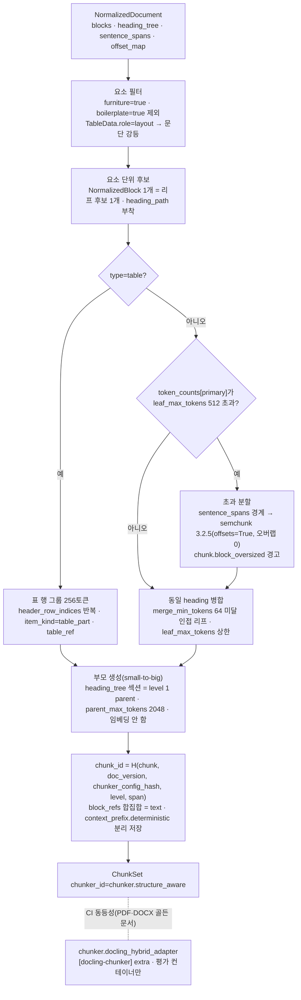

# ADR-0020: 기본 청커 StructureAwareChunker와 의존성 잠금(semchunk 3.2.5, tiktoken 0.12)

## 맥락과 문제

브리프 D-19 원안은 청킹 기본을 "Docling HybridChunker 계열 + 토큰 예산 병합 + 부모-자식 + 문맥 보강"으로 적었다. 청킹 연구 문서(07-tech-landscape/04)는 이 문구에서 세 가지 문제를 확인했다. (a) Docling의 `HybridChunker`·`HierarchicalChunker`는 입력이 `DoclingDocument`로 고정되어 있고 Docling에는 HWP/HWPX 백엔드가 없어(04 §1 함정 (a), §브리프와의 충돌), HWPX(python-hwpx)·HWP 5.0(Java 사이드카 → HWPX)·HTML(Trafilatura) 경로의 산출물에는 `ParsedDocument → DoclingDocument` 역변환(출처(provenance) 손실 검증 미완, 04 미해결 이슈 6) 없이는 적용할 수 없다. 한국어 1급 요구(R1, 원칙 6)에서 가장 중요한 HWPX 경로가 기본 청커의 사각지대가 되는 셈이다. (b) "문맥 보강 기본"이 LLM 요약으로 읽히면 개방 결정 O-05와 충돌한다(ADR-0016이 해소). (c) "late chunking 프로파일"은 mean pooling 장문 모델을 전제하는데 기본 임베더 BGE-M3(D-16)의 dense 벡터는 [CLS] 토큰 기반이라 직접 호환되지 않는다(04 §12; 매트릭스 §브리프 수정 제안 D-19).

의존성 측면의 문제도 함께 드러났다. docling-core 2.97.x의 `[chunking]` extra는 `semchunk>=2.2.0,<4.0.0`, `[chunking-openai]` extra는 `tiktoken>=0.9.0,<0.13.0`을 고정한다(04 §1 의존성 제약, 라이브러리 후보 표; v2.97.0 `pyproject.toml` 확인). 최신 semchunk 4.1.1(2026-06-13)·tiktoken 0.14.0(2026-08-17)과 Docling 청커 어댑터를 D-01의 단일 `uv` 잠금 파일에 함께 두면 해소가 실패한다(04 미해결 이슈 11). 게다가 semchunk 4.x는 유료 Isaacus API 기반 "AI chunking" 모드와 `chunkerify()` 키워드 전용 인자화(파괴적 변경)를 추가했고(04 §6), Docling은 주 2회 릴리스로 어댑터 파손 위험이 높다(매트릭스 §종합 리스크 #7; 바이블 §15 #9).

바이블은 이를 "ParsedDocument 네이티브 `StructureAwareChunker`(Docling HybridChunker 알고리즘 재현) 1차 + Docling 어댑터 `[docling-chunker]` extra 2차 + CI 동등성, 폴백 `chunker.flat_text`, semchunk 3.2.5·tiktoken 0.12 잠금"으로 확정했다(브리프 §4 D-19 개정 v1.1; 바이블 §3.1 D-19 `amended`, §4.2 `chunk` 행, §6.7, §7.3, §15 #9). 매트릭스 점수표에서 자체 구현과 Docling 어댑터는 88:88 동점이므로 선정 근거는 점수가 아니라 통합 제약이다(04 §선정 근거 점수표; 매트릭스 `chunker_default` 행). 본 ADR은 이 결정을 대안·근거와 함께 기록한다. 이 결정이 확정되어야 03-contracts/05(`ChunkSet`), 04-pipelines/10(청킹 전략), 10-development/05(CI 잠금 게이트), 09-operations/02(프로파일 `ingest.chunk`)가 같은 플러그인 ID·필드·기본값·버전을 쓸 수 있다.

## 결정 동인(decision drivers)

- **모든 파서 경로에 동일 동작(D-04, D-18)**: HWPX·HWP·PDF·DOCX·HTML·TXT/MD가 모두 자체 소유 `ParsedDocument` → `NormalizedDocument`로 수렴하므로(바이블 §4.2), 기본 청커는 이 계약 위에서 동작해야 포맷별로 청크 경계·ID·좌표가 갈리지 않는다. 벤더 모델 전용 청커를 기본으로 두면 R1의 HWPX가 2등 시민이 된다.
- **Adapters over Forks(원칙 2)**: Docling HybridChunker의 알고리즘(요소 단위 → 초과 분할 → 동일 heading 병합)은 차용하되 코드는 포크하지 않는다. 외부 라이브러리는 어댑터로 감싸고 우리 계약으로 변환한다.
- **결정성과 콘텐츠 주소화(원칙 4, K5, ADR-0004)**: `chunk_id = H("chunk", doc_version, chunker_config_hash, str(level), span)`이므로 청커는 I/O·시간·난수 없는 순수 함수여야 하고(바이블 §4.1), 같은 `NormalizedDocument`·같은 설정은 같은 `ChunkSet`을 내야 `stage_key` 캐시가 성립한다.
- **단일 좌표계(K1, ADR-0030)**: `Chunk.block_refs` 오프셋 합집합이 `text`를 재구성해야 인용·부모 확장·`answer_spans` 평가가 같은 좌표를 쓴다. 문자열 입력 청커는 오프셋을 우리가 재계산해야 하므로 오차 원천이 늘어난다(04 §어댑터 계약).
- **평가 주도(원칙 7, §7.4)**: 512/2048/64/256 등 크기 값은 초안 목표이며 `gate`가 붙는다(O-09, ADR-0019). 청커 선정은 값과 분리해 구조·계약·의존성만 확정한다.
- **단일 잠금과 pin-and-bump(D-01)**: `uv lock --check`가 CI 게이트이며, 빠른 릴리스 의존성은 정확 고정 후 계약 테스트 코퍼스 통과 시에만 범프한다(매트릭스 §어댑터·플러그인 공통 요구 3).
- **라이선스와 오픈소스 채택성(D-02, R2)**: semchunk·docling-core·tiktoken은 모두 MIT(A 등급)이나, semchunk 4.x의 유료 API 모드는 설정 표면에서 제외해야 한다(04 §브리프와의 충돌 "R2 vs semchunk 4.x").
- **한국어 문장 경계(원칙 6)**: semchunk의 구분자 계층에는 한국어 종결 규칙이 없어 번호 매기기("1.", "가.")에서 오분할할 수 있다(04 §6 함정). 형태소 기반 문장 분리기의 `sentence_spans`를 먼저 쓰고 semchunk는 예산 맞춤에만 쓴다.
- **표 질의 품질(R6)**: 헤더 반복 행 그룹과 `table_ref` 보존으로 색인 직렬화(triplet)와 표시 직렬화(HTML/Markdown)를 분리해야 표 조각이 자립적이면서 Context Pack에서 읽기 쉽다(04 §9).

## 고려한 대안

### 대안 1 — Docling `HybridChunker`를 1차 기본 청커로(브리프 원안, 바이블 기각)

- 설명: 모든 파서 경로의 `ParsedDocument`를 `DoclingDocument` 빌더 API(`add_heading/add_text/add_table/...`)로 역변환한 뒤 `HybridChunker(tokenizer=HuggingFaceTokenizer(..., max_tokens=512))`를 적용한다.
- 장점: LF AI & Data 재단 산하 성숙 구현(점수표 성숙도 5, 커뮤니티 4), heading 경로·캡션·`prov` 보존, 토큰 예산 병합·표 헤더 반복(`repeat_table_header=True`)·`contextualize()`가 이미 있다(04 §1). 자체 코드 신규 리스크가 없다.
- 단점: 입력이 `DoclingDocument`로 고정되고 HWP/HWPX 백엔드가 없어 역변환이 필수인데 bbox·charspan 손실 검증이 끝나지 않았다(04 미해결 이슈 6). `HuggingFaceTokenizer.max_tokens`를 생략하면 BGE-M3의 8192가 예산으로 들어가 병합이 사실상 일어나지 않는 함정(04 §1 함정 (b)), 기본 triplet 직렬화의 낮은 LLM 가독성(함정 (c)), 주 2회 릴리스·`docling-core` 상한이 코어 잠금을 묶는 문제(바이블 §15 #9)가 있다. 매트릭스는 "통합 제약" 때문에 2차로 강등했고 바이블 §3.1 D-19가 `amended`로 확정했다.

### 대안 2 — `flat_text`(문장 → semchunk 384 토큰, 오버랩 10%)를 기본으로(바이블 기각)

- 설명: 구조를 보지 않고 `display_text` 전체를 문장 경계로 나눈 뒤 semchunk로 384 토큰 예산을 맞추고 ±2 문장 윈도우를 붙인다(바이블 §7.3 `fallback`).
- 장점: 구현이 단순하고 파서 품질에 덜 민감하다. 구조가 빈약한 TXT·게시글에는 적합하다(04 §프로파일별 조합 `flat_text`).
- 단점: heading 경로·표 격자·목록 구조를 버리므로 결정적 `context_prefix`(D-19, K2)와 표 행 그룹이 성립하지 않고 부모(섹션) 단위가 없어 small-to-big이 불가하다. 재현 연구는 코퍼스 내 검색에서 구조 기반 청킹이 최고임을 일관되게 보고한다(04 §15: Beyond Chunk-Then-Embed nDCG@10 0.41~0.50, Systematic Investigation Paragraph Group 최고, 고정 문자 청킹 <0.244). 바이블은 이를 폴백 `chunker.flat_text`로만 둔다(§5.4 `chunker_id`, §7.1 `lite` 행).

### 대안 3 — 의미 분할(semantic splitter)을 기본으로(바이블 기각)

- 설명: Chonkie 1.7.0 `SemanticChunker`(`minishlab/potion-base-32M`, threshold 0.8) 또는 LlamaIndex `SemanticSplitterNodeParser` 개념으로 인접 문장 임베딩 유사도의 급변점을 청크 경계로 삼는다(04 §7).
- 장점: heading이 없는 장단락에서 주제 전환을 잡을 수 있고 Chroma 연구에서 `ClusterSemanticChunker` 400 토큰이 recall 91.3%로 최고 수준이었다(04 §7).
- 단점: 결과가 임베딩 모델·문서 유형에 크게 의존하고, LumberChunker 실험(DCG@20 44.74 vs 재귀 54.72)·Beyond Chunk-Then-Embed(late chunking 이득 −0.50)·Vectara(계산 비용이 일관된 이득으로 정당화되지 않음)가 구조 기반 대비 우위를 확인하지 못했다(04 §7; 매트릭스 `chunker_semantic` 행). 임베딩 호출이 청킹에 들어와 순수 함수·비용 원칙과 어긋난다. 바이블은 `semantic_experimental` 프로파일 옵션으로만 둔다(브리프 D-19 "프로파일 옵션").

### 대안 4 — 범용 문자열 스플리터(Chonkie·LangChain·LlamaIndex) 위에 구조 메타를 덧씌우기(기각)

- 설명: `RecursiveChunker`·`RecursiveCharacterTextSplitter`·`HierarchicalNodeParser` 같은 문자열 입력 청커로 나눈 뒤 heading·표·`prov`를 사후 매핑한다.
- 장점: 생태계가 크고(점수표 커뮤니티 5), 언어별 recipe(`default_kr.json`)·계층 노드 등 기성 기능이 많다(04 §2~§4).
- 단점: 입력이 문자열이라 구조 정보를 스스로 잃고 오프셋(`start_index`만 제공, 또는 `add_start_index` 옵션)을 우리가 재계산해야 하며, LlamaIndex는 노드·관계·`docstore`가 프레임워크에 묶여 `ChunkSet`·`IndexBackend`와 이중 상태가 된다(04 §3·§4 함정). Markdown/HTML 헤더 스플리터는 `ParsedDocument`가 이미 제공하는 구조를 중복 재추출한다. `langchain-experimental`은 sunset 진행 중이다(매트릭스 공통 요구 3 "sunset 공지 패키지 금지").

### 대안 5 — 최신 semchunk 4.x·tiktoken 0.14를 추종하고 Docling 어댑터를 폐기하거나 별도 잠금으로 분리(기각)

- 설명: 코어는 최신 버전을 쓰고, `docling-core[chunking]` 상한과 충돌하는 Docling 어댑터는 (a) 제공하지 않거나 (b) 별도 저장소·별도 잠금 파일로 뺀다.
- 장점: 4.x의 보안·버그 수정을 즉시 받고 상한 갱신을 기다리지 않는다.
- 단점: (a)는 자체 구현의 성숙도 3점 리스크를 상쇄하는 CI 동등성 기준선을 잃는다(04 §점수표 "성숙도 3점은 Docling 어댑터를 2차로 유지해 상쇄"). (b)는 D-01 "단일 저장소·`uv` 워크스페이스·`uv lock --check`"(바이블 §12)와 어긋나고 두 잠금의 버전 편차가 동등성 테스트 자체를 무효화한다. 우리가 호출하는 semchunk API(`chunk(text, chunk_size, token_counter, offsets=True, overlap=...)`)는 3.0.0 이후 동일하고 4.x 차이는 유료 AI 모드·키워드 전용화·Python 3.9 종료뿐이므로(04 §6), 3.2.5 고정은 기능 손실이 없다. tiktoken도 `o200k_base`는 0.7.0부터 있어 0.12.0으로 충분하다(04 §17).

### 대안 6 — late chunking을 `chunker` 확장 지점의 플러그인으로 모델링(기각)

- 설명: Chonkie `LateChunker`처럼 청커가 문서 전체를 임베딩 모델에 통과시킨 뒤 청크 경계로 토큰 임베딩을 풀링한다.
- 장점: 프로파일에서 청커만 바꾸면 켜진다.
- 단점: 청커가 임베딩 서빙(vLLM/TEI)에 의존해 `chunk` 스테이지가 GPU·외부 HTTP를 갖게 되고 `EmbeddedChunkSet`을 청커가 생산하는 경계 위반이 생긴다. 바이블은 late chunking을 임베더의 pooling 모드(`EmbeddedChunkSet.pooling = late`, §5.4; `Pooling` 열거 §5.7)로 두고 §7.4 (5)에서 mean pooling 모델을 강제한다. 구조(단락) 경계에서는 이득이 ≈0으로 재현되어 기대치도 낮다(04 §12 0.3.0 보정).

### 대안 7 — 채택: 계약 네이티브 `StructureAwareChunker` 1차 + Docling 어댑터 extra 2차 + `flat_text` 폴백 + semchunk 3.2.5·tiktoken 0.12.0 잠금

- 설명: Docling HybridChunker 알고리즘을 `NormalizedDocument` 위에서 재현한 자체 청커를 기본으로 두고, Docling 어댑터는 `[docling-chunker]` extra로 분리해 CI 동등성 기준선으로 유지하며, 의존성은 상한과 호환되는 버전으로 정확 고정한다.
- 장점: 모든 파서 경로에 같은 청커·같은 `chunk_id` 식·같은 불변식이 적용되고, 단일 잠금이 해소되며, 코드 변경 없이 상한 완화 시 범프할 수 있다.
- 단점: 자체 구현 유지 비용과 3.x 고정에 따른 수정 미수혜가 남는다. 아래 결과·준수 확인에서 다룬다.

## 결정

**결정:** 청킹 기본: **ParsedDocument 네이티브 `StructureAwareChunker`**(Docling HybridChunker 알고리즘 재현: 요소 단위 → 초과 분할(문장 → semchunk) → 동일 heading 병합 → 부모 생성; Docling 어댑터는 `[docling-chunker]` extra 2차 + CI 동등성) + **토큰 예산 병합**(자식 512 / 부모 2048 / 병합 하한 64, 임베딩 모델 토크나이저 기준) + **부모-자식(small-to-big; 부모는 반환 단위만, 임베딩 안 함)** + **표 행 그룹 청킹(256 토큰, 헤더 행 반복)** + **문맥 보강 = 결정적 `context_prefix`(문서 제목·heading 경로·캡션, 기본 켬, 본문과 분리 저장) + LLM 접두어·문서/섹션 요약(O-05 정책, 기본 끔)**. 의미 분할(semantic splitter)·late chunking(mean pooling 장문 모델 강제 검증)·proposition은 프로파일 옵션 — 브리프 §4 D-19(개정 v1.1), 바이블 §3.1 D-19 `amended`. 의존성은 **semchunk 3.2.5·tiktoken 0.12.0으로 잠근다**(`uv lock --check`, pin-and-bump; 바이블 §4.2 `chunk` 행 "in_process(StructureAwareChunker, semchunk 3.2.5)", §15 #9). 관련 ADR: [ADR-0019 청크 크기·토크나이저·recount](../06-adr/0019-chunk-size-tokenizer-defaults-and-recount-stage.md), [ADR-0016 LLM 보강 기본 끔](../06-adr/0016-llm-enrichment-default-off-and-budget-policy.md), [ADR-0029 3-텍스트 규칙](../06-adr/0029-three-text-rule-and-deterministic-context-prefix.md), [ADR-0004 결정적 chunk_id](../06-adr/0004-deterministic-chunk-id-scoped-record-id-and-ulid-exception.md), [ADR-0035 툴체인 고정](../06-adr/0035-python-version-and-toolchain-pins.md).

계약·프로파일·의존성 요소는 바이블의 철자를 그대로 쓴다.

| 요소 | 정본 값 | 바이블 |
|------|---------|--------|
| 스테이지 | `chunk`: `NormalizedDocument` → `ChunkSet`, 확장 지점 `chunker`, 격리 `in_process`; 선택 `recount`(`chunker` role `token_counter`, `token_counts` 키 추가만, 재청킹 아님); StagePolicy `ingest-cpu` / 5m / 3회 / `non_retryable` `chunk.tokenizer_missing`·`contract.violation` | §4.2, §4.4 |
| `chunker_id` | `chunker.structure_aware`(기본) / `chunker.docling_hybrid_adapter`(2차, `[docling-chunker]` extra) / `chunker.flat_text`(폴백); 모듈 `adapters/chunk/{structure_aware, flat_text, table_rows, recount, docling_hybrid_adapter(extra)}.py` | §5.4 `ChunkSet`, §6.7, §12 |
| 프로파일 `ingest.chunk` | `plugin: chunker.structure_aware`, `tokenizer: hf:BAAI/bge-m3`, `secondary_tokenizers: [tiktoken:o200k_base]`, `leaf_max_tokens: {value: 512, gate: {metric: ndcg@10, grid: [256, 384, 512, 768], dataset: ko-public-v1}}`, `parent_max_tokens: 2048`, `merge_min_tokens: 64`, `fallback: {plugin: chunker.flat_text, max_tokens: 384, overlap_ratio: {value: 0.10, gate: {grid: [0, 0.10, 0.15]}}, sentence_window_n: 2}`, `table_row_group_tokens: 256` — 값은 초안 목표(ADR-0019) | §7.2, §7.3, §7.4 |
| (1) 요소 단위 | `NormalizedBlock` 1개 = 리프 후보 1개(`block_id`로 `Block`과 1:1), `heading_tree`에서 `heading_path`·`numbering_path` 부착; `Block.furniture=true`·`NormalizedBlock.boilerplate=true`는 기본 청킹 제외; `TableData.role=layout` 표는 문단으로 강등 | §5.4 `Block`·`TableData`·`NormalizedBlock`·`NormalizedDocument` |
| (2) 초과 분할 | `token_counts[primary_tokenizer_id]`가 `leaf_max_tokens`를 넘는 리프는 `NormalizedBlock.sentence_spans` 경계 → semchunk(`offsets=True`) 순으로 분할, 구조 청크 오버랩 0(`fallback_overlap_ratio` 0.10은 `flat_text`만); `chunk.block_oversized` 경고(`warnings[]`, `stats.oversized_blocks`) | §3.2 O-09, §4.2, §5.7 |
| (3) 동일 heading 병합 | `merge_min_tokens` 미달 인접 리프는 같은 `heading_path`일 때만 병합하며 `leaf_max_tokens`를 넘지 않는다; 결과 `item_kind ∈ {text, list_group, code, table, table_part, figure}`, `level=0` | §5.4 `Chunk`, §5.7 `ItemKind`·`ChunkLevel` |
| (4) 부모 생성 | `heading_tree` 섹션 = `level=1`·`item_kind=parent`, `parent_max_tokens` 초과 시 섹션 내 순차 분할, `child_chunk_ids`·`parent_chunk_id` 상호 참조; 부모는 반환 단위만(임베딩 안 함, 불변식 (5)); `parent_expand`·`ChunkTextStore`의 원천 | §5.4, §8.2, §13.2 |
| 표 행 그룹 | `table_row_group_tokens` 256, `header_row_indices` 반복, `item_kind=table_part`, `table_ref{table_block_id, header_row_indices[], row_range[2], col_range[2], serialization: enum(TableSerialization), html_ref}`; 색인 직렬화 `triplet`, 표시 `html`(1차)/`markdown`; `chunk.count_exceeded`는 행 그룹 확대 후 재시도, 최종 비재시도(세트 상한 청크 50,000) | §5.1, §5.4, §5.7 |
| ID·불변식 | `span = "{first_block_id}:{char_start}-{last_block_id}:{char_end}"`, `chunk_id = H("chunk", doc_version, chunker_config_hash, str(level), span)`, `chunker_config_hash = H("config", canonical_json(config))`; 불변식 (1) `block_refs` 합집합 = `text` (2) `level=0 → token_counts[primary] ≤ leaf_max_tokens` (3) `context_prefix.* ⊄ text` (4) `parent_chunk_id` 세트 내 존재 (5) 부모 미임베딩 | §5.4 `Chunk`, §6.2 |
| 좌표 | `BlockRef.char_start/char_end`는 `Chunk.text`(display) 기준 코드포인트, `original_char_*`는 `NormalizedBlock.offset_map` 사상 결과; `sentence_spans`는 `text` 기준 | §5.3 `BlockRef`, §6.3 |
| 토큰 카운터 | `ctx.token_counter`(`TokenCounter{tokenizer_id}`)만 사용, `primary_tokenizer_id = hf:BAAI/bge-m3`, `secondary_tokenizer_ids = ["tiktoken:o200k_base"]`, `Chunk.token_counts` 병기; §7.4 (4) `chunk.tokenizer` = 임베딩 모델 토크나이저 | §3.2 O-09, §4.1, §5.4, §7.4 |
| 멱등성 | `stage_key = H("stage","chunk", scope_key, normalized.blake3, fingerprint)`, `fingerprint`에 `chunker_config_hash`·`primary_tokenizer_id` 포함 | §4.1, §4.2, §6.2 |
| 장르 규칙 | `genre_rules: {law_article: {heading_regex: "^제\\d+조", split_on: [항]}}`(YAML 이스케이프; 정규식 `^제\d+조`), 적용 장르는 `ChunkSet.genre_route`(enum(Genre)), `korean-gov`는 `law_article` 장르 라우팅 | §5.4, §5.7 `Genre`, §7.1, §7.3 |
| 옵션 | 의미 분할(`semantic_experimental`, Chonkie 1.7.0 `SemanticChunker`) — 프로파일 옵션; late chunking — 청커 아님, `EmbeddedChunkSet.pooling=late` + §7.4 (5) mean pooling 강제; proposition — 플러그인 `enricher`(O-05 정책, ADR-0016) | §5.4, §5.7 `Pooling`, §7.4 |
| 의존성 잠금 | semchunk 3.2.5(MIT; `offsets`·`overlap`은 3.0.0부터), tiktoken 0.12.0(MIT; `docling-core[chunking-openai]` 상한 `<0.13.0`), docling-core 2.97.x `[chunking]`은 `[docling-chunker]` extra에서만; 3.x/4.x 공통 API만 호출, `chunking_model`·`isaacus_client`(유료 모드) 미노출 | §6.7, §12, §15 #9; 04 §6·§17 |



의존성 선언은 상한을 코어에도 같은 값으로 명시하고 정확 버전은 잠금 파일이 정본이다(버전 근거: 04 §1·§6·§17, 확인일 2026-09-18~22).

```toml
# pyproject.toml 발췌(예시). 정확한 고정 버전은 uv.lock이 정본이며 CI `uv lock --check`로 강제한다.
[project]
dependencies = [
  "semchunk>=3.0.0,<4.0.0",   # uv.lock: 3.2.5 — offsets/overlap은 3.0.0부터; 상한은 docling-core[chunking]과 동일
  "tiktoken>=0.9.0,<0.13.0",  # uv.lock: 0.12.0 — 상한은 docling-core[chunking-openai]와 동일; o200k_base는 0.7.0부터
]

[project.optional-dependencies]
docling-chunker = ["docling-core[chunking]>=2.97,<3"]   # 2차 어댑터 chunker.docling_hybrid_adapter; CI 동등성 컨테이너에서만 설치
```

## 결과

### 긍정

- HWPX·HWP(→ HWPX)·PDF(Docling·pdftext)·DOCX·HTML(Trafilatura)·TXT/MD 전 경로가 같은 청커·같은 `chunk_id` 식·같은 불변식을 쓴다. O-09 그리드 비교, `parent_expand`, `answer_spans` 평가, 인용 좌표가 포맷에 독립적이다(K1).
- 청커가 순수 함수이므로 같은 `NormalizedDocument`·같은 `chunker_config_hash`는 같은 `ChunkSet`을 내고 `stage_key` 캐시가 성립한다. 임베더 교체는 재청킹이 아니라 `recount`로 끝난다(§4.2).
- semchunk 3.2.5 + tiktoken 0.12.0 + docling-core 2.97.x + docling 2.129.0이 하나의 `uv.lock`에서 해소된다(04 미해결 이슈 11 (a)). 우리가 호출하는 API가 3.x/4.x 공통이라 상한 완화 시 잠금 버전만 바뀐다.
- Docling 어댑터가 CI 동등성 기준선으로 남아 자체 구현의 신규 코드 리스크(점수표 성숙도 3)를 상쇄하고, 골든셋에서 어댑터가 우세하면 1차·2차를 뒤집을 근거가 생긴다.
- `table_ref` 보존으로 색인 직렬화(`triplet`)와 표시 직렬화(`html`/`markdown`)가 분리되어 표 조각의 자립성과 Context Pack `tables[].html` 렌더링을 동시에 얻는다.
- Docling의 잦은 릴리스가 코어 런타임 이미지에 전파되지 않는다(`[docling-chunker]` extra는 평가 컨테이너만; 바이블 §15 #9).

### 부정

- 자체 청커의 유지 비용이 생긴다. Docling이 알고리즘을 바꾸면 동등성 테스트가 드리프트를 감지하지만 어느 쪽이 맞는지는 골든셋으로 판단해야 한다.
- semchunk 3.x는 4.x만 유지될 경우 보안·버그 수정을 받지 못한다(04 §리스크). tiktoken도 0.12.0에 머문다.
- `[docling-chunker]` extra는 `transformers`·`tree-sitter`를 끌어와 CI 이미지 크기와 시간을 늘린다(04 §1 설치 extra).
- `ParsedDocument → DoclingDocument` 역변환의 `prov` 손실 검증이 끝나지 않아(04 미해결 이슈 6) 동등성 비교 범위는 우선 PDF·DOCX 골든 문서에 한정된다. HWPX 경로는 자체 구현만 검증한다.
- semchunk는 한국어 종결·번호 매기기를 모르므로 문장 분리기(`sentence_splitter`)가 정규식 폴백으로 내려가면 경계 품질 저하가 청킹까지 전파된다(`normalize.segmenter_fallback` 경고, §5.7).

### 중립

- 512/2048/64/256/0.10/2는 초안 목표이며 ADR-0019(O-09) 그리드로 확정한다. 본 ADR은 값을 정하지 않고 구조·계약·의존성만 확정한다.
- 의미 분할·late chunking·proposition은 옵션으로 남는다. late chunking은 청커가 아니라 임베더 pooling 모드이며 구조 경계에서의 기대치는 "중립"이다(04 §12).
- `context_prefix` 분리와 LLM 보강 기본값은 ADR-0029·ADR-0016이 소유한다. 본 ADR은 청커가 `context_prefix.deterministic`을 `text`와 분리해 생산한다는 점만 확정한다.
- 1차·2차는 점수 동점(88:88)이므로 선정은 통합 제약에 따른 것이다. 골든셋에서 어댑터 경로가 유의하게 우세하면 재검토한다.
- `chunker.flat_text` 폴백으로 라우팅하는 조건(heading 계층 부재 비율 등, 04 §실패 모드)은 04-pipelines/10이 정한다.

## 준수 확인 방법

| 강제 수단 | 내용 | 위치·근거 |
|-----------|------|-----------|
| 잠금 게이트 | `uv lock --check` 필수; 잠금 검사 스크립트가 `uv.lock`의 `semchunk == 3.2.5`·`tiktoken == 0.12.0`을 확인하고 불일치 시 실패(범프는 계약 테스트 코퍼스 통과 + 본 ADR 개정 PR만); `[docling-chunker]` extra를 포함한 해소가 별도 CI 잡으로 성공해야 한다 | 바이블 §12, §15 #9; [CI/CD](../10-development/05-ci-cd.md), [개발 환경](../10-development/02-development-environment.md) |
| API 표면 린트 | `adapters/chunk/*`의 semchunk 호출은 `chunk(text, chunk_size, token_counter, offsets=True, overlap=...)` 공통 시그니처만; `chunking_model`·`isaacus_client`·`ISAACUS_API_KEY` 문자열 금지; `docling_core` import는 `docling_hybrid_adapter.py`에서만(import-linter 계약); `chunk` 스테이지에 `temporalio`·`fastapi`·임베딩 클라이언트 import 금지 | 바이블 §4.1, §12; [코딩 표준](../10-development/03-coding-standards.md) |
| 스키마 제약 | `ChunkSet.chunker_id`는 3값 enum; `Chunk` 필수 필드(`chunk_id`, `span`, `item_kind`, `level`, `block_refs`, `sentence_spans`, `token_counts`, `context_prefix.*`, `text_source`, `ocr_confidence_min`, `content_hash`); `table_ref`는 `item_kind ∈ {table, table_part}`에서 조건 필수; `ItemKind`·`ChunkLevel`·`TableSerialization`·`Genre` 값은 §5.7 표와 CI 기계 대조 | 바이블 §1.2, §5.4, §5.7; [ChunkSet 계약](../03-contracts/05-chunk-set.md) |
| 불변식 계약 테스트 | (1) `block_refs` 오프셋 합집합 = `text`(표는 `serialization`으로 재구성) (2) `level=0` 청크의 `token_counts[primary_tokenizer_id] ≤ leaf_max_tokens` (3) `context_prefix.deterministic`·`generated`가 `text`의 부분 문자열이 아님 (4) `parent_chunk_id`·`child_chunk_ids` 상호 일치 (5) `level=1`은 `EmbeddedChunkSet.vectors`에 없음; `chunk_id`를 `span`·`chunker_config_hash`로 재계산해 일치 | 바이블 §5.4 불변식, §6.2; [테스트 전략](../10-development/04-testing-strategy.md) |
| 결정성·멱등성 | 적합성 키트 `contract_roundtrip`·`idempotency`: 같은 `NormalizedDocument`·같은 설정 2회 실행 → `chunk_set_id`·`created_at` 제외 동일 바이트, 동일 `chunk_id` 집합, 2회차 `cache_hit=true`; 설정 1개 변경 → `chunker_config_hash`·`stage_key` 변경 | 바이블 §4.1, §6.2; ADR-0032, ADR-0037 |
| CI 동등성(2차) | 평가 컨테이너에서 PDF·DOCX 골든 문서를 `chunker.structure_aware`와 `chunker.docling_hybrid_adapter`로 청킹해 청크 경계·`heading_path`·표 조각 수 일치율을 측정·기록하고 회귀를 감시한다(임계값은 테스트 전략 문서가 초안 목표로 정함); 어댑터는 `HuggingFaceTokenizer(..., max_tokens=leaf_max_tokens)`를 명시해야 하며 자동 결정(8192) 경로는 테스트로 차단 | 04 §1 함정 (b), §리스크; [벤치마크 계획](../08-evaluation/05-benchmark-plan-and-baselines.md) |
| 프로파일 검증 | `rag profile validate`: (4) `ingest.chunk.tokenizer` = 임베딩 모델 토크나이저·팩 카운터 일치, (5) `pooling=late` 임베더는 mean pooling 모델만, `leaf_max_tokens`·`overlap_ratio` 등 `gate` 값 변경은 `EvalReport.gate_result.passed` 없이는 `profile.invalid`; `fallback.plugin`은 등록된 `chunker` entry point | 바이블 §7.3, §7.4; [프로파일·정책 계약](../03-contracts/15-collection-profile-and-policy-contracts.md), [설정 레퍼런스](../09-operations/02-configuration-reference.md) |
| 실패 정책 테스트 | 단일 단락이 `leaf_max_tokens`의 수 배 → `chunk.block_oversized` 경고 + 강제 분할 + 정상 종료; 표가 세트 상한을 넘김 → 행 그룹 확대 재시도 후 `chunk.count_exceeded` 비재시도; `token_counter` 부재 → `chunk.tokenizer_missing` 비재시도(`StagePolicy.non_retryable_error_codes`) | 바이블 §4.2, §4.4, §5.7; [잡·이벤트 계약](../03-contracts/12-jobs-events-and-status.md) |
| 관측 | `rag_ingest_stage_duration_seconds{stage="chunk"}`, 이벤트 `ingest.document.chunked`, `ChunkSet.stats{leaf_count, parent_count, table_part_count, oversized_blocks}`가 채워지는지 계약 테스트 | 바이블 §5.4, §5.7, §6.5; [관측성](../09-operations/03-observability.md) |
| 코드 리뷰 항목 | (1) 새 `chunker` 플러그인이 `Stage` 5멤버를 구현하고 `fingerprint()`에 `chunker_config_hash`·`primary_tokenizer_id`를 포함하는가 (2) `furniture`·`boilerplate` 제외와 `layout` 표 강등을 처리하는가 (3) `BlockRef` 오프셋이 display 기준이고 `original_char_*`를 `offset_map`으로 사상하는가 (4) 문장 경계를 `NormalizedBlock.sentence_spans`에서 먼저 취하고 semchunk는 예산 맞춤에만 쓰는가 (5) 표 헤더를 초과 시에도 생략하지 않는가(`omit_header_on_overflow=false` 동등) (6) `context_prefix`를 `text`에 넣지 않는가 (7) 새 의존성이 A 등급이며 잠금 범프 사유가 PR에 있는가 | [플러그인 개발 가이드](../10-development/06-plugin-development-guide.md), [청킹 전략](../04-pipelines/10-chunking-strategies.md) |

## 재검토 조건

- docling-core가 `semchunk<4.0.0` 또는 `tiktoken<0.13.0` 상한을 완화하면(업스트림 이슈 제기 후 추적) semchunk 4.x(오프라인 표준 모드만)·tiktoken 0.13+로 범프한다 — 계약 테스트 코퍼스 통과 후 잠금 갱신, 본 ADR 제목의 버전만 개정(§1.2 patch).
- Docling 어댑터가 자체 `TokenCounter`만 주입해 `docling-core[chunking-openai]`가 불필요함이 확인되면 tiktoken 잠금을 해제하는 개정을 검토한다(04 미해결 이슈 11; tiktoken은 `token_counts` 병기용이라 상한이 사라지면 최신 추종 가능).
- 한국어 골든셋(바이블 §15 #1, ADR-0023)에서 `chunker.docling_hybrid_adapter` 경로가 `chunker.structure_aware`보다 nDCG@10·Recall@20에서 유의하게 우세하고 `prov` 손실 검증(04 미해결 이슈 6)이 통과되면 1차·2차를 뒤집는 개정을 발의한다.
- Docling이 HWP/HWPX 백엔드를 추가하거나 `HybridChunker`가 `DoclingDocument` 외 입력을 받게 되면 대안 1의 통합 제약을 재평가한다. 그 경우에도 CI 동등성과 계약 네이티브 폴백은 유지한다.
- semchunk 3.x가 유지보수 종료·보안 이슈로 고정 불가가 되면 리프 초과 분할을 MIT 알고리즘 내재화(`RecursiveTextChunker`) 또는 semantic-text-splitter(Rust, MIT)로 교체한다(04 §6 대안, 미해결 이슈 8 비교 결과 반영).
- ADR-0019(O-09) 그리드 결과로 512/2048/64/256/오버랩 값이 바뀌어도 본 ADR의 구조 결정은 불변이다. 다만 `merge_min_tokens`·`table_row_group_tokens`의 의미가 바뀌는 변경은 본 ADR을 함께 개정한다.
- ADR-0021로 Kiwi가 기본 문장 분리기로 승격되면 `sentence_spans` 원천이 바뀌어 `normalizer_fingerprint` → `normalized.blake3` → `chunk` 재실행이 일어난다. 청커 구조는 불변이나 동등성 기준선을 재생성한다.
- 청킹 품질 직접 지표(MoC Boundary Clarity·Chunk Stickiness, Adaptive Chunking Block Integrity)가 한국어 골든셋에서 리트리벌 지표와 상관을 보이면 `genre_rules`를 heading 밀도·문서 길이 외 지표 기반 라우팅으로 확장하는 개정을 검토한다(04 §15 (4), 미해결 이슈 12).

## 참조

- [설계 브리프](../00-vision/00-design-brief.md) §2 R1·R2·R6, §3 원칙 2·4·6·7, §4 D-01·D-02·D-04·D-16·D-18·D-19(개정 v1.1), §5 O-05·O-09, §7 재현성
- [설계 바이블](../02-architecture/00-design-bible.md) §1.2, §2.1 K1·K2·K5, §3.1 D-19, §3.2 O-05·O-09, §3.3 0020 행, §4.1, §4.2 `chunk`·`recount` 행, §4.4 chunk/recount, §5.1 `ChunkSet`, §5.3 `BlockRef`·`TokenCounts`·`Producer`, §5.4 `ParsedDocument`(`Block`·`TableData`)·`NormalizedDocument`(`NormalizedBlock`)·`ChunkSet`(`Chunk`)·`EmbeddedChunkSet`(`pooling`), §5.7 `ItemKind`·`ChunkLevel`·`TableSerialization`·`TableRole`·`Genre`·`Pooling`·오류 카탈로그 `chunk.*`, §6.1 `plugin_id`·`tokenizer_id`, §6.2 `chunk_id`·`chunker_config_hash`·`stage_key`, §6.3, §6.7 extras, §7.1 청킹 행, §7.2, §7.3 `ingest.chunk`, §7.4 (4)·(5), §12 `adapters/chunk`, §15 #4·#8·#9
- [기술 지형 종합: 선정 매트릭스](../07-tech-landscape/00-summary-and-selection-matrix.md) §문서 간 상충 판정 J-5, §매트릭스 `chunker_default`·`chunker_semantic`·`sentence_splitter` 행, §프로파일별 기본 조합 청킹 행, §개방 결정 권고 O-09, §브리프 수정 제안 D-19·D-01, §ADR 발의 목록 P1 "기본 청커 StructureAwareChunker와 의존성 잠금", §어댑터·플러그인 공통 요구 2·3·4·5, §종합 리스크 #7
- [청킹 전략·라이브러리](../07-tech-landscape/04-chunking-strategies-and-libraries.md) §라이브러리 후보(docling-core·semchunk·tiktoken·Chonkie 행), §1 Docling HybridChunker(진입점·의존성 제약·함정), §2~§4, §6 semchunk(버전 제약·API), §7 의미 분할, §8 small-to-big, §9 표 청킹, §12 late chunking, §13 proposition, §15 크기·오버랩 종합, §17 토큰 카운팅, §권고안, §선정 근거 점수표(88:88), §어댑터 계약, §실패 모드, §브리프와의 충돌, §리스크 및 완화, §결정 사항 요약(0.3.0), §미해결 이슈 6·8·11·12
- 관련 ADR: [ADR-0001 라이선스 등급표](../06-adr/0001-license-grade-table-and-d02-interpretation.md), [ADR-0002 provenance](../06-adr/0002-provenance-element-path-and-nullable-page-bbox.md), [ADR-0004 결정적 chunk_id](../06-adr/0004-deterministic-chunk-id-scoped-record-id-and-ulid-exception.md), [ADR-0006 PDF 고속 경로](../06-adr/0006-pdf-fast-path-pypdfium2-pdftext-replaces-pymupdf.md), [ADR-0016 LLM 보강 기본 끔](../06-adr/0016-llm-enrichment-default-off-and-budget-policy.md), [ADR-0019 청크 크기·recount](../06-adr/0019-chunk-size-tokenizer-defaults-and-recount-stage.md), [ADR-0021 한국어 분석기](../06-adr/0021-korean-analyzer-kiwi-promotion-and-interim-mecab-kss.md), [ADR-0023 평가 하네스](../06-adr/0023-evaluation-qrels-answer-spans-and-linear-ndcg.md), [ADR-0029 3-텍스트 규칙](../06-adr/0029-three-text-rule-and-deterministic-context-prefix.md), [ADR-0030 단일 좌표계](../06-adr/0030-single-coordinate-system-and-score-ledger.md), [ADR-0031 프로파일 게이트](../06-adr/0031-profile-schema-extends-and-quality-gates.md), [ADR-0032 적합성 키트](../06-adr/0032-plugin-sdk-stage-protocol-and-conformance-kit.md), [ADR-0035 툴체인 고정](../06-adr/0035-python-version-and-toolchain-pins.md), [ADR-0037 산출물 캐시 스코프](../06-adr/0037-artifact-cache-scope-and-stage-key-composition.md)
- 계약·파이프라인·운영 문서: [ParsedDocument](../03-contracts/03-parsed-document.md), [NormalizedDocument](../03-contracts/04-normalized-document.md), [ChunkSet](../03-contracts/05-chunk-set.md), [EmbeddedChunkSet·IndexRecord](../03-contracts/07-embedded-chunk-set-and-index-record.md), [프로파일·정책 계약](../03-contracts/15-collection-profile-and-policy-contracts.md), [청킹 전략](../04-pipelines/10-chunking-strategies.md), [임베딩](../04-pipelines/12-embedding.md), [플러그인 아키텍처](../02-architecture/05-plugin-architecture.md), [저장소 구조](../10-development/01-repository-structure.md), [CI/CD](../10-development/05-ci-cd.md), [테스트 전략](../10-development/04-testing-strategy.md), [설정 레퍼런스](../09-operations/02-configuration-reference.md), [벤치마크 계획](../08-evaluation/05-benchmark-plan-and-baselines.md)
