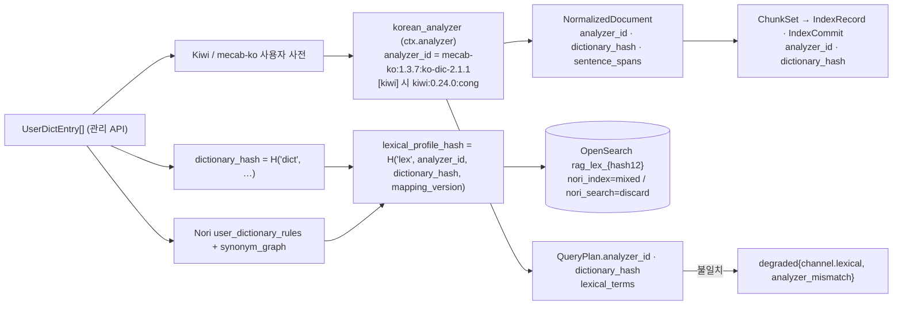

# ADR-0021: 한국어 분석기: Kiwi 승격 조건과 공백기 기본(python-mecab-ko + kss)

## 맥락과 문제

브리프 원칙 6(Korean-First, Multilingual-Ready)은 "한국어 토크나이징(Nori/Kiwi)"을 동급으로 명명하지만, 두 이름은 서로 다른 역할이다. 서버 측 렉시컬 분석기(lexical analyzer)는 `standard` 이상 프로파일의 OpenSearch `analysis-nori`가 맡고(D-15), 플랫폼 측 형태소 분석기(morphological analyzer, 역할 `korean_analyzer`)는 질의 정규화·키워드 추출(`lexical_terms`), `lite` 프로파일의 `sparse_bm25` 토큰화(ADR-0012), 결정적 보강의 NNG/NNP 키워드(`enricher.korean_keywords`), 문장 분리(역할 `sentence_splitter`)를 담당한다(바이블 §3.1 D-10 — `normalizer` 그룹 roles `korean_analyzer`/`sentence_splitter`/`pii_detector`, §4.1 `ctx.analyzer`, §7.1). 선정 매트릭스 판정 J-7과 07-tech-landscape/13은 플랫폼 측 1차 후보로 Kiwi(kiwipiepy)를 골랐다(가중 점수 93/100, Apache-2.0 전제; 13 §선정 근거 점수표).

문제는 라이선스 전환기다. Kiwi C++ 코어는 v0.24.0(2026-09-13)부터 Apache-2.0이지만, Python 바인딩 kiwipiepy의 PyPI 최신판 0.23.2(2026-06-11)는 LGPLv3 코어를 **정적 링크한 wheel**이며, Apache-2.0 전환은 기여자 동의 절차(이슈 #233, 2026-09-17 개설)가 진행 중이고 0.24.0 wheel은 미공개다(13 §후보 목록 A, §Kiwi 함정 (1); as of 2026-09-22 open). D-02(개정 v1.1, ADR-0001)의 라이선스 등급표는 LGPL을 B 등급으로 두어 "동적 링크·선택 extra만, 정적 링크 휠 기본 설치 금지"로 규정하고, 바이블 §7.4 (1)은 `PluginMeta.license_grade=B`이고 `linkage=static_bundled`인 플러그인을 프로파일 로딩에서 거부한다. 따라서 kiwipiepy 0.23.2는 기본 의존성이 될 수 없다.

그런데 플랫폼 측 분석기가 없으면 `lite`(Qdrant 단독, OpenSearch 없음 — 바이블 §7.1)는 렉시컬 레그를 유니코드 경계 토큰화로 강등해야 하며, 이는 MIRACL-ko 10K 문서 실험에서 nDCG@10 0.36(Qdrant charabia)·0.41(Vespa ICU)에 그친 방식이다. 형태소 분석(MeCab·Nori)은 0.61~0.64였다(13 §BM25 토크나이징 전략 비교; 06 인용). D-15(개정 v1.1)는 이 때문에 경량 프로파일 전제로 "플랫폼 측 `korean_analyzer` 필수"를 명시했다(바이블 §7.4 (9), ADR-0012). 한편 서버 측 Nori는 사전이 mecab-ko-dic 2.1.1-20180720으로 고정되어 기관명·신조어 재현율이 사용자 사전 운영에 달려 있고, 기본 `decompound_mode=discard`는 복합명사 원형을 버린다(13 §Lucene Nori 함정 (1)·(2); 06 §한국어 렉시컬 분석기 비교).

결정할 것은 네 가지다. (1) Apache-2.0 kiwipiepy 공개 전 **공백기 기본** 분석기·문장 분리기, (2) Kiwi **승격 조건**과 승격 시 바뀌는 것, (3) 분석기 전환·사전 변경이 색인·질의 일관성을 깨지 않도록 하는 기록·감지 장치(`analyzer_id`·`dictionary_hash`), (4) Kiwi/mecab-ko 사용자 사전과 Nori `user_dictionary_rules`·`synonym_graph`의 단일 소스. 매트릭스는 이를 P2 ADR로 등록했고(07-tech-landscape/00 §ADR 발의 목록 P2, §브리프 수정 제안 원칙 6·D-02·D-15), 바이블 §3.3 0021 행과 §미해결 이슈 15가 본 ADR을 지정한다.

## 결정 동인(decision drivers)

- **라이선스(D-02, ADR-0001)**: 코어 인프로세스 의존은 A 등급만(바이블 §12 "코어는 A 등급 순수 Python만 인프로세스 의존"). B 등급 정적 링크 wheel은 `optIn` + 명시 extra 없이는 거부(§7.4 (1)). LGPL 정적 링크는 Apache-2.0 배포물에 재링크 가능성 제공 의무를 발생시킨다(13 §브리프와의 충돌 D-02).
- **한국어 렉시컬 품질(원칙 6, D-07, D-15)**: 형태소 토큰화 유무가 BM25 nDCG@10에 절대값 0.2 이상 차이를 낸다(13 §BM25 토크나이징 전략 비교). `lite`도 `eval.gates.ndcg@10.min 0.70 / recall@20.min 0.85`(초안 목표, 바이블 §7.2)를 통과해야 한다.
- **색인·질의 토큰화 일관성(브리프 §7 재현성)**: 색인과 질의가 같은 `analyzer_id`·`dictionary_hash`를 참조해야 BM25 점수가 자기 일관적이다(07-tech-landscape/00 §어댑터·플러그인 공통 요구 6). 분석기 전환은 조용히 일어나면 안 되고 재색인으로 드러나야 한다(13 §리스크 "공백기 기본과 1차의 토큰·태그 차이").
- **설치 용이성(D-01 Python 3.12/3.13, 3개 OS)**: 네이티브 빌드·JVM 없이 `pip install`로 끝나야 한다. python-mecab-ko 1.3.7은 Windows·macOS·manylinux wheel 45개(cp37~cp312)와 사전 자동 의존을 제공하고, pecab은 2022-12 이후 릴리스가 없다(13 §MeCab-ko 진입점, §선정 근거 점수표 0.2.0 재산정 메모). 단, Python 3.13 wheel 제공은 확인 필요(as of 2026-09; 13 미해결 이슈 3)이며, 미제공 시 아래 재검토 조건을 따른다.
- **단일 좌표계(K1)와 문장 오프셋**: `NormalizedBlock.sentence_spans{start, end, sub_spans[]}`는 표시 텍스트 기준 코드포인트 오프셋이다(바이블 §5.4, §6.3). 오프셋을 직접 주지 않는 도구(mecab-ko, wtpsplit)는 어댑터가 재구성해야 한다(13 §MeCab-ko 출력 형식, §후보 목록 B).
- **교체 가능성(원칙 2, D-10)**: 분석기는 `normalizer` 확장 지점의 역할 플러그인이며 스테이지는 `ctx.analyzer`만 본다(바이블 §4.1). 어댑터 뒤에서 교체되므로 점수표는 절대 평가가 아니라 우선순위다(13 §0.2.0 재산정 메모).
- **유지보수·운영 리스크**: Kiwi·kss·pecab·python-mecab-ko는 모두 개인 프로젝트다(13 §리스크; 바이블 §15와 매트릭스 §종합 리스크 #6). Nori(ASF)는 폴백으로 남긴다. Kiwi 모델은 별도 패키지(`kiwipiepy_model`, 약 84 MiB 압축)이고 프로세스당 로딩 약 1.4 s, python-mecab-ko는 사전 약 34.5 MB·로딩 0.0007 s다(13 §리소스 요구, 측정·참고치).

## 고려한 대안

### 대안 1 — kiwipiepy 0.23.2(LGPLv3)를 기본 설치(바이블 기각)

- 설명: 07-tech-landscape/07이 잠정 제안한 방식으로, 현재 PyPI wheel을 그대로 기본 의존성(또는 사실상 항상 설치되는 extra)으로 쓴다(매트릭스 J-7 "07: kiwipiepy 0.23.2(LGPL)를 extra로 잠정 사용").
- 장점: 후보 중 최고 점수(Apache 전제 93, 현재 81)와 기능 — `split_into_sents` 오프셋·서브문장, `typos='basic'` 오타 교정, `space()` 띄어쓰기 복원, `add_user_word` 런타임 사용자 사전, CoNg 문맥 모델, 처리량 약 61K자/s(13 §Kiwi 진입점·본 문서 측정). 승격 시 재색인이 불필요하다.
- 단점: LGPLv3 정적 링크 wheel은 D-02 B 등급 "정적 링크 휠 기본 설치 금지"에 정면으로 걸리고, 바이블 §7.4 (1)이 `license_grade=B` ∧ `linkage=static_bundled`를 거부한다. 07의 "LGPL은 GPL과 다르다"는 의견은 12 문서 §6.1 D-02 판정 규칙(B 등급: 정적 포함 금지, 우선 A 대안 탐색)과 매트릭스 J-7 판정으로 기각되었다. 바이블 §7.1이 "현행 0.23.2는 LGPL 정적 링크 wheel(`linkage=static_bundled`)로 기본 설치 금지(D-02 B)"로 확정.

### 대안 2 — Nori 단독(서버 측 분석기만, 플랫폼 측 분석기 없음)(바이블 기각)

- 설명: 06·11 문서의 "Nori 서버 분석기 기본, Kiwi 옵션"을 문자 그대로 적용해 플랫폼(Python) 측 형태소 분석기를 두지 않고, 필요 시 OpenSearch `POST /<index>/_analyze`를 호출한다(매트릭스 J-7 문서별 의견).
- 장점: ASF 유지보수·운영 검증·서버 내장으로 추가 의존성이 없다. `user_dictionary`·`nori_readingform`·`nori_number` 등 필터가 갖춰져 있다(13 §Lucene Nori 진입점).
- 단점: `lite`에는 OpenSearch가 없어(바이블 §7.1) 렉시컬 레그가 유니코드 경계 BM25로 강등된다(nDCG@10 0.36대). `standard`에서도 질의 이해·키워드 추출·문장 분리마다 `_analyze` 왕복이 필요하고(13 §Nori 함정 (3)), 문장 분리 기능은 없다. 사전이 2018-07 고정이라 플랫폼 측에서도 갱신할 수 없다. D-15(개정 v1.1) "플랫폼 측 `korean_analyzer` 필수"와 §7.4 (2)·(9)에 어긋나 기각. 서버 측 Nori 자체는 유지한다(아래 결정).

### 대안 3 — 공백·유니코드 경계 토큰화(형태소 분석기 없음)(바이블 기각)

- 설명: OpenSearch `standard`·Qdrant `multilingual`(charabia) 토크나이저처럼 어절 단위로 BM25를 계산한다.
- 장점: 의존성·사전·모델이 전혀 없고 색인이 작다. 정확 어절 일치의 정밀도는 높다.
- 단점: 조사·어미가 붙은 "정보를"·"정보의"·"정보가"가 모두 다른 토큰이 되어 재현율이 매우 낮다(13 §BM25 토크나이징 전략 비교 — MIRACL-ko 0.36/0.41 vs 형태소 0.61~0.64). D-07 "lexical(BM25, 한국어 형태소)"과 O-09 "렉시컬 토큰화는 형태소 분석기(혼용 금지)"(바이블 §3.2)를 위반하며, 13 §프로파일별 조합은 이를 "경고 로그를 남기는 강등 상태"로만 취급한다. 기각.

### 대안 4 — 기타 후보(공백기 기본·문장 분리기 후보)

| 후보 | 설명 | 장점 | 단점·판정 | 근거 |
|------|------|------|-----------|------|
| pecab | mecab-ko-dic 기반 순수 Python 분석기(Apache-2.0) — 매트릭스 0.1.0 판의 공백기 후보 | 설치 무의존, 라이선스 깨끗 | 1.0.8(2022-12) 이후 약 3년 9개월 릴리스 없음; kss 파이프라인 내 mecab 대비 약 160배 느림(대량 색인 부적합) → **wheel 설치 불가 환경의 순수 Python 폴백**으로만 | 13 §후보 목록 A, §1차/2차/폴백 |
| lindera-python + ko-dic | Rust 형태소 분석기 바인딩(MIT, 5.3.0 2026-08) | 라이선스·wheel 깨끗, 활발 | 사전을 별도 배포해야 하고 한국어 품질 독립 검증 자료 없음(가중 76) → lindera 백엔드(Milvus/LanceDB) 프로파일의 토큰 일관성용으로 재평가 | 13 §선정 근거 점수표, §MeCab-ko 함정 |
| Kiwi C++(Apache-2.0) 직접 바인딩(cffi) 자체 유지 | kiwipiepy를 우회해 Apache 코어를 직접 바인딩 | 라이선스 즉시 해소 | 바인딩 유지 비용이 우리에게 귀속되어 원칙 2(Adapters over Forks) 위배; 13 §리스크가 "Apache 전환 장기 지연 시 검토"로만 둠 | 13 §리스크 및 완화 |
| KoNLPy 계열·PyKoSpacing | GPL-3.0 라이브러리 | 생태계 인지도 | GPL 라이브러리는 플랫폼 코드 import 금지(D-02 C 등급은 별도 컨테이너 + 네트워크 API만) → 평가 하네스 격리 컨테이너에서만 | 13 §KoNLPy 계열, §띄어쓰기 교정과 정규화 도구 |
| 문장 분리 wtpsplit SaT 2.2.1 | 85개 언어 신경망 문장 분리(MIT, 한국어 포함) | 구두점 없는 텍스트에 강건, 다국어 컬렉션 공용 후보 | torch/모델 의존, 문자열 리스트 반환(오프셋 재계산), 한국어 정확도 미검증 → 골든셋 비교 후 재검토 | 13 §후보 목록 B; 04 §후보 목록 |
| 문장 분리 kss `fast`·`mecab` 백엔드 | kss의 다른 백엔드 | `fast`는 경량, `mecab`은 형태소 휴리스틱 | `fast`는 "…참조). 그는 …"를 1문장으로 병합(3/4, 13 측정) → **사용 금지**; `mecab`은 python-mecab-ko 설치 시 선택 가능(공백기 기본은 `punct`) | 13 §문장 분리: Kiwi vs kss vs 정규식 |

### 대안 5 — 채택: python-mecab-ko + kss `punct` 공백기 기본, Kiwi `[kiwi]` extra, Apache wheel 공개 후 승격

- 설명: 기본 설치는 python-mecab-ko 1.3.7(BSD-3-Clause, mecab-ko 엔진 포함 wheel) + python-mecab-ko-dic 2.1.1.post2(Apache-2.0) + kss 6.0(BSD-3-Clause) `split_sentences(backend="punct")`. Kiwi는 `rag-platform[kiwi]` 선택 extra로 오버라이드하며, kiwipiepy 0.24.0 Apache-2.0 wheel의 PyPI 공개가 확인되면 본 ADR을 개정해 기본을 Kiwi로 승격한다. 서버 측은 항상 Nori `mixed`(색인)/`discard`(질의)다(매트릭스 J-7 판정; 13 §결정 사항 요약).
- 장점: 기본 설치가 A 등급 wheel만으로 구성되어 D-02 게이트를 통과하고 3개 OS에서 네이티브 빌드 없이 설치된다(wheel 범위 cp37~cp312, 13 §MeCab-ko 진입점; Python 3.13 wheel은 확인 필요 as of 2026-09, 13 미해결 이슈 3). MIRACL-ko 연구에서 MeCab 형태소 BM25는 0.61~0.64로 Nori와 동급이다(13 §MeCab-ko 성능 근거). 현 시점 점수는 python-mecab-ko 83 > Kiwi 81(LGPL 감점), 문장 분리는 kss `punct` 89 > Kiwi 81이다(13 §선정 근거 점수표 0.2.0). 전환은 `analyzer_id` 변경으로 드러나고 렉시컬 재색인만 유발하므로 구조가 바뀌지 않는다.
- 단점: mecab-ko 사전도 2018-07 고정이라 사용자 사전 의존이 크고, 문자 오프셋을 직접 주지 않으며(`node.rlength` 재구성), 사용자 사전은 `mecab-dict-index` 컴파일이 필요해 Kiwi `add_user_word`보다 운영이 번거롭다(13 §MeCab-ko 함정). 질의 오타·띄어쓰기 교정은 공백기에 제공되지 않는다(바이블 §8.1 2단계 "mecab-ko는 교정 생략"). 아래 결과·준수 확인으로 완화한다.

## 결정

**결정:** 공백기 기본 한국어 분석기·문장 분리는 python-mecab-ko 1.3.7 + kss 6.0 `punct`이며 Kiwi는 `[kiwi]` extra 오버라이드다(정본 YAML §7.3은 mecab-ko + kss). kiwipiepy 0.24.0 Apache-2.0 wheel의 PyPI 공개 확인 후 ADR-0021 개정으로 승격 — 확인 필요(as of 2026-09; 이슈 #233 open). 현행 0.23.2는 LGPL 정적 링크 wheel(`linkage=static_bundled`)로 기본 설치 금지(D-02 B) — 바이블 §7.1 "한국어 분석기·문장 분리" 행. 공백기 한국어 분석기 기본은 mecab-ko + kss, Kiwi는 `[kiwi]` extra(`linkage=static_bundled` B 등급 거부) — 바이블 §결정 사항 요약(v1.1). kiwipiepy 0.24.0(Apache-2.0) PyPI 공개 확인 후 ADR-0021 개정으로 §7.3 YAML 기본을 Kiwi로 승격(`analyzer_id` 변경 → 렉시컬 재색인) — 바이블 §미해결 이슈 15. 렉시컬 인덱스 기본 OpenSearch(analysis-nori; 색인 `decompound_mode=mixed`/질의 `discard`, 컬렉션 사용자 사전 파이프라인 필수, DLS 이중 방어) — 브리프 §4 D-15(개정 v1.1), 바이블 §3.1 D-15 `amended`. 관련 ADR: [ADR-0001 라이선스 등급표](../06-adr/0001-license-grade-table-and-d02-interpretation.md), [ADR-0012 경량 프로파일 BM25](../06-adr/0012-lite-profile-qdrant-only-client-bm25.md), [ADR-0014 sparse 표현](../06-adr/0014-sparse-representation-bge-m3-lexical-leg-kept.md), [ADR-0019 청크·토크나이저](../06-adr/0019-chunk-size-tokenizer-defaults-and-recount-stage.md).

계약 요소는 바이블의 철자를 그대로 쓴다.

| 요소 | 정본 값 | 바이블 |
|------|---------|--------|
| `analyzer_id` 형식·값 | `{engine}:{version}:{dictionary}`; `mecab-ko:1.3.7:ko-dic-2.1.1`(공백기 기본), `kiwi:0.24.0:cong`(확인 필요 as of 2026-09; `[kiwi]` extra), `nori:3.8:mecab-ko-dic-2018-07`(서버 측) | §6.1 |
| 프로파일 YAML 기본(전 프로파일 동일, `base`에서 상속) | `ingest.normalize.analyzer: {plugin: normalizer.mecab_ko, user_dictionary: collection}`, `sentence_splitter: {plugin: normalizer.kss_punct, fallback: normalizer.regex_sentences}`; `[kiwi]` 설치 시 오버라이드 예 `analyzer: {plugin: normalizer.kiwi, fallback: normalizer.mecab_ko}`, `sentence_splitter: {plugin: normalizer.kiwi_sentences, fallback: normalizer.kss_punct}` | §7.3 |
| 플러그인 역할·위임 | `normalizer` 그룹 roles `korean_analyzer`·`sentence_splitter`(`PluginMeta.role`); `enricher.korean_keywords`·`query_transformer.korean_normalize`·lite `sparse_bm25` 토큰화는 `ctx.analyzer` 위임(Kiwi 또는 공백기 mecab-ko) | §3.1 D-10, §3.2 O-05, §4.1, §7.3 |
| 질의 측 | Kiwi 설치 시 `typos='basic'` + `space()` 교정 → `QueryPlan.normalized_query`(공백기 mecab-ko는 교정 생략); NNG/NNP/SL/SN → `lexical_terms{term, weight, tag}`(사용자 사전 가중 1.5); `KeywordSource` `analyzer_nng`/`analyzer_nnp`/`user_dict` | §8.1 2단계, §5.5 `QueryPlan`, §5.7 |
| 문장 분리 폴백 체인 | 문장 분리기 예외 → kss → 정규식 폴백 + `warnings`(경고 코드 `normalize.segmenter_fallback`); 결과는 `NormalizedBlock.sentence_spans{start, end, sub_spans[]}`(display 기준) | §4.2 `normalize`, §5.4, §5.7 |
| 텍스트 이중 뷰 | `display_text` NFC / `lexical_text` NFKC(기호 통일, 한자 독음, 띄어쓰기 교정 opt-in; BM25·키워드 입력); `normalization_report.spacing_corrected`; `lexical_text`에 U+1100~U+11FF 잔존 없음(`normalize.nfd_residual`) | §5.4 `NormalizedBlock`, §6.3 |
| 서버 측 Nori | `index_text` analyzer `nori_index`=`mixed`, search_analyzer `nori_search`=`discard`, stoptags `J*`·`E*`·`S*`; 보조 `cjk_bigram`(boost 0.1), `lexical_terms` keyword(boost 0.3), `context_prefix`(boost 0.5); YAML `analyzer: {index: nori_mixed, search: nori_discard, stop_tags: ["J*", "E*", "S*"]}` | §7.3, §8.1 7단계, §13.4 |
| 사용자 사전 단일 소스 | `UserDictEntry{entry_id, tenant_id, collection_id, surface, pos, reading, synonyms, weight, source: enum(DictSource), updated_at}` → Kiwi·mecab-ko 사용자 사전, Nori `user_dictionary_rules`, `synonym_graph` 생성; `GET/PUT /v1/collections/{collection_id}/dictionary`; `dictionary_hash = H("dict", *sorted(entry 정규화 행))`; `korean-gov`는 컬렉션 사용자 사전 필수 | §5.6, §6.2, §7.1, §14 |
| 기록·전파 | `NormalizedDocument.analyzer_id`·`dictionary_hash`(Y) → `ChunkSet` 전파 → `IndexRecord`(keyword, "질의 시 공간·분석기 불일치 감지") · `IndexCommit`("변경 시 렉시컬 재색인 트리거") · `CollectionSpec{analyzer_id, dictionary_hash, dictionary_ref}` | §5.4, §5.6 |
| 불일치 감지 | `QueryPlan.analyzer_id`·`dictionary_hash`가 컬렉션 값과 불일치 → `degraded += {component: "channel.lexical", reason: "analyzer_mismatch"}`; 다중 컬렉션에서 `analyzer_id` 혼합 시 `convex_*` 융합은 `rrf`로 강등 + `degraded{fusion, profile_mismatch}` | §5.5, §3.2 O-01, §8.1 6단계 |
| 해시·물리명 | `normalizer_fingerprint = H("normalizer", plugin_id, plugin_version, config_hash, analyzer_id, dictionary_hash, pii_policy, pii_detector_version)`(`normalize` `stage_key` 구성요소); `lexical_profile_hash = H("lex", analyzer_id, dictionary_hash, mapping_version)` → OpenSearch 물리 인덱스 `rag_lex_{lexical_profile_hash[:12]}` | §4.2, §6.2, §13.4 |
| 라이선스 메타·게이트 | `PluginMeta.license`·`license_grade`(`LicenseGrade`)·`linkage`(`Linkage`: `pure_python, dynamic, static_bundled`) 필수; `license_grade=B` ∧ `linkage=static_bundled` → 거부(명시 extra 설치 + `optIn` 필요); 코어 extras `[kiwi]` | §5.6, §5.7, §6.7, §7.4 (1) |



`UserDictEntry` 예시(ULID·해시는 형식 예시):

```json
{
  "entry_id": "01J9ZQ4K7X2M8N3P5R6S7T8V9W",
  "tenant_id": "01J9ZQ4K7X2M8N3P5R6S7T8V9A",
  "collection_id": "01J9ZQ4K7X2M8N3P5R6S7T8V9B",
  "surface": "정보공개청구서",
  "pos": "NNG",
  "reading": null,
  "synonyms": ["정보공개 청구서"],
  "weight": 1.0,
  "source": "manual",
  "updated_at": "2026-09-22T09:00:00.000Z"
}
```

## 결과

### 긍정

- 기본 설치가 BSD-3(python-mecab-ko, kss) + Apache-2.0(사전)만으로 구성되어 D-02 CI 게이트(pip-licenses + liccheck + SBOM)를 통과하고, Windows·macOS·manylinux에서 네이티브 빌드 없이 설치된다(cp37~cp312 wheel; Python 3.13은 확인 필요 as of 2026-09 — 13 §MeCab-ko 진입점, 미해결 이슈 3). `lite`가 형태소 BM25 레그를 유지해 ADR-0012의 전제(플랫폼 측 `korean_analyzer` 필수)가 공백기에도 충족된다.
- 분석기·사전 상태가 `analyzer_id`·`dictionary_hash`로 `NormalizedDocument`부터 `IndexCommit`·`CollectionSpec`·`QueryPlan`까지 기록되므로 전환은 렉시컬 재색인으로만 일어나고, 누락된 전환은 `degraded{channel.lexical, analyzer_mismatch}`로 드러난다. Kiwi 승격은 `analyzer_id` 값 변경일 뿐 계약 구조를 바꾸지 않는다.
- `UserDictEntry` 단일 소스가 Kiwi·mecab-ko·Nori·`synonym_graph` 사전 드리프트를 막고, 사전 변경이 `dictionary_hash` → `lexical_profile_hash` 변경으로 새 물리 인덱스를 만들어 색인·질의가 다른 사전을 보는 상태를 구조적으로 배제한다.
- Kiwi는 오늘도 `[kiwi]` extra + `optIn`으로 쓸 수 있어(§7.4 (1)), 라이선스 판단을 사용자에게 맡기는 배포 조직은 즉시 Kiwi 품질(오타·띄어쓰기 교정, 오프셋 있는 문장 분리)을 얻는다.

### 부정

- mecab-ko 사전은 Nori와 같은 2018-07 고정 사전이어서 신조어·기관명 재현율이 컬렉션 사용자 사전 운영에 달려 있고, 사용자 사전 반영에 `mecab-dict-index` 컴파일이 필요하다(13 §MeCab-ko 함정). 문자 오프셋 미제공으로 어댑터가 `node.rlength`로 오프셋을 재구성하는 비용과 오류 가능성이 생긴다.
- 공백기에는 질의 오타·띄어쓰기 교정이 없다(바이블 §8.1 2단계). 질의 품질이 프로파일이 아닌 설치 상태(`[kiwi]` 유무)에 의존하며, 이 차이는 `analyzer_id`로만 드러난다.
- kss 6.0.6 sdist는 `pecab`을 필수 의존으로 끌어오고(13 §후보 목록 B), `fast` 백엔드는 오분할이 측정되어 설정에서 막아야 한다. 네 패키지 모두 단일 메인테이너다(13 §리스크; 매트릭스 §종합 리스크 #6).
- 승격 시 모든 컬렉션의 렉시컬 재색인이 필요하다 — `standard`는 `lexical_profile_hash` 변경 → 새 `rag_lex_*` 인덱스 blue/green, `lite`는 `sparse_bm25`·`lexical_terms` 재생성을 포함한다. 승격 전후 컬렉션이 섞이면 `convex_*` 융합이 `rrf`로 강등된다(§3.2 O-01).

### 중립

- 문장 분리 정확도의 Kiwi·kss 우열은 미확정이다(두 자사 벤치마크가 상반, 각각 상대 구버전 측정). Kiwi 1차의 근거는 오프셋·모델 공유이며, 최종 확정은 자체 공문서 골든셋 측정 후다(13 §문장 분리 벤치마크 해석, 미해결 이슈 11).
- 플랫폼 분석기와 Nori의 토큰·태그 차이(예: Kiwi `W_SERIAL` vs Nori 분리 토큰)는 각 레그가 색인·질의를 같은 분석기로 처리하므로 점수 자기 일관성을 깨지 않는다(13 §Nori 함정 (3), §리스크). 태그 매핑은 세종 태그로 축약한다(13 §Kiwi 함정 (5)).
- kiwipiepy 0.24.0 wheel의 `linkage` 값은 wheel 실물 확인 후 기록한다. Apache-2.0 코어를 정적 포함한 wheel은 A 등급이므로 §7.4 (1)의 B ∧ `static_bundled` 규칙 대상이 아니다.
- 채택은 어댑터 뒤의 우선순위다. lindera-python·wtpsplit·pecab 재평가는 본 결정의 구조(역할 플러그인 + `analyzer_id` 기록)를 바꾸지 않는다.

## 준수 확인 방법

| 강제 수단 | 내용 | 위치·근거 |
|-----------|------|-----------|
| 라이선스 CI 게이트 | `pyproject.toml` 코어 의존에 `kiwipiepy`가 없고 `[kiwi]` extra에만 있음을 `uv lock --check` + 라이선스 게이트(pip-licenses + liccheck + SBOM)가 확인; `PluginMeta.license_grade`·`linkage` 필수; `license_grade=B` ∧ `linkage=static_bundled` 플러그인은 `plugin.license_denied`(비재시도) | 브리프 D-01·D-02; 바이블 §5.6, §5.7, §7.4 (1); [CI/CD](../10-development/05-ci-cd.md) |
| 프로파일 로딩 검증 | `rag profile validate`: (1) 플러그인 등급·`linkage` 대조, (2) `korean_analyzer=false` 백엔드 단독이면 플랫폼 측 `korean_analyzer` 필수, (9) `lite`는 무조건 필수; 위반 시 `profile.invalid`; `korean-gov` 컬렉션은 사용자 사전(`dictionary_ref`) 필수를 컬렉션 검증 항목으로 둔다 | 바이블 §7.1, §7.4; [프로파일 계약](../03-contracts/15-collection-profile-and-policy-contracts.md), [설정 레퍼런스](../09-operations/02-configuration-reference.md) |
| 스키마 제약 | `analyzer_id`(패턴 `{engine}:{version}:{dictionary}`)·`dictionary_hash`(hex64)는 `NormalizedDocument`·`ChunkSet`·`IndexRecord`·`IndexCommit`·`CollectionSpec`·`QueryPlan`에서 필수; `Linkage`·`DictSource`·`KeywordSource`·`DegradedReason`(`analyzer_mismatch`) 열거는 §5.7 철자와 CI 기계 대조 | 바이블 §1.2, §5.4~5.7; [정규화 문서 계약](../03-contracts/04-normalized-document.md), [평가·피드백·사이드카 계약](../03-contracts/16-eval-feedback-and-sidecar-contracts.md) |
| 지문 검증 | SDK가 `normalize` 스테이지 `fingerprint()`에 `analyzer_id`·`dictionary_hash` 포함을 강제(누락 시 낡은 `NormalizedDocument` 캐시 재사용 — 리스크 #8); 적합성 키트 `idempotency`가 분석기·사전 변경 후 `stage_key` 변화를 확인 | 바이블 §4.1, §6.2, §12 `testing/`, §15 #8; ADR-0032 |
| 일관성 계약 테스트 | 색인 `IndexRecord.analyzer_id`·`dictionary_hash` ≠ `QueryPlan` 값이면 `degraded{channel.lexical, analyzer_mismatch}`가 기록되는지; 다중 컬렉션 `analyzer_id` 혼합 시 `convex_*` → `rrf` 강등 + `degraded{fusion, profile_mismatch}` | 바이블 §3.2 O-01, §5.5, §8.1 6단계; [질의 이해](../04-pipelines/14-query-understanding.md), [하이브리드 검색·융합](../04-pipelines/15-hybrid-search-and-fusion.md) |
| 사전 파이프라인 테스트 | 같은 `UserDictEntry[]` → 같은 `dictionary_hash`(정규화 행 정렬); 하나의 입력에서 Kiwi·mecab-ko 사전과 Nori `user_dictionary_rules`·`synonym_graph`가 함께 생성되고 사전 파일 직접 편집 경로가 없음; `dictionary_hash` 변경 → `lexical_profile_hash` 변경 → 새 `rag_lex_*` 인덱스 + 렉시컬 재색인 제안 | 바이블 §5.6, §6.2, §12 `korean/`, §13.4, §14; [갱신·삭제·재색인](../04-pipelines/19-update-delete-and-reindexing.md) |
| 문장 분리 폴백 테스트 | 분리기 예외 주입 → kss → 정규식 폴백 순서와 `normalize.segmenter_fallback` 경고 기록; `sentence_spans`가 display 기준 코드포인트 오프셋이고 블록 범위를 벗어나지 않음; kss `fast` 백엔드는 설정 스키마에서 허용하지 않음 | 바이블 §4.2, §5.4, §6.3; [정규화·클리닝](../04-pipelines/09-normalization-and-cleaning.md) |
| 골든셋 게이트 | 분석기 기본값 변경(승격 포함)은 `eval.gates`(`standard` ndcg@10 0.80 / recall@20 0.92, `lite` 0.70 / 0.85 — 초안 목표) 회귀와 MIRACL-ko dev 렉시컬 레그 회귀를 통과해야 하며 게이트 없이는 바뀌지 않는다 | 바이블 §7.2, §7.4; [리트리벌 메트릭·하네스](../08-evaluation/02-retrieval-metrics-and-harness.md) |
| 코드 리뷰 항목 | (1) `kiwipiepy` import가 `adapters/normalize/korean/kiwi.py` 밖에 없고 extra 미설치 시 `normalizer.mecab_ko`로 폴백되는가 (2) `space()`·`typos` 교정을 표시 텍스트(`display_text`)에 적용하지 않는가(색인 뷰·질의만) (3) `analyzer_id`를 상수로 박지 않고 런타임 엔진 버전·사전 식별자로 구성하는가 (4) Kiwi 확장 태그를 세종 태그로 축약해 `lexical_terms.tag`에 넣는가 (5) 사용자 사전 반영이 `UserDictEntry` 경로만 거치는가 | 바이블 §5.4, §6.3, §12; 13 §Kiwi 함정 (4)·(5) |

## 재검토 조건

- **Kiwi 승격(본 ADR 개정 트리거)**: (a) kiwipiepy ≥ 0.24.0 Apache-2.0 wheel의 PyPI 공개와 이슈 #233 종결 확인, D-01 대상(Python 3.12/3.13, manylinux·macOS·Windows) wheel 범위와 `kiwipiepy_model` 라이선스 확인(as of 2026-09 확인 필요); (b) 라이선스 게이트 A 판정(`linkage` 실물 기록); (c) 골든셋 게이트 통과. 개정 시 바뀌는 것: §7.3 YAML 기본 `normalizer.mecab_ko` → `normalizer.kiwi`(fallback `normalizer.mecab_ko`), `normalizer.kss_punct` → `normalizer.kiwi_sentences`(fallback `normalizer.kss_punct`); 기본 `analyzer_id` → `kiwi:0.24.0:cong`; `[kiwi]` extra → 기본 의존; 질의 교정(`typos='basic'` + `space()`) 기본 켬; 프로파일 `version` 증가 → `profile_hash` 변경 → 컬렉션 blue/green 렉시컬 재색인. 계약 구조·브리프 원칙 6 문구는 불변.
- kiwipiepy Apache 전환이 장기 지연되면 Kiwi C++ 직접 바인딩(cffi) 또는 문장 분리 대안(wtpsplit SaT)을 별도 ADR로 검토한다(13 §리스크).
- python-mecab-ko가 Python 3.13/3.14 wheel을 제공하지 않거나(13 미해결 이슈 3) mecab-ko 엔진 원 저장소 라이선스 원문 확인(13 미해결 이슈 2)이 B 등급 이하로 판정되면 공백기 기본을 lindera-python 또는 pecab으로 재평가한다.
- 자체 공문서 골든셋의 문장 분리 측정(13 미해결 이슈 11)이 kss `punct`·Kiwi·wtpsplit 사이에 유의한 차이를 보이면 `sentence_splitter` 기본을 갱신한다(`config_hash` 변경 → `normalize` 재실행).
- OpenSearch `analysis-nori`의 사전·버전이 바뀌면 서버 측 `analyzer_id`(`nori:3.8:mecab-ko-dic-2018-07`)를 갱신하고 `lexical_profile_hash` 변경으로 재색인한다.
- lindera 백엔드(Milvus·LanceDB) 프로파일을 채택하면 플랫폼 측 분석기를 lindera-python으로 맞추는 토큰 일관성 규칙을 추가한다(13 §프로파일별 조합 dev/eval).

## 참조

- [설계 브리프](../00-vision/00-design-brief.md) §3 원칙 2·6, §4 D-01·D-02(개정 v1.1)·D-07·D-10·D-15(개정 v1.1), §7 재현성, §9.11
- [설계 바이블](../02-architecture/00-design-bible.md) §1.2, §3.1 D-02·D-10·D-15, §3.2 O-01·O-05·O-09, §3.3 0021 행, §4.1, §4.2 `normalize`, §5.1, §5.4 `NormalizedDocument`·`NormalizedBlock`·`ChunkSet`·`IndexRecord`·`IndexCommit`, §5.5 `QueryPlan`, §5.6 `CollectionSpec`·`PluginMeta`·`UserDictEntry`, §5.7 `KeywordSource`·`DegradedReason`·`Linkage`·`DictSource`·오류 카탈로그, §6.1 `analyzer_id`, §6.2 `normalizer_fingerprint`·`lexical_profile_hash`·`dictionary_hash`, §6.3, §6.7 extras, §7.1, §7.3, §7.4, §8.1 2·6·7단계, §12, §13.4, §14, §15 #8, §결정 사항 요약, §미해결 이슈 15
- [기술 지형 종합: 선정 매트릭스](../07-tech-landscape/00-summary-and-selection-matrix.md) J-7, `korean_tokenizer`·`server_lexical_analyzer`·`sentence_splitter` 행, §프로파일별 기본 조합, §브리프 수정 제안 D-02·D-15·원칙 6, §ADR 발의 목록 P2, §어댑터·플러그인 공통 요구 6, §종합 리스크 #6
- [한국어 NLP](../07-tech-landscape/13-korean-nlp-tokenization-and-language-resources.md) §후보 목록 A·B, §Kiwi / kiwipiepy, §MeCab-ko + mecab-ko-dic, §Lucene Nori, §KoNLPy 계열, §문장 분리: Kiwi vs kss vs 정규식, §BM25 토크나이징 전략 비교, §1차/2차/폴백, §프로파일별 조합, §선정 근거 점수표(0.2.0 재산정 메모), §어댑터 계약, §리소스 요구, §브리프와의 충돌 D-02·원칙 6/D-15, §리스크 및 완화, §결정 사항 요약, §미해결 이슈 1·2·3·11
- [벡터·렉시컬 인덱스 백엔드](../07-tech-landscape/06-vector-and-lexical-index-backends.md) §OpenSearch(한국어 단락: Nori `decompound_mode`·`user_dictionary_rules`·색인 `mixed`/검색 `discard` 권고), §한국어 렉시컬 분석기 비교와 recall 근거, §개방 결정에 대한 의견 O-09, §브리프와의 충돌 5
- [리트리벌 기법·융합·리랭킹](../07-tech-landscape/07-retrieval-techniques-fusion-reranking.md) §질의 이해(Kiwi 교정·키워드 `lexical_terms`), §브리프와의 충돌 D-02 Kiwi 행
- [청킹 전략·라이브러리](../07-tech-landscape/04-chunking-strategies-and-libraries.md) §후보 목록(kss 6.0.6, wtpsplit) · [보안·멀티테넌시·PII·라이선스](../07-tech-landscape/12-security-multitenancy-pii-and-licensing.md) §6.1 D-02 판정 규칙(B 등급)
- 관련 ADR: [ADR-0001](../06-adr/0001-license-grade-table-and-d02-interpretation.md), [ADR-0012](../06-adr/0012-lite-profile-qdrant-only-client-bm25.md), [ADR-0013](../06-adr/0013-fusion-rrf-k60-then-convex-combination-and-postprocess-order.md), [ADR-0014](../06-adr/0014-sparse-representation-bge-m3-lexical-leg-kept.md), [ADR-0016](../06-adr/0016-llm-enrichment-default-off-and-budget-policy.md), [ADR-0019](../06-adr/0019-chunk-size-tokenizer-defaults-and-recount-stage.md), [ADR-0029](../06-adr/0029-three-text-rule-and-deterministic-context-prefix.md), [ADR-0031](../06-adr/0031-profile-schema-extends-and-quality-gates.md), [ADR-0032](../06-adr/0032-plugin-sdk-stage-protocol-and-conformance-kit.md), [ADR-0036](../06-adr/0036-naming-and-identifier-conventions.md)
- 계약·파이프라인·운영 문서: [정규화 문서 계약](../03-contracts/04-normalized-document.md), [EmbeddedChunkSet·IndexRecord](../03-contracts/07-embedded-chunk-set-and-index-record.md), [QueryRequest·QueryPlan](../03-contracts/09-query-request-and-query-plan.md), [프로파일 계약](../03-contracts/15-collection-profile-and-policy-contracts.md), [평가·피드백·사이드카 계약](../03-contracts/16-eval-feedback-and-sidecar-contracts.md), [정규화·클리닝](../04-pipelines/09-normalization-and-cleaning.md), [임베딩](../04-pipelines/12-embedding.md), [인덱싱](../04-pipelines/13-indexing.md), [질의 이해](../04-pipelines/14-query-understanding.md), [갱신·삭제·재색인](../04-pipelines/19-update-delete-and-reindexing.md), [관리 API](../05-api/04-management-api.md), [설정 레퍼런스](../09-operations/02-configuration-reference.md), [플러그인 개발 가이드](../10-development/06-plugin-development-guide.md)
