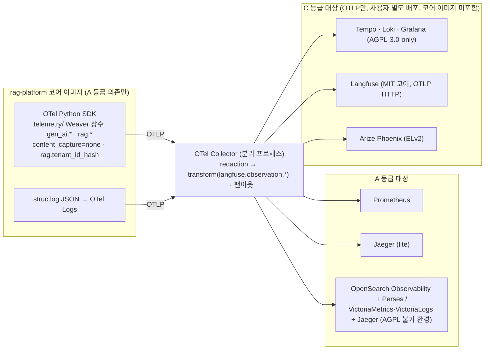

# ADR-0022: 관측성 규약 고정(GenAI semconv 커밋·Weaver)과 라이선스 경계

> MADR(Markdown Architectural Decision Record) 형식. 바이블 §3.3 표의 0022행(slug `observability-genai-semconv-pin-and-license-boundary`, P2)이며 관련 결정은 브리프 확정 결정 D-11(브리프 §4 개정 v1.1, 바이블 §3.1 `amended`)이다. 이 ADR은 바이블의 결정을 근거·대안과 함께 기록하고 바이블 표를 바꾸지 않는다(바이블 §1.1). 라이선스 등급표 자체는 [ADR-0001](./0001-license-grade-table-and-d02-interpretation.md), 관측 신호와 도메인 이벤트의 분리는 [ADR-0017](./0017-event-delivery-outbox-cloudevents-no-broker.md), 점수 원장(`RankedSet.score_breakdown`)은 [ADR-0030](./0030-single-coordinate-system-and-score-ledger.md), 강제 지점 E13은 [ADR-0027](./0027-security-context-injection-and-acl-enforcement-points.md), 메트릭·스팬·로그 명명은 [ADR-0036](./0036-naming-and-identifier-conventions.md)이 다룬다.

## 맥락과 문제

브리프 v1.0의 D-11은 "OpenTelemetry(GenAI semantic conventions) 트레이스, Prometheus/Grafana, 선택적으로 Langfuse/Arize Phoenix 익스포터"로 적혀 있었다(브리프 §3 원칙 8 "Observable & Explainable"). 기술 지형 조사(09·12 문서)는 이 문구가 두 가지 위험을 안고 있음을 확인했다. 첫째, 준수 대상인 규약이 아직 안정되지 않아 "준수"가 계약 안정성(원칙 1)과 충돌하고, 둘째, 지명된 관측 백엔드 일부가 D-02 라이선스 등급표의 C 등급이라 코어 이미지·pip 의존으로 들어올 수 없다. 확정된 사실은 다음과 같다(확인일 2026-09-18, 재확인 2026-09-22; 09 문서).

| # | 사실 | 출처 |
|---|------|------|
| F1 | OTel GenAI semantic conventions(`gen_ai.*`)는 **Development 단계**이며 2026년 semconv v1.42.0에서 별도 저장소 `open-telemetry/semantic-conventions-genai`로 분리되었고 `schema_url`은 TODO다. 속성명 개명이 마이너 릴리스에서도 일어날 수 있다 | 09 문서 §관측성 후보 목록, §관측성 규약 비교; 매트릭스 "브리프 수정 제안" D-11 행 |
| F2 | `gen_ai.*`에는 연산명 `retrieval`과 `gen_ai.data_source.id`는 있으나 **문서 단위 점수·내용 속성이 없다**. 문서 단위 속성(`retrieval.documents.N.document.id/score`, `reranker.query/model_name/top_k`, `reranker.input_documents.*`/`output_documents.*`)은 OpenInference(`openinference-semantic-conventions` 0.1.38, Apache-2.0)가 정의한다 | 09 문서 §관측성 규약 비교 |
| F3 | retrieval 스팬의 Required 속성은 `gen_ai.operation.name`만이고 `gen_ai.data_source.id`·`gen_ai.provider.name`은 Conditionally Required다. 리랭크 전용 `gen_ai.operation.name` 값은 없다 | 09 문서 §관측성 규약 비교, §표준 모델 매핑, 미해결 이슈 5 |
| F4 | 콘텐츠 속성(`gen_ai.input.messages`, `gen_ai.output.messages`, `gen_ai.system_instructions`)은 규약상 **Opt-In**("PII 포함 가능성" 명시)이며 `opentelemetry-util-genai`의 `OTEL_INSTRUMENTATION_GENAI_CAPTURE_MESSAGE_CONTENT` 기본값은 `NO_CONTENT`다 | 09 문서 §관측성 규약 비교 |
| F5 | Grafana·Tempo·Loki는 **AGPL-3.0-only**, Arize Phoenix는 **Elastic-2.0(비OSI)**, Langfuse는 MIT 코어 + `ee/`(2026-01 ClickHouse 인수, MIT 코어 유지 확인 2026-09-18). D-02 등급표에서 AGPL·ELv2는 C 등급 = "별도 컨테이너 + 네트워크 API로만, 코어 이미지 미포함". Prometheus·Jaeger·Perses·OpenSearch·VictoriaMetrics/VictoriaLogs·OpenLIT은 Apache-2.0(A) | 12 문서 §6.1·§6.2, 09 문서 §LLM 관측성 백엔드 비교·§비AGPL 대안, ADR-0001 |
| F6 | Langfuse는 OTLP **HTTP만** 수신(`/api/public/otel`, gRPC 미지원)하고 관측 타입은 `langfuse.observation.type` 우선이며, 현행 `gen_ai.input.messages`/`gen_ai.output.messages`·`gen_ai.provider.name` 매핑은 매핑 표에 없다(확인 필요, as of 2026-09). Phoenix·Opik·OpenLIT도 OTLP를 수신하므로 **전용 익스포터가 필요하지 않다** | 09 문서 §LLM 관측성 백엔드 비교, §브리프와의 충돌 2 |
| F7 | OpenTelemetry Weaver(Apache-2.0, OTel 공식 도구)는 semconv 레지스트리에서 속성 상수 코드를 생성하고 레지스트리 린트·버전 간 diff·`schema_url` 고정을 지원한다. 자체 `rag.*`는 Weaver 레지스트리 YAML로 작성해야 한다 | 09 문서 §관측성 후보 목록 |
| F8 | OTel Collector(contrib) redaction processor는 속성 허용 목록·정규식 값 마스킹·해시를 제공한다(트레이스 베타, 로그·메트릭 알파). Langfuse 서버측 마스킹·보존 정책은 EE 전용이다 | 09 문서 §관측성 후보 목록, §프라이버시 파이프라인 |
| F9 | 12 문서는 계량 목적으로 OTel 메트릭에 `tenant_id` 속성을 붙이는 안을 적었으나, 바이블 §6.5는 메트릭 라벨을 `stage, channel, backend_id, profile_id, outcome, renderer, queue`로 한정하고 **`tenant_id` 라벨을 금지**하며 과금 정본은 PostgreSQL `usage_ledger`다 | 12 문서 §3.5 계량 원칙, 바이블 §2.1 K6·§6.5·§13.1 |

따라서 결정할 질문은 다섯이다. (1) 어느 규약을 어떤 방식으로 고정해 속성명 개명에서 코드·대시보드를 보호하는가, (2) "왜 이 청크가 뽑혔는지"(원칙 8)를 어디에 기록하는가 — 스팬인가 계약인가, (3) 콘텐츠·테넌트 식별자를 텔레메트리에서 어떻게 다루는가, (4) C 등급 관측 백엔드와 플랫폼 코드·이미지의 경계는 어디인가, (5) AGPL 자체가 금지된 배포 환경에는 무엇을 제공하는가.

## 결정 동인(decision drivers)

| 동인 | 출처 | 함의 |
|------|------|------|
| Observable & Explainable — 트레이스와 점수 분해로 선택 이유를 설명 | 브리프 §3 원칙 8 | 리트리버·리랭커 스팬에 문서 단위 속성이 필요하고, 점수 분해는 소실되지 않아야 한다 |
| Contracts First — 이름이 바뀌면 버전이 바뀐다 | 브리프 §3 원칙 1, 바이블 §1.2 | Development 단계 규약을 "최신 추적"하면 계약 없는 파손이 생긴다; 커밋 고정 + 생성 상수 + diff 게이트 |
| 라이선스 등급표 A/B/C/D/X | D-02, ADR-0001, 12 문서 §6.1 | AGPL(Grafana·Tempo·Loki)·ELv2(Phoenix)는 C: 분리 컨테이너 + 네트워크 API만, 코어 이미지·pip 미포함 |
| 멀티테넌시·비밀 보호 | 원칙 9, 바이블 §10.3 E13, §6.6 | 콘텐츠 캡처 기본 끔, `tenant_id`는 해시, 로그·트레이스에 비밀 미기록 |
| 점수 원장 K3 — `CandidateSet → RankedSet(score_breakdown) → ContextPack` | 바이블 §2.1 K3, ADR-0030 | 점수 분해의 정본은 계약이며 텔레메트리는 그것을 복제하지 않는다(카디널리티·용량) |
| 저카디널리티 메트릭 | 바이블 §6.5, 12 문서 §3.5 | 테넌트·문서·사용자 단위 라벨 금지; 과금은 `usage_ledger` |
| 표준 전송(OTLP)으로 백엔드 교체 가능성 유지 | 매트릭스 `tracing/observability` 행, 09 문서 §결정 사항 요약 | 플랫폼 코드는 OTel SDK만 알고 벤더 속성은 Collector에서 부착 |
| `lite` 단일 노드·5분 기동 | 바이블 §7.1·§11.6 | 경량 프로파일은 Jaeger + Prometheus(Apache-2.0), Collector 선택 |
| 규제 프로파일(`korean-gov`, ISMS-P); 관측 신호와 도메인 이벤트의 분리 | 바이블 §7.1·§7.2, 09 문서 §프로파일별 조합; ADR-0017 F6, 바이블 §10.3 E12 | `NO_CONTENT` 잠금, AGPL 불가 환경 대안 필수; 스팬·메트릭에 도메인 이벤트를, 이벤트에 콘텐츠를 싣지 않는다 |

## 고려한 대안

| # | 대안 | 판정 | 근거 요약 |
|---|------|------|-----------|
| A | GenAI semconv 최신 릴리스 추적(`opentelemetry-semantic-conventions` 패키지 상수를 그대로 사용) | 기각 | Development 단계·별도 저장소·`schema_url` TODO(F1); 개명 시 대시보드·Langfuse 매핑·계약 테스트가 동시에 깨진다 |
| B | Langfuse·Phoenix·Grafana 계열을 pip/SDK 코드 의존 또는 Helm 번들로 포함 | 기각 | ELv2·AGPL은 C 등급(F5); 전용 익스포터 불필요(F6); MIT인 Langfuse SDK도 벤더 속성을 코드에 스며들게 한다 |
| C | 콘텐츠 캡처 기본 켬(질의·청크 원문을 스팬에 기록) | 기각 | 규약 자체가 Opt-In(F4); E13·PII 정책 위반; 서버측 마스킹은 Langfuse EE(F8) |
| D | `tenant_id`를 메트릭 라벨로(테넌트별 계량·대시보드) | 기각 | 바이블 §6.5 금지(F9); 카디널리티 폭증; 과금 정본은 `usage_ledger` |
| E | 점수 분해(dense/sparse/lexical/rerank)를 스팬 속성 또는 스팬 이벤트(`rag.candidate.scored`)에 기록 | 기각 | 후보 수 × 채널 수만큼 폭증; K3에 따라 정본은 `RankedSet.score_breakdown`이며 바이블 §6.5가 "스팬 이벤트 아닌 `RankedSet`에"로 고정 |
| F | 자체 `rag.*` 규약만 사용 또는 OpenInference 단일 규약 | 기각 | 장점은 개명 위험의 자체 통제·단일 네임스페이스. 단점: `gen_ai.*` 없이는 OTel contrib 공식 계측기·백엔드 `gen_ai.operation.name` 폴백 분류(F6)를 잃고, OpenInference만으로는 OTel 공식 메트릭(`gen_ai.client.token.usage`)·평가 이벤트(`gen_ai.evaluation.result`)가 없다(F2·F3). 09 문서 결론은 "두 규약을 겹쳐 쓰되 네임스페이스 분리" |
| G | OTel SDK → 커밋 고정 `gen_ai.*` + OpenInference 문서 단위 속성 + 자체 `rag.*`(Weaver 생성 상수), 콘텐츠 캡처 끔·`tenant_id` 해시, C 등급 백엔드는 OTLP 대상·분리 컨테이너만, Collector가 redaction·transform·팬아웃, AGPL 불가 대안 문서화 | **채택** | 매트릭스 `tracing/observability` 행·09 문서 §결정 사항 요약·12 문서 §6.2와 일치 |

### 대안 A: GenAI semconv 최신 추적(기각)

- 설명: `opentelemetry-semantic-conventions` 릴리스마다 상수를 갱신하고 코드가 그 상수를 직접 참조한다.
- 장점: 별도 레지스트리·코드 생성 없이 시작할 수 있고 공식 계측기(`opentelemetry-instrumentation-openai-v2` 등)와 항상 같은 이름을 쓴다.
- 단점: 규약이 Development 단계라 개명이 예고 없이 일어나며(F1), 개명은 대시보드 질의·Collector redaction 허용 목록·"본문 문자열이 스팬에 없음" 계약 테스트·Langfuse 매핑을 한 번에 깨뜨린다(09 문서 §실패 모드, 바이블 §15 리스크 9). 어느 이름이 정본인지 코드 밖(레지스트리)에서 검증할 수 없다.
- 판정: 기각. 저장소 커밋을 고정하고 Weaver가 생성한 단일 상수 모듈만 참조하며, 커밋 이동은 `weaver registry diff` 결과를 첨부한 변경으로만 허용한다.

### 대안 B: Langfuse·Phoenix·Grafana 계열의 pip/코드 의존 또는 번들(기각)

- 설명: `langfuse` SDK로 스팬을 만들거나 Phoenix·Grafana·Tempo·Loki 이미지를 플랫폼 Helm 차트·compose에 포함한다.
- 장점: 첫 화면까지의 거리가 가장 짧고 Langfuse의 `mask` 콜백·주석 큐를 SDK에서 바로 쓴다.
- 단점: Phoenix(ELv2)·Grafana·Tempo·Loki(AGPL-3.0-only)는 D-02 C 등급으로 코어 이미지 포함·재배포가 금지된다(F5, ADR-0001). Langfuse는 MIT 코어이나 SDK를 코드에 넣으면 `langfuse.observation.*` 벤더 속성이 플랫폼 코드에 들어가고 2026-01 인수 이후 EE 경계 변화에 코드가 노출된다. 모든 후보가 OTLP를 수신하므로 전용 익스포터는 필요하지 않다(F6).
- 판정: 기각. 플랫폼 코드는 OTel SDK만 알고, 이들 백엔드는 OTLP 엔드포인트 값(`RAG_OTEL__EXPORTER_OTLP_ENDPOINT`)으로만 연결되며 이미지는 사용자가 별도 배포한다. Langfuse 호환 속성은 Collector `transform`에서만 부착한다(09 문서 §표준 모델 매핑).

### 대안 C: 콘텐츠 캡처 기본 켬(기각)

- 설명: 디버깅 편의를 위해 질의·청크 원문·LLM 메시지를 스팬 속성으로 기본 기록한다.
- 장점: Langfuse·Phoenix UI에서 입력·출력을 즉시 볼 수 있다.
- 단점: 규약이 콘텍스트 속성을 Opt-In으로 정의하고 PII 가능성을 명시한다(F4). 테넌트 문서 원문이 관측 스택(다른 보존·접근 정책)으로 복제되어 E13·PII 정책과 충돌하고, 서버측 마스킹은 Langfuse EE 전용이라 소스에서 막아야 한다(F8). `korean-gov`는 `NO_CONTENT`가 강제다.
- 판정: 기각. 기본 `none`, 스팬에는 `rag.tenant_id_hash`와 청크 ID·해시만, Collector redaction이 2차 방어다.

### 대안 D: `tenant_id` 메트릭 라벨(기각)

- 설명: `rag_*` 메트릭에 `tenant_id` 라벨을 붙여 테넌트별 대시보드·계량을 Prometheus에서 수행한다(12 문서 §3.5 초안).
- 장점: 테넌트별 지연·오류율을 추가 저장소 없이 본다.
- 단점: 테넌트 수 × 기존 라벨 곱으로 시계열이 폭증하고, 테넌트 식별자가 관측 스택에 평문으로 남아 E13의 "해시만" 원칙과 어긋난다. 과금·사용량 정본은 이미 원장 `usage_ledger`(K6)다.
- 판정: 기각. 라벨은 바이블 §6.5의 7종만, 테넌트 단위 관측이 필요하면 로그(`tenant_id_hash`)·트레이스 속성(`rag.tenant_id_hash`)·원장으로 한다.

### 대안 E: 점수 분해를 스팬 이벤트에(기각)

- 설명: 09 문서는 `RankedSet.score_breakdown`과 함께 스팬 이벤트 `rag.candidate.scored`에도 후보별 점수를 남기는 안을 적었다.
- 장점: 트레이스만으로 후보별 채널 점수를 재구성할 수 있다.
- 단점: top-100 후보 × 채널·융합·리랭크 열이 질의마다 이벤트로 쌓여 트레이스 용량과 백엔드 비용을 지배하고, 계약(`RankedSet`)과 텔레메트리 두 곳에 같은 사실이 존재해 불일치 위험이 생긴다. K3 점수 원장은 `Σ contribution = fused_score` 불변식을 계약에서 검증한다.
- 판정: 기각. 바이블 §6.5 "점수 분해는 스팬 이벤트 아닌 `RankedSet`에". 트레이스에는 상위 k개 `retrieval.documents.N.document.id/score`와 `rag.degraded_count` 같은 저카디널리티 값만 남고, 전체 분해는 `explain=true` 응답으로 반환한다.

### 대안 G: 커밋 고정 규약 3중 네임스페이스 + OTLP 경계(채택)

- 설명: 계측 API는 OTel Python SDK만. `gen_ai.*`는 `semantic-conventions-genai` 고정 커밋, `rag.*`는 자체 Weaver 레지스트리 YAML에서 상수 모듈을 생성하고 `schema_url`을 고정한다. OpenInference 문서 단위 속성은 리트리버·리랭커 스팬에 병용한다. 콘텐츠 캡처는 끔, `tenant_id`는 해시. Collector가 redaction·transform·팬아웃을 맡고 C 등급 백엔드는 OTLP 대상으로만 존재한다.
- 장점: 개명은 빌드에서 감지되고(diff), 벤더 종속이 Collector 설정에 격리되며, 라이선스 경계가 이미지 목록과 `uv.lock`에서 기계 검증된다. `lite`(Jaeger + Prometheus)에서 `korean-gov`(OpenSearch Observability + Perses)까지 같은 코드다.
- 단점: 자체 레지스트리 YAML·Weaver 템플릿 학습 비용, Collector 설정이 운영 자산이 된다, Langfuse UI 입력·출력은 콘텐츠 캡처를 켠 프로파일에서만 채워진다.
- 판정: 채택.

## 결정

**결정:** **관측성**: OpenTelemetry Python SDK(트레이스·메트릭·로그), GenAI semantic conventions는 **특정 저장소 커밋에 고정**하고 속성 상수는 OTel Weaver로 생성(`gen_ai.*` + OpenInference `retrieval.*` + 자체 `rag.*`), Prometheus 메트릭(`rag_<stage>_<name>_<unit>`), 콘텐츠 캡처 기본 끔·`tenant_id`는 해시. Grafana·Tempo·Loki(AGPL)·Langfuse·Arize Phoenix(ELv2)는 **OTLP 대상·분리 컨테이너로만**(pip/코드 의존 금지), AGPL 불가 환경 대안(OpenSearch Observability + Perses, VictoriaMetrics/Logs + Jaeger) 문서화(브리프 §4 D-11, 개정 v1.1, 근거: ADR-0022 = 본 문서).

바이블 §3.1 D-11 요지: OTel; GenAI semconv **커밋 고정 + Weaver 상수**; Grafana·Tempo·Loki(AGPL)·Langfuse·Phoenix(ELv2)는 OTLP 대상·분리 컨테이너만(pip 의존 금지); AGPL 불가 대안 문서화. 개정 이유: semconv Development 단계(속성 개명 위험), 관측 스택 라이선스 경계(매트릭스 P2).

결정에 딸린 정본 세부(모두 바이블 인용, 이 문서가 새로 정하지 않는다):

- 스팬(바이블 §6.5): 이름 `rag.{stage}`(`rag.plan`, `rag.retrieve.dense`, `rag.rerank`, `rag.ingest.parse`); 속성은 Weaver 생성 상수 `gen_ai.*`(retrieval 스팬 `gen_ai.data_source.id = collection_id`), OpenInference `retrieval.documents.*`/`reranker.*`, 자체 `rag.*`(`rag.tenant_id_hash`, `rag.profile_hash`, `rag.plan_id`, `rag.degraded_count`). 콘텐츠 캡처 기본 끔; 점수 분해는 스팬 이벤트 아닌 `RankedSet`에. 상수 모듈은 `src/rag_platform/telemetry/`(otel·metrics·redaction, 바이블 §12) 하나이며 다른 패키지는 속성명을 문자열 리터럴로 쓰지 않는다. `gen_ai.*` 레지스트리의 저장소 URL·고정 커밋 해시와 `schema_url`은 이 모듈의 레지스트리 매니페스트에 기록한다(초기 값은 구현 시 확정).
- 메트릭(바이블 §6.5): `rag_<stage>_<name>_<unit>`(Prometheus; 단위 `seconds, bytes, total, count, ratio`), 라벨은 `stage, channel, backend_id, profile_id, outcome, renderer, queue`만, **`tenant_id` 라벨 금지**, 정본 목록(`rag_query_latency_seconds` … `rag_eval_metric_value{metric}`)은 §6.5 그대로. 노출은 `GET /metrics`(바이블 §14).
- 로그(바이블 §6.5): structlog JSON, 필드 `event, level, tenant_id_hash, job_id, trace_id, stage, code`. 계약의 `trace_id`(`ContextPack.trace_id`, `StageError.trace_id`, `ConvertRequest.trace_id`; 바이블 §5.3·§5.5·§5.6)가 트레이스·로그·응답을 상관한다.
- 이벤트 식별자(도메인 이벤트, 관측 신호 아님 — ADR-0017 F6, E12): CloudEvents `source = urn:rag:{component}`(`{component}`는 §2.3 컨테이너 이름), 생산자는 `urn:rag:api`·`urn:rag:worker` 둘뿐(평가 하네스 `eval.run.completed`도 `worker`), `subject = tenant/{tenant_id}/{entity}/{id}`, 확장 속성 `tenantid`(바이블 1.3.0 §6.5, AM-13). 트레이스의 `rag.tenant_id_hash`(해시)와 이벤트의 `tenantid`(테넌트 스코프 릴레이용, 평문 ULID)는 서로 다른 식별자이며 혼용하지 않는다.
- 설정(바이블 §6.6·§7.3): `RAG_OTEL__EXPORTER_OTLP_ENDPOINT`, `RAG_OTEL__CONTENT_CAPTURE=none`; 프로파일 `observability: {content_capture: none, tenant_id_hash: true}`. 비밀은 로그·트레이스에 값 미기록. `content_capture: none`은 OTel 콘텐츠 캡처 모드 `NO_CONTENT`(F4)에 대응한다.
- 강제 지점 E13(바이블 §10.3): 트레이스 콘텐츠 캡처 기본 끔, `rag.tenant_id_hash`만, Collector redaction; `korean-gov` `NO_CONTENT` 잠금; 검증은 "본문 문자열이 스팬에 없음" 테스트.
- Collector(바이블 §2.2·§2.3): redaction(콘텐츠 차단)·transform·팬아웃, 격리 `sidecar`, `lite`는 선택. 물리 배포 단위는 [배포 아키텍처](../02-architecture/08-deployment-architecture.md)가 확정하며 차트는 OTLP 엔드포인트 값(`externals.otel.endpoint`)만 받는다. Langfuse 파이프라인의 `transform`은 `langfuse.observation.type`(캡처를 켠 프로파일에서만 `langfuse.observation.input/output`)을 부착하고 플랫폼 코드에는 벤더 속성이 없다(09 문서 §표준 모델 매핑).
- 코어 이미지·`uv.lock`에는 A 등급만(바이블 §12 첫 문단, ADR-0001). `langfuse`·`arize-phoenix*` 패키지와 Grafana·Tempo·Loki·Phoenix 이미지는 코어 배포물·플랫폼 이미지 목록에 없다.

| 프로파일(바이블 §7.1 "관측성" 행, §7.2 `observability.content_capture`) | `lite` | `standard` | `premium` | `korean-gov` |
|---|---|---|---|---|
| 스택 | OTel → Jaeger + Prometheus | Collector(redaction) → Tempo/Loki/Prometheus + Grafana(분리) + Langfuse(OTLP) | 동일 | AGPL 불가 시 OpenSearch Observability + Perses(OpenSearch 자원 경합 시 VictoriaMetrics/VictoriaLogs + Jaeger) |
| `observability.content_capture` | none | none | none | `NO_CONTENT` 잠금 |

## 결과

### 긍정

- 속성명 개명이 빌드 단계(`weaver registry diff`)에서 드러나며, 코드·대시보드·redaction 허용 목록이 하나의 생성 상수 모듈을 공유해 부분 갱신 파손이 없다(바이블 §15 리스크 9 완화).
- 리트리버·리랭커 스팬에 OpenInference 문서 단위 속성이 있어 "어느 문서가 어떤 점수로 통과했는지"를 트레이스에서 보고, 전체 점수 분해는 `RankedSet.score_breakdown`·`explain`으로 정확히 재현한다(원칙 8 + K3).
- 라이선스 경계가 이미지 목록·`uv.lock`·Helm 값으로 기계 검증되어 D-02 위반이 관측 스택 쪽에서 재발하지 않는다(ADR-0001).
- 백엔드 교체는 Collector 설정 변경이고 플랫폼 코드는 불변이다. `lite`는 Apache-2.0 스택(Jaeger + Prometheus)만으로 동작한다.
- 콘텐츠 캡처 끔 + `tenant_id_hash` + Collector redaction의 다중 방어로 관측 스택이 문서 원문·테넌트 식별자의 복제본이 되지 않는다(E13).

### 부정

- 자체 `rag.*` 레지스트리 YAML과 Weaver 템플릿·CI 단계를 유지해야 한다. 커밋 이동은 diff 검토·상수 재생성·대시보드 갱신을 동반하는 명시적 작업이다.
- Langfuse UI의 입력·출력은 기본(`none`)에서 비어 보인다. 이는 의도된 결과이며 콘텐츠 캡처를 켠 프로파일에서만 Collector `transform`으로 채워진다(F6).
- Collector 설정(redaction 허용 목록·transform OTTL·파이프라인별 exporter)이 운영 자산이 되어 09-operations/03이 소유·검증해야 한다. redaction processor의 로그·메트릭 지원은 알파 단계다(F8).
- 표준 프로파일 사용자는 Grafana·Tempo·Loki·Langfuse(ClickHouse 포함)를 별도로 설치·운영해야 하고 플랫폼은 엔드포인트 값만 받는다(매트릭스 종합 리스크 8).
- 리랭크 스팬의 `gen_ai.operation.name`은 표준 값이 없어(F3) 스팬 이름 `rag.rerank`와 OpenInference `reranker.*`로만 식별된다.

### 중립

- 이 ADR은 메트릭·스팬·로그의 **이름 규약** 자체를 정하지 않는다(ADR-0036, 바이블 §6.5). 새 메트릭·속성 추가는 §1.2 절차(minor)로 §6.5 표(및 `rag.*` 레지스트리 YAML)를 먼저 갱신한다.
- 09 문서가 제안한 메트릭 라벨(`collection_id`, `model`, `provider`, `dataset_id` 등)·스팬 이벤트 `rag.candidate.scored`·속성 `rag.tenant_id`는 바이블 §6.5의 라벨 허용 목록·`RankedSet`·`rag.tenant_id_hash`로 대체되었다(바이블이 정본).
- 관측 신호는 도메인 이벤트가 아니다(ADR-0017 F6, E12). `gen_ai.evaluation.result` 이벤트·`rag_eval_metric_value{metric}`의 사용 방식은 [ADR-0023](./0023-evaluation-qrels-answer-spans-and-linear-ndcg.md)의 하네스가 정한다.
- 자동 계측기 선택(OTel contrib 공식 우선, 공식 계측기가 없는 대상만 OpenInference·OpenLLMetry; 모두 Apache-2.0, 대상별 하나만 활성화)은 매트릭스 `tracing/observability` 행·09 문서 §역할별 1차·2차·폴백의 권고이며 이 ADR이 새로 정하지 않는다.
- 바이블 1.3.0(§6.5, AM-41)이 정본 메트릭 목록에 36종(09-operations/03 미해결 2 확정분 34종 + 04-pipelines/03 라우터 2종)과 스팬 2종(`rag.ingest.detect`, `rag.parse.call`)을 추가했다. 라벨 규약(7종·`tenant_id` 금지)은 불변이며, 새 메트릭도 이 ADR이 고정한 이름 형식(`rag_<stage>_<name>_<unit>`)·스팬 이름 형식(`rag.{stage}`)을 그대로 따른다.

## 준수 확인 방법

| # | 규칙 | 강제 수단 | 게이트·위치 |
|---|------|-----------|-------------|
| 1 | `gen_ai.*` 레지스트리는 고정 커밋, `rag.*`는 자체 레지스트리 YAML, `schema_url` 고정 | `telemetry/` 레지스트리 매니페스트의 저장소 URL·커밋 해시; `weaver registry diff`(고정 커밋 ↔ 체크아웃된 레지스트리) 차이 = 빌드 실패; 상수 모듈 재생성 결과가 커밋된 파일과 일치해야 함 | CI(매트릭스 "운영·평가 공통 요구" CI 게이트 "OTel Weaver 레지스트리 diff", 바이블 §15 리스크 9) |
| 2 | 속성명은 생성 상수로만 참조 | `telemetry/` 밖에서 `gen_ai.`·`retrieval.documents.`·`reranker.`·`rag.` 접두 문자열 리터럴 금지(제안: ruff 커스텀 규칙 또는 grep 린트) | CI 린트 + 코드 리뷰 |
| 3 | 스팬 이름 `rag.{stage}`; 메트릭 `rag_<stage>_<name>_<unit>`·라벨 7종·`tenant_id` 라벨 금지·정본 목록 일치 | 런타임 메트릭 레지스트리 스냅샷 ↔ 바이블 §6.5 목록 기계 대조(불일치 = 빌드 실패; 이벤트·오류 코드와 동일 절차) | CI 이름 대조(바이블 §1.2) |
| 4 | 콘텐츠 캡처 기본 끔, `korean-gov`는 `NO_CONTENT` 잠금 | 설정 기본 `RAG_OTEL__CONTENT_CAPTURE=none`; `korean-gov` 프로파일에서 `observability.content_capture` 오버라이드는 `rag profile validate` 거부(`profile.invalid`; 제안: §7.4 검증 규칙에 추가) | 프로파일 검증(바이블 §7.4), 배포 값 `contentCapture: none` |
| 5 | 스팬·로그에 문서·질의 본문 문자열이 없다 | 계약 테스트 "본문 문자열이 스팬에 없음"(골든 문서로 수집·질의 후 수집된 스팬·로그 전량 검색); Collector redaction 설정에 `gen_ai.input.messages`·`gen_ai.output.messages`·`retrieval.documents.*.document.content` 차단 키 존재 검사 | E13 테스트, Collector 설정 린트(09-operations/03) |
| 6 | `tenant_id` 평문은 텔레메트리에 없다 | structlog 프로세서가 `tenant_id`를 `tenant_id_hash`로 치환; 스팬 속성은 `rag.tenant_id_hash`만; 테스트가 테넌트 ULID 평문을 스팬·로그에서 검색 | E13 테스트, 적합성 키트 `security_invariants` |
| 7 | 점수 분해는 스팬 이벤트에 없다 | 질의 트레이스에 후보 단위 점수 이벤트·속성이 없음을 테스트; `RankedSet.score_breakdown` 불변식은 계약 테스트 | 계약 테스트(ADR-0030) |
| 8 | 코어 배포물에 C 등급 관측 의존·벤더 속성 없음 | `uv.lock` 라이선스 게이트(pip-licenses + liccheck) + 명시 거부 목록(`langfuse`, `arize-phoenix*`); 플랫폼 이미지 목록·SBOM에 Grafana·Tempo·Loki·Phoenix 이미지 없음; Helm은 `externals.otel.endpoint`만; `langfuse.observation.` 등 벤더 접두 문자열이 `src/`에 없음(린트) | CI 라이선스 게이트(ADR-0001), 배포 아키텍처 이미지 목록, CI 린트 |
| 9 | Collector 파이프라인은 redaction → transform → exporter 순서 | Collector 설정 스키마 검증 + 통합 테스트(OTLP 수신 → 각 exporter 모의 수신) | 09-operations/03 |

코드 리뷰 체크리스트(요약): (a) 새 스팬·메트릭·속성이 바이블 §6.5(또는 `rag.*` 레지스트리 YAML)에 먼저 추가되었는가, (b) 속성명이 `telemetry/` 상수인가, (c) 스팬 속성·로그 필드에 `text`·`context_prefix`·`query` 원문이나 `tenant_id` 평문이 없는가, (d) 메트릭 라벨이 7종 안에 있고 값이 저카디널리티인가, (e) `langfuse`·`arize-phoenix` 등 벤더 SDK 임포트가 없는가, (f) 후보별 점수를 스팬 이벤트로 남기지 않는가.

## 재검토 조건

- GenAI semconv가 Stable로 승격되거나 `schema_url`이 확정될 때: 고정 커밋을 해당 태그로 이동하고 Weaver diff 결과·대시보드 갱신을 첨부한 변경(바이블 §1.2 minor)으로 처리한다. 리랭크 연산의 `gen_ai.operation.name` 표준 값이 추가되면 함께 반영한다(09 문서 미해결 이슈 5).
- Langfuse가 현행 `gen_ai.input.messages`/`gen_ai.output.messages`·`gen_ai.provider.name`을 매핑 표에 올리면 Collector `transform`의 Langfuse 규칙을 축소한다; 반대로 2026-01 인수 이후 MIT 코어 범위가 축소되면 Langfuse를 C 등급으로 재분류한다(09 문서 §리스크, 분기별 재확인).
- Grafana·Tempo·Loki 라이선스가 바뀌거나 Perses·VictoriaTraces·OpenSearch Observability가 성숙해 AGPL 불가 환경 1차 대안의 순위가 바뀔 때(09 문서 §비AGPL 관측성 스택 대안).
- OTel Collector redaction processor의 로그·메트릭 지원이 베타 이상이 되거나, `korean-gov`에서 Collector 없이 SDK 단독으로 `NO_CONTENT`를 보증해야 하는 배포가 생길 때(배포 아키텍처 미해결 이슈 9·12).
- 바이블 §6.5 라벨 허용 목록·정본 메트릭 목록·`rag.*` 속성 목록 변경은 ADR 발의 + §6.5 갱신(minor)이며, 스팬 이름 규약·필드 제거·의미 변경은 major다(바이블 §1.2).
- **대기 중(이 ADR의 minor 개정 예정):** `rag_stage_errors_total`·`rag_api_problems_total`·`rag_feedback_events_total`·`rag_api_sse_connections_count` 4종은 새 라벨(`code`, `status`, `route`, `kind`)이 필요해 바이블 1.3.0(§6.5)이 노출을 보류했다(09-operations/03 미해결 1). 라벨 허용 집합(§6.5 "저카디널리티만: `stage, channel, backend_id, profile_id, outcome, renderer, queue`")을 이 4종으로 확장하는 개정은 이 ADR의 minor 개정(§1.2)으로 처리하고, 값 영역이 저카디널리티임을 확인하는 근거를 09-operations/03이 제공한 뒤 착수한다.

## 참조

- [설계 브리프](../00-vision/00-design-brief.md) — §3 원칙 1·8·9, §4 D-02·D-11(개정 v1.1)·D-14·D-15, §7 보안, §9.9 메트릭 명명, §9.11
- [설계 바이블](../02-architecture/00-design-bible.md) — §1.1~1.2, §2.1 K3·K6, §2.2(`otel` 컨테이너), §2.3 OTel Collector 행, §3.1 D-11, §3.3 0022행, §5.3 `StageError.trace_id`, §5.5 `RankedSet.score_breakdown`·`ContextPack.trace_id`, §5.6 `Profile.observability`·`ConvertRequest.trace_id`, §6.5, §6.6, §7.1 관측성 행, §7.2 `observability.content_capture`, §7.3·§7.4, §10.3 E12·E13, §12 `telemetry/`, §13.1 `usage_ledger`, §14 `GET /metrics`, §15 리스크 9
- [기술 지형 종합: 선정 매트릭스와 결정 권고](../07-tech-landscape/00-summary-and-selection-matrix.md) — 매트릭스 `tracing/observability`·`event_bus`·`license_scanner` 행, 프로파일별 기본 조합 "관측성" 행, "브리프 수정 제안" D-11 행, ADR 발의 목록 P2, "운영·평가 공통 요구" CI 게이트·관측 메트릭 표준, 종합 리스크 7·8
- [평가 프레임워크·벤치마크·관측성](../07-tech-landscape/09-evaluation-and-observability.md) — §관측성 후보 목록, §관측성 규약 비교, §LLM 관측성 백엔드 비교, §비AGPL 관측성 스택 대안, §역할별 1차·2차·폴백(계측 API~프라이버시), §프로파일별 조합, §표준 모델 매핑(트레이스), §메트릭 이름, §프라이버시 파이프라인, §실패 모드, §브리프와의 충돌 1~3, §리스크 및 완화, 미해결 이슈 5·6
- [보안·멀티테넌시·PII·라이선스 컴플라이언스](../07-tech-landscape/12-security-multitenancy-pii-and-licensing.md) — §3.5 계량 원칙·감사 로그 저장소, §6.1 판정 규칙, §6.2 의존성 라이선스 지도(Phoenix·Langfuse·Loki 행), "브리프와의 충돌" D-11 행
- [배포 아키텍처](../02-architecture/08-deployment-architecture.md) — §3.1 이미지 목록(`otel-collector`), 관측 스택 외부화·`externals.otel.endpoint`·`observability.contentCapture`, 미해결 이슈 9·12
- 관련 ADR(바이블 §3.3 번호·slug): [ADR-0001 라이선스 등급표](./0001-license-grade-table-and-d02-interpretation.md), [ADR-0017 이벤트 전달](./0017-event-delivery-outbox-cloudevents-no-broker.md), [ADR-0023 평가 하네스](./0023-evaluation-qrels-answer-spans-and-linear-ndcg.md), [ADR-0027 SecurityContext·강제 지점](./0027-security-context-injection-and-acl-enforcement-points.md), [ADR-0030 단일 좌표계와 점수 원장](./0030-single-coordinate-system-and-score-ledger.md), [ADR-0033 사이드카 convert 계약](./0033-sidecar-convert-contract-and-isolation-ladder.md), [ADR-0036 명명 규약](./0036-naming-and-identifier-conventions.md)
- 이 결정을 전제로 하는 설계 문서(문서 맵): [관측성](../09-operations/03-observability.md), [보안·컴플라이언스](../09-operations/05-security-and-compliance.md), [설정 레퍼런스](../09-operations/02-configuration-reference.md), [멀티테넌시·보안 아키텍처](../02-architecture/07-multi-tenancy-and-security-architecture.md), [CI/CD](../10-development/05-ci-cd.md), [코딩 표준](../10-development/03-coding-standards.md)
