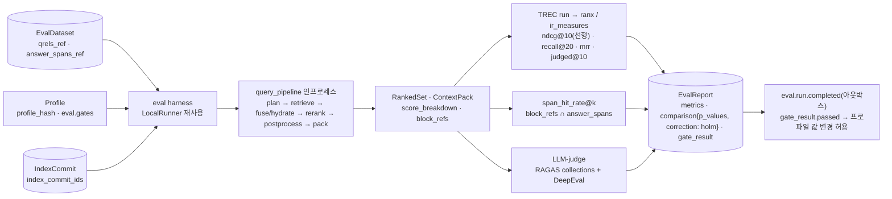

# ADR-0023: 평가 하네스: qrels + answer_spans, nDCG 선형 이득, Holm 보정

> MADR(Markdown Architectural Decision Record) 형식. 바이블 §3.3 표의 0023행(slug `evaluation-qrels-answer-spans-and-linear-ndcg`, P2)이며 관련 결정은 브리프 확정 결정 D-12(브리프 §4 개정 v1.1, 바이블 §3.1 `amended`)다. 이 ADR은 바이블의 결정을 근거·대안과 함께 기록하고 바이블 표를 바꾸지 않는다(바이블 §1.1). 하네스가 재사용하는 비내구 `LocalRunner`는 [ADR-0003](./0003-orchestrator-neutral-pipeline-and-non-durable-local-runner.md), 골든셋 좌표가 의존하는 단일 좌표계와 provenance는 [ADR-0030](./0030-single-coordinate-system-and-score-ledger.md)·[ADR-0002](./0002-provenance-element-path-and-nullable-page-bbox.md), 게이트가 붙는 프로파일 스키마는 [ADR-0031](./0031-profile-schema-extends-and-quality-gates.md)이 다루며, 이 하네스가 판정하는 대표 게이트(융합 CC 전환, 청크 그리드, late interaction 위치, LLM 보강)는 [ADR-0013](./0013-fusion-rrf-k60-then-convex-combination-and-postprocess-order.md)·[ADR-0019](./0019-chunk-size-tokenizer-defaults-and-recount-stage.md)·[ADR-0010](./0010-bge-m3-rationale-and-late-interaction-slot.md)·[ADR-0016](./0016-llm-enrichment-default-off-and-budget-policy.md)에 있다.

## 맥락과 문제

브리프 v1.0의 D-12는 "평가 하네스 코어 포함: 골든셋(golden set) 포맷(qrels), 오프라인 메트릭(nDCG/Recall/MRR), LLM-judge, A/B 프로파일 비교, 한국어 벤치마크"까지만 적었다. 기술 지형 조사에서 다음 사실이 확정되어 D-12를 개정(v1.1)했다.

| # | 사실 | 출처 |
|---|------|------|
| F1 | 문서 단위 관련성 판정(relevance judgments, qrels)은 재청킹에 불변이고 사람이 판정하기 쉽지만, 청크 단위 qrels는 청킹 전략을 바꾸면 무효화된다. 따라서 진실값은 문서 ID + 정답 문자 구간(answer span, char offsets)으로 저장하고 청크 판정은 provenance로 **파생 계산**한다. 문서 단위 qrels만으로는 청킹 전략 비교(O-09)가 불가하다 | 09 문서 §메트릭 정의 트레이드오프, 매트릭스 §브리프 수정 제안 D-12 |
| F2 | TREC qrels/run(공백 구분, `doc_id`는 ULID) + `answer_spans` JSONL 확장이면 ranx·ir_measures·pytrec_eval·BEIR·MTEB와 무손실 교환이 가능하다 | 09 문서 §TREC 포맷 |
| F3 | IR 메트릭 라이브러리 가중 점수: ranx 4.65(1위) > ir_measures 4.50 > pytrec_eval 4.20 > PyTerrier 3.60(MPL-2.0·JVM). nDCG 이득 함수는 trec_eval·pytrec_eval·BEIR·ranx `ndcg`·ir_measures `nDCG` 모두 **선형**이 기본이고, 지수 이득(Burges `2^rel − 1`)은 ranx `ndcg_burges`·ir_measures `nDCG(dcg='exp-log2')`로 별도 계산된다 | 09 문서 §선정 근거 점수표, §메트릭 정의, §IR 메트릭 라이브러리 비교 |
| F4 | ranx `compare()`는 paired t-test·Fisher randomization·Tukey HSD와 `max_p`만 제공하며 Bonferroni·Holm 등 다중 비교 보정(multiple-comparison correction) 옵션이 없다. PyTerrier `pt.Experiment(correction="holm")`는 statsmodels 보정을 내장하지만 MPL-2.0·JVM이라 개발 의존성 참조 구현으로만 쓸 수 있다 | 09 문서 §IR 메트릭 라이브러리 비교, 매트릭스 `ir_metrics` 행 |
| F5 | LLM-judge 프레임워크는 RAGAS·DeepEval 동점 4.15. RAGAS 0.4.3 `ragas.metrics.collections`는 메트릭 정의의 표준성으로 1차이나 2026-01 이후 릴리스 정체이고, collections API는 언어 적응(`adapt_prompts`)을 지원하지 않는다. Phoenix evals(ELv2)·BERGEN(CC BY-NC-SA)·LangSmith(서버 비공개)는 제외 | 매트릭스 `eval_framework` 행, 09 문서 §RAGAS |
| F6 | LLM 판정은 LLM 리랭커를 쓴 시스템을 편애하는 순환성이 있어(Clarke & Dietz) 최종 게이트는 사람 라벨 qrels여야 한다. 쌍대 비교(pairwise comparison)가 절대 점수보다 안정(Zheng et al.)하므로 프로파일 상대 비교는 RAGElo형이 적합하다. 셀프호스팅 판정 모델은 한국어 판정 능력이 미검증이라 κ·τ 교정 통과 후에만 승격한다 | 09 문서 §LLM-judge 교정 |
| F7 | 인터리빙(interleaving, team-draft)은 A/B 분할보다 통계적 효율이 높다(Chapelle et al. 2012). 우리 소비자는 LLM이므로 "클릭"은 다운스트림 응답이 인용한 `cite_id`·명시 피드백으로 대체되고, 요청에 `experiment_id`와 팀 배정이 남아야 한다. "A/B 대비 1~2자릿수 적은 표본" 수치는 1차 출처 미확인(as of 2026-09) | 09 문서 §온라인 실험(A/B·인터리빙) |
| F8 | 한국어 공공문서(HWPX) 공개 리트리벌 벤치마크는 존재 확인 못함(as of 2026-09). 외부 셋은 Allganize RAG-Evaluation-Dataset-KO(MIT, PDF 63건·질의 300; 정답이 문서·페이지 단위라 `answer_spans` 재라벨 필요, 검정력 낮음), MIRACL-ko(Apache-2.0), SDS KoPub VDR(CC BY-SA 4.0; KOGL 제1유형 256건 + 법령 105건, 600쌍), MLDR-ko(MIT, 장문). 자체 골든셋 4종(HWPX/HWP 공공문서·PDF·HTML·문장 분리 표본)은 KOGL 제1유형으로 구성해야 공개 가능 | 09 문서 §벤치마크 데이터·§골든셋 구축, 매트릭스 §운영·평가 공통 요구 |

리스크 #1은 "한국어 문서 수준 골든셋 부재 — 모든 기본값이 영어·라인 OCR·벤더 수치 의존"이다(바이블 §15, 매트릭스 §종합 리스크). 결정할 질문은 다섯이다. (1) 골든셋의 진실값 단위와 교환 포맷, (2) nDCG의 이득 함수와 다중 비교의 유의성 판정 규칙, (3) 하네스가 검색을 실행하는 코드 경로와 재현성을 고정하는 필드, (4) LLM-judge·온라인 비교와 오프라인 qrels의 관계, (5) 결과가 프로파일 기본값을 구속하는 방식.

## 결정 동인(decision drivers)

| 동인 | 출처 | 함의 |
|------|------|------|
| Evaluation-Driven — 모든 기본값은 골든셋 평가로 정당화, 하네스는 코어 컴포넌트 | 브리프 §3 원칙 7, 바이블 §2.1 K7 | 평가는 부속 도구가 아니라 `eval harness` 컨테이너·`evaluator` 확장 지점·`EvalDataset`/`EvalRun`/`EvalReport` 계약을 가진 1급 시민이다 |
| 검색 품질이 제1 지표 — nDCG@10 ≥ 0.80, Recall@20 ≥ 0.92(초안 목표) | 브리프 §2 R3, §7 검색 품질 행 | 메트릭 정의가 외부 벤치마크와 직접 비교 가능해야 목표치의 의미가 유지된다 → 선형 이득 |
| 개방 결정 게이트가 청크 단위 판정을 요구 | 바이블 §3.2 O-09(그리드 {256, 384, 512, 768} × {0, 10%, 15%}), O-01(≥200 qrels → CC), O-04, O-05 | 문서 단위 qrels만으로는 청킹 그리드를 판정할 수 없다 → `answer_spans` + `span_hit_rate@k` |
| 단일 좌표계(K1) — 인용 `segments`, 골든셋 `answer_spans`, 부모 확장, 문장 윈도우가 같은 좌표 | 바이블 §2.1 K1, §5.3 `BlockRef`·`Provenance`, §6.3, D-04 | 정답 구간은 `element_path` + 원문 코드포인트 오프셋으로 기록하고 청크 적중은 `block_refs[]`로 파생 계산한다 |
| 하나의 커널·두 개의 셸 — 개발·CI·평가 하네스는 비내구 `LocalRunner` | D-17, ADR-0003, 바이블 §2.1 K5, §11.1 | 하네스는 별도 검색 경로를 갖지 않고 프로덕션 `query_pipeline`을 인프로세스로 실행한다 |
| 재현성 — 동일 입력 + 동일 프로파일 → 동일 `IndexCommit` | 브리프 §3 원칙 4, §7 재현성 행, 바이블 §5.4 `IndexCommit` 소비자 `EvalRun.index_commit_ids` | `EvalRun`은 `index_commit_ids`·`profile_hash`로 "무엇을 평가했는지"를 고정한다 |
| 품질 기본값은 게이트 없이 바뀌지 않는다 | 바이블 §7.4, §5.6 게이트 값 행, §1.2 변경 절차 | 프로파일 `gate{metric?, dataset?, grid \| min_delta \| min_delta_pt \| min_qrels \| candidate \| promote_to, tool?, max_cost_per_doc_usd?}`(`metric` 생략 = `ndcg@10`, `dataset` 생략 = `eval.datasets[0]`)의 판정자는 `EvalReport.gate_result.passed`다 |
| Korean-First — 한국어 골든셋 부재가 리스크 #1 | 브리프 §3 원칙 6, 바이블 §15 리스크 1 | 자체 골든셋 `ko-public-v1`을 M1 산출물로 앞당기고 외부 한국어 셋으로 보완한다 |
| 라이선스 A 등급 우선, 데이터셋 라이선스도 판정 | D-02, ADR-0001, 매트릭스 `license_scanner` 행 | ranx(MIT)·ir_measures·RAGAS·DeepEval·RAGElo(Apache-2.0)만 런타임; PyTerrier(MPL-2.0)는 dev 의존성; NC·ND 데이터셋은 배포물 미포함, `EvalDataset.license` 필수 |
| 통계적 정직성 — 1종 오류 팽창·판정기 순환 편향 방지 | 09 문서 §IR 메트릭 라이브러리 비교·§LLM-judge 교정, 바이블 §15 리스크 9 | 다중 비교는 Holm 보정, 최종 게이트는 사람 라벨, 판정 모델과 리랭커 모델 분리 |
| Observable & Explainable — 점수 원장(K3) | 브리프 §3 원칙 8, 바이블 §2.1 K3 | 하네스는 `RankedSet.score_breakdown`을 그대로 받아 채널별 기여를 분석한다(별도 경로였다면 불가) |

## 고려한 대안

| # | 대안 | 판정 | 근거 요약 |
|---|------|------|-----------|
| A | 문서 단위 qrels만(브리프 v1.0 문구) | 기각 | 청킹 전략 비교(O-09) 불가, `span_hit_rate@k` 정의 불가(F1) |
| B | 청크 단위 qrels(`doc_id` 자리에 `chunk_id`) | 기각 | 재청킹·임베더 교체마다 골든셋 무효(F1); `chunk_id`는 `chunker_config_hash`를 포함(바이블 §6.2)하므로 구조적으로 불변일 수 없다 |
| C | 별도 검색 경로의 하네스(백엔드 직접 질의, 프레임워크 내장 evaluator) | 기각 | 프로덕션과 다른 코드 경로의 수치는 무효(09 문서 §하네스 아키텍처); `eval harness`는 "별도 검색 경로"를 소유하지 않는다(바이블 §2.3) |
| D | 지수 이득 nDCG(Burges `2^rel − 1`) 기본 | 기각 | trec_eval·BEIR·MTEB·공개 리더보드와 비교 불가(F3); 필요 시 `ndcg_exp@k` 별도 지표명으로만 |
| E | 보정 없는 다중 비교(ranx `compare` p값 그대로) | 기각 | 여러 프로파일·메트릭을 한 번에 비교하면 1종 오류 팽창(F4, 09 문서 리스크 표) |
| F | LLM-judge만으로 게이트 판정(사람 qrels 없이) | 기각 | 순환 편향·적대적 점수 부풀리기(F6); 판정은 확장·모니터링용 |
| G | A/B 트래픽 분할만(인터리빙·쌍대 비교 없이) | 기각(보완) | 감도가 낮아 표본이 많이 필요(F7); 인터리빙·RAGElo형 쌍대 비교를 병기 |
| H | 하네스 코어를 PyTerrier / LlamaIndex·Haystack evaluator로 | 기각 | PyTerrier는 MPL-2.0·JVM(D-02 우선 목록 밖), 프레임워크 evaluator는 통계 검정·융합·trec_eval 동일성 부재(09 문서 §IR 메트릭 라이브러리 비교) |
| I | TREC qrels/run + `answer_spans` JSONL, ranx/ir_measures 선형 nDCG, Holm 보정, `LocalRunner` 재사용, RAGAS collections + DeepEval 병기, 인터리빙·쌍대 비교, 프로파일 `gate` | **채택** | 세 설계 제안·매트릭스 D-12 수정 제안·ADR 발의 P2와 일치 |

### 대안 A·B: 문서 단위 qrels만 / 청크 단위 qrels(기각)

- 설명: A는 TREC qrels의 `doc_id`를 문서 ID로만 두고 청크 판정을 하지 않는다. B는 `doc_id` 자리에 `chunk_id`를 넣어 청크를 직접 판정한다.
- 장점: A는 사람이 판정하기 쉽고 재청킹에 불변이며 모든 IR 도구가 그대로 읽는다. B는 컨텍스트 팩 노이즈(Precision@k)를 청크 단위로 바로 잰다.
- 단점: A는 두 청킹 전략이 같은 문서를 회수하면 어느 쪽이 정답 문장을 담았는지 구분하지 못해 O-09 그리드·부모 확장·문장 윈도우·`compress`의 효과를 판정할 수 없다. B는 `chunk_id = H("chunk", doc_version, chunker_config_hash, level, span)`이라 청커 설정이 바뀌면 모든 판정이 사라지고, 라벨러가 청크 경계라는 구현 산물을 판정하게 된다.
- 판정: 기각. A의 장점(불변·교환성)은 유지하고 B의 목적(청크 단위 판정)은 문서 ID + 정답 문자 구간에서 파생 계산으로 얻는다(F1·F2).

### 대안 C: 별도 검색 경로의 하네스(기각)

- 설명: 하네스가 Qdrant·OpenSearch 클라이언트를 직접 호출하거나 BEIR·LlamaIndex `RetrieverEvaluator`류로 "리트리버"만 따로 평가한다.
- 장점: 파이프라인 전체를 띄우지 않아 빠르고, 채널 단독 성능(Recall@100)을 보기 쉽다.
- 단점: 보안 필터(바이블 §10.2)·융합 가중·`hydrate`·리랭크·후처리 고정 순서·`pack` 예산 절단이 빠져 프로덕션과 다른 결과를 측정한다. 프로파일 `gate`는 프로덕션 기본값을 구속하므로 다른 경로의 수치로는 정당화할 수 없다. `LocalRunner`는 이미 같은 파이프라인 정의를 다른 셸로 실행하도록 설계되었다(D-17, ADR-0003).
- 판정: 기각. 채널 단독 지표가 필요하면 같은 실행의 `CandidateSet.channel_runs[]`를 TREC run으로 내보내 계산한다(K3 점수 원장).

### 대안 D·E: 지수 이득 nDCG / 보정 없는 다중 비교(기각)

- 설명: D는 등급 판정 0~3에서 상위 등급을 강조하는 Burges 이득을 기본으로 둔다. E는 ranx `compare(stat_test="fisher")`의 p값을 그대로 `p < 0.05`로 판정한다.
- 장점: D는 "매우 관련" 문서를 놓친 비용을 크게 반영한다. E는 추가 구현이 없다.
- 단점: D는 §7 목표 nDCG@10 ≥ 0.80이 어떤 외부 수치와도 직접 비교되지 않게 만들고(MTEB·BEIR·MIRACL 공개 수치는 선형), 같은 지표명으로 두 정의가 공존하면 리더보드 인용이 오염된다. E는 여러 프로파일·여러 메트릭을 베이스라인과 함께 비교하는 하네스의 실제 사용(청크 그리드, 융합 `rrf_k` × CC 가중 그리드)에서 우연한 유의를 양산한다.
- 판정: 기각. 이득 함수는 선형 `rel`, 할인 `1/log2(i+1)`로 고정하고 지수 이득은 `ndcg_exp@k`라는 별도 이름으로만 허용한다. 다중 비교는 하네스가 Holm 보정을 적용한 `p_values`로 판정하고(`comparison.correction: "holm"`), 3개 이상 시스템의 전체 비교는 Tukey HSD를 쓴다(09 문서 §하네스 아키텍처).

### 대안 F·G: LLM-judge 단독 게이트 / A/B 분할 단독(기각·보완)

- 설명: F는 RAGAS/DeepEval 점수만으로 프로파일 승격을 판정한다. G는 트래픽을 프로파일 A/B로 나눠 피드백 지표만 비교한다.
- 장점: F는 사람 라벨 없이 빠르게 확장되고 생성 품질(faithfulness)까지 본다. G는 구현이 단순하다.
- 단점: F는 LLM 리랭커·LLM 보강을 쓴 시스템을 편애하는 순환성(F6)으로 O-04·O-05 게이트를 스스로 오염시키고, 한국어 판정 정확도의 공개 수치가 없다. G는 감도가 낮고 LLM 소비자에게는 "클릭"이 없다.
- 판정: 기각·보완. 최종 게이트는 사람 라벨 qrels(`label_provenance=human`)이며 LLM-judge는 RAGAS 0.4 collections 정의 + DeepEval 병기로 확장·모니터링에 쓴다. 온라인 비교는 `QueryRequest.experiment_id`·`team_assignment`로 팩 내부 순서를 교차 배치하고 `FeedbackEvent`(`cited`·`rated`) 귀속으로 승패를 매기며, 절대 점수가 불안정한 비교는 RAGElo형 쌍대 비교로 보완한다.

## 결정

**결정:** **평가 하네스 코어 포함**: 골든셋 포맷 **TREC qrels/run + `answer_spans` JSONL**(문서 ID + 정답 문자 구간, 재청킹에 불변), 오프라인 메트릭(ranx/ir_measures, nDCG **선형 이득** 고정, Holm 보정), LLM-judge(RAGAS collections + DeepEval 병기), A/B 프로파일 비교 + 인터리빙·쌍대 비교, 한국어 벤치마크. 하네스는 프로덕션과 동일한 인프로세스 스테이지를 실행하고 모든 품질 기본값은 프로파일 `gate`로 정당화(브리프 §4 D-12, 개정 v1.1).

바이블 §3.1 D-12 요지: 골든셋 = TREC qrels/run + **`answer_spans` JSONL**; nDCG 선형 이득; Holm 보정; 인터리빙·쌍대 비교; 하네스는 동일 인프로세스 스테이지 실행; 프로파일 `gate`. 개정 이유: 문서 단위 qrels로는 청킹 비교(O-09) 불가.



결정에 딸린 정본 세부(모두 바이블 인용, 이 문서가 새로 정하지 않는다):

- 계약(바이블 §5.1·§5.6; 소유 문서 03-contracts/16): `EvalDataset{dataset_id, name, content_hash, qrels_ref, answer_spans_ref, corpus_collection_id, judgment_level, label_provenance, license, created_at}`(모두 Y; `qrels_ref`·`answer_spans_ref`는 `ArtifactRef`). `EvalRun{run_id, dataset_id, profile_id, profile_hash, index_commit_ids, status, judge_model?, experiment_id?, metrics_requested, started_at, finished_at?}`. `EvalReport{run_id, metrics, comparison?, gate_result, artifacts_ref, created_at}` — `metrics` 키 `ndcg@10, recall@20, mrr, span_hit_rate@k, judged@10 …`, `comparison{baseline_run_id, deltas, p_values, correction: "holm"}`, `gate_result{passed, failed_gates[]}`. 09 문서의 제안 필드(`qrels_uri`·`answer_spans_uri`, `judgment_level: enum[document, span]`, `gate_result: enum[pass, fail, warn]`)는 바이블이 `*_ref`(`ArtifactRef`, §6.4)·아래 열거·객체형으로 정규화했으므로 채택하지 않는다.
- 열거(바이블 §5.7): `JudgmentLevel = binary, graded`; `LabelProvenance = human, umbrela, synthetic`; `EvalRunStatus = running, completed, failed`; `JobKind`의 `evaluate`; `FeedbackKind = cited, rated, corrected`. 식별자(§6.1·§6.4): `dataset_id`·`run_id`는 ULID이며 `run_id`라는 이름은 `EvalRun`에서만 쓴다.
- 좌표(바이블 §2.1 K1, §5.3 `Provenance`·`BlockRef`, §6.3): `answer_spans`는 문서 ID + `element_path` + 원문 `Block.text` 기준 0-based 유니코드 코드포인트 구간(끝 미포함)으로 기록한다. 청크 적중은 `RankedResult.block_refs[]{element_path, original_char_start, original_char_end}`와의 교차로 파생 계산하므로 청커·임베더·프로파일이 바뀌어도 골든셋은 불변이다. JSONL 레코드의 필드명은 03-contracts/16이 이 좌표 규약 안에서 확정한다.
- 메트릭 정의(09 문서 §메트릭 정의를 계약 정의로 채택): nDCG@k = DCG@k / IDCG@k, 이득 선형 `rel`(`graded`는 0~3 등급, `binary`는 `rel ∈ {0, 1}`), 할인 `1/log2(i+1)`; 지수 이득은 `ndcg_exp@k`로만. `judged@10` = 상위 10 중 qrels 판정이 존재하는 비율(풀링 편향 감지). `span_hit_rate@k` = 상위 k 청크 중 정답 구간과 겹치는 청크가 하나라도 있으면 1. 계산은 ranx 1차·ir_measures 2차(trec_eval 동일성 교차 검증) — 매트릭스 `ir_metrics` 행.
- 통계(바이블 §5.6 `EvalReport.comparison`, §7.3 `eval.gates`): 베이스라인 대비 비교는 질의 단위 쌍대 검정 p값에 Holm 보정을 적용한 `p_values`로 판정하고 `correction`은 `"holm"` 고정. 검정 종류는 09 문서·매트릭스 권고(Fisher randomization; 3개 이상 시스템은 Tukey HSD)를 따르되, 바이블이 고정한 값은 `correction`·`p`·`max_regression`이며 검정 이름은 08-evaluation/02가 확정한다.
- 실행(바이블 §2.3 `eval harness`, §11.1~11.2, §12 `eval/`, §14): 하네스는 `LocalRunner`(`local` 모드, 비내구)로 `pipelines.query.run`과 동일한 `plan → retrieve → fuse(hydrate) → rerank → postprocess → pack`을 실행한다. 워크플로우 `eval.run.v1`은 `POST /v1/eval/runs` 또는 야간 스케줄(`maintenance` 큐, `JobKind=evaluate`)로 시작하고 `EvalReport` 저장 후 `eval.run.completed`를 아웃박스에 기록한다. 원장 표 `eval_datasets, eval_runs, eval_reports`(§13.1), 골든셋 오브젝트 키 `eval/datasets/{dataset_id}/{qrels|answer_spans}.jsonl`(§13.3), 메트릭 `rag_eval_metric_value{metric}`(§6.5), 패키지 `rag_platform.eval/`(`harness`, `runner`, `trec`, `metrics_ranx`, `judge_ragas`, `span_hit`, `gates`, `datasets/`), extra `[eval]`, CLI `rag eval`, API `GET/POST /v1/eval/datasets`·`/v1/eval/runs`·`/v1/eval/runs/{run_id}`·`/v1/eval/runs/{run_id}/report`.
- 재현성(바이블 §5.4 `IndexCommit`, §5.6 `EvalRun`, §6.2): `EvalRun.profile_hash`는 실행된 모든 `QueryPlan.profile_hash`와 같아야 하고 `index_commit_ids`는 평가 시점의 현재 세대 커밋이다. `RankedSet.score_breakdown`(K3)을 보존해 채널 기여를 분석한다.
- 게이트(바이블 §7.3·§7.4, §5.6 `Profile` 게이트 값 행): 품질 기본값은 `{value, gate: {metric?, dataset?, grid | min_delta | min_delta_pt | min_qrels | candidate | promote_to, tool?, max_cost_per_doc_usd?}}` 형식(`profile.schema.json` `$defs/GateSpec`)이다. `metric` 생략 = `ndcg@10`, `dataset` 생략 = `eval.datasets[0]`; `grid | min_delta | min_delta_pt | min_qrels | candidate | promote_to` 중 하나 이상 필수; `min_delta`는 지표 단위, `min_delta_pt`는 퍼센트 포인트, `promote_to`는 enum(FusionMethod)(O-01 전환 목표), `tool`은 판정 도구(`ranx.optimize_fusion` 등). 게이트가 붙은 값은 `EvalReport.gate_result.passed`와 ADR 없이는 변경할 수 없다(변경 = `version` 증가 = `profile_hash` 변경 = 컬렉션 blue/green). 이 하네스가 판정하는 대표 게이트의 §7.3 표기: 융합 CC 전환 `fusion.gate: {promote_to: convex_minmax, min_qrels: 200, tool: ranx.optimize_fusion}`(ADR-0013), 청크 그리드 `leaf_max_tokens: {value: 512, gate: {metric: ndcg@10, grid: [256, 384, 512, 768], dataset: ko-public-v1}}`(ADR-0019), LLM 보강 `generated_prefix.gate: {metric: ndcg@10, min_delta: 0.03, max_cost_per_doc_usd: 0.05}`(ADR-0016), 리랭커 교체 `rerank.gate: {candidate: dragonkue/bge-reranker-v2-m3-ko, min_delta_pt: 2}`. `standard` 정본 YAML: `eval.datasets: [ko-public-v1, allganize-ko]`, `eval.gates: {ndcg@10: {min: 0.80, max_regression: 0.01, p: 0.05, correction: holm}, recall@20: {min: 0.92}, judged@10: {warn_below: 0.7}}`.
- LLM-judge·온라인(바이블 §7.1 평가 행, §5.5 `QueryRequest`, §5.6 `FeedbackEvent`, §5.7 이벤트): RAGAS 0.4 `ragas.metrics.collections` 정의·클래스 1차 + DeepEval(pytest CI 게이트) 병기; collections는 `adapt_prompts`를 지원하지 않으므로 한국어 판정 프롬프트는 하네스가 소유·버전 관리한다(09 문서 §RAGAS). 셀프호스팅 judge는 κ·τ 교정 통과 후(`korean-gov`). 인터리빙·A/B는 `QueryRequest.experiment_id`·`team_assignment`(N) → `EvalRun.experiment_id` → `FeedbackEvent.kind ∈ {cited, rated}`(`feedback.query.cited`·`feedback.query.rated`)로 귀속하고, 쌍대 비교는 RAGElo(매트릭스 2차)로 한다. 매트릭스 `eval_framework` 행이 제안한 `evaluator` 플러그인 3종(리트리벌 메트릭·판정·span 적중)의 `plugin_id`(`evaluator.{implementation}`, §6.1)는 08-evaluation/02가 확정한다.

| 프로파일(바이블 §7.1 평가 행, §7.2·§7.3 `eval.*`; 게이트 값은 초안 목표) | `lite` | `standard` | `premium` | `korean-gov` |
|---|---|---|---|---|
| 하네스 구성 | ranx + DeepEval pytest(소형 골든셋) | + ir_measures, RAGAS 0.4 collections, RAGElo, 인터리빙 | + O-03/O-04/O-05 ablation | + 셀프호스팅 judge(교정 후), KoPub·Allganize KO, 사람 라벨 100% |
| `eval.gates.ndcg@10.min / recall@20.min` | 0.70 / 0.85 | 0.80 / 0.92 | 0.80 / 0.92 | 0.80 / 0.92 |
| 한국어 셋(§7.3 `eval.datasets`, §15 리스크 1, 09 문서 §벤치마크 데이터) | `ko-public-v1` 소형 분할 | `ko-public-v1`, `allganize-ko`(+ MIRACL-ko·MLDR-ko 회귀) | 동일 | + KoPub(SDS KoPub VDR), 사람 라벨 |

`EvalReport` 예시(값은 형식 예시이며 측정치가 아니다). `schema_version`은 바이블 §5.6 `EvalReport` 행에 없고 §5.2 공통 봉투도 수집 측(`SourceDocument`~`IndexCommit`)·질의 측(`QueryPlan`~`ContextPack`) 계약에만 적용되므로, 03-contracts/16이 `eval-report.schema.json`에 선택(N) 필드로만 두었고 봉투 필드 적용 여부(Y 승격)는 그 문서의 미해결 이슈 1이 확정한다 — 이 ADR은 이를 단정하지 않는다. 런 산출물의 오브젝트 키는 §13.3에 없어 03-contracts/16·08-evaluation/02가 확정한다:

```json
{
  "schema_version": "1.0.0",
  "run_id": "01J9ZR5E3H7K9M2N4P6Q8S0T1V",
  "metrics": {"ndcg@10": 0.812, "recall@20": 0.927, "mrr": 0.744, "span_hit_rate@10": 0.858, "judged@10": 0.79},
  "comparison": {"baseline_run_id": "01J9ZR1A2B3C4D5E6F7G8H9J0K", "deltas": {"ndcg@10": 0.014, "recall@20": 0.006}, "p_values": {"ndcg@10": 0.031, "recall@20": 0.44}, "correction": "holm"},
  "gate_result": {"passed": true, "failed_gates": []},
  "artifacts_ref": {"uri": "s3://rag-artifacts/eval/runs/01J9ZR5E3H7K9M2N4P6Q8S0T1V/per_query.jsonl", "blake3": "9f3a6c1e2b7d4f80a5c3e9d1b2f4a6c8e0d2b4f6a8c0e2d4b6f8a0c2e4d6b8f0", "media_type": "application/x-ndjson", "size_bytes": 184320},
  "created_at": "2026-09-22T09:00:00.000Z"
}
```

## 결과

### 긍정

- 골든셋이 청커·임베더·프로파일 변경에 불변이므로 O-09 그리드·O-01 CC 전환·O-04·O-05 게이트를 같은 라벨로 반복 판정할 수 있고, 라벨링 비용이 구현 산물(청크 경계)에 묶이지 않는다.
- nDCG 선형 이득은 trec_eval·BEIR·MTEB·MIRACL 공개 수치와 직접 비교되어 §7 목표(nDCG@10 ≥ 0.80)의 의미가 외부에서도 유지된다.
- Holm 보정으로 그리드형 다중 비교의 1종 오류가 통제되고, `comparison.p_values`·`correction`이 계약에 남아 판정이 감사 가능하다.
- 하네스가 프로덕션 코드 경로를 그대로 쓰므로 보안 필터·융합·리랭크·후처리·팩 예산까지 포함한 "실제 반환될 컨텍스트"를 측정하고, `score_breakdown`으로 채널 기여를 설명한다(원칙 8). `EvalRun.index_commit_ids`·`profile_hash`로 모든 수치가 "어느 인덱스·어느 설정"의 것인지 고정된다(원칙 4).
- 사람 라벨 게이트 + LLM-judge 확장 + 인터리빙 피드백 루프가 역할을 나눠 판정기 순환 편향과 A/B 저감도를 동시에 완화한다.

### 부정

- `answer_spans` 라벨링은 문서 단위 판정보다 비싸다. span 선택 UI가 필요하고(Label Studio Community 2차, 09 문서 §골든셋 구축), Allganize KO는 문서·페이지 정답을 재라벨해야 `span_hit_rate@k`에 쓸 수 있다.
- Holm 보정은 ranx 밖에서 하네스가 구현하므로 참조 구현(PyTerrier, dev 의존성)과의 대조 테스트가 필요하고, 보정이 보수적이어서 소규모 셋(Allganize KO 300 질의)에서는 유의 판정이 어렵다.
- `LocalRunner`는 비내구라 대형 골든셋의 장시간 런이 크래시하면 처음부터 다시 실행한다(`temporal` 모드의 `eval.run.v1`은 액티비티 단위 재시도로 완화, 바이블 §11.1).
- RAGAS 릴리스 정체·collections 언어 적응 미지원으로 한국어 판정 프롬프트를 자체 소유해야 하고, 인스턴스 속성 교체는 비공식 확장점이라 계약 테스트가 필요하다(09 문서 리스크 표).
- 골든셋 자체가 아직 없다(리스크 #1). `ko-public-v1` 완성 전까지 모든 게이트 값은 "초안 목표"이며 외부 셋의 검정력은 낮다.

### 중립

- 이 ADR은 포맷·메트릭 정의·실행 경로·게이트 관계를 고정하고, 골든셋 구축 절차(질의 분포·검수 도구)·판정 프롬프트 표·검정 이름·런 산출물 키·`answer_spans` 레코드 필드명은 08-evaluation/02~04와 03-contracts/16이 확정한다.
- 청크 단위 Precision@k·컨텍스트 팩 노이즈는 `answer_spans`에서 파생 계산할 수 있으나 정본 게이트 메트릭은 `ndcg@10`·`recall@20`·`judged@10`이다(§7.3). 임베딩·리랭커 모델 선택은 `mteb` 한국어 태스크가 담당하고(D-16 근거) 파이프라인 전체 평가만 이 하네스가 담당한다(09 문서 §벤치마크 프로그램).

## 준수 확인 방법

| # | 규칙 | 강제 수단 | 게이트·위치 |
|---|------|-----------|-------------|
| 1 | `EvalDataset.qrels_ref`·`answer_spans_ref`·`license`(SPDX)는 필수(Y) | `eval-dataset.schema.json` `required`; 계약 스냅샷 | CI 스키마 export diff(바이블 §12 `schemas/`), 03-contracts/16 불변식 |
| 2 | `JudgmentLevel`·`LabelProvenance`·`EvalRunStatus`·`FeedbackKind` 값과 `eval.run.completed` 이름은 §5.7과 일치 | `$defs/{TypeName}` ↔ 바이블 §5.7 기계 대조 | CI 열거·이벤트 대조(바이블 §1.2) |
| 3 | nDCG는 선형 이득만; 지수 이득은 `ndcg_exp@k` 키로만 | `metrics_ranx`가 ranx `ndcg`만 호출(`ndcg_burges` 호출 금지 테스트); ir_measures `nDCG@k` 교차 검증; 공개 베이스라인(Pyserini BM25, MIRACL-ko) 재현치 ±0.01 자체 검증(09 문서 §IR 메트릭 라이브러리 비교) | `tests/eval` 하네스 자체 검증 |
| 4 | `comparison`이 있으면 `p_values` 존재, `correction`은 `"holm"` | 스키마 `const "holm"` + `dependentRequired`; statsmodels `multipletests(method="holm")`; PyTerrier `pt.Experiment(correction="holm")` p값 일치 테스트는 dev 의존성만 | 계약 테스트; CI 라이선스 게이트가 런타임 의존성의 MPL-2.0 유입 차단(ADR-0001) |
| 5 | 하네스는 `pipelines.query.run`을 `LocalRunner`로 실행하고 백엔드를 직접 질의하지 않는다 | `rag_platform.eval`이 `adapters/retrieve`·`adapters/index`·백엔드 클라이언트를 임포트하지 않는 import-linter 계약(제안: 10-development/03); `EvalRun.profile_hash == QueryPlan.profile_hash` 런타임 단정 | CI 린트, 하네스 통합 테스트 |
| 6 | `answer_spans` 좌표는 K1 규약(`element_path` + 원문 코드포인트, 끝 미포함) | `span_hit`이 `block_refs[].element_path`·`original_char_*`만 사용; 오프셋 왕복 테스트(적합성 키트 `renderer_citation_roundtrip`과 같은 좌표) | 계약 테스트(바이블 §15 리스크 7) |
| 7 | 게이트가 붙은 프로파일 값 변경은 `gate_result.passed=true`인 `run_id` 첨부 + ADR | `rag profile validate`(§7.4)·PR 템플릿 필수 항목; PR CI는 `tests/eval` 소형 골든셋(`lite`)으로 회귀, 전량은 야간 `eval.run.v1` | 10-development/05, 바이블 §1.2 minor 절차 |
| 8 | `run_id`는 `EvalRun`에서만; `dataset_id`·`run_id`는 ULID; `rag_eval_metric_value{metric}` 라벨은 저카디널리티(`tenant_id` 금지) | 명명·메트릭 정본 린트(§6.1·§6.5) | CI(ADR-0036, ADR-0022) |
| 9 | `eval.run.completed`는 아웃박스 경유, `data`에 콘텐츠 없음(ID·해시·메트릭 값만) | 불변식 I-16 계약 테스트 | ADR-0017 규칙 3 |
| 10 | 판정 모델은 평가 대상 프로파일의 `rerank.model_id`·LLM 보강 모델과 다른 계열; 게이트 데이터셋은 `label_provenance=human` | `EvalRun.judge_model` 검사; 각 `gate.dataset`(생략 시 `eval.datasets[0]`)이 가리키는 `EvalDataset.label_provenance` 검사 | 하네스 시작 시 검증 + 코드 리뷰 |
| 11 | NC·ND 데이터셋(CRAG, KorQuAD 등)은 배포물·공개 골든셋 미포함 | `EvalDataset.license` + 데이터셋 레지스트리 라이선스 게이트(매트릭스 `license_scanner` 행) | CI 라이선스 게이트 |

코드 리뷰 체크리스트(요약): (a) 새 메트릭 키가 `{metric}@{k}` 규약을 따르고 08-evaluation/02에 정의가 먼저 추가되었는가, (b) 하네스 코드가 프로파일 값을 우회해 스테이지 설정을 직접 만들지 않는가, (c) 청크 판정을 `chunk_id`로 저장하는 코드가 없는가(파생 계산만), (d) p값을 보정 없이 게이트에 쓰는 경로가 없는가, (e) 판정 프롬프트 변경이 `EvalRun.judge_model` 버전에 반영되는가.

## 재검토 조건

- 컬렉션 골든셋이 ≥200 qrels(사람 라벨)에 도달하면 융합 CC 전환(ADR-0013)과 M2 게이트 목록(청크 그리드 ADR-0019, late interaction ADR-0010, LLM 보강 ADR-0016, 리랭커·임베딩 교체)을 이 하네스로 판정한다 — 이 ADR 자체는 바뀌지 않는다.
- ranx가 다중 비교 보정을 내장하거나 nDCG 기본 이득을 바꾸면 하네스 자체 구현·`ndcg_exp@k` 규칙을 재검토한다. ir_measures 교차 검증이 ±0.01을 벗어나면 라이브러리 버전을 고정하고 원인을 조사한다.
- RAGAS collections가 프롬프트 주입 생성자 인자 또는 언어 적응을 제공하거나, 릴리스 정체가 지속되어 DeepEval을 1차로 바꿔야 할 때(매트릭스 `eval_framework` 행).
- 셀프호스팅 판정 모델(Atla Selene-1-Mini, M-Prometheus 등)이 한국어 사전 점검과 골든셋 κ ≥ 0.6·τ ≥ 0.9(초안 목표, 09 문서 §LLM-judge 교정)를 통과하면 `korean-gov` 판정 모델을 승격한다.
- 인터리빙 감도의 1차 출처가 확인되거나, LLM 소비자의 `cite_id` 귀속 신호가 승패 판정에 부족하다고 실측되면 온라인 비교 방식을 재검토한다.
- TREC RAG 트랙 관련성 척도 변경(2024 0~3 → 2025 0~4)에 따라 `JudgmentLevel=graded`의 등급 범위 정의가 필요하면 03-contracts/16에서 minor로 다룬다.
- 한국어 공공문서(HWPX) 공개 벤치마크가 등장하거나 Allganize KO `answer_spans` 재라벨이 끝나면 `eval.datasets` 기본값을 프로파일 `version` 증가로 갱신한다(§7.4).
- 바이블 §1.2 절차: `EvalReport.metrics` 키 추가·열거값 추가는 minor(ADR 발의 + §5.7 갱신), `comparison`·`gate_result` 구조 변경·`answer_spans` 좌표 의미 변경은 major다.

## 참조

- [설계 브리프](../00-vision/00-design-brief.md) — §2 R3, §3 원칙 4·6·7·8, §4 D-02·D-04·D-12·D-17, §5 O-01·O-04·O-05·O-09, §7 검색 품질·재현성, §9.8 수치 규약
- [설계 바이블](../02-architecture/00-design-bible.md) — §1.1~1.2, §2.1 K1·K3·K5·K7, §2.3 `eval harness` 행, §3.1 D-12, §3.2 O-01·O-04·O-05·O-09, §3.3 0023행, §5.1 `EvalDataset`/`EvalRun`/`EvalReport`, §5.3 `Provenance`·`BlockRef`, §5.4 `IndexCommit`, §5.5 `QueryRequest.experiment_id`·`team_assignment`, §5.6 `EvalDataset`/`EvalRun`/`EvalReport`·`FeedbackEvent`·`Profile.eval`, §5.7 `JudgmentLevel`·`LabelProvenance`·`EvalRunStatus`·`JobKind`·`FeedbackKind`·이벤트 카탈로그, §6.1 `run_id`·`dataset_id`, §6.3 오프셋, §6.5 `rag_eval_metric_value`, §6.7 `[eval]`, §7.1 평가 행, §7.2 `eval.gates`, §7.3 `eval:`, §7.4, §11.1~11.2 `eval.run.v1`, §12 `eval/`, §13.1 `eval_*` 표, §13.3 평가 셋 키, §14 `/v1/eval/*`, §15 리스크 1·7·9
- [기술 지형 종합: 선정 매트릭스와 결정 권고](../07-tech-landscape/00-summary-and-selection-matrix.md) — 매트릭스 `eval_framework`·`ir_metrics`·`license_scanner` 행, 프로파일별 기본 조합 "평가" 행, 개방 결정 권고 O-01·O-09, 브리프 수정 제안 D-12, ADR 발의 목록 P2, §운영·평가 공통 요구(골든셋 4종·M2 게이트 목록), §종합 리스크 1·9
- [평가 프레임워크·벤치마크·관측성](../07-tech-landscape/09-evaluation-and-observability.md) — §한국어·다국어 리트리벌 벤치마크 데이터, §메트릭 정의(공통 기준), §TREC 포맷, §RAGAS, §IR 메트릭 라이브러리 비교, §벤치마크 프로그램, §LLM-judge 교정, §골든셋 구축, §온라인 실험(A/B·인터리빙), §선정 근거 점수표, §역할별 1차·2차·폴백, §평가 하네스 아키텍처, §어댑터 계약(제안), §개방 결정에 대한 의견, §브리프와의 충돌 4, §리스크 및 완화
- [계약 개요](../03-contracts/00-contract-overview.md) — 인벤토리 `EvalDataset`/`EvalRun`/`EvalReport`·`FeedbackEvent` 소유 문서 배정(03-contracts/16), JSON Lines는 평가 셋에만
- 관련 ADR(바이블 §3.3 번호·slug): [ADR-0001 라이선스 등급표](./0001-license-grade-table-and-d02-interpretation.md), [ADR-0002 provenance](./0002-provenance-element-path-and-nullable-page-bbox.md), [ADR-0003 오케스트레이터 중립 파이프라인·LocalRunner](./0003-orchestrator-neutral-pipeline-and-non-durable-local-runner.md), [ADR-0010 late interaction 슬롯](./0010-bge-m3-rationale-and-late-interaction-slot.md), [ADR-0013 융합 2단계 전략](./0013-fusion-rrf-k60-then-convex-combination-and-postprocess-order.md), [ADR-0016 LLM 보강 게이트](./0016-llm-enrichment-default-off-and-budget-policy.md), [ADR-0017 이벤트 전달](./0017-event-delivery-outbox-cloudevents-no-broker.md), [ADR-0019 청크 크기·토크나이저](./0019-chunk-size-tokenizer-defaults-and-recount-stage.md), [ADR-0022 관측성 규약](./0022-observability-genai-semconv-pin-and-license-boundary.md), [ADR-0030 단일 좌표계·점수 원장](./0030-single-coordinate-system-and-score-ledger.md), [ADR-0031 프로파일 게이트](./0031-profile-schema-extends-and-quality-gates.md), [ADR-0032 플러그인 SDK(`evaluator`)](./0032-plugin-sdk-stage-protocol-and-conformance-kit.md), [ADR-0036 명명 규약](./0036-naming-and-identifier-conventions.md)
- 이 결정을 전제로 하는 설계 문서(문서 맵): [평가 전략](../08-evaluation/01-evaluation-strategy.md), [리트리벌 메트릭과 하네스](../08-evaluation/02-retrieval-metrics-and-harness.md), [골든 데이터셋 구축](../08-evaluation/03-golden-dataset-construction.md), [LLM-judge와 생성 품질](../08-evaluation/04-llm-judge-and-generation-quality.md), [벤치마크 계획과 베이스라인](../08-evaluation/05-benchmark-plan-and-baselines.md), [온라인 피드백 루프](../08-evaluation/06-online-feedback-loop.md), [평가·피드백·사이드카 계약](../03-contracts/16-eval-feedback-and-sidecar-contracts.md), [질의 요청·질의 계획](../03-contracts/09-query-request-and-query-plan.md), [컬렉션 프로파일·정책 계약](../03-contracts/15-collection-profile-and-policy-contracts.md), [관리 API](../05-api/04-management-api.md), [CI/CD](../10-development/05-ci-cd.md), [리스크와 완화](../11-roadmap/03-risks-and-mitigations.md)
