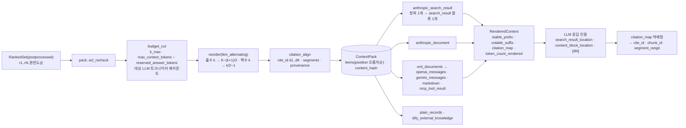

# ADR-0024: Context Pack 순서 전략과 Anthropic search_result 렌더러

> MADR 형식. 바이블 §3.3 표의 0024행이며 관련 결정은 D-20(브리프 §4 개정 v1.1, 바이블 §3.1 `amended`)이다. 이 ADR은 바이블 §9(ContextPack·렌더러 정본)와 §2.1 K4의 결정을 근거·대안과 함께 기록하고 바이블 표를 바꾸지 않는다(바이블 §1.1). `reorder`·`citation_align`이 `pack` 내부 `budget_cut` 뒤에 오는 이유(D-07 v1.2)는 [ADR-0013](./0013-fusion-rrf-k60-then-convex-combination-and-postprocess-order.md), 청크 측 예산 토크나이저(`hf:BAAI/bge-m3`)는 [ADR-0019](./0019-chunk-size-tokenizer-defaults-and-recount-stage.md), MCP `structuredContent`·`cursor`는 [ADR-0025](./0025-mcp-cursor-pagination-and-tool-set.md), 인용 좌표(`block_refs`·`sentence_spans` → `segments`·`provenance`)는 [ADR-0030](./0030-single-coordinate-system-and-score-ledger.md), `packer` 확장 지점의 `renderer`·`token_counter` 역할과 적합성 키트는 [ADR-0032](./0032-plugin-sdk-stage-protocol-and-conformance-kit.md), 공급자 페이로드의 보안 필드 배제는 [ADR-0027](./0027-security-context-injection-and-acl-enforcement-points.md)이 다룬다.

## 맥락과 문제

브리프 D-20 원안(v1.0)과 R6 해석은 LLM 네이티브 직렬화의 예로 "Anthropic `document` 블록/`citations`"를 들었고, §6은 레퍼런스 `answer`를 "Claude 기반, 인용 포함"으로만 적었다. 컨텍스트 팩(Context Pack)의 순서·인용 ID·토큰 예산·충분성은 R6 "LLM이 참고하면 최고의 효과"라는 요구만 있고 정본 규칙이 없었다. 기술 지형 조사([10 LLM 컨텍스트 최적화·MCP](../07-tech-landscape/10-llm-context-optimization-and-mcp.md), [07 리트리벌 기법](../07-tech-landscape/07-retrieval-techniques-fusion-reranking.md), [11 기존 RAG 플랫폼 격차 분석](../07-tech-landscape/11-existing-rag-platforms-gap-analysis.md), [선정 매트릭스](../07-tech-landscape/00-summary-and-selection-matrix.md) `context_packer`/`context_renderer` 행·브리프 수정 제안 D-20 행)와 설계 리뷰에서 다음 사실이 확정되었다.

| # | 사실 | 출처 |
|---|------|------|
| F1 | 관련 정보가 프롬프트의 처음·끝에 있을 때 정답률이 높고 중간에서 저하되는 U자형 편향(Liu et al. TACL 2023; Hsieh et al. ACL Findings 2024는 원인을 U자형 어텐션 편향으로 규명), 앞쪽 정보가 평균적으로 덜 주목되는 최신성 편향(recency bias; Peysakhovich & Lerer 2023), 검색 결과 수를 늘리면 hard negative로 정답률이 다시 내려가는 역U자(Jin et al. 2024). 재배열은 비용 0의 최소 대응이지만 근거가 2023~2024년 모델 기준이라 현세대 모델에서는 골든셋 재측정이 필요하다 | 10 §A1·§A2, 07 §4 표 "Lost in the Middle" 행 |
| F2 | 참조 구현 LangChain·LlamaIndex `LongContextReorder`는 K의 홀짝에 따라 1위가 처음 또는 끝으로 바뀐다(K=3 `[r1, r3, r2]`, K=4 `[r2, r4, r3, r1]`). Haystack `LostInTheMiddleRanker`는 홀짝 무관 결정적이나 1위를 처음(primacy)에 둔다. 어느 끝이 현세대 모델에 유리한지 직접 비교 근거는 없다 | 10 §A1 참조 구현 표, R11 |
| F3 | Anthropic Messages API의 `search_result` 블록은 RAG 전용 GA 경로다: 항목별 `source`·`title`, `content[]` 텍스트 블록이 최소 인용 단위, `citations.enabled`, 인용 결과 `search_result_location{search_result_index, start_block_index, end_block_index, cited_text}`, user 최상위 또는 `tool_result.content`에 위치, `cited_text`는 출력 토큰 미과금. 제약: 요청 내 `citations.enabled`는 all-or-nothing; `tool_result.content`에 `search_result`가 하나라도 있으면 모든 블록이 `search_result`여야 함(동종 블록); `output_config.format`(구조화 출력)과 병용 시 400; 빈 결과는 `{"type":"text","text":"No results found."}` 단일 블록 권고 | 10 §B1, 매트릭스 브리프 수정 제안 D-20 행 |
| F4 | `document` 블록 + `citations`는 문서 단위 경로다: plain text(`char_location`)·PDF(`page_location`)·Custom content(`content_block_location`, 추가 청킹 없음), `title`(길이 제한)·`context`(비인용 메타). 스캔 PDF는 인용 불가, 한국어 문장 자동 청킹 품질은 확인 필요. 청크 리스트에는 항목별 `source`/`title` 보존이 약하다 | 10 §B2, 브리프와의 충돌 D-20 행 |
| F5 | OpenAI `file_search`·Gemini File Search는 관리형 스토어 전용이라 자체 리트리버 결과에는 네이티브 인용 경로가 없다. Anthropic 공식 프롬프팅 가이드의 XML `<documents>` 템플릿(20k+ 토큰은 프롬프트 상단, 인용문 먼저 추출)이 모델 무관 폴백이며 `[dN]` 마커 + 구조화 출력 인용 배열로 파싱한다(OpenAI·Gemini·로컬은 인용과 구조화 출력이 충돌하지 않음). Gemini `start_index/end_index`는 문자 범위라 세그먼트 역매핑과 호환된다 | 10 §B3·B5~B7, 점수표(중립 렌더러 XML 4.45) |
| F6 | Anthropic는 공식 오프라인 토크나이저가 없고 `POST /v1/messages/count_tokens`(무료, 티어별 RPM)만 정확하다. `tiktoken`·LiteLLM은 Claude 토큰 수의 오차 방향·크기를 보장하지 못하며 Claude 4.7+ 계열은 구세대 대비 약 30% 팽창한다. 근사가 불가피하면 골든셋 실측 `calibration_ratio` + 마진(초안 10%)을 쓰고, 한국어 팽창률은 공급자·모델별로 달라 골든셋으로 고정해야 한다 | 10 §A7, 매트릭스 교차 함의 4·O-09 권고 |
| F7 | 프롬프트 캐싱(prompt caching)은 접두어 바이트 일치로 동작한다(`tools → system → messages`). `cache_control`은 최상위 블록에만 붙고 인용 하위 블록·빈 텍스트 블록에는 붙일 수 없다. 렌더 순서·타임스탬프·원시 점수가 접두어에 섞이면 캐시가 깨진다 | 10 §A8, D5 R1·R2 |
| F8 | 충분성 신호(Joren et al.)로 선택적 생성이 정답 비율을 +2~10% 올린다. 10 문서는 `sufficiency.status`에 `partial`을 제안했으나 바이블은 `not_needed, sufficient, insufficient, unknown` 4값으로 확정하고 부분 충분은 `coverage` + `confidence`로 표현한다. 원시 점수는 융합·모델마다 스케일이 달라 3단계 `confidence_tier`만 노출한다 | 10 §A6, 바이블 §5.7 `SufficiencyStatus`·§9.1 충분성 |
| F9 | Dify External Knowledge API(`records[{content, score, title, metadata}]`)가 외부 앱의 최소 검색 계약으로 쓰이므로 `dify_external_knowledge`·`plain_records` 렌더러가 제안되었다 | 11 §Dify·미해결 이슈 1, 매트릭스 `context_renderer` 행 |
| F10 | `reorder`(K 의존 `position`)와 `citation_align`(`cite_id` 확정)은 `pack`의 `k_max`·토큰 예산 절단 뒤에 있어야 하므로 `pack` 내부 고정 순서 `acl_recheck → budget_cut → reorder → citation_align`으로 이동했다(D-07 v1.2, 리뷰 major) | 바이블 §3.1 D-07, §8.2, ADR-0013 |

문제: (1) 렌더 순서 기본 전략을 무엇으로 하고 K 홀짝·참조 구현 차이에 어떻게 대응하는가, (2) 인용 ID를 렌더 위치와 어떻게 분리해 절단·재정렬·멀티턴에서도 불변으로 두는가, (3) Anthropic 렌더러의 1차 블록을 `search_result`·`document`·XML 중 무엇으로 하고 all-or-nothing·동종 블록·구조화 출력 병용 금지를 어디서 강제하는가, (4) 레퍼런스 `answer`가 인용과 구조화 응답을 어떻게 양립시키는가, (5) 대상 LLM 토큰 예산을 어떤 카운터로 산정하는가, (6) 공급자마다 다른 페이로드를 하나의 계약으로 표현하고 인용을 어떻게 역매핑하는가, (7) 충분성 상태 열거를 몇 값으로 고정하는가.

## 결정 동인(decision drivers)

| ID | 동인 | 내용 | 근거 |
|----|------|------|------|
| DR1 | LLM 네이티브 출력 | 최종 소비자는 사람이 아니라 LLM이다. 토큰 예산·순서·인용 가능성을 최적화하고, API가 `cited_text`를 보증하는 공급자 네이티브 인용을 마커 방식보다 우선한다 | 브리프 원칙 10, R6, 10 점수표 |
| DR2 | 인용 검증 가능성 | 공급자 인용 위치가 `cite_id → chunk_id → segments → provenance`로 결정적으로 되돌아와야 평가 하네스(`answer_spans`)·감사가 성립한다(단일 좌표계 K1) | 바이블 §2.1 K1·K4, §5.5 `RenderedContext.citation_map`, ADR-0030 |
| DR3 | 공급자 중립 | 계약은 플랫폼이 소유하고 공급자 포맷은 어댑터(렌더러)로 감싼다. 새 공급자·외부 앱은 렌더러 추가로 수용하며 계약은 바뀌지 않는다 | 브리프 원칙 2·5, D-10 `packer`, F9 |
| DR4 | 결정성·프롬프트 캐싱 | 같은 `RankedSet`·설정이면 `items`·`content_hash`·렌더 바이트가 동일해야 하고, 안정 접두어/가변 접미어를 분리해 캐시 접두어를 유지한다 | 브리프 원칙 4, 바이블 §9.1 결정성, §9.4, F7 |
| DR5 | 평가 주도 | 근거가 2023~2025년 모델·단일 조건 실험인 기본값(순서 전략, `r1` 위치, 표 형식)은 골든셋 A/B 항목으로 열어 두되 게이트 없이 바꾸지 않는다 | 브리프 원칙 7, 바이블 §7.4, F1·F2 |
| DR6 | 테넌트 격리 | 공급자 페이로드에 `tenant_id`·주체·`acl_*`·`record_id`가 나가지 않아야 한다. 내부 식별자는 `RenderedContext.citation_map`에만 둔다 | D-09, 바이블 §9.3 공통 규칙 (1), ADR-0027 |
| DR7 | 지연·비용 예산 | `pack` 40ms·`render` 15ms(초안). `count_tokens` API 호출은 Valkey 캐시로 최소화하고 실패 시 근사로 축소한다 | 바이블 §8.3, §4.3 `pack` 실패 정책 |
| DR8 | 한국어 우선 | 규정·법령 문서(`korean-gov`)는 조·항 연속성이 중요해 원문 순서가 필요하고, 한국어 토큰 팽창률은 공급자별로 달라 실측으로 고정해야 한다 | 브리프 원칙 6, 바이블 §7.2 `korean-gov` 행, 10 §A1·§A7 |

## 고려한 대안

| 대안 | 설명 | 장점 | 단점 | 판정 |
|------|------|------|------|------|
| A1 `litm_alternating`(순위 기준 직접 배치: `r1` 마지막, `r2` 처음) | 홀수 순위는 끝에서, 짝수 순위는 처음부터 채움(바이블 §9.2 공식) | K 홀짝 무관 결정적, 비용 0, U자·최신성 편향 동시 대응(F1), K=1..5 테스트 벡터로 고정 | 현세대 모델 효과는 재측정 필요; `r1` 끝 배치는 Peysakhovich & Lerer 한 근거 | **채택**(기본) |
| A2 `litm_alternating_primacy`(`r1` 처음, Haystack 배치) 기본 | A1의 좌우 반전 | 검증된 Haystack 구현과 동일 배치 | 직접 비교 근거 없음(F2); 열거값 추가는 바이블 §1.2 minor 변경이며 게이트 근거 필요 | **기각**(바이블: 골든셋 A/B 항목으로만) |
| A3 LangChain·LlamaIndex `LongContextReorder` 그대로 사용 | 리스트 뒤집기 후 교대 삽입 | 라이브러리 재사용 | K 홀짝에 따라 1위 위치가 바뀜(F2) → 비결정성, 최신성 대응 실패 | **기각** |
| A4 `relevance_desc` 기본 | 관련도 내림차순 | 단순, 디버그 용이 | U자·최신성 편향 미대응(F1) | 기각(열거·옵션 유지, A/B 대조군) |
| A5 `document_order` 전 프로파일 기본 | 문서 간 관련도, 문서 내 원문 순서 | 절차·규정 문서에 유리(DR8) | 일반 QA에서 최상위 근거 위치 보장 없음 | 기각(`korean-gov` 기본으로만) |
| A6 `cite_id`를 렌더 위치(`position`)에서 파생 | `d{position+1}` | 필드 하나 절약 | 재정렬·절단·멀티턴 추가 시 인용 불일치(10 리스크 표); 후처리·`pack` 이중 부여(F10) | **기각** |
| A7 Anthropic 1차 = `search_result` + `citations` | 항목 1개 → 블록 1개, `segments[]` → `content[]` | RAG 전용 GA, 항목별 `source`/`title`, 블록 단위 인용, `tool_result` 사용 가능, `cited_text` 미과금(F3); 점수 4.50 | all-or-nothing·동종 블록·구조화 출력 병용 금지를 렌더러가 사전 검증해야 함; 블록 수 상한 확인 필요 | **채택** |
| A8 Anthropic 1차 = `document` + `citations`(브리프 v1.0 문구) | 청크마다 문서 블록 | PDF 페이지 인용, `context` 비인용 메타(F4); 점수 4.00 | 청크 리스트에 인덱스·메타 보존 약함, 스캔 PDF 인용 불가, 한국어 자동 청킹 미확인 | **기각**(바이블: 2차, `get_document`·긴 섹션용) |
| A9 Anthropic 1차 = XML `<documents>` + `[dN]` | 프롬프트 텍스트 | 모델 무관, 한국어·라이선스 무제약; 점수 4.25 | 환각 인용 가능(`cited_text` 보증 없음), 정규식·구조화 출력 필요(F5) | 기각(공급자 중립 폴백·타 공급자 골격으로 유지) |
| A10 `tool_result`에 `search_result` + 안내 `text` 블록 혼합 | 충분성·상충·절단 문구를 별도 텍스트 블록으로 | 직관적 | 공급자 validation error(F3) | **기각**(첫 항목 `content[0]` 또는 시스템 지시문; `render.mixed_blocks`) |
| A11 `answer`에서 인용 + `output_config.format` 동시 사용 | 구조화 JSON 안에 인용 | 파싱 안정 | 400(F3) | **기각**(인용 켠 텍스트 1차, 구조화는 2단계 호출 또는 `bracket_id`) |
| A12 `sufficiency.status`에 `partial` 추가(10 문서 제안) | 5값 열거 | 부분 충분을 상태로 표현 | `coverage`(수치)·`confidence`(tier)와 중복, 규칙 판정 경계 모호 | **기각**(바이블 4값) |
| A13 Anthropic 예산을 `tiktoken`·고정 배율 근사로 산정 | `o200k_base` × 상수 | API 호출 0 | 오차 방향·크기 보장 없음, 세대별 약 30% 팽창(F6) → 컨텍스트 초과·400 | **기각**(`exact_api` 또는 `approximate + calibration_ratio`; 불일치는 구성 거부) |
| A14 공급자별 팩 스키마(Anthropic 팩·OpenAI 팩 …) | 계약을 공급자 단위로 분리 | 매핑 단계 생략 | 계약 N개·평가 하네스 분기·MCP 슬림 팩 이중화(DR3) | 기각(중립 JSON + 렌더러 9종) |

- **A1 vs A2·A3.** 세 참조 구현은 "양끝 교대 배치"라는 같은 계열이지만 정의가 다르다. LangChain·LlamaIndex는 K 홀짝에 의존하고, Haystack은 결정적이되 1위를 처음에 둔다. 바이블은 순위 기준 직접 배치로 K 홀짝 의존을 없애고 최신성 편향 근거로 `r1`을 질의 직전에 두되, 어느 끝이 유리한지는 근거가 없으므로 `litm_alternating_primacy`를 열거에 넣지 않고 골든셋 A/B(`r1` 마지막 vs 처음)로 남긴다(DR5).
- **A7 vs A8·A9.** `search_result`는 청크 리스트를 위한 블록이라 항목별 `source`·`title`이 보존되고 `search_result_index`로 역매핑이 결정적이다(DR2). `document`는 문서 전체·PDF 인용에 맞으므로 `get_document`·긴 섹션의 2차 경로로 남기고, XML은 `cited_text` 보증이 없어 Anthropic 1차가 될 수 없으나 OpenAI·Gemini·로컬에는 네이티브 경로가 없으므로 공급자 중립 폴백이자 그들의 골격이 된다(F5).
- **A11.** 인용과 구조화 출력의 병용 금지는 API 제약이므로 레퍼런스 `answer`는 인용 켠 텍스트 응답을 1차로 하고, 구조화가 필요하면 2단계 호출 또는 `citation_style=bracket_id`(XML 경로)로 전환한다. 렌더러는 `render.citations_with_structured_output`으로 400을 예방한다.
- **A13.** 청크 예산은 임베딩 토크나이저, 팩 예산은 대상 LLM 토크나이저라는 이중 카운트(O-09, ADR-0019)를 전제로, Anthropic에는 `count_tokens`(`exact_api`)만 정확하고 근사는 실측 `calibration_ratio` + 10% 마진으로만 허용한다. 공급자와 카운터가 어긋나는 구성(`anthropic` + `tiktoken`)은 프로파일 로딩에서 거부한다.

## 결정

**결정:** 브리프 D-20(개정 v1.1) 그대로 — "Context Pack은 **LLM 공급자 중립 표준 JSON** + **렌더러**(Anthropic Messages **`search_result`(1차)/`document`(2차) + `citations`** 블록, OpenAI 호환 메시지, Gemini 메시지, 공급자 중립 XML `<documents>` + `[dN]` 마커, Markdown, MCP `structuredContent`, 외부 앱용 `plain_records`/`dify_external_knowledge`). `cite_id`는 관련도순 불변(렌더 위치와 분리), 렌더 순서는 `litm_alternating` 기본, 토큰 예산은 대상 LLM 토크나이저로 재계산, 인용은 `output_config.format`(구조화 출력)과 병용 불가하므로 레퍼런스 `answer`는 인용 켠 텍스트 응답 1차". 순서 전략의 정본 공식은 바이블 §9.2 그대로 — "순위 `k`(1-based), 항목 수 `K`: 홀수 `k` → `position = K − (k+1)/2`, 짝수 `k` → `position = k/2 − 1`. `r1`은 항상 마지막(질의 직전), `r2`는 항상 처음." 충분성은 바이블 §5.7 그대로 — `SufficiencyStatus = not_needed, sufficient, insufficient, unknown`(`partial`은 기각: `coverage` + `confidence`로 표현).

| 항목 | 정본 값 | 위치 |
|------|---------|------|
| `Renderer` 열거 9종 | `anthropic_search_result, anthropic_document, openai_messages, gemini_messages, xml_documents, markdown, mcp_tool_result, plain_records, dify_external_knowledge`; 모듈 `render/` 9개 + `citation_map`; `packer` 그룹 `PluginMeta.role = renderer` / `token_counter`; `QueryRequest.renderer` 기본은 `target_model{provider: enum[anthropic, openai, google, local], model}`에서 유도 | 바이블 §5.7, §12, §3.1 D-10, §5.5 `QueryRequest` |
| `OrderingStrategy`·`litm_alternating` 테스트 벡터 | `litm_alternating, relevance_desc, document_order`; `QueryRequest.ordering_strategy` → `QueryPlan.pack.ordering` → `ContextPack.ordering{strategy, applied}`; `document_order` = 문서 간 관련도, 문서 내 원문 순서; `litm_alternating_primacy`는 열거에 없다. 테스트 벡터 K=1 `[r1]`, K=2 `[r2, r1]`, K=3 `[r2, r3, r1]`, K=4 `[r2, r4, r3, r1]`, K=5 `[r2, r4, r5, r3, r1]`; 적합성 키트 `litm_order(K=1..5)`가 이 표를 고정 | §5.5, §5.7, §8.2 `reorder`, §9.2, §12 `testing/` |
| `cite_id`·`rank`·`position` | `cite_id = d{rank}`(`^d[1-9][0-9]*$`), `rank` 1-based 관련도 순위(최종 항목 기준), `position` 0-based 렌더 위치; `items[]`는 `position` 오름차순; `budget_cut` 뒤 `citation_align`이 최종 K개에 연속 `d1..dK`를 부여하며 절단된 순위를 건너뛰지 않는다; `omitted[]`에는 `cite_id`가 없고 렌더하지 않는다 | §5.5 `ContextItem`·`ContextPack.omitted`, §6.1, §8.2, §9.3 공통 규칙 (3) |
| `pack` 내부 고정 순서 | `PackStep = acl_recheck, budget_cut, reorder, citation_align` → `sufficiency` → `content_hash`; `citation_align`이 `segments[]`(문장·표 행, `text` 기준 코드포인트 오프셋)·`provenance[]`(`block_refs`에서 결정적 생성)·`tables[]`·`conflicts_with[]`를 확정; `diagnostics.pack_steps[]` | §8.1 13단계, §8.2, ADR-0013 |
| 토큰 예산 이중 카운트 | 청크 예산 = `token_count_primary`(`hf:BAAI/bge-m3`); 팩 예산 = `budget.tokenizer{provider, model, name}` + `count_method`: Anthropic `count_tokens`(`exact_api`, Valkey `tok:{tokenizer_id}:{H(text)}`) 또는 `approximate` + `calibration_ratio`(근사 시 필수) + `safety_margin` 0.10; OpenAI `tiktoken:o200k_base`(`exact_local`); Gemini `count_tokens`/`LocalTokenizer`; 로컬 HF `tokenizers`; 공급자·카운터 불일치 → `pack.tokenizer_mismatch`(구성 거부); API 실패 → `pack.count_api_failed` 폴백 + `degraded{token_count, approximate_count}` + `diagnostics.count_method_fallback`; 렌더 후 `RenderedContext.token_count_rendered` 재카운트 → `budget.used_tokens` 갱신, 초과 시 `overflow_policy`(`[downgrade_tables, truncate]`, 옵션 `compress`)로 재렌더 | §9.1 이중 카운트·예산 초과, §5.5 `ContextPack.budget`·`RenderedContext`, §4.3 `pack`, §9.4, ADR-0019 |
| `anthropic_search_result`(1차) 매핑·사전 검증 | 항목 1개 → `{"type":"search_result","source":"rag://{collection_id}/{document_id}/{chunk_id}","title":"{title} › {section_path} ({doc_date}) [{confidence_tier}]{ [ocr]}","content":[segments[] 각각 text 블록],"citations":{"enabled":true}}`; 표는 HTML 문자열 텍스트 블록; user 최상위 또는 `tool_result.content`; `source`에 `tenant_id` 미포함; 역매핑 `search_result_location{search_result_index, start_block_index, end_block_index, cited_text}` → `citation_map[provider_key=search_result_index] → {cite_id, chunk_id, collection_id, document_id, segment_range}`. 사전 검증: `citations.enabled` all-or-nothing; `tool_result.content`에 `search_result`와 `text` 혼합 금지 → `render.mixed_blocks`(안내 문구는 첫 항목 `content[0]` 또는 시스템 지시문); `output_config.format` 병용 금지 → `render.citations_with_structured_output`; 빈 팩은 `{"type":"text","text":"No results found."}` 단일 블록(`render.empty_pack` 방지); `cache_control`은 최상위 블록만, 빈 텍스트 블록 금지; 블록 수 상한은 확인 필요(as of 2026-09); 세 오류는 비재시도이며 `render` 스테이지가 400 예방으로 사전 검증 | §9.3, §5.7 오류 카탈로그, §4.3 `render` |
| `anthropic_document`(2차) | `get_document`·긴 섹션: `{"type":"document","source":{"type":"content","content":[segments]},"title","context": context_prefix,"citations":{"enabled":true}}`; 역매핑 `content_block_location` → 세그먼트; 스캔 PDF(텍스트 없음) 인용 불가 | §9.3 |
| `xml_documents`(중립 폴백)와 그 파생 | `<documents><document index="dN"><source/><title/><section/><date/><confidence/><document_content/></document></documents>` + 지시문 "인용문 먼저 추출, `[dN]` 표기"; 정규식 `\[d(\d+)\]` + 선택 구조화 출력 `{answer, citations: [cite_id]}`; `cite_id` 화이트리스트 검증(환각 인용 차단); 20k+ 토큰은 프롬프트 상단. `openai_messages` = XML을 `input_text`로 + `text.format` 인용 배열; `gemini_messages` = XML을 `parts`로 + `start_index/end_index` → 세그먼트; `markdown` = `### [dN] title › path` + 본문; `mcp_tool_result` = `structuredContent` 슬림 팩 + `content[0].text` = `xml_documents`(`response_format=concise` 기본, 20k 토큰 상한, `truncated` + `next_cursor`, Anthropic 호스트 재전달 시 동종 블록 규칙); `plain_records` = `[{id, content, score(tier→수치), title, metadata}]`, `dify_external_knowledge` = Dify 외부 지식 API 스키마(인용 역매핑 없음) | §9.3, ADR-0025 |
| 공통 렌더 규칙 | (1) 공급자 페이로드에 `tenant_id`·주체·`acl_*`·`record_id` 금지(내부 식별자는 `citation_map`만); (2) `text_source ∈ {ocr, vlm}` → `[ocr]`/`[vlm]`, 변환본 `quality=degraded` → `[converted]`, `expose_confidence=true`면 `ocr_confidence_min` 소수 2자리 병기; (3) 모든 렌더러는 `cite_id` 연속 `d1..dK` 전제; 헤더 `title › section_path (doc_date)` + `source_uri` + `confidence_tier`, 원시 점수 숨김(`explain`만); `korean-gov`는 `render_hints.data_marking=datamark` | §9.1 헤더·출처 표기·데이터마킹, §9.3 공통 규칙 |
| 프롬프트 캐싱·결정성 | `RenderedContext.stable_prefix`(`instructions_template_id` 템플릿, 도구 정의, `stable_prefix_ref`) / `volatile_suffix`(팩 항목 + 질의) 분리, 브레이크포인트 접두어 끝 1개(+ 팩 끝 1개); 멀티턴은 이전 팩을 재정렬하지 않고 추가만(`session_id`, `exclude_ids`); MCP `tools/list` 결정적 순서; `content_hash = H("pack", canonical_json(items))`(타임스탬프·`trace_id` 제외); `render` 캐시 키 `H("render", content_hash, renderer, options_hash)` | §9.4, §9.1 결정성, §6.2, §4.3 `render` |
| 충분성 | 규칙: `route=no_retrieval → not_needed`; `relevance_gate.passed → sufficient`(`confidence` = `max(final_score)` tier); 실패 → `insufficient`; 리랭크 생략 + 캘리브레이션 없음 → `unknown`; `coverage` = 적중 질의 변형/키워드 비율; `method ∈ {rule, llm_judge}`(LLM 판정은 `premium` 옵션, O-05 비용 정책); `stop_signal`은 `sufficiency`에서 파생 | §9.1 충분성, §5.5, §5.7 `SufficiencyMethod`, ADR-0016 |
| API 표면 | `POST /v1/query` → `{context_pack, rendered?, explain?}`; `POST /v1/render` `{pack_id \| context_pack, renderer, options}` → `RenderedContext`; `POST /v1/answer` 레퍼런스 구현: 인용 켠 텍스트 응답 1차, 구조화는 2단계 호출 또는 `citation_style=bracket_id` | §14 |
| 프로파일 값(초안 목표) | `query.pack.ordering / table_format_preference / renderer`: `lite` `litm_alternating / [markdown, json] / xml_documents`, `standard`·`premium` `litm_alternating / [html, markdown, json] / anthropic_search_result`, `korean-gov` `document_order / [html, markdown] / xml_documents`; `k_max / max_context_tokens / reserved_answer_tokens` = 10/12,000/2,000 · 20/24,000/4,000 · 20/32,000/4,000 · 20/24,000/4,000; `overflow_policy [downgrade_tables, truncate]`; `confidence_tiers {high: 0.7, medium: 0.4}`; `tokenizer {provider: anthropic, model: "<target-model-id>", count_method: exact_api, calibration_ratio: null, safety_margin: 0.10}`; `instructions_template_id: rag-answer-ko@1` | §7.2, §7.3 |



K=3 팩(렌더 순서 `[r2, r3, r1]`)을 `anthropic_search_result`로 렌더한 `RenderedContext` 발췌(바이블 §5.5·§9.3 필드; `provider_payload.content`는 `position 0` 항목만 남기고 `tenant_id`·`volatile_suffix`는 생략했으며 `provider_key`는 `search_result_index`, `<hex64>`는 플레이스홀더다). 인용 `search_result_index=2`는 `cite_id=d1`, 즉 마지막 위치의 1위 항목으로 되돌아간다.

```json
{
  "schema_version": "1.0.0", "pack_id": "01J9ZQ4K7X2M8N3P5R6S7T8V9W",
  "renderer": "anthropic_search_result", "collection_ids": ["01J9ZP000000000000000COLL1"],
  "provider_payload": {
    "role": "user",
    "content": [
      {
        "type": "search_result",
        "source": "rag://01J9ZP000000000000000COLL1/01J9ZP00000000000000000DOC2/<hex64>",
        "title": "정보보호 지침 › 제2장 운영 › 제3조 절차 (2026-03-01) [high]",
        "content": [{"type": "text", "text": "제3조(절차) ① 정보보호 담당자는 분기별로 접근 권한을 점검한다."}, {"type": "text", "text": "② 점검 결과는 정보보호위원회에 보고한다."}],
        "citations": {"enabled": true}
      }
    ]
  },
  "stable_prefix": {"instructions_template_id": "rag-answer-ko@1", "stable_prefix_ref": null},
  "citation_map": [
    {"provider_key": 0, "cite_id": "d2", "chunk_id": "<hex64>", "collection_id": "01J9ZP000000000000000COLL1", "document_id": "01J9ZP00000000000000000DOC2", "segment_range": [0, 2]},
    {"provider_key": 1, "cite_id": "d3", "chunk_id": "<hex64>", "collection_id": "01J9ZP000000000000000COLL1", "document_id": "01J9ZP00000000000000000DOC5", "segment_range": [0, 1]},
    {"provider_key": 2, "cite_id": "d1", "chunk_id": "<hex64>", "collection_id": "01J9ZP000000000000000COLL1", "document_id": "01J9ZP00000000000000000DOC1", "segment_range": [0, 3]}
  ],
  "token_count_rendered": 1842, "count_method": "exact_api", "warnings": []
}
```

## 결과

**긍정**

- 순서가 K 홀짝·참조 구현과 무관하게 결정적이고 K=1..5 벡터가 적합성 키트에 고정되므로, 라이브러리 교체·리팩터링에도 배치가 바뀌지 않는다(DR4·DR5).
- `cite_id`가 `budget_cut` 뒤 최종 K개 기준 연속 `d1..dK`이고 `position`과 분리되어 재정렬·절단·멀티턴 추가에도 인용이 깨지지 않으며, 9종 렌더러가 같은 전제를 공유한다(DR2, F10).
- Anthropic 경로는 API가 `cited_text`·블록 인덱스를 보증하는 네이티브 인용을 쓰므로 환각 인용이 차단되고, `citation_map`으로 `chunk_id → segments → provenance`까지 결정적으로 되돌아와 `answer_spans` 평가·감사가 성립한다(DR1·DR2).
- 하나의 중립 JSON에서 9종 렌더러가 파생되어 MCP 슬림 팩·평가 하네스·외부 앱(Dify) 연동이 같은 계약을 쓰고, 공급자 추가는 `render/` 모듈 하나로 끝난다(DR3).
- 대상 LLM 토크나이저 이중 카운트와 `exact_api`/`calibration_ratio` 규칙으로 한국어 팽창·세대별 토크나이저 변경에도 컨텍스트 초과 400을 예방한다(DR7·DR8).
- 위반 가능한 공급자 제약(혼합 블록·구조화 출력 병용·빈 팩)이 오류 코드로 카탈로그화되어 렌더 전에 잡힌다.

**부정**

- `search_result`의 all-or-nothing·동종 블록 규칙 때문에 팩 수준 안내 문구(충분성·상충·절단)를 `tool_result` 안에 별도 텍스트 블록으로 낼 수 없고 첫 항목 `content[0]` 또는 시스템 지시문에 실어야 한다. 그 문구도 인용 대상이 된다.
- 인용과 구조화 출력의 병용 금지로 레퍼런스 `answer`는 텍스트 응답 1차이며, 구조화 응답에는 2단계 호출(비용·지연 증가) 또는 `bracket_id`(환각 인용 위험, 화이트리스트 검증 필요)가 든다.
- Anthropic 정확 카운트는 API 왕복과 RPM 한도를 소비한다(`pack` 40ms 예산 안). 캐시·근사 폴백으로 축소하지만 근사 시 `calibration_ratio`를 골든셋으로 실측·유지해야 한다.
- `litm_alternating`·`r1` 끝 배치·표 HTML 1차는 2023~2025년 연구·단일 조건 실험에 근거한 초안이며 현세대 모델·한국어 골든셋 재측정 전이다(바이블 §15 #1).
- 렌더러 9종은 계약 테스트·인용 라운드트립 테스트를 9배로 늘린다.

**중립**

- `relevance_desc`·`document_order`·`anthropic_document`·`compress`는 열거·옵션으로 남지만 `standard` 기본값은 아니다.
- 후처리·`pack` 순서(ADR-0013), 청크 예산 토크나이저(ADR-0019), MCP 커서·20k 상한(ADR-0025), `segments`의 좌표 원천(ADR-0030)은 이 ADR로 바뀌지 않는다. 계약 `schema_version`은 1.0.0을 유지한다.

## 준수 확인 방법

| 게이트 | 강제 내용 | 정의 위치 |
|--------|-----------|-----------|
| CI 열거 대조(바이블 §1.2) | `Renderer` 정확히 9값, `OrderingStrategy` 3값(`litm_alternating_primacy` 없음), `SufficiencyStatus` 4값(`partial` 없음), `CountMethod` 3값, `CitationStyle` 2값, `TableFormat` 3값, `OverflowPolicy` 3값, `PackStep` 4값; 오류 코드 `render.mixed_blocks`·`render.citations_with_structured_output`·`render.empty_pack`·`pack.tokenizer_mismatch`·`pack.count_api_failed`·`pack.budget_overflow` 카탈로그 일치 | [10-development/05](../10-development/05-ci-cd.md), [03-contracts/00](../03-contracts/00-contract-overview.md) |
| `rag profile validate` (4) | `chunk.tokenizer` = 임베딩 모델 토크나이저이고 팩 `tokenizer.provider`와 카운터가 일치(`anthropic` + `tiktoken` 조합은 `profile.invalid`); `count_method=approximate`면 `calibration_ratio` 필수; `ordering`·`renderer`·`table_format_preference`·`overflow_policy`는 열거값만; `gate`가 붙은 `ordering`은 `EvalReport.gate_result.passed` 없이 변경 불가 | 바이블 §7.4, [03-contracts/15](../03-contracts/15-collection-profile-and-policy-contracts.md), [ADR-0031](./0031-profile-schema-extends-and-quality-gates.md) |
| 스키마 제약 | `ContextItem.cite_id` `^d[1-9][0-9]*$`이고 `cite_id = "d" + rank`, 팩 내 `d1..dK` 연속; `position`은 `0..K−1` 순열이고 `items[]`는 `position` 오름차순; `ordering.strategy=litm_alternating`·`applied=true`면 §9.2 공식과 일치; `omitted[]`에 `cite_id` 없음; `budget.count_method=approximate → calibration_ratio` 필수(`if/then`); `conflicts_with` 비어 있지 않으면 `header.doc_date`·`doc_version_label` `dependentRequired`; `RenderedContext.citation_map[]` 필수, `renderer`는 `enum(Renderer)` | 바이블 §5.5, [03-contracts/11](../03-contracts/11-context-pack.md), [03-contracts/09](../03-contracts/09-query-request-and-query-plan.md) |
| 렌더 사전 검증(`render` 스테이지) | `anthropic_search_result`: `tool_result` 경로에 비-`search_result` 블록 → `render.mixed_blocks`; 요청에 `output_config.format`이 있고 `citations.enabled` → `render.citations_with_structured_output`; K=0 → `render.empty_pack` 대신 `"No results found."` 텍스트 블록; 직렬화된 페이로드에 `tenant_id`·주체·`acl_*`·`record_id` 부재(적합성 키트 `security_invariants`) | 바이블 §4.3 `render`, §9.3, §12 `testing/` |
| 적합성 키트(바이블 §12 `testing/`) | `litm_order`: K=1..5 벡터 + 임의 K에서 `r1` 마지막·`r2` 처음·`position` 순열; `renderer_citation_roundtrip`: 9종 렌더러 각각 공급자 인용(`search_result_location`·`content_block_location`·`[dN]`·`start_index/end_index`) → `citation_map` → `{cite_id, chunk_id, segment_range}` 왕복 일치, `budget_cut`으로 항목이 빠진 뒤에도 연속; `contract_roundtrip`: 같은 `RankedSet`·설정으로 두 번 패킹·렌더 시 `content_hash`·렌더 바이트 동일; 캐시 회귀는 `usage.cache_read_input_tokens > 0` | 바이블 §12, [10-development/04](../10-development/04-testing-strategy.md) |
| 하네스 게이트(ADR-0023) | 골든셋 A/B: `litm_alternating` vs `relevance_desc` vs `document_order`, `r1` 마지막 vs 처음(인터리빙 + 인용 귀속으로 승패); 표 QA 서브셋(HTML·Markdown·JSON·Markdown-KV); `calibration_ratio` = 골든셋 `exact / approx` 실측; 기본값 변경은 Holm 보정 p<0.05 + `EvalReport.gate_result.passed` | [08-evaluation/02](../08-evaluation/02-retrieval-metrics-and-harness.md), [08-evaluation/05](../08-evaluation/05-benchmark-plan-and-baselines.md) |
| 계량·알람 | `rag_pack_citation_unresolved_total` 증가 = 역매핑 결함; `rag_pack_tokens_count`가 `max_context_tokens − reserved_answer_tokens` 초과 = 카운터 오차; `rag_pack_latency_seconds` 40ms 초과 경고; `count_method_fallback=true` 비율 추적; 라벨은 `renderer`(저카디널리티)만 | 바이블 §6.5, §8.3, [09-operations/03](../09-operations/03-observability.md) |
| 코드 리뷰 체크리스트 | (a) `position` 계산은 `retrieval/pack/reorder.py`의 §9.2 공식 한 곳, `cite_id` 부여는 `retrieval/pack/citation_align.py` 한 곳 (b) 렌더러는 `items[]`를 `position` 순으로 순회하고 `rank`·`cite_id`를 재계산하지 않음 (c) `source` URI 조립에 `tenant_id` 사용 금지, 내부 식별자는 `citation_map`에만 (d) Anthropic 카운터는 `count_tokens` 어댑터만, `tiktoken`은 OpenAI 카운터에 한정 (e) 안내 문구는 첫 항목 `content[0]` 또는 `instructions_template_id` 템플릿으로만 (f) `cache_control`은 최상위 블록만, 빈 텍스트 블록 생성 금지 (g) 멀티턴 경로는 이전 팩 재정렬 금지 | [10-development/07](../10-development/07-contributing.md), 바이블 §9.3·§9.4·§12 |

## 재검토 조건

1. 골든셋 A/B에서 `r1` 처음(primacy)이 유의하게 우세하면 `OrderingStrategy`에 `litm_alternating_primacy`를 추가하고(바이블 §1.2 열거값 추가 = minor, 게이트 근거 첨부), `standard` 기본 전환은 별도 게이트로 다룬다. `relevance_desc`가 우세하거나 LITM 효과가 없으면 기본 전략을 ADR 개정으로 바꾼다(10 리스크 표, ADR-0013 재검토 조건 6).
2. Anthropic가 인용과 `output_config.format` 병용을 허용하거나 `search_result`의 all-or-nothing·동종 블록 제약을 바꾸면 `render.*` 오류 카탈로그와 `answer` 2단계 설계를 재검토한다(확인 필요, as of 2026-09).
3. `search_result` 블록 수 상한과 `count_tokens` RPM 한도가 공식 확인되면(바이블 미해결 이슈 7) `k_max`·`tok:` 캐시 정책·`approximate` 폴백 임계를 갱신한다.
4. `anthropic_document`의 한국어 문장 자동 청킹 품질 확인(10 미해결 이슈 3) 결과에 따라 2차 경로를 Custom content(`source.type=content`) 강제로 고정한다.
5. OpenAI Responses·Gemini가 외부 리트리버 결과에 네이티브 인용 경로를 제공하면 `openai_messages`·`gemini_messages`의 `[dN]` 마커를 네이티브로 대체한다(렌더러 내부 변경, 계약·열거 불변). 공급자 응답 포맷 이동으로 문자 범위 기반 역매핑이 성립하지 않으면 `citation_map.segment_range` 표현을 재검토한다.
6. 현세대 모델·한국어 표 골든셋 재측정에서 Markdown-KV/레코드형이 우세하면 `TableFormat` 값 추가(minor)와 `table_format_preference` 기본 갱신을 이 ADR 개정으로 기록한다(10 §A4·미해결 이슈 7).
7. `compress`(EXIT 문장 단위)가 한국어 골든셋을 통과해 `overflow_policy` 기본에 들어가면 `segments` 재계산 규칙과 `renderer_citation_roundtrip` 범위를 함께 갱신한다(ADR-0013 후처리 순서와 무관).

## 참조

- [설계 브리프](../00-vision/00-design-brief.md) §2 R6, §3 원칙 2·4·5·6·7·10, §4 D-09·D-10·D-13·D-20(개정 v1.1), §6 레퍼런스 `answer`, §9 문서 규약
- [설계 바이블](../02-architecture/00-design-bible.md) §1.1·§1.2, §2.1 K1·K4, §3.1 D-07·D-10·D-20 행, §3.3 0024행, §4.3 `pack`·`render`, §5.1 `ContextPack`·`RenderedContext`, §5.3 `Warning`·`DegradedEntry`·`TokenCounts`, §5.5 `QueryRequest`·`QueryPlan.pack`·`ContextPack`·`ContextItem`·`RenderedContext`, §5.7 `Renderer`·`OrderingStrategy`·`ConfidenceTier`·`CountMethod`·`OverflowPolicy`·`OmitReason`·`SufficiencyStatus`·`SufficiencyMethod`·`TableFormat`·`CitationStyle`·`DataMarking`·`PackStep`·오류 카탈로그, §6.1 `cite_id`·`tokenizer_id`, §6.2 `ContextPack.content_hash`, §6.5 메트릭, §7.1 후처리·패킹 행, §7.2·§7.3·§7.4, §8.1 13·14단계, §8.2, §8.3, §9.1~§9.5, §12 `retrieval/pack`·`render/`·`testing/`, §14 `/v1/query`·`/v1/render`·`/v1/answer`, §15 #1·#7, 미해결 이슈 2·7
- [기술 지형 종합: 선정 매트릭스](../07-tech-landscape/00-summary-and-selection-matrix.md) `context_packer`/`context_renderer`·`postprocessor_compression`·`mcp_sdk` 행, 프로파일별 기본 조합 후처리·패킹 행, 개방 결정 권고 O-09, 브리프 수정 제안 D-20 행, ADR 발의 목록 P2 "Context Pack 기본 전략과 Anthropic 렌더러(`search_result`)", 교차 함의 4(토크나이저 소유권)
- [10 LLM 컨텍스트 최적화와 MCP](../07-tech-landscape/10-llm-context-optimization-and-mcp.md) §A1 순서 전략·참조 구현 표, §A2 K 상한, §A3 헤더, §A4 표 형식, §A5 상충 표시, §A6 충분성·신뢰도, §A7 토큰 예산, §A8 프롬프트 캐싱, §A9 예산 초과, §B1 `search_result`, §B2 `document`, §B3 XML 템플릿, §B4 `answer` 주의, §B5~B7 OpenAI·Gemini·로컬, §D5 R1~R11, 권고안 1차/2차/폴백·프로파일별 조합·점수표, 표준 모델 매핑, 실패 모드, 브리프와의 충돌 D-20·§6, 리스크 및 완화, 결정 사항 요약
- [07 리트리벌 기법](../07-tech-landscape/07-retrieval-techniques-fusion-reranking.md) §4 후처리 표(Lost in the Middle·충분성·인용 단위 정렬 행), 계약 제안 `ContextPack` 행; [11 기존 RAG 플랫폼 격차 분석](../07-tech-landscape/11-existing-rag-platforms-gap-analysis.md) Dify External Knowledge API, 상호운용 렌더러, 미해결 이슈 1; 설계 제안 [제안 B 검색 품질 우선](../12-appendix/design-proposals/proposal-B-retrieval-quality-first.md)(K4 예산·순서·인용이 있는 팩)
- 관련 ADR: [ADR-0013 융합·후처리·pack 순서](./0013-fusion-rrf-k60-then-convex-combination-and-postprocess-order.md), [ADR-0016 LLM 보강 기본 끔](./0016-llm-enrichment-default-off-and-budget-policy.md), [ADR-0019 청크·토크나이저 기본값](./0019-chunk-size-tokenizer-defaults-and-recount-stage.md), [ADR-0023 평가 하네스](./0023-evaluation-qrels-answer-spans-and-linear-ndcg.md), [ADR-0025 MCP 커서·도구 집합](./0025-mcp-cursor-pagination-and-tool-set.md), [ADR-0027 SecurityContext·ACL 강제 지점](./0027-security-context-injection-and-acl-enforcement-points.md), [ADR-0030 단일 좌표계·점수 원장](./0030-single-coordinate-system-and-score-ledger.md), [ADR-0031 프로파일 게이트](./0031-profile-schema-extends-and-quality-gates.md), [ADR-0032 플러그인 SDK·적합성 키트](./0032-plugin-sdk-stage-protocol-and-conformance-kit.md)
- 하위 설계 문서: [03-contracts/11 Context Pack](../03-contracts/11-context-pack.md), [03-contracts/09 QueryRequest·QueryPlan](../03-contracts/09-query-request-and-query-plan.md), [04-pipelines/17 후처리·컨텍스트 패킹](../04-pipelines/17-post-processing-and-context-packing.md), [05-api/03 리트리벌 API](../05-api/03-retrieval-api.md), [05-api/05 MCP 서버](../05-api/05-mcp-server.md), [08-evaluation/02](../08-evaluation/02-retrieval-metrics-and-harness.md), [08-evaluation/04 LLM-judge·생성 품질](../08-evaluation/04-llm-judge-and-generation-quality.md), [ADR 인덱스](./README.md)
