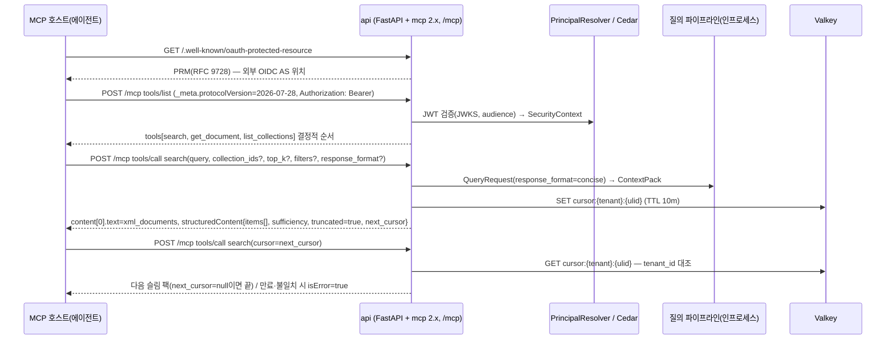

# ADR-0025: MCP 커서 페이지네이션과 도구 집합

브리프 §4 확정 결정 D-13(MCP 서버)의 v1.1 개정 — "더 보기"를 서버 세션 상태가 아닌 명시적 `cursor`/`next_cursor` 핸들로 구현하고, v1 도구 집합을 3종으로 고정하며, 결과를 슬림 `structuredContent` + 20k 토큰 상한으로 제한한 것 — 의 근거와 기각 대안을 기록하는 MADR(Markdown Architectural Decision Record) 문서다. 결정 문구의 정본은 브리프 §4 D-13(v1.1)과 설계 바이블 §3.1 D-13·§9.3 `mcp_tool_result`·§9.4·§10.3 E14·§13.4 Valkey 키·§14 `/mcp` 행이며, 이 문서는 그것을 바꾸지 않고 설명한다(바이블 §1.1). 바이블 §3.3의 ADR 번호·slug(`0025`, `mcp-cursor-pagination-and-tool-set`)를 따른다.

## 맥락과 문제

- 브리프 v1.0 D-13은 "MCP(Model Context Protocol) 서버 제공: `search`, `get_document`, `list_collections` 도구"만 확정했고 전송·인증·결과 크기·"더 보기(추가 결과 요청)" 방식은 열어 두었다. R6("TOP-K는 LLM이 참고하면 최고의 효과")과 원칙 10(LLM-Native Output)은 에이전트가 플랫폼을 직접 호출하는 경로를 요구한다(브리프 §2 R6, §3).
- MCP 스펙은 13개월 동안 세 번 파괴적으로 개정되었다(10 문서 §C1): 2025-03-26 Streamable HTTP 도입, 2025-06-18 `structuredContent`/`outputSchema`, 2025-11-25 OIDC Discovery·CIMD, **2026-07-28 무상태화** — `initialize` 핸드셰이크와 `Mcp-Session-Id`가 제거되고 모든 요청은 `_meta`의 `protocolVersion`·`clientCapabilities`로 자기 서술하며, `server/discover`가 필수, `tools/list`는 결정적 순서 권고, 12개월 폐기 정책이 붙었다. "이전 호출의 검색 결과를 서버 세션에 두고 다음 페이지를 준다"는 설계는 성립하지 않는다(선정 매트릭스 "브리프 수정 제안" D-13 행).
- 스펙의 커서 페이지네이션(`cursor`/`nextCursor`)은 `tools/list`·`resources/list`·`prompts/list` 같은 목록 메서드에만 있고 **`tools/call` 결과에는 네이티브 페이지네이션이 없다**(10 문서 §C4). 스펙 "Stateful Tools" 지침은 상태를 도구 인자로 전달되는 명시적 핸들로 유지하고, 만료 정책을 도구 설명에 적시하며, 만료 핸들 호출은 실행 오류(`isError: true`)로 돌려주라고 한다.
- 결과 크기에는 호스트 측 상한이 있다. Claude Code는 도구 응답을 기본 25,000 토큰으로 제한하고 잘라낼 때 "더 좁은 검색" 안내를 요구한다(10 문서 §C4). `ContextPack` 인라인 한계는 512KB·항목 20·24,000 토큰(바이블 §5.1)이므로 전체 팩을 그대로 도구 결과에 넣으면 호스트 상한을 넘거나 에이전트 컨텍스트를 낭비한다.
- 인증 서버는 비목표다(브리프 §6: OIDC 연동만). 스펙 2026-07-28은 리소스 서버가 RFC 9728 PRM(Protected Resource Metadata)을 게시하고 `Authorization: Bearer` 토큰의 audience를 검증하도록 요구한다(10 문서 §C2). 테넌트·ACL은 REST와 같은 `PrincipalResolver`에서 나와야 하고(바이블 §2.3 `api`, §10.3 E14), 테넌트 스코프 상태를 Valkey에 두려면 키에 `{tenant}` 접두가 필수다(§13.4, E17).
- 세 설계 제안과 심사는 도구 3종·`cursor` 핸들·슬림 `structuredContent`에 이견이 없었고, 14 문서는 에이전틱 루프용으로 `search_batch`(다중 질의 1회 호출)·`expand`(그래프·부모 확장)를 추가 제안했다(14 문서 "에이전틱 검색 도구"; 매트릭스 `mcp_sdk` 행).

따라서 결정할 질문은 다섯이다. (1) "더 보기"의 상태 모델, (2) 커서 핸들의 저장소와 스코프, (3) 도구 결과의 형태와 크기 상한, (4) v1 도구 집합의 범위, (5) 전송·인증·SDK 핀과 격리 방식.

## 결정 동인(decision drivers)

| 동인 | 출처 | 함의 |
|------|------|------|
| LLM-Native Output — 에이전트가 MCP로 직접 호출 | 브리프 §2 R6, §3 원칙 10, D-13 | 도구 결과는 사람이 아니라 LLM이 읽는다. 토큰 예산·인용 가능성(`cite_id`)·충분성 신호를 결과에 싣는다 |
| 스펙 2026-07-28 무상태화(세션 제거) | 10 문서 §C1, 매트릭스 D-13 행 | 서버 상태는 세션이 아닌 **명시적 핸들**(도구 인자 문자열)로만 유지 |
| `tools/call`에 네이티브 페이지네이션 없음 | 10 문서 §C4 | 페이지네이션은 도구 스키마(`cursor` 입력 / `next_cursor` 출력)로 설계해야 한다 |
| 멀티테넌시 1급, 강제 지점 E14·E17 | D-09, 바이블 §10.3, §13.4 | 핸들은 `tenant_id`에 바인딩되고 Valkey 키는 `cursor:{tenant}:{ulid}`; 다른 테넌트 주체의 핸들 제시는 실패해야 한다 |
| 정확성 상태는 PostgreSQL, Valkey는 캐시·핸들 | 바이블 §2.3 Valkey 행 | 커서 만료·유실은 정확성 사고가 아니라 "재검색"으로 복구 가능한 편의 상태여야 한다 |
| 호스트 결과 상한(Claude Code 25k), `response_format` 관행 | 10 문서 §C4 | 20k 토큰 상한(초안), `concise` 기본, 초과 시 절단 + 안내 문구 + `next_cursor` |
| 인증·인가 경로 하나(`PrincipalResolver` → `SecurityContext`) | 바이블 §2.3 `api`, E1·E2·E14, 12 문서 | MCP도 REST와 동일 검증기·Cedar `allowed_collections`; AS는 외부 OIDC(브리프 §6 비목표) |
| 프롬프트 캐싱 — `tools/list` 결정적 순서 | 바이블 §9.4, 10 문서 §C1(스펙 권고) | 도구 정의는 안정 접두어(`stable_prefix`)에 속한다 |
| 파괴적 개정 리스크(13개월 3회, SDK v1→v2) | 매트릭스 리스크 #7, 10 문서 리스크 표 | `McpToolAdapter`로 격리, `mcp>=2,<3` 핀, 공식 적합성 스위트 CI |
| Adapters over Forks·NIH 금지, 라이선스 A 등급 | 브리프 §3 원칙 2, R2, D-02 | 공식 SDK `mcp` 2.x(MIT, 매트릭스 4.55) 채택; 도구는 동일 질의 파이프라인 위 얇은 어댑터(바이블 §2.2 `api`); `mcp`·`fastmcp` 모두 A 등급이라 라이선스는 결정 요인이 아니다 |

## 고려한 대안

| # | 대안 | 판정 | 근거 요약 |
|---|------|------|-----------|
| A | 세션 기반 페이지네이션(`Mcp-Session-Id` 서버 세션에 결과 보관) | 기각 | 스펙 2026-07-28이 세션·`initialize` 제거(10 문서 §C1) |
| B | 전체 `ContextPack` 반환(절단·커서 없음) | 기각 | 호스트 25k 상한·512KB/24k 팩 한계(§5.1), 토큰 낭비(10 문서 §C4) |
| C | 테넌트 미바인딩 커서(전역 키 `cursor:{ulid}` 또는 자기완결 인코딩 커서) | 기각 | E14·E17·§13.4 위반, 교차 테넌트 누출(매트릭스 리스크 #4) |
| D | v1 도구 집합 확대(`search_batch`·`expand` 즉시 포함) | 기각(v1.1 후보로 유보) | 루프는 클라이언트(14 문서); 계약 안정 전 도구 수·설명문 부담 |
| E | REST 라우트 자동 노출(`fastapi-mcp`) | 기각 | 14개월 미릴리스·무상태 스펙 지원 미확인, 도구별 크기 정책 조정 불가(10 문서 §C3) |
| F | 도구 3종 + `cursor`/`next_cursor` Valkey 핸들(테넌트 바인딩, 10분) + 슬림 `structuredContent` + 20k 상한 + `concise` 기본 + 결정적 `tools/list` | **채택** | 세 제안 동일, 매트릭스 `mcp_sdk` 행 |

### 대안 A: 세션 기반 페이지네이션(기각)

- 설명: 스펙 2025-11-25 이하의 `Mcp-Session-Id`에 검색 결과(또는 `RankedSet`)를 서버 메모리·Valkey로 보관하고, 같은 세션의 후속 `search` 호출이 "다음 페이지"를 받는다.
- 장점: 도구 스키마에 페이지네이션 인자가 없고, 세션 안에서 결과가 일관되며, 재검색 비용이 없다.
- 단점: 2026-07-28이 `initialize`·`Mcp-Session-Id`를 제거해 세션 식별자 자체가 없다(10 문서 §C1). 구버전 클라이언트만 세션을 쓰므로 두 세대에 다른 상태 모델이 생기고, 스펙 12개월 폐기 정책상 구 경로는 소멸한다. 세션 상태는 수평 확장 시 스티키 라우팅을 요구한다(브리프 §7 가용성 99.9%).
- 판정: 기각. 매트릭스 "브리프 수정 제안" D-13 행이 "세션 상태로 설계 불가"로 판정했다.

### 대안 B: 전체 ContextPack 반환(기각)

- 설명: `search`가 `POST /v1/query`와 같은 `ContextPack` 전체(`items[]` 전 필드, `diagnostics`, `explain`)를 `structuredContent`와 텍스트 블록 양쪽에 넣는다.
- 장점: REST와 완전히 같은 계약, 렌더러 분기 없음, 스펙 SHOULD(구조화 JSON을 `TextContent`로도 반환) 문자 그대로 준수.
- 단점: 팩 한계 512KB·24,000 토큰(§5.1)이 호스트 상한(Claude Code 25k)과 맞닿아 절단·안내가 호스트에서 일어나고, JSON을 텍스트 블록에 중복하면 토큰이 2배가 된다(10 문서 §C7). `record_id`·`acl`·`diagnostics`는 에이전트에 불필요하고 §9.3 공통 규칙(1)은 공급자 페이로드에 내부 식별자를 넣지 않는다.
- 판정: 기각. 슬림 팩 + `content[0].text` = `xml_documents`(사람·모델이 바로 읽는 형태)로 대체하고 그 사실을 도구 설명에 적는다(10 문서 §C7).

### 대안 C: 테넌트 미바인딩 커서(기각)

- 설명: (C1) 핸들을 전역 키 `cursor:{ulid}`로 저장해 누구든 핸들만 있으면 다음 페이지를 받는다. (C2) 서버 상태 없이 질의·필터·오프셋을 서명해 커서 문자열에 인코딩하고 매 페이지 재검색한다.
- 장점: C1은 구현이 가장 단순하다. C2는 Valkey 의존이 없고 만료 개념이 없다.
- 단점: C1은 핸들 유출·추측 시 다른 테넌트의 결과를 읽게 되어 E14("커서 핸들은 `tenant_id`에 바인딩")·E17·§13.4("모든 테넌트 스코프 키는 `{tenant}` 접두 필수")를 위반한다(리스크 #4 교차 테넌트 누출). C2는 커서에 질의·필터가 노출되고, 페이지 사이에 `index_generation`이 바뀌면 결과가 흔들리며, 매 페이지 리랭크 비용을 다시 낸다(§8.3 예산).
- 판정: 기각. 서버 발행 불투명 핸들을 `cursor:{tenant}:{ulid}`(10분)에 두고 `SecurityContext.tenant_id`와 대조한다.

### 대안 D: v1 도구 집합 확대(기각, v1.1 후보)

- 설명: 14 문서가 제안한 `search_batch`(계획-실행 루프의 하위 질의 병렬 검색, 왕복 절감)·`expand`(그래프 홉·부모 확장)를 v1 도구로 포함하고, `list_collections`에 `include_stats`, `get_document`에 `section_path`·`page_range`·`max_tokens`(10 문서 §C5)를 더한다.
- 장점: 에이전틱 RAG 왕복 수 감소(14 문서 plan-and-execute), 그래프 프로파일과 바로 연동.
- 단점: 루프·생성은 클라이언트 책임(14 문서 결정 권고, 브리프 §6 비목표)이고, `expand`는 외부 그래프 플러그인(ADR-0015)과 부모 확장 정책(`parent_expand`, §8.2)이 먼저 안정되어야 한다. 도구가 늘수록 `tools/list` 토큰과 설명문 유지 부담이 커지고(10 문서 §C6), 스펙 개정마다 재작업 표면이 넓어진다(리스크 #7).
- 판정: 기각. `search_batch`·`expand`는 v1.1 후보로 기록하고(§3.1 D-13, §14), 재검토 조건에서 승격 게이트를 정한다. 10 문서 §C5의 추가 인자는 v1 시그니처(§14)에 없으며 05-api/05가 선택 인자 제안으로만 다룰 수 있다.

### 대안 E: REST 라우트 자동 노출(기각)

- 설명: `fastapi-mcp` 0.4.0(MIT)으로 `/v1/query`·`/v1/documents/*`·`/v1/collections` 라우트를 MCP 도구로 자동 노출하고 FastAPI 인증 의존성을 공유한다.
- 장점: 코드 중복 최소, D-01(FastAPI)과 직접 맞물림, 인증 경로 자동 공유.
- 단점: 마지막 릴리스 2025-07-28로 14개월 이상 멈춰 있고 2026-07-28 무상태 스펙(`server/discover`, `_meta` 협상) 지원이 확인되지 않았다(확인 필요 as of 2026-09). REST 스키마를 그대로 도구로 노출하면 `response_format`·20k 상한·설명문(10 문서 §C6)을 도구별로 다듬을 수 없다. 점수는 10 문서 권고안 "선정 근거 점수표"의 MCP SDK 표 기준 `fastapi-mcp` 0.4.0 3.95(스펙 추종 미확인) 대 `mcp` 2.x 4.55이며, 선정 매트릭스에는 `fastapi-mcp` 행이 없고 `mcp_sdk` 행 총점 4.55만 있다.
- 판정: 기각. 공식 SDK `mcp` 2.x `MCPServer`를 1차, `fastmcp` 4.x를 2차(인증 프록시 필요 시), 저수준 `mcp.server.Server`를 폴백으로 두되 모두 `McpToolAdapter` 뒤에 숨긴다(10 문서 §C3, 바이블 §12 `mcp/`).

### 대안 F: 도구 3종 + 테넌트 바인딩 커서 핸들 + 슬림 structuredContent(채택)



- 설명: `api` 컨테이너가 FastAPI 앱에 `/mcp`(Streamable HTTP)를 마운트하고, 도구는 `McpToolAdapter`가 동일 질의 파이프라인·문서 조회·컬렉션 목록을 감싼다. 결과가 20k 토큰을 넘으면 절단하고 서버 발행 불투명 핸들을 `next_cursor`로 돌려주며, 핸들은 Valkey `cursor:{tenant}:{ulid}`에 10분 보관되고 호출 주체의 `tenant_id`와 대조된다.
- 장점: 스펙 무상태 모델과 정합, 인증·필터 경로가 REST와 동일(E14), 팩 렌더러 하나(`mcp_tool_result`, §9.3) 추가로 끝나며, SDK 파손은 어댑터 한 곳에 갇힌다.
- 단점: Valkey 불가 시 커서 발급 불가, 10분 뒤 재검색 필요, 페이지 사이 결과 일관성은 핸들 수명 안에서만 보장된다.
- 판정: 채택. 세 제안 동일이며 매트릭스 `mcp_sdk`·`cache_kv_store` 행과 일치한다.

## 결정

**결정:** **MCP(Model Context Protocol) 서버** 제공(`mcp>=2,<3`, Streamable HTTP, FastAPI `/mcp` 마운트, 외부 OIDC AS + RFC 9728 PRM): `search`, `get_document`, `list_collections` 도구. 스펙 2026-07-28이 세션을 제거했으므로 "더 보기"는 `cursor` 입력/`next_cursor` 출력(Valkey 핸들, 테넌트 바인딩)으로 구현하고 결과는 `structuredContent`(슬림 ContextPack) + 20k 토큰 상한. `search_batch`·`expand`는 v1.1 후보 (개정 v1.1, 근거: ADR-0025). — 브리프 §4 D-13, 바이블 §3.1 D-13(`amended`).

결정에 딸린 정본 세부(모두 바이블 인용, 이 문서가 새로 정하지 않는다):

- 도구 시그니처(§14 `/mcp` 행): `search(query, collection_ids?, top_k?, filters?, response_format?, cursor?)`, `get_document(document_id, view?, cursor?)`, `list_collections()`. 인자 의미는 `QueryRequest`(§5.5)와 같다 — `query` ≤ 4,000자, `collection_ids` 1..20이며 `SecurityContext.collection_ids`와 교집합(빈 집합 403), `top_k` 1..50 기본 10, `filters`는 `FilterNode`(§5.7 `FilterableField` 화이트리스트), `response_format ∈ enum(ResponseFormat) = {concise, detailed, pack_only}` MCP 기본 `concise`, `cursor`는 MCP "더 보기" 핸들. `get_document`의 `view`·`cursor`는 REST `GET /v1/documents/{document_id}/content?view=parsed|normalized|chunks&cursor=`(§14)와 같은 어휘를 쓰고 §10.2 (a) 보안 필터로 재조회한다(E10). `list_collections`는 Cedar `allowed_collections`만 반환한다(E14). `tools/list`는 결정적 순서(§9.4).
- 인증(E14, §2.2·§2.3 `api`, §14): 동일 `PrincipalResolver`(OIDC JWT JWKS 검증), `GET /.well-known/oauth-protected-resource`로 PRM 게시, `Authorization: Bearer` 헤더만, audience 검증. 실패는 401/403, 도구 실행 오류는 `isError`. 본문에 `tenant_id`가 오면 REST와 같이 거부한다(E1).
- 커서(§5.5 `QueryRequest.cursor`, §5.5 `ContextPack.truncated`/`next_cursor`, §13.4, §12 `mcp/cursor_store`): 서버 발행 불투명 문자열, Valkey 키 `cursor:{tenant}:{ulid}` TTL 10분, `SecurityContext.tenant_id`에 바인딩. `next_cursor`가 `null`이면 끝. 만료·불일치 핸들은 실행 오류(`isError: true`, "cursor expired; re-run search", 10 문서 실패 모드 표)로 돌려주고 만료 정책을 도구 설명에 적는다.
- 결과 형태(§9.3 `mcp_tool_result`, §5.7 `Renderer`): `structuredContent` = 슬림 팩 `items[]{cite_id, chunk_id, collection_id, document_id, header, text_preview | text, confidence_tier, text_source, provenance}`, `sufficiency`, `truncated`, `next_cursor`; `content[0].text` = `xml_documents`. `response_format=concise`는 `text_preview`, `detailed`는 `text`. 20k 토큰 상한(초안 목표), 초과 시 `truncated=true` + `next_cursor` + 안내 문구. Anthropic 호스트가 `tool_result`로 재전달하면 동종 블록 규칙(§9.3 `anthropic_search_result` 제약). 공급자 페이로드에 `tenant_id`·주체·`acl_*`·`record_id`를 넣지 않는다(§9.3 공통 규칙 1).
- SDK·격리(매트릭스 `mcp_sdk`, §12): `mcp>=2,<3` 핀, `mcp/` 패키지의 `McpToolAdapter`·`tools`·`cursor_store`만 SDK를 안다. 기동은 `rag mcp serve`(§11.6 5단계). 회귀는 `@modelcontextprotocol/conformance`(`--spec-version 2025-11-25`·`2026-07-28`) CI.

`structuredContent` 슬림 팩 예시(`response_format=concise`, 항목 1개, 절단됨):

```json
{
  "items": [
    {
      "cite_id": "d1",
      "chunk_id": "9f3a5c7e1b2d4f60a8c9e1f3b5d7a9c0e2f4a6b8d0c2e4f6a8b0c2d4e6f8a0b1",
      "collection_id": "01J9ZQ4K7X2M8N3P5R6S7T8VA0",
      "document_id": "01J9ZQ4K7X2M8N3P5R6S7T8VB1",
      "header": {
        "title": "정보공개 업무 처리 지침",
        "section_path": ["제3장 청구 접수", "제12조 접수 절차"],
        "numbering_path": ["3", "12"],
        "source_uri": "s3://tenant-docs/guides/foia-2026.hwpx",
        "doc_date": "2026-03-01",
        "lang": "ko"
      },
      "text_preview": "정보공개 청구서는 접수일로부터 10일 이내에 공개 여부를 결정하여 청구인에게 통지한다.",
      "confidence_tier": "high",
      "text_source": "text_layer",
      "provenance": [
        {"element_path": "/hp:sec[0]/hp:p[41]", "char_start": 0, "char_end": 58, "page": null, "bbox": null}
      ]
    }
  ],
  "sufficiency": {"status": "sufficient", "coverage": 0.8, "confidence": "high", "missing_aspects": [], "method": "rule"},
  "truncated": true,
  "next_cursor": "01JA0C3D5E7F9G2H4J6K8M0N2P"
}
```

## 결과

### 긍정

- 서버에 세션 상태가 없어 `api` 인스턴스 수평 확장에 스티키 라우팅이 필요 없고, 스펙 2026-07-28 무상태 모델과 구버전 클라이언트(SDK가 처리)를 한 코드 경로로 서비스한다.
- 인증·인가·필터·`SecurityContext` 주입이 REST와 같은 한 경로라 강제 지점(§10.3) 우회 표면이 늘지 않는다. 커서가 테넌트에 바인딩되어 핸들 유출이 교차 테넌트 누출로 이어지지 않는다.
- 슬림 팩 + `xml_documents` 텍스트로 토큰을 두 배로 쓰지 않으면서 스펙의 구조화 출력(`outputSchema` ↔ `structuredContent`)을 만족하고, `cite_id`·`sufficiency`로 에이전트가 인용·중단 판단을 할 수 있다(원칙 10).
- 도구 3종·결정적 `tools/list`는 프롬프트 캐시 안정 접두어에 들어가며(§9.4), 스펙 개정 시 재작업이 `McpToolAdapter` 한 곳에 갇힌다(리스크 #7 완화).

### 부정

- Valkey 불가 시 커서를 발급할 수 없다. 이때 `truncated=true`·`next_cursor=null`로 응답하고 안내 문구로 `filters`·`top_k` 축소를 권하는 폴백(매트릭스 결과 크기 행 "top_k 축소")은 제안이며 05-api/05가 확정한다. 커서는 정확성 상태가 아니므로 `degraded` 기록 여부도 같은 문서가 정한다.
- 핸들 수명 10분 뒤에는 재검색해야 하며, 페이지 사이에 `index_generation`이 바뀌어도 커서 안의 결과는 발급 시점 기준이다.
- 만료 커서·입력 검증 실패의 전용 오류 코드가 §5.7 카탈로그에 없다. MCP 계층은 `isError: true` 실행 오류로 표현하고, 전용 코드(예: `api.cursor_expired`)가 필요하면 §1.2 minor 절차(열거값 추가)로 제안한다.
- 20k 토큰 상한과 10분 TTL은 초안 목표다. 호스트 상한·에이전트 루프 지연 실측 후 §7.2 파라미터 표를 통해 조정한다.

### 중립

- `QueryRequest.session_id`·`exclude_ids`(§5.5)는 REST 경로의 에이전트 반복 검색 필드이며 v1 `search` 시그니처(§14)에는 없다. MCP 노출 여부는 v1.1 후보 검토와 함께 다룬다.
- 도구 이름 네임스페이스 접두어(`rag_search` 등)는 스펙이 호스트 몫으로 두므로 기본 이름은 D-13 그대로이고 접두어는 호스트 설정 옵션이다(10 문서 §C5). 도구 주석 `readOnlyHint=true, idempotentHint=true, openWorldHint=false`(10 문서 §C5 권고)와 개발용 stdio 전송(인증 스펙 미적용)은 05-api/05가 확정한다.

## 준수 확인 방법

| # | 규칙 | 강제 수단 | 게이트·위치 |
|---|------|-----------|-------------|
| 1 | 도구 집합·시그니처는 §14 `/mcp` 행 그대로(3종, 인자 이름·선택 여부), `tools/list` 결정적 순서 | `mcp/tools`의 `inputSchema`·`outputSchema`를 `query-request.schema.json`·`context-pack.schema.json` 부분집합으로 생성(손편집 금지) | `tools/list` 스냅샷 테스트(순서 포함) + 적합성 CI |
| 2 | `mcp>=2,<3` 핀, SDK 임포트는 `mcp/` 패키지 안에서만 | `pyproject.toml` 버전 제약, `uv lock --check`(D-01); import-linter 계층 규칙(§12 `contracts ← … ← api | mcp | cli`) + "`mcp` SDK는 `rag_platform.mcp` 외 임포트 금지" 규칙(제안) | CI 린트 |
| 3 | 인증은 동일 `PrincipalResolver`, PRM 게시, `Authorization: Bearer`만, audience 검증, 본문 `tenant_id` 거부 | `security/principal_resolver` 재사용(§12); `GET /.well-known/oauth-protected-resource` 라우트; 헤더 외 토큰(쿼리) 거부 | 계약 테스트(401/403/`isError`), `@modelcontextprotocol/conformance` 인증 시나리오(커버리지 확인 필요 as of 2026-09), E14 |
| 4 | 커서 키 `cursor:{tenant}:{ulid}` TTL 10분, `tenant_id` 바인딩, 불일치·만료는 `isError: true` | `mcp/cursor_store`가 키를 `SecurityContext.tenant_id`로만 구성; `{tenant}` 접두 없는 키 생성 API 미제공 | 적합성 키트 `security_invariants`에 "테넌트 B 주체가 테넌트 A 핸들 제시 → 실행 오류" 항목(제안); 코드 리뷰: §13.4 접두 규칙 |
| 5 | `structuredContent` 필드는 §9.3 슬림 팩 열거와 일치, `tenant_id`·주체·`acl_*`·`record_id` 부재 | `render/mcp_tool_result` 렌더러 단일 구현; `outputSchema`에 `additionalProperties: false`(제안) | 렌더러 스냅샷 + "금지 필드 부재" 테스트(매트릭스 CI 게이트 "문서 내용·내부 식별자 부재" 계열) |
| 6 | `content[0].text` = `xml_documents`, JSON 중복 금지 | 렌더러가 `xml_documents` 렌더러를 호출해 텍스트 블록 생성 | 렌더러 테스트, 적합성 키트 `renderer_citation_roundtrip`(`[dN]` 마커 ↔ `cite_id`) |
| 7 | `response_format=concise` 기본, 20k 토큰 상한, 초과 시 `truncated=true` + `next_cursor` + 안내 문구 | 렌더 후 재카운트로 `budget.used_tokens` 갱신(§9.4), 초과 픽스처 | 렌더러 테스트(예산 초과 픽스처), `rag_pack_tokens_count{renderer="mcp_tool_result"}` 관찰 |
| 8 | `list_collections`는 `allowed_collections`만, `search`의 `collection_ids`는 교집합(빈 집합 403), `get_document`는 §10.2 (a) 재조회 | Cedar 인가(E2) 재사용, `hydrate`·`get_document` 공통 보안 필터(E10) | 정책 단위 테스트, 카나리 테넌트 침투 테스트(E8 계열) |
| 9 | 구·신 스펙 클라이언트 회귀, `rag mcp serve` 기동 경로(§11.6 5단계) 유지 | `npx @modelcontextprotocol/conformance server --url … --spec-version 2025-11-25` 및 `--spec-version 2026-07-28` | CI(Node 런타임 추가) + 개발 모드 스모크 테스트; MCP Inspector는 수동·OAuth 스모크 |

코드 리뷰 체크리스트(요약): (a) 도구 인자·결과 필드가 §14·§9.3 밖으로 늘지 않았는가(늘면 05-api/05 미해결 이슈 → §1.2 절차), (b) Valkey 키에 `{tenant}` 접두가 있는가, (c) `mcp` SDK 타입이 `rag_platform.mcp` 밖으로 새지 않는가, (d) 결과에 `record_id`·`acl_*`·`tenant_id`가 없는가, (e) 만료 커서·입력 오류가 프로토콜 오류가 아닌 `isError: true`로 반환되는가, (f) `tools/list` 순서를 바꾸는 변경이 스냅샷을 갱신했는가.

## 재검토 조건

- MCP 스펙이 `tools/call` 결과의 네이티브 페이지네이션 또는 세션·상태 모델을 (재)도입할 때 → 커서 핸들을 스펙 기능으로 이관하는 ADR 개정. 2026-07-28이 12개월 폐기 정책에 들어가거나 `mcp` 3.x가 릴리스될 때 → 핀 범위와 어댑터 재검토(ADR-0018과 병행).
- `search_batch`·`expand` 승격 게이트: 14 문서 계획-실행 루프에서 `search` 반복 대비 왕복·지연 절감이 골든셋 에이전트 시나리오로 입증되고, `expand`의 전제(그래프 플러그인 ADR-0015, `parent_expand` 정책 §8.2)가 안정될 때 → v1.1 ADR 개정으로 도구 추가(§1.2 minor).
- 호스트 결과 상한(Claude Code 25k 등)이나 에이전트 컨텍스트 관행이 바뀌어 20k 상한이 과대·과소로 판명될 때, 커서 TTL 10분이 실제 루프 지연과 맞지 않을 때 → §7.2 파라미터 개정(초안 목표 갱신).
- Valkey 불가 시 커서 폴백(발급 불가·`degraded` 기록)이 운영에서 문제가 되거나, 만료 커서 전용 오류 코드가 필요해질 때 → §5.7 열거값 추가(minor).

## 참조

- [설계 브리프](../00-vision/00-design-brief.md) — §2 R6, §3 원칙 2·9·10, §4 D-01·D-02·D-09·D-13·D-14·D-20, §6 비목표(인증 서버), §7 품질 목표, §9.11 ADR 길이
- [설계 바이블](../02-architecture/00-design-bible.md) — §1.1~1.2, §2.2 C4(`api`·Valkey·`agent`), §2.3 `api`·Valkey 행, §3.1 D-13, §3.3, §5.1(`QueryRequest`·`ContextPack` 생산·소비), §5.5 `QueryRequest`·`ContextPack`·`ContextItem`, §5.7 `ResponseFormat`·`Renderer`·`FilterableField`·오류 코드, §6.1 ULID, §6.7 `/mcp`, §8.2~8.3, §9.3 `mcp_tool_result`·공통 규칙, §9.4, §10.2, §10.3 E1·E2·E3·E10·E14·E17, §11.6, §12 `mcp/`·`render/`·`security/`·`testing/`, §13.4 Valkey 키, §14
- [기술 지형 종합: 선정 매트릭스와 결정 권고](../07-tech-landscape/00-summary-and-selection-matrix.md) — 매트릭스 `mcp_sdk`·`cache_kv_store`·`authz_policy` 행, "브리프 수정 제안" D-13 행, ADR 발의 목록, 리스크 #4·#7, 어댑터 공통 요구 3(pin-and-bump)
- [LLM 컨텍스트 최적화·인용·MCP 연동](../07-tech-landscape/10-llm-context-optimization-and-mcp.md) — §C1 스펙 이력(2026-07-28 무상태화), §C2 전송·인증, §C3 SDK 비교, §C4 결과 크기·페이지네이션, §C5 도구 스키마, §C6 설명문, §C7 `structuredContent`, 권고안 MCP 행, 선정 근거 점수표(MCP SDK: `mcp` 2.x 4.55 / `fastmcp` 4.x 4.45 / `fastapi-mcp` 0.4.0 3.95), 실패 모드(만료 커서), 리스크 표
- [고급 RAG: 그래프·RAPTOR·에이전틱·멀티모달](../07-tech-landscape/14-advanced-rag-graph-raptor-agentic-multimodal.md) — 에이전틱 검색 도구(`search_batch`·`expand`), 계획-실행 루프, 결정 권고(루프는 클라이언트)
- 관련 ADR(바이블 §3.3 번호·slug): [ADR-0011 저장소 기본 이미지 Valkey](./0011-kv-and-object-storage-valkey-rustfs-seaweedfs.md), [ADR-0015 GraphRAG 외부 플러그인](./0015-graph-rag-external-plugin-raptor-core-option.md), [ADR-0018 API 규약](./0018-api-rest-sse-mcp-no-grpc-rfc9457.md), [ADR-0024 Context Pack 순서 전략과 렌더러](./0024-context-pack-ordering-and-anthropic-search-result-renderer.md), [ADR-0027 SecurityContext 서버 주입과 강제 지점](./0027-security-context-injection-and-acl-enforcement-points.md), [ADR-0036 명명 규약](./0036-naming-and-identifier-conventions.md)
- 이 결정을 전제로 하는 설계 문서(문서 맵): [MCP 서버](../05-api/05-mcp-server.md), [리트리벌 API](../05-api/03-retrieval-api.md), [질의 요청·질의 계획 계약](../03-contracts/09-query-request-and-query-plan.md), [컨텍스트 팩 계약](../03-contracts/11-context-pack.md), [멀티테넌시·보안 아키텍처](../02-architecture/07-multi-tenancy-and-security-architecture.md), [보안·컴플라이언스](../09-operations/05-security-and-compliance.md)
