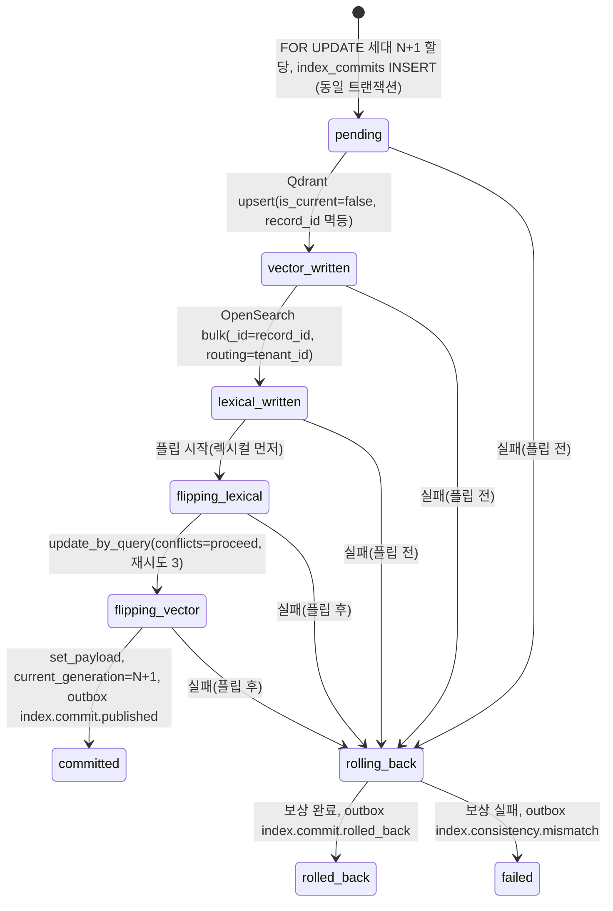

# ADR-0026: IndexCommit 세대 사가: 세대 합성 물리 키, 플립 중간 상태와 이전 세대 복원 보상, ID 발급·문서 직렬화, commit ledger

> MADR(Markdown Architectural Decision Record) 형식. 바이블 §3.3 표의 0026행(slug `index-commit-generation-saga-and-ledger`, P0)이며 관련 결정은 핵심 아이디어 K6 "원장 중심 + 세대 사가"(바이블 §2.1)다. 이 ADR은 바이블 §11.4의 결정을 근거·대안과 함께 기록하고 바이블 표를 바꾸지 않는다(바이블 §1.1). 물리 키 `record_id`의 결합식은 [ADR-0004](../06-adr/0004-deterministic-chunk-id-scoped-record-id-and-ulid-exception.md), 아웃박스·`event_id` 소비자 멱등은 [ADR-0017](../06-adr/0017-event-delivery-outbox-cloudevents-no-broker.md), 오케스트레이터 중립 셸은 [ADR-0003](../06-adr/0003-orchestrator-neutral-pipeline-and-non-durable-local-runner.md), 검색 핫패스의 PostgreSQL 미의존은 [ADR-0034](../06-adr/0034-retrieval-hot-path-postgres-independence-and-hydrate.md)가 다룬다.

## 맥락과 문제

`index` 스테이지는 한 문서 버전의 `EmbeddedChunkSet`을 벡터 백엔드(Qdrant)와 렉시컬 백엔드(OpenSearch) 둘에 적재하고 `IndexCommit`을 낸다(브리프 D-05·D-15, 바이블 §4.2). 두 엔진에 걸친 쓰기는 트랜잭션(transaction)이 아니므로 한쪽만 성공한 부분 커밋, 두 세대가 동시에 검색되는 중복, 이전 세대를 지운 뒤 새 세대가 실패하는 검색 공백이 모두 가능하다. 브리프 §7은 "수집은 at-least-once + 멱등", "동일 `IngestRequest` + 동일 프로파일 → 동일 `IndexCommit` 해시", 리트리벌 가용성 99.9%를 요구하므로 이 비원자성은 "허용된 혼합 상태"로 명시적으로 모델링되어야 한다. 기술 지형 조사와 설계 제안·리뷰에서 다음 사실이 확정되었다.

| # | 사실 | 출처 |
|---|------|------|
| F1 | 두 백엔드 쓰기는 트랜잭션이 아니다. `IndexCommit`을 사가(saga)로 정의하고 Temporal(D-17)이 보상을 실행한다. 원 제안은 insert-then-delete(새 청크 적재 후 `commit_id != new`인 이전 청크 삭제)였고, "커밋 완료 시점에 이전 버전을 `is_current=false`로 갱신"하는 대안을 병기한 채 04-pipelines/19로 확정을 미뤘다. Qdrant `set_payload`·OpenSearch `update_by_query`가 부분 갱신을 지원한다 | 07-tech-landscape/06 §IndexCommit 프로토콜 |
| F2 | alias 교체는 백엔드 각자는 원자적(Qdrant `update_collection_aliases` 한 요청, OpenSearch `POST _aliases`)이나 두 백엔드 사이에는 동시 원자성이 없다. 프로파일 변경은 blue/green 컬렉션 + alias 교체이며 순서를 "렉시컬 → 벡터"로 고정하고 수 초의 혼합 상태를 허용하거나 `QueryPlan`에 `index_generation`을 명시하는 두 길이 제시되었다 | 07-tech-landscape/06 §재색인과 alias swap |
| F3 | 백업의 교차 백엔드 시점 불일치 때문에 진짜 소스는 오브젝트 스토리지의 콘텐츠 주소화 산출물이다. 복구는 "산출물 재적재(replay)" 1순위, 스냅샷 복원은 시간 단축용 2순위 | 07-tech-landscape/06 §리스크·백업 표준 |
| F4 | Temporal에서 사가는 SDK 기능이 아니라 패턴(보상 액티비티 스택)이다. 워크플로우 코드는 샌드박스에서 실행되어 `datetime.now`·랜덤·I/O가 차단되고, 결정론은 `Replayer` CI로 지킨다. "Qdrant 커밋 성공·OpenSearch 실패"는 08 문서 실패 모드 표에 보상 `index.rollback(commit_id)`로만 적혀 있었다 | 07-tech-landscape/08 §Temporal 함정 1·5, §실패 모드 |
| F5 | Qdrant 포인트 ID는 u64 또는 UUID만 허용한다. 바이블 초판(v1.0)의 물리 키 `record_id = chunk_id`, `point_id = uuid5(chunk_id)`는 청킹 전 단계가 같은 재색인에서 새 세대가 이전 세대를 제자리에서 덮어써 `is_current` 선적재·플립·복원이 성립하지 않았다(리뷰 blocker) → D-06 v1.2에서 `record_id`에 스코프·세대를 합성 | 07-tech-landscape/06 §매핑, 바이블 §3.1 D-06, ADR-0004 |
| F6 | 설계 제안 A의 A3 "세대 기반 IndexCommit 사가"가 K6의 출처다. 다만 A의 보상은 "세대 단위 삭제 하나"였고 `CommitStatus`는 7단(플립 중간 상태 없음)이었다. 리뷰에서 플립 후 실패를 새 세대 삭제만으로 처리하면 이전 세대가 이미 `is_current=false`여서 검색 공백이 생김이 지적되어 바이블 v1.1이 중간 상태 2단과 이전 세대 복원 보상으로 정밀화했다 | 설계 제안 A §1.1 A3·§11.3·§15.2, 바이블 §범위 변경 이력 |
| F7 | 두 백엔드 정합성 붕괴(부분 커밋·alias 비원자성·백업 시점 불일치)는 종합 리스크 #5이며 완화는 사가 + commit ledger + 주기 정합성 검사 + 산출물 재적재다 | 매트릭스 §종합 리스크 Top 10 #5, 바이블 §15 #5 |
| F8 | 잡 상태 정본은 PostgreSQL `jobs`이고 Temporal은 실행 엔진이다(D-08 개정). 같은 문서에 동시에 두 잡이 돌면 세대 할당·플립이 경합한다 | 브리프 D-08, 바이블 §3.1 D-08, §11.2 |

따라서 결정할 질문은 다섯이다. (1) 세대 N과 N+1이 물리적으로 공존하려면 키를 어떻게 구성하는가, (2) 플립 순서와 중간 상태를 어디에 기록하는가, (3) 실패 지점에 따라 보상을 어떻게 나누는가, (4) `commit_id`·`event_id`·`index_generation`은 누가 언제 발급하고 같은 문서의 잡은 어떻게 직렬화하는가, (5) 커밋의 정본과 복구 1순위는 무엇인가.

## 결정 동인(decision drivers)

- **검색 공백·중복 없음(R3, 브리프 §7 가용성 99.9%)**: 문서 갱신 중 어느 시점에도 그 문서의 결과가 0건이 되거나 두 세대가 함께 나오면 안 된다. 수 초의 혼합 상태만 허용한다.
- **순수 스테이지·내구 오케스트레이션(원칙 3, D-17)**: 상태·재시도·보상은 오케스트레이터가 책임지고, `index` 어댑터는 `record_id` 단위 upsert만 안다. 사가는 패턴이므로(F4) 보상 규칙을 계약과 원장에 명시해야 한다.
- **멱등성·재현성(원칙 4, 브리프 §7)**: 액티비티 재시도는 같은 `record_id`·같은 `commit_id`·같은 `event_id`를 내야 하고, `commit_hash`는 실행 시각과 무관해야 한다.
- **관측·설명 가능(원칙 8)**: 실패 지점이 원장에 남아야 보상이 결정적이고 운영자가 혼합 상태를 볼 수 있어야 한다(`ContextPack.diagnostics.index_generations_seen`).
- **테넌트 격리(D-09, E5·E17)**: 공유 물리 컬렉션에서 다른 테넌트·컬렉션·세대의 레코드를 덮어쓸 수 있는 키는 허용되지 않는다.
- **검색 핫패스 PostgreSQL 미의존(ADR-0034)**: 리트리버는 원장을 읽지 않으므로 "현재 세대" 판정은 인덱스 payload(`is_current`)로 사전 필터되어야 한다(바이블 §10.2 (a)).
- **복구의 결정성(원칙 4, F3)**: 정본은 콘텐츠 주소화 산출물과 PostgreSQL 원장이며 인덱스는 재구성 가능한 투영이다(K6).
- **Temporal 결정론 제약(F4)**: 워크플로우 코드는 `workflow.now()`·`workflow.random()`만 쓸 수 있고 `LocalRunner`(ADR-0003)에서도 같은 파이프라인 정의가 돌아야 한다.

## 고려한 대안

### 대안 1 — alias 스왑만(문서 갱신도 컬렉션 blue/green + alias 교체로)

- 설명: 문서가 바뀔 때마다 새 물리 컬렉션·인덱스를 채우고 alias를 교체한다(07-tech-landscape/06 §재색인과 alias swap의 재색인 절차를 문서 단위로 확장).
- 장점: 백엔드 각자의 alias 교체는 원자적이고 롤백은 alias 되돌림 한 번이다.
- 단점: alias는 컬렉션·인덱스 단위라 문서 단위 갱신에 쓸 수 없다(설계 제안 A §15.2 "alias만 교체는 문서 단위 갱신에 맞지 않아 세대 플립을 택했다"). 두 백엔드 alias 교체 사이의 혼합 상태는 여전히 남는다(F2). 바이블 §11.4 (5)가 기각: alias 교체는 컬렉션 단위 프로파일 변경(`reindex.collection.v1`, `tier.promotion.v1`)에만 쓴다.

### 대안 2 — insert-then-delete만(`is_current` 없이 이전 커밋 레코드를 즉시 삭제)

- 설명: 07-tech-landscape/06 §IndexCommit 프로토콜의 원안. 새 세대를 적재한 뒤 `delete_by_filter(document_id AND commit_id != new)`로 이전 세대를 지우고 `committed`를 기록한다.
- 장점: payload 갱신이 없어 쓰기 증폭이 적고 상태가 단순하다.
- 단점: 적재 완료부터 삭제 완료까지 두 세대가 함께 검색되어 중복이 생기고, 삭제가 한 백엔드에서만 끝난 채 실패하면 이전 세대가 돌아올 수 없어 롤백이 불가능하다. 06 문서 스스로 `is_current` 대안을 병기하고 확정을 미뤘다(F1). 바이블은 `is_current=false` 선적재 → 플립 → 지연 정리(`maintenance.cleanup.v1`)를 택했다.

### 대안 3 — 세대 미포함 `record_id`(바이블 v1.1 이전: `record_id = chunk_id`, `point_id = uuid5(chunk_id)`)

- 설명: 콘텐츠 주소 `chunk_id`를 그대로 물리 키로 쓴다.
- 장점: 키가 하나뿐이고 `hydrate`·`exclude_ids`가 같은 값을 쓴다.
- 단점: 청킹 전 단계가 같은 재색인(`from_stage=enrich|embed`, `reindex_always`, 임베더·ACL 정책 변경)은 `chunk_id` 집합이 같아 새 세대 upsert가 이전 세대를 제자리에서 덮어쓴다. 새 세대가 `is_current=false`로 들어가는 순간 그 청크는 검색에서 사라지고(공백), 플립 후 실패 시 복원할 이전 세대가 없다. 동일 바이트 문서의 교차 테넌트 덮어쓰기(E17)도 함께 발생한다(F5). D-06 v1.2·ADR-0004에서 기각.

### 대안 4 — 플립 후 실패도 새 세대 삭제만으로 보상(설계 제안 A §11.3, 바이블 v1.0)

- 설명: 실패 지점과 무관하게 보상은 양 백엔드 `delete_by_filter(commit_id)` 하나이고 `CommitStatus`에 플립 중간 상태가 없다.
- 장점: 보상 코드 경로가 하나라 단순하다.
- 단점: 렉시컬 플립이 끝난 뒤(`flipping_lexical` 이후) 실패하면 OpenSearch에서 이전 세대는 이미 `is_current=false`다. 이때 새 세대를 지우면 그 문서는 렉시컬 채널에서 0건이 되어 검색 공백이 생기고, 벡터 채널만 이전 세대를 반환하는 채널 간 불일치가 남는다. 실패 지점이 원장에 없으므로 운영자가 어느 백엔드를 고쳐야 하는지 알 수 없다(F6). 바이블 v1.1 "세대 사가 보상 정밀화"에서 기각.

### 대안 5 — 스냅샷 복원을 복구 1순위로

- 설명: 정합성 불일치·보상 실패 시 Qdrant 컬렉션 스냅샷·OpenSearch `repository-s3` 스냅샷을 복원한다.
- 장점: 대량 손실에서 재적재보다 빠르다.
- 단점: 두 백엔드 스냅샷의 시점이 다르므로 복원 뒤에도 세대·`content_hash` 집합이 어긋난다(F3). 정본이 산출물이므로 스냅샷은 상태를 만들지 못하고 시간만 줄인다. 바이블 §11.4 (4)가 기각: 산출물 재적재 1순위, 스냅샷은 시간 단축용 2순위.

### 대안 6 — 리트리버가 `QueryPlan.index_generation_min`으로 같은 세대만 조회(혼합 상태 제거)

- 설명: 플래너가 원장(또는 캐시)의 `current_generation`을 읽어 두 채널이 같은 세대만 조회하도록 필터를 붙인다(07-tech-landscape/06 §재색인과 alias swap 두 번째 길, 설계 제안 A `index_generation_min`).
- 장점: 채널 간 세대 불일치를 원리적으로 없앤다.
- 단점: 검색 핫패스가 문서별 `current_generation`을 알아야 하므로 원장 조회 또는 캐시 지연이 생기고(ADR-0034 위배 또는 stale 필터), 캐시가 늦으면 오히려 새 세대 전체가 필터에 걸린다. 혼합 상태는 수 초라 관측(`index_generations_seen`)으로 충분하다고 판단해 채택하지 않았다. 도입 여부는 바이블 미해결 이슈 8(04-pipelines/19 p99 측정)로 재검토 조건에 남긴다.

### 대안 7 — `commit_id`·`event_id`를 액티비티 내부에서 발급

- 설명: `stage.index` 액티비티가 실행 시점에 ULID를 만들고 원장에 기록한다.
- 장점: 워크플로우 코드가 ID를 다루지 않아 파이프라인 정의가 얇아진다.
- 단점: 액티비티 재시도마다 새 `commit_id`가 생겨 `pending` 행이 중복되고 보상 대상(`delete_by_filter(commit_id)`)이 어긋난다. `event_id`가 바뀌면 아웃박스 소비자 멱등(ADR-0017)이 깨진다. 워크플로우 코드는 `datetime.now`·랜덤이 차단되므로(F4) 재생 결정적 `workflow.now()`·`workflow.random()`으로 1회 생성해 인자로 전달해야 한다. 바이블 §11.2·§4.2가 기각.

### 대안 8 — 채택: 원장 중심 세대 사가(세대 합성 `record_id`, 9단 `CommitStatus`, 두 갈래 보상, 워크플로우 1회 발급 + 디스패처 직렬화, `index_commits` 정본)

- 설명: 아래 "결정" 절.
- 장점: 검색 공백·중복 없음, 실패 지점이 원장에 남아 보상이 결정적, 재시도 멱등, 복구가 산출물 재적재 하나로 수렴한다.
- 단점: 세대별 레코드가 `cleanup_delay` 동안 2배 공존하고 플립마다 두 백엔드 payload 갱신(쓰기 증폭)이 있다(아래 결과 참조).

### 대안 9 — `documents.last_generation`(마지막 할당 번호) 컬럼 추가(기각, 1.3.0 추가 검토, R-01)

- 설명: `documents`에 `last_generation` 컬럼을 두고 `index_generation = last_generation + 1`로 할당한 뒤 같은 트랜잭션에서 컬럼을 갱신한다(03-contracts/08 미해결 이슈 14가 병기했던 대안; 02-architecture/03 §9.2 (3)의 `next_generation` 제안과 같은 성격).
- 장점: `index_commits`를 스캔해 `max`를 구하지 않고 컬럼 값만 읽으면 되어 조회 경로가 가볍다.
- 단점: `index_commits.index_generation`의 `max`가 이미 "다음에 쓸 번호"를 담고 있어 컬럼은 파생 값의 중복 저장이다. 컬럼과 원장 `max`의 갱신 타이밍이 어긋나면(트랜잭션 경합·마이그레이션 누락) 서로 다른 답을 낼 수 있고, 그 경우 `UNIQUE(tenant_id, document_id, index_generation)`(02-architecture/04 I1) 위반의 원인 진단이 한 곳(원장 `max`) 대신 두 곳(컬럼 대 원장)이 된다.
- 판정: 기각(트리아지 결정 R-01). `documents` 행 잠금 아래 `max(index_commits.index_generation) + 1`(없으면 1) 하나로 충분하고 폐기·롤백 세대도 재사용하지 않으므로(위 결정 6) 별도 컬럼이 필요 없다(바이블 §11.4 (6) 1.3.0, AM-18).

## 결정

**결정:** `index` 스테이지는 `IndexCommit` 세대 사가로 실행된다(바이블 §2.1 K6, §11.4). 워크플로우는 원장 `SELECT documents … FOR UPDATE`로 `index_generation=N+1`을 할당하고 `INSERT index_commits(commit_id[워크플로우 발급], N+1, status=pending)`을 **동일 트랜잭션**에서 기록한다 → Qdrant `upsert(records: point_id=uuid5(record_id=H("record", …, N+1, chunk_id)), commit_id, is_current=false)`(`record_id` 멱등) → `status=vector_written` → OpenSearch `bulk(records: _id=record_id, commit_id, is_current=false, routing=tenant_id)` → `status=lexical_written → flipping_lexical` → OpenSearch `update_by_query(document_id: gen=N+1 → is_current=true; gen≤N → false; conflicts=proceed, 재시도 3)` → `status=flipping_vector` → Qdrant `set_payload(document_id: gen=N+1 → is_current=true; gen≤N → false)` → `status=committed`, `documents.current_generation=N+1`, outbox(`index.commit.published`). 실패 시 `status=rolling_back`. 플립 전(`pending`~`lexical_written`): `delete_by_filter(commit_id)` 양쪽. 플립 후(`flipping_*`): `previous_commit_id` 세대를 양 백엔드에서 `is_current=true`로 복원(`compensation.restored_generation=N`)한 후 N+1 삭제 → `rolled_back`, outbox(`index.commit.rolled_back`); 보상 실패 → `failed` + `index.consistency.mismatch`. 이전 세대 물리 삭제는 `maintenance.cleanup.v1`(`cleanup_delay` 1h). 원칙은 바이블 §11.4 그대로다.

1. 새 세대는 `is_current=false`로 먼저 적재되어 검색에 보이지 않는다. `record_id`가 `index_generation`을 포함하므로 청킹 전 단계가 같은 재색인(`chunk_id` 집합 동일: `from_stage=enrich|embed`, `reindex_always`, 임베더·ACL 정책 변경)도 이전 세대를 덮어쓰지 않는다(공백·중복 없음).
2. 플립 순서는 **렉시컬 → 벡터**로 고정하고(프로파일 `ingest.index.commit: {strategy: insert_then_delete, flip_order: [lexical, vector], cleanup_delay: 1h}`, 네 프로파일 동일, 바이블 §7.2·§7.3) 중간 상태 `flipping_lexical`/`flipping_vector`를 원장에 기록해 실패 지점을 안다; 수 초의 혼합 상태는 허용한다(`ContextPack.diagnostics.index_generations_seen`으로 관측).
3. 보상은 실패 지점에 따라 둘이다 — 플립 전은 새 세대 삭제, 플립 후는 **이전 세대(`previous_commit_id`) 복원 후 새 세대 삭제**(`compensation.restored_generation`); 복원 실패는 `failed` + `index.consistency.mismatch`.
4. OpenSearch `update_by_query`는 비원자적이므로 `conflicts=proceed` + 재시도 후 정합성 검사 잡(`maintenance.consistency.v1`)이 세대별 `is_current=true` 카운트를 `record_count`와 대조하고, `content_hash` 집합 불일치는 **산출물 재적재**로 복구한다(스냅샷 복원은 시간 단축용 2순위).
5. 컬렉션 단위 프로파일 변경은 세대 플립이 아니라 blue/green 물리 컬렉션 + alias 교체다(`reindex.collection.v1`, 바이블 §11.2).
6. 발급·직렬화: `commit_id`·`event_id`는 워크플로우가 `workflow.now()`·`workflow.random()`(재생 결정적)으로 1회 생성해 액티비티 인자로 전달(재시도 불변; `LocalRunner`는 일반 생성), `index_generation`은 원장 `documents` 행 잠금 아래 **그 문서의 `max(index_commits.index_generation) + 1`**(없으면 1)로 할당하며 `documents.current_generation + 1`이 아니다(바이블 §11.4 (6) 1.3.0, AM-18) — 롤백된 세대는 `current_generation`을 전진시키지 않았고 재색인 모드 A의 전진하지 않은 green 세대도 있으므로 `current_generation + 1`은 이미 쓰인 번호를 재발급해 원장 `UNIQUE(tenant_id, document_id, index_generation)`(02-architecture/04 I1)을 깨뜨릴 수 있다; 폐기·롤백된 세대 번호는 재사용하지 않으며 이를 위한 별도 `last_generation` 컬럼은 두지 않는다(대안 9, 기각). 문서 단위 잡 직렬화·테넌트 동시성(`runtime.tenant_concurrent_jobs_max`)은 디스패처(api 프로세스; PG advisory lock `tenant_id`, `jobs.waiting_for`)가 보장하며 플립 시 `documents.current_generation ≥ N+1`이면 `index.generation_conflict`(비재시도, 안전망).

PostgreSQL `index_commits`가 commit ledger 정본이다(바이블 §5.4 `IndexCommit`, §13.1). `commit_hash = H("commit", profile_hash, *sorted(f"{chunk_id}:{content_hash}:{embed_text_hash}"))`가 브리프 §7 재현성 목표를, `artifact_refs{source, parsed, normalized, chunk_set, enriched, embedded}`가 재적재 복구 1순위를 담당한다. `CommitStatus`는 `pending, vector_written, lexical_written, flipping_lexical, flipping_vector, committed, rolling_back, rolled_back, failed` 9단, `CommitKind`는 `upsert, delete`(바이블 §5.7)이며 삭제는 `record_count=0` 커밋(`delete.document.v1`: 양 백엔드 `delete_by_filter(document_id)` → `is_current` 없음 → `ingest.document.deleted`, §11.2)이다.



| 실패 지점(`compensation.failed_at_status`) | 보상 동작(양 백엔드) | 원장 결과 | 검색 관점 |
|---|---|---|---|
| `pending`, `vector_written`, `lexical_written`(플립 전) | `delete_by_filter(commit_id)` — 새 세대 N+1만 삭제 | `rolled_back`, `compensation.restored_generation=null`, `deleted_counts{backend_id: n}`, `backend_results[].status=compensated` | 이전 세대 N은 내내 `is_current=true`라 영향 없음 |
| `flipping_lexical`, `flipping_vector`(플립 후) | (a) `previous_commit_id` 세대 N을 `update_by_query`/`set_payload`로 `is_current=true` 복원 → (b) `delete_by_filter(commit_id)`로 N+1 삭제 | `rolled_back`, `compensation.restored_generation=N` | 복원 완료 전까지 채널 간 세대 불일치 가능(수 초, `index_generations_seen`) |
| 보상 자체 실패 | 중단, 정합성 검사·재적재로 이관 | `failed`, `error: StageError`, outbox `index.consistency.mismatch`, `rag_consistency_mismatch_total` | `maintenance.consistency.v1`이 세대별 `is_current` 카운트·`content_hash` 집합 대조 후 `artifact_refs` 재적재 |

아래는 플립 후 실패로 롤백된 커밋 원장 행의 사가 관련 필드 예시다(전체 계약과 봉투는 [IndexCommit](../03-contracts/08-index-commit.md); ULID·해시는 형식 예시).

```json
{
  "commit_id": "01J9ZQ7E2S5Q6R7S8T9V0WXYZ1",
  "previous_commit_id": "01J9ZQ4K7X2M8N3P5R6S7T8V9W",
  "kind": "upsert",
  "status": "rolled_back",
  "index_generation": 8,
  "record_count": 412,
  "backend_results": [
    {"backend_id": "index_backend.qdrant", "backend_version": "1.19.1", "physical_name": "rag_vec_9f3a1b2c4d5e", "alias": "col_01J9ZQ5C0Q3N4P5R6S7T8V9WXY_vec", "upserted": 412, "deleted": 412, "duration_ms": 1830, "status": "compensated"},
    {"backend_id": "index_backend.opensearch", "backend_version": "3.8.0", "physical_name": "rag_lex_7c8d9e0f1a2b", "alias": "col_01J9ZQ5C0Q3N4P5R6S7T8V9WXY_lex", "upserted": 412, "deleted": 412, "duration_ms": 2410, "status": "compensated"}
  ],
  "compensation": {"reason": "index.partial_commit", "failed_at_status": "flipping_vector", "deleted_counts": {"index_backend.qdrant": 412, "index_backend.opensearch": 412}, "restored_generation": 7, "completed_at": "2026-09-22T09:00:12.000Z"},
  "error": {"code": "index.partial_commit", "retryable": false, "stage": "index", "plugin_id": "index_backend.qdrant"},
  "events_emitted": ["01J9ZQ7F3T6R7S8T9V0WXYZ12A"]
}
```

## 결과

### 긍정

- 문서 갱신 중 어느 시점에도 세대 N 또는 N+1 중 정확히 하나가 `is_current=true`이므로(플립 사이 수 초 제외) 검색 공백·중복이 없다. 리트리버는 원장을 읽지 않고 §10.2 (a) `is_current = true` 사전 필터만으로 현재 세대를 본다.
- 같은 커밋의 액티비티 재시도는 같은 `commit_id`·`record_id`로 upsert되어 멱등이고, 같은 `commit_id`가 `committed`면 no-op이다(바이블 §4.2). `event_id`가 불변이라 아웃박스 릴레이 중복은 소비자 멱등으로 무해하다.
- 실패 지점이 `CommitStatus`로 원장에 남아 보상이 두 갈래로 결정적이고, `compensation`·`backend_results[].status`로 어느 백엔드에 무엇을 했는지 감사할 수 있다.
- 청킹 전 단계가 같은 재색인도 새 세대로 공존하므로 임베더 교체·`reindex_always`·`from_stage=enrich|embed` 재처리가 문서 단위 blue/green처럼 동작한다.
- 복구 절차가 하나다: 원장 `index_commits.artifact_refs`에서 `EmbeddedChunkSet`(+ `requires_lineage`)을 다시 읽어 같은 사가를 재실행한다. 스냅샷은 시간 단축에만 쓴다.

### 부정

- 세대별 레코드가 `cleanup_delay`(1h) 동안 문서당 2배 공존한다. 저장량·payload 인덱스 크기 영향은 바이블 미해결 이슈 17대로 04-pipelines/19에서 측정한다.
- 플립마다 두 백엔드에 payload 갱신(`update_by_query`·`set_payload`)이 발생하는 쓰기 증폭이 있다(설계 제안 A §15.2 약점 3). 분 단위로 갱신되는 문서가 많은 컬렉션은 정리 잡과 함께 세그먼트 부담이 커진다.
- OpenSearch `update_by_query`가 비원자적이라 `conflicts=proceed` 재시도 3회 뒤에도 일부 레코드의 `is_current`가 어긋날 수 있다. 이는 정합성 검사 잡이 세대별 카운트로 잡아내며, 그 사이 검색은 혼합 상태다.
- 원장이 PostgreSQL 단일 장애 반경에 들어간다(바이블 §15 #10). Temporal 전용 DB 분리·append-only 위주·PG HA·검색 핫패스 PG 미의존(ADR-0034)으로 완화한다.

### 중립

- `hydrate`는 융합된 `record_id`로 정확히 그 세대의 payload를 읽는다. 플립 경합으로 사라진 레코드는 후보 제외 + `degraded{hydrate, partial_result}`, `ExplainCode hydrate_missing`, `OmitReason hydrate_missing`, `rag_hydrate_missing_total`로 처리한다(바이블 §4.3).
- `is_current`·`index_generation`·`commit_id`·`record_id`는 사용자 필터 금지 필드다(`plan.filter_field_forbidden`, 바이블 §5.7 `FilterableField`). 세대는 플랫폼 내부 개념이며 API에는 `GET /v1/documents/{document_id}/commits`·`GET /v1/collections/{collection_id}/stats`로만 노출된다(바이블 §14).
- 보상 `delete_by_filter(commit_id)`는 `IndexRecord.commit_id`(keyword, 바이블 §5.4)에 의존한다. 바이블 §13.4 Qdrant payload 인덱스 목록에는 `commit_id`가 없으므로 보상 삭제의 비용과 인덱스 추가 여부는 04-pipelines/13에서 확인한다(아래 재검토 조건).
- ACL·메타데이터 갱신은 세대를 만들지 않는다(`acl.update.v1`은 payload만 갱신, ADR-0005·E11). 세대는 `doc_version`이 바뀌거나 재처리로 `index` 스테이지가 다시 실행될 때만 증가한다.

## 준수 확인 방법

| 강제 수단 | 내용 | 위치·근거 |
|-----------|------|-----------|
| 스키마 제약 | `index-commit.schema.json`의 `$defs/CommitStatus` 9값·`$defs/CommitKind` 2값, `compensation.failed_at_status`는 `enum(CommitStatus)`, `restored_generation`은 `integer \| null`, `previous_commit_id`는 `string(ulid) \| null`(Y), `backend_results[].status`는 `enum[ok, failed, compensated]`. CI가 바이블 §5.7과 기계 대조(불일치 = 빌드 실패) | 바이블 §1.2, §5.4, [IndexCommit](../03-contracts/08-index-commit.md) |
| 원장 제약 | `index_commits.commit_id` PK; `documents.current_generation`·`current_commit_id` 갱신은 `committed` 전이와 같은 트랜잭션; 세대 할당은 `SELECT … FOR UPDATE` 아래에서만(리뷰 항목); `jobs` 부분 인덱스 `(document_id) WHERE state IN ('queued','running','cancelling')`로 디스패처가 직렬화 판정 | 바이블 §13.1, [저장소 아키텍처](../02-architecture/04-storage-architecture.md) |
| 이벤트·오류 카탈로그 대조 | `index.commit.published`·`index.commit.rolled_back`·`index.consistency.mismatch`·`ingest.document.indexed`·`ingest.document.deleted`, 오류 `index.security_fields_missing`·`index.generation_conflict`(비재시도)·`index.backend_unavailable`·`index.partial_commit`(보상 후 비재시도)만 사용. 아웃박스 기록은 상태 갱신과 동일 트랜잭션(계약 테스트) | 바이블 §5.7, §4.4, ADR-0017 |
| 사가 상태 기계 테스트 | `WorkflowEnvironment.start_time_skipping()`으로 9단 각 상태에서 백엔드 실패를 주입: 플립 전 실패 → 새 세대 삭제·이전 세대 레코드 수 불변; 플립 후 실패 → 이전 세대 `is_current=true` 복원 후 새 세대 삭제, `compensation.restored_generation=N`; 복원 실패 → `failed` + `index.consistency.mismatch`. `Replayer` 히스토리 회귀로 결정론 확인 | 바이블 §11.6 CI, [테스트 전략](../10-development/04-testing-strategy.md) |
| 멱등·발급 테스트 | 같은 커밋 재시도 → 같은 `record_id`·`commit_id`·`event_id`(레코드 수·원장 행 수 불변); 새 세대 → 다른 `record_id`; 같은 `commit_id`가 `committed`면 no-op; `documents.current_generation ≥ N+1` 주입 시 `index.generation_conflict` | 바이블 §4.2, §11.4 (6), ADR-0004 |
| 적합성 키트 `idempotency`(E17) | "동일 `chunk_id` 재색인(`from_stage=embed`)에서 이전 세대가 플립 전까지 검색된다", "두 테넌트(및 같은 테넌트의 두 컬렉션)가 동일 바이트를 수집해도 서로 덮어쓰지 않는다" | 바이블 §10.3 E17 |
| 어댑터 계약 테스트(E5) | 백엔드로 나가는 모든 레코드의 `record_id`가 `tenant_id`·`collection_id`·`document_id`·`index_generation`을 합성했는지 재계산 대조; 새 세대 upsert의 `is_current`는 항상 `false`; 보안 필드 누락 1건이면 배치 전체 `index.security_fields_missing` | 바이블 §10.3 E5, [인덱싱](../04-pipelines/13-indexing.md) |
| 린트 | `pipelines`·`retrieval`·`render`의 `temporalio` 임포트 금지(import-linter); 스테이지 코드의 `datetime.now`·`random`·`uuid`·`ulid` 직접 호출 금지(`ctx.now()`만), ID 발급은 워크플로우 셸에서만 | 바이블 §4.1, §11.1, [코딩 표준](../10-development/03-coding-standards.md) |
| 필터 금지 스키마 테스트 | `FilterNode.field`에 `is_current`·`index_generation`·`commit_id`·`record_id`가 오면 `plan.filter_field_forbidden`; `filters.security`에 `is_current = true` 항상 포함(어댑터 요청 검사) | 바이블 §5.7 `FilterableField`, §10.2, ADR-0027 |
| 운영 검증 | `maintenance.consistency.v1` 스케줄(§7.2 `runtime.consistency_check`)이 세대별 `is_current=true` 카운트 ↔ `record_count`, `content_hash` 집합을 원장 ↔ Qdrant ↔ OpenSearch 대조; 불일치는 `rag_consistency_mismatch_total` + `index.consistency.mismatch` + 재적재 런북 | 바이블 §11.2, §6.5, [런북](../09-operations/06-runbooks.md), [백업·재해 복구](../09-operations/07-backup-and-disaster-recovery.md) |
| 코드 리뷰 항목 | (1) 새 세대 적재가 `is_current=false`로 시작하는가 (2) 플립 순서가 `flip_order` 프로파일 값을 읽고 렉시컬이 먼저인가(§7.4 로더 규칙에는 `flip_order` 검사가 없으므로 리뷰로 강제) (3) 상태 전이마다 원장 갱신이 먼저인가 (4) 보상 분기가 `failed_at_status`로 결정되는가 (5) `commit_id`·`event_id`가 액티비티 인자인가 (6) 이전 세대 물리 삭제를 사가 안에서 하지 않는가(`maintenance.cleanup.v1`만) | [CI/CD](../10-development/05-ci-cd.md) |

## 재검토 조건

- `is_current` 플립 혼합 상태의 p99가 "수 초"를 넘거나 `korean-gov`처럼 혼합 상태를 허용하지 않는 요구가 생기면 대안 6(`index_generation_min` 세대 고정 조회) 도입을 ADR로 판단한다(바이블 미해결 이슈 8, 04-pipelines/19 측정).
- `cleanup_delay`(1h) 동안의 2배 공존 저장량·payload 인덱스 비용(바이블 미해결 이슈 17)이 실측에서 허용 범위를 넘을 때 — `cleanup_delay` 값 변경은 §1.2 minor 절차.
- 디스패처의 문서 단위 직렬화가 `reindex.collection.v1` 슬라이딩 윈도우 50과 충돌하거나 `waiting_for` 체인 상한·기아 방지 규칙이 필요할 때(바이블 미해결 이슈 16, 02-architecture/06).
- Qdrant payload 인덱스 목록(§13.4)에 `commit_id`를 추가할지 여부가 보상 `delete_by_filter(commit_id)` 비용 측정(04-pipelines/13)으로 결정될 때 — 바이블 §13.4 표 갱신(patch 또는 minor).
- 교체 백엔드가 `IndexBackendCapabilities.supports_delete_by_filter=false`이거나 부분 payload 갱신(`set_payload`/`update_by_query` 상당)을 제공하지 않아 플립·보상을 어댑터가 다른 수단으로 흡수해야 할 때.
- `lite` 프로덕션 실행기가 DBOS Transact 등으로 바뀌어 "워크플로우 코드 1회 발급"의 결정론 모델이 달라질 때(바이블 §11.1, 미해결 이슈 6). `CommitStatus` 값 추가·개명, `flip_order`·`cleanup_delay` 기본값 변경, 보상 규칙 변경은 계약 major/minor 절차(바이블 §1.2)를 밟고 본 ADR을 개정한다.
- **미정(O-11, AM-21·AM-45):** 두 물리 해시(`embedding_profile_hash`·`analyzer_id`)가 불변이고 `profile_hash`만 바뀐 컬렉션 프로파일 변경의 재색인 모드 B와 green 물리 이름. 잠정 규칙은 자동 재색인 불가(부모 잡 `failed`) + 운영자 대안(변경 묶기·새 컬렉션 이관, 04-pipelines/19). 해결은 ADR-0039 이후 ADR(0040+)의 본 ADR 개정으로 다룬다(major 유발, D4-3 보류).
- **미정(O-12, AM-21·AM-45):** blue/green 채움 중 `documents` 원장 포인터(모드 A는 `ledger.advance_pointers`가 alias 교체 직후 1회 전진, 02-architecture/06 §2.5)와 정합성 검사(`maintenance.consistency.v1`)의 기준 세대. 해결은 O-11과 같은 후속 ADR(0040+)로 이관한다.

## 참조

- [설계 브리프](../00-vision/00-design-brief.md) §3 원칙 3·4·8, §4 D-05·D-06(개정 v1.2)·D-08·D-14·D-15·D-17, §7 가용성·재현성, §10 Index Commit
- [설계 바이블](../02-architecture/00-design-bible.md) §범위 변경 이력, §2.1 K5·K6, §3.1 D-06·D-08, §3.3 0026 행, §4.1(`requires_lineage`), §4.2 `index`·`publish`, §4.3 `hydrate`, §4.4 index 정책, §5.4 `IndexRecord`·`IndexCommit`, §5.7 `CommitStatus`·`CommitKind`·`FilterableField`·이벤트 카탈로그·오류 카탈로그, §6.1·§6.2(`commit_hash`), §6.5 메트릭, §7.2·§7.3 `ingest.index.commit`, §10.2 (a), §10.3 E5·E17, §11.1·§11.2·§11.4·§11.5, §13.1 `documents`·`jobs`·`index_commits`·`outbox`, §13.4, §14, §15 #5·#10, §16, 미해결 이슈 8·16·17
- [기술 지형 종합: 선정 매트릭스](../07-tech-landscape/00-summary-and-selection-matrix.md) `orchestrator`·`vector_index`·`lexical_index`·`event_bus` 행, §계약 제안 묶음 `IndexCommit`/`CollectionSpec`, §종합 리스크 Top 10 #5
- [벡터·렉시컬 인덱스 백엔드](../07-tech-landscape/06-vector-and-lexical-index-backends.md) §IndexCommit 프로토콜, §재색인과 alias swap, §매핑(Qdrant 포인트 ID), §리스크·백업 표준
- [오케스트레이션·메시징·API 프레임워크](../07-tech-landscape/08-orchestration-messaging-and-api-frameworks.md) §Temporal 함정 1·5, §실패 모드, §결정론(`Replayer`)
- 설계 제안 [A](../12-appendix/design-proposals/proposal-A-operability-first.md) §1.1 A3, §11.3 IndexCommit 사가, §15.2 약점 3
- 관련 ADR: [ADR-0003 오케스트레이터 중립 파이프라인](../06-adr/0003-orchestrator-neutral-pipeline-and-non-durable-local-runner.md), [ADR-0004 결정적 chunk_id·스코프·세대 합성 record_id](../06-adr/0004-deterministic-chunk-id-scoped-record-id-and-ulid-exception.md), [ADR-0005 doc_version은 콘텐츠 해시만](../06-adr/0005-doc-version-content-hash-only-and-acl-payload-update.md), [ADR-0017 이벤트 전달](../06-adr/0017-event-delivery-outbox-cloudevents-no-broker.md), [ADR-0027 SecurityContext와 강제 지점 17개](../06-adr/0027-security-context-injection-and-acl-enforcement-points.md), [ADR-0034 검색 핫패스 PostgreSQL 미의존](../06-adr/0034-retrieval-hot-path-postgres-independence-and-hydrate.md), [ADR-0037 산출물 캐시 스코프](../06-adr/0037-artifact-cache-scope-and-stage-key-composition.md)
- 계약·설계 문서: [EmbeddedChunkSet과 IndexRecord](../03-contracts/07-embedded-chunk-set-and-index-record.md), [IndexCommit](../03-contracts/08-index-commit.md), [잡·이벤트·상태](../03-contracts/12-jobs-events-and-status.md), [데이터 흐름과 문서 생애주기](../02-architecture/03-data-flow-and-document-lifecycle.md), [오케스트레이션과 워크플로우](../02-architecture/06-orchestration-and-workflows.md), [실패 모드와 복원력](../02-architecture/09-failure-modes-and-resilience.md), [인덱싱](../04-pipelines/13-indexing.md), [갱신·삭제·재색인](../04-pipelines/19-update-delete-and-reindexing.md)
