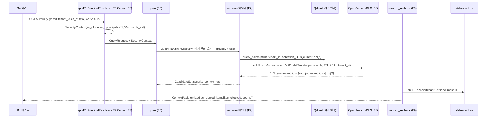

# ADR-0027: SecurityContext 서버 주입, 요청별 테넌트 JWT(DLS), ACL 회수 힌트와 강제 지점 17개

## 맥락과 문제

브리프 D-09는 "멀티테넌시 1급: `tenant_id`, `collection_id`, `acl` 필드는 모든 인덱스 레코드에 존재하고 리트리벌 시 필터 강제"만을 확정했다. 원칙 9(Multi-Tenant & Secure by Design)와 §7 보안 목표(테넌트 격리, ACL 필터 강제, 아웃바운드 egress 통제)를 실제 코드 경계로 옮기려면 네 가지가 더 정해져야 한다. (1) 누가 보안 컨텍스트(SecurityContext)를 만들고 무엇을 신뢰하는가 — 특히 공개 보류(embargo)·만료 판정 시각 `as_of`를 클라이언트가 보낼 수 있는가. (2) 두 백엔드(Qdrant·OpenSearch)와 PostgreSQL에서 필터가 누락되었을 때 서버 측에 두 번째 방어선이 있는가, 있다면 OpenSearch 문서 수준 보안(Document Level Security, DLS)이 요청의 테넌트를 어떻게 아는가. (3) 접근 제어 목록(Access Control List, ACL)이 갱신·회수된 뒤 백엔드 payload에 전파되기까지의 창에서 무엇이 결과를 막는가, 그리고 small-to-big 부모 확장이 권한을 상승시키지 않는가. (4) 강제 지점(enforcement point)의 목록이 닫혀 있어 리뷰·CI가 빠진 곳을 기계적으로 찾을 수 있는가.

세 설계 제안과 심사는 여기서 결함을 드러냈다. 제안 B의 `QueryRequest.as_of`는 클라이언트가 미래 시각을 보내 `embargo_until`을, 과거 시각을 보내 `expires_at`을 우회할 수 있어 심사가 치명 결함으로 지목했다(바이블 목적 절). 글로서리 GL-15는 사전 필터(pre-filter)와 사후 필터(post-filter)의 허용 여부를 미정으로 남겼고, 한 제안은 부모 청크 ACL을 "자식 ACL의 교집합"으로 계산하려 했다(바이블 §16). 바이블 1.0.0의 강제 지점 15개에는 워커·릴레이를 경유한 SSRF와 동일 바이트 문서의 콘텐츠 키 충돌(ADR-0004 v1.2 blocker)이 없었고, 1.1.0에서 E16·E17이 추가되었다(바이블 §범위 변경 이력). 본 ADR은 바이블 §5.3 `SecurityContext`·§5.5 `QueryRequest`·§9.1·§10.1~10.4·§13.1·§13.4에 확정된 결정을 근거·대안과 함께 기록한다.

## 결정 동인(decision drivers)

| # | 동인 | 출처 |
|---|------|------|
| DR-1 | **fail-closed**: 필터 없는 검색은 실행되지 않아야 하고, 보안 필드가 없는 레코드는 색인되지 않아야 한다. 애플리케이션 버그가 곧 데이터 누출이므로 서버 측 두 번째 방어선을 둔다 | 12 문서 §1.2·§2.3, 매트릭스 공통 요구 7, 바이블 §10.3 E5·E7·E8 |
| DR-2 | **시점 판정의 신뢰 경계**: embargo·만료 판정 시각은 요청자가 아니라 서버가 소유해야 한다 | 바이블 목적 절(`QueryRequest.as_of` 결함), §5.3 `SecurityContext.as_of` |
| DR-3 | **재현율 보존**: 허용 비율 p가 작은 테넌트·ACL 조합에서 사후 필터는 기대 잔존 K'·p로 재현율이 붕괴한다. Recall@20 ≥ 0.92(브리프 §7)를 지키려면 인덱스가 필터를 인지한 채 탐색해야 한다 | 12 문서 §2.3, 06 문서 필터링된 ANN(`is_tenant`, ACORN), 매트릭스 리스크 #4 |
| DR-4 | **검색 핫패스 PostgreSQL 미의존**: ACL 재검증은 `hydrate`가 읽은 payload와 Valkey 힌트로만 수행해야 한다(ADR-0034) | 바이블 §2.3 Valkey 행, §9.1, §13.1 |
| DR-5 | **ACL 전파 창 폐쇄**: `runtime.acl_propagation_slo`(`lite` 15m / `standard` 5m / `premium` 5m / `korean-gov` 1m) 안에 회수가 반영되어야 하고, 전파 중에도 회수된 문서가 반환되면 안 된다 | 바이블 §7.2·§10.3 E9·E11, ADR-0005 |
| DR-6 | **권한 상승 금지**: small-to-big 확장·표 전체 복원·요약 항목이 자식 리프보다 넓은 권한으로 노출되면 안 된다 | 바이블 §8.2 `parent_expand`, §10.1, §13.2 |
| DR-7 | **주체 모델의 상한과 다중 인증 수단**: OIDC·API 키·mTLS 주체가 같은 필터 의미를 가져야 하고, 그룹 확장은 1,024 상한으로 필터 절 폭증을 막아야 한다 | 바이블 §5.3 `Principal`, §10.1, 12 문서 §2.2 |
| DR-8 | **닫힌 강제 지점 목록**: 리스크 #3(교차 테넌트 누출)의 완화는 E1~E17 전부가 계약·CI로 검증될 때만 성립한다 | 바이블 §15 #3, 매트릭스 CI 게이트 |

## 고려한 대안

### 대안 1 — 서버 주입 `SecurityContext` + 모든 채널 사전 필터 + 요청별 단명 테넌트 JWT DLS + 문서 단위 ACL 상속 + `aclrev` 회수 힌트 + 강제 지점 17개 (채택)

- 설명: `api`가 OIDC JWT(JWKS, Authlib) 또는 API 키를 `PrincipalResolver`로 해석하고 Cedar 4.12(cedarpy 4.12.0 래핑, 12 문서 §3.4) 인가 뒤 읽기 전용 `SecurityContext{tenant_id, principals, collection_ids, as_of = 서버 now(), classification_max, policy_version, auth_method, visible_set}`를 주입한다. 보안 불변식(§10.2 (a))은 모든 채널·모든 백엔드의 사전 필터이며 전략 필터·사용자 필터와 분리된다. OpenSearch에는 `api`가 발급한 요청별 단명 JWT(TTL ≤ 60s, `aud=opensearch`)로 DLS `${attr.jwt.tenant_id}`를 채우고, PostgreSQL은 RLS `FORCE`, Qdrant는 `payload_filter`·`shard_key` 등급에서 사전 필터 단일 방어다. ACL은 문서 단위로 모든 레벨이 상속하며, `pack.acl_recheck`가 payload ACL과 Valkey `aclrev:` 힌트로 `as_of` 재검증을 한다.
- 장점: DR-1~DR-8 모두 충족. 12 문서 점수표에서 PostgreSQL RLS 90·Qdrant payload 파티셔닝 88·OpenSearch DLS 84·Cedar 83으로 격리 수단 1위 조합이고, 매트릭스 `authz_policy`·`lexical_index`·`vector_index` 행의 권고("모든 검색은 사전 필터, `security.tenant_id` 부재는 어댑터 예외, DLS 이중 방어, `is_tenant` 파티셔닝")와 정확히 일치한다. OpenSearch Security는 JWT 인증 도메인과 `${attr.jwt.X}` 치환을 지원하므로(12 문서 §1.2) 추가 컴포넌트 없이 요청 단위 테넌트를 서버가 강제한다.
- 단점: `api`가 서명 키·JWKS 게시·키 회전을 운영해야 한다(바이블 미해결 이슈 14); Qdrant는 JWT RBAC 클레임 문법 확인 전까지 단일 방어(리스크 #3 잔여, 미해결 이슈 13); 그룹 확장 캐시(5~15분)와 `aclrev` TTL(2 × SLO)이 정합성 창을 만든다.

### 대안 2 — 클라이언트가 `tenant_id`·`as_of`를 요청 본문에 전달 (제안 B `QueryRequest.as_of`; 기각)

- 설명: `QueryRequest.as_of`로 "특정 시점 기준" 조회를 허용하고, `tenant_id`를 본문 필드로 받는다.
- 장점: 평가·재현 시 시점을 고정할 수 있고 게이트웨이 없는 배포에서 테넌트 지정이 단순하다.
- 단점: `embargo_until <= :as_of`·`expires_at > :as_of` 판정에 요청자가 개입해 공개 보류·만료를 우회한다(DR-2; 심사 치명 결함). 본문 `tenant_id`는 토큰과 불일치할 수 있어 신뢰 경계가 둘이 된다. 바이블은 `QueryRequest`·`IngestRequest` 모두에서 `tenant_id`를 제거하고 보안 필드 수신을 422로 거부한다(§5.4·§5.5, E1).

### 대안 3 — 사후 필터(post-filter) + 과다 인출(over-fetch) (기각)

- 설명: 필터 없이 Top-K'를 검색한 뒤 애플리케이션에서 `tenant_id`·ACL로 걸러내고, K' = K/p로 보정한다.
- 장점: 백엔드 중립적이고 필터 미지원 백엔드에서도 동작한다.
- 단점: 허용 비율 p가 작으면 잔존 K'·p가 0에 수렴해 재현율이 붕괴하고(12 문서 §2.3, DR-3), 필터 전 후보가 메모리·네트워크를 통과하므로 누출 표면이 커진다. Qdrant 필터형 HNSW·payload 인덱스(`is_tenant`, ACORN)와 OpenSearch `bool.filter`가 사전 필터를 제공하므로 이유가 없다(06 문서). 바이블 §16은 GL-15를 "사전 필터만 허용"으로 해소했고 E7은 "사후 필터 금지"를 어댑터 계약으로 둔다.

### 대안 4 — 부모 ACL = 자식 ACL의 교집합(레벨별 ACL 계산) (기각)

- 설명: 부모·요약·표 전체 레코드의 ACL을 자식 리프 ACL의 교집합으로 계산해 저장하고, `ChunkTextStore` 번들에도 ACL을 둔다.
- 장점: 향후 블록·청크 단위 ACL이 도입되면 부모가 가장 좁은 권한을 갖는다.
- 단점: v1의 ACL은 `SourceDocument.acl` 하나(문서 단위)이므로 교집합은 항상 문서 ACL과 같아 계산·저장이 중복이다(§10.1). `deny_principals`는 합집합, `embargo_until`은 최대, `expires_at`은 최소로 필드마다 결합 규칙이 달라 오류 여지가 크고, E11 ACL 갱신마다 부모를 재계산해야 하며 번들이 ACL을 품게 되어 `ChunkTextStore`의 "번들에 ACL 없음"(§13.2) 규칙이 깨진다. 바이블은 "모든 레벨 상속, 별도 계산 없음"(§8.2·§10.1·E10)으로 확정하고 청크 단위 ACL은 `Block.acl_override`·`Chunk.acl` ADR로 미룬다.

### 대안 5 — 서비스 계정 토큰 공유 DLS 또는 원 주체 토큰 전달 (기각)

- 설명: (a) `api`가 OpenSearch에 단일 서비스 계정으로 접속하고 DLS는 역할에 고정 문자열로 둔다. (b) 사용자의 OIDC 토큰을 그대로 OpenSearch에 전달해 `${attr.jwt.*}`를 채운다.
- 장점: (a) 토큰 발급·서명 키가 필요 없다. (b) IdP가 발급한 클레임을 그대로 쓴다.
- 단점: (a) 서비스 계정 토큰에는 요청의 `tenant_id` 클레임이 없어 `${attr.jwt.tenant_id}` 치환이 불가능하다 — DLS를 두면 0건, 빼면 애플리케이션 필터 단일 방어로 돌아간다(12 문서 §1.2 "애플리케이션 버그가 곧 데이터 누출"). (b) `auth_method=api_key`·`mtls` 주체에는 JWT가 없고, IdP 토큰의 `aud`·수명·클레임 이름이 OpenSearch에 결합되며 사용자 토큰이 내부 백엔드로 흘러간다. 바이블 E8은 "`auth_method=api_key`·`mtls` 주체도 같은 경로(원 주체 토큰은 전달하지 않음)"로 두 변형을 함께 배제하고, 검증으로 "서비스 계정 토큰만으로는 DLS가 0건" 테스트를 둔다.

### 대안 6 — 강제 지점 15개 유지(E16 egress·E17 콘텐츠 키 스코프 없음) (바이블 1.0.0; 기각)

- 설명·장점: 인증·인가·인덱스·플래너·어댑터·백엔드·패커·MCP·관측성·격리 승격까지의 15개만 강제하고, 원천 URI 페치·웹훅 전송의 목적지와 콘텐츠 키 스코프는 각 구성요소 재량에 맡긴다. 목록이 짧고 네트워크 정책은 배포 계층(NetworkPolicy)에 위임할 수 있다.
- 단점: `fetch`의 `source_uri`·릴레이의 `webhook_url`은 테넌트가 지정하는 아웃바운드 연결이라 클라우드 메타데이터(`169.254.169.254`)·RFC1918·`localhost`·DNS 리바인딩으로 내부망을 탐색할 수 있다(리스크 #3 SSRF, 브리프 §7 보안). 스코프 없는 `chunk_id`를 물리 키로 쓰면 동일 바이트 문서를 두 테넌트가 수집할 때 뒤 테넌트의 `tenant_id`·`acl_*`가 앞 레코드를 덮어쓴다(ADR-0004 v1.2). 두 결함은 격리 불변식이 성립하는 전제이므로 E16(`EgressPolicy`, `RAG-Signature`)과 E17(`record_id`·`stage_key`·PK 스코프 합성)을 목록에 넣어 CI 대상으로 만든다(ADR-0037·ADR-0038).

## 결정

**결정:** 바이블 §3.1 D-09·§5.3·§5.5·§9.1·§10.1~10.3·§16의 다음 문장을 그대로 채택한다.

- D-09: 멀티테넌시 1급; `tenant_id`·`collection_id`·`acl_*`·`acl_hash` 전 레코드 필수, 리트리벌 **사전 필터** 강제, `SecurityContext` 서버 주입, 질의 측 항목(`candidates[]`·`results[]`·`ContextItem`)에도 `collection_id`·ACL 필드 전파 — `confirmed`; §10 강제 지점 17개로 정밀화(E16 아웃바운드 egress, E17 콘텐츠 키 스코프 추가). `QueryRequest.as_of` 제거(embargo 우회 차단) — 바이블 §3.1.
- `SecurityContext`: `tenant_id`, `principals`, `collection_ids` — 서버 주입·읽기 전용(스키마 `readOnly`); 사용자 + 확장 그룹 + `tenant:*`, ≤ 1,024(초과 `auth.too_many_principals`); Cedar `allowed_collections` ∩ 요청 컬렉션. `as_of` — **서버 `now()`**. embargo/expiry 판정 시각. 클라이언트 입력 없음. `classification_max`, `policy_version`, `auth_method` — 주체가 볼 수 있는 최고 등급(테넌트 정책 기본 `internal`); Cedar 정책 버전. `visible_set` — 필터 불변식 `:visible_set`(§10.2): 기본 `[public, tenant]`, `auth_method=api_key`이고 `service:` 주체만이면 `[public]` — 바이블 §5.3.
- `QueryRequest`: `tenant_id`·`as_of`는 본문에 **없다**(서버 `SecurityContext`). 클라이언트가 보낸 보안 필드는 422로 거부한다 — 바이블 §5.5.
- ACL은 **문서 단위**(`SourceDocument.acl` 하나, `acl_hash`)다. 부모·요약·표 조각 등 모든 레벨의 레코드와 `ChunkTextStore` 번들은 문서 ACL을 상속하므로 small-to-big 확장으로 권한이 상승하지 않는다 — 바이블 §10.1.
- 필터 불변식(모든 채널·모든 백엔드, 사전 필터): (a) 보안 불변식 `QueryPlan.filters.security` — 제거·완화 불가 / (b) 전략 필터 `QueryPlan.filters.strategy` — 플래너가 `strategy`로 결정, 사용자 완화 불가 / (c) 사용자·self-query 필터 — `filters.relaxable_keys` 순서로만 완화. `IndexBackend.search`는 필터에 `tenant_id`가 없으면 `retrieve.security_context_missing` 예외를 던지고, `CandidateSet.security_context_hash`(§6.2)로 포함을 서명한다. `hydrate`·`ChunkTextStore`·`get_document`는 같은 (a) 조건으로 재조회한다 — 바이블 §10.2.
- E8: OpenSearch Security DLS `{"term":{"tenant_id":"${attr.jwt.tenant_id}"}}` — api가 **요청별 단명 JWT**(TTL ≤ 60s, 클레임 `tenant_id`·`sub`·`aud=opensearch`, 플랫폼 서명 키; JWKS를 OpenSearch Security `jwt` 인증 도메인에 등록, 역할 `rag_reader`에 DLS 매핑)를 발급해 OpenSearch 요청 `Authorization` 헤더로 전달하고 DLS는 그 클레임을 참조한다. `auth_method=api_key`·`mtls` 주체도 같은 경로(원 주체 토큰은 전달하지 않음). PostgreSQL RLS `FORCE`(모든 테넌트 표, `SET LOCAL app.tenant_id`). Qdrant는 `korean-gov`·`index_per_tenant`에서 Qdrant JWT RBAC(`access[].collections[].payload = {tenant_id}`, 요청별 테넌트 스코프 토큰; 확인 필요 as of 2026-09) 옵션이며 그 외 등급은 **사전 필터 단일 방어**(리스크 #3) — 바이블 §10.3.
- ACL 재검증(`acl_recheck`): 반환 직전 항목별 ACL을 `SecurityContext.as_of`로 재평가한다. 입력 = `hydrate`가 채운 `results[].acl`(payload) + Valkey 회수 힌트 `aclrev:{tenant_id}:{document_id}`(`acl.update.v1`·`delete.document.v1`이 백엔드 payload 갱신 **전에** `{acl_hash, acl, deleted}`를 기록, TTL = 2 × `acl_propagation_slo`). 힌트가 있고 `acl_hash`가 payload와 다르면 힌트의 `acl`로 §10.2 조건을 판정(`deleted`면 제외, `explain += acl_revoked_hint`, `acl.source=revocation_hint`); 힌트가 없거나 같으면 payload 값으로 embargo·expires·classification 시간 조건만 재평가(`acl.source=payload`). 실패 `omitted.reason=acl_denied`, `items[].acl = {classification, checked: true, checked_at: as_of, source}`, `classification_max` 계산. Valkey 불가 시 payload 판정 + `degraded{acl_recheck, unavailable}`(회수 창 = 전파 SLO). 정본은 `documents.acl`과 백엔드 payload이며 힌트는 전파 창을 닫는 장치다(PG 미의존 유지) — 바이블 §9.1.
- 용어 변경: 사전 필터 / 사후 필터 → 사전 필터만 허용(GL-15 해소); 부모 ACL = 자식 교집합 → ACL은 문서 단위, 모든 레벨 상속(§10.1); 강제 지점 15개 → 17개(E16 egress, E17 콘텐츠 키 스코프)(ADR-0027) — 바이블 §16.

강제 지점 17개의 요지(정본은 바이블 §10.3 표이며 여기서는 실패 코드만 병기한다):

| # | 지점 | 강제 요지 | 실패 시 |
|---|------|-----------|---------|
| E1 | API 인증 | OIDC JWT(JWKS, Authlib) 또는 `api_key_id → tenant`; 본문 `tenant_id`는 422 | 401 |
| E2 | API 인가 | Cedar 4.12 `authorize(principal, action, resource)`; `allowed_collections` ∩ 요청; `policy_version` | 403(fail-closed) |
| E3 | 레이트리밋 | `limits` + Valkey, 키 `tenant_id`/`api_key_id`; 운영 fail-closed | 429 + `RateLimit` |
| E4 | 수집 정규화 | 주체 접두어 정규화·상한 1,024; `pii_policy`; ACL을 문서 단위로 모든 레벨·부모 번들에 전파(`acl_hash`) | 잡 실패 |
| E5 | 인덱스 쓰기 | `tenant_id`·`collection_id`·`acl_allow`·`acl_visibility`·`acl_hash` 누락 1건이면 배치 전체 거부; `record_id` 스코프 합성(E17); `is_tenant`; `routing=tenant_id`; `tenants/{tenant_id}/` 접두 | `index.security_fields_missing` |
| E6 | 플래너 | `SecurityContext` 서버 주입(요청 본문 무시); `filters.security`·`filters.strategy` 불변; `relaxable_keys`에 보안·전략 키 금지 | `plan.security_context_missing` |
| E7 | 리트리버 어댑터 | `search(plan, security)`에 `tenant_id` 부재 → 예외; 사전 필터만; `security_context_hash` 서명 | 계약 위반 |
| E8 | 백엔드 이중 방어 | OpenSearch DLS(요청별 테넌트 JWT), PostgreSQL RLS `FORCE`, Qdrant 사전 필터 단일 방어(+ JWT RBAC 옵션) | 서버 측 차단 |
| E9 | 패커 재검증 | `results[].acl` + `aclrev:` 힌트로 `as_of` 재평가; `items[].acl{checked, checked_at, source}` | `omitted.reason=acl_denied` |
| E10 | 부모 확장·문서 조회 | `ChunkTextStore`·`get_document`·`hydrate`에 §10.2 (a) 동일 적용; 문서 ACL 상속 | 확장 생략 |
| E11 | ACL 갱신 | `PATCH /v1/documents/{document_id}/acl` → `aclrev:` → `update_acl` payload만 → `acl.document.updated`; `rag_acl_propagation_seconds` | SLO 알림 |
| E12 | 이벤트·웹훅 | `tenantid` 필수; 테넌트별 구독만; `data`에 본문 금지; `RAG-Signature` HMAC | 미전달 |
| E13 | 관측성 | 콘텐츠 캡처 기본 끔; `rag.tenant_id_hash`만; `korean-gov` `NO_CONTENT` | — |
| E14 | MCP | 동일 `PrincipalResolver`(RFC 9728 PRM); `list_collections`는 `allowed_collections`만; 커서 `tenant_id` 바인딩 | 401/403, `isError` |
| E15 | 격리 등급 승격 | `TieringPolicy` 초과 시 `shard_key`/`index_per_tenant` blue/green 승격(`tier_promotion`) | — |
| E16 | 아웃바운드 egress | `EgressPolicy`(프로파일 AND 테넌트); 웹훅 `RAG-Signature`; NetworkPolicy 이중 방어 | `fetch.egress_denied` / `outbox.egress_denied` |
| E17 | 콘텐츠 키 스코프 | `record_id`·`stage_key` 스코프 합성; `artifacts`·`lineage` PK에 `tenant_id`; `jobs`·`idempotency_keys` `(tenant_id, key)` | `contract.violation` |

## 결과

### 긍정

- 신뢰 경계가 하나다. 테넌트·주체·시각·가시 집합은 모두 `api`가 토큰에서 도출해 주입하므로 `IngestRequest`·`QueryRequest`·MCP `search`가 같은 `SecurityContext`를 쓰고, embargo·만료 우회 경로가 계약 수준에서 사라진다(`QueryRequest.as_of` 제거).
- 보안 필터가 전략·사용자 필터와 분리되어 `relaxable_keys` 완화·self-query 재검색·다중 컬렉션 융합이 보안 조건을 건드리지 못하며, `CandidateSet.filters_applied`·`security_context_hash`·`filters.effective_hash`로 감사가 가능하다.
- OpenSearch·PostgreSQL에서는 필터 누락 버그가 있어도 서버가 차단한다. 요청별 JWT는 API 키·mTLS 주체에도 같은 DLS를 적용하고, 사용자 토큰이 백엔드로 흘러가지 않는다.
- ACL 갱신은 재임베딩 없이 payload만 바꾸고(ADR-0005), 전파 창은 `aclrev` 힌트와 `pack.acl_recheck`가 닫아 "회수 → 전파 완료 전 질의 → 미반환" 시나리오를 만족한다. 검색 핫패스는 PostgreSQL을 읽지 않는다(ADR-0034).
- 문서 단위 ACL 상속으로 부모 확장·표 전체 복원·요약 항목의 권한 계산이 없고, `ChunkTextStore` 번들은 ACL을 품지 않는다.
- E1~E17이 닫힌 목록이라 계약 테스트·적합성 키트·카나리 침투 테스트의 대상이 명확하다.

### 부정

- `api`가 서명 키·JWKS 게시·회전과 OpenSearch Security `jwt` 도메인 구성을 운영해야 한다. TTL ≤ 60s는 시계 오차(clock skew)에 민감하고, 검증 실패 시 대안은 테넌트 filtered alias 전용 접속이다(바이블 미해결 이슈 14).
- Qdrant는 `payload_filter`·`shard_key` 등급에서 사전 필터 단일 방어다. 어댑터 계약 테스트·`security_context_hash`·카나리 침투가 유일한 보호이며, JWT RBAC 클레임 문법 확인 전까지 잔여 리스크 #3이 남는다.
- 그룹 확장 캐시(5~15분)와 `aclrev` TTL(2 × SLO)은 정합성 창이다. Valkey 불가 시 `degraded{acl_recheck, unavailable}`로 회수 창이 SLO 길이만큼 열린다.
- 주체 상한 1,024를 넘는 조직(중첩 그룹)은 `auth.too_many_principals`로 거부된다. ReBAC 허용 집합 계산(OpenFGA `ListObjects`·SpiceDB)은 12 문서가 선택 어댑터로만 제안했고 바이블은 채택하지 않았다.
- 클라이언트가 지정하는 시점 조회(평가·재현)는 API로 제공되지 않는다.

### 중립

- `Acl.visibility=public`은 교차 테넌트 공개가 아니다(테넌트 내 allow 검사 생략만). `service:` 전용 API 키 주체는 `visible_set=[public]`이라 `visibility=tenant` 문서를 `acl_allow`로만 본다.
- `IndexRecord.acl_hash`는 payload 저장만(비인덱스)이며 E9 대조 키로만 쓰인다(§13.4). 블록·청크 단위 ACL(`Block.acl_override`·`Chunk.acl`)은 별도 ADR 대상이다.
- `security` 패키지(`principal_resolver`, `authz_cedar`, `security_context`, `acl_recheck`, `egress_policy`, `backend_token`)는 `api`·`retrieval`·`adapters/index`에서만 임포트된다(바이블 §12).

## 준수 확인 방법

| 강제 수단 | 내용 | 실패 시 |
|-----------|------|---------|
| 스키마 제약 | `common-types.schema.json` `$defs/SecurityContext`: 8필드 필수, `readOnly: true`, `principals.maxItems=1024`. `query-request.schema.json`·`ingest-request.schema.json`: `tenant_id`·`as_of` 미정의 + `additionalProperties=false`(수신 시 422). `query-plan.schema.json`: `filters.security`·`filters.strategy` 필수, `relaxable_keys` 항목 패턴에서 `tenant_id, collection_id, acl_*, is_current, index_generation, level, commit_id, record_id` 배제. `index-record.schema.json`: `tenant_id`·`collection_id`·`acl_allow`·`acl_visibility`·`acl_hash` 필수(E5). `candidate-set`·`ranked-set`·`context-pack`: `collection_id`·ACL 필드 필수 | 스키마 검증 실패 / 422 / `index.security_fields_missing` |
| CI 열거·이름 대조(§1.2) | `Visibility`·`Classification`·`AuthMethod`·`AclCheckSource`·`TenantIsolationTier`·`OmitReason.acl_denied`·`ExplainCode.acl_revoked_hint`·`DegradedComponent.acl_recheck`, 오류 코드 `auth.*`·`plan.security_context_missing`·`plan.filter_field_forbidden`·`retrieve.security_context_missing`·`index.security_fields_missing`·`fetch.egress_denied`·`outbox.egress_denied`, 이벤트 `acl.document.updated`·`audit.*`, Valkey 접두 `aclrev:` | 빌드 실패 |
| 어댑터 계약 테스트(E7·E8) | 모든 `index_backend`·`retriever` 어댑터: "백엔드 요청에 `tenant_id` 필터 존재", `tenant_id` 부재 시 `retrieve.security_context_missing`, 사후 필터 코드 경로 없음, `security_context_hash = H("sec", …)` 재계산 일치; OpenSearch 어댑터: 요청마다 `Authorization` JWT(`aud=opensearch`, `exp − iat ≤ 60s`, `tenant_id` 클레임) 존재, "서비스 계정 토큰만으로는 DLS가 0건" | 어댑터 배포 차단 |
| 적합성 키트 `security_invariants`·`idempotency`(ADR-0032) | 플러그인 백엔드에 §10.2 (a) 전 조건 전송 검증; E17 "두 테넌트(및 같은 테넌트의 두 컬렉션)가 동일 바이트를 수집해도 각자의 `tenant_id`·`collection_id`로 레코드·산출물이 생성되고 서로 덮어쓰지 않는다" | 플러그인 등록 거부 |
| 골든 시나리오(E9·E10) | "ACL 회수(또는 삭제) → 백엔드 전파 완료 전 질의 → 미반환"(`omitted.reason=acl_denied`, `explain += acl_revoked_hint`, `items[].acl.source=revocation_hint`); "부모 확장 항목의 `acl`이 자식 후보와 동일"; Valkey 중단 시 `degraded{acl_recheck, unavailable}` | 릴리스 차단 |
| 카나리 침투 테스트(주기) | 카나리 테넌트 데이터로 교차 테넌트 질의·MCP `search`·`get_document`·`hydrate`·`ChunkTextStore` 0건 확인; `tests/security` | 운영 알림 + 릴리스 차단 |
| 정책·인가 테스트(E2·E14) | Cedar 정책 단위 테스트(`allowed_collections` ∩ 요청 = ∅ → 403 `plan.collection_forbidden`); MCP conformance CI(`Authorization: Bearer`·audience, `list_collections` 범위, 커서 테넌트 불일치 거부) | CI 실패 |
| E13·E16 계약 테스트(정본: 바이블 §10.3 검증 열, ADR-0022·ADR-0038) | "본문 문자열이 스팬에 없음", 메트릭 라벨에 `tenant_id` 없음; `169.254.169.254`·RFC1918·`localhost`·리다이렉트 우회·DNS 리바인딩·운영 `file://` 거부, `RAG-Signature` 5분 재생 창 | CI 실패 |
| import-linter | `security`는 `api`·`retrieval`·`adapters/index`에서만 임포트; `pipelines`·`retrieval`·`render`는 `ledger` 미참조(핫패스 PG 미의존) | 린트 실패 |
| 메트릭·알림 | `rag_acl_propagation_seconds` p99 ≤ `runtime.acl_propagation_slo`; `rag_acl_recheck_denied_total`·`rag_authz_errors_total`·`rag_egress_denied_total{component}` 급증 알림 | 운영 알림 |
| 코드 리뷰 체크리스트 | (1) `SecurityContext`를 요청 본문·쿼리 파라미터에서 생성하는 코드 없음, (2) `as_of`에 `now()` 이외의 대입 없음, (3) 새 조회 경로(부모·문서·표·그림 파생물)가 §10.2 (a)를 적용, (4) 새 Valkey 테넌트 스코프 키에 `{tenant}` 접두, (5) 새 아웃바운드 연결이 `EgressPolicy`를 경유, (6) E1~E17 표에 없는 새 강제 지점은 바이블 §1.2 절차로 추가 | 리뷰 반려 |

## 재검토 조건

- Qdrant JWT RBAC(`access[].collections[].payload`)의 클레임 문법·성능·요청별 토큰 발급 비용이 확인되어(바이블 미해결 이슈 13) Qdrant도 `payload_filter` 등급에서 서버 측 이중 방어를 갖출 수 있을 때 — E8·§10.4를 개정한다.
- OpenSearch Security `jwt` 인증 도메인 + 요청별 단명 JWT 구성이 09-operations/05 검증에서 실패하거나(키 회전·시계 오차·서비스 계정 혼용), 대안인 테넌트 filtered alias 전용 접속으로 바꿔야 할 때(미해결 이슈 14).
- 블록·청크 단위 ACL(`Block.acl_override`·`Chunk.acl`)이 도입되어 "문서 단위, 모든 레벨 상속"이 성립하지 않을 때 — 대안 4의 결합 규칙 문제를 다시 다룬다.
- 주체 상한 1,024 초과(`auth.too_many_principals`)가 실제 테넌트에서 반복되거나 중첩 그룹·상속 권한 반영 요구로 ReBAC 허용 집합 계산기(OpenFGA·SpiceDB)를 `PrincipalResolver` 어댑터로 붙일 때.
- 평가·감사 목적의 시점 지정 조회 요구가 확정될 때 — 요청 필드가 아닌 별도 인가 경로로만 검토한다.
- pgbouncer 트랜잭션 모드에서 `SET LOCAL app.tenant_id` 강제 방법(미해결 이슈 9)이 RLS `FORCE` 전제를 바꿀 때.
- 기본 프로파일에 사전 필터를 제공하지 못하는 `index_backend`가 들어올 때(E7 "사후 필터 금지"와 충돌).
- `rag_acl_propagation_seconds`가 SLO를 반복 위반하거나 `aclrev` TTL(2 × SLO)이 실측에서 부족할 때(ADR-0005 재검토 조건과 연동).

## 참조

- [설계 브리프](../00-vision/00-design-brief.md) — §3 원칙 9, §4 D-09·D-13·D-14·D-15, §6(사용자 인증 서버 비목표), §7 보안, §9.7 결정 표기
- [설계 바이블](../02-architecture/00-design-bible.md) — 목적 절(`QueryRequest.as_of` 결함), §범위 변경 이력, §1.2, §2.3 `api`·Valkey, §3.1 D-09, §3.3 0027 행, §4.3, §5.1, §5.3 `Acl`·`SecurityContext`·`Principal`·`EgressPolicy`·`TieringPolicy`, §5.4 `IngestRequest`·`SourceDocument`·`IndexRecord`, §5.5 `QueryRequest`·`QueryPlan.filters`·`CandidateSet`·`RankedSet.results[].acl`·`ContextItem.acl`, §5.7(`Visibility`·`Classification`·`AuthMethod`·`AclCheckSource`·`FilterableField` 금지 목록·오류 카탈로그), §6.1 주체, §6.2 `security_context_hash`·`acl_hash`·웹훅 서명, §7.2 `runtime.acl_propagation_slo`, §8.1 1단계·13단계, §8.2, §8.3, §9.1, §10.1~10.4, §12 `security` 패키지, §13.1, §13.4, §14, §15 #3, §16, 미해결 이슈 9·13·14
- [기술 지형 종합: 선정 매트릭스](../07-tech-landscape/00-summary-and-selection-matrix.md) — `authz_policy`·`lexical_index`·`vector_index` 행, 프로파일별 보안·PII 행, 어댑터·플러그인 공통 요구 7(보안 불변식), CI 게이트, 종합 리스크 #4
- [보안·멀티테넌시·PII·라이선스](../07-tech-landscape/12-security-multitenancy-pii-and-licensing.md) — §1.2 OpenSearch 인덱스 분리 vs DLS(`${attr.jwt.X}` 치환, 이중 방어 권고), §1.3 PostgreSQL RLS(`FORCE`, `SET LOCAL`), §2.2 ReBAC 옵션, §2.3 사전 필터 vs 사후 필터(fail closed), §3.4 OPA vs Cedar(cedarpy 4.12.0), 점수표(RLS 90·DLS 84·Cedar 83), Qdrant JWT RBAC 클레임 확인 필요
- [벡터·렉시컬 인덱스 백엔드](../07-tech-landscape/06-vector-and-lexical-index-backends.md) — Qdrant payload 파티셔닝(`is_tenant`, `payload_m=16, m=0`)·필터링된 ANN(ACORN), OpenSearch custom routing·filtered alias·DLS, 저선택도 다중 필터 리스크
- 관련 ADR: [ADR-0004](./0004-deterministic-chunk-id-scoped-record-id-and-ulid-exception.md)(스코프·세대 합성 `record_id`, E17), [ADR-0005](./0005-doc-version-content-hash-only-and-acl-payload-update.md)(ACL payload 갱신, E11), [ADR-0017](./0017-event-delivery-outbox-cloudevents-no-broker.md)(아웃박스·`tenantid`, E12), [ADR-0018](./0018-api-rest-sse-mcp-no-grpc-rfc9457.md)(RFC 9457·422 규약), [ADR-0022](./0022-observability-genai-semconv-pin-and-license-boundary.md)(콘텐츠 캡처 끔, E13), [ADR-0025](./0025-mcp-cursor-pagination-and-tool-set.md)(MCP 인증·커서 바인딩, E14), [ADR-0026](./0026-index-commit-generation-saga-and-ledger.md)(`is_current` 플립), [ADR-0028](./0028-tenant-isolation-tiering-policy.md)(격리 등급, E15), [ADR-0030](./0030-single-coordinate-system-and-score-ledger.md)(질의 측 계약 골격), [ADR-0032](./0032-plugin-sdk-stage-protocol-and-conformance-kit.md)(적합성 키트), [ADR-0034](./0034-retrieval-hot-path-postgres-independence-and-hydrate.md)(`hydrate`가 payload ACL을 읽는 경로), [ADR-0037](./0037-artifact-cache-scope-and-stage-key-composition.md)(`stage_key` 스코프), [ADR-0038](./0038-outbound-egress-policy-and-webhook-signing.md)(E16)
- 하류 문서(문서 맵): [멀티테넌시·보안 아키텍처](../02-architecture/07-multi-tenancy-and-security-architecture.md), [계약 개요](../03-contracts/00-contract-overview.md), [QueryRequest·QueryPlan 계약](../03-contracts/09-query-request-and-query-plan.md), [CandidateSet·RankedSet 계약](../03-contracts/10-candidate-set-and-ranked-set.md), [ContextPack 계약](../03-contracts/11-context-pack.md), [하이브리드 검색·융합](../04-pipelines/15-hybrid-search-and-fusion.md), [후처리·컨텍스트 패킹](../04-pipelines/17-post-processing-and-context-packing.md), [리트리벌 API](../05-api/03-retrieval-api.md), [MCP 서버](../05-api/05-mcp-server.md), [보안·컴플라이언스](../09-operations/05-security-and-compliance.md)
