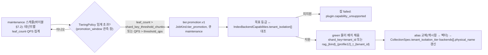

# ADR-0028: 테넌트 격리 등급 TieringPolicy

> MADR(Markdown Architectural Decision Record) 형식. 바이블 §3.3 표의 0028행(slug `tenant-isolation-tiering-policy`, P2)이며 관련 결정은 핵심 아이디어 K7 "격리 등급 1급 + 품질 게이트 프로파일"(바이블 §2.1, 출처 운영 계층 A)이다. 이 ADR은 바이블 §10.4 격리 수준 표·§10.3 E15·§5.3 `TieringPolicy`·§11.2 `tier.promotion.v1`을 근거·대안과 함께 기록하고 바이블 표를 바꾸지 않는다(바이블 §1.1). 짝이 되는 어댑터 격리 사다리(`in_process/helper_process/sidecar`)는 [ADR-0033](./0033-sidecar-convert-contract-and-isolation-ladder.md), 프로파일 `extends` 상속과 `gate`는 [ADR-0031](./0031-profile-schema-extends-and-quality-gates.md), 공유 컬렉션에서 교차 테넌트 충돌을 없애는 물리 키 스코프는 [ADR-0004](./0004-deterministic-chunk-id-scoped-record-id-and-ulid-exception.md), blue/green의 세대·alias 규칙은 [ADR-0026](./0026-index-commit-generation-saga-and-ledger.md), 보안 강제 지점 17개는 [ADR-0027](./0027-security-context-injection-and-acl-enforcement-points.md)이 다룬다.

## 맥락과 문제

브리프 D-09는 "멀티테넌시(multi-tenancy) 1급: `tenant_id`·`collection_id`·`acl`이 모든 인덱스 레코드에 존재하고 리트리벌 시 필터 강제"까지만 정했고, 테넌트를 **물리적으로 어디에 두는가**(공유 컬렉션 / 전용 샤드 / 전용 컬렉션)와 그 배치를 **언제·어떻게 바꾸는가**는 비어 있었다. 세 설계 제안 중 운영성 우선 제안 A가 "격리 등급을 1급 개념으로 두고 정책 객체 하나로 선언·검증"을 제시했고 심사단이 운영 계층으로 채택했다(바이블 §2.1 K7). 기술 지형 조사에서 확정된 사실은 다음과 같다.

| # | 사실 | 출처 |
|---|------|------|
| F1 | Qdrant 공식 가이드는 테넌트별 컬렉션을 "rarely the most efficient approach"로 규정하고 Qdrant Cloud는 클러스터당 기본 1,000 컬렉션 상한을 둔다. 권고 모델은 (a) payload 파티셔닝(`tenant_id` keyword 인덱스 `is_tenant: true`), (b) 커스텀 샤딩(`sharding_method: custom`, `shard_key`), (c) 계층형(tiered) 멀티테넌시(`ShardKeyWithFallback{target, fallback}`, 1.16) — 소형은 공유 샤드 + 필터, 성장하면 전용 샤드로 승격 | 12 문서 §1.1, 06 문서 §Qdrant 멀티테넌시 |
| F2 | payload 기반 멀티테넌시의 성능 튠은 `hnsw_config.m = 0` + `payload_m = 16`(테넌트별 독립 그래프); `is_tenant=true`(v1.11.0+)가 같은 테넌트 벡터를 디스크에 공존 배치; sparse IDF는 1.19의 질의별 IDF 모집단으로 테넌트 범위로 좁힌다 | 12 문서 §1.1, 06 문서 |
| F3 | OpenSearch는 인덱스-퍼-테넌트가 "인덱스·샤드 폭증"으로 클러스터 상태·힙 부담을 만들고, 권고는 공유 인덱스 + 애플리케이션 필터 + custom routing(`routing=tenant_id`) + filtered alias + Security 플러그인 DLS(Document Level Security) 이중 방어다. 대형·규제 테넌트만 인덱스-퍼-테넌트로 승격하며 "Qdrant 커스텀 샤드 승격과 동일한 tiering 정책을 `IndexBackend`가 추상화"한다 | 12 문서 §1.2, 06 문서 §OpenSearch 멀티테넌시 |
| F4 | 노이지 네이버(noisy neighbor) 격리 수단: 벡터 인덱스는 대형 테넌트 커스텀 샤드 승격, 렉시컬 인덱스는 인덱스-퍼-테넌트 승격 + ILM; 판정 계량은 Qdrant 컬렉션 포인트 수·OpenSearch `_stats` doc count. 필터링된 ANN 실패 모드 표: "대형 테넌트 혼재 → 노이즈 이웃 → tiered multitenancy로 전용 샤드 승격 / custom routing + 전용 인덱스" | 12 문서 §1.5, 06 문서 §필터링된 ANN 실패 모드 |
| F5 | 규제 테넌트의 물리 분리·파기: OpenBao Transit(MPL-2.0, A 등급)로 테넌트 DEK를 감싸고 테넌트 삭제 시 DEK 폐기로 크립토 셰레딩(crypto-shredding); 벡터 자체는 암호화 불가라 저장 암호화 + ACL로 보호. `regulated`(`korean-gov`) 프로파일은 "커스텀 샤드/인덱스-퍼-테넌트, OpenBao DEK, 크립토 셰레딩" | 12 문서 §1.4·프로파일 표, 매트릭스 프로파일 표 `korean-gov` 저장소·보안 행 |
| F6 | 격리 기본 점수(가중): PostgreSQL RLS 90, Qdrant payload 파티셔닝 88, OpenSearch DLS 84. 매트릭스 `authz_policy` 행은 "격리 기본: Qdrant payload 파티셔닝 + OpenSearch DLS + PostgreSQL RLS" | 매트릭스 `authz_policy` 행, 12 문서 점수표 |
| F7 | Qdrant JWT RBAC(`access[].collections[].payload`)의 정확한 클레임 스키마는 공식 문서 재확인이 필요하다(페치 실패) — 확인 필요(as of 2026-09) | 12 문서 미해결 이슈 2, 바이블 §10.3 E8 |
| F8 | 06 문서는 `IndexBackendCapabilities.tenant_isolation`을 `enum[payload_filter, shard_key, index_per_tenant, tenant_shard, partition_key]`(Weaviate 테넌트 샤드, Milvus 파티션 키 포함)로 제안했으나 바이블 §5.7 `TenantIsolationTier`는 3값으로 확정했다 | 06 문서 §capabilities 표, 바이블 §5.7 |
| F9 | 공유 컬렉션의 콘텐츠 키 충돌(동일 바이트 문서를 두 테넌트가 수집 → 같은 포인트 덮어쓰기)은 물리 키 `record_id = H("record", tenant_id, collection_id, document_id, str(index_generation), chunk_id)` 합성(E17)으로 해소되어, 공유 배치가 정확성 문제를 만들지 않는다 | 바이블 §3.1 D-06(v1.2), §6.2, §10.3 E17, ADR-0004 |

따라서 결정할 질문은 넷이다. (1) 테넌트 물리 배치의 등급은 몇 개이고 각 등급의 수단은 무엇인가, (2) 등급과 승격 조건을 **어디에** 선언하고 **무엇으로** 검증하는가, (3) 승격은 누가 어떤 절차로 수행하는가, (4) 어댑터 격리 사다리(ADR-0033)와의 관계는 무엇인가.

## 결정 동인(decision drivers)

| 동인 | 출처 | 함의 |
|------|------|------|
| Multi-Tenant & Secure by Design; 보안 목표 "테넌트 격리" | 브리프 §3 원칙 9, §7 보안, D-09 | 어느 등급에서도 §10.2 보안 불변식이 동일하게 강제되어야 하며 등급은 "덜 안전한 모드"를 만들지 않는다 |
| 리트리벌 p95 < 800ms(100만 청크 기준), Recall@20 ≥ 0.92 | 브리프 §7, 바이블 §8.3, 06 문서 저선택도 필터 recall 급락 | 대형 테넌트가 공유 그래프·샤드에 혼재하면 노이지 네이버·필터 recall 저하가 생기므로 물리 배치를 바꿀 수 있어야 한다 |
| 운영 비용·백엔드 한계 | F1·F3(1,000 컬렉션 상한, 샤드 폭증) | 전 테넌트 물리 분리는 불가. 기본은 공유, 분리는 예외 |
| Korean-First·규제(ISMS-P, 개인정보 파기 의무) | 브리프 §3 원칙 6, `korean-gov` 프로파일(바이블 §7), F5 | 규제 테넌트는 전용 컬렉션 + 테넌트 DEK(크립토 셰레딩)를 선택할 수 있어야 한다 |
| Contracts First; 기본값은 프로파일에, 변경은 `profile_hash`·blue/green | 브리프 §3 원칙 1, 바이블 §7.4, K7 | 등급·임계는 계약 타입(`TieringPolicy`)으로 프로파일에 선언되고 로딩 시 검증된다 |
| Idempotent & Content-Addressed; 세대 공존 | 원칙 4, K6, E17, ADR-0004·0026 | 공유 컬렉션에서도 충돌이 없으므로 `payload_filter`를 기본으로 둘 수 있고, 승격은 세대·alias blue/green으로 무중단이다 |
| Adapters over Forks; `capabilities()` 선언 | 원칙 2, D-15, 바이블 §5.3 `IndexBackendCapabilities` | 백엔드가 지원하는 등급을 `tenant_isolation[]`로 선언하고 프로파일 검증기가 대조한다(교체 백엔드 수용) |
| 검색 핫패스 PostgreSQL 미의존 | ADR-0034, 바이블 §11.1 | 등급 판정·승격은 `maintenance` 경로의 잡이며 검색 경로는 캐시된 `CollectionSpec`만 읽는다 |
| 격리 등급 1급(어댑터·테넌트 두 사다리를 같은 층에서 선언·검증) | 바이블 §2.1 K7, §16 용어 "격리 사다리"·"격리 등급 정책" | 두 사다리는 같은 프로파일 로더(`rag profile validate`, §7.4)가 검증하는 1급 개념이다 |

## 고려한 대안

| # | 대안 | 판정 | 근거 요약 |
|---|------|------|-----------|
| A | 전 테넌트 `index_per_tenant`(테넌트 = 물리 컬렉션/인덱스) | 기각 | F1·F3: 컬렉션·인덱스 폭증, 1,000 컬렉션 상한, 소형 테넌트 비효율 |
| B | 수동 승격(운영자가 임의로 물리 배치 변경, 정책 객체 없음) | 기각 | 임계·절차가 코드·프로파일 밖에 있어 재현 불가, 무중단 보장 없음, 감사 불가 |
| C | 어댑터 격리와 별도 정책 객체(테넌트 격리 설정을 프로파일 밖 독립 객체로) | 기각 | K7 위배: 두 사다리가 다른 로더·검증 경로를 갖게 되어 `capabilities` 대조·`profile_hash` blue/green 의미론을 벗어난다 |
| D | 단일 등급 `payload_filter` 고정(승격 없음) | 기각 | F4: 노이지 네이버·저선택도 recall 저하에 대응 불가, F5: 규제 테넌트 물리 분리·크립토 셰레딩 미충족 |
| E | 3단 등급 + `TieringPolicy` 단일 선언 + `tier.promotion.v1` blue/green 승격 | **채택** | 세 설계 제안·매트릭스·06/12 문서 권고와 일치 |

### 대안 A: 전 테넌트 `index_per_tenant`(기각)

- 설명: 테넌트마다 Qdrant 물리 컬렉션과 OpenSearch 인덱스를 만들고 백엔드 자격증명(Qdrant JWT RBAC, 인덱스 패턴 역할)으로 격리한다.
- 장점: 가장 강한 물리 격리, 테넌트 삭제 즉시성, 테넌트별 ILM·스냅샷·리전 배치.
- 단점: Qdrant Cloud 1,000 컬렉션 상한과 컬렉션당 메모리·인덱스 오버헤드(F1), OpenSearch 인덱스·샤드 폭증과 힙 부담(F3), 소형 테넌트가 다수인 SaaS형 배치에서 비용이 선형으로 는다. `lite` 단일 노드에서는 운영 불가.
- 판정: 기각. `index_per_tenant`는 **등급 하나**로 남기고 `korean-gov` 선택·규제 요구에서만 쓴다.

### 대안 B: 수동 승격(기각)

- 설명: 임계·절차를 문서화만 하고 운영자가 필요 시 `rag` CLI나 백엔드 콘솔로 샤드·컬렉션을 옮긴다.
- 장점: 초기 구현이 없다.
- 단점: 임계가 프로파일에 없어 `profile_hash`에 반영되지 않고, 승격 중 검색 무중단(alias 교체, 세대 공존)이 사람 손에 의존하며, `jobs` 원장·`job.state.changed` 이벤트·감사가 남지 않는다. 브리프 §7 재현성("동일 프로파일 → 동일 `IndexCommit`")과 충돌한다.
- 판정: 기각. 승격은 `JobKind.tier_promotion` 잡(`tier.promotion.v1`)으로만 수행한다.

### 대안 C: 어댑터 격리와 별도 정책 객체(기각)

- 설명: 테넌트 격리 임계를 테넌트 레지스트리나 운영 도구 전용 설정 객체에 두고, 어댑터 격리(`StagePolicy.isolation`)와 다른 시점·다른 검증기로 처리한다.
- 장점: 프로파일이 얇아진다.
- 단점: 격리 등급이 "프로파일 로딩 시 `capabilities()`와 대조되는 1급 개념"(K7, §7.4 (2))이 아니게 된다. 백엔드가 `shard_key`를 지원하지 않는데 승격 임계가 설정되는 오류를 로딩 시 잡지 못하고 승격 잡 실행 시점에야 발견한다. 두 사다리의 용어(`격리 등급`)가 분리되어 글로서리(바이블 §16)와 어긋난다.
- 판정: 기각. `TieringPolicy`는 프로파일 계약 타입(§5.1, `tiering-policy.schema.json`)이며 어댑터 격리 모드와 같은 로더가 검증한다.

### 대안 D: 단일 등급 `payload_filter` 고정(기각)

- 설명: 승격 개념 없이 항상 공유 컬렉션 + 사전 필터로 운영한다.
- 장점: 가장 단순하고 06/12 문서 점수(F6)에서 기본으로 충분히 높다.
- 단점: 테넌트 청크가 커지면 필터 recall 급락·타임아웃·노이지 네이버(F4)를 해소할 수단이 없고, 규제 테넌트의 물리 분리·크립토 셰레딩(F5)을 제공할 수 없다. `korean-gov` 프로파일 요구를 충족하지 못한다.
- 판정: 기각. 단, `payload_filter`는 **기본 등급**으로 채택한다.

### 대안 E: 3단 등급 + `TieringPolicy` + `tier.promotion.v1`(채택)

- 설명: 등급 `payload_filter`(기본) / `shard_key` / `index_per_tenant`를 `TenantIsolationTier`로 고정하고, 승격 임계를 `TieringPolicy` 하나로 프로파일에 선언·검증한다. 임계 초과는 blue/green 승격 잡이 처리한다.
- 장점: 기본은 비용 0의 공유 배치(F1·F6), 성장·규제 요구에 등급으로 대응(F4·F5), 백엔드 지원 여부를 `IndexBackendCapabilities.tenant_isolation[]`로 로딩 시 검증, 공유 컬렉션의 정확성은 E17이 보장(F9).
- 단점: 승격 잡·판정 스케줄·alias 교체 구현이 필요하고, Qdrant는 `payload_filter`·`shard_key` 등급에서 사전 필터 단일 방어라는 잔여 리스크가 남는다(바이블 §15 리스크 #3).
- 판정: 채택.

## 결정

**결정:** 어댑터 격리 3단(`in_process/helper_process/sidecar`)과 테넌트 격리 3단(`payload_filter/shard_key/index_per_tenant`)을 `TieringPolicy` 하나로 선언·검증. 프로파일은 `extends` 단일 상속이며 모든 품질 기본값에 `gate`가 붙는다(바이블 §2.1 K7; 프로파일 상속·게이트 부분은 [ADR-0031](./0031-profile-schema-extends-and-quality-gates.md), 어댑터 사다리 부분은 [ADR-0033](./0033-sidecar-convert-contract-and-isolation-ladder.md)이 기록).

바이블 §10.4 격리 수준 정본 표(그대로 인용):

| 등급 | 수단 | 기본 | 승격 조건 |
|------|------|------|-----------|
| `payload_filter` | 공유 물리 컬렉션/인덱스 + `tenant_id` 사전 필터(`is_tenant` 인덱스, `payload_m=16, m=0`) + routing + DLS(요청별 테넌트 JWT, E8); 물리 키 `record_id`는 테넌트·컬렉션·문서·세대 합성(E17)이라 공유 컬렉션에서도 충돌 없음; Qdrant는 사전 필터 단일 방어 | `lite`, `standard`, `premium` | — |
| `shard_key` | Qdrant custom sharding(`shard_key=tenant_id`), OpenSearch routing 고정 | — | 테넌트 청크 > 100만 또는 QPS 임계 |
| `index_per_tenant` | 테넌트 전용 물리 컬렉션/인덱스(`rag_{kind}_{profile12}_t_{tenant_id}`) + OpenBao Transit 테넌트 DEK(크립토 셰레딩) + Qdrant JWT RBAC 테넌트 스코프 토큰 옵션(E8) | `korean-gov` 선택 | 규제·계약 요구 |

바이블 §10.3 E15 정본 문구: `TieringPolicy{shard_key_threshold_chunks: 1000000, threshold_qps, index_per_tenant: opt_in}` 초과 테넌트는 `shard_key`(Qdrant custom sharding) / `index_per_tenant`(OpenSearch 전용 인덱스)로 blue/green 승격 잡(`tier_promotion`). 바이블 §7.2 `security.tenant_isolation_tier`: `lite` payload_filter / `standard` payload_filter → 100만 청크 초과 시 shard_key 승격 / `premium` 동일 / `korean-gov` 규제 테넌트 index_per_tenant 선택.

`TieringPolicy`(바이블 §5.3·§5.1; 스키마 `tiering-policy.schema.json`, 인라인 한계 2KB, 생산 프로파일 → 소비 E15 승격 잡·컬렉션 검증; 필드 정의는 [03-contracts/15](../03-contracts/15-collection-profile-and-policy-contracts.md)가 소유):

| 필드 | 타입 | 필수 | 기본(초안 목표) | 의미 |
|------|------|------|-----------------|------|
| `shard_key_threshold_chunks` | integer | Y | 1000000 | 테넌트 리프 청크 수(`CollectionSpec.stats.leaf_count` 테넌트 합산)가 초과하면 `shard_key` 승격 조건 |
| `threshold_qps` | number \| null | N | null | 테넌트 질의 QPS 임계(`usage_ledger` `queries` 계량); null이면 청크 수만 본다 |
| `index_per_tenant` | enum(IndexPerTenantMode) | Y | `opt_in` | `opt_in`(테넌트·컬렉션 정책으로만 선택) / `auto`(임계 초과 시 승격 잡이 자동 선택) / `disabled`(이 프로파일에서 금지) |
| `promotion_window` | string(duration) | N | 24h | 임계 판정 관측 창 |

```json
{
  "shard_key_threshold_chunks": 1000000,
  "threshold_qps": null,
  "index_per_tenant": "opt_in",
  "promotion_window": "24h"
}
```



결정에 딸린 정본 세부(모두 바이블 인용, 이 문서가 새로 정하지 않는다):

- 열거(바이블 §5.7): `TenantIsolationTier = payload_filter, shard_key, index_per_tenant`(사용 필드 `CollectionSpec.tenant_isolation_tier`, `IndexBackendCapabilities.tenant_isolation[]`, 프로파일 `security.tenant_isolation_tier`), `IndexPerTenantMode = opt_in, auto, disabled`(`TieringPolicy.index_per_tenant`), `JobKind`에 `tier_promotion`. 06 문서의 `tenant_shard`·`partition_key`(F8)는 채택하지 않으며, Weaviate·Milvus 어댑터는 자기 수단을 세 등급 중 하나로 매핑해 `tenant_isolation[]`에 선언한다.
- 선언 위치(바이블 §5.6 `Profile.security = {…, tenant_isolation_tier, tiering: TieringPolicy}`; §7.3 YAML `security.tenant_isolation_tier: payload_filter`, `security.tiering: {shard_key_threshold_chunks: 1000000, index_per_tenant: opt_in}`). 정본 경로는 `security.tiering` 하나이며 `ingest.index.tiering`은 `profile.schema.json`이 거부한다(§7.3; 바이블 v1.2.1 변경 이력). 백엔드별 물리 설정은 `ingest.index.backends[]`에 둔다 — Qdrant `tenant_isolation: payload_filter`, `hnsw: {m: 0, payload_m: 16}`, OpenSearch `routing: tenant_id`, `dls: true`. `security.tiering`은 `profile_hash`에 포함되어 값 변경 = `version` 증가 = 컬렉션 blue/green이다(§7.4).
- 검증(바이블 §7.4 (2)): 요구 등급(`CollectionSpec.tenant_isolation_tier`, `TieringPolicy`가 승격 목표로 삼을 수 있는 등급) ↔ 각 `backends[]`의 `IndexBackendCapabilities.tenant_isolation[]` 대조. 미지원은 로딩 시 `profile.invalid`, 실행 시 `plugin.capability_unsupported`(비재시도). `index_per_tenant=disabled`이면 `CollectionSpec.tenant_isolation_tier=index_per_tenant` 생성을 거부한다.
- 물리 명명(바이블 §13.4): Qdrant 공유 `rag_vec_{embedding_profile_hash[:12]}`(`payload_filter`·`shard_key`), 전용 `rag_vec_{hash12}_t_{tenant_id}`; OpenSearch 공유 `rag_lex_{lexical_profile_hash[:12]}`, 전용 `_t_{tenant_id}` 접미; alias `col_{collection_id}_vec`·`col_{collection_id}_lex`, 테넌트 filtered alias `t_{tenant_id}_lex`. 오브젝트 키는 등급 무관 `tenants/{tenant_id}/` 접두(E5).
- 승격 절차(바이블 §11.2 `tier.promotion.v1`, §11.4 원칙 (5)): 컬렉션 단위 물리 배치 변경은 세대 플립이 아니라 **blue/green 물리 컬렉션 + alias 교체(렉시컬 → 벡터)**다. 승격 중 검색은 이전 alias를 향하고 §10.2 필터 불변식은 두 물리 배치에 동일 적용된다. `record_id`가 세대·스코프를 포함하므로 두 배치가 공존해도 충돌이 없다(E17). 완료 시 `CollectionSpec` 갱신은 검색 경로 캐시 `collspec:{collection_id}`에 기존 이벤트 `collection.profile.changed`(§5.7)로 전파한다. Qdrant 계층형 멀티테넌시(`ShardKeyWithFallback`)가 새 컬렉션 없이 샤드 이동을 허용하는지는 확인 필요(as of 2026-09)이며, 허용되더라도 계약(무중단·alias·세대 공존)은 바뀌지 않는다(구현은 [04-pipelines/19](../04-pipelines/19-update-delete-and-reindexing.md)).
- 이중 방어(바이블 §10.3 E8, §15 리스크 #3): OpenSearch DLS(요청별 테넌트 JWT)·PostgreSQL RLS는 모든 등급에서 동일. Qdrant는 `index_per_tenant`에서만 JWT RBAC 테넌트 스코프 토큰 옵션(F7 확인 필요)이고 그 외 등급은 사전 필터 단일 방어 — 수용된 잔여 리스크다.
- `korean-gov`(바이블 §10.4, 매트릭스 프로파일 표): 규제 테넌트는 `index_per_tenant`를 선택하고 OpenBao Transit 테넌트 DEK(`KeyProvider`, §12 `security/key_provider`)로 크립토 셰레딩을 제공한다.

## 결과

### 긍정

- 기본 등급이 공유 배치라 테넌트 수에 비례하는 컬렉션·인덱스 비용이 없고(F1·F3), `lite` 단일 노드에서 `korean-gov` 규제 배치까지 같은 계약·같은 어댑터 인터페이스로 표현된다.
- 등급과 임계가 프로파일 계약(`TieringPolicy`, `TenantIsolationTier`)이므로 `profile_hash`·`rag profile validate`·CI 열거 대조(§1.2)가 그대로 적용되고, 백엔드 교체 시 지원 등급 불일치를 로딩 시점에 잡는다.
- 승격이 `JobKind.tier_promotion` 잡이라 `jobs` 원장·`job.state.changed`·감사 이벤트가 남고, blue/green + alias 교체로 검색 무중단이다.
- 논리 보안 불변식(§10.2)이 등급과 무관하게 동일하므로 등급은 성능·규제 대응 수단이고 보안 등급이 아니다. 공유 배치의 정확성(교차 테넌트 덮어쓰기 없음)은 E17이 보장한다.

### 부정

- 판정 스케줄(테넌트별 `leaf_count`·QPS 집계)과 승격 잡(green 채움·alias 교체·스펙 갱신)을 구현해야 하며, 승격 동안 저장량이 일시적으로 2배가 된다(재색인과 동일 특성).
- Qdrant `payload_filter`·`shard_key` 등급은 사전 필터 단일 방어다(리스크 #3). 완화는 어댑터 불변식 계약 테스트·카나리 침투 테스트이며, 서버 측 토큰 스코프가 필요하면 `index_per_tenant`로 올려야 한다.
- 임계값(100만 청크, QPS null, 24h)은 초안 목표다. 브리프 §7의 "100만 청크 기준 p95"와 06 문서의 필터 recall 함정을 근거로 삼았을 뿐 자체 부하 측정이 없다.
- `index_per_tenant` 테넌트는 컬렉션·인덱스·DEK가 늘어 운영 비용이 증가하고, PostgreSQL 측 물리 분리 단위(별도 DB vs 스키마)는 아직 미정이다([04-storage 문서](../02-architecture/04-storage-architecture.md) 미해결 이슈).

### 중립

- 어댑터 격리 사다리(`IsolationMode`)의 필드 위치는 `StagePolicy.isolation`·`Capabilities.isolation_modes`·`PluginMeta.isolation_supported`(바이블 §5.3·§5.6)이고 `TieringPolicy` 필드 네 개는 모두 테넌트 임계다. K7의 "하나로 선언·검증"은 **같은 프로파일 로더가 한 번에 검증하는 1급 개념**이라는 뜻이며, 이 ADR은 `TieringPolicy`에 어댑터 필드를 추가하지 않는다.
- 강등(`index_per_tenant → payload_filter`)은 바이블이 정하지 않았다. 규제 테넌트에서의 금지 여부와 절차는 [02-architecture/07](../02-architecture/07-multi-tenancy-and-security-architecture.md)·09-operations 런북이 다룬다.

## 준수 확인 방법

| # | 규칙 | 강제 수단 | 게이트·위치 |
|---|------|-----------|-------------|
| 1 | `TenantIsolationTier`·`IndexPerTenantMode`·`JobKind`(`tier_promotion`) 값은 §5.7과 일치 | `schemas/*.schema.json` `$defs` ↔ 바이블 §5.7 기계 대조(불일치 = 빌드 실패) | CI 열거 대조(바이블 §1.2) |
| 2 | `TieringPolicy` 필수 필드·기본값·`CollectionSpec.tenant_isolation_tier`(Y)·`IndexBackendCapabilities.tenant_isolation[]`(Y); 프로파일 선언 경로는 `security.tiering`만(`ingest.index.tiering`은 `profile.schema.json`이 거부, §7.3) | `tiering-policy.schema.json`, `collection-spec.schema.json`, `capabilities.schema.json`의 `required`·`default`; `profile.schema.json` 부정 예시(`ingest.index.tiering` 선언 프로파일 → `profile.invalid`) | 계약 스냅샷 테스트(03-contracts/00·15) |
| 3 | 요구 등급 ⊆ 백엔드 `tenant_isolation[]`, `disabled`면 `index_per_tenant` 컬렉션 거부 | `rag profile validate` §7.4 (2), `POST /v1/collections` 프로파일 검증 → `profile.invalid` | 프로파일 검증 단위 테스트(`profiles/validate`) |
| 4 | `payload_filter` 물리 설정: Qdrant `is_tenant=true` payload 인덱스 + `m=0`·`payload_m=16`, OpenSearch `routing=tenant_id` + filtered alias + DLS | E5 어댑터 테스트(컬렉션·인덱스 생성 시 설정 검사) | 어댑터 계약 테스트(`adapters/index/qdrant`, `adapters/index/opensearch`) |
| 5 | 물리명 `rag_vec_{hash12}`·`rag_vec_{hash12}_t_{tenant_id}`·`rag_lex_{hash12}[_t_{tenant_id}]`, alias `col_{collection_id}_{vec\|lex}` | 어댑터 명명 함수 단위 테스트(§13.4 정규식) | 어댑터 테스트, ADR-0036 |
| 6 | 보안 불변식은 등급 무관 동일: `tenant_id` 필터 부재 → `retrieve.security_context_missing`, 사전 필터만 | 적합성 키트 `security_invariants`를 세 등급 물리 배치 각각에서 실행; 카나리 테넌트 침투 테스트 | 적합성 CI(ADR-0032), E7·E8 |
| 7 | 공유 배치에서 교차 테넌트·교차 컬렉션 덮어쓰기 없음 | 적합성 키트 `idempotency`(E17: 두 테넌트 동일 바이트 → 각자 레코드) | 적합성 CI, ADR-0004 |
| 8 | 승격은 `tier.promotion.v1`(`JobKind.tier_promotion`)로만, blue/green + alias 교체(렉시컬 → 벡터) | 물리 배치를 바꾸는 코드 경로가 이 워크플로우 밖에 없음(코드 리뷰); `supports_alias_swap=true` 요구 | Temporal `Replayer` 회귀, 승격 통합 테스트("승격 중 질의 결과 집합 불변") |
| 9 | `korean-gov` `index_per_tenant`는 OpenBao Transit 테넌트 DEK 필수 | 프로파일 `security` 검증 + `KeyProvider` 프로바이더 `openbao` 요구 | 프로파일 검증 테스트, 09-operations/05 |
| 10 | 임계값 변경은 ADR + `version` 증가(`profile_hash` 변경) | 바이블 §1.2 "기본 파라미터 값 변경 = ADR 발의 → minor" | 프로파일 diff 리뷰(`rag profile diff`) |

코드 리뷰 체크리스트(요약): (a) 새 백엔드 어댑터가 `tenant_isolation[]`을 세 값 중에서만 선언하는가, (b) `IndexBackend.upsert`·`search`가 등급에 따라 필터를 생략하는 분기를 갖지 않는가(등급은 배치만 바꾼다), (c) 승격 코드가 `record_id`·`point_id`를 재계산하지 않고 그대로 옮기는가(스코프·세대 합성 유지), (d) 테넌트 삭제 경로가 `index_per_tenant`면 물리 컬렉션·인덱스 삭제 + DEK 폐기, 공유 등급이면 `delete_by_filter(tenant_id)`인가, (e) 검색 경로가 등급 판정을 위해 PostgreSQL을 읽지 않는가(ADR-0034).

## 재검토 조건

- 임계값 실측: 자체 부하 테스트에서 `payload_filter` 등급의 단일 테넌트 100만 청크 p95(브리프 §7 800ms)·Recall@20 ≥ 0.92가 유지되지 않거나 반대로 훨씬 큰 규모까지 유지될 때 `shard_key_threshold_chunks`를 개정한다(§1.2 minor, ADR 개정). `threshold_qps`는 `usage_ledger` 관측 후 값을 정한다.
- Qdrant JWT RBAC 클레임 스키마(F7)와 계층형 멀티테넌시(`ShardKeyWithFallback`)의 무중단 샤드 이동 여부가 공식 문서·실측으로 확인될 때(E8 옵션 문구·승격 구현 정밀화; 계약 불변).
- Weaviate(테넌트 = 샤드)·Milvus(파티션 키) 어댑터를 기본 목록에 올리면서 세 등급 매핑이 의미를 잃을 때 — `TenantIsolationTier` 값 추가는 열거값 추가(minor)로 ADR 발의(F8).
- `index_per_tenant` 테넌트의 PostgreSQL 물리 분리 단위와 테넌트별 버킷·리전 정책 필드가 02-architecture/04·07에서 확정될 때.
- 강등 절차·규제 테넌트 강등 금지가 런북으로 확정될 때, 또는 브로커 도입(ADR-0017 조건)으로 승격 이벤트의 외부 소비자가 생길 때.
- K7 문구("`TieringPolicy` 하나로")와 §5.3 필드 집합의 정합을 03-contracts/15가 스키마 수준에서 다르게 해석해야 할 때(예: 어댑터 등급 요약 필드 제안) — 필드 추가(선택)는 minor ADR.

## 참조

- [설계 브리프](../00-vision/00-design-brief.md) — §3 원칙 1·2·4·6·9, §4 D-06·D-09·D-14·D-15, §7 지연·검색 품질·보안, §9.7·9.11
- [설계 바이블](../02-architecture/00-design-bible.md) — §1.1~1.2, §2.1 K5·K6·K7, §2.3(Qdrant·OpenSearch·PostgreSQL 행), §3.1 D-06·D-09·D-15, §3.3 0028행, §4.1 격리 모드, §5.1 `TieringPolicy`·`CollectionSpec`·`Capabilities`, §5.3 `TieringPolicy`·`IndexBackendCapabilities`·`StagePolicy`, §5.6 `CollectionSpec`·`Profile.security`, §5.7 `TenantIsolationTier`·`IndexPerTenantMode`·`JobKind`·오류 코드, §6.1~6.2 `record_id`·`point_id`, §7.2 `security.tenant_isolation_tier`, §7.3 `ingest.index.backends`·`security.tiering`, §7.4 (2), §8.1 6단계, §10.2~10.4, §11.2 `tier.promotion.v1`, §11.4 원칙 (5), §12 `contracts/policies.py`·`security/key_provider`, §13.1 `collections`·`usage_ledger`, §13.4, §15 리스크 #3, §16 용어
- [기술 지형 종합: 선정 매트릭스와 결정 권고](../07-tech-landscape/00-summary-and-selection-matrix.md) — 매트릭스 `vector_index`·`lexical_index`·`authz_policy` 행, 프로파일별 기본 조합 "인덱스"·"저장소"·"보안·PII" 행, 어댑터·플러그인 공통 요구 1·5·7, 종합 리스크 4
- [보안·멀티테넌시·PII·라이선스](../07-tech-landscape/12-security-multitenancy-pii-and-licensing.md) — §1.1 Qdrant 격리 모델, §1.2 OpenSearch 인덱스 분리 vs DLS, §1.4 테넌트별 키·크립토 셰레딩, §1.5 노이지 네이버, 프로파일 표(`standard`·`regulated`), 미해결 이슈 2
- [벡터·렉시컬 인덱스 백엔드](../07-tech-landscape/06-vector-and-lexical-index-backends.md) — §Qdrant 멀티테넌시(payload 파티셔닝·custom sharding·tiered), §OpenSearch 멀티테넌시(routing·filtered alias·DLS), §capabilities 표 `tenant_isolation`, §필터링된 ANN 실패 모드
- 관련 ADR(바이블 §3.3 번호·slug): [ADR-0004 결정적 chunk_id·스코프 합성 record_id](./0004-deterministic-chunk-id-scoped-record-id-and-ulid-exception.md), [ADR-0005 doc_version·ACL payload 갱신](./0005-doc-version-content-hash-only-and-acl-payload-update.md), [ADR-0011 Valkey·오브젝트 스토리지](./0011-kv-and-object-storage-valkey-rustfs-seaweedfs.md), [ADR-0012 경량 프로파일 Qdrant 단독](./0012-lite-profile-qdrant-only-client-bm25.md), [ADR-0026 IndexCommit 세대 사가](./0026-index-commit-generation-saga-and-ledger.md), [ADR-0027 SecurityContext·강제 지점](./0027-security-context-injection-and-acl-enforcement-points.md), [ADR-0031 프로파일 extends·게이트](./0031-profile-schema-extends-and-quality-gates.md), [ADR-0032 플러그인 SDK·적합성 키트](./0032-plugin-sdk-stage-protocol-and-conformance-kit.md), [ADR-0033 사이드카 convert·격리 사다리](./0033-sidecar-convert-contract-and-isolation-ladder.md), [ADR-0034 검색 핫패스 PostgreSQL 미의존](./0034-retrieval-hot-path-postgres-independence-and-hydrate.md), [ADR-0036 명명 규약](./0036-naming-and-identifier-conventions.md), [ADR-0037 산출물 캐시 스코프](./0037-artifact-cache-scope-and-stage-key-composition.md)
- 이 결정을 전제로 하는 설계 문서(문서 맵): [멀티테넌시·보안 아키텍처](../02-architecture/07-multi-tenancy-and-security-architecture.md), [저장소 아키텍처](../02-architecture/04-storage-architecture.md), [오케스트레이션과 워크플로우](../02-architecture/06-orchestration-and-workflows.md), [컬렉션·프로파일·정책 계약](../03-contracts/15-collection-profile-and-policy-contracts.md), [인덱싱](../04-pipelines/13-indexing.md), [갱신·삭제·재인덱싱](../04-pipelines/19-update-delete-and-reindexing.md), [스케일링·성능](../09-operations/04-scaling-and-performance.md), [보안·컴플라이언스](../09-operations/05-security-and-compliance.md), [런북](../09-operations/06-runbooks.md)
