# ADR-0029: 3-텍스트 규칙과 결정적 context_prefix

## 맥락과 문제

청크 하나는 서로 다른 세 소비자를 갖는다. (1) 임베더는 dense·sparse 벡터의 입력 문자열을, (2) 렉시컬 인덱스(BM25)는 형태소 분석기가 처리할 NFKC 렉시컬 뷰를, (3) `pack`·렌더러·인용은 사용자가 보게 될 원문(NFC 표시 텍스트)과 그 위의 문자 오프셋을 요구한다. 브리프 D-19는 청킹 기본에 문맥 보강(contextual enrichment)을 포함했고, 연구는 문맥을 청크 앞에 붙여 임베딩·BM25 입력을 만드는 것이 검색 실패율을 크게 낮춘다고 보고했다(Anthropic Contextual Retrieval: top-20 실패율 5.7% → 3.7% → 2.9% → 1.9%; 04 §11). 그러나 접두어를 어디에 두는가는 검색 품질과 무관하게 계약의 정합성을 결정한다.

접두어가 본문 문자열에 섞이면 세 가지가 깨진다. 첫째, 단일 좌표계(K1)의 전제인 `Chunk.block_refs` 오프셋 합집합 = `text`, `sentence_spans`·`segments`의 `text` 기준 오프셋(바이블 §5.4 `Chunk` 불변식 (1), §6.3)이 접두어 길이만큼 어긋나 인용 좌표와 골든셋 `answer_spans` 대조가 틀어진다. 둘째, `content_hash = blake3_hex(utf8(Chunk.text))`(§6.2)가 heading 경로·제목에 종속되어 같은 본문이 다른 섹션이나 다른 컬렉션에 있을 때 후처리 `dedup`(1차, §8.2)이 중복을 잡지 못하고, 제목 한 글자 수정이 전 청크의 해시를 바꾼다. 셋째, Context Pack 헤더가 이미 `title › section_path (doc_date)`를 표기하므로(§9.1) 본문에도 접두어가 있으면 같은 정보가 항목마다 두 번 렌더링된다(04 §11 판단). 여기에 O-05가 더해진다: LLM 생성 접두어(`context_prefix.generated`)를 컬렉션 정책으로 켜고 끌 때 표시 원문·`chunk_id`·인용 좌표가 함께 바뀌어서는 안 된다(ADR-0016).

기존 플랫폼 중 Onyx는 이 문제를 `generate_enriched_content_for_chunk_embedding()`(제목 접두·요약 부착)과 `cleanup_content_for_chunks()`(정확한 역연산)로 풀어 임베딩용 텍스트와 사용자 반환 텍스트를 분리한다(11 §Onyx). 선정 매트릭스는 이 `enrich/strip` 대칭을 계약으로 강제하기로 했고(00 §매트릭스 `contextual_enricher` 행, §계약 제안 `EnrichedChunkSet`), 설계 제안 B가 이를 `text` / `embed_text` / `index_text` + `strip_offsets`의 3-텍스트 규칙으로 정식화해 바이블 K2가 되었다(§2.1). 브리프 D-19는 "문맥 보강"을 결정적 접두어(기본 켬, 본문과 분리 저장)와 LLM 접두어(O-05, 기본 끔)로 분리하는 개정(v1.1)을 받았다(§3.1 D-19 `amended`). 본 ADR은 그 두 결정의 텍스트 계약 부분 — 세 텍스트의 정의·조립식·대칭 보장·결정적 접두어의 형식과 저장 위치 — 을 근거·대안과 함께 기록한다. 이 결정이 확정되어야 03-contracts/05·06·07·11, 04-pipelines/10·11·12·13·16·17이 같은 필드와 조립 규칙을 쓸 수 있다.

## 결정 동인(decision drivers)

- **단일 좌표계 보존(K1, D-04)**: `block_refs`·`sentence_spans`·`segments`·`answer_spans`는 모두 `Chunk.text` 기준 코드포인트 오프셋이다(바이블 §5.3 `BlockRef`, §6.3). 어떤 보강도 이 기준 문자열을 바꾸면 안 된다.
- **콘텐츠 주소화·중복 제거(원칙 4, D-06)**: `content_hash`는 표시 원문만의 함수여야 컬렉션 간·섹션 간 중복 제거(§8.2 `dedup` 1차, `duplicates_of`)와 변경 감지가 성립한다. `chunk_id`도 접두어와 무관하다(`H("chunk", doc_version, chunker_config_hash, str(level), span)`, §6.2).
- **재현성(브리프 §7, K5)**: 결정적 접두어는 비용 0이고 같은 입력에 같은 문자열을 낸다. 임베딩 캐시 `H("embed", embedding_space_id, "document", embed_text)`와 `commit_hash`(`embed_text_hash` 포함, §6.2)가 그대로 멱등성 키가 된다.
- **Contextual BM25·Contextual Embedding 효과(04 §11, §O-02 의견)**: 접두어는 임베딩 입력과 BM25 입력 양쪽에 들어가야 보고된 이득(-35%, -49%)을 얻는다. 어떤 sparse 방식이든 접두어를 포함해 색인해야 하며 분리 저장이 이를 가능하게 한다.
- **표시·렉시컬 이중 뷰(§6.3)**: 표시 텍스트는 NFC, 렉시컬 뷰는 NFKC이고 혼용이 금지된다. 접두어도 두 뷰가 필요하므로 임베딩용과 BM25용 조립 결과가 다르고, 복원 오프셋도 둘이어야 한다.
- **LLM 슬롯의 독립성(O-05, ADR-0016)**: `context_prefix.generated`의 켬/끔·모델 교체가 `text`·`chunk_id`·인용 좌표를 바꾸지 않아야 하고, 바꾸는 것은 `embed_text`와 그 파생(벡터, `embed_text_hash`, `commit_hash`)에 한정되어야 한다.
- **LLM 네이티브 출력(원칙 10, R6)**: 팩 헤더·`anthropic_document.context`·리랭크 입력은 접두어를 원문과 별도 필드로 받아야 중복 없이 재생성할 수 있다(§9.1, §9.3, §8.1 10단계).
- **저장 한계(§5.1)**: `IndexRecord` payload 32KB, `text` 8,192 UTF-8 바이트. 접두어를 본문에 넣으면 이 한계를 접두어가 잠식한다.

## 고려한 대안

### 대안 1 — 접두어를 `text`에 포함(Docling `contextualize()` 출력을 그대로 저장, 바이블 기각)

- 설명: 청커가 `"{title} › {heading_path} › {caption}\n{본문}"` 한 문자열을 `text`로 저장하고 임베딩·BM25·표시가 모두 이를 쓴다. Docling HybridChunker의 `contextualize()`가 heading 경로 + 본문을 임베딩용 문자열로 렌더링하는 방식과 같다(04 §docling-core 행).
- 장점: 필드가 하나라 계약·어댑터가 단순하고, 기성 청커 출력을 변환 없이 쓸 수 있다.
- 단점: `block_refs` 합집합 = `text` 불변식이 깨져 인용 좌표를 전부 접두어 길이만큼 보정해야 하고, `content_hash`가 heading에 종속되어 중복 제거·변경 감지가 무너진다. 팩에서 헤더와 본문에 같은 문맥이 두 번 나온다(04 §11 판단). 매트릭스 계약 제안은 `context_prefix{deterministic, generated}`를 "`text`에 미포함"으로 명시했고(00 §계약 제안 `ChunkSet`), 04 문서 결정 사항도 "`text`에 포함하지 않는다"이다. 바이블 §5.4 `Chunk.text`("접두어 미포함")·불변식 (3) `context_prefix.* ⊄ text`가 기각을 확정했다. 표준 모델 매핑에서 Docling `contextualize()` 출력은 `context_prefix.deterministic + text`(분리 저장)로 변환한다(04 §표준 모델 매핑).

### 대안 2 — 단일 텍스트 필드로 임베딩·BM25·표시 공용(바이블 기각)

- 설명: 접두어 여부와 별개로 임베딩 입력·BM25 입력·표시 원문을 한 문자열로 통일하고 NFC/NFKC 이중 뷰도 두지 않는다.
- 장점: 저장량 최소, 조립 코드 없음.
- 단점: 한국어 렉시컬 뷰는 NFKC(전각·호환 문자 정규화)이고 표시 텍스트는 NFC여야 하며 바이블 §6.3은 혼용을 금지한다(13 문서 근거로 매트릭스 `NormalizedDocument` 제안이 `display_text`/`lexical_text` 이중 뷰를 채택). 하나로 합치면 사용자에게 NFKC 변형 원문을 보여주거나 BM25에 NFC 원문을 넣어 형태소 분석 품질을 잃는다. `hypothetical_questions`처럼 BM25에만 부착해야 하는 옵션(§5.4 `Enrichment`)을 표현할 수 없고, dense·sparse 입력(`embed_text`)과 BM25 입력(`index_text`)에 서로 다른 접두어 뷰를 줄 수 없다. 바이블 §5.4 `Chunk`가 `text`와 `lexical_text`를 모두 필수로 두고 `Enrichment`가 `embed_text`·`index_text`를 분리한 것이 기각 근거다.

### 대안 3 — LLM 생성 접두어를 기본으로 두고 결정적 접두어는 폴백(10 문서 권고, 바이블 기각)

- 설명: 수집 시 청크마다 LLM이 50~100토큰 문맥을 생성해 `embed_text`·`index_text`에 넣고, 결정적 접두어는 LLM 실패 시에만 쓴다.
- 장점: 공개 수치(-35~-67%)가 가장 크다(04 §11; 10 §O-05).
- 단점: 비결정적 출력이 기본 경로에 들어와 임베딩 캐시·`commit_hash` 재현성(브리프 §7)이 약해지고, 재현 연구는 약 20GB VRAM 또는 $1.02/M 토큰 비용과 문서 내 검색 저하를 보고했다(04 §11). 매트릭스 J-3이 다수 의견(04·07·11·14)으로 기각했고 바이블 §3.2 O-05는 "LLM 보강은 모든 프로파일 기본 끔"으로 확정했다(ADR-0016). 본 ADR은 `generated`·`generated_by`를 O-05 슬롯(기본 null)으로만 둔다.

### 대안 4 — 접두어를 메타데이터 필드로만 색인하고 텍스트에 조립하지 않음(바이블 기각)

- 설명: `title`·`heading_path`는 이미 `IndexRecord`의 keyword 필드이므로 임베딩 입력은 `text`만 쓰고, BM25도 `heading_path` 필드 매칭에 맡긴다.
- 장점: 조립·복원 규칙이 전혀 필요 없고 `embed_text = text`가 된다.
- 단점: Contextual Embedding 효과는 벡터 입력에 문맥이 들어가야 생기고(04 §11 -35%), Contextual BM25 효과는 접두어 토큰이 BM25 문서 본문에 포함되어야 얻는다(04 §O-02 의견 "어떤 sparse 방식이든 `context_prefix`를 포함해 색인해야"). keyword 필드 매칭은 형태소 분석을 거치지 않아 한국어 부분 일치가 안 된다. 바이블 §5.4 `Enrichment.embed_text = deterministic + "\n" + (generated + "\n")? + text`, `index_text = prefix(lexical) + "\n" + lexical_text`가 조립을 명시해 기각했다. 별도 `context_prefix` 필드(boost 0.5, §13.4)는 조립의 대체가 아니라 보조다.

### 대안 5 — 복원을 구분자 규약에만 의존(`"\n"` 첫 등장으로 분리), `strip_offsets` 없음(바이블 기각)

- 설명: `embed_text`·`index_text`에서 첫 줄바꿈 이후를 원문으로 간주한다.
- 장점: 필드 하나가 줄어든다.
- 단점: `generated` 접두어는 LLM 출력이라 줄바꿈을 포함할 수 있고 `deterministic`도 캡션에 줄바꿈이 있을 수 있어 규약 파싱이 깨진다. `index_text`는 `lexical_text`(NFKC) 기준이어서 `text`와 길이가 다를 수 있으므로 오프셋 하나로는 두 문자열을 모두 복원할 수 없다. Onyx의 `cleanup_content_for_chunks()`가 정확한 역연산을 보장하는 이유는 부착 규칙을 코드가 알기 때문인데, 플러그인 경계를 넘는 우리 계약에서는 그 지식을 데이터(`strip_offsets{text_start_in_embed, text_start_in_index}`)로 실어야 대칭이 검증 가능하다(00 §계약 제안 "`enrich(chunk) -> (embed_text, index_text)` / `strip(index_text) -> original` 대칭 강제"). 바이블 §5.4 `Enrichment.strip_offsets` 필수(Y)가 기각을 확정했다.

### 대안 6 — 채택: 3-텍스트 분리 보관 + `strip_offsets` 대칭 + 결정적 접두어 분리 저장·양쪽 조립 + LLM 슬롯 기본 null

- 설명: `ChunkSet`은 `text`(NFC 표시 조각)·`lexical_text`(NFKC 조각)·`context_prefix{deterministic, generated, generated_by}`를 분리 보관한다. `enrich`(`enricher.deterministic_prefix`)가 `embed_text`·`index_text`를 조립하고 `strip_offsets`를 기록한다. `IndexRecord`는 `text`·`context_prefix`·`index_text`를 각각 저장하며, 검색 경로는 `hydrate`가 읽은 `context_prefix`와 `text`로 리랭크 입력·팩 헤더를 재생성한다.
- 장점: K1 좌표·`content_hash`·`chunk_id`가 접두어와 무관하고, 접두어 효과는 임베딩·BM25 양쪽에서 얻으며, LLM 슬롯 켬/끔이 `embed_text` 파생만 바꾼다. 대칭이 데이터로 검증된다.
- 단점: 파생 문자열 두 개와 오프셋 두 개가 늘고, 조립 규칙(`"\n"` 구분자)을 `enrich`·`rerank`·렌더러가 일관되게 알아야 한다. 아래 결과·준수 확인에서 다룬다.

## 결정

**결정:** 청크는 `text`(표시 원문) / `embed_text`(결정적 접두어 + 원문; dense·sparse 입력) / `index_text`(렉시컬 뷰 + 접두어; BM25 입력)를 분리 보관하고 `strip_offsets`로 `enrich → strip` 대칭을 계약으로 강제한다(바이블 §2.1 K2). 문맥 보강 = 결정적 `context_prefix`(문서 제목·heading 경로·캡션, 기본 켬, 본문과 분리 저장) + LLM 접두어·문서/섹션 요약(O-05 정책, 기본 끔)(브리프 §4 D-19 개정 v1.1, 바이블 §3.1 D-19 `amended`). 관련 ADR: [ADR-0016 LLM 보강 기본 끔](../06-adr/0016-llm-enrichment-default-off-and-budget-policy.md), [ADR-0020 기본 청커](../06-adr/0020-default-chunker-structure-aware-and-dependency-locks.md), [ADR-0030 단일 좌표계·점수 원장](../06-adr/0030-single-coordinate-system-and-score-ledger.md), [ADR-0004 결정적 chunk_id](../06-adr/0004-deterministic-chunk-id-scoped-record-id-and-ulid-exception.md), [ADR-0034 hydrate](../06-adr/0034-retrieval-hot-path-postgres-independence-and-hydrate.md), [ADR-0024 렌더러](../06-adr/0024-context-pack-ordering-and-anthropic-search-result-renderer.md).

계약 요소는 바이블의 철자를 그대로 쓴다.

| 요소 | 정본 값 | 바이블 |
|------|---------|--------|
| `Chunk.text` | `display_text` 조각(NFC), **접두어 미포함**; `block_refs` 합집합 = `text`, `sentence_spans`는 `text` 기준; `content_hash = blake3_hex(utf8(text))` | §5.4 `Chunk`, §6.2, §6.3 |
| `Chunk.lexical_text` | `lexical_text` 조각(NFKC), BM25·sparse 입력 원료 | §5.4 `Chunk`, §6.3 |
| `Chunk.context_prefix.deterministic` | string, Y. `"{title} › {heading_path 조인} › {caption?}"`, 50~100토큰(초안 목표); `title`은 `IndexRecord.title` 대체 순서(`ParsedDocument.metadata.title` → 첫 `heading level 0` → `source_uri` 마지막 경로 요소)를 따르고 `caption`은 표·그림 청크에만 붙는다 | §5.4 `Chunk`·`IndexRecord` |
| `Chunk.context_prefix.generated` / `generated_by` | string \| null, Y(nullable), 기본 null; `{model_id}@{revision}`. O-05 슬롯(모든 프로파일 `ingest.enrich.generated_prefix.enabled: false`) | §5.4, §7.2, §7.3 |
| 불변식 | (1) `block_refs` 오프셋 합집합 = `text` (3) `context_prefix.* ⊄ text` | §5.4 `Chunk` 불변식 |
| `Enrichment.embed_text` | `deterministic + "\n" + (generated + "\n")? + text` — dense·sparse 입력. 모델 지시 프롬프트는 포함하지 않으며 어댑터가 붙이고 `embedding_space_id`의 `prompt_hash`로 식별한다 | §5.4 `Enrichment`, §6.2 |
| `Enrichment.index_text` | `prefix(lexical) + "\n" + lexical_text` (+ `hypothetical_questions` 옵션 부착) — BM25 입력. `prefix(lexical)`은 접두어의 렉시컬 뷰(NFKC, 혼용 금지) | §5.4 `Enrichment`, §6.3 |
| `Enrichment.strip_offsets` | `{text_start_in_embed, text_start_in_index}`, Y — 코드포인트 오프셋; `strip()` 대칭 보장 | §5.4 `Enrichment` |
| `Enrichment.hypothetical_questions` | N, 기본 끔; 켜면 `index_text`에만 부착, `embed_text`·`text` 미포함 | §5.4 `Enrichment` |
| 조립 주체·캐시 | `enrich` 스테이지 `enricher.deterministic_prefix`(`ingest.enrich.deterministic` 첫 항목, in_process); `stage_key = H("stage","enrich", scope_key, chunk_set.blake3, fingerprint)`; `EnrichedChunkSet`은 `chunk_set_ref`로 본문을 참조하고 `enrichments`만 담는다(3벌 중복 저장 방지) | §4.2, §5.4 `EnrichedChunkSet`, §7.3, §12 |
| 임베딩 파생 | 청크 캐시 `H("embed", embedding_space_id, "document", embed_text)`; `VectorBundle.embed_text_hash`·`truncated`; `commit_hash = H("commit", profile_hash, *sorted(f"{chunk_id}:{content_hash}:{embed_text_hash}"))` | §4.2, §5.4 `VectorBundle`, §6.2 |
| `IndexRecord` | `text`(원천 CS, ≤ 8,192 UTF-8 바이트) / `context_prefix`(원천 CS, string Y; 리랭크 입력·헤더 재생성) / `index_text`(원천 ENR, Y(OpenSearch)) / `content_hash`(원천 CS) | §5.4 `IndexRecord` |
| 렉시컬 매핑 | OpenSearch `index_text`(analyzer `nori_index`=`mixed`, search_analyzer `nori_search`=`discard`), `context_prefix`(boost 0.5, 초안 목표); `lite`의 `sparse_bm25`도 BM25 입력인 `index_text`에서 계산 | §13.4, D-15 |
| 검색 경로 | `hydrate`가 `text, context_prefix, …`를 1회 배치로 채움 → `rerank` 입력 = `context_prefix + "\n" + text`(리랭커 토크나이저로 `max_tokens_per_text` 절단) → `ContextItem.text` = 원문(접두어 제외), `ContextItem.context_prefix`(N) → 렌더러 `anthropic_document.context`, 헤더 `title › section_path (doc_date)` | §4.3, §8.1 9~10단계, §5.5 `RankedResult`·`ContextItem`, §9.1, §9.3 |

```mermaid
flowchart LR
    CS["ChunkSet · Chunk<br/>text (NFC) · lexical_text (NFKC)<br/>context_prefix.deterministic · generated=null"] -->|"enrich: enricher.deterministic_prefix"| EN["Enrichment<br/>embed_text = deterministic + LF + text<br/>index_text = prefix(lexical) + LF + lexical_text<br/>strip_offsets {30, 32}"]
    EN -->|"embed: H(embed, space, document, embed_text)"| EMB["EmbeddedChunkSet<br/>dense · sparse_learned · embed_text_hash"]
    EN -->|"strip(): 대칭 검증"| CS
    EMB --> IR["IndexRecord payload<br/>text · context_prefix · index_text · content_hash"]
    CS -->|"requires_lineage"| IR
    IR -->|"hydrate: with_payload[text, context_prefix, ...]"| RR["RankedResult<br/>text · context_prefix"]
    RR -->|"rerank 입력 = context_prefix + LF + text"| RK["reranker"]
    RR -->|"pack"| CI["ContextItem<br/>text(원문) · header · context_prefix"]
    CI -->|"render"| RD["anthropic_document.context = context_prefix<br/>header title › section_path"]
```



`Chunk`·`Enrichment` 일부 예시(해시·좌표 필드 생략; `㈜`는 NFKC에서 `(주)`가 되어 두 오프셋이 다름을 보인다):

```json
{
  "chunk": {
    "item_kind": "text",
    "level": 0,
    "heading_path": ["제2장 운영", "제3조 절차"],
    "text": "제3조(절차) 정보보호 책임자는 매년 1회 위험평가를 실시한다.",
    "lexical_text": "제3조(절차) 정보보호 책임자는 매년 1회 위험평가를 실시한다.",
    "context_prefix": {
      "deterministic": "㈜한빛 정보보호 지침 › 제2장 운영 › 제3조 절차",
      "generated": null,
      "generated_by": null
    }
  },
  "enrichment": {
    "embed_text": "㈜한빛 정보보호 지침 › 제2장 운영 › 제3조 절차\n제3조(절차) 정보보호 책임자는 매년 1회 위험평가를 실시한다.",
    "index_text": "(주)한빛 정보보호 지침 › 제2장 운영 › 제3조 절차\n제3조(절차) 정보보호 책임자는 매년 1회 위험평가를 실시한다.",
    "strip_offsets": {
      "text_start_in_embed": 30,
      "text_start_in_index": 32
    },
    "status": "complete"
  }
}
```

## 결과

### 긍정

- 인용 좌표가 보강과 무관하다. `block_refs`·`sentence_spans`·`segments`·`provenance`·골든셋 `answer_spans`가 모두 `Chunk.text` 기준이므로(K1) 접두어 형식·길이·LLM 켬/끔이 바뀌어도 재계산이 없다(바이블 §5.4, §6.3).
- 중복 제거·변경 감지가 본문만 본다. 같은 본문이 다른 섹션·다른 컬렉션에 있어도 `content_hash`가 같아 `dedup`(1차)이 잡고(§8.2), 제목·heading 수정은 `content_hash`·`chunk_id`를 바꾸지 않는다.
- Contextual Embedding·Contextual BM25 효과를 비용 0으로 얻는다. 결정적 접두어가 `embed_text`와 `index_text` 양쪽에 들어가고(04 §11, §O-02 의견), 별도 `context_prefix` 필드 boost 0.5가 제목·경로 매칭을 보조한다(§13.4).
- O-05 슬롯이 독립적이다. `generated`를 켜면 바뀌는 것은 `embed_text`·`index_text`와 그 파생(`embed_text_hash`, 벡터, `commit_hash`)뿐이며 `text`·`chunk_id`·`content_hash`·좌표는 그대로다(ADR-0016 결과와 일치).
- 재현성·캐시가 성립한다. 같은 `ChunkSet`과 `enricher_fingerprint`는 바이트 동일한 `embed_text`를 내므로 청크 임베딩 캐시 `H("embed", …)`가 테넌트 내 재청킹·컬렉션 이동에서도 적중하고 `commit_hash`가 브리프 §7 재현성 목표의 근거가 된다.
- 팩 렌더링에 중복이 없다. `ContextItem.text`는 원문만, 문맥은 `header`와 `context_prefix`로 한 번씩 표기되며(§9.1, §9.3) 결정적 직렬화가 프롬프트 캐싱 접두어 일치를 돕는다(10 §A8).
- 기성 청커 출력이 손실 없이 매핑된다. Docling `contextualize()` → `context_prefix.deterministic + text`, Chonkie `Chunk.context` → `context_prefix.deterministic`(04 §표준 모델 매핑).

### 부정

- 파생 문자열 두 개(`embed_text`·`index_text`)와 오프셋 두 개가 계약에 추가된다. `EnrichedChunkSet`은 본문을 참조로만 들고(§5.4) `IndexRecord`는 `text`·`context_prefix`·`index_text`를 각각 저장하므로 렉시컬 인덱스 저장량이 접두어만큼 늘고 payload 32KB 한계(§5.1)를 셋이 나눠 쓴다.
- 조립 규칙(`"\n"` 구분자, 접두어 순서)이 `enrich`(조립), `rerank`(`context_prefix + "\n" + text` 재조립), 렌더러(`context` 매핑) 세 곳에 나타난다. 구현이 어긋나면 리랭크 입력과 임베딩 입력이 달라진다. 준수 확인에서 SDK 공용 구현 하나로 묶는다.
- 접두어 토큰(50~100)은 리프 예산 512 밖에서 더해진다. BGE-M3 8192 한도에는 여유가 있지만(04 §파라미터 표) 리랭커 `max_tokens_per_text` 512(`standard`)에서는 긴 리프의 본문 끝이 잘릴 수 있어 절단은 반드시 리랭커 토크나이저 기준이어야 한다(07 §O-09; `premium`은 1024).
- 접두어의 렉시컬 뷰(NFKC)를 별도로 만들어야 하므로 `text_start_in_index ≠ text_start_in_embed`인 경우가 생기고, 소비자는 두 오프셋을 구분해 써야 한다.
- LLM 접두어를 켜거나 끄는 컬렉션은 `embed_text`가 바뀌어 `enrich`부터 재실행·재임베딩된다(재청킹은 아님).

### 중립

- `50~100토큰`과 OpenSearch `context_prefix` boost 0.5는 초안 목표다(바이블 §범위). 접두어가 상한을 넘을 때의 축약 규칙(어느 heading 단을 생략하는가)과 `prefix(lexical)` 생성 함수의 정확한 정의는 04-pipelines/11과 03-contracts/06이 확정하되, 분리 저장·조립식·`strip_offsets`는 본 ADR에 고정된다.
- `context_prefix.generated`·`generated_by`는 `Chunk` 필드로 표기되지만 생산자는 `enrich`(LLM)이므로 어느 산출물에 기록되는지의 표기 정합은 03-contracts/05·06이 확정한다. 본 ADR은 값의 의미(O-05 슬롯, 기본 null)와 `embed_text` 조립식만 고정한다.
- `hypothetical_questions`를 `index_text`에만 부착하는 규칙은 유지하되, BM25 스케일 왜곡 여부는 ablation 후 확정한다(바이블 미해결 이슈 10).
- `embed.token_overflow` 절단은 임베더 입력에만 적용되고 `VectorBundle.truncated`에 기록되며 `text`·`strip_offsets`를 바꾸지 않는다(§4.2, §5.4).

## 준수 확인 방법

| 강제 수단 | 내용 | 위치·근거 |
|-----------|------|-----------|
| 스키마 제약 | `Chunk.text`·`lexical_text`·`context_prefix.deterministic` 필수, `generated`·`generated_by` nullable 필수(기본 null); `Enrichment.embed_text`·`index_text`·`strip_offsets`(두 키 모두 integer ≥ 0) 필수, `hypothetical_questions` 선택(N); `IndexRecord.text`(≤ 8,192 UTF-8 바이트)·`context_prefix`·`content_hash` 필수, `index_text`는 OpenSearch 매핑 시 필수; `ContextItem.text` 필수·`context_prefix` 선택. 열거·필드명은 §5.7·§6과 CI 기계 대조 | 바이블 §1.2, §5.4, §5.5; [ChunkSet](../03-contracts/05-chunk-set.md), [EnrichedChunkSet](../03-contracts/06-enriched-chunk-set.md), [EmbeddedChunkSet·IndexRecord](../03-contracts/07-embedded-chunk-set-and-index-record.md), [ContextPack](../03-contracts/11-context-pack.md) |
| 계약 불변식 테스트(적합성 키트 `contract_roundtrip`) | 모든 청크에 대해 (a) `embed_text[text_start_in_embed:] == text` (b) `index_text[text_start_in_index : text_start_in_index + len(lexical_text)] == lexical_text`(오프셋·길이는 코드포인트) (c) `embed_text[:text_start_in_embed] == deterministic + "\n"` 또는 `deterministic + "\n" + generated + "\n"` (d) `not text.startswith(deterministic)` 및 `deterministic not in text`(불변식 (3)) (e) `block_refs` 합집합 == `text` (f) `content_hash == blake3_hex(utf8(text))` (g) `text.normalize("NFC") == text`, `lexical_text.normalize("NFKC") == lexical_text` | 바이블 §5.4 불변식, §6.2, §6.3; ADR-0032; [테스트 전략](../10-development/04-testing-strategy.md) |
| 결정성·독립성 테스트(`idempotency`) | 같은 `ChunkSet`·`enricher_fingerprint`로 두 번 `enrich` → `embed_text`·`index_text` 바이트 동일; `generated_prefix.enabled`만 토글 → `text`·`chunk_id`·`content_hash`·`block_refs`·`sentence_spans` 불변, `embed_text`·`embed_text_hash`·`commit_hash`만 변경; heading 텍스트만 바꾼 재청킹 → `content_hash` 불변 | 바이블 §4.1, §6.2; ADR-0016, ADR-0037 |
| 인덱스 매핑·payload 검증 | OpenSearch 매핑에 `index_text`(`nori_index`/`nori_search`)·`context_prefix`(boost 0.5)·`text`(비분석 미러)가 있고 `text`에 접두어가 없음; Qdrant payload에 `text`·`context_prefix` 저장(비인덱스); `hydrate.with_payload` 목록에 `text`·`context_prefix` 포함; `lite`의 `sparse_bm25`는 `index_text` 토큰화 결과 | 바이블 §4.3, §8.1 9단계, §13.4, D-15; [인덱싱](../04-pipelines/13-indexing.md), [저장소 아키텍처](../02-architecture/04-storage-architecture.md) |
| 리랭크 입력 테스트 | 리랭커 어댑터가 `hydrate` 값으로 `context_prefix + "\n" + text`를 만들고 리랭커 모델 토크나이저로 `max_tokens_per_text`를 절단함을 고정 벡터로 확인(`explain`에 원시 입력 미노출) | 바이블 §8.1 10단계; 07 §O-09; [리랭킹](../04-pipelines/16-reranking.md) |
| 렌더러 왕복 테스트(`renderer_citation_roundtrip`) | `ContextItem.text`·`segments[].text`에 `context_prefix` 문자열이 없음; `segments` 오프셋이 `text` 범위 안; `anthropic_document.context == context_prefix`; `anthropic_search_result.title`은 `header`에서 생성; 같은 `RankedSet`으로 두 번 렌더 → 바이트 동일 | 바이블 §9.1, §9.3; ADR-0024; [후처리·패킹](../04-pipelines/17-post-processing-and-context-packing.md) |
| 중복 제거 테스트 | 같은 `text`·다른 `heading_path`인 두 청크(다른 컬렉션 포함)를 검색 결과에 넣으면 `dedup`(1차)이 하나를 `duplicates_of`로 제거 | 바이블 §8.2; ADR-0013 |
| 골든셋 게이트 | `answer_spans` 적중 판정(`span_hit`)은 `Chunk.text` 좌표만 사용; 접두어 조립 변경이 있어도 적중률이 변하지 않음을 하네스가 회귀로 확인 | 바이블 §7.4, D-12; ADR-0023; [리트리벌 메트릭·하네스](../08-evaluation/02-retrieval-metrics-and-harness.md) |
| 코드 리뷰 항목 | (1) 새 `enricher`·`postprocessor`가 `Chunk.text`·`lexical_text`를 변경하지 않는가(`text`를 바꾸는 후처리 단계는 `block_refs`·`sentence_spans`를 함께 재계산하는가) (2) 접두어 조립·복원(`"\n"` 구분자, `strip_offsets` 계산)이 SDK 공용 구현 하나를 쓰고 어댑터가 문자열을 직접 이어붙이지 않는가 (3) `hypothetical_questions`·요약 등 LLM 산출물이 `index_text` 이외에 들어가지 않는가 (4) 모델 지시 프롬프트를 `embed_text`에 넣지 않고 어댑터가 붙이며 `prompt_hash`에 반영하는가 (5) `IndexRecord.text`를 절단할 때 `block_refs`·`sentence_spans`를 절단 범위로 재계산하고 `text_truncated=true`를 기록하는가 (6) 렌더러가 본문에 접두어를 다시 붙이지 않는가 | 바이블 §5.4 `IndexRecord.text`, §8.1 12단계; [CI/CD](../10-development/05-ci-cd.md), [보강 파이프라인](../04-pipelines/11-enrichment.md), [청킹 전략](../04-pipelines/10-chunking-strategies.md) |

## 재검토 조건

- 한국어 골든셋(D-12) ablation에서 결정적 접두어 포함 `embed_text`가 문서 내 검색(같은 문서의 인접 조항 구분)을 유의하게 떨어뜨리는 것이 확인되면(04 §11 "Beyond Chunk-Then-Embed" 보고와 같은 현상), 접두어 구성(`heading_path` 깊이·`title` 포함 여부)이나 `embed_text` 조립식을 §1.2 minor 절차로 개정한다. 분리 저장과 `strip_offsets`는 유지한다.
- OpenSearch `context_prefix` boost 0.5 또는 `index_text` 접두어 포함이 BM25 점수 스케일을 왜곡해 `fusion` 기여를 편향시키는 것이 측정되면 boost 값·`index_text` 조립식을 개정한다(바이블 미해결 이슈 10의 `hypothetical_questions` ablation과 함께).
- `pooling=late`(late chunking) 프로파일이 게이트를 통과해 기본 후보가 되면, 문서 전체를 인코딩한 뒤 청크 구간을 풀링하는 방식에서 `embed_text`의 접두어 의미가 달라지므로 `late`에서의 `embed_text` 정의를 개정한다.
- O-05 승격(ADR-0016 재검토 조건)으로 `generated`가 어느 프로파일에서든 기본 켬이 되면 `embed_text` 조립식은 그대로이나 `strip_offsets` 기본값과 캐시 적중률 영향을 재평가한다.
- 임베딩 모델 교체 후보(`ko-quality`·`quality-max`, D-16)가 지시 프롬프트를 본문 문자열 안에 요구하는 형식이라면 "프롬프트는 어댑터 소유, `embed_text` 미포함" 규칙의 예외 여부를 검토한다.
- `IndexRecord.text` 8,192 UTF-8 바이트 또는 payload 32KB 한계가 실측(04-pipelines/13)에서 자주 초과되어 `text_truncated` 비율이 유의하면, `index_text` 미러 저장 범위 또는 한계 값을 개정한다.
- Anthropic `document.context`·`search_result` 블록 의미가 바뀌어 접두어를 별도 필드로 전달할 수 없게 되면 렌더러 매핑(ADR-0024)을 함께 개정한다.

## 참조

- [설계 브리프](../00-vision/00-design-brief.md) §2 R6, §3 원칙 4·7·10, §4 D-04·D-06·D-12·D-15·D-16·D-19(개정 v1.1), §5 O-05, §7 재현성, §10 용어 Chunk·Enrichment
- [설계 바이블](../02-architecture/00-design-bible.md) §1.2, §2.1 K1·K2·K5, §3.1 D-19, §3.2 O-05·O-09, §3.3 0029 행, §4.1, §4.2 `chunk`·`enrich`·`embed` 행, §4.3 `hydrate`·`rerank`·`pack`, §5.1, §5.3 `BlockRef`·`TokenCounts`, §5.4 `ChunkSet`·`Chunk`·`EnrichedChunkSet`·`Enrichment`·`EmbeddedChunkSet`·`VectorBundle`·`IndexRecord`, §5.5 `RankedResult`·`ContextItem`, §5.7 `EnrichStatus`·오류 카탈로그 `embed.token_overflow`, §6.2 `content_hash`·`chunk_id`·임베딩 캐시·`commit_hash`·`embedding_space_id`, §6.3, §7.1 청킹·보강 행, §7.2 `ingest.enrich.generated_prefix.enabled`, §7.3 `ingest.enrich`, §8.1 9~12단계, §8.2 `dedup`, §9.1 헤더·결정성, §9.3 `anthropic_document`, §12 `adapters/enrich`, §13.4 OpenSearch 필드, §16 용어(3-텍스트 규칙·결정적 접두어), 미해결 이슈 10
- [기술 지형 종합: 선정 매트릭스](../07-tech-landscape/00-summary-and-selection-matrix.md) §문서 간 상충 판정 J-3, §매트릭스 `chunker_default`·`contextual_enricher` 행, §프로파일별 기본 조합 청킹 행, §개방 결정 권고 O-05, §브리프 수정 제안 D-19, §계약 제안 `NormalizedDocument`·`ChunkSet`·`EnrichedChunkSet`
- [청킹 전략·라이브러리](../07-tech-landscape/04-chunking-strategies-and-libraries.md) §docling-core 행(`contextualize()`), §11 Anthropic Contextual Retrieval(수치·비용·판단 "2단계 분리·본문과 분리 저장"), §ChunkSet 계약 제안(`text` 접두어 미포함, `context_prefix` 분리 저장, 불변식 (4)), §표준 모델 매핑, §파라미터 표(접두어 50~100토큰과 BGE-M3 한도), §O-05·O-02 의견, §결정 사항 요약
- [검색 기법·융합·리랭킹](../07-tech-landscape/07-retrieval-techniques-fusion-reranking.md) §O-09(리랭커 입력 절단은 리랭커 토크나이저 기준), §O-05
- [LLM 문맥 최적화·MCP](../07-tech-landscape/10-llm-context-optimization-and-mcp.md) §A8 프롬프트 캐싱(접두어 바이트 일치), §ContextItem 제안 `context_prefix`, §헤더 행, §렌더러 규칙 R1, §O-05(기본 켬 권고 — J-3 소수 의견)
- [기존 RAG 플랫폼 격차 분석](../07-tech-landscape/11-existing-rag-platforms-gap-analysis.md) §Onyx 문맥 보강(`generate_enriched_content_for_chunk_embedding()` / `cleanup_content_for_chunks()` 역연산), §계약 제안 `enricher` 대칭, §O-05
- 관련 ADR: [ADR-0004 결정적 chunk_id](../06-adr/0004-deterministic-chunk-id-scoped-record-id-and-ulid-exception.md), [ADR-0012 lite BM25](../06-adr/0012-lite-profile-qdrant-only-client-bm25.md), [ADR-0013 융합·후처리 순서](../06-adr/0013-fusion-rrf-k60-then-convex-combination-and-postprocess-order.md), [ADR-0014 sparse 표현](../06-adr/0014-sparse-representation-bge-m3-lexical-leg-kept.md), [ADR-0016 LLM 보강 기본 끔](../06-adr/0016-llm-enrichment-default-off-and-budget-policy.md), [ADR-0019 청크 크기·토크나이저](../06-adr/0019-chunk-size-tokenizer-defaults-and-recount-stage.md), [ADR-0020 기본 청커](../06-adr/0020-default-chunker-structure-aware-and-dependency-locks.md), [ADR-0023 평가 하네스](../06-adr/0023-evaluation-qrels-answer-spans-and-linear-ndcg.md), [ADR-0024 렌더러](../06-adr/0024-context-pack-ordering-and-anthropic-search-result-renderer.md), [ADR-0030 단일 좌표계·점수 원장](../06-adr/0030-single-coordinate-system-and-score-ledger.md), [ADR-0032 적합성 키트](../06-adr/0032-plugin-sdk-stage-protocol-and-conformance-kit.md), [ADR-0034 hydrate](../06-adr/0034-retrieval-hot-path-postgres-independence-and-hydrate.md), [ADR-0037 산출물 캐시 스코프](../06-adr/0037-artifact-cache-scope-and-stage-key-composition.md)
- 계약·파이프라인·개발 문서: [NormalizedDocument](../03-contracts/04-normalized-document.md), [ChunkSet](../03-contracts/05-chunk-set.md), [EnrichedChunkSet](../03-contracts/06-enriched-chunk-set.md), [EmbeddedChunkSet·IndexRecord](../03-contracts/07-embedded-chunk-set-and-index-record.md), [CandidateSet·RankedSet](../03-contracts/10-candidate-set-and-ranked-set.md), [ContextPack](../03-contracts/11-context-pack.md), [청킹 전략](../04-pipelines/10-chunking-strategies.md), [보강](../04-pipelines/11-enrichment.md), [임베딩](../04-pipelines/12-embedding.md), [인덱싱](../04-pipelines/13-indexing.md), [리랭킹](../04-pipelines/16-reranking.md), [후처리·패킹](../04-pipelines/17-post-processing-and-context-packing.md), [저장소 아키텍처](../02-architecture/04-storage-architecture.md), [테스트 전략](../10-development/04-testing-strategy.md), [CI/CD](../10-development/05-ci-cd.md), [리트리벌 메트릭·하네스](../08-evaluation/02-retrieval-metrics-and-harness.md)
