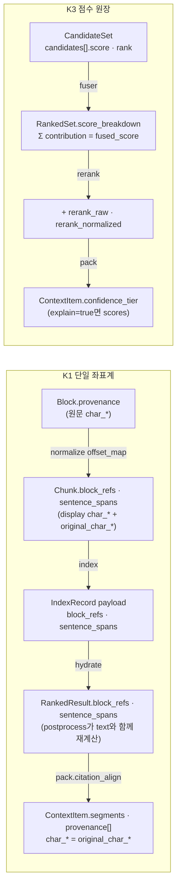

# ADR-0030: 단일 좌표계와 점수 원장(계약 골격)

> 상태 accepted(2026-09-22) · 우선순위 P0 · 관련 결정 D-05(`confirmed`), K1, K3 · 형식 MADR. 이 ADR은 설계 바이블 §3.1 D-05 행과 §2.1 K1·K3 행에 이미 확정된 결정을 근거·대안과 함께 기록한다. 바이블 표를 바꾸지 않으며(바이블 §1.1), 새 타입·필드·열거값을 만들지 않는다. 계약 골격은 설계 제안 B의 것이다(바이블 목적 절).

## 맥락과 문제

브리프 D-05는 수집 8단·질의 5단, 합쳐 13개의 스테이지 경계 계약(contract)을 확정했고 모든 경계를 JSON Schema 2020-12로 게시하라고 요구한다(R5). 그런데 세 설계 제안과 기술 지형 조사는 이 경계 "사이"와 "안"에 결정할 것이 더 있음을 드러냈다.

- **서브스테이지가 생겼다.** 포맷 판정 `detect`(parse 내부), 임베더 교체 시 토큰 재카운트 `recount`(ADR-0019), 융합 뒤 payload 1회 배치 조회 `hydrate`(ADR-0034), 커밋 이벤트 `publish`, 공급자 포맷 `render`(D-20)는 D-05 목록에 없는 처리 단계다(바이블 §4.2·§4.3). 각 단계에 새 경계 타입을 두면 13 계약이 18~19개로 늘고 `lineage_refs`·`requires_lineage`·`ArtifactRef.schema_type` 매핑이 모두 바뀐다. 두지 않으면 어떤 타입의 어떤 필드가 그 단계의 산출물인지 명시해야 한다.
- **좌표가 흩어질 위험이 있다.** 인용 `segments`(10 문서 §D `ContextPack` 필드 제안), 골든셋 `answer_spans`(09 문서 §메트릭 "문서 ID + 정답 문자 구간"), 부모 확장(small-to-big)과 문장 윈도우(04 문서 §8), 압축(10 문서 §A `segments` 보존 여부)이 각각 오프셋을 다룬다. 정규화는 텍스트 길이를 바꾸고(`offset_map`, ADR-0002), 외부 청커는 입력 문자열 기준 오프셋을 낸다(04 문서 §표준 모델 매핑 "오프셋을 원문 정규화 텍스트 기준으로 재계산"). 좌표계를 하나로 못 박지 않으면 재청킹·재정규화·압축마다 인용과 평가가 어긋난다(바이블 §15 리스크 7).
- **점수가 소실될 위험이 있다.** 브리프 원칙 8은 "각 후보의 점수 분해(dense/sparse/lexical/rerank)"를 요구한다. 그러나 벡터 백엔드의 서버 측 융합은 개별 prefetch 점수를 돌려주지 않고(06 문서 §Qdrant 출력 형식), Qdrant RRF 상수 기본값은 문헌 k=60과 다른 2다(07 문서 §융합). 관측 스택은 콘텐츠 캡처 기본 끔·분리 컨테이너(D-11, pip/코드 의존 금지)라 트레이스에 흘린 점수는 재현 근거가 되지 못한다. 제안 A는 `Chunk.kind`와 `IndexRecord.item_kind`를 서로 다른 열거로 두어 검색 단위의 의미가 두 곳에서 어긋났다(바이블 목적 절 "치명적 결함").

따라서 결정할 문제는 다음 셋이다. (1) 서브스테이지를 경계 타입 없이 어떻게 표현하는가. (2) 검색 단위와 그 원문 좌표를 어느 타입·어느 필드 하나로 고정하는가. (3) 채널 원점수에서 신뢰도 등급까지 점수가 어디에 어떤 불변식으로 누적되는가.

## 결정 동인(decision drivers)

| # | 동인 | 출처 | 설계 함의 |
|---|------|------|-----------|
| DR1 | D-05 13 경계 `confirmed`; 스테이지 경계·타입명 변경은 계약 major(§1.2) | 브리프 §4 D-05, R5; 바이블 §1.2, §3.1 D-05 | 서브스테이지는 기존 타입의 필드·조건 필수로 표현한다 |
| DR2 | 설명 가능성: 후보별 점수 분해, "왜 이 청크가 뽑혔는지" | 브리프 원칙 8; 바이블 §2.1 K3 | 점수는 트레이스가 아닌 계약(`RankedSet`)에 누적된다 |
| DR3 | 융합은 플랫폼 `fuser`, RRF k=60 → CC 2단계, 서버 융합은 `lite` 단일 컬렉션만 | 브리프 D-07(v1.2); 바이블 §3.2 O-01; 매트릭스 §개방 결정 권고 O-01 | 채널별 `contribution`을 플랫폼이 계산해야 원장이 성립한다 |
| DR4 | LLM 네이티브 출력의 인용 가능성: `segments`, `citations`, `cite_id` 불변 | 브리프 R6, 원칙 10, D-20; 10 문서 §B 인용 위치 타입 | 인용 세그먼트는 검색 단위의 좌표에서 결정적으로 나와야 한다 |
| DR5 | 골든셋 진실값 = 문서 ID + `answer_spans`, 재청킹에 불변 | 브리프 D-12; 09 문서 §메트릭 Span hit rate@k | 청크·항목 좌표가 원문 `Block.text` 기준으로 환원 가능해야 한다 |
| DR6 | 검색 핫패스 PostgreSQL 미의존, `hydrate` 1회 배치, payload 32KB | 바이블 §4.3, §5.1 `IndexRecord`, ADR-0034; 브리프 §7 가용성 | 좌표는 `IndexRecord` payload에 자족적으로 들어가야 한다 |
| DR7 | 결정성·콘텐츠 주소화: 같은 입력 → 같은 팩(`content_hash`) | 브리프 원칙 4; 바이블 §9.1 결정성 | `block_refs → provenance` 변환에 외부 상태가 끼면 안 된다 |
| DR8 | `text`를 바꾸는 후처리(`parent_expand`·`sentence_window`·`compress`)가 기본 파이프라인에 있다 | 브리프 D-07, D-19; 바이블 §8.2 | 좌표 배열은 텍스트와 함께 재계산되는 계약 의무여야 한다 |

## 고려한 대안

### A1. 서브스테이지마다 새 경계 타입을 추가 — 기각

- 설명: `detect`·`recount`·`hydrate`·`publish`·`render`의 출력을 각각 별도 계약(예: 판정된 원본, 재카운트된 청크 세트, 수화된 랭크 세트)으로 게시한다.
- 장점: 스테이지 = 계약 1:1이 유지되어 `Stage[In, Out]` 시그니처가 단순하다. 단계별 스키마가 독립적으로 진화한다.
- 단점: 브리프 D-05(`confirmed`)와 어긋나며 경계 추가는 계약 major다(DR1). 실제 산출물 차이는 필드 채움(`detect`: `format`·`format_confidence`·`container_flags`), 키 추가(`recount`: `token_counts`), 조건 필수 전환(`hydrate`: `hydrated=true`)에 그쳐 타입을 나눌 정보량이 없다(바이블 §4.2·§4.3). `lineage_refs` 키·`requires_lineage`·`ArtifactRef.schema_type`·`schemas/` 파일·03-contracts 문서 수가 함께 늘어 원칙 1(Contracts First)의 비용만 커진다. `hydrate`는 `fuse` 내부에서 인프로세스로 끝나므로 오케스트레이터를 넘는 `ArtifactRef` 경계(D-17)가 필요하지도 않다.

### A2. 점수 분해를 OpenTelemetry 스팬 이벤트에만 기록 — 기각

- 설명: 후보별 채널 점수·기여분을 `rag.candidate.scored` 같은 스팬 이벤트로 남기고 계약에는 최종 점수만 둔다(09 문서 §통합 설계 함의가 병기한 방식; 제안 A의 운영성 우선 구조).
- 장점: 계약이 얇아지고 관측 백엔드(Langfuse·Phoenix)에서 그대로 시각화된다.
- 단점: 콘텐츠 캡처 기본 끔·샘플링·보존 기간 때문에 재현 근거가 되지 못하고, 후보 수 × 채널 수 속성은 카디널리티·용량을 폭발시킨다(09 문서 §통합 설계 함의). 평가 하네스(TREC run)는 `RankedSet`을 소비하므로(바이블 §5.1) 트레이스 백엔드에 의존하게 되며, 그 백엔드(Grafana·Tempo·Loki AGPL, Arize Phoenix ELv2, Langfuse MIT 코어 — ADR-0022)는 D-11에 따라 OTLP 대상·분리 컨테이너로만 두며 pip/코드 의존이 금지된다. 바이블 §6.5는 "점수 분해는 스팬 이벤트 아닌 `RankedSet`에"로 못 박았다.

### A3. `offset_map`을 하류(`hydrate`·`pack`)에 전달해 원문 오프셋을 그때 계산 — 기각

- 설명: `BlockRef`에는 표시 텍스트 오프셋만 두고, `NormalizedBlock.offset_map`을 payload 또는 산출물 조회로 하류에 넘겨 인용 시점에 원문 좌표를 사상한다.
- 장점: `BlockRef`가 두 필드 작아지고 청커 구현이 단순하다.
- 단점: `offset_map`은 블록 단위 배열이라 payload 32KB 한계(DR6)에 맞지 않고, 산출물(`NormalizedDocument`, 최대 256MB) 또는 PostgreSQL 조회가 핫패스에 들어와 ADR-0034·`hydrate` 지연 예산(§8.3 15ms, 초안)을 깨뜨린다. 변환에 외부 상태가 끼어 팩 결정성(DR7)이 약해진다. 바이블 §6.3은 청커가 `original_char_start/original_char_end`를 함께 기록해 하류가 `offset_map` 없이 `block_refs → Provenance`를 생성하도록 정했다.

### A4. `Chunk.kind`와 `IndexRecord.item_kind` 이중 열거 — 기각

- 설명: 청크 측 `kind`(`text, table, table_part, code, figure_caption, list, parent, sentence_window, summary`)와 레코드 측 `item_kind`(`chunk, summary, community_report, entity, page_image, table, figure`)를 따로 둔다(제안 A §ChunkSet·§IndexRecord).
- 장점: 청킹 관점과 검색 슬롯(O-03) 관점을 각자 확장할 수 있다.
- 단점: 같은 검색 단위의 의미가 두 열거로 갈려 매핑 표가 필요하고, 전략 필터 `item_kind IN :item_kinds`(바이블 §10.2)와 후처리 `parent` 판정이 어느 열거를 보는지 모호하다. `sentence_window`는 검색 단위가 아니라 후처리 단계다. 바이블은 `ItemKind` 단일 열거 11값으로 통일하고(§5.7, §6.4 열거 타입명 고유) 이중 열거를 치명적 결함으로 제거했다.

### A5. 서버 측 융합(Qdrant `prefetch` + `Fusion.RRF`)을 기본으로 — 기각(`lite` 단일 컬렉션 최적화로만 허용)

- 설명: 채널 검색과 융합을 백엔드 한 요청으로 끝낸다(제안 C의 "Qdrant prefetch 한 요청" 서술).
- 장점: 왕복 1회, 구현이 짧다.
- 단점: 융합 결과 `ScoredPoint`에 개별 prefetch 점수가 없어 점수 분해가 불가능하고(06 문서 §Qdrant 출력 형식), lexical 레그(OpenSearch)와 다중 컬렉션 런은 서버 융합에 들어가지 못한다(바이블 §3.2 O-01 다중 컬렉션 규칙). Qdrant RRF 기본 k=2는 문헌 k=60과 다르다(07 문서 §융합). 바이블은 dense·sparse를 `query_points` 두 호출로 분리하고(§8.1 7단계) 서버 융합을 `lite` 단일 컬렉션 질의(`k=60` 명시)로 한정했다. 이 경로에서 원장 열을 채우는 방식은 ADR-0012·04-pipelines/15의 범위다.

### A6. 13 경계 유지 + `BlockRef` 단일 좌표계 + `ScoreBreakdown` 점수 원장 — 채택

- 설명: 아래 "결정" 절. 서브스테이지는 기존 타입의 필드·조건 필수로 표현하고, 검색 단위는 `IndexRecord` 하나, 좌표는 `BlockRef` 하나, 점수는 `CandidateSet → RankedSet.score_breakdown → ContextPack.confidence_tier` 하나의 원장으로 고정한다.
- 장점: DR1~DR8을 모두 만족하며 인용·평가·설명이 별도 부품이 아니라 계약의 파생물이 된다. 채널·융합 방식·리랭커 교체는 원장의 열 하나를 더하거나 값을 바꾸는 일이 된다.
- 단점: payload가 무거워지고(`block_refs`·`sentence_spans` 포함 32KB 상한), `text`를 바꾸는 모든 후처리 플러그인이 좌표 재계산 의무를 진다. "결과" 절에서 다룬다.

## 결정

**결정:** 스테이지 경계: `IngestRequest → SourceDocument → ParsedDocument → NormalizedDocument → ChunkSet → EnrichedChunkSet → EmbeddedChunkSet → IndexCommit` / `QueryRequest → QueryPlan → CandidateSet → RankedSet → ContextPack`. 모든 경계는 JSON Schema 2020-12로 게시 — 브리프 §4 D-05 원문. 바이블 §3.1 D-05 행: "스테이지 경계 13 계약 유지; 서브스테이지 `detect`(parse 내부)·`recount`(chunk 재카운트)·`hydrate`(fuse 내부, §4.3)·`publish`·`render`는 경계 타입을 추가하지 않는 정밀화(`RenderedContext`는 `ContextPack`의 뷰)", 상태 `confirmed`, 근거 "K1·K3 단일 좌표계·점수 원장으로 경계의 필드를 확정".

**결정:** 바이블 §2.1 K1 단일 좌표계(One Coordinate System) — "모든 검색 단위는 `IndexRecord` 하나로 표현되고 payload의 `block_refs[]{block_id, element_path, char_start, char_end, original_char_start, original_char_end, page?, bbox?}`·`sentence_spans[]`로 원문에 역추적된다(`Chunk.block_refs`와 동일 구조 `BlockRef`, `Provenance`로 결정적 변환). 인용 `segments`, 골든셋 `answer_spans`, 부모 확장, 문장 윈도우가 같은 좌표를 쓴다. 검색 핫패스는 `hydrate` 서브스텝(§4.3)이 이 좌표를 인덱스 payload에서 읽으며 PostgreSQL을 거치지 않는다".

**결정:** 바이블 §2.1 K3 점수 원장(Score Ledger) — "`CandidateSet(채널 원점수·순위) → RankedSet(score_breakdown, Σ contribution = fused_score) → ContextPack(confidence_tier)`로 점수가 소실되지 않는다. 융합은 플랫폼 `fuser`가 수행한다".

결정이 고정하는 계약 표현은 바이블 §5.2·§5.3·§5.4·§5.5·§5.7의 다음 행이다(철자 그대로; 공통 봉투 §5.2와 열거 정본 §5.7이 계약 인벤토리의 정본).

| 축 | 타입 · 필드 | 바이블 규정(요지) |
|----|-------------|------------------|
| 경계 | 봉투 `schema_version`·`schema_type`·`tenant_id`·`collection_id`/`collection_ids`·`producer`·`quality`·`warnings`·`degraded`·`created_at`·`lineage_refs` | §5.2. 수집 측 `SourceDocument`~`IndexCommit`, 질의 측 `QueryPlan`~`ContextPack` 공통 |
| 경계 | `detect` → `SourceDocument.format`·`format_confidence`·`container_flags` / `recount` → `ChunkSet.token_counts` 키 추가 / `hydrate` → `RankedSet.hydrated=true` + 조건 필수 필드 / `publish` → `CloudEventEnvelope[]` / `render` → `RenderedContext{pack_id, citation_map[]}` | §4.2·§4.3. 새 `schema_type` 없음; `RankedSet` 단계별 조건 필수는 JSON Schema `if/then`(`stage`·`hydrated`) |
| 좌표 | `BlockRef{block_id, element_path, char_start, char_end, original_char_start, original_char_end, page, bbox, section_index?}` | §5.3. `char_*`는 `Chunk.text`(display) 기준, `original_char_*`는 원문 `Block.text` 기준(`offset_map` 사상 결과), `page`·`bbox`는 nullable 필수, `section_index`는 선택 |
| 좌표 | `Chunk.block_refs`·`IndexRecord.block_refs`·`RankedResult.block_refs`(모두 `array<BlockRef>`), `sentence_spans: array<[integer, integer]>` | §5.4·§5.5. 세 곳이 같은 `BlockRef` 구조; 오프셋 합집합이 `text`를 재구성(`ChunkSet` 불변식 1); `IndexRecord.text` 절단 시 두 배열을 절단 범위로 재계산 |
| 좌표 | `ContextItem.provenance: array<Provenance>`, `ContextItem.segments[]{index, text, char_start, char_end, block_id}` | §5.5. `provenance`는 `block_refs[]`에서 결정적 생성(`element_path`·`page`·`bbox`·`section_index` 복사, `char_start/char_end = original_char_start/original_char_end`); `segments`는 `citation_align`이 `sentence_spans`·`block_refs`에서 생성, `text` 기준 |
| 좌표 | `RankedResult.block_refs`·`sentence_spans` 재계산 의무 | §5.5·§8.2. `text`를 바꾸는 `parent_expand`·`sentence_window`·`compress`는 두 배열을 함께 재계산; 토큰 단위 압축은 `text_format=plain` + `block_refs` 무효화(`provenance` 블록 단위만) |
| 단위 | `ItemKind`(단일 열거) — `Chunk.item_kind`, `IndexRecord.item_kind`, 후보·결과·항목 | §5.7. `text, list_group, code, table, table_part, figure, parent, summary, community_report, entity, page_image`; 리프 1개 = `IndexRecord` 1개(세대별) |
| 원장 | `CandidateSet.channel_runs[].candidates[].score`·`.rank` | §5.5. 채널 원점수(cosine / dot / BM25 / MaxSim), 채널 내 1-based 순위 |
| 원장 | `ChannelScore{score, rank, contribution, variant_ids}` / `ScoreBreakdown{dense, sparse, lexical, graph, tree, visual, late_interaction(각 ChannelScore \| null), fused, fused_rank, rerank_raw, rerank_normalized, normalization, boosts?}` | §5.3. 열 이름은 `ScoreKind` = `Channel` ∪ `fused, rerank`(§5.7); 미적중 채널은 null, `rerank_raw`·`rerank_normalized`는 리랭크 전·생략 시 null(`number | null`) |
| 원장 | `RankedResult.score_breakdown`·`fused_score`·`fused_rank`·`rerank_*`·`final_score`·`channels_hit`·`variant_ids`·`explain[]` | §5.5. 불변식 `Σ contribution = fused_score`; RRF `contribution = w_run/(k+rank)`, CC `w_c·norm`; 정렬 `(-fused_score, record_id)`(§8.1 8단계) |
| 원장 | `ContextItem.confidence_tier`(enum(ConfidenceTier) `high, medium, low`), `ContextItem.scores`(`explain=true`만), `ContextPack.explain` | §5.5. 리랭크 정규 점수 구간, 원시 점수 미노출; `pack.confidence_tiers{high, medium}` 경계는 프로파일 값(초안) |



RRF(k=60, 채널 가중 1:1:1, 원 질의만 적중) 후 크로스인코더 `sigmoid` 정규화까지 기록된 `ScoreBreakdown` 예시. `contribution` 세 값의 합이 `fused`와 같다(값은 소수 6자리 반올림).

```json
{
  "dense": {"score": 0.8123, "rank": 1, "contribution": 0.016393, "variant_ids": ["01J9ZQ4K7X2M8N3P5R6S7T8V9W"]},
  "sparse": {"score": 12.417, "rank": 3, "contribution": 0.015873, "variant_ids": ["01J9ZQ4K7X2M8N3P5R6S7T8V9W"]},
  "lexical": {"score": 18.052, "rank": 2, "contribution": 0.016129, "variant_ids": ["01J9ZQ4K7X2M8N3P5R6S7T8V9W"]},
  "graph": null,
  "tree": null,
  "visual": null,
  "late_interaction": null,
  "fused": 0.048395,
  "fused_rank": 1,
  "rerank_raw": 2.31,
  "rerank_normalized": 0.9097,
  "normalization": "sigmoid"
}
```

HWPX 리프 청크(흐름 포맷, `page`·`bbox` null; 정규화가 앞의 제어 문자 2개를 제거해 원문 오프셋이 2만큼 밀린 경우)의 `block_refs`·`sentence_spans`와, `citation_align`이 그 두 배열에서만 만든 `segments`·`provenance`를 나란히 놓은 예시.

```json
{
  "block_refs": [
    {"block_id": "9a0c2b3f9c1a7e0b2d4c6f8a1b3d5e7f", "element_path": "/hml/body/section[0]/p[37]", "char_start": 0, "char_end": 35, "original_char_start": 2, "original_char_end": 37, "page": null, "bbox": null, "section_index": 0}
  ],
  "sentence_spans": [[0, 35]],
  "segments": [
    {"index": 0, "text": "제3조(절차) ① 정보보호 업무는 다음 각 호의 절차에 따른다.", "char_start": 0, "char_end": 35, "block_id": "9a0c2b3f9c1a7e0b2d4c6f8a1b3d5e7f"}
  ],
  "provenance": [
    {"element_path": "/hml/body/section[0]/p[37]", "char_start": 2, "char_end": 37, "page": null, "bbox": null, "section_index": 0}
  ]
}
```

## 결과

### 긍정

- 13 계약·13 스키마 파일·`lineage_refs` 6키가 그대로 유지되어 `schemas/`의 경계 스키마 13개가 D-05 목록과 1:1로 대응하고, 03-contracts 경계 계약 문서(01~11)가 이를 소유한다(브리프 §8 문서 맵). 서브스테이지 추가(`recount`·`hydrate`)가 계약 major를 일으키지 않았다.
- 인용 정확도(`segments → cited_text` 역매핑), 골든셋 판정(Span hit rate@k), 부모 확장·문장 윈도우가 모두 `BlockRef` 하나의 파생물이다. 재청킹·재정규화·임베더 교체에도 `answer_spans`(원문 기준)가 유효하다(ADR-0002·ADR-0023).
- `hydrate`가 `IndexRecord` payload만 읽어 `RankedSet`을 채우므로 검색 핫패스가 PostgreSQL·산출물 저장소를 거치지 않는다(ADR-0034). 팩 생성에 외부 상태가 없어 `ContextPack.content_hash`가 결정적이다.
- "왜 이 청크가 뽑혔나"가 `score_breakdown`·`channels_hit`·`explain[]`로 계약 안에 있어 평가 하네스(TREC run 내보내기), A/B 비교, 리랭커 폴백 감사(`rerank_skipped`)가 관측 백엔드 없이 동작한다. RRF → CC 전환은 `contribution` 정의만 바뀌고 불변식은 같다.
- `ItemKind` 단일 열거로 전략 필터(`level_in`·`item_kinds`)·후처리 `parent` 판정·MCP 슬림 팩이 같은 값을 본다.

### 부정

- `IndexRecord` payload가 `block_refs`·`sentence_spans`를 품어 무거워진다(payload 32KB 상한, `text` 8,192 UTF-8 바이트). `hydrate` 100 × ~10KB 배치 조회의 p95는 실측 대상이다(바이블 미해결 이슈 12).
- `text`를 바꾸는 모든 `postprocessor` 플러그인(부모 확장·문장 윈도우·압축)이 두 좌표 배열을 함께 재계산해야 한다. 토큰 단위 압축(LLMLingua-2류)은 이 의무를 지킬 수 없어 `text_format=plain` + `block_refs` 무효화로 강등된다.
- `RankedSet`이 세 번 갱신되는 단일 타입이라 단계별 조건 필수를 JSON Schema `if/then`으로 표현해야 하고, 소비자는 `stage`·`hydrated`를 보고 어떤 필드가 있는지 판단해야 한다.
- `lite` 서버 융합 경로는 채널별 `contribution`을 백엔드에서 받지 못하므로 원장의 채널 열이 `standard`와 같은 충실도를 갖지 못한다(ADR-0012·04-pipelines/15에서 처리 방식 확정).

### 중립

- `RenderedContext`는 인벤토리 타입(`rendered-context.schema.json`)으로 존재하지만 `pack_id`로 `ContextPack`을 가리키는 뷰이며 D-05 경계 수에 들지 않는다.
- `ScoreBreakdown.boosts[]`(`BoostKind`)와 `late_interaction` 열은 슬롯만 있고 기본 프로파일에서는 null이다. O-04 결과로 재융합이 도입되면 열의 의미가 정밀화된다(ADR-0010).
- 기술 지형 문서들의 제안 필드명(`scores{}`·`ranks{}`·`source_query_id`, `provenance` 객체, `item_kind` 7값 등)은 바이블 철자로 통일된 것으로 본다(매트릭스 §미해결 이슈 6).

## 준수 확인 방법

| 수단 | 검사 항목 | 위치·실패 시 |
|------|-----------|--------------|
| JSON Schema(`schemas/common-types.schema.json` `$defs`; 03-contracts/00 소유) | `BlockRef.required`에 `original_char_start`·`original_char_end`·`page`·`bbox` 포함, `page`·`bbox`는 `type: [.., null]`; `Chunk.block_refs`·`IndexRecord.block_refs`·`RankedResult.block_refs`는 모두 `$ref: #/$defs/BlockRef`(지역 재정의 금지); `ContextItem.provenance`는 `type: array`, `items: $ref Provenance`; `ScoreBreakdown.required = [dense, sparse, lexical, graph, tree, visual, late_interaction, fused, fused_rank, rerank_raw, rerank_normalized, normalization]`(채널 열과 `rerank_raw`·`rerank_normalized`는 nullable, §5.3); `ChannelScore.required = [score, rank, contribution, variant_ids]`; `RankedSet`은 `stage`·`hydrated` 기반 `if/then`으로 조건 필수 표현; `$defs/ItemKind` 하나만 존재 | 로드 시 검증 실패 = `contract.violation`(§5.7) |
| CI 스키마·바이블 대조(§1.2) | `schemas/*.schema.json`의 `schema_type` 집합 = §5.1 인벤토리(서브스테이지용 신규 타입 있으면 실패); `$defs/ItemKind`·`Channel`·`ScoreKind`·`RankedStage`·`ConfidenceTier`·`ScoreNormalization`·`BoostKind` 값 집합이 §5.7과 일치 | 불일치 = 빌드 실패 |
| 계약 테스트(03-contracts/05·07·10·11) | (1) `block_refs` 오프셋 합집합 = `text`(표는 `serialization` 재구성) (2) `sentence_spans`가 `[0, len(text)]` 안이고 `block_refs` 구간을 넘지 않음 (3) `Σ contribution = fused_score`(부동소수 허용 오차는 03-contracts/10 불변식 절이 정한다) (4) `fused_rank`가 `(-fused_score, record_id)` 정렬과 일치 (5) `provenance[i]`가 `block_refs[i]`의 결정적 함수(`char_* = original_char_*`, 나머지 복사) (6) `IndexRecord.text_truncated=true`면 두 배열이 절단 범위 안 (7) `hydrated=true`일 때만 `block_refs`·`sentence_spans`·`acl` 존재 | 병합 차단 |
| 적합성 키트(ADR-0032, §12 `testing/`) | `fuser`: ranx `fuse(method="rrf")` 결과와 순서·점수 일치(§8.1 8단계) + 원장 불변식; `postprocessor` step: 입력·출력 모두 불변식 (1)(2) 통과, `text` 불변 단계는 두 배열 바이트 동일; `index_backend`: `retrieve(record_ids, with_payload)`가 `block_refs`·`sentence_spans`를 돌려줌; `renderer_citation_roundtrip`: 공급자 인용 위치 → `citation_map` → `segments` → 원문 구간 왕복 | 플러그인 PR 병합 차단 |
| 정적 검사(import-linter, ruff 규칙) | `retrieval/` 패키지가 `normalize` 모듈·`offset_map`을 임포트하지 않음; `detect`·`recount`·`hydrate`·`publish`·`render`의 `Stage[In, Out]` 타입 인자가 인벤토리 타입만 사용; `score_breakdown` 채널 열 쓰기는 `fuser`, `rerank_*` 쓰기는 `reranker`만 | 빌드 실패 |
| 코드 리뷰 체크리스트(04-pipelines/15·17) | (a) 후보별 점수 분해를 스팬 속성·이벤트로 내보내지 않음(상위 k `document.id`와 최종 점수만) (b) `text`를 바꾸는 단계가 `block_refs`·`sentence_spans`를 함께 갱신 (c) 새 채널은 `Channel`·`ScoreBreakdown` 열 추가(minor)로만 (d) 서브스테이지에 새 `schema_type`을 만들지 않음 (e) `ItemKind` 외 별도 종류 열거를 만들지 않음 | 리뷰 승인 조건 |
| 운영 메트릭·게이트 | `rag_pack_citation_unresolved_total`(§6.5) 증가율, `rag_hydrate_missing_total`; 골든셋 게이트(D-12, §7.4)에서 Span hit rate가 재청킹 전후 동일 문서에서 불변, TREC run이 `RankedSet`에서만 생성됨 | `EvalReport.gate_result` 실패 |

## 재검토 조건

1. 어떤 서브스테이지가 별도 워커·큐로 분리되어 오케스트레이터를 넘는 `ArtifactRef` 경계가 필요해질 때 — 경계 추가는 계약 major(§1.2), 브리프 D-05 개정 절차를 따른다.
2. 새 검색 채널(`Channel` 열거값)이 추가될 때 — `ScoreBreakdown` 열 추가(minor)로 처리하며 이 결정은 불변이다.
3. O-01 CC 전환 또는 O-04 `late_interaction` 재융합 도입으로 `contribution`의 정의가 바뀔 때 — 불변식 `Σ contribution = fused_score`가 유지되는지 ADR-0013·ADR-0010과 함께 확인한다.
4. 토큰 단위 압축이 기본 후보로 승격되어 `block_refs` 무효화가 일반화될 때 — `provenance` 블록 단위 규칙과 `text_format=plain` 강등 규칙을 재검토한다.
5. `hydrate` 배치 조회 p95 또는 payload 크기가 §8.3 예산·32KB 상한을 넘는 것이 실측될 때(바이블 미해결 이슈 12) — `block_refs` 표현 압축을 검토하되 좌표 의미는 바꾸지 않는다.
6. 골든셋(M1·M2)에서 `renderer_citation_roundtrip` 실패율 또는 `rag_pack_citation_unresolved_total`이 허용치를 넘을 때 — ADR-0002 `offset_map` 설계와 함께 재검토한다.
7. 브리프 D-05가 개정될 때(바이블 §1.2 "브리프 확정 결정 개정" 절차).

## 참조

- 설계 브리프 §2 R5·R6, §3 원칙 1·3·4·8·10, §4 D-05·D-07·D-11·D-12·D-17·D-19·D-20, §7 가용성·재현성 — [00-design-brief](../00-vision/00-design-brief.md)
- 설계 바이블 §1.1~1.2, §2.1 K1·K3, §3.1 D-05 행, §3.2 O-01·O-04, §3.3 0030 행, §4.2·§4.3 서브스테이지 행, §5.1 인벤토리, §5.2 봉투, §5.3 `BlockRef`·`Provenance`·`ChannelScore`·`ScoreBreakdown`, §5.4 `ChunkSet`·`Chunk`·`IndexRecord`, §5.5 `CandidateSet`·`RankedSet`·`ContextPack`·`ContextItem`·`RenderedContext`, §5.7 `ItemKind`·`Channel`·`ScoreKind`·`RankedStage`·`ConfidenceTier`, §6.3 오프셋 규약, §6.5 스팬 규약, §8.1 8~13단계, §8.2, §9.1, §13.2, §15 리스크 7 — [00-design-bible](../02-architecture/00-design-bible.md)
- 기술 지형 종합 §개방 결정 권고 O-01, §계약 제안 묶음 `ChunkSet`·`CandidateSet`/`RankedSet`·`ContextPack` 행, §미해결 이슈 6 — [00-summary-and-selection-matrix](../07-tech-landscape/00-summary-and-selection-matrix.md)
- 기술 지형 04 §8 부모-자식·문장 윈도우, §ChunkSet 계약 요구사항(`block_refs` 불변식), §표준 모델 매핑 — [04-chunking-strategies-and-libraries](../07-tech-landscape/04-chunking-strategies-and-libraries.md)
- 기술 지형 06 §Qdrant(Query API·출력 형식: 융합 시 개별 prefetch 점수 미반환), §개방 결정 O-01 — [06-vector-and-lexical-index-backends](../07-tech-landscape/06-vector-and-lexical-index-backends.md)
- 기술 지형 07 §융합(RRF k 기본값 차이), §표준 모델 매핑 `RankedSet` 행 — [07-retrieval-techniques-fusion-reranking](../07-tech-landscape/07-retrieval-techniques-fusion-reranking.md)
- 기술 지형 09 §메트릭(Span hit rate@k, `answer_spans`), §통합 설계 함의(점수 분해 기록 위치·카디널리티) — [09-evaluation-and-observability](../07-tech-landscape/09-evaluation-and-observability.md)
- 기술 지형 10 §A 컨텍스트 압축(`segments` 보존 여부), §B 공급자 인용 위치 타입, §D `ContextPack` 필드 제안 — [10-llm-context-optimization-and-mcp](../07-tech-landscape/10-llm-context-optimization-and-mcp.md)
- 설계 제안 B(계약 골격 원안, K1·K3) — [proposal-B](../12-appendix/design-proposals/proposal-B-retrieval-quality-first.md); 설계 제안 A(기각된 `kind`/`item_kind` 이중 열거) — [proposal-A](../12-appendix/design-proposals/proposal-A-operability-first.md)
- 관련 ADR: [ADR-0002 provenance 표현](../06-adr/0002-provenance-element-path-and-nullable-page-bbox.md), [ADR-0004 결정적 chunk_id·record_id](../06-adr/0004-deterministic-chunk-id-scoped-record-id-and-ulid-exception.md), [ADR-0010 late_interaction 슬롯](../06-adr/0010-bge-m3-rationale-and-late-interaction-slot.md), [ADR-0012 lite Qdrant 단독](../06-adr/0012-lite-profile-qdrant-only-client-bm25.md), [ADR-0013 융합·후처리 순서](../06-adr/0013-fusion-rrf-k60-then-convex-combination-and-postprocess-order.md), [ADR-0019 recount 스테이지](../06-adr/0019-chunk-size-tokenizer-defaults-and-recount-stage.md), [ADR-0023 answer_spans](../06-adr/0023-evaluation-qrels-answer-spans-and-linear-ndcg.md), [ADR-0024 Context Pack 순서·렌더러](../06-adr/0024-context-pack-ordering-and-anthropic-search-result-renderer.md), [ADR-0029 3-텍스트 규칙](../06-adr/0029-three-text-rule-and-deterministic-context-prefix.md), [ADR-0032 적합성 키트](../06-adr/0032-plugin-sdk-stage-protocol-and-conformance-kit.md), [ADR-0034 hydrate·PG 미의존](../06-adr/0034-retrieval-hot-path-postgres-independence-and-hydrate.md), [ADR-0036 명명 규약](../06-adr/0036-naming-and-identifier-conventions.md), [ADR 인덱스](../06-adr/README.md)
- 계약·파이프라인·평가 문서(문서 맵): [00-contract-overview](../03-contracts/00-contract-overview.md), [05-chunk-set](../03-contracts/05-chunk-set.md), [07-embedded-chunk-set-and-index-record](../03-contracts/07-embedded-chunk-set-and-index-record.md), [10-candidate-set-and-ranked-set](../03-contracts/10-candidate-set-and-ranked-set.md), [11-context-pack](../03-contracts/11-context-pack.md), [14-schema-versioning-and-compatibility](../03-contracts/14-schema-versioning-and-compatibility.md), [15-hybrid-search-and-fusion](../04-pipelines/15-hybrid-search-and-fusion.md), [17-post-processing-and-context-packing](../04-pipelines/17-post-processing-and-context-packing.md), [02-retrieval-metrics-and-harness](../08-evaluation/02-retrieval-metrics-and-harness.md), [04-testing-strategy](../10-development/04-testing-strategy.md), [05-ci-cd](../10-development/05-ci-cd.md)
