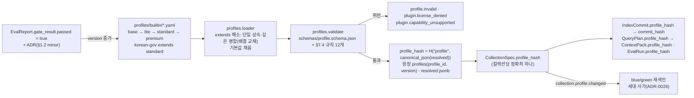

# ADR-0031: 프로파일 스키마: extends 단일 상속과 품질 게이트

> MADR(Markdown Architectural Decision Record) 형식. 바이블 §3.3 표의 0031행(slug `profile-schema-extends-and-quality-gates`, P2)이며 관련 결정은 핵심 아이디어 K7 "격리 등급 1급 + 품질 게이트 프로파일"(바이블 §2.1)이다. 이 ADR은 바이블 §7(프로파일 정본)·§7.4(로딩 시 검증 규칙과 게이트)의 결정을 근거·대안과 함께 기록하고 바이블 표를 바꾸지 않는다(바이블 §1.1). K7의 다른 절반인 테넌트 격리 등급 `TieringPolicy`는 [ADR-0028](./0028-tenant-isolation-tiering-policy.md), 게이트를 판정하는 하네스는 [ADR-0023](./0023-evaluation-qrels-answer-spans-and-linear-ndcg.md), 프로파일 값이 바뀌었을 때 실행되는 blue/green 세대 사가는 [ADR-0026](./0026-index-commit-generation-saga-and-ledger.md)이 다룬다. 검증 규칙 12개가 참조하는 개별 결정은 §결정의 규칙 표에서 ADR별로 링크한다.

## 맥락과 문제

브리프 §10은 프로파일(profile)을 "파이프라인 구성 프리셋(파서·청커·임베더·검색 전략의 조합, 버전드)", 컬렉션(collection)을 "테넌트 내 인덱스 논리 단위(프로파일 고정)"로 정의하고, §7 재현성 목표는 "동일 `IngestRequest` + 동일 프로파일 → 동일 `IndexCommit` 해시"다. 원칙 7(Evaluation-Driven)은 "모든 기본값은 골든셋(golden set) 평가로 정당화된다"고 요구한다. 세 설계 제안의 심사는 격리 등급(A)·프로파일 단순성(C)·게이트 계약(B)을 합쳐 K7로 확정했다. 기술 지형 조사에서 확정된 사실은 다음과 같다.

| # | 사실 | 출처 |
|---|------|------|
| F1 | 14개 연구 문서의 프로파일 표(01 standard/lite/enterprise, 02 `pdf_*`, 05 default-hybrid/ko-quality/lite, 07 default/quality/lite, 09 dev/lightweight/standard/regulated, 12 lite/standard/regulated, 13 standard/lite/airgapped, 14 lite/default/graph/visual-pages)는 `lite`·`standard`·`premium`·`korean-gov` 네 이름으로 접혔고, 세부 ID(`pdf_fast_cpu`, `ko-quality`, `graph`)는 스테이지 옵션으로 프로파일 안에서 참조된다. 네 프로파일의 컴포넌트 표(바이블 §7.1)는 24행 중 대부분이 "동일" 또는 "standard + α"다 — 공유가 기본이고 차이가 예외다 | 매트릭스 §프로파일별 기본 조합, 바이블 §7.1 |
| F2 | 프로파일 변경(임베딩 모델·청커 교체)은 blue/green이다: `col_{collection_id}_{profile_hash}` 신규 컬렉션을 채우고 하네스(D-12)가 통과하면 alias를 "렉시컬 → 벡터" 순으로 교체한다. 즉 프로파일 해시는 물리 인덱스 이름과 세대 사가의 입력이다 | 06 문서 §alias 교체, 바이블 §11.4 |
| F3 | Onyx v4.8.0-beta.0은 "재색인 중 임베딩 설정 유실"을 수정했고, 조사 문서의 대응은 "`IndexCommit`에 프로파일 해시 고정"이다. 매트릭스도 `parser_fingerprint`·`embedding_space_id`·`analyzer_id`·`chunker_config_hash`·프로파일 해시가 `IndexCommit`에 기록되어야 재현성(§7)이 보장된다고 요구한다 | 11 문서 §실패 모드, 매트릭스 §어댑터·플러그인 공통 요구 2 |
| F4 | "거의 모든 기본값이 초안 목표"다. CI 게이트 정책(초안): 기본 프로파일의 nDCG@10·Recall@20이 §7 목표 미달이면 실패, 베이스라인 대비 nDCG@10 하락 > 0.01 & p < 0.05면 실패, `Judged@10 < 0.7`이면 경고. M2 게이트 목록(임베딩 교체 +2p, 리랭커 +2pt, LLM 접두어 +0.03 & 비용 상한, 융합 CC 전환 ≥200 qrels, 청크 그리드)이 ADR 트리거로 명시되어 있다 | 09 문서 §평가 하네스 아키텍처, 매트릭스 §운영·평가 공통 요구, §종합 리스크 1 |
| F5 | 플러그인은 `capabilities()`를 선언하고 프로파일 검증 시 요구 기능과 대조한다. 미지원 조합(pgvector + `late_interaction`, CLS pooling 모델 + late chunking, Nemotron + 에어갭)은 로딩 시 거부하거나 채널을 자동 비활성하고 `degraded`에 기록한다. 토큰 카운터 공급자·카운터 불일치도 구성 검증에서 거부한다. Qdrant `fusion: rrf`의 상수 k 기본값은 2이므로 `fusion.k`는 프로파일 필수다 | 매트릭스 §어댑터·플러그인 공통 요구 4·5, O-01 권고, 06 문서 §Query API |
| F6 | 라이선스 등급 B(LGPL)는 "동적 링크·별도 프로세스만, 정적 포함 금지"다. kiwipiepy 0.23.2 PyPI wheel은 Kiwi를 정적 링크한 LGPLv3이며 0.24.0의 Apache-2.0 전환은 진행 중(이슈 #233, 확인 필요 as of 2026-09)이다. 기본 설치 금지는 프로파일 검증이 `PluginMeta.linkage=static_bundled` B 등급을 거부해야 강제된다 | 12 문서 §6.1 등급표, 13 문서 Kiwi 행, 바이블 §5.6 `PluginMeta.linkage` |
| F7 | Haystack 3의 "컴포넌트 입출력 타입 선언 + 파이프라인 YAML 직렬화 + allowlist 역직렬화(`eval`/`exec` 차단)"가 프로파일 직렬화·플러그인 로딩 보안의 직접 참조다. Onyx `DocumentIndex`의 능력 믹스인(mixin) 합성은 인터페이스 계약(우리 `IndexBackend`·`Capabilities`)의 참조이며 설정 값의 상속 모델이 아니다 | 11 문서 §Haystack 3, §Onyx |

결정할 질문은 다섯이다. (1) 네 프로파일이 공유하는 값과 다른 값을 어떻게 표현하는가(상속 모델과 병합 의미), (2) 프로파일의 정체성(해시)을 무엇으로 정의하고 어디에 기록하는가, (3) 품질 기본값을 누가 어떤 근거로 바꿀 수 있는가, (4) 컬렉션·요청 단위 편차를 어디까지 허용하는가, (5) 로딩 시 무엇을 검증해 잘못된 조합을 컬렉션 생성 전에 막는가.

## 결정 동인(decision drivers)

| 동인 | 출처 | 함의 |
|------|------|------|
| Evaluation-Driven — 모든 기본값은 골든셋 평가로 정당화 | 브리프 §3 원칙 7, D-12, 바이블 §2.1 K7 | 품질 기본값은 값 하나가 아니라 `{value, gate}` 쌍이며, `gate`의 판정자는 `EvalReport.gate_result.passed`다 |
| 재현성 — 동일 `IngestRequest` + 동일 프로파일 → 동일 `IndexCommit` 해시; 두 백엔드의 blue/green은 해시 단위 | 브리프 §7 재현성, §3 원칙 4, 바이블 §5.4 `commit_hash`, §11.4, F2, ADR-0026 | 프로파일 정체성은 상속을 해소한 결과의 정규 직렬화(canonical JSON) 해시여야 하고 `commit_hash = H("commit", profile_hash, …)`에 들어간다. 값 변경 = `version` 증가 = `profile_hash` 변경 = 재색인이며, 해시가 바뀌지 않는 "조용한 변경"은 존재할 수 없어야 한다 |
| Contracts First — 프로파일도 계약 | 브리프 §3 원칙 1, D-05, 바이블 §5.1 `Profile` 1.0.0 | `schemas/profile.schema.json`(`$id = urn:rag:schema:profile:1`) + Pydantic v2 `contracts/profile.py`, 소유 문서는 03-contracts/15 |
| 컬렉션은 정확히 하나의 프로파일 해시에 바인딩 | 바이블 §5.6 `CollectionSpec.profile_id/profile_hash`, §13.1 `collections` | 컬렉션별 자유 편차는 바인딩을 깨뜨린다 → 편차는 허용 키만 |
| 라이선스 등급표와 CI 게이트 | D-02, ADR-0001, F6 | 프로파일 로딩이 `license_grade ≤ license_policy.max_grade`·`territory`·`static_bundled` B 거부를 강제하는 첫 지점이다 |
| 능력 선언 대조와 부분 성공 | D-15 `capabilities()`, F5, 바이블 §4.1 부분 성공 | 미지원 조합은 로딩 시 거부 또는 자동 비활성 + `degraded{capability_unsupported}` |
| Korean-First | 브리프 §3 원칙 6, D-15 경량 프로파일, O-08 | `lite`는 플랫폼 측 `korean_analyzer` 필수, `ocr.lang/version/model` 필수 키 |
| Multi-Tenant & Secure by Design | D-09, 바이블 §10.3 E6·E16, ADR-0027·ADR-0038 | `relaxable_keys`에 보안·전략 키 금지, `deny_cidrs` 축소 불가는 프로파일 검증에서 막는다 |
| 단순성(C 제안) — 커널·SDK는 C | 바이블 §목적, §2.1 K5 | 내장 프로파일 네 개 + `base`의 선형 체인은 `rag profile diff`로 한 줄씩 설명된다. 다중 상속의 해소 규칙을 배울 필요가 없다 |
| 리스크 #1 골든셋 부재 | 바이블 §15 리스크 1, F4 | §7.2 수치는 모두 초안 목표이지만 구속력은 있다 — 바꾸려면 게이트를 통과해야 한다 |

## 고려한 대안

| # | 대안 | 판정 | 근거 요약 |
|---|------|------|-----------|
| A | 다중 상속·믹스인(`extends: [standard, ko-quality, airgapped]`) | 기각 | 병합 순서 규칙이 해시 결정성을 흔들고 `diff`가 선형이 아니다(F7) |
| B | 게이트 없는 기본값 변경(PR 리뷰만) | 기각 | 원칙 7·리스크 #1 위반, Onyx식 "설정 유실" 재발(F3·F4) |
| C | 컬렉션별 자유 오버라이드(임의 키 `profile_overrides`) | 기각 | 컬렉션 = 프로파일 해시 하나 바인딩이 깨지고 재현성·blue/green이 무효(F2·F3) |
| D | 프로파일 없는 플랫 설정(환경 변수·pydantic-settings만) | 기각 | 버전·해시가 없어 `IndexCommit`에 기록할 정체성이 없다 |
| E | 배열 병합·키 삭제 연산자를 가진 병합 의미 | 기각 | `channels[]`·`postprocess.order`·`deny_cidrs`·`parse.router` 체인은 순서·전체가 의미라 부분 병합이 오독을 만든다 |
| F | `extends` 단일 상속·깊은 병합(배열 교체), `{value, gate}` 형식, 검증 규칙 12개, `rag profile validate/diff`, `POST /v1/profiles/validate` | **채택** | 바이블 §7·§7.4, K7, 매트릭스 요구 2·4·5와 일치 |

### 대안 A: 다중 상속·믹스인(기각)

- 설명: 프로파일이 여러 부모를 나열하고(`extends: [standard, ko-quality]`), 축별 조각(임베딩 축, 격리 축, 에어갭 축)을 믹스인으로 합성한다.
- 장점: F1의 세부 ID(`ko-quality`, `pdf_airgapped`)를 독립 조각으로 재사용할 수 있고 조합 폭발을 파일 수로 흡수한다.
- 단점: 두 부모가 같은 키를 다르게 주면 해소 순서(C3 MRO식·선언 순서·깊이 우선)를 정해야 하고, 그 규칙이 `profile_hash`의 일부가 되어 감사자가 해시를 재계산하려면 규칙까지 알아야 한다. `rag profile diff lite standard`처럼 "부모와의 차이"를 한 줄로 보이는 것이 불가능하다. Onyx의 믹스인은 인터페이스(능력) 합성이고 값 상속이 아니다(F7). 세부 ID는 이미 스테이지 옵션으로 프로파일 안에서 참조되므로(F1) 조각 재사용은 옵션 값으로 충분하다.
- 판정: 기각. 축 조합이 필요하면 `korean-gov extends standard`처럼 새 자식 프로파일을 하나 더 만든다.

### 대안 B: 게이트 없는 기본값 변경(기각)

- 설명: `leaf_max_tokens: 512`처럼 값만 두고 변경은 코드 리뷰로 통제한다.
- 장점: YAML이 짧고 기존 플랫폼(Dify의 지식베이스 UI 설정 TopK 3·threshold 0.5, RAGFlow의 문서 엔진 Compose 프로파일)과 같은 익숙함이 있다(11 문서).
- 단점: 원칙 7과 정면 충돌한다. 모든 §7.2 값이 영어·벤더·라인 OCR 수치 의존의 초안 목표(F4, 리스크 #1)인데, 근거 없는 조정이 누적되면 "무엇이 측정된 값이고 무엇이 추측인지" 구분이 사라진다. 값 변경이 `version`·`profile_hash`와 묶이지 않으면 Onyx의 재색인 중 설정 유실(F3)과 같은 조용한 회귀가 재현된다.
- 판정: 기각. 게이트는 값 옆에 붙어 있어야 리뷰어가 "이 값을 바꾸려면 어느 데이터셋에서 어떤 지표를 얼마나 올려야 하는가"를 파일에서 바로 읽는다.

### 대안 C: 컬렉션별 자유 오버라이드(기각)

- 설명: `CollectionSpec` 또는 `IngestRequest`가 프로파일의 임의 경로를 덮어쓴다.
- 장점: 재색인 없이 컬렉션마다 미세 조정이 가능하다.
- 단점: 컬렉션은 정확히 하나의 `profile_hash`에 바인딩되고(바이블 §5.6) 그 해시가 `IndexCommit.commit_hash`·물리 컬렉션 이름(F2)·`QueryPlan`·`ContextPack`·`EvalRun`에 기록된다. 임의 오버라이드는 같은 해시 아래 다른 파이프라인을 만들어 재현성(§7)과 `rag profile diff`·평가 비교를 무효화하고, 게이트(B)를 우회하는 뒷문이 된다.
- 판정: 기각. 바이블 §5.4 `IngestRequest.profile_overrides`는 **컬렉션 프로파일의 허용 키만**(`parse.pdf.route`, `enrich.generated_prefix`) 받고 그 외는 422다. 허용 키 값은 해당 스테이지(`parse`·`enrich`)의 config에 들어가므로 `config_hash`와 `fingerprint`(§4.1·§6.2 지문 식)에 자연히 반영되어 캐시·계보가 갈린다고 보는 것이 이 ADR의 추론이다 — 바이블은 허용 키와 422만 정하며, 오버라이드 값의 지문 반영 방식은 03-contracts/01·15가 확정한다.

### 대안 D·E: 플랫 설정 / 배열 병합·삭제 연산자(기각)

- 설명: D는 `RAG_*` 환경 변수(바이블 §6.6)와 pydantic-settings만으로 스테이지 값을 준다. E는 자식이 부모 배열에 요소를 추가·삭제하는 연산자(`+item`, `-key`)를 둔다.
- 장점: D는 파일이 없어 배포가 단순하다. E는 `korean-gov`가 `standard`의 `enrich.deterministic[]`에 한 항목만 추가하는 식의 짧은 표현이 가능하다.
- 단점: D는 `version`·`profile_hash`가 없어 `IndexCommit`·`QueryPlan`에 기록할 정체성이 없고 blue/green의 단위도 없다(§6.6은 인프라 접속 정보용이다). E는 `channels[]`(채널 × 리트리버), `postprocess.order[]`(고정 순서 `PostprocessStep`), `parse.router.*`(폴백 체인 순서), `deny_cidrs`(보안 목록)가 모두 "전체 목록이 의미"라 부분 병합 결과를 파일만 보고 알 수 없고, 보안 목록의 삭제 연산자는 규칙 (12)와 충돌한다.
- 판정: 기각. 배열은 자식이 전체를 다시 선언한다(교체). 보안 목록의 축소는 병합 규칙이 아니라 검증 규칙 (12)가 막는다.

## 결정

**결정:** 프로파일은 컬렉션에 고정되는 버전드 프리셋이며 `profile_hash`가 `IndexCommit`·`QueryPlan`·`ContextPack`에 기록된다. 상속 체인은 `base → lite → standard → premium`, `korean-gov extends standard`. `extends`는 단일 상속·깊은 병합(배열은 교체)이다(바이블 §7). 프로파일은 `extends` 단일 상속이며 모든 품질 기본값에 `gate`가 붙는다(바이블 §2.1 K7). **품질 기본값은 게이트 없이 바뀌지 않는다.** `gate{metric?, dataset?, grid | min_delta | min_delta_pt | min_qrels | candidate | promote_to, tool?, max_cost_per_doc_usd?}`(§5.6 게이트 값 행; `metric` 생략 = `ndcg@10`, `dataset` 생략 = `eval.datasets[0]`)가 붙은 값은 하네스 결과(`EvalReport.gate_result.passed`)와 ADR 없이는 변경할 수 없다. 프로파일 값 변경 = `version` 증가 = `profile_hash` 변경 = 컬렉션 blue/green 재색인(바이블 §7.4).



결정에 딸린 정본 세부(모두 바이블 인용, 이 문서가 새로 정하지 않는다):

- 계약(바이블 §5.1·§5.6; 소유 문서 03-contracts/15): `Profile` 1.0.0, `schemas/profile.schema.json`, `$id = urn:rag:schema:profile:1`, 인라인 한계 256KB. 최상위 키 `schema_version`, `profile_id`(kebab, §6.1), `version`(semver), `extends`(string | null; `base`만 null), `tier`(enum(ProfileTier) = `lite, standard, premium, korean-gov`), `license_policy{max_grade, territory}`, `runtime{orchestrator, queues, tenant_concurrent_jobs_max, acl_propagation_slo, outbox_lag_slo, egress: EgressPolicy}`, `ingest{fetch, parse{router, options}, normalize, chunk, recount?, enrich, embed, index}`, `query{transform, channels, fusion, hydrate, rerank, postprocess, pack, latency_budget_ms}`, `security{authn, authz, rate_limit, tenant_isolation_tier, tiering: TieringPolicy}`, `observability{content_capture, tenant_id_hash}`, `eval{datasets[], gates}`. 각 스테이지 값은 `{plugin, policy: StagePolicy, …플러그인 config_schema 필드}`다.
- 상속 해소(바이블 §7, §5.6 `extends`): 부모는 정확히 하나. 로더는 `base`부터 자식까지 체인을 따라 객체는 키 단위로 재귀 병합하고, 스칼라와 **배열은 자식 값으로 교체**한 뒤 스키마 기본값을 채운다. 키 삭제·배열 요소 병합 연산자는 바이블에 없으며 이 ADR도 추가하지 않는다. `rag profile diff lite standard`는 해소 후 차이만 출력한다(§7.4).
- 해시와 기록 지점(바이블 §6.1·§6.2): `profile_hash = H("profile", canonical_json(extends 해소·기본값 채움 후의 프로파일))`, `canonical_json` = 키 정렬·공백 없음·`ensure_ascii=false`·부동소수 최단 표현, BLAKE3 소문자 hex 64자. 기록: `CollectionSpec.profile_id/profile_hash`(§5.6), `IndexCommit.profile_id/profile_hash`와 `commit_hash`(§5.4), `QueryPlan.profile_id/profile_hash`(§5.5, `planner_fingerprint`·`plan` 캐시 키 포함), `ContextPack.profile_id/profile_hash`(§5.5), `EvalRun.profile_hash`(§5.6), 원장 `profiles(profile_id, version) PK, profile_hash, yaml, resolved jsonb`(§13.1), 스팬 속성 `rag.profile_hash`(§6.5). 검색 핫패스는 api 프로세스 캐시의 해소 결과를 쓰고 `collection.profile.changed`로 갱신한다(§13.1, ADR-0034).
- 게이트 형식(바이블 §5.6 "게이트 값" 행, §7.4; `profile.schema.json` `$defs/GateSpec`): `{value, gate: {metric?, dataset?, grid?, min_delta?, min_delta_pt?, min_qrels?, candidate?, promote_to?, tool?, max_cost_per_doc_usd?}}`. `metric` 생략 = `ndcg@10`, `dataset` 생략 = `eval.datasets[0]`; `grid | min_delta | min_delta_pt | min_qrels | candidate | promote_to` 중 하나 이상 필수. `min_delta`는 지표 단위, `min_delta_pt`는 퍼센트 포인트, `promote_to`는 enum(FusionMethod)(O-01 전환 목표), `tool`은 판정 도구(`ranx.optimize_fusion` 등). `standard` 정본 YAML의 게이트 보유 값은 아래 표와 같다(값은 모두 초안 목표). `eval.gates`는 프로파일 전체의 회귀 게이트이고 `ingest.embed.equivalence_gate{cosine_min: 0.9999, sample: 1000}`는 같은 임베딩 공간 안의 서빙 교체 동등성 게이트라 `{value, gate}` 형식과 구분된다(D-16, ADR-0009).

| YAML 경로(바이블 §7.3) | `value` | `gate` | 근거 결정 |
|---|---|---|---|
| `ingest.chunk.leaf_max_tokens` | 512 | `{metric: ndcg@10, grid: [256, 384, 512, 768], dataset: ko-public-v1}` | O-09, [ADR-0019](./0019-chunk-size-tokenizer-defaults-and-recount-stage.md) |
| `ingest.chunk.fallback.overlap_ratio` | 0.10 | `{grid: [0, 0.10, 0.15]}` | O-09, ADR-0019 |
| `ingest.enrich.generated_prefix` | `enabled: false` | `{metric: ndcg@10, min_delta: 0.03, max_cost_per_doc_usd: 0.05}` | O-05, [ADR-0016](./0016-llm-enrichment-default-off-and-budget-policy.md) |
| `query.fusion` | `rrf`, `k: 60`, 1:1:1, 변형 0.5 | `{promote_to: convex_minmax, min_qrels: 200, tool: ranx.optimize_fusion}` | O-01, [ADR-0013](./0013-fusion-rrf-k60-then-convex-combination-and-postprocess-order.md) |
| `query.rerank` | `BAAI/bge-reranker-v2-m3` | `{candidate: dragonkue/bge-reranker-v2-m3-ko, min_delta_pt: 2}` | D-16, [ADR-0010](./0010-bge-m3-rationale-and-late-interaction-slot.md) |
| `eval.gates` | — | `{ndcg@10: {min: 0.80, max_regression: 0.01, p: 0.05, correction: holm}, recall@20: {min: 0.92}, judged@10: {warn_below: 0.7}}` | D-12, ADR-0023 |

- 검증 규칙(바이블 §7.4 `rag profile validate` 12개; 실행 지점은 CLI, `POST /v1/profiles/validate`, `POST /v1/collections` 생성·`PATCH /v1/collections/{collection_id}` 프로파일 변경 시 동일 검증기):

| # | 규칙 | 위반 시 코드(§5.7) | 근거 |
|---|------|--------------------|------|
| 1 | 모든 `plugin` 값은 등록된 entry point, `PluginMeta.license_grade ≤ license_policy.max_grade`(C/D/X는 `optIn` 명시, D 모델은 `model_license_ack: true`), `territory` 대조, **`license_grade=B`이고 `linkage=static_bundled`이면 거부** | `plugin.license_denied` | D-02, [ADR-0001](./0001-license-grade-table-and-d02-interpretation.md), F6 |
| 2 | 요구 능력 ↔ `capabilities()`(`IndexBackendCapabilities` 포함) 대조; `supports_multivector=false`면 `late_interaction` 채널 자동 비활성 + `degraded{channel.late_interaction, capability_unsupported}`; `korean_analyzer=false` 백엔드 단독이면 플랫폼 측 `korean_analyzer` 필수 | `plugin.capability_unsupported` / 자동 비활성 | D-15, [ADR-0032](./0032-plugin-sdk-stage-protocol-and-conformance-kit.md), F5 |
| 3 | `fusion.k` 필수 | `profile.invalid`(런타임 방어 `fuse.k_missing`) | O-01, ADR-0013, F5 |
| 4 | `chunk.tokenizer` = 임베딩 모델 토크나이저, 팩 `tokenizer.provider`와 카운터 일치 | `profile.invalid` | O-09, ADR-0019, [ADR-0024](./0024-context-pack-ordering-and-anthropic-search-result-renderer.md) |
| 5 | late chunking ↔ mean pooling 모델(`Pooling = mean`) | `profile.invalid` | D-19, [ADR-0020](./0020-default-chunker-structure-aware-and-dependency-locks.md) |
| 6 | `ocr.version/model/lang` 필수 키(`{plugin: rapidocr, lang: [korean], version: PPOCRV5, model: MOBILE}`) | `profile.invalid` | O-08, [ADR-0008](./0008-ocr-default-rapidocr-ppocrv5-korean.md) |
| 7 | `filters.relaxable_keys`에 보안·전략 키(`tenant_id, collection_id, acl_*, is_current, index_generation, level, commit_id, record_id`) 금지 | `profile.invalid` | D-09 E6, [ADR-0027](./0027-security-context-injection-and-acl-enforcement-points.md) |
| 8 | `embedding_space_ids` 재계산 일치(`H("space", …)`·`H("spaces", …)`, §6.2) | `profile.invalid` | D-16, [ADR-0009](./0009-embedding-serving-vllm-pooling-tei-inprocess.md) |
| 9 | `lite`는 플랫폼 측 `korean_analyzer`(`normalizer` 그룹 `role=korean_analyzer`) 필수 | `profile.invalid` | D-15, [ADR-0012](./0012-lite-profile-qdrant-only-client-bm25.md), [ADR-0021](./0021-korean-analyzer-kiwi-promotion-and-interim-mecab-kss.md) |
| 10 | `parse.router`는 `SourceFormat` 13값(`hwpx, hwp5, hwp3, pdf, docx, doc, rtf, odt, html, txt, md, json, unknown`) 전부를 키로 가짐 | `profile.invalid` | D-18, [ADR-0007](./0007-hwp5-java-sidecar-first-pyhwp-demoted.md) |
| 11 | `query.hydrate.top_n ≥ max(rerank.top_n_in, pack.k_max)` | `profile.invalid` | [ADR-0034](./0034-retrieval-hot-path-postgres-independence-and-hydrate.md) |
| 12 | `runtime.egress.deny_cidrs`는 기본 목록(§5.3 `EgressPolicy`)을 포함, 축소 불가 | `profile.invalid` | E16, [ADR-0038](./0038-outbound-egress-policy-and-webhook-signing.md) |

- 컬렉션·요청 편차(바이블 §5.4·§5.6·§14): `IngestRequest.profile_overrides`는 컬렉션 프로파일의 허용 키만(`parse.pdf.route`, `enrich.generated_prefix`), 그 외 422. 컬렉션의 프로파일 변경은 `PATCH /v1/collections/{collection_id}`(→ blue/green, `collection.profile.changed`)로만 일어난다. 동일 프로파일의 재색인은 `POST /v1/collections/{collection_id}/reindex`(`reindex.collection.v1`)이며 프로파일을 바꾸는 경로가 아니다(바이블 §14).
- 변경 절차(바이블 §1.2): "기본 파라미터 값 변경"은 ADR 발의 → 게이트 근거(§7.4) 첨부 → 바이블 표 갱신, 바이블 minor·계약 `schema_version` minor(가산만). 최상위 키 제거·의미 변경은 major.
- 도구·패키지(바이블 §12·§14·§6.6): `rag_platform.profiles/`(`loader`(extends 해소)·`schema`·`validate`·`profile_hash`·`builtin/{base,lite,standard,premium,korean-gov}.yaml`), CLI `rag profile validate`·`rag profile diff`, API `GET /v1/profiles`·`GET /v1/profiles/{profile_id}`(해소 결과 포함)·`POST /v1/profiles/validate`, 설정 `RAG_PROFILE__PATH`. import-linter 계층상 `retrieval`·`pipelines`는 `profiles`를 임포트하지 못하며 해소 결과는 셸·api가 주입한다(§12 의존 방향).

`profiles.resolved`에 저장되는 해소 결과 발췌(형식 예시; 필수 최상위 키 전부를 담지 않았고 값은 §7.3 정본 YAML의 초안 목표다):

```json
{
  "schema_version": "1.0.0", "profile_id": "standard", "version": "1.0.0", "extends": "lite", "tier": "standard",
  "ingest": {
    "chunk": {"leaf_max_tokens": {"value": 512, "gate": {"metric": "ndcg@10", "grid": [256, 384, 512, 768], "dataset": "ko-public-v1"}}, "parent_max_tokens": 2048},
    "enrich": {"generated_prefix": {"enabled": false, "plugin": "enricher.llm_context_prefix", "gate": {"metric": "ndcg@10", "min_delta": 0.03, "max_cost_per_doc_usd": 0.05}}}
  },
  "query": {"fusion": {"method": "rrf", "k": 60, "weights": {"dense": 1.0, "sparse": 1.0, "lexical": 1.0}, "variant_query_weight": 0.5, "gate": {"promote_to": "convex_minmax", "min_qrels": 200, "tool": "ranx.optimize_fusion"}}}
}
```

## 결과

### 긍정

- 네 프로파일의 공통 값이 한 곳(`base`·`lite`)에 있고 자식은 차이만 선언하므로 §7.2 표의 "동일" 행이 파일에서도 중복되지 않고, `rag profile diff`가 상속 체인을 한 줄씩 설명한다.
- `profile_hash`가 해소 결과의 정규 직렬화에서 나오므로 YAML 서식·키 순서·상속 경로가 달라도 같은 파이프라인은 같은 해시다. 해시가 `IndexCommit.commit_hash`·`QueryPlan`·`ContextPack`·`EvalRun`에 기록되어 "어느 설정으로 색인·검색·평가했는가"가 원장에서 재구성된다(원칙 4·8, F3).
- 게이트가 값 옆에 붙어 리뷰어·운영자가 변경 조건을 파일에서 읽고, `EvalReport.gate_result.passed`가 판정자라서 §7.2 초안 수치의 승격 경로(M2 게이트 목록)가 프로파일 형식 그 자체로 표현된다.
- 검증 규칙 12개가 라이선스(1)·능력(2)·보안(7·12)·한국어(6·9)·정합성(3·4·5·8·10·11)을 컬렉션 생성 전에 걸러 런타임 오류(`fuse.k_missing`, `embed.space_mismatch`, `parse.unsupported_format`)를 설계 시점 오류(`profile.invalid`)로 앞당기고, `profile_overrides` 허용 키 화이트리스트는 요청 단위 편차가 게이트를 우회하지 못하게 하면서 `parse.pdf.route`·`enrich.generated_prefix`처럼 문서 단위로 달라야 하는 값은 열어 둔다.

### 부정

- 단일 상속은 축 조합(예: 에어갭이면서 GPU 품질 우선)을 표현하려면 자식 프로파일을 하나 더 만들어야 하므로 프로파일 수가 늘 수 있다. 세부 ID를 스테이지 옵션으로 두는 F1 방식이 이를 완화하지만 조합이 많아지면 관리 부담이 생긴다.
- 배열 교체는 `korean-gov`가 `standard`의 `enrich.deterministic[]`에 한 항목을 더할 때 전체 배열을 다시 써야 하고, 부모가 배열을 바꾸면 자식이 조용히 옛 배열을 유지한다. `rag profile diff`와 CI의 내장 프로파일 diff가 이를 드러내야 한다.
- 모든 값 변경이 `version` 증가·`profile_hash` 변경·blue/green 재색인으로 이어져 작은 조정도 재색인 비용을 낸다. 재색인이 불필요한 값(예: `latency_budget_ms`, `rate_limit`)까지 같은 절차를 밟는 보수성이다. 어떤 키가 재색인 없이 세대만 승계할 수 있는지는 바이블에 없으며 이 ADR도 정하지 않는다.
- 골든셋(`ko-public-v1`)이 아직 없어(리스크 #1) 게이트가 붙은 값을 당장 바꿀 수 있는 정당한 경로가 없다. 초기에는 §7.2 초안 목표가 그대로 고정된다. 또한 검증기가 플러그인 레지스트리·`capabilities()`·`embedding_space_ids` 재계산에 의존하므로 `rag profile validate`는 플러그인이 설치된 환경에서만 완전하다.

### 중립

- 이 ADR은 상속·해시·게이트 형식(`$defs/GateSpec`, 바이블 §5.6)·검증 규칙 집합·편차 허용 범위를 고정하고, `base`의 `tier` 처리(`base`는 컬렉션에 바인딩되지 않는 조상이다), 규칙별 오류 `detail` 형식, `POST /v1/profiles/validate` 응답 본문은 03-contracts/15·05-api/04가 확정한다. 프로파일 안의 `TieringPolicy`·`EgressPolicy`·`StagePolicy`의 의미는 각각 ADR-0028·ADR-0038·ADR-0003이 소유한다.

## 준수 확인 방법

| # | 규칙 | 강제 수단 | 게이트·위치 |
|---|------|-----------|-------------|
| 1 | 최상위 키 12개 필수(`extends`는 nullable), `tier`는 `$defs/ProfileTier`, `profile_id`는 kebab, `version`은 semver | `profile.schema.json` `required`·`pattern`; `$defs/ProfileTier` ↔ 바이블 §5.7 기계 대조 | CI 스키마 export diff·열거 대조(바이블 §1.2, §12 `schemas/`) |
| 2 | `extends`는 단일 부모, 순환·미존재 부모는 거부, 배열은 교체 | `profiles.loader` 단위 테스트(순환 → `profile.invalid`); 내장 5개 프로파일 해소 결과 스냅샷 + `rag profile diff` 골든 출력 | `tests/contracts` 스냅샷 |
| 3 | `profile_hash`는 해소 결과의 `canonical_json` BLAKE3이며 YAML 키 순서·서식에 불변 | `sdk.hash_of(H)` 공용 구현 재사용(`config_hash`와 동일 함수); 키 순서를 섞은 동일 프로파일의 해시 동일성 테스트 | 적합성 키트 `contract_roundtrip` |
| 4 | 검증 규칙 12개는 하나의 검증기(`profiles.validate`)로 CLI·`POST /v1/profiles/validate`·컬렉션 생성/변경이 공유 | 규칙별 위반 픽스처 12개(각 코드 `profile.invalid`/`plugin.license_denied`/`plugin.capability_unsupported`); 세 진입점이 같은 함수를 호출하는 import 테스트 | 단위 테스트, 05-api/04 계약 테스트 |
| 5 | 게이트 보유 값은 `{value, gate}` 형식, `gate`는 `$defs/GateSpec`(바이블 §5.6): `metric?`·`dataset?`는 기본값(`ndcg@10`·`eval.datasets[0]`), `grid \| min_delta \| min_delta_pt \| min_qrels \| candidate \| promote_to` 중 하나 이상 | `profile.schema.json` `$defs/GateSpec`(`anyOf`, `additionalProperties: false`; 03-contracts/15 소유) + 내장 YAML 검증 | CI 스키마 검증 |
| 6 | 게이트 보유 값의 변경 PR은 `gate_result.passed=true`인 `EvalRun.run_id`와 ADR 링크 첨부, `version` 증가 동반; 해소 결과가 바뀌면 `version`도 바뀐다(역도 성립) | PR 템플릿 필수 항목; CI가 이전 태그와 내장 YAML을 비교해 게이트 경로 변경 시 `version`·ADR 링크 부재를 실패 처리하고 `profile_hash` 변경 ⇔ `version` 변경을 검사(제안: 10-development/05) | ADR-0023 준수 항목 7, 바이블 §1.2 minor |
| 7 | `CollectionSpec.profile_hash` = `profiles` 행 해시; `IndexCommit.profile_hash` = 커밋 시점 컬렉션 해시; `QueryPlan.profile_hash` = `ContextPack.profile_hash` = `EvalRun.profile_hash` | 관리 API·`index` 사가·플래너·하네스 런타임 단정; 정합성 검사 잡(`consistency_check`)이 원장 대조 | 계약 테스트, ADR-0026·ADR-0023 |
| 8 | `IngestRequest.profile_overrides`는 허용 키만(`additionalProperties: false`) | `ingest-request.schema.json`; 그 외 키 → 422 `contract.violation` | 계약 테스트(03-contracts/01) |
| 9 | 검색 핫패스는 `profiles.loader`를 임포트하지 않고 주입된 해소 결과만 사용 | import-linter 계약(`retrieval`·`pipelines` → `profiles` 금지, 바이블 §12) | CI 린트 |
| 10 | 이름 정본: `ProfileTier` 값, `collection.profile.changed`, `profile.invalid`·`plugin.license_denied`·`plugin.capability_unsupported`, `rag.profile_hash` | 열거·이벤트·오류 코드·스팬 속성 기계 대조 | CI(ADR-0036, ADR-0022) |

코드 리뷰 체크리스트(요약): (a) 새 프로파일 값이 품질에 영향을 주는데 `gate`가 없지 않은가, (b) 자식 프로파일이 배열을 부분만 적고 나머지가 상속된다고 가정하지 않았는가, (c) 스테이지 코드가 프로파일 밖(환경 변수·상수)에서 품질 값을 읽지 않는가, (d) `profile_overrides` 허용 키를 넓히는 변경에 ADR 참조가 있는가, (e) 검증 규칙 추가 시 CLI·API·컬렉션 생성 세 진입점이 모두 같은 검증기를 타는가.

## 재검토 조건

- 컬렉션 골든셋이 ≥200 qrels(사람 라벨)에 도달해 `query.fusion.gate`가 통과되면 `convex_minmax` 전환은 프로파일 `version` 증가와 ADR-0013 개정으로 처리한다 — 이 ADR의 형식·절차는 바뀌지 않는다. 청크 그리드·리랭커·임베딩 교체·LLM 접두어 게이트도 같다.
- 축 조합 프로파일(에어갭 × GPU, 규제 × 경량 등)이 내장 프로파일 수를 눌러 단일 체인의 중복이 `rag profile diff`로 관리되지 않는 수준이 되면 상속 모델을 재검토한다. 그때까지는 새 자식 프로파일과 스테이지 옵션으로 흡수한다.
- 03-contracts/15가 `base`의 `tier` 처리(컬렉션에 바인딩되지 않는 조상의 `tier` 값 또는 생략 허용)를 확정하면 바이블 §5.6 `Profile` 표 `tier` 행을 minor로 갱신한다(§1.2). 게이트 객체의 키 집합은 §5.6 "게이트 값" 행·§7.4·`$defs/GateSpec`이 이미 정합하므로 재검토 대상이 아니다.
- 재색인이 불필요한 키(지연 예산·레이트리밋 등)의 변경마다 blue/green 비용이 문제로 실측되면 "세대 승계 가능 키" 개념을 별도 ADR로 검토한다. 이 ADR은 그 구분을 만들지 않는다.
- `IngestRequest.profile_overrides` 허용 키 확장 요구가 생기면 바이블 §5.4 갱신(minor)과 함께 이 ADR의 대안 C 판정을 재확인한다. 컴포넌트 기본값 교체(예: kiwipiepy 0.24.0 Apache-2.0 공개 후 ADR-0021 개정)는 프로파일 `version` 증가로만 반영되며 규칙 (1)의 `static_bundled` 거부는 유지된다.
- 바이블 §1.2 절차: 최상위 키 추가·검증 규칙 추가·열거값 추가는 minor(ADR 발의 + §7.4·§5.7 갱신), 최상위 키 제거·`extends` 의미 변경·`profile_hash` 식 변경은 major다.

## 참조

- [설계 브리프](../00-vision/00-design-brief.md) — §3 원칙 1·4·6·7·8·9, §4 D-02·D-05·D-07·D-09·D-12·D-15·D-16·D-18·D-19, §5 O-01·O-05·O-08·O-09, §7 재현성, §9.8 수치 규약, §10 Profile·Collection
- [설계 바이블](../02-architecture/00-design-bible.md) — §1.1~1.2, §2.1 K5·K7, §3.1 D-02·D-07·D-12·D-15·D-16·D-19, §3.2 O-01·O-05·O-08·O-09, §3.3 0031행, §4.1 지문·멱등성 키, §5.1 `Profile`·`PluginMeta`·`Capabilities`·`StagePolicy`·`TieringPolicy`·`EgressPolicy`, §5.3 `Capabilities`·`IndexBackendCapabilities`·`EgressPolicy`, §5.4 `IngestRequest.profile_overrides`·`IndexCommit.profile_hash`, §5.5 `QueryPlan`·`ContextPack`, §5.6 `CollectionSpec`·`PluginMeta.linkage`·`EvalRun`·`EvalReport.gate_result`·`Profile`, §5.7 `ProfileTier`·`SourceFormat`·`Pooling`·`LicenseGrade`·`Linkage`·`FusionMethod`·이벤트 `collection.profile.changed`·오류 `profile.invalid`·`plugin.*`·`fuse.k_missing`, §6.1 `profile_id`·`profile_hash`, §6.2 `H()`·`canonical_json`·`profile_hash`·`commit_hash`, §6.5 `rag.profile_hash`, §6.6 `RAG_PROFILE__PATH`, §7~7.4, §10.3 E6·E16, §11.4, §12 `profiles/`·`cli/`, §13.1 `profiles`·`collections`, §14 `/v1/profiles/*`·`/v1/collections/*`, §15 리스크 1·2·8
- [기술 지형 종합: 선정 매트릭스와 결정 권고](../07-tech-landscape/00-summary-and-selection-matrix.md) — §프로파일별 기본 조합, §개방 결정 권고 O-01·O-05·O-08·O-09, §어댑터·플러그인 공통 요구 2·4·5, §운영·평가 공통 요구(초안 목표·M2 게이트 목록), §종합 리스크 1·2
- 기술 지형 개별 문서: [06 벡터·렉시컬 인덱스 백엔드](../07-tech-landscape/06-vector-and-lexical-index-backends.md) §Query API(RRF 상수 k 기본 2)·§alias 교체(blue/green `col_{collection_id}_{profile_hash}`); [09 평가·관측성](../07-tech-landscape/09-evaluation-and-observability.md) §평가 하네스 아키텍처(CI 게이트 정책); [11 기존 RAG 플랫폼 격차 분석](../07-tech-landscape/11-existing-rag-platforms-gap-analysis.md) §Onyx(능력 믹스인, 재색인 설정 유실)·§Haystack 3(YAML 직렬화·allowlist)·§Dify·RAGFlow 설정 방식·§실패 모드; [12 보안·멀티테넌시·PII·라이선스](../07-tech-landscape/12-security-multitenancy-pii-and-licensing.md) §6.1 라이선스 등급표(B 등급 정적 포함 금지); [13 한국어 NLP](../07-tech-landscape/13-korean-nlp-tokenization-and-language-resources.md) Kiwi·kiwipiepy 행(0.23.2 LGPL 정적 링크, 0.24.0 전환)
- [계약 개요](../03-contracts/00-contract-overview.md) — 인벤토리 `Profile`·`CollectionSpec`·`PluginMeta`·`Capabilities`·`StagePolicy`·`TieringPolicy`·`EgressPolicy` 소유 문서 배정(03-contracts/15), `IngestRequest.profile_overrides` 불변식
- 관련 ADR(바이블 §3.3 번호·slug): [ADR-0001](./0001-license-grade-table-and-d02-interpretation.md), [ADR-0003](./0003-orchestrator-neutral-pipeline-and-non-durable-local-runner.md), [ADR-0007](./0007-hwp5-java-sidecar-first-pyhwp-demoted.md), [ADR-0008](./0008-ocr-default-rapidocr-ppocrv5-korean.md), [ADR-0009](./0009-embedding-serving-vllm-pooling-tei-inprocess.md), [ADR-0010](./0010-bge-m3-rationale-and-late-interaction-slot.md), [ADR-0012](./0012-lite-profile-qdrant-only-client-bm25.md), [ADR-0013](./0013-fusion-rrf-k60-then-convex-combination-and-postprocess-order.md), [ADR-0016](./0016-llm-enrichment-default-off-and-budget-policy.md), [ADR-0019](./0019-chunk-size-tokenizer-defaults-and-recount-stage.md), [ADR-0020](./0020-default-chunker-structure-aware-and-dependency-locks.md), [ADR-0021](./0021-korean-analyzer-kiwi-promotion-and-interim-mecab-kss.md), [ADR-0022](./0022-observability-genai-semconv-pin-and-license-boundary.md), [ADR-0023](./0023-evaluation-qrels-answer-spans-and-linear-ndcg.md), [ADR-0024](./0024-context-pack-ordering-and-anthropic-search-result-renderer.md), [ADR-0026](./0026-index-commit-generation-saga-and-ledger.md), [ADR-0027](./0027-security-context-injection-and-acl-enforcement-points.md), [ADR-0028](./0028-tenant-isolation-tiering-policy.md), [ADR-0032](./0032-plugin-sdk-stage-protocol-and-conformance-kit.md), [ADR-0034](./0034-retrieval-hot-path-postgres-independence-and-hydrate.md), [ADR-0036](./0036-naming-and-identifier-conventions.md), [ADR-0038](./0038-outbound-egress-policy-and-webhook-signing.md)
- 이 결정을 전제로 하는 설계 문서(문서 맵): [컬렉션 프로파일·정책 계약](../03-contracts/15-collection-profile-and-policy-contracts.md), [수집 요청](../03-contracts/01-ingest-request.md), [인덱스 커밋](../03-contracts/08-index-commit.md), [평가·피드백·사이드카 계약](../03-contracts/16-eval-feedback-and-sidecar-contracts.md), [플러그인 아키텍처](../02-architecture/05-plugin-architecture.md), [갱신·삭제·재색인](../04-pipelines/19-update-delete-and-reindexing.md), [관리 API](../05-api/04-management-api.md), [리트리벌 메트릭과 하네스](../08-evaluation/02-retrieval-metrics-and-harness.md), [설정 레퍼런스](../09-operations/02-configuration-reference.md), [CI/CD](../10-development/05-ci-cd.md)
