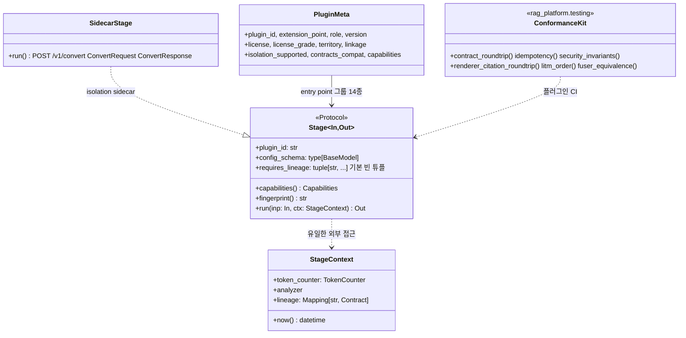

# ADR-0032: 플러그인 SDK: Stage 프로토콜 5멤버와 적합성 키트

브리프 §4 확정 결정 D-10(Python entry points 기반 플러그인 시스템, 확장 지점 14종)을 `confirmed`로 유지하면서, 그 위에 놓이는 플러그인 SDK(Software Development Kit)의 최소 계약 — `Stage[In, Out]` 프로토콜 5멤버, `StageContext`를 통한 순수성 규칙, `PluginMeta.role`에 의한 서브 역할 표현, 지문(fingerprint) 구성요소 강제 검증, 격리 모드, 적합성 키트(conformance kit) `rag_platform.testing` — 를 기록하는 MADR(Markdown Architectural Decision Record) 문서다. 결정 문구의 정본은 브리프 §4 D-10과 설계 바이블 §3.1 D-10 행·§4.1 공통 규약·§5.6 `PluginMeta`·§12 패키지 맵이며, 이 문서는 그것을 바꾸지 않고 근거와 기각 대안을 설명한다(바이블 §1.1). 바이블 §3.3의 ADR 번호·slug(`0032`, `plugin-sdk-stage-protocol-and-conformance-kit`)를 따른다.

## 맥락과 문제

- 브리프 R4는 "모든 기술을 사용하도록"을 **모두 플러그인으로 수용 가능한 확장 지점**으로 해석했고(브리프 §2), D-10은 확장 지점 14종을 entry points 레지스트리로 확정했다. 그러나 D-10은 플러그인이 **무엇을 구현해야 하는지**(인터페이스), **무엇을 하면 안 되는지**(순수성), **어떻게 검증되는지**(적합성), **재현성 지문에 무엇이 들어가는지**를 정하지 않았다. 세 설계 제안은 이 공백을 각각 다르게 채웠고, 심사는 "커널·SDK는 C"를 채택했다(바이블 목적 절).
- 선정 매트릭스는 14개 확장 지점을 약 40개 역할(role)로 세분한다(`format_detector`, `korean_tokenizer`, `sentence_splitter`, `pii_detector`, `context_renderer` 등; 매트릭스 "역할과 D-10 확장 지점 매핑"). 제안 C §12.1은 이를 수용하기 위해 entry point 그룹에 횡단 `renderer`·`authz_policy`·`pii_detector`·`korean_analyzer`를 **추가**하자고 했다. 확장 지점 수를 늘리면 브리프 D-10을 ADR로 뒤집어야 하고, 역할 목록은 연구가 진행될수록 계속 늘어난다.
- 스테이지는 Temporal 액티비티 래퍼와 `LocalRunner` 두 셸에서 같은 코드로 실행된다(ADR-0003, 바이블 §11.1). 스테이지가 시각·난수·파일·네트워크를 직접 만지면 두 셸의 산출물이 달라지고, 멱등성 키 = 캐시 키 = 산출물 경로 규칙(K5)이 무너진다. 기술 지형 03 문서도 파서 어댑터는 "파일 시스템·네트워크 상태를 갖지 않는다"고 요구했다.
- 캐시 키 규칙은 지문이 정확할 때만 안전하다. 사이드카 이미지가 바뀌었는데 `fingerprint()`에 image digest가 없으면 낡은 `ParsedDocument`가 재사용되고, 사용자 사전이 갱신됐는데 `dictionary_hash`가 없으면 낡은 `NormalizedDocument`가 재사용된다(바이블 §15 리스크 #8 "캐시 키 = 멱등성 키 규칙의 함정"). 제안 C 리스크 5도 같은 함정을 지목했다.
- 기존 RAG 플랫폼 조사(11 문서)는 플러그인 계약이 검증되지 않을 때의 실패 사례를 보여준다: 파서가 오류 없이 내용을 변형(Dify v1.17.1 CSV 선행 0 손실), 보강 텍스트가 RRF 중복 제거를 깨뜨림(Open WebUI `CHUNK_HASH_KEY`), 재색인 중 임베딩 설정 유실(Onyx v4.8.0-beta.0). Cognita·Verba 사례는 "컴포넌트 계약은 살아남고 앱은 죽는다"는 교훈을 남겼다. 한편 라이선스 등급표(ADR-0001)는 플러그인 메타데이터에 `license`·`license_grade`·`territory`를 요구하고, 격리 사다리(매트릭스 공통 요구 1, ADR-0033)는 A 등급 순수 Python만 인프로세스에 두도록 요구한다. 이 둘은 플러그인 **선언**(메타데이터)과 **로딩 시점 검증**이 SDK에 있어야 성립한다.

따라서 결정할 질문은 다섯이다. (1) 플러그인이 구현하는 최소 인터페이스는 무엇인가, (2) 서브 역할을 확장 지점 추가 없이 어떻게 표현하는가, (3) 스테이지의 순수성을 어떻게 보장하는가, (4) 지문에 무엇이 반드시 들어가고 누가 검증하는가, (5) 등록된 플러그인이 계약을 지키는지 무엇으로 증명하는가.

## 결정 동인(decision drivers)

| # | 동인 | 출처 | 함의 |
|---|------|------|------|
| DR-1 | Pluggable Everywhere — 모든 스테이지는 플러그인 교체 가능, 그러나 D-10의 확장 지점 수는 확정값 | 브리프 §3 원칙 5, §4 D-10(`confirmed`) | 서브 역할은 확장 지점이 아닌 다른 축으로 표현해야 한다 |
| DR-2 | Pure Stages, Durable Orchestration — 상태·재시도·시간은 오케스트레이터 책임 | 브리프 §3 원칙 3, 바이블 §2.1 K5, ADR-0003 | 스테이지는 I/O·시간·난수를 직접 쓰지 않고 `StageContext`만 사용한다 |
| DR-3 | Idempotent & Content-Addressed — 멱등성 키 = 캐시 키 = 산출물 경로 = `stage_key`, 그 구성요소가 `fingerprint` | 브리프 §3 원칙 4, 바이블 §4.1, §6.2, §15 #8 | 지문 구성요소 누락은 조용한 품질 회귀이므로 SDK가 강제 검증한다 |
| DR-4 | Contracts First — 스테이지 입출력은 계약 타입, 플러그인은 `contracts_compat` 범위 선언 | 브리프 §3 원칙 1, 바이블 §5.1, §6.4 | 인터페이스는 계약 타입을 제네릭 인자로 받는 `Stage[In, Out]`이다 |
| DR-5 | 라이선스 등급 A/B/C/D/X와 격리 사다리 — 인프로세스는 A 등급 순수 Python만 | D-02, ADR-0001, 바이블 §4.1 격리 모드, §12, 매트릭스 공통 요구 1 | `PluginMeta{license_grade, linkage, isolation_supported}`가 로딩 시점에 검증된다 |
| DR-6 | Adapters over Forks — 벤더 프레임워크 타입을 우리 인터페이스로 삼지 않는다 | 브리프 §3 원칙 2, 11 문서(LlamaIndex 0.x API 변경·LangChain `Document` 2필드·`langchain_classic` 2026-12 EOL) | SDK 인터페이스는 자체 소유, 프레임워크는 어댑터 뒤에 둔다 |
| DR-7 | 재현성 — 동일 `IngestRequest` + 동일 프로파일 → 동일 `IndexCommit` 해시; 두 셸의 산출물 동일 | 브리프 §7, 바이블 §11.1 | 결정성은 코드 리뷰가 아니라 적합성 테스트로 증명한다 |
| DR-8 | 보안 불변식은 어댑터 단위 계약 테스트로 검증 | 바이블 §10.3 E5·E7·E17, 매트릭스 공통 요구 7 | `security_invariants`·`idempotency` 키트가 `index_backend`·스테이지 CI에 있어야 한다 |
| DR-9 | 개발 5분 기동·파일 1개 플러그인 — 진입 장벽 최소화 | 바이블 §11.6, 제안 C §12.1 "최소 구현" | 필수 멤버는 5개로 고정하고 나머지는 셸·SDK가 제공한다 |
| DR-10 | 빠른 릴리스 의존성 파손 대응 — 계약 스냅샷·conformance CI | 바이블 §15 #9, 매트릭스 리스크 #7 | 적합성 키트는 코어와 외부 플러그인이 같은 것을 실행한다 |

## 고려한 대안

| # | 대안 | 판정 | 근거 요약 |
|---|------|------|-----------|
| A | 확장 지점 수 확대(횡단 그룹 `renderer`·`authz_policy`·`pii_detector`·`korean_analyzer` 추가) | 기각 | D-10 `confirmed`; 역할은 약 40개로 열려 있어 그룹 폭증; 프로파일 키는 스테이지 단위 |
| B | 스테이지 내 직접 I/O·시간·난수 접근 허용 | 기각 | 두 셸 산출물 불일치, Temporal 샌드박스 결정론 위반, 캐시 키 무효 |
| C | 적합성 테스트 없는 등록(entry point만 있으면 로드) | 기각 | 11 문서 실패 사례(조용한 내용 변형·중복 제거 파손·설정 유실), 보안 불변식 미검증 |
| D | 지문 자유 구성(플러그인 작성자가 `fingerprint()` 내용을 임의 결정) | 기각 | 리스크 #8; image digest·`dictionary_hash`·`embedding_space_id`·`analyzer_id` 누락 시 낡은 산출물 재사용 |
| E | 프레임워크 컴포넌트 계약(LlamaIndex·LangChain·Haystack) 또는 ABC 상속 계층을 SDK 인터페이스로 채택 | 기각(allowlist 아이디어만 참조) | 벤더 타입 종속·점수 분해 없음·0.x API 변경; 원칙 2 위배 |
| F | `Stage[In, Out]` 프로토콜 5멤버 + `StageContext` + `PluginMeta.role` + 지문 강제 검증 + 적합성 키트 | **채택** | 제안 C 커널·SDK 골격을 바이블 §4.1·§5.6·§12로 확정 |

### 대안 A: 확장 지점 수 확대(기각)

- 설명: 제안 C §12.1의 원안. entry point 그룹을 D-10 14종에 횡단 `renderer`, `authz_policy`, `pii_detector`, `korean_analyzer`를 더해 18종으로 늘리고, 매트릭스의 세분 역할이 필요할 때마다 그룹을 추가한다.
- 장점: 역할별 검색(discovery)이 entry point 그룹 이름만으로 가능하고, 역할별 인터페이스를 그룹 단위로 고정할 수 있다.
- 단점: 브리프 §4는 "변경하려면 ADR로 뒤집어야 한다"고 못 박았고 D-10은 `confirmed`다. 매트릭스가 세분한 역할은 `format_detector`부터 `visual_page_retriever`까지 약 40개이며 연구마다 늘어나므로, 그룹으로 올리면 확장 지점 수가 열린 집합이 된다. 프로파일 YAML(바이블 §5.6 `Profile.ingest`, §7.3)은 `{fetch, parse, normalize, chunk, …}` 스테이지 단위로 `plugin` 값을 받으므로 역할 그룹은 프로파일 스키마와도 어긋난다. `authz_policy`는 스테이지가 아니라 플랫폼 인프라(`security/authz_cedar`, 바이블 §12)여서 플러그인 확장 지점 자체가 아니다(매트릭스 "(횡단) 확장 지점이 아닌 플랫폼 인프라").
- 판정: 기각. 매트릭스 판정대로 "플러그인 레지스트리(entry point) 그룹은 D-10 이름을 그대로 쓰고, 역할은 그 안의 구현체 슬롯 이름"이 된다. 바이블 §3.1 D-10 행은 이를 `PluginMeta.role`로 확정했다.

### 대안 B: 스테이지 내 직접 I/O·시간·난수 접근 허용(기각)

- 설명: 스테이지가 `datetime.now()`, `random`, 파일·HTTP 호출, 형태소 분석기 인스턴스 생성, 토크나이저 로딩을 스스로 수행한다. 어댑터 작성이 가장 자유롭다.
- 장점: 래핑 라이브러리 관용구를 그대로 쓸 수 있고 SDK가 제공해야 할 컨텍스트 표면이 작다.
- 단점: 같은 입력에 대해 `LocalRunner`와 Temporal 셸의 출력이 달라져 브리프 §7 재현성과 K5(멱등성 키 = 캐시 키)가 깨진다. 스테이지가 직접 로드한 분석기·토크나이저 버전은 `fingerprint()` 밖에 있으므로 리스크 #8이 그대로 발생한다. 03 문서의 어댑터 계약은 "파일 시스템·네트워크 상태를 갖지 않는다. LibreOffice·Tika 호출은 의존성 주입으로 받고, 재시도·타임아웃은 Temporal 액티비티가 책임진다"고 요구했고, 11 문서의 "잘못된 이미지 링크로 인덱싱 큐 정지"(Dify v1.17.1)는 스테이지 내부 I/O가 격리되지 않았을 때의 실패다.
- 판정: 기각. 스테이지는 `ctx.token_counter`, `ctx.analyzer`, `ctx.now()`, `ctx.lineage[...]`만 쓴다(바이블 §4.1). 외부 서빙(vLLM·TEI·사이드카) 호출은 SDK가 제공하는 `SidecarStage`·어댑터 클라이언트를 통해 셸 정책(`StagePolicy`) 아래에서만 일어난다.

### 대안 C: 적합성 테스트 없는 등록(기각)

- 설명: `pyproject.toml`의 entry point와 `PluginMeta`만 있으면 레지스트리가 로드한다. 계약 준수는 플러그인 작성자의 자체 테스트에 맡긴다.
- 장점: 플러그인 배포 절차가 가장 짧고, 코어가 테스트 코퍼스·키트를 유지할 부담이 없다.
- 단점: 11 문서가 수집한 실패 모드는 모두 "계약 위반이 오류 없이 통과한" 사례다 — 파서가 내용을 변형해도 스키마는 유효하고, 보강 텍스트가 원문 해시를 오염시켜도 타입은 맞으며, 재색인이 임베딩 설정을 잃어도 잡은 성공한다. 보안 불변식(바이블 §10.3 E5 "보안 필드 누락 레코드 배치 전체 거부", E7 "백엔드 요청에 `tenant_id` 필터 존재", E17 "두 테넌트가 동일 바이트를 수집해도 서로 덮어쓰지 않는다")은 어댑터 단위 계약 테스트 없이는 검증할 방법이 없다(매트릭스 공통 요구 7). 인용 좌표 불일치(리스크 #7)와 LITM 순서(§9.2 테스트 벡터)도 같은 부류다.
- 판정: 기각. 적합성 키트 `rag_platform.testing`을 코어가 제공하고, 코어 어댑터와 외부 플러그인 CI가 같은 키트를 실행한다(바이블 §11.6 CI 항목 "적합성 키트", §12 `testing/`).

### 대안 D: 지문 자유 구성(기각)

- 설명: `fingerprint() -> str`의 내용을 플러그인 작성자가 결정한다. SDK는 문자열이 반환되는지만 본다.
- 장점: 구현이 단순하고 확장 지점별 규칙 표를 SDK가 유지하지 않는다.
- 단점: 바이블 §15 #8이 열거한 함정 그대로다 — 사이드카 image digest가 빠지면 Java 사이드카·OCR 이미지 갱신 뒤에도 낡은 `ParsedDocument`가 재사용되고, `dictionary_hash`·`analyzer_id`가 빠지면 사용자 사전 갱신이 `NormalizedDocument` 캐시에 반영되지 않으며, `embedding_space_id`가 빠지면 서빙 스택 교체가 임베딩 캐시에 반영되지 않는다. 매트릭스 공통 요구 2는 모델을 "`model_id` + HF revision + 서빙 이미지 digest"로 식별하고 같은 공간 내 서빙 교체에 코사인 ≥ 0.9999 게이트를 요구하는데, 지문이 이를 포함하지 않으면 게이트가 무의미해진다.
- 판정: 기각. 지문은 §6.2의 단일 식 `H("producer", plugin_id, plugin_version, config_hash, image_digest or "", ",".join(model_ids))`로 SDK `hash_of(H)`가 구성하고, 확장 지점별 필수 구성요소(사이드카 image digest, `dictionary_hash`, `embedding_space_id`, `analyzer_id`)의 포함을 SDK가 검증한다(바이블 §4.1 지문 행).

### 대안 E: 프레임워크 컴포넌트 계약 또는 ABC 상속 계층 채택(기각)

- 설명: LlamaIndex `NodeWithScore`/`BaseRetriever`, LangChain `Document`/`BaseRetriever`, Haystack `@component` 중 하나를 플러그인 인터페이스로 삼거나, 확장 지점별 추상 기반 클래스(Abstract Base Class, ABC) 계층을 SDK가 상속 강제한다.
- 장점: 기존 생태계 컴포넌트를 변환 없이 등록할 수 있고, ABC는 런타임에 미구현 멤버를 즉시 잡아낸다.
- 단점: 11 문서 기준으로 LlamaIndex는 0.x 정책상 마이너 릴리스 간 API 변경이 잦고 벤더 투자가 상용 LlamaParse로 이동했으며 `NodeWithScore`는 단일 스칼라 점수라 점수 원장(K3)을 표현할 수 없다. LangChain `Document(page_content, metadata)`는 provenance·점수 분해가 `metadata` dict에 비공식으로 들어가고 `langchain_classic`은 2026-12 보안 패치 종료다. Haystack `Document(content, meta, score, embedding)`도 점수 분해가 없다. 프레임워크 타입을 인터페이스로 삼는 것은 원칙 2(Adapters over Forks)와 D-04(표준 문서 모델 자체 소유)에 어긋난다. ABC 상속은 프레임워크 타입 종속 문제는 없으나 플러그인이 코어 클래스를 상속해야 하므로 "파일 1개·계약 타입만 임포트"(DR-9)를 어렵게 하고, 두 확장 지점을 한 클래스가 구현하는 어댑터(예: `index_backend`의 `retriever` 역할)에서 다중 상속 충돌이 생긴다.
- 판정: 기각. 인터페이스는 구조적 타이핑의 `Stage[In, Out]` 프로토콜(`typing.Protocol`)이며 mypy strict가 정적으로 검사한다(D-01). 단, Haystack 3의 "역직렬화 신뢰 모듈 allowlist"(11 문서)는 프로파일 `plugin` 값을 등록된 entry point로만 제한하는 규칙(바이블 §7.4 (1))으로 흡수했다. 프레임워크 컴포넌트는 `adapters/` 아래 어댑터로 감싸 등록한다.

### 대안 F: `Stage[In, Out]` 5멤버 + `StageContext` + `PluginMeta.role` + 지문 강제 검증 + 적합성 키트(채택)

- 설명: 플러그인은 계약 타입을 제네릭 인자로 받는 `Stage[In, Out]` 프로토콜의 5멤버만 구현한다. 셸(액티비티 래퍼·`LocalRunner`)이 `ArtifactRef` 로드·저장·계보·`StageContext` 주입을 맡으므로 스테이지 코드는 저장소·오케스트레이터·시각을 모른다. 서브 역할은 `PluginMeta.role` 문자열로 선언하고 entry point 그룹은 14종을 유지한다. 지문은 SDK `hash_of(H)`가 구성하고 필수 구성요소를 검증한다. 격리는 `PluginMeta.isolation_supported`와 프로파일 `StagePolicy.isolation`의 교차로 결정되며 `sidecar`는 SDK `SidecarStage` 래퍼가 `POST /v1/convert`로 감싼다. 적합성 키트는 코어 `testing/` 패키지에 있고 플러그인 CI가 실행한다.
- 장점: 파일 1개로 플러그인을 작성할 수 있다(제안 C §12.1 예시). 순수성이 구조적으로 보장되어 Temporal 결정론과 두 셸 동등성이 자동으로 성립한다. 확장 지점 수가 닫혀 있어 `ExtensionPoint` 열거·프로파일 스키마·CI 대조가 안정된다. 라이선스·격리·능력 검증이 모두 메타데이터 한 곳(`PluginMeta`)에서 로딩 시점에 끝난다.
- 단점: 프로토콜은 런타임 강제가 약하므로 레지스트리 로딩 검사와 mypy에 의존한다. 적합성 키트는 코퍼스(리스크 #1)와 유지 비용이 든다. 확장 지점별 지문 필수 구성요소 표를 SDK가 유지해야 한다.
- 판정: 채택. 바이블 §2.1 K5("`Stage[In, Out]` 프로토콜 5멤버 + `PipelineContext` + `ArtifactRef` 단일 페이로드", 출처 C)와 §4.1·§5.6·§12에 확정된 내용과 일치한다.

## 결정

**결정:** **플러그인 시스템**: Python entry points 기반 레지스트리. 확장 지점 = `fetcher`, `parser`, `normalizer`, `chunker`, `enricher`, `embedder`, `index_backend`, `query_transformer`, `retriever`, `fuser`, `reranker`, `postprocessor`, `packer`, `evaluator`(브리프 §4 D-10, `confirmed`). entry points 14 확장 지점 유지; 서브 역할은 `PluginMeta.role`로 표현(예: `normalizer` 그룹의 `korean_analyzer`/`sentence_splitter`/`pii_detector`, `packer` 그룹의 `renderer`/`token_counter`) — 매트릭스 역할 매핑과 일치; 확장 지점 수는 늘리지 않는다(바이블 §3.1 D-10).

바이블 §4.1 스테이지 시그니처 정본 문구: `Stage[In, Out]` 프로토콜 5멤버: `plugin_id: str`, `config_schema: type[BaseModel]`, `capabilities() -> Capabilities`(§5.3), `fingerprint() -> str`, `async run(inp: In, ctx: StageContext) -> Out`. 선택 클래스 속성 `requires_lineage: tuple[str, ...] = ()`(셸이 함께 로드할 상류 `schema_type`; `index`만 사용). 스테이지는 I/O·시간·난수를 직접 쓰지 않는다(`ctx.token_counter`, `ctx.analyzer`, `ctx.now()`, `ctx.lineage[...]`만).

바이블 §4.1 지문 정본 문구: `fingerprint = H("producer", plugin_id, plugin_version, config_hash, image_digest, model_ids)`(§6.2). SDK가 사이드카 image digest·`dictionary_hash`·`embedding_space_id`·`analyzer_id` 포함을 검증.

결정에 딸린 정본 세부(모두 바이블 인용, 이 문서가 새로 정하지 않는다):

| 항목 | 정본 | 출처 |
|------|------|------|
| entry point 그룹 | `rag_platform.{extension_point}`; `extension_point`는 `enum(ExtensionPoint)` 14값 | §6.7, §5.7 |
| `plugin_id` | `{extension_point}.{implementation}`(둘 다 snake_case). 예 `parser.hwpx_python_hwpx`, `embedder.vllm_pooling_bge_m3`, `index_backend.qdrant`, `fuser.rrf`; `Producer.plugin_id`와 동일 문자열 | §6.1, §5.3 `Producer` |
| `PluginMeta` | 생산 `pyproject.toml` `[tool.rag_platform.plugin]` → 소비 레지스트리·라이선스 게이트·프로파일 검증. 필드 `plugin_id`(Y), `extension_point`(Y), `role`(N, `string \| null`; `korean_analyzer`, `sentence_splitter`, `pii_detector`, `format_detector`, `token_counter`, `renderer` …), `version`(Y, `Producer.plugin_version`), `license`·`license_grade`·`territory`(Y), `linkage`(Y, `enum(Linkage)` = `pure_python, dynamic, static_bundled`), `isolation_supported`(Y, `array<enum(IsolationMode)>`), `model_ids`·`model_license_ack_required`(N), `sidecar_image`(N), `contracts_compat`(Y, `">=1.0,<2.0"`), `capabilities`(Y) | §5.6, §5.7 |
| `Capabilities` | 모든 `Stage` 공통 `isolation_modes`, `supports_resumable`, `contracts_compat`(Y); `input_formats`, `model_ids`, `requires_gpu`, `extra`(N). `index_backend`는 `extra = IndexBackendCapabilities{supports_server_bm25, korean_analyzer, supports_server_fusion, tenant_isolation, supports_alias_swap, supports_multivector, max_vector_dim, max_multivector_elements, supports_payload_only_points}` | §5.3, §5.1 `capabilities.schema.json` |
| 역할과 그룹의 대응 | `detect`는 `parser`(role `format_detector`); `normalize`는 `normalizer`(roles `korean_analyzer`, `sentence_splitter`, `pii_detector`); `recount`는 `chunker`(role `token_counter`); `render`는 `packer`(role `renderer`) | §4.2, §4.3 |
| 격리 모드 | `in_process`(A 등급 순수 Python) / `helper_process`(`multiprocessing spawn`, ctypes·네이티브 크래시 위험) / `sidecar`(JVM·LibreOffice·CUDA·GPL/AGPL; REST `POST /v1/convert`). 프로파일 `StagePolicy.isolation`이 강제, SDK `SidecarStage`가 `ConvertRequest`/`ConvertResponse`로 감싼다 | §4.1, §5.3 `StagePolicy`, §5.6, ADR-0033 |
| `StageContext` 제공물 | `ctx.token_counter`(`TokenCounter{tokenizer_id}` 단일 인터페이스, O-09), `ctx.analyzer`(Kiwi 또는 공백기 mecab-ko, O-05·ADR-0021), `ctx.now()`, `ctx.lineage[schema_type]`(`requires_lineage` 선언분을 셸이 `lineage_refs`에서 로드; `index`: `EnrichedChunkSet`·`ChunkSet`·`SourceDocument`) | §4.1, §5.2, §3.2 |
| 지문 구성요소 | 단일 식 `H("producer", plugin_id, plugin_version, config_hash, image_digest or "", ",".join(model_ids))`; 스테이지별 포함 항목 — `parse`: `parser_fingerprint`(사이드카 image digest·`model_ids`), `normalize`: `analyzer_id`·`dictionary_hash`·`pii_policy`, `chunk`: `chunker_config_hash`·`primary_tokenizer_id`, `embed`: `embedding_profile_hash`(= `embedding_space_id` 합성) | §4.2, §6.2 |
| 적합성 키트 | `rag_platform.testing`: `contract_roundtrip`, `idempotency`(E17: 두 테넌트·두 컬렉션이 동일 바이트를 수집해도 서로 덮어쓰지 않음; 동일 `chunk_id` 재색인에서 이전 세대가 플립 전까지 검색됨), `security_invariants`, `renderer_citation_roundtrip`(리스크 #7), `litm_order(K=1..5)`(§9.2 표 고정), `fuser_equivalence`(ranx 일치, §8.1 8단계) | §12 `testing/`, §10.3 E17, §9.2, §15 #7·#8 |
| 배포·저장소 | 코어 `rag-platform`(import `rag_platform`); 플러그인 `rag-plugin-{name}`(import `rag_plugin_{name}`); 본 저장소 `plugins/`는 A/B 등급만(`rag-plugin-lightrag`, `rag-plugin-hipporag`, `rag-plugin-colqwen-visual`, `rag-plugin-kure-late-interaction`); GPL/AGPL 플러그인·이미지는 별도 저장소 `rag-platform-gpl-sidecars` | §6.7, §12 |
| 의존 방향 | `contracts ← sdk ← plugins \| adapters \| pipelines \| retrieval \| render ← …`; `adapters`는 `storage`를 모른다(`ArtifactRef` 로드는 셸) | §12 |
| 로딩 시점 검증 | `rag profile validate` (1) 모든 `plugin` 값은 등록된 entry point이고 `license_grade ≤ license_policy.max_grade`, `territory` 대조, `license_grade=B`이고 `linkage=static_bundled`이면 거부; (2) 요구 능력 ↔ `capabilities()` 대조(멀티벡터 미지원 → `late_interaction` 자동 비활성 + `degraded`; `korean_analyzer=false` 백엔드 단독이면 플랫폼 측 `korean_analyzer` 필수) | §7.4 |

## 결과

### 긍정

- 플러그인은 계약 타입과 `rag_platform.sdk`만 임포트하는 파일 1개로 작성되고, 저장소·오케스트레이터·시각을 모르므로 `LocalRunner`와 Temporal 셸에서 동일한 산출물을 낸다(브리프 §7 재현성, ADR-0003).
- 확장 지점 수가 14로 닫혀 `ExtensionPoint` 열거·프로파일 스키마·entry point 그룹·CI 대조(바이블 §1.2)가 안정되고, 매트릭스의 세분 역할은 확장 지점 추가 없이 `PluginMeta.role` 문자열로 수용된다.
- 지문 구성요소 검증으로 리스크 #8(낡은 산출물 재사용)이 SDK 수준에서 차단되고, `stage_key`의 `scope_key` 합성(ADR-0037)과 결합해 교차 스코프 오염도 막는다. 라이선스 등급·`territory`·`linkage`·격리 모드·능력 대조가 `PluginMeta` 하나에서 로딩 시점에 끝나므로, C/D/X 등급 또는 LGPL 정적 링크 wheel이 기본 프로파일에 들어오는 일도 기계적으로 차단된다(ADR-0001, 리스크 #2).
- 적합성 키트가 코어 어댑터와 외부 플러그인에 같은 기준을 적용하므로, 11 문서가 수집한 "오류 없는 계약 위반"이 CI에서 드러난다. `security_invariants`·`idempotency`는 강제 지점 E5·E7·E17의 검증 수단이다.

### 부정

- `typing.Protocol`은 런타임 상속 검사가 없어 미구현 멤버는 mypy strict와 레지스트리 로딩 검사에서만 잡힌다. 레지스트리 로딩 시 5멤버 존재 검사와 실패 코드 매핑은 바이블에 명시되어 있지 않아 아래 준수 확인 1에서 제안으로 남긴다.
- `PluginMeta.role`은 `string | null`이라 열거 CI 대조 대상이 아니다. 역할 이름의 오타(`korean_analyser` 등)는 열거 게이트가 아니라 프로파일 검증·코드 리뷰로만 잡힌다.
- 확장 지점별 지문 필수 구성요소 표(§4.2·§6.2)는 SDK 코드가 유지해야 하며, 새 격리 모드·새 해시 구성요소(예: LLM 보강의 `prompt_hash`)가 생기면 바이블 §4.1과 함께 갱신해야 한다.
- 적합성 키트는 계약 코퍼스(HWPX·PDF·HTML 등)와 골든 시나리오를 요구한다. 리스크 #1(한국어 골든셋 부재)이 해소되기 전까지 `contract_roundtrip`은 소형 코퍼스로만 실행된다. 또한 사이드카 플러그인의 `image_digest`는 런타임에 셸이 해석해 `Producer.image_digest`에 기록하므로, 이미지 참조(`sidecar_image`)만 있고 digest를 얻지 못하는 환경(에어갭 레지스트리)에서는 지문 검증이 실패하는 운영 절차가 필요하다.

### 중립

- `Capabilities.extra`는 `index_backend`의 `IndexBackendCapabilities`만 정본이다. 제안 C가 열거한 `EmbedderCapabilities`·`ParserCapabilities`·`RerankerCapabilities`는 바이블에 없으므로 03-contracts/16이 선택 필드(N)로 제안할 수 있으나 이 ADR은 확정하지 않는다.
- `ctx.analyzer`의 실제 엔진(Kiwi 또는 mecab-ko)은 프로파일과 ADR-0021이 정하며 스테이지는 `analyzer_id`만 지문에 포함한다. 엔진 승격은 플러그인 코드 변경 없이 `analyzer_id` 변경 → 렉시컬 재색인으로 흡수된다. `SidecarStage`는 컨테이너 안의 같은 `Stage`를 `rag serve sidecar`로 노출하는 대칭 구조다(제안 C §12.1, 바이블 §12 `cli/serve`). 사이드카 계약 세부는 ADR-0033이 소유한다.

## 준수 확인 방법

| # | 규칙 | 강제 수단 | 게이트·위치 |
|---|------|-----------|-------------|
| 1 | `Stage[In, Out]` 5멤버 구현 | mypy strict 구조적 타입 검사(D-01); 레지스트리(`plugins/registry`)가 entry point 로드 시 5멤버 존재·`config_schema`가 `BaseModel` 서브클래스인지 검사 | CI 타입 검사; 로딩 실패 코드는 제안(바이블 미명시): `profile.invalid`로 프로파일 검증 실패 처리 |
| 2 | 스테이지 순수성 — I/O·시간·난수는 `ctx.*`만 | 적합성 키트 `idempotency`(같은 입력·같은 `ctx` 고정값으로 2회 실행 → 산출물 `blake3` 동일); 코드 리뷰 체크리스트 (c) | 적합성 키트 CI + 코드 리뷰; ruff 금지 API 규칙(`datetime.now`, `random`, `time.time`, `open`, `httpx`/`requests` 직접 임포트)은 제안(바이블 미명시) |
| 3 | 확장 지점 14종 고정, 그룹 이름 `rag_platform.{extension_point}` | `schemas/common-types.schema.json` `$defs/ExtensionPoint`(`plugin-meta.schema.json`이 `$ref`로 참조) ↔ 바이블 §5.7 기계 대조(§1.2); 레지스트리가 열거에 없는 entry point 그룹을 무시하고 경고하는 동작은 제안(바이블 미명시) | 열거 대조 CI(불일치 = 빌드 실패); 새 그룹 = D-10 개정 ADR 필요 |
| 4 | `plugin_id = {extension_point}.{implementation}`, 접두가 `extension_point`와 일치 | `PluginMeta` 스키마 검증 + 레지스트리 접두 대조; `Producer.plugin_id`와 동일 문자열 | 계약 스냅샷 테스트; 위반은 `contract.violation` |
| 5 | `PluginMeta` 필수 필드와 라이선스 게이트 | `license`·`license_grade`·`territory`·`linkage`·`isolation_supported`·`contracts_compat`·`capabilities` 필수(§5.6); `rag profile validate` (1); `rag plugin list --check-license`; pip-licenses + liccheck + SBOM + `models.lock` | CI 라이선스 게이트(ADR-0001); 위반 `plugin.license_denied`; `license_grade=B` + `linkage=static_bundled` 거부 |
| 6 | 능력 선언 ↔ 프로파일 요구 | `rag profile validate` (2) `capabilities()` 대조; `IndexBackendCapabilities` 필수 필드; 미지원 조합은 로딩 거부 또는 채널 자동 비활성 + `degraded{…, capability_unsupported}` | 프로파일 검증 CI; 위반 `plugin.capability_unsupported` |
| 7 | 지문 구성요소 | SDK `hash_of(H)`만으로 `fingerprint` 구성; 확장 지점·격리 모드별 필수 구성요소(사이드카 → `image_digest`, `normalizer` → `analyzer_id`·`dictionary_hash`, `embedder` → `embedding_space_id`/`embedding_profile_hash`, `chunker` → `chunker_config_hash`·`primary_tokenizer_id`) 누락 시 로딩 거부; 적합성 키트 `idempotency`가 구성요소 하나를 바꾸면 `fingerprint`·`stage_key`가 바뀜을 확인 | SDK 단위 테스트 + 적합성 키트; 리스크 #8 완화 항목 |
| 8 | 격리 모드 | `StagePolicy.isolation ∈ PluginMeta.isolation_supported`(프로파일 검증); `in_process`는 A 등급만(§12); `sidecar`는 `SidecarStage` 경유 `POST /v1/convert`만, 사이드카 주소는 서비스 디스커버리만(E16) | 프로파일 검증 CI + ADR-0033 계약 테스트; 코드 리뷰 (d) |
| 9 | 적합성 키트 실행 | `contract_roundtrip`(모든 스테이지, 계약 코퍼스), `idempotency`(모든 스테이지 + E17 시나리오), `security_invariants`(`index_backend`·`retriever`: `tenant_id` 필터 존재, 보안 필드 누락 배치 거부), `renderer_citation_roundtrip`(`packer` role `renderer`), `litm_order`(`packer`), `fuser_equivalence`(`fuser`, ranx 일치) | 코어 `tests/adapters`·`tests/security`와 `plugins/*` CI 필수 게이트(§11.6) |
| 10 | 의존 방향 | import-linter `contracts ← sdk ← plugins \| adapters \| pipelines \| retrieval \| render ← orchestration \| ledger \| storage \| security \| profiles \| eval ← api \| mcp \| cli`, 역방향 금지(§12); `adapters`는 `storage`를 모른다(`ArtifactRef` 로드는 셸); `pipelines`·`retrieval`·`render`는 `temporalio`·`fastapi`·`ledger`를 모른다 | CI 린트(D-01), 위반 = 빌드 실패 |
| 11 | 배포 명명·저장소 경계 | 패키지 `rag-plugin-{name}`/import `rag_plugin_{name}`; 본 저장소 `plugins/`는 A/B 등급만; GPL/AGPL은 `rag-platform-gpl-sidecars` | 라이선스 게이트 + 코드 리뷰 (e); ADR-0036 명명 |
| 12 | 계약 호환 범위 | `contracts_compat`(예 `">=1.0,<2.0"`)가 로드되는 계약 `schema_version`을 포함하는지 레지스트리가 검사 | 계약 스냅샷 테스트; 위반 `contract.violation` |

코드 리뷰 체크리스트(요약): (a) 플러그인 모듈이 `rag_platform.contracts`·`rag_platform.sdk` 외의 코어 패키지를 임포트하지 않는가, (b) `plugin_id` 접두·`PluginMeta.extension_point`·entry point 그룹 셋이 일치하고 `role`이 §5.6 예시 철자를 따르는가, (c) `run()` 안에 `datetime.now`·`random`·파일/네트워크 I/O·재시도 루프·전역 캐시가 없고 토크나이저·분석기는 `ctx`에서 받는가, (d) 사이드카·외부 서빙 호출이 `SidecarStage`·어댑터 클라이언트를 거치고 `StagePolicy` 밖의 타임아웃을 갖지 않는가, (e) 새 플러그인 디렉터리가 `plugins/`에 추가될 때 `license_grade`가 A 또는 B이고 적합성 키트 호출이 CI 설정에 있는가.

## 재검토 조건

- 매트릭스의 세분 역할 중 어떤 것이 기존 14 확장 지점의 스테이지 경계 안에서 표현되지 않아(입출력 계약이 다름) 별도 확장 지점이 필요해질 때 — 이 경우 D-10 개정 ADR을 발의하고 `ExtensionPoint` 열거는 major 변경 절차(바이블 §1.2)를 따른다.
- `token_counter` 역할의 그룹 표기가 바이블 §3.1 D-10 행(`packer` 그룹 예시)과 §4.2 `recount` 행(`chunker` role `token_counter`)에서 다르다. 소유자(architecture)가 patch로 정합화할 때 이 문서의 "역할과 그룹의 대응" 행을 함께 갱신한다.
- 계약 `schema_version` major 승격(2.0.0) 시 `contracts_compat` 의미와 레지스트리의 다중 major 공존 규칙을 재검토한다.
- 적합성 키트가 잡지 못한 계약 위반 부류가 운영·평가에서 확인되면 키트 항목을 추가한다(바이블 §1.2 minor 절차; `testing/` 패키지와 §12 목록 갱신).
- 새 격리 모드 또는 새 지문 구성요소(예: LLM 보강 `prompt_hash`, VLM 파서 모델 revision)가 필요해지면 §4.1 지문 행과 준수 확인 7의 필수 구성요소 표를 갱신한다.
- `PluginMeta.role`의 오타·중복으로 인한 사고가 반복되면 `role`을 열거 타입으로 승격하는 ADR을 검토한다(현재는 `string | null`). Python 패키징 표준(entry points 메타데이터, `importlib.metadata`) 또는 D-01 툴체인(ADR-0035)이 바뀌어 레지스트리 구현에 영향을 줄 때도 재검토한다.

## 참조

- [설계 브리프](../00-vision/00-design-brief.md) — §2 R4, §3 원칙 1·2·3·4·5·7, §4 D-01·D-02·D-04·D-10·D-17, §6(플러그인 SDK 포함), §7 재현성
- [설계 바이블](../02-architecture/00-design-bible.md) — §1.1·§1.2, §2.1 K5·K7, §2.3 `worker`, §3.1 D-10, §3.2 O-05·O-09, §3.3, §4.1~§4.3, §5.1, §5.2 `lineage_refs`, §5.3 `Producer`·`Capabilities`·`IndexBackendCapabilities`·`StagePolicy`, §5.6 `PluginMeta`·`ConvertRequest`/`ConvertResponse`·`Profile`, §5.7 `ExtensionPoint`·`IsolationMode`·`LicenseGrade`·`Linkage`·오류 카탈로그, §6.1 `plugin_id`·`analyzer_id`·`tokenizer_id`, §6.2 `fingerprint`·`stage_key`, §6.4, §6.7, §7.4, §8.1, §9.2, §10.3 E5·E7·E16·E17, §11.1, §11.6, §12, §15 #7·#8·#9, §16
- [기술 지형 종합: 선정 매트릭스와 결정 권고](../07-tech-landscape/00-summary-and-selection-matrix.md) — "역할과 D-10 확장 지점 매핑", 매트릭스 `(횡단)` 행, "어댑터·플러그인 공통 요구" 1~7, "운영·평가 공통 요구" CI 게이트, 종합 리스크 #7
- [기존 RAG 플랫폼 격차 분석](../07-tech-landscape/11-existing-rag-platforms-gap-analysis.md) — Cognita·Verba 종료 사례, LlamaIndex·LangChain·Haystack 3 계약 구조, "어댑터 계약 요구", "실패 모드"; [Office·HTML·텍스트 파싱](../07-tech-landscape/03-document-parsing-office-html-text.md) — "통합 설계 함의 › 어댑터 계약"(순수 함수 시그니처, 상태 금지, 의존성 주입)
- [설계 제안 C: 단순성·확장성 우선](../12-appendix/design-proposals/proposal-C-simplicity-and-extensibility-first.md) — §12.1 플러그인 SDK(원안: 횡단 그룹 추가는 기각, 5멤버·`SidecarStage`·적합성 키트는 채택), 리스크 5
- 관련 ADR(바이블 §3.3 번호·slug): [ADR-0001 라이선스 등급표](./0001-license-grade-table-and-d02-interpretation.md), [ADR-0003 오케스트레이터 중립 파이프라인](./0003-orchestrator-neutral-pipeline-and-non-durable-local-runner.md), [ADR-0021 한국어 분석기](./0021-korean-analyzer-kiwi-promotion-and-interim-mecab-kss.md), [ADR-0024 Context Pack 순서 전략](./0024-context-pack-ordering-and-anthropic-search-result-renderer.md), [ADR-0027 강제 지점 17개](./0027-security-context-injection-and-acl-enforcement-points.md), [ADR-0033 사이드카 convert 계약과 격리 사다리](./0033-sidecar-convert-contract-and-isolation-ladder.md), [ADR-0036 명명 규약](./0036-naming-and-identifier-conventions.md), [ADR-0037 산출물 캐시 스코프](./0037-artifact-cache-scope-and-stage-key-composition.md)
- 이 결정을 전제로 하는 설계 문서(문서 맵): [플러그인 아키텍처](../02-architecture/05-plugin-architecture.md), [컬렉션 프로파일·정책 계약](../03-contracts/15-collection-profile-and-policy-contracts.md), [평가·피드백·사이드카 계약](../03-contracts/16-eval-feedback-and-sidecar-contracts.md), [파이프라인 프레임워크](../04-pipelines/01-pipeline-framework.md), [테스팅 전략](../10-development/04-testing-strategy.md), [플러그인 개발 가이드](../10-development/06-plugin-development-guide.md)
