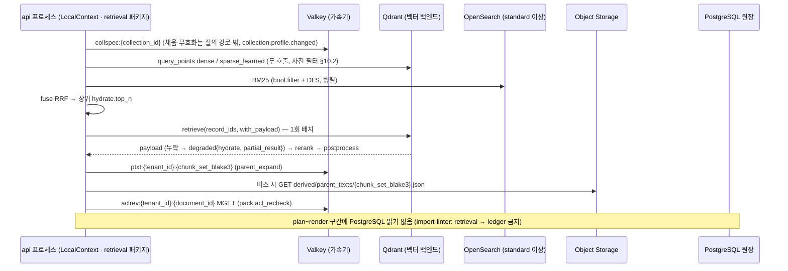

# ADR-0034: 검색 핫패스의 PostgreSQL 미의존, hydrate 서브스텝과 부모 텍스트 저장 정책

> 상태 accepted(2026-09-22) · 우선순위 P2 · 관련 결정 브리프 §7 가용성, K1 · 형식 MADR. 이 ADR은 설계 바이블 §13.1(핫패스 규칙)·§13.2(`ChunkTextStore`)·§4.3(`hydrate` 행)·§5.4(`IndexRecord` payload 정책)에 이미 확정된 결정을 근거·대안과 함께 기록한다. 바이블 표를 바꾸지 않으며(바이블 §1.1) 새 타입·필드·열거값·오류 코드를 만들지 않는다. 본문의 "PostgreSQL"은 바이블 §13.1의 원장(ledger) 역할을 뜻한다.

## 맥락과 문제

브리프 §7은 리트리벌 API 가용성 99.9%와 수집 at-least-once + 멱등을 **서로 다른 목표**로 적었다. 그런데 D-14·D-17에 따라 PostgreSQL은 메타·잡·원장·아웃박스·레지스트리·Temporal 영속화를 모두 맡는 컴포넌트가 되었고, 바이블 §15 리스크 #10은 이를 "PostgreSQL 단일 장애 반경"으로 등재했다. 세 설계 제안은 모두 검색 경로에 PostgreSQL 읽기를 남겨 두었고, 바이블 목적 절은 이를 "치명적 결함"으로 제거했다.

- 제안 B는 부모 텍스트를 PostgreSQL `chunk_texts` 표에 두고 `postprocess`를 "인프로세스 + PostgreSQL 조회, 60ms"로 예산했다(B §3.2, §후처리 `parent_expand`). 제안 C는 융합 뒤 "후보 텍스트 로드(top-100, PostgreSQL/캐시) 40ms"와 `postprocess` "inprocess(+PostgreSQL/S3 부모 텍스트 조회)"를 두었다(C §8.2).
- 제안 A는 "리트리벌 경로는 PG 미의존"을 원칙으로 세웠으나 플래너가 `index_generation_min`을 위해 컬렉션 `current_generation`을 원장에서 읽었다(A §8 7항). 다만 A는 `text` 비정규화 복제와 "프로파일·컬렉션 세대만 캐시" 방향을 제시하고 저장량 대가(100만 청크·1,500자 기준 약 1.5GB×2)를 스스로 계량했다(A §리스크).

동시에 K1 단일 좌표계(ADR-0030)는 인용 좌표·본문·ACL이 `IndexRecord` payload에 자족적으로 있어야 한다고 요구하고, 리랭커(바이블 §8.1 10단계)는 융합 직후 상위 100개의 `context_prefix + "\n" + text`를 입력으로 받는다. 04 문서 §8은 부모 확장이 "인덱스 재조회 없이" 계약 필드만으로 동작해야 하며 프레임워크 `docstore`는 우리 `ChunkSet`/`IndexBackend`와 이중 상태가 된다고 경고했다. 따라서 결정할 문제는 넷이다. (1) 검색 경로가 읽어도 되는 저장소는 무엇인가. (2) 융합 뒤 본문·좌표·ACL을 언제 어떻게 한 번에 채우는가(`hydrate`). (3) 임베딩하지 않는 부모(small-to-big) 텍스트를 어디에 어떤 키로 두는가. (4) 컬렉션 스펙·현재 세대처럼 원장에만 있는 상태를 검색 경로가 어떻게 얻는가.

## 결정 동인(decision drivers)

| # | 동인 | 출처 | 설계 함의 |
|---|------|------|-----------|
| DR1 | 리트리벌 99.9% vs 수집 at-least-once — 두 경로의 가용성 요구가 다르다 | 브리프 §7 가용성; 바이블 §2.3 PostgreSQL 행("소유하지 않는 것: 검색 핫패스") | 검색 경로를 수집 정본(원장)에서 분리한다 |
| DR2 | PostgreSQL 단일 장애 반경(원장·아웃박스·Temporal) | 바이블 §15 #10; 제안 A §리스크 "원장 단일 장애점"; 12 문서 §1.3(RLS는 pgbouncer 트랜잭션 모드에서 매 트랜잭션 `SET LOCAL app.tenant_id`) | 핫패스 왕복에 PG 트랜잭션을 두지 않는다 |
| DR3 | K1 단일 좌표계 — 좌표·본문·ACL은 인덱스 payload에서 읽는다 | 바이블 §2.1 K1; ADR-0030 DR6 | `hydrate`가 `IndexRecord` payload만 읽는다 |
| DR4 | p95 800ms, `hydrate` 15ms(초안), 리랭커 입력 홉 제거 | 브리프 §7; 바이블 §5.4 `IndexRecord`, §8.3; 08 문서 §O-10(핫패스 p95로 정당화) | `text`를 payload에 비정규화 복제하고 배치 조회는 1회 |
| DR5 | ACL 시점성 — 결과 캐시 금지, 사전 필터, 부모는 문서 ACL 상속 | 바이블 §4.3(`retrieve`·`hydrate` 캐시 "없음"), §10.1, §10.3 E9·E10 | `hydrate`·`ChunkTextStore`는 §10.2 (a) 조건으로 재조회, 번들에 ACL 없음 |
| DR6 | 리트리벌은 오케스트레이터 미경유, `LocalContext` 인프로세스 | 브리프 D-17; 바이블 §11.1 `query` 행; 매트릭스 `orchestrator` 행; 08 문서 §결정 | 검색 경로는 무상태이며 원장 읽기가 없어야 단순하다 |
| DR7 | 세대 합성 `record_id`와 플립 혼합 상태(수 초) | 브리프 D-06 v1.2; 바이블 §11.4 (2); ADR-0004·ADR-0026 | 융합~`hydrate` 사이 플립으로 레코드가 사라질 수 있다 → 부분 결과로 처리 |
| DR8 | 계약 한계: payload 32KB, `text` 8,192 UTF-8 바이트, `CandidateSet` 300 × 1KB, `RankedSet` 100 × ~10KB | 바이블 §5.1 | 채널 결과는 얇게, 본문은 상위 `top_n`만 한 번 |
| DR9 | 파생물 키는 설정을 포함해야 덮어쓰기가 없다 | ADR-0037(`stage_key` 스코프); 바이블 §13.2, §15 #8 | 부모 번들 키는 `doc_version`이 아니라 `chunk_set_blake3` |
| DR10 | 원장이 유일한 진실, 인덱스는 재구성 가능한 투영 | 바이블 §2.1 K6; 브리프 원칙 4 | payload 복제본의 정본은 `ChunkSet` 산출물, 드리프트는 정합성 검사로 복구 |

## 고려한 대안

### A1. 검색 시 PostgreSQL `documents`·청크 텍스트 표(`chunk_texts` 류) 조회 — 기각(세 제안의 치명 결함)

- 설명: 융합 뒤 상위 후보의 본문·부모 텍스트·문서 메타(현재 세대·ACL)를 원장 PostgreSQL에서 조회한다(B `chunk_texts`, C "후보 텍스트 로드 40ms", A `current_generation` 읽기).
- 장점: 정본 하나만 조회하므로 payload 복제·드리프트가 없다. RLS `FORCE`가 서버 측 이중 방어를 제공한다(12 문서 §1.3, 격리 점수 90).
- 단점: 검색 가용성이 잡·아웃박스·Temporal 영속화와 같은 인스턴스에 묶여 브리프 §7의 99.9%가 수집 부하·마이그레이션·장애 조치에 종속된다(DR1·DR2). 검색 QPS가 원장 트랜잭션과 경합하고, RLS는 pgbouncer 트랜잭션 모드에서 매 트랜잭션 `SET LOCAL app.tenant_id`를 요구해 왕복이 늘어난다(12 문서 §1.3 함정). 본문이 인덱스 payload와 PG 두 곳에 있으면 ACL 갱신·삭제의 전파 창이 갈라진다(E9·E11). 04 문서 §8은 부모 확장이 인덱스 재조회 없이 계약 필드로 동작해야 한다고 했고, 바이블 §13.1은 청크 본문 표를 두지 않았다(`documents`는 문서 정본·ACL 갱신 대상일 뿐이다).

### A2. 채널 결과(`CandidateSet`)에 전체 payload 포함 — 기각

- 설명: `retrieve`가 채널마다 `text`·`block_refs`·`sentence_spans`·ACL 전체를 반환해 `hydrate` 단계를 없앤다.
- 장점: 추가 왕복이 없다. 구현이 짧다.
- 단점: 런은 채널 × 컬렉션 × 변형이고 dense·sparse는 점수 분해를 위해 `query_points` 두 호출로 분리된다(06 문서 §Qdrant 출력 형식 "융합 시 개별 prefetch 점수 미반환"; 바이블 §8.1 7단계). 같은 레코드의 본문이 채널 수만큼 중복 전송되고, 융합 뒤 상위 `hydrate.top_n`(100)만 살아남아 대부분이 폐기된다. §5.1 한계로 계산하면 채널 런당 300 × ~10KB로 슬림(300 × 1KB)의 약 10배이며 채널 타임아웃 250ms(§7.2) 위험이 커진다. 바이블은 `payload_slim`을 `dedup`·`acl_classification` 사전 판단·`text_preview`에 필요한 10개 키로 한정하고 "본문·인용 좌표·전체 ACL은 `hydrate`가 채운다"(§5.5)고 정했다.

### A3. 부모 텍스트 번들 키 `doc_version` — 기각

- 설명: 부모 번들을 `derived/parent_texts/{doc_version}.json`으로 저장하고 후보의 `doc_version`으로 로드한다.
- 장점: 문서 단위 키라 직관적이고 `documents.current_doc_version`과 1:1이다.
- 단점: `parent_chunk_id = H("chunk", doc_version, chunker_config_hash, "1", span)`(§6.2)은 청커 설정에 의존한다. 같은 문서를 청커 설정이 다른 두 컬렉션에 넣거나 blue/green 재색인(§11.2 `reindex.collection.v1`)을 하면 같은 `doc_version` 키에 서로 다른 부모 집합이 덮어써진다(§13.2). ADR-0037이 `stage_key`에서 확인한 "스코프·설정 누락 = 조용한 오염"(§15 #8)과 같은 계열이다. `chunk_set_blake3`는 `ChunkSet` 산출물 바이트 해시라 청커 설정·토크나이저·정규화 결과를 모두 포함하고, `IndexRecord.chunk_set_blake3` payload로 후보에서 직접 도달한다.

### A4. 부모를 벡터 없는 payload 전용 포인트로 적재(`vector_payload`) — 보류(04-pipelines/17 실측 후 택1)

- 설명: `item_kind=parent`(level 1) 레코드를 벡터 없이 payload만 가진 포인트로 벡터 백엔드에 넣고, `parent_expand`가 `hydrate`와 같은 `retrieve(record_ids, with_payload)`로 읽는다.
- 장점: 저장소가 하나로 줄고 오브젝트 스토리지·Valkey 왕복이 없다. 세대 플립·삭제·ACL payload 갱신(E11)이 부모에도 레코드 단위로 자동 적용된다. 보안 필터가 §10.2 (a) 하나로 통일된다.
- 단점: Qdrant가 빈 named vectors 포인트를 허용하는지 확인 필요(as of 2026-09; 바이블 §5.3 `IndexBackendCapabilities.supports_payload_only_points`는 nullable). 06 문서는 payload 전용 포인트를 다루지 않았다(연구 공백). 포인트 수가 `parent_count`만큼 늘어 payload 인덱스·`is_tenant` 그래프 크기에 영향을 주고, 전략 필터 `level IN [0]`(§10.2 (b))이 누락되면 부모가 직접 후보로 노출된다. 백엔드마다 지원이 달라 `IndexBackendCapabilities` 의존이 생긴다. 바이블은 이를 `postprocess.parent_expand.text_store: enum[artifact_store, vector_payload]` 프로파일 값으로 열어 두었다.

### A5. 본문 비복제 — `hydrate`가 산출물 저장소의 `ChunkSet`에서 본문·좌표를 로드 — 기각

- 설명: payload에는 필터·`text_preview`만 두고, 후보의 `chunk_set_blake3`로 `ChunkSet` 산출물을 로드해 `text`·`block_refs`를 채운다.
- 장점: 저장량 증가가 없고(제안 A 산술 약 1.5GB×2 회피) 정본 하나만 존재한다.
- 단점: `ChunkSet`은 문서 단위 산출물(청크 최대 50,000, "참조만", §5.1)이라 상위 100개 후보가 최대 100개 문서에 걸치면 문서 크기의 산출물 GET 100회가 핫패스에 들어온다. 오브젝트 스토리지 p95가 검색 p95에 직결되고, 리랭커 입력이 필요한 `hydrate` 15ms 예산(§8.3)을 지킬 수 없다. ADR-0030 A3가 `offset_map` 전달을 기각한 이유와 같다. 바이블은 `text`(≤ 8,192 UTF-8 바이트)만 복제하고 전문은 `ChunkSet`·`ChunkTextStore`에 두는 절충을 택했다(§5.4).

### A6. `hydrate` 서브스텝 + `IndexRecord` payload + `ChunkTextStore(artifact_store)` + api 프로세스 캐시 — 채택

- 설명: 아래 "결정" 절. 검색 핫패스가 읽는 저장소를 벡터·렉시컬 백엔드, 오브젝트 스토리지(부모 번들), Valkey(가속기)로 한정한다.
- 장점: DR1~DR10을 모두 만족한다. 왕복은 채널 검색(병렬) + `hydrate` 1회 + 선택적 부모 번들 + `aclrev` MGET으로 고정되고, 좌표·ACL·본문이 한 payload에서 나와 팩이 결정적이다.
- 단점: `text` 복제와 부모 번들로 저장량이 늘고 payload 32KB 예산 관리와 정합성 검사가 필요하다. "결과" 절에서 다룬다.

## 결정

**결정:** 검색 핫패스(`plan`~`render`)는 PostgreSQL을 읽지 않는다: 컬렉션 스펙·프로파일·현재 세대는 api 프로세스 캐시(Valkey 또는 인메모리, 갱신은 `collection.profile.changed` 이벤트)로 제공한다(ADR-0034) — 바이블 §13.1 원문. 바이블 §11.1 `query` 행: "`LocalContext` 인프로세스 | 무상태 | 모든 프로파일의 리트리벌 | 오케스트레이터·PostgreSQL 미경유". 바이블 §12: "`pipelines`·`retrieval`·`render`는 `temporalio`·`fastapi`·`ledger`를 모른다."

**결정:** 바이블 §5.4 `IndexRecord` — "payload는 "필터·정렬·설명·리랭크 입력·인용 좌표·ACL 재검증에 필요한 것"만 넣는다. `text`(≤ 8,192 UTF-8 바이트)는 리랭커 입력 홉 제거를 위해 비정규화 복제하며 정본은 `ChunkSet` 산출물이다(ADR-0034). 검색 핫패스는 `hydrate`(§4.3)로 이 payload만 읽고 PostgreSQL을 읽지 않는다."

**결정:** 바이블 §8.1 9단계 `hydrate` — "fused 상위 `hydrate.top_n`의 `record_id`로 벡터 백엔드 `retrieve(with_payload=[text, context_prefix, block_refs, sentence_spans, table_ref, html_ref, acl_*, acl_hash, title, source_uri, external_id, doc_date, doc_type, lang, text_source, ocr_confidence_min, chunk_set_blake3])` **1회 배치** → `RankedSet.hydrated=true`; 누락 레코드(플립 경합)는 제외 + `degraded{hydrate, partial_result}` + `explain += hydrate_missing`", 기본 파라미터 "top_n 100, 15ms". §4.3 행: `fuse` 내부 서브스텝(경계 타입 추가 없음), `standard`·`lite` 모두 Qdrant, 캐시 없음(ACL 시점성), "`hydrate.backend_error` → 1회 재시도 후 503 `retrieve.unavailable`".

**결정:** 바이블 §13.2 `ChunkTextStore`(부모 텍스트, PG 미의존) — "`get_many(chunk_set_blake3, parent_chunk_ids, security) -> {parent_chunk_id: ParentEntry}` 인터페이스. 기본 구현 `artifact_store`: `index` 스테이지가 청크 세트당 부모 번들 `derived/parent_texts/{chunk_set_blake3}.json`(`{parent_chunk_id: {text, heading_path, numbering_path, token_counts, block_refs, sentence_spans, text_source, ocr_confidence_min, page_start, page_end}}`)을 저장하고, `parent_expand`는 후보 payload의 `chunk_set_blake3`로 번들을 로드한다(Valkey `ptxt:{tenant_id}:{chunk_set_blake3}` 24h). (…) 번들에 ACL은 없다(부모는 문서 ACL을 상속하므로 후보의 `acl`이 그대로 적용, E10). 대안 `vector_payload`: 부모를 벡터 없는 payload 전용 포인트로 적재(`IndexBackendCapabilities.supports_payload_only_points`; Qdrant 빈 named vectors 허용 여부 확인 필요, as of 2026-09). 04-pipelines/17 실측으로 택1하며 프로파일 `parent_expand.text_store`로 전환한다."

결정이 고정하는 계약·프로파일 표현은 다음 행이다(철자는 바이블 그대로).

| 축 | 위치 | 바이블 규정(요지) |
|----|------|------------------|
| 경계 | `RankedSet.stage=fused`, `hydrated: false → true` | §3.1 D-05(`confirmed`), §4.3, §5.5. `hydrate`는 새 `schema_type`을 만들지 않으며 조건 필수는 JSON Schema `if/then`(ADR-0030) |
| 조회 범위 | `QueryPlan.hydrate{top_n, backend_id, with_vectors}` | §5.5. 기본 `top_n = rerank.top_n_in`(§7.2: `lite` 30, `standard`·`premium`·`korean-gov` 100), `fast` 변형 `pack.k_max × 2`(§5.5 `retrieval_variant`), 로딩 검증 `top_n ≥ max(rerank.top_n_in, pack.k_max)`(§7.4 (11)); 예산 부족 시 사전 저하 `top_n_in`·`hydrate.top_n` 100→50(§8.1 6단계, §8.3); `with_vectors=true`면 `dedup`의 벡터 재조회 생략(§8.2) |
| 채우는 필드 | `RankedResult.text, .context_prefix, .heading_path, .numbering_path, .title, .source_uri, .external_id, .doc_date, .doc_type, .page_start, .page_end, .lang, .text_source, .ocr_confidence_min, .chunk_set_blake3`, `.acl{allow, deny, visibility, classification, embargo_until, expires_at, acl_hash}`, `.block_refs`, `.sentence_spans`, `.table_ref`, `.html_ref` | §5.5(`hydrated=true` 조건 필수). `acl`은 `IndexRecord.acl_*` 역평탄화(§10.1)이며 `pack.acl_recheck` 입력(E9) |
| 실패 | `hydrate.backend_error`(재시도 yes) → 1회 재시도 후 503 `retrieve.unavailable`; 누락 → 후보 제외 + `DegradedEntry{component: hydrate, reason: partial_result}` + `ExplainCode.hydrate_missing`; 팩 `omitted[].reason=hydrate_missing` | §4.3, §5.7(오류 카탈로그·`DegradedComponent`·`DegradedReason`·`ExplainCode`·`OmitReason`); 메트릭 `rag_hydrate_latency_seconds`·`rag_hydrate_missing_total`(§6.5); `ContextPack.diagnostics.latency_ms.hydrate`·`index_generations_seen`(§5.5) |
| payload 정책 | `IndexRecord` payload 32KB(`block_refs`·`sentence_spans` 포함); `text` ≤ 8,192 UTF-8 바이트, 초과 시 문장 경계 절단 + 두 배열 재계산 + `text_truncated=true`; `text_preview` ≤ 200자 | §5.1, §5.4. `block_refs`·`sentence_spans`·`text`·`acl_hash`는 Qdrant payload 저장만(비인덱스, §13.4); OpenSearch는 payload 필드를 `enabled: false`로 미러하되 `hydrate`는 벡터 백엔드만 읽는다 |
| 후보 슬림 | `CandidateSet.channel_runs[].candidates[].payload_slim = {heading_path, page_start, page_end, doc_date, acl_classification, acl_hash, token_count_primary, text_preview, content_hash, text_source}` | §5.5; 한계 채널 런당 300 × 1KB(§5.1) |
| 부모 텍스트 | `ChunkTextStore.get_many(chunk_set_blake3, parent_chunk_ids, security)`; 오브젝트 키 `tenants/{tenant_id}/derived/parent_texts/{chunk_set_blake3}.json`; Valkey `ptxt:{tenant_id}:{chunk_set_blake3}` 24h; 대안 슬롯 `QueryPlan.postprocess.parent_expand.text_store: enum[artifact_store, vector_payload]`(§7.2 기본 `artifact_store`) | §13.2, §13.3, §13.4, §5.5. `index`는 `requires_lineage: ChunkSet`(§4.1)으로 번들을 만든다; 미스 → `postprocess.parent_text_miss`(폴백: 확장 생략 + `degraded{parent_expand}`), 예산 초과 시 `parent_expand` 생략(§4.3, §8.3); `vector_payload`는 `IndexBackendCapabilities.supports_payload_only_points`(§5.3, 확인 필요 as of 2026-09) 조건 |
| 컬렉션 상태 | `CollectionSpec`·`Profile`·`documents.current_generation` 사본 = api 프로세스 캐시(Valkey `collspec:{collection_id}` 또는 인메모리), 무효화 `collection.profile.changed` | §13.1(`collections` 행 "검색 경로는 캐시 사본만 사용"), §13.4, §5.7 이벤트 카탈로그 |
| ACL 재검증·보안 필터 | `pack.acl_recheck` 입력 = `results[].acl`(payload) + Valkey `aclrev:{tenant_id}:{document_id}`; Valkey 불가 시 payload 판정 + `degraded{acl_recheck, unavailable}`; `hydrate`·`ChunkTextStore`·`get_document`는 §10.2 (a) 조건으로 재조회 | §9.1("정본은 `documents.acl`과 백엔드 payload이며 힌트는 전파 창을 닫는 장치다(PG 미의존 유지)"), §10.2, §10.3 E9·E10 |



`QueryPlan` 조각(`standard`; §7.3 YAML 값을 §5.5 계약 필드명으로 옮긴 것)과 `hydrate` 누락 시 `degraded[]` 항목 예시.

```json
{
  "hydrate": {"top_n": 100, "backend_id": "index_backend.qdrant", "with_vectors": false},
  "postprocess": {
    "order": ["relevance_gate", "dedup", "mmr", "parent_expand", "dedup"],
    "parent_expand": {"enabled": true, "ratio_threshold": 0.5, "max_parent_tokens": 2048, "text_store": "artifact_store"}
  },
  "degraded": [{"component": "hydrate", "reason": "partial_result", "detail": "2 of 100 record_ids missing during generation flip"}]
}
```

부모 번들 `derived/parent_texts/{chunk_set_blake3}.json`의 항목 하나(HWPX 흐름 포맷, 예시는 블록 1개로 축약; 키는 `parent_chunk_id`, ACL 필드 없음).

```json
{
  "7c1d9e2f4a6b8c0d1e3f5a7b9c2d4e6f8a0b1c3d5e7f9a2b4c6d8e0f1a3b5c7d": {
    "text": "제3조(절차) ① 정보보호 업무는 다음 각 호의 절차에 따른다.",
    "heading_path": ["정보보호 지침", "제2장 운영"],
    "numbering_path": ["제2장", "제3조"],
    "token_counts": {"hf:BAAI/bge-m3": 31, "tiktoken:o200k_base": 38},
    "block_refs": [{"block_id": "9a0c2b3f9c1a7e0b2d4c6f8a1b3d5e7f", "element_path": "/hml/body/section[0]/p[37]", "char_start": 0, "char_end": 35, "original_char_start": 2, "original_char_end": 37, "page": null, "bbox": null, "section_index": 0}],
    "sentence_spans": [[0, 35]],
    "text_source": "text_layer",
    "ocr_confidence_min": null,
    "page_start": null,
    "page_end": null
  }
}
```

## 결과

### 긍정

- 검색 가용성이 벡터·렉시컬 백엔드와 모델 서버에만 종속된다. 원장 마이그레이션·PG 장애 조치·수집 폭주 중에도 `POST /v1/query`·MCP `search`가 동작해 브리프 §7의 99.9%를 수집(at-least-once)과 분리해 지킬 수 있고, 리스크 #10의 완화 장치가 코드 구조(import-linter)로 강제된다.
- 핫패스 저장소 왕복이 고정된다: 채널 검색(병렬) + `hydrate` 1회 + 선택적 부모 번들(Valkey 히트 시 0) + `aclrev` MGET. 리랭커는 `hydrate` 값을 바로 받아 추가 홉이 없다(§8.1 10단계).
- 좌표·ACL·본문이 한 payload에서 나와 `ContextPack.content_hash`가 결정적이고(ADR-0030), `acl_recheck`가 payload `acl_hash`와 회수 힌트만으로 완결된다(E9).
- 세대 플립 경합이 조용한 오답이 아니라 `degraded{hydrate, partial_result}`·`hydrate_missing`·`rag_hydrate_missing_total`로 관측된다(§11.4 (2)가 허용한 혼합 상태의 짝). 부모 번들 키가 청커 설정을 포함해 다중 컬렉션·blue/green에서 덮어쓰기가 없고, 번들에 ACL이 없어도 권한 상승이 없다(§10.1 문서 단위 ACL).

### 부정

- 저장량: `text`가 `ChunkSet` 산출물과 Qdrant payload(OpenSearch 미러 포함)에 중복된다(제안 A 산술: 100만 청크·1,500자 기준 약 1.5GB×2). 부모 번들이 파생물로 추가된다. payload 32KB 상한은 `block_refs`가 많은 표·목록 청크에서 관리 대상이다(ADR-0030 부정).
- 정합성: payload `text`·ACL이 정본(`ChunkSet`, `documents.acl`)과 어긋날 수 있다. 복구 경로는 `maintenance.consistency.v1`(`content_hash` 집합 대조)과 산출물 재적재, ACL은 `update_acl` payload 갱신(E11)·회수 힌트(E9)뿐이며 핫패스에서 정본을 확인하는 길은 의도적으로 없다.
- 지연: `hydrate` 왕복 15ms(초안)와 100 × ~10KB 전송이 추가되고, `with_vectors=false`면 근중복 `dedup`이 벡터 재조회 1회를 더 한다(§8.2). p95는 실측 대상이다(바이블 미해결 이슈 12).
- 신선도·품질 저하 경로: 컬렉션 스펙·현재 세대 캐시는 `collection.profile.changed` 릴레이 지연(`outbox_lag_slo`, `standard` 5s) 동안 낡을 수 있고, 바이블은 캐시 원천과 무효화 트리거만 정했으며 미스 정책(캐시에 없는 `collection_id`)은 정하지 않았다. 번들 미스·오브젝트 스토리지 장애는 `parent_expand` 생략(`degraded{parent_expand}`)으로 나타나 검색은 성공하지만 small-to-big 이득을 잃는다.

### 중립

- 인증·인가(E1~E3: `api_keys`, Cedar, 그룹 확장)는 `plan` 앞 단계로 이 ADR의 범위 밖이며 API 키 판정의 PostgreSQL 의존은 02-architecture/07·05-api/01의 몫이다. `audit.query.executed` 아웃박스 기록(§8.1 14단계)은 PostgreSQL 쓰기다. 이 결정은 읽기 의존을 다루며, 응답이 그 기록을 기다리는지는 바이블이 정하지 않았다(05-api/03·09-operations/03).
- D-15 교체 목록의 postgres-only 백엔드(pgvector + pg_textsearch)를 `IndexBackend`로 쓰면 `hydrate`가 읽는 벡터 백엔드 자체가 PostgreSQL이다. 그 경우에도 원장(§13.1 표) 미의존 원칙은 그대로다.
- `get_document`(`GET /v1/documents/{document_id}/content`, MCP)는 핫패스가 아니며 산출물·원장 조회가 허용된다(§10.2 (a) 조건은 동일, E10).
- Valkey 키(`qemb`, `plan`, `tok`, `ptxt`, `rr`, `aclrev`, `collspec`)는 모두 가속기다. 미스 시 원천은 payload·산출물·재계산이며 검색 측 PG 폴백은 없다(§2.3 Valkey 행: 검색 측은 `degraded`). `lite`는 채널 검색과 `hydrate`가 같은 Qdrant를 읽으므로 장애 반경이 하나다.

## 준수 확인 방법

| 수단 | 검사 항목 | 위치·실패 시 |
|------|-----------|--------------|
| 정적 검사(import-linter, §12) | `rag_platform.retrieval`·`pipelines`·`render`가 `rag_platform.ledger`(및 PG 드라이버·SQL 모듈)를 임포트하지 않음; `security`는 `api`·`retrieval`·`adapters/index`에서만 사용 | 빌드 실패 |
| JSON Schema(03-contracts/07·09·10 소유) | `index-record.schema.json`: `chunk_set_blake3`·`text_truncated`·`text_preview`·`acl_hash` `required`(바이트 상한은 Pydantic 검증자); `ranked-set.schema.json`: `hydrated` 필수, `if hydrated=true then required`에 §4.3 필드 목록·`acl`·`block_refs`·`sentence_spans`, `stage ∈ {reranked, postprocessed}`면 `hydrated` `const true`; `candidate-set.schema.json`: `payload_slim`은 10개 키의 닫힌 객체(`additionalProperties: false`, 권고)로 본문·좌표 유입 차단; `query-plan.schema.json`: `hydrate.required = [top_n, backend_id, with_vectors]`, `parent_expand.text_store` `enum[artifact_store, vector_payload]` | 로드 시 `contract.violation` |
| CI 스키마·바이블 대조(§1.2) | `$defs/DegradedComponent`에 `hydrate`·`parent_expand`, `$defs/DegradedReason`에 `partial_result`, `$defs/ExplainCode`·`$defs/OmitReason`에 `hydrate_missing`; 오류 카탈로그 `hydrate.backend_error`(retryable)·`postprocess.parent_text_miss`; 메트릭 `rag_hydrate_latency_seconds`·`rag_hydrate_missing_total`; 이벤트 `collection.profile.changed` | 불일치 = 빌드 실패 |
| 프로파일 검증(`rag profile validate`, §7.4) | (11) `query.hydrate.top_n ≥ max(rerank.top_n_in, pack.k_max)`; `query.hydrate.backend`는 `role: vector` 백엔드; `parent_expand.text_store=vector_payload`면 `IndexBackendCapabilities.supports_payload_only_points=true`((2) 능력 대조) | `profile.invalid` / `plugin.capability_unsupported` |
| 적합성 키트(§12 `testing/`, ADR-0032) | `index_backend`: `retrieve(record_ids, with_payload)`가 §4.3 필드를 모두 돌려주고 요청 필터에 `tenant_id`·`is_current` 포함(`security_invariants`); `ChunkTextStore`: `security` 없는 호출 거부, 미스는 예외가 아닌 부분 결과; `idempotency`: 청커 설정이 다른 두 컬렉션이 같은 문서를 색인해도 번들 키가 다름(E17 확장) | 플러그인 PR 병합 차단 |
| 통합 테스트(10-development/04) | `pipelines.query.run`을 `ledger` 접근 시 예외를 던지는 컨텍스트(스텁 DSN)로 실행 → `ContextPack` 정상 생성; Valkey 중단 시 `degraded`만 추가; 세대 플립 중 질의 → `degraded{hydrate, partial_result}` + `rag_hydrate_missing_total` 증가 | CI 실패 |
| 코드 리뷰 체크리스트(04-pipelines/15·17) | (a) `retrieval/` 안에 `documents`·`collections`·`index_commits` 조회 없음 (b) `hydrate` 호출은 질의당 1회, 후보 루프 안 `retrieve` 금지 (c) payload 새 필드는 §5.4 표 갱신(ADR) + 32KB 예산 확인 (d) `payload_slim`에 본문·좌표·전체 ACL 추가 금지 (e) 부모 번들 키는 `chunk_set_blake3`만, 번들에 ACL 필드 금지 (f) `text` 절단 시 `block_refs`·`sentence_spans` 재계산 (g) 컬렉션 스펙은 `collspec:` 캐시 API로만 | 리뷰 승인 조건 |
| 운영 메트릭·게이트(09-operations/03) | `rag_hydrate_latency_seconds` p95 ≤ 15ms(초안 목표), `rag_hydrate_missing_total` 증가율(플립 창과 상관), `rag_consistency_mismatch_total`(payload `content_hash` vs 원장); `ContextPack.diagnostics.latency_ms.hydrate`·`index_generations_seen` | 알림; §8.3 예산 개정은 ADR |

## 재검토 조건

1. `hydrate` p95가 15ms(초안)를 넘거나 payload가 32KB 상한에 닿는 것이 실측될 때(바이블 미해결 이슈 12) — `top_n`·`with_vectors`·payload 표현 압축을 검토하되 좌표 의미는 바꾸지 않는다(ADR-0030 재검토 5).
2. 04-pipelines/17 실측(p95·저장량)이 `vector_payload`를 택하거나 `IndexBackendCapabilities.supports_payload_only_points`의 Qdrant 값이 확정될 때(as of 2026-09 확인 필요) — A4의 보류 상태를 갱신하고, 채택 시 `parent_expand.text_store` 기본값 변경(프로파일 `version` 증가·게이트 첨부, §1.2 minor)을 발의한다.
3. 블록·청크 단위 ACL이 도입될 때(§10.1은 v1 미지원) — 부모 번들과 payload의 ACL 표현을 함께 재검토한다.
4. postgres-only 프로파일(pgvector + pg_textsearch)이 `IndexBackend`로 채택될 때 — "PostgreSQL 미의존"을 "원장 미의존"으로 정밀화하는 문구 개정(바이블 patch)을 발의한다.
5. `index_generation_min` 필터가 도입될 때(바이블 미해결 이슈 8) — 현재 세대 캐시의 신선도 요구가 관측용에서 정확성용으로 바뀌므로 무효화 지연 상한을 정한다.
6. 골든셋 게이트에서 `text_truncated` 리프의 인용 손실 또는 `parent_expand` 생략률이 허용치를 넘을 때(8,192 바이트 한계·번들 캐시 TTL 24h 재검토), 그리고 브리프 §7 가용성 목표 또는 D-14 저장소 결정이 개정될 때(바이블 §1.2 절차).

## 참조

- 설계 브리프 §3 원칙 4·9, §4 D-05·D-06·D-07·D-09·D-14·D-15·D-17, §7 가용성·성능·재현성 — [00-design-brief](../00-vision/00-design-brief.md)
- 설계 바이블 §1.1~1.2, §2.1 K1·K6, §2.3, §3.1 D-05·D-07, §3.3 0034 행, §4.1(`requires_lineage`), §4.3, §5.1, §5.3(`IndexBackendCapabilities`·`DegradedEntry`), §5.4 `IndexRecord`, §5.5 `QueryRequest`·`QueryPlan`·`CandidateSet`·`RankedSet`·`ContextPack`, §5.7, §6.2, §6.5, §7.2~7.4, §8.1~8.3, §9.1, §10.1~10.3, §11.1·§11.2·§11.4, §12, §13.1~13.4, §15 #8·#10, §16, 미해결 이슈 1·8·12 — [00-design-bible](../02-architecture/00-design-bible.md)
- 기술 지형 종합 §선정 매트릭스 `vector_index`·`lexical_index`·`orchestrator`·`authz_policy`·`cache_kv_store` 행, §계약 제안 묶음 `ChunkSet`·`EmbeddedChunkSet`/`IndexRecord` 행, §어댑터·플러그인 공통 요구 7(보안 불변식) — [00-summary-and-selection-matrix](../07-tech-landscape/00-summary-and-selection-matrix.md)
- 기술 지형 04 §8 부모-자식(계약 함의 "인덱스 재조회 없이", 프레임워크 `docstore` 이중 상태 함정) — [04-chunking-strategies-and-libraries](../07-tech-landscape/04-chunking-strategies-and-libraries.md); 06 §Qdrant(동작 방식·Query API·출력 형식·멀티테넌시·함정) — [06-vector-and-lexical-index-backends](../07-tech-landscape/06-vector-and-lexical-index-backends.md); 07 §후처리 표 부모 확장 행(`docstore` 조회, 토큰 예산 급증) — [07-retrieval-techniques-fusion-reranking](../07-tech-landscape/07-retrieval-techniques-fusion-reranking.md)
- 기술 지형 08 §O-10(핫패스 p95 측정), §결정(리트리벌 경로는 오케스트레이터 미경유) — [08-orchestration-messaging-and-api-frameworks](../07-tech-landscape/08-orchestration-messaging-and-api-frameworks.md); 12 §1.3 PostgreSQL RLS(pgbouncer `SET LOCAL`, 격리 점수 90) — [12-security-multitenancy-pii-and-licensing](../07-tech-landscape/12-security-multitenancy-pii-and-licensing.md)
- 설계 제안 A §8 7항·§리스크(원장 단일 장애점, `text` 비정규화 복제) — [proposal-A](../12-appendix/design-proposals/proposal-A-operability-first.md); 제안 B §3.2·§후처리(`chunk_texts`) — [proposal-B](../12-appendix/design-proposals/proposal-B-retrieval-quality-first.md); 제안 C §8.2(후보 텍스트 로드) — [proposal-C](../12-appendix/design-proposals/proposal-C-simplicity-and-extensibility-first.md). 관련 ADR: [ADR-0004 결정적 chunk_id·record_id](../06-adr/0004-deterministic-chunk-id-scoped-record-id-and-ulid-exception.md), [ADR-0005 doc_version 콘텐츠 해시·ACL payload 갱신](../06-adr/0005-doc-version-content-hash-only-and-acl-payload-update.md), [ADR-0012 lite Qdrant 단독](../06-adr/0012-lite-profile-qdrant-only-client-bm25.md), [ADR-0013 융합·후처리 순서](../06-adr/0013-fusion-rrf-k60-then-convex-combination-and-postprocess-order.md), [ADR-0026 세대 사가](../06-adr/0026-index-commit-generation-saga-and-ledger.md), [ADR-0027 SecurityContext·강제 지점](../06-adr/0027-security-context-injection-and-acl-enforcement-points.md), [ADR-0030 단일 좌표계·점수 원장](../06-adr/0030-single-coordinate-system-and-score-ledger.md), [ADR-0032 적합성 키트](../06-adr/0032-plugin-sdk-stage-protocol-and-conformance-kit.md), [ADR-0037 산출물 캐시 스코프](../06-adr/0037-artifact-cache-scope-and-stage-key-composition.md), [ADR 인덱스](../06-adr/README.md)
- 아키텍처·계약·파이프라인·운영 문서(문서 맵): [04-storage-architecture](../02-architecture/04-storage-architecture.md), [09-failure-modes-and-resilience](../02-architecture/09-failure-modes-and-resilience.md), [07-embedded-chunk-set-and-index-record](../03-contracts/07-embedded-chunk-set-and-index-record.md), [10-candidate-set-and-ranked-set](../03-contracts/10-candidate-set-and-ranked-set.md), [13-indexing](../04-pipelines/13-indexing.md), [15-hybrid-search-and-fusion](../04-pipelines/15-hybrid-search-and-fusion.md), [17-post-processing-and-context-packing](../04-pipelines/17-post-processing-and-context-packing.md), [19-update-delete-and-reindexing](../04-pipelines/19-update-delete-and-reindexing.md), [03-retrieval-api](../05-api/03-retrieval-api.md), [03-observability](../09-operations/03-observability.md), [04-scaling-and-performance](../09-operations/04-scaling-and-performance.md), [01-repository-structure](../10-development/01-repository-structure.md), [04-testing-strategy](../10-development/04-testing-strategy.md), [05-ci-cd](../10-development/05-ci-cd.md)
