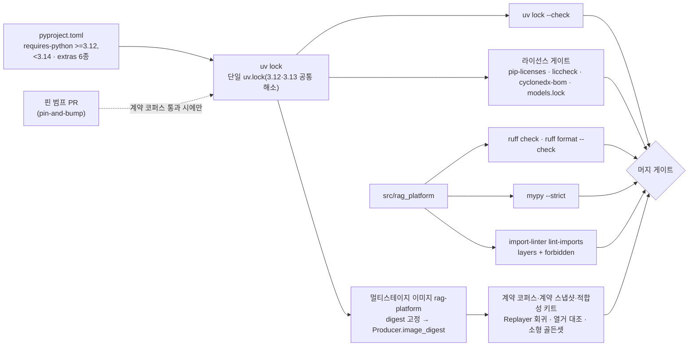

# ADR-0035: Python 버전·툴체인 고정

## 맥락과 문제

브리프 D-01 원안은 구현 언어를 "Python 3.12+"로 적었다. 개방 범위(하한만 있는 `>=3.12`)는 파서 경로의 실제 의존성과 맞지 않는다는 점이 기술 지형 조사에서 확인되었다. Unstructured 0.27.6은 `requires-python >=3.11,<3.14`(02 라이브러리 후보 표, 02 §브리프와의 충돌 D-01; 04 §브리프와의 충돌 D-01; 11 §리스크 "런타임 버전 충돌"), RapidOCR 3.9.2는 Python 3.8~3.13만 명시하고 3.14 지원은 미확인(02 라이브러리 후보 표·RapidOCR 함정), Docling의 Nemotron-OCR extra(`feat-ocr-nemotron`)는 Linux x86_64 + Python 3.12 + CUDA 13.x 한정(02 VLM·OCR 비교 표), flytekit 1.16.28은 `>=3.10,<3.13`(08 후보 표; 채택하지 않음), RAGFlow SDK 0.27.2는 `>=3.13,<3.14`(11 §RAGFlow 진입점)이다. 즉 "3.12+"를 열어두면 3.14 인터프리터 이미지에서 기본 OCR 엔진과 제2 의견 파서가 설치되지 않거나 동작을 보증할 수 없어 파서 워커가 깨진다(바이블 §3.1 D-01 근거). 매트릭스는 이를 "파서 워커 이미지는 3.12/3.13 고정, 3.14 채택 전 호환성 검증; 외부 앱 SDK는 인프로세스 의존에서 제외(HTTP만)"로 정리했다(매트릭스 §브리프 수정 제안 D-01).

툴체인 측면의 문제는 빠른 릴리스 의존성의 파손이다(바이블 §15 #9; 매트릭스 §종합 리스크 #7). Docling은 주 1~2회 릴리스하고(03 §리스크; 매트릭스 `pdf_layout_parser` 행) docling-core 2.97.x는 `semchunk<4.0.0`·`tiktoken<0.13.0` 상한을 고정하며(04 §브리프와의 충돌 D-01 "패키지 관리 uv" 행, §리스크), python-hwpx는 PyPI Alpha 선언 상태로 7주간 24회 릴리스·메이저 3회 상승했고(01 python-hwpx 성숙도; 매트릭스 `hwpx_parser` 행) 조사 기간 중 6.5.0이 추가 공개되었다(매트릭스 미해결 이슈 9). MCP SDK는 13개월 동안 3회 파괴적 개정(매트릭스 `mcp_sdk` 행), OTel GenAI 규약은 속성 개명 위험이 있다(D-11, ADR-0022). 정확 버전이 잠금 파일에 고정되고 그 잠금이 CI에서 검사되지 않으면 어댑터 파손이 빌드 실패가 아니라 런타임 실패로 나타난다. 계층 규칙도 같은 성격이다. D-17의 "파이프라인 정의는 `temporalio`를 임포트하지 않는다"(08 §D-17 검증; ADR-0003)와 D-02의 "AGPL 코드 `import` 금지"(12 §6.4 코드 경계; ADR-0001)는 문서 규약만으로는 지켜지지 않으므로 기계 강제가 필요하다.

바이블은 이를 D-01 `amended`로 확정했다 — Python 3.12/3.13(파서 워커 이미지 고정, 3.14는 검증 후), Pydantic v2, FastAPI, uv(`uv lock --check`), ruff, mypy strict, import-linter(바이블 §3.1 D-01; 브리프 §4 D-01 개정 v1.1). 패키지 맵은 단일 저장소·`uv` 워크스페이스·배포 패키지 `rag-platform`(import `rag_platform`)·extras 6종·의존 방향 규칙을 정본으로 둔다(바이블 §6.7, §12). 여기서 "파서 워커 이미지"는 Python 파서 어댑터(`adapters/parse/*`, 바이블 §12)를 `in_process`·`helper_process`로 싣는 코어 이미지 `rag-platform`의 워커 역할을 뜻한다. Java 21 사이드카 이미지 `parser-workers`(바이블 §6.7)는 Python 버전 제약의 대상이 아니다. 본 ADR은 이 결정을 대안·근거·강제 수단과 함께 기록한다. 이 결정이 확정되어야 10-development/01·02·03·05(저장소 구조·개발 환경·코딩 표준·CI/CD), 02-architecture/02·08(컴포넌트·배포 아키텍처), 09-operations/08(업그레이드)이 같은 인터프리터 범위·도구·게이트를 전제할 수 있다.

## 결정 동인(decision drivers)

- **파서 경로 호환성(R1, D-18, O-08)**: HWPX·HWP·PDF·OCR·DOCX·HTML 기본 경로의 Python 라이브러리가 모두 설치·동작하는 인터프리터 범위가 곧 플랫폼의 지원 범위다. 한국어 1급 요구를 지는 파서 워커가 첫 번째 제약이다.
- **재현성과 콘텐츠 주소화(원칙 4, 브리프 §7 재현성, K5)**: 같은 `IngestRequest` + 같은 프로파일 → 같은 `IndexCommit` 해시는 같은 의존성 버전을 전제한다. `Producer.fingerprint`는 `plugin_version`·`image_digest`를 포함하므로(바이블 §4.1, §6.2) 의존성 버전은 잠금 파일과 이미지 digest로 고정되어야 한다.
- **오케스트레이터 중립성(D-17, ADR-0003)**: `pipelines`·`retrieval`·`render`가 `temporalio`·`fastapi`·`ledger`를 모르는 것이 `LocalRunner`와 Temporal이 같은 정의를 실행하는 조건이다(바이블 §11.1, §12). 위반은 린트로 막아야 한다.
- **라이선스 경계(D-02, ADR-0001)**: 코어는 A 등급 순수 Python만 인프로세스 의존한다(바이블 §12). 라이선스 게이트(pip-licenses + liccheck + cyclonedx-bom)는 `uv lock`을 입력으로 삼으므로(12 §6.3 도구 체인) 잠금 파일이 라이선스 판정의 단일 소스다.
- **Contracts First(원칙 1, D-05)**: 모든 계약은 JSON Schema 2020-12 + Pydantic v2(바이블 §5)이며, mypy strict가 계약 모델과 어댑터 경계의 타입을 컴파일 시점에 검사한다.
- **빠른 릴리스 리스크 완화(바이블 §15 #4·#9)**: pin-and-bump — `uv lock` 정확 고정 + 업스트림 릴리스마다 계약 테스트 코퍼스 통과 후 범프(매트릭스 §어댑터·플러그인 공통 요구 3).
- **개발자 경험(바이블 §11.6)**: `uv tool install rag-platform` 60초, `rag up --profile lite` 90초의 5분 기동은 단일 패키지·단일 잠금·extras 구조를 전제한다.
- **오픈소스 채택성(R2, D-02)**: 지원 인터프리터 범위가 좁을수록 기여자·운영자 진입 장벽이 높아지므로 상한은 근거(실제 의존성 제약)가 있을 때만 두고 재검토 조건을 명시한다.

## 고려한 대안

### 대안 1 — "Python 3.12+" 개방 범위(브리프 원안, 바이블 기각)

- 설명: `requires-python = ">=3.12"`로 하한만 두고 새 인터프리터를 자동 허용한다.
- 장점: 새 CPython 성능 개선·표준 라이브러리 기능을 즉시 쓸 수 있고 배포 환경 선택이 넓다. 일부 후보 라이브러리는 이미 3.14를 지원한다(readability-lxml 0.9, 03 후보 표; litellm Py 3.10~3.14, 10 후보 표; neo4j-graphrag-python 3.10~3.14, 14 후보 표).
- 단점: 파서 경로가 깨진다. Unstructured `<3.14`, RapidOCR 3.8~3.13(3.14 미확인), Nemotron extra 3.12 한정(02), Microsoft GraphRAG 3.11~<3.14(14 후보 표; 외부 플러그인)이 상한을 가지므로 3.14 이미지에서는 기본 OCR 엔진(O-08)과 제2 의견 파서가 해소되지 않는다. `uv`는 `requires-python` 전 범위에 대해 단일 잠금을 해소하므로 상한이 없으면 상한 있는 의존성과 잠금 해소 자체가 실패하거나 조건부 마커로 갈라진다. 바이블 §3.1 D-01은 이 이유로 `amended` 처리했다.

### 대안 2 — Python 3.14 즉시 채택(기각)

- 설명: 최신 CPython(3.14)을 기준 인터프리터로 삼고 호환되지 않는 라이브러리를 교체·격리한다.
- 장점: 인터프리터 수명이 가장 길고 최신 기능·성능을 확보한다.
- 단점: 대안 1과 같은 상한 문제가 기본 프로파일의 OCR·레이아웃 경로에 직접 걸린다. RapidOCR는 "Python 3.14 지원 미확인"(02 RapidOCR 함정)이고 Unstructured는 `<3.14`가 명시적이다. 이 라이브러리들을 사이드카로 밀어내면 `in_process` A 등급 순수 Python 경로(바이블 §4.1 격리 모드)를 잃고 격리 사다리(ADR-0033)의 비용을 기본 프로파일이 지게 된다. 브리프 D-01은 "3.14는 호환성 검증 후 채택"으로 시점을 미룬다.

### 대안 3 — Poetry 또는 pip-tools로 패키지 관리(기각)

- 설명: 잠금·설치 도구로 uv 대신 Poetry(자체 잠금·가상환경 관리) 또는 pip-tools(`pip-compile`로 `requirements*.txt` 생성)를 쓴다.
- 장점: 오래 쓰인 도구로 기여자 친숙도가 높고, pip-tools는 pip 표준 위에서 최소 도구로 동작한다.
- 단점: 07-tech-landscape는 패키지 관리자를 비교 조사하지 않았으므로(08 문서는 오케스트레이터·API 프레임워크 대상) 아래는 일반 특성이며 버전별 세부는 확인 필요(as of 2026-09). pip-tools의 잠금은 인터프리터·플랫폼별 `requirements.txt`라 3.12/3.13 두 버전과 extras 6종 조합을 한 파일로 표현하지 못하고 파일 수가 조합만큼 늘어난다. Poetry는 단일 저장소 다중 패키지(워크스페이스)와 `uv tool install`에 해당하는 도구 설치 흐름이 코어 기능이 아니다(확인 필요 as of 2026-09). 무엇보다 D-01은 브리프 수준에서 uv를 확정했고(브리프 §4), 바이블 §11.6 개발 모드·§12 워크스페이스·12 §6.3 라이선스 게이트(`uv lock` → pip-licenses/liccheck/cyclonedx-bom)·02-architecture/08 멀티스테이지 빌드가 모두 uv를 전제한다. 연구 근거 없이 이를 뒤집을 이유가 없다.

### 대안 4 — 코어(API·검색)와 파서 워커의 Python 버전 분리(기각)

- 설명: `api`는 3.14, 파서 워커만 3.12/3.13으로 이미지를 나눈다.
- 장점: 검색 핫패스가 새 인터프리터 성능을 먼저 얻는다.
- 단점: 바이블 §12는 단일 저장소·`uv` 워크스페이스·배포 패키지 하나를 정본으로 두고, 컴포넌트·배포 아키텍처는 `api`·`worker`·`relay`·`eval harness`가 같은 이미지 digest를 쓰는 단일 이미지 + CLI 역할 플래그 구조다(02-architecture/02 §7, 02-architecture/08 §3.3). 버전을 나누면 잠금이 둘로 갈리고 계약 스냅샷·적합성 키트·`Replayer` 회귀를 두 인터프리터에서 각각 돌려야 하며, 검색 경로가 `LocalContext`로 `api` 프로세스 안에서 같은 어댑터(`adapters/rerank`, `adapters/llm`)를 실행하므로(바이블 §11.1) 분리 이득이 실제로 작다.

### 대안 5 — 계층 규칙을 문서·코드 리뷰만으로 강제(import-linter 없이)(기각)

- 설명: 바이블 §12 의존 방향을 코딩 표준 문서에 적고 리뷰에서 확인한다.
- 장점: 도구 하나가 줄고 계층 정의를 바꿀 때 설정 수정이 없다.
- 단점: D-17 위반(`pipelines`가 `temporalio`를 임포트)은 리뷰를 통과해도 `LocalRunner`에서 실행 불가로만 드러나며(08 §D-17 검증), AGPL 임포트 유출(`fitz`, `pymupdf`, `hwp5`)은 pip 메타데이터 기반 라이선스 게이트가 잡지 못하는 경로다(12 §6.4 "ruff 커스텀 규칙 또는 import-linter로 차단"). 브리프 D-01이 "계층 규칙 import-linter"를 명시했고 매트릭스 D-17 행도 "`temporalio` 임포트 금지 린트"를 요구한다.

### 대안 6 — 상한 없는 최신 추종(정확 핀 없이 `>=` 범위와 자동 갱신)(기각)

- 설명: 의존성은 하한만 선언하고 잠금은 매 빌드 재생성한다.
- 장점: 보안·버그 수정을 가장 빨리 받고 잠금 갱신 PR이 필요 없다.
- 단점: docling-core `[chunking]` 상한과 최신 semchunk 4.1.1·tiktoken 0.14.0은 한 잠금에 공존할 수 없고(04 §브리프와의 충돌), semchunk 4.x는 `chunkerify()` 키워드 전용화와 유료 모드를 추가한 파괴적 변경이다(04 §6; ADR-0020). python-hwpx는 7주에 메이저가 3회 올랐고(01) MCP SDK는 v1→v2가 파괴적이었다(매트릭스 `mcp_sdk` 행). 자동 갱신은 이런 변경을 계약 코퍼스 없이 프로덕션 이미지에 실어 나른다. 바이블 §15 #9의 완화 장치는 정확히 그 반대(`uv lock --check`, 잠금, 계약 스냅샷)다.

### 대안 7 — 채택: Python 3.12/3.13 고정 + uv 워크스페이스 단일 잠금 + ruff + mypy strict + import-linter + pin-and-bump

- 설명: `requires-python = ">=3.12,<3.14"`로 두 마이너 버전만 지원하고, 단일 `uv.lock`을 CI가 검사하며, 정적 검사 3종(ruff·mypy strict·import-linter)과 계약 코퍼스로 핀 범프를 통제한다.
- 장점: 파서 경로 전체가 해소되고, 잠금 하나가 라이선스 게이트·SBOM·이미지 빌드의 공통 입력이 되며, D-17·D-02의 임포트 규칙이 빌드 게이트가 된다.
- 단점: 3.14 기능·성능 미수혜, 핀 유지 비용, 도구 공급자 집중. 아래 결과에서 다룬다.

## 결정

**결정:** 구현 언어 **Python 3.12/3.13**(파서 워커 이미지는 3.12/3.13 고정, 3.14는 호환성 검증 후 채택), 계약 모델 **Pydantic v2**, API **FastAPI**, 패키지 관리 **uv**(`uv lock --check` CI), 린트 **ruff**, 타입 **mypy(strict)**, 계층 규칙 **import-linter** — 브리프 §4 D-01(개정 v1.1), 바이블 §3.1 D-01 `amended`. 의존 방향(import-linter): `contracts ← sdk ← plugins | adapters | pipelines | retrieval | render ← orchestration | ledger | storage | security | profiles | eval ← api | mcp | cli`. 역방향 금지. `pipelines`·`retrieval`·`render`는 `temporalio`·`fastapi`·`ledger`를 모른다. `adapters`는 `storage`를 모른다(ArtifactRef 로드는 셸). `security`는 `api`·`retrieval`·`adapters/index`에서만 사용(바이블 §12). 코어 배포 패키지 `rag-platform`(import `rag_platform`), extras `[kiwi]`, `[docling-chunker]`, `[gpu]`, `[opensearch]`, `[temporal]`, `[eval]`; 플러그인 배포 `rag-plugin-{name}`(import `rag_plugin_{name}`), entry point 그룹 `rag_platform.{extension_point}`(바이블 §6.7). 핀은 **pin-and-bump + 계약 코퍼스**(`uv lock` 정확 고정, 업스트림 릴리스마다 계약 테스트 코퍼스 통과 후 범프; 매트릭스 §어댑터·플러그인 공통 요구 3)이며 CI는 `WorkflowEnvironment.start_time_skipping()` 단위 테스트, `Replayer` 히스토리 회귀, 계약 스냅샷, 적합성 키트, 소형 골든셋 게이트, `uv lock --check`, 라이선스 게이트, 열거 대조(§1.2)를 실행한다(바이블 §11.6). 관련 ADR: [ADR-0003 오케스트레이터 중립 파이프라인](../06-adr/0003-orchestrator-neutral-pipeline-and-non-durable-local-runner.md), [ADR-0001 라이선스 등급표](../06-adr/0001-license-grade-table-and-d02-interpretation.md), [ADR-0020 기본 청커·의존성 잠금](../06-adr/0020-default-chunker-structure-aware-and-dependency-locks.md), [ADR-0008 OCR 기본값](../06-adr/0008-ocr-default-rapidocr-ppocrv5-korean.md), [ADR-0036 명명 규약](../06-adr/0036-naming-and-identifier-conventions.md).

버전·핀은 바이블과 매트릭스의 값을 그대로 쓴다. 정확한 고정 버전은 `uv.lock`이 정본이며 아래 수치는 각 연구 문서 확인일(2026-09-18~22) 기준이다.

| 요소 | 정본 값 | 근거 |
|------|---------|------|
| 인터프리터 | `requires-python = ">=3.12,<3.14"`; CI 매트릭스 3.12·3.13 둘 다; 이미지 베이스는 3.12 또는 3.13 계열만, digest 고정 | 브리프 D-01; 바이블 §3.1; 02 §브리프와의 충돌 D-01 |
| 상한 근거 라이브러리 | Unstructured 0.27.6 `>=3.11,<3.14`(제2 의견 파서, 선택 경로); rapidocr 3.9.2 Python 3.8~3.13(O-08 기본, 마이너 3.9.x 고정); Docling `feat-ocr-nemotron` extra Python 3.12 한정(GPU 비교 대상); RAGFlow SDK `>=3.13,<3.14`(외부 앱, HTTP 어댑터만) | 02 후보 표·§브리프와의 충돌; 11 §RAGFlow; 매트릭스 D-01 행 |
| 계약·API | Pydantic 2.13, FastAPI 0.141, uvicorn 0.53, sse-starlette 3.4(확인일 기준, 잠금이 정본) | 매트릭스 `api_framework` 행 |
| 청킹 | semchunk 3.2.5(범위 `>=3.0.0,<4.0.0`), tiktoken 0.12.0(`>=0.9.0,<0.13.0`); docling-core 2.97.x `[chunking]`은 `[docling-chunker]` extra에서만 | ADR-0020; 04 §6·§17; 바이블 §15 #9 |
| HWPX | python-hwpx `>=6.4,<7`(pin-and-bump; 6.5.0은 계약 코퍼스 통과 후 범프) | 바이블 §7.1; 매트릭스 `hwpx_parser` 행·미해결 이슈 9; 01 |
| PDF | Docling 2.129.x 마이너 고정(03의 2.128.0 표기는 2.129.x로 통일); pypdfium2 5.13 + pdftext 0.7 | 바이블 §7.1; 매트릭스 미해결 이슈 8·`pdf_text_parser` 행 |
| 오케스트레이션 | Temporal Server 1.32 + `temporalio` 1.33(`[temporal]` extra), `pydantic_data_converter`, `TracingInterceptor` | 바이블 §11.1; 매트릭스 `orchestrator` 행 |
| MCP·이벤트 | `mcp>=2,<3`(`McpToolAdapter`로 격리), `cloudevents>=2.2,<3` | 브리프 D-13; 매트릭스 `mcp_sdk`·`event_bus` 행 |
| 한국어 분석기 | 공백기 기본 python-mecab-ko 1.3.7 + kss 6.0.6; `[kiwi]` extra kiwipiepy `>=0.24.0`(Apache-2.0 wheel PyPI 공개 확인 필요 as of 2026-09; 0.23.2 LGPL 정적 링크 wheel 기본 설치 금지) | 바이블 §7.1; ADR-0021; 매트릭스 `korean_tokenizer` 행 |
| 정적 검사 | ruff(lint + format, `target-version = "py312"`), mypy `strict = true` + `pydantic.mypy` 플러그인, import-linter `layers` + `forbidden` 계약 | 브리프 D-01; 바이블 §12; 12 §6.4 |
| 금지 | sunset 공지 패키지(langchain-experimental, `langchain_classic` 2026-12 EOL); C 등급 임포트(`fitz`, `pymupdf`, `hwp5`); 외부 앱 SDK 인프로세스 의존 | 매트릭스 공통 요구 3; 12 §6.4; 11 §브리프와의 충돌 D-01 |

```toml
# pyproject.toml 발췌(예시). 정확한 고정 버전은 uv.lock이 정본이며 CI `uv lock --check`로 강제한다.
[project]
name = "rag-platform"
requires-python = ">=3.12,<3.14"   # D-01: 3.12/3.13. 3.14는 재검토 조건 충족 후 상한 상향
dependencies = ["pydantic>=2,<3", "fastapi", "semchunk>=3.0.0,<4.0.0", "tiktoken>=0.9.0,<0.13.0", "python-hwpx>=6.4,<7", "mcp>=2,<3", "cloudevents>=2.2,<3"]

[project.optional-dependencies]
kiwi = ["kiwipiepy>=0.24.0"]
docling-chunker = ["docling-core[chunking]>=2.97,<3"]
temporal = ["temporalio>=1.33,<2"]
opensearch = ["opensearch-py"]
eval = ["ranx", "ir_measures", "ragas", "deepeval"]
gpu = []   # CUDA·Paddle 런타임은 ocr-gpu 이미지로 분리(02-architecture/08 §3.3)

[tool.uv.workspace]
members = ["sdk/python", "plugins/*"]

[tool.ruff]
target-version = "py312"

[tool.mypy]
strict = true
plugins = ["pydantic.mypy"]

[tool.importlinter]
root_package = "rag_platform"
include_external_packages = true

[[tool.importlinter.contracts]]
name = "layers (바이블 §12 의존 방향)"
type = "layers"
layers = [
  "rag_platform.api | rag_platform.mcp | rag_platform.cli",
  "rag_platform.orchestration | rag_platform.ledger | rag_platform.storage | rag_platform.security | rag_platform.profiles | rag_platform.eval",
  "rag_platform.plugins | rag_platform.adapters | rag_platform.pipelines | rag_platform.retrieval | rag_platform.render",
  "rag_platform.sdk",
  "rag_platform.contracts",
]

[[tool.importlinter.contracts]]
name = "pipelines/retrieval/render는 temporalio·fastapi·ledger를 모른다"
type = "forbidden"
source_modules = ["rag_platform.pipelines", "rag_platform.retrieval", "rag_platform.render"]
forbidden_modules = ["temporalio", "fastapi", "rag_platform.ledger"]

[[tool.importlinter.contracts]]
name = "adapters는 storage를 모른다(ArtifactRef 로드는 셸; 바이블 §12)"
type = "forbidden"
source_modules = ["rag_platform.adapters"]
forbidden_modules = ["rag_platform.storage"]

[[tool.importlinter.contracts]]
name = "C 등급 임포트 차단(ADR-0001; 12 §6.4)"
type = "forbidden"
source_modules = ["rag_platform"]
forbidden_modules = ["fitz", "pymupdf", "hwp5"]
```

위 네 계약은 준수 확인 방법 표의 import-linter 계약 (1)~(4)와 1:1 대응한다. 계층 내부의 실제 의존(디스패처 → 원장, 하네스 → `LocalRunner` 등)을 표현하는 `|`/`:` 구분과 10계층 정밀화는 02-architecture/02 §1.2가 다루며 바이블의 화살표는 모두 보존된다.



## 결과

### 긍정

- 기본 프로파일의 파서 경로(python-hwpx, Docling 2.129.x, pypdfium2/pdftext, RapidOCR 3.9.x, docx2python, Trafilatura, charset-normalizer)가 하나의 `uv.lock`에서 3.12·3.13 모두에 해소된다. 인터프리터 상한이 명시되어 "설치는 되지만 OCR가 없는" 이미지가 만들어지지 않는다.
- 잠금 파일 하나가 `uv lock --check`, 라이선스 게이트·SBOM(12 §6.3), 멀티스테이지 이미지 빌드(02-architecture/08 §3.3)의 공통 입력이 되어 재현성(브리프 §7)과 D-02 판정이 같은 근거를 쓴다.
- D-17의 `temporalio` 임포트 금지와 D-02의 C 등급 임포트 금지가 리뷰 관행이 아닌 빌드 게이트가 된다. `LocalRunner`와 Temporal이 같은 정의를 실행하는 조건(바이블 §11.1)이 기계적으로 보장된다.
- pin-and-bump가 빠른 릴리스 의존성(python-hwpx·Docling·MCP SDK·semchunk/tiktoken)의 파손을 계약 코퍼스 단계에서 잡는다(바이블 §15 #4·#9).
- mypy strict + Pydantic v2가 계약 모델·`Stage[In, Out]` 프로토콜(바이블 §4.1)의 타입 오류를 컴파일 시점에 드러내고, ruff 단일 도구가 린트·포맷을 통일한다.

### 부정

- Python 3.14의 기능·성능 개선을 파서 경로 라이브러리가 따라올 때까지 받지 못한다. 3.12는 보안 지원 종료(2028-10 예정)까지 2년 남았으므로 3.14 검증을 미루면 지원 범위가 좁아진다.
- 핀 유지 비용이 생긴다. semchunk 3.x·tiktoken 0.12는 상한 완화 전까지 수정 미수혜(ADR-0020 부정), python-hwpx는 릴리스마다 코퍼스 실행이 필요하다(01).
- mypy strict는 동적 프록시·벤더 타입 미제공 라이브러리(JPype, 일부 OCR 바인딩)와 마찰이 있어(01 §JPype 단점) 어댑터 경계에 타입 스텁·`typing.cast` 부담이 생긴다.
- uv·ruff는 같은 개발사(Astral)의 도구라 공급자 집중 리스크가 있고, import-linter는 단일 도구 의존이다. 대체 경로는 재검토 조건에 둔다.
- 외부 앱 SDK(RAGFlow 등)를 인프로세스에서 쓰지 못해 통합은 항상 HTTP 어댑터다(11 §브리프와의 충돌 D-01).

### 중립

- 본 ADR의 버전 수치는 확인일(2026-09-18~22) 기준이며 `uv.lock`이 정본이다. 핀 범프는 본 ADR 개정 없이 계약 코퍼스 통과 + 잠금 갱신 PR로 처리한다(바이블 §1.2 patch). 본 ADR은 범위·상한의 근거와 절차만 고정한다.
- import-linter `layers` 계약의 `|`(같은 계층·상호 독립)와 바이블 §12의 `|` 표기 의미 차이, 10계층 정밀화는 02-architecture/02 §1.2·미해결 이슈 1이 architecture 소유자와 정리한다. 바이블의 모든 화살표와 세 금지 규칙은 어느 쪽에서도 불변이다.
- Python 3.13 자유 스레딩(free-threaded) 빌드는 D-01 범위 안이지만 Docling·mecab-ko·ONNX Runtime wheel 호환이 확인 필요(as of 2026-09)이므로 채택하지 않는다(02-architecture/02 미해결 이슈 8).
- 개발 기본 인터프리터(`.python-version`)와 CI 매트릭스 구성은 10-development/02·05가 정한다. 본 ADR은 두 버전 모두 CI에서 검증된다는 점만 요구한다.
- `[gpu]` extra의 내용은 비어 있거나 최소이며 CUDA·Paddle 런타임은 `ocr-gpu` 이미지에 있다(02-architecture/08 §3.3). Python 버전 제약은 `ocr-gpu`·`parser-workers` 사이드카에는 적용되지 않는다(계약 JSON만 공유).

## 준수 확인 방법

| 강제 수단 | 내용 | 위치·근거 |
|-----------|------|-----------|
| 잠금 게이트 | PR마다 `uv lock --check`; `requires-python`이 `>=3.12,<3.14`인지, `uv.lock`의 python-hwpx·semchunk·tiktoken·temporalio·docling·rapidocr·mcp 버전이 본 ADR 표의 범위 안인지 스크립트 검사; 범프 PR은 계약 코퍼스 잡 통과가 필수 | 바이블 §11.6, §15 #9; [CI/CD](../10-development/05-ci-cd.md), [개발 환경](../10-development/02-development-environment.md) |
| CI 매트릭스 | 단위·계약·적합성 테스트를 3.12와 3.13 두 인터프리터에서 실행; 한쪽만 통과하면 실패 | 브리프 D-01; [테스트 전략](../10-development/04-testing-strategy.md) |
| 이미지 게이트 | 코어 이미지 베이스는 3.12 또는 3.13 계열 태그만(빌드 인자 검사), digest 고정, `Producer.image_digest`로 전파; `[gpu]`·C 등급 패키지 포함 시 빌드 실패 | 바이블 §6.2, §6.7; [배포 아키텍처](../02-architecture/08-deployment-architecture.md) §3.3 |
| 정적 검사 | `ruff check` + `ruff format --check`(위반 0), `mypy --strict src/`(오류 0; 벤더 라이브러리 스텁 부재는 모듈 단위 `ignore_missing_imports`만 허용, 함수 단위 `type: ignore`는 사유 주석 필수), `lint-imports`(계약 전부 KEPT) | 브리프 D-01; 바이블 §12; [코딩 표준](../10-development/03-coding-standards.md) |
| import-linter 계약 | (1) `layers` — 바이블 §12 의존 방향, 역방향 금지 (2) `forbidden` — `pipelines`·`retrieval`·`render` → `temporalio`·`fastapi`·`rag_platform.ledger` (3) `forbidden` — `adapters` → `storage` (4) `forbidden` — 저장소 전체 → `fitz`·`pymupdf`·`hwp5`(C 등급); `security` 사용처는 `api`·`retrieval`·`adapters/index`만 | 바이블 §11.1, §12; 12 §6.4; ADR-0001, ADR-0003; [컴포넌트 아키텍처](../02-architecture/02-component-architecture.md) §1.2 |
| 라이선스 게이트 | `uv lock` 산출을 입력으로 pip-licenses + liccheck(A 허용, B 조건부, C/D/X 차단) + cyclonedx-bom SBOM + `models.lock`; `PluginMeta.license`·`license_grade`·`territory` 필수 | D-02; 바이블 §5.7 `LicenseGrade`; 12 §6.3; ADR-0001 |
| 계약·회귀 게이트 | 계약 스냅샷(`schemas/` export diff), 열거 대조(`schemas/*.schema.json` `$defs` ↔ 바이블 §5.7), `Replayer` 히스토리 회귀, `WorkflowEnvironment.start_time_skipping()` 단위 테스트, 적합성 키트, 소형 골든셋 게이트 — 핀 범프 PR은 이 게이트 전부를 통과해야 한다 | 바이블 §1.2, §11.6; ADR-0032 |
| 스키마 제약 | `PluginMeta.contracts_compat`(semver 범위) 선언 필수; `Producer.plugin_version`·`image_digest` 필수로 `fingerprint`에 반영 | 바이블 §5.3, §6.2, §6.4; [프로파일·정책 계약](../03-contracts/15-collection-profile-and-policy-contracts.md) |
| 코드 리뷰 항목 | (1) 새 의존성이 A 등급이고 `requires-python`이 3.12·3.13을 모두 포함하는가(3.13 미지원 패키지는 거부) (2) 상한이 있으면 사유와 재검토 조건이 PR에 있는가 (3) sunset 공지·정체 패키지가 아닌가 (4) 외부 앱 SDK를 인프로세스로 넣지 않았는가 (5) 새 모듈이 바이블 §12 계층에 배치되고 import-linter 계약이 갱신되었는가 (6) `type: ignore`·`cast`에 사유가 있는가 | 매트릭스 공통 요구 3; [기여 가이드](../10-development/07-contributing.md), [저장소 구조](../10-development/01-repository-structure.md) |

## 재검토 조건

- **3.14 채택**: Unstructured·RapidOCR(ADR-0008 재검토 조건 6)·Docling(Nemotron extra 포함)·python-mecab-ko(13 미해결 이슈 3)의 3.14 wheel과 `requires-python` 상향이 공개되고 계약 코퍼스·적합성 키트·`Replayer` 회귀가 3.14에서 통과하면 `requires-python` 상한을 `<3.15`로 올린다. D-01 문구("3.14는 호환성 검증 후 채택") 안의 변경이므로 본 ADR 개정 + 바이블 §3.1 D-01 행 갱신(§1.2 minor)으로 처리한다.
- **3.12 종료**: Python 3.12 보안 지원 종료(2028-10 예정) 12개월 전까지 하한을 3.13으로 올리는 개정을 발의하고, 09-operations/08 업그레이드 절차에 인터프리터 전환을 등재한다.
- **자유 스레딩 빌드**: Docling·mecab-ko·ONNX Runtime wheel의 free-threaded 호환이 확인되고 `ingest-cpu` 프로세스 다중화(02-architecture/02)를 스레드로 대체할 실측 이득이 있으면 D-01 범위 안에서 본 ADR을 개정한다.
- **핀 완화**: docling-core가 `semchunk<4.0.0`·`tiktoken<0.13.0` 상한을 완화하면 ADR-0020 절차로 범프한다. python-hwpx 7.x가 공개되면 OWPML 어댑터의 계약 코퍼스 통과 후 상한을 `<8`로 올린다(ADR-0007·ADR-0002 영향 검토).
- **도구 교체**: uv가 `lock --check` 의미론이나 `requires-python` 전 범위 단일 잠금을 잃거나 라이선스가 A 등급을 벗어나면, 또는 import-linter·ruff·mypy가 유지보수 종료되면 대체 도구 비교를 07-tech-landscape 부록으로 조사한 뒤 본 ADR을 개정한다. 그때까지 대안 3의 도구는 근거 없이 채택하지 않는다.
- **계층 표기 정리**: 02-architecture/02 미해결 이슈 1(`|`/`:` 의미, 10계층 정밀화)이 바이블 §12에 반영되면 위 `layers` 계약 예시를 갱신한다. 바이블의 화살표·세 금지 규칙이 바뀌는 변경은 바이블 major 절차(§1.2)다.
- **외부 앱 SDK 인터프리터 수렴**: RAGFlow 등 외부 앱 SDK의 `requires-python`이 플랫폼 범위와 겹치더라도 인프로세스 의존 제외 규칙은 유지한다(어댑터 경계 원칙 2). 이 항목은 재검토 대상이 아님을 명시한다.

## 참조

- [설계 브리프](../00-vision/00-design-brief.md) §2 R1·R2, §3 원칙 1·2·3·4, §4 D-01(개정 v1.1)·D-02·D-05·D-13·D-17·D-18·D-19, §7 재현성, §9.11
- [설계 바이블](../02-architecture/00-design-bible.md) §1.1, §1.2, §2.1 K5, §3.1 D-01·D-02·D-17·D-19, §3.3 0035 행, §4.1 격리 모드·지문, §5.1 `PluginMeta`, §5.3 `Producer`, §5.7 `LicenseGrade`·`Linkage`, §6.2 `fingerprint`, §6.4 `contracts_compat`, §6.7 패키지·extras·사이드카 이미지, §7.1 HWPX·PDF·한국어 분석기 행, §11.1, §11.6 개발 모드·CI, §12 모듈/패키지 맵·의존 방향, §15 #4·#9
- [기술 지형 종합: 선정 매트릭스](../07-tech-landscape/00-summary-and-selection-matrix.md) §매트릭스 `hwpx_parser`·`pdf_layout_parser`·`ocr_engine`·`chunker_default`·`korean_tokenizer`·`orchestrator`·`api_framework`·`mcp_sdk`·`event_bus`·`license_scanner` 행, §브리프 수정 제안 D-01·D-17·D-19, §ADR 발의 목록 P1 "기본 청커 StructureAwareChunker와 의존성 잠금"(D-01 연관), §어댑터·플러그인 공통 요구 1·2·3, §운영·평가 공통 요구 CI 게이트, §종합 리스크 #3·#7, §미해결 이슈 8·9
- [01 HWPX/HWP 문서 파싱](../07-tech-landscape/01-document-parsing-hwpx-hwp.md) python-hwpx 성숙도·pin-and-bump, JPype 단점(mypy strict); [02 PDF 파싱·레이아웃 분석·OCR](../07-tech-landscape/02-document-parsing-pdf-layout-ocr.md) 라이브러리 후보 표(Unstructured·RapidOCR), RapidOCR 함정, VLM·OCR 비교 표(Nemotron extra), §브리프와의 충돌 D-01
- [04 청킹 전략과 라이브러리](../07-tech-landscape/04-chunking-strategies-and-libraries.md) §6 semchunk, §17 토큰 카운팅, §브리프와의 충돌 D-01 두 행, §리스크 및 완화
- [08 오케스트레이션·메시징·API 프레임워크](../07-tech-landscape/08-orchestration-messaging-and-api-frameworks.md) 후보 표(Flyte·Resonate `requires_python`), §D-17 검증(import-linter 린트 규칙)
- [11 기존 RAG 플랫폼 격차 분석](../07-tech-landscape/11-existing-rag-platforms-gap-analysis.md) §RAGFlow 진입점, §리스크 "런타임 버전 충돌", §브리프와의 충돌 D-01; [12 보안·멀티테넌시·PII·라이선스](../07-tech-landscape/12-security-multitenancy-pii-and-licensing.md) §6.3 도구 체인과 CI 게이트, §6.4 AGPL 코드 경계
- 관련 ADR: [ADR-0001 라이선스 등급표](../06-adr/0001-license-grade-table-and-d02-interpretation.md), [ADR-0003 오케스트레이터 중립 파이프라인](../06-adr/0003-orchestrator-neutral-pipeline-and-non-durable-local-runner.md), [ADR-0006 PDF 고속 경로](../06-adr/0006-pdf-fast-path-pypdfium2-pdftext-replaces-pymupdf.md), [ADR-0007 HWP 5.0 경로](../06-adr/0007-hwp5-java-sidecar-first-pyhwp-demoted.md), [ADR-0008 OCR 기본값](../06-adr/0008-ocr-default-rapidocr-ppocrv5-korean.md), [ADR-0020 기본 청커·의존성 잠금](../06-adr/0020-default-chunker-structure-aware-and-dependency-locks.md), [ADR-0021 한국어 분석기](../06-adr/0021-korean-analyzer-kiwi-promotion-and-interim-mecab-kss.md), [ADR-0022 관측성 규약 고정](../06-adr/0022-observability-genai-semconv-pin-and-license-boundary.md), [ADR-0025 MCP 커서·도구 집합](../06-adr/0025-mcp-cursor-pagination-and-tool-set.md), [ADR-0032 플러그인 SDK·적합성 키트](../06-adr/0032-plugin-sdk-stage-protocol-and-conformance-kit.md), [ADR-0033 사이드카 convert 계약](../06-adr/0033-sidecar-convert-contract-and-isolation-ladder.md), [ADR-0036 명명 규약](../06-adr/0036-naming-and-identifier-conventions.md)
- 설계·개발·운영 문서: [시스템 개요](../02-architecture/01-system-overview.md), [컴포넌트 아키텍처](../02-architecture/02-component-architecture.md) §1.2·§7, [배포 아키텍처](../02-architecture/08-deployment-architecture.md) §3.3, [저장소 구조](../10-development/01-repository-structure.md), [개발 환경](../10-development/02-development-environment.md), [코딩 표준](../10-development/03-coding-standards.md), [테스트 전략](../10-development/04-testing-strategy.md), [CI/CD](../10-development/05-ci-cd.md), [기여 가이드](../10-development/07-contributing.md), [릴리스 프로세스](../10-development/08-release-process.md), [업그레이드·마이그레이션](../09-operations/08-upgrade-and-migration.md)
