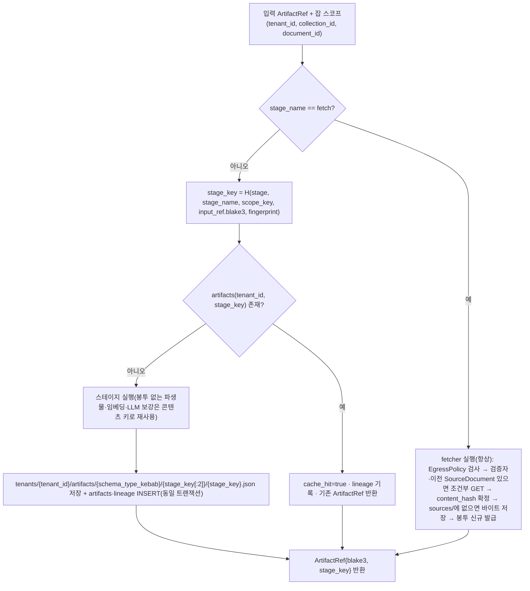

# ADR-0037: 산출물 캐시 스코프: stage_key에 tenant·collection·document 합성, fetch 캐시 제외

## 맥락과 문제

핵심 아이디어 K5(바이블 §2.1)는 스테이지를 순수 변환 `Stage[In, Out]`으로 두고, 오케스트레이터를 넘는 페이로드를 `ArtifactRef` 하나로 제한하며(Temporal 단일 페이로드 2MB 한계 — 07-tech-landscape/08 §심층 비교 › Temporal, §통합 설계 함의 › 페이로드·히스토리 한계 대응), 셸(액티비티 래퍼)이 입력 `ArtifactRef`를 로드해 스테이지를 실행하고 출력을 콘텐츠 주소화(content-addressed) 저장한 뒤 참조만 돌려준다. "같은 입력·같은 생산자면 같은 산출물"(원칙 4 Idempotent & Content-Addressed)이므로 **멱등성 키 = 캐시 키 = 산출물 경로**를 하나의 값 `stage_key`로 통일했고, 셸은 원장 `artifacts`에 `stage_key`가 있으면 실행을 생략하고(`cache_hit=true`) 계보(`lineage`)만 기록한다(바이블 §4.1). 브리프 §7의 "at-least-once + 멱등"과 "동일 `IngestRequest` + 동일 프로파일 → 동일 `IndexCommit` 해시"가 이 규칙에 기댄다.

바이블 v1.0의 `stage_key`는 `H("stage", stage_name, input_ref.blake3, fingerprint)`로 **잡 스코프가 없었다**. 설계 리뷰는 이를 blocker로 올렸다(바이블 §15 리스크 #8, §10.3 E17). 문제는 두 갈래다. 첫째, `fetch` 다음의 `detect`·`parse`는 입력 해시로 봉투가 없는 원본 바이트의 `content_hash`를 쓴다(§4.2; `SourceDocument` JSON에는 `request_id`·`fetched_at`이 있어 그 바이트 해시로는 어떤 재수집도 적중하지 않는다). 그런데 계약 산출물 `SourceDocument`~`EmbeddedChunkSet`은 봉투(`tenant_id`·`collection_id`·`document_id`·`acl`, §5.2)를 품는다. 스코프 없는 키에서는 동일 바이트 문서(공개 법령 PDF·표준 서식)를 테넌트 B가 수집할 때 테넌트 A의 `ParsedDocument`가 적중하고, 그 산출물의 `blake3`가 다시 `normalize`·`chunk`·`enrich`·`embed` 키의 입력이 되어 A의 봉투가 B의 잡 끝까지 전파된다 — 교차 스코프 오염이다. 같은 테넌트의 두 컬렉션(다른 `acl`·프로파일)이나 같은 컬렉션의 두 `document_id`(같은 바이트, 다른 `external_id`)에서도 같은 일이 일어난다. 둘째, v1.0은 `fetch`도 캐시 대상으로 두어 검증자(`etag`·`last_modified`)가 없는 원천의 낡은 원본을 재사용했다. 플랫폼은 크롤러가 아니라 URI를 받는 pull 모델(브리프 R1)이어서 원천이 언제 바뀌는지 알 수 없고, `fetcher` 확장 지점은 연구 문서조차 없다(매트릭스 `uri_fetcher` 행·미해결 이슈 1).

물리 인덱스 키는 같은 리뷰에서 `record_id`에 스코프·세대를 합성해 해결했다(ADR-0004, D-06 v1.2). 본 ADR은 그 짝으로 **산출물 쪽** 키를 정한다: 봉투가 있는 계약 산출물에는 스코프를 합성하고, 봉투가 없어 스코프가 오염 방지에 기여하지 않는 콘텐츠 전용 캐시(원본 바이트·파생물·청크 임베딩·LLM 보강)는 비용을 위해 스코프 없이 두며, `fetch`는 캐시에서 제외한다.

## 결정 동인(decision drivers)

- **멱등성·재현성(원칙 4, 브리프 §7)**: 같은 잡의 액티비티 재시도와 `reprocess.document.v1`은 같은 `stage_key`로 적중해야 하고, 다른 스코프의 입력은 다른 키를 내야 한다. 07-tech-landscape/08 §통합 설계 함의 › 두 모드가 같은 파이프라인 정의를 공유하는 패턴("출력을 콘텐츠 주소화 저장 후 참조를 반환")와 매트릭스 §어댑터·플러그인 공통 요구 2("출력 ID는 BLAKE3 콘텐츠 주소")가 전제다.
- **테넌트 격리(D-09, E5·E17)**: 봉투를 품은 바이트는 인덱스 레코드와 같은 격리 대상이다. 07-tech-landscape/12 §심층 비교 › 5.3 데이터 유출("어댑터 불변식이 유일한 방어선")와 매트릭스 §종합 리스크 #4가 요구하는 불변식은 검색 필터뿐 아니라 캐시 조회 경로에도 있어야 한다.
- **비용(매트릭스 §종합 리스크 #8·#10)**: 사이드카 변환(JVM·LibreOffice·OCR), GPU 임베딩, LLM 보강이 가장 비싼 연산이다. 07-tech-landscape/01 §통합 설계 함의 › 어댑터 계약 표 「파생 산출물」 행("같은 원본 해시 + 같은 사이드카 이미지 태그면 재변환 생략")과 07-tech-landscape/05 §통합 설계 함의 › 어댑터 계약 표 「결정성」 행("동일 `embedding_space_id`와 동일 텍스트는 캐시 히트")은 봉투 없는 결과의 콘텍스트 무관 재사용을 요구한다.
- **원천 신선도와 egress(R1, E16)**: 원본은 원천이 바꾼다. 검증자가 있을 때만 조건부 GET이 안전하며, `EgressPolicy`(SSRF 방어)는 매 수집마다 적용되어야 한다.
- **단일 해시 식(K5)**: 결합식 `H()` 하나(§6.2)와 키 하나(`stage_key`)가 멱등성·캐시·경로·계보(`ArtifactRef.stage_key`, `lineage.stage_key`)를 모두 서술한다. 스코프를 위해 두 번째 키 체계를 만들지 않는다.
- **저장 비용 하한(§13.3)**: 원본 바이트는 테넌트 안에서 한 번만 저장한다(`sources/{blake3}`).

## 고려한 대안

### 대안 1 — 바이블 v1.0: 콘텍스트 무관 `stage_key = H("stage", stage_name, input_ref.blake3, fingerprint)`

- 설명: 입력 해시와 생산자 지문만으로 키를 만들고 테넌트·컬렉션·문서를 넣지 않는다.
- 장점: 동일 바이트 문서를 누가 수집하든 `parse`~`embed`를 한 번만 실행해 CPU·GPU 비용이 최소이고 키 구성이 가장 단순하다.
- 단점: 맥락에 적은 대로 첫 수집자의 봉투가 뒤 수집자의 잡 전체로 전파된다(교차 스코프 오염, 리스크 #8). `reprocess.document.v1`이 다른 문서의 산출물을 적중해 계보가 문서 경계를 잃고, `artifacts` PK에 `tenant_id`가 없어 "모든 테넌트 표에 RLS `FORCE`"(§13.1)와도 어긋난다. 바이블 v1.1에서 기각(E17 blocker).

### 대안 2 — `fetch`도 `stage_key` 캐시 대상(예: `H("stage", "fetch", source_uri, fingerprint)`)

- 설명: 같은 `source_uri`의 재수집을 이전 `SourceDocument`로 대체한다.
- 장점: 재수집의 네트워크 비용이 0이 되고 파이프라인 전체가 한 규칙으로 설명된다.
- 단점: `fetch`의 실제 입력은 원천의 현재 상태인데 키에는 그 상태가 없다. 검증자가 없는 원천(프리사인 URL·파일 공유·정적 페이지)에서는 갱신을 영원히 놓치고(리스크 #8 "검증자 없는 원천의 낡은 원본 재사용"), `EgressPolicy` 재검사·리다이렉트 재해석(E16)도 건너뛴다. `IngestRequest`에는 `request_id`·`requested_at`이 있어 `input_ref.blake3`로는 어차피 적중하지 않으므로 별도 키 식이 필요해지고, 그러면 K5의 단일 식이 깨진다. 바이블 §4.2에서 기각.

### 대안 3 — 원본 바이트를 스코프별로 중복 저장(`tenants/{tenant_id}/{collection_id}/{document_id}/sources/…`)

- 설명: 계약 산출물처럼 원본도 잡 스코프 경로에 둔다.
- 장점: 문서 삭제·보존 정책을 경로 하나로 처리한다.
- 단점: 원본 바이트에는 봉투가 없어 스코프가 아무것도 막지 않는다. 같은 테넌트가 같은 파일을 여러 컬렉션·`external_id`로 수집할 때마다 최대 `fetch.max_bytes`(200MB, §5.1)가 중복되고, 매트릭스 `object_store_local` 행("산출물은 BLAKE3 콘텐츠 주소화(원칙 4)")과 어긋난다. 바이블 §13.3에서 기각.

### 대안 4 — 파생물·청크 임베딩·LLM 보강 캐시까지 스코프 합성

- 설명: `H("derived", scope_key, …)`, `H("embed", scope_key, …)`처럼 모든 캐시에 일괄로 스코프를 넣는다.
- 장점: 규칙이 하나("모든 캐시는 잡 스코프")라 검증이 단순하다.
- 단점: 이 결과들에는 봉투가 없으므로 스코프가 오염을 막는 데 기여하지 않는다. 대신 같은 테넌트의 재청킹·컬렉션 복제·blue/green 재색인마다 사이드카 변환과 GPU 임베딩·LLM 호출을 반복해 매트릭스 §종합 리스크 #8·#10의 비용을 그대로 떠안고, `EmbeddedChunkSet.cache_hits`(§5.4)의 비용 계량 의미가 사라진다. 바이블 §4.1·§4.2에서 기각(비용 중복).

### 대안 5 — 테넌트만 스코프(`scope_key = tenant_id`)

- 설명: 교차 테넌트만 막고 컬렉션·문서는 공유한다(본 ADR의 분석 대안).
- 장점: 같은 테넌트 안에서는 동일 바이트의 `parse`~`embed`를 한 번만 실행한다.
- 단점: 봉투에는 `collection_id`·`document_id`·`acl`도 있다. 두 컬렉션(다른 ACL·프로파일)이나 두 `document_id`가 같은 산출물을 재사용하면 첫 문서의 `collection_id`·`acl`이 뒤 문서에 실린다. E17이 "두 테넌트(및 같은 테넌트의 두 컬렉션)"를 명시하고 `reprocess.document.v1`은 "같은 문서만 적중"(§11.2)해야 하므로 기각.

### 대안 6 — 채택: 계약 산출물은 `scope_key` 합성, 봉투 없는 캐시는 스코프 없이 테넌트 내 공유, `fetch`는 캐시 제외

- 설명: 아래 결정.
- 장점: 오염을 막는 데 필요한 곳(봉투가 있는 곳)에만 스코프를 두고, 비싼 무봉투 연산은 계속 공유한다. 키 체계는 `H()` 하나로 남고 물리 키 `record_id`(ADR-0004)와 대칭이다.
- 단점: 계약 JSON 산출물은 스코프마다 중복 저장되고, 동일 바이트 문서의 `parse`~`chunk` CPU 연산은 스코프마다 반복된다(아래 결과).

## 결정

**결정:** 멱등성 키 = 캐시 키 = 산출물 경로 = `stage_key`(잡 스코프 `tenant_id/collection_id/document_id` 포함; 봉투 없는 콘텐츠 전용 캐시만 스코프 없이 공유)(바이블 §2.1 K5). `stage_key = H("stage", stage_name, scope_key, input_ref.blake3, fingerprint)`, `scope_key = f"{tenant_id}/{collection_id}/{document_id}"`. `artifacts(tenant_id, stage_key)` 행 또는 산출물 경로에 `stage_key`가 있으면 실행 생략(`cache_hit=true`, 계보 기록). 계약 산출물은 봉투(`tenant_id`·`collection_id`·`document_id`·`acl`)를 품으므로 **잡 스코프 안에서만** 재사용한다 — 동일 바이트를 다른 테넌트·컬렉션·문서가 수집하면 재실행. 봉투가 없는 콘텐츠 전용 캐시만 스코프 없이 테넌트 내 공유: 원본 바이트 `sources/{blake3}`, 파생물 `H("derived", content_hash, sidecar_image_digest)`, 청크 단위 임베딩 `H("embed", embedding_space_id, "document", embed_text)`, LLM 보강 `H("llm-enrich", model_id, prompt_hash, embed_text)`. `fetch`는 캐시 대상이 아니다(바이블 §4.1·§6.2). `fetch`는 **캐시 없음**(`stage_key` 미적용, 항상 다운로드; `EgressPolicy` 적용 §10.3 E16). 검증자(`etag`|`last_modified`)가 있고 같은 `document_id`의 이전 `SourceDocument`가 있으면 조건부 GET(304 → 이전 원본 바이트 재사용, `SourceDocument` 봉투는 새로 발급); 검증자 부재 시 조건부 재수집 금지. 다운로드 후 `content_hash` 확정, 동일 `content_hash` 원본이 `sources/`에 있으면 바이트 저장만 생략(바이블 §4.2).

이에 따라 `reprocess.document.v1`은 원장 계보에서 `from_stage` 이전 산출물을 재사용하되 `stage_key`가 잡 스코프를 포함하므로 같은 문서의 산출물만 적중한다(§11.2). `artifacts` PK는 `(tenant_id, stage_key)`, `lineage` PK는 `(tenant_id, child_ref_blake3, parent_ref_blake3)`이며 둘 다 `stage_key`를 기록한다(§13.1, E17). `ArtifactRef.stage_key`(선택, hex64)는 생산 스테이지의 멱등성 키를 실어 계보를 자기 서술한다(§5.3). 산출물 경로는 `tenants/{tenant_id}/artifacts/{schema_type_kebab}/{stage_key[:2]}/{stage_key}.json`이고 `ArtifactRef.blake3`는 그 바이트의 해시다(§13.3).

| 캐시 부류 | 조회 키 | 스코프 | 저장 위치(§13.3) | 봉투 |
|-----------|---------|--------|------------------|------|
| 계약 산출물(`SourceDocument`~`EmbeddedChunkSet`) | `stage_key` | 테넌트·컬렉션·문서(`scope_key`) | `tenants/{tenant_id}/artifacts/{schema_type_kebab}/{stage_key[:2]}/{stage_key}.json` + `artifacts(tenant_id, stage_key)` | 있음 |
| 원본 바이트 | `content_hash = blake3_hex(원본 바이트)` | 테넌트 내 | `tenants/{tenant_id}/sources/{blake3[:2]}/{blake3}` | 없음 |
| 파생물(HWPX 변환본·페이지 이미지·표 HTML·벤더 JSON·벡터 npz) | `H("derived", content_hash, sidecar_image_digest)` | 테넌트 내 | `tenants/{tenant_id}/derived/{kind}/{blake3[:2]}/{blake3}.{ext}` | 없음 |
| 청크 임베딩 | `H("embed", embedding_space_id, "document", embed_text)` | 테넌트 내 | `embed` 스테이지 캐시(04-pipelines/12) | 없음 |
| LLM 보강 | `H("llm-enrich", model_id, prompt_hash, embed_text)` | 테넌트 내(재청킹·타 컬렉션에 재사용) | `enrich` 스테이지 캐시(04-pipelines/11) | 없음 |
| `fetch` | 없음(`stage_key` 미적용) | — | 조건부 GET만; 바이트는 위 "원본 바이트" 규칙 | 봉투 매회 신규 |

스테이지별 `stage_key` 구성은 바이블 §4.2 표 그대로다. `detect`·`parse`는 입력 해시로 `content_hash`를, 그 뒤는 직전 산출물의 `blake3`를 쓴다.

| 스테이지 | `stage_key` | 비고 |
|----------|-------------|------|
| `fetch` | 없음 | 항상 실행 |
| `detect` | `H("stage","detect", scope_key, content_hash, fingerprint)` | `parse` 내부 서브스테이지 |
| `parse` | `H("stage","parse", scope_key, content_hash, parser_fingerprint)` | 파생물은 별도 `H("derived", …)` |
| `normalize` | `H("stage","normalize", scope_key, parsed.blake3, fingerprint)` | 지문에 `analyzer_id`·`dictionary_hash`·`pii_policy` |
| `chunk` | `H("stage","chunk", scope_key, normalized.blake3, fingerprint)` | 지문에 `chunker_config_hash`·`primary_tokenizer_id` |
| `recount` | `H("stage","recount", scope_key, chunk_set.blake3, tokenizer_id)` | `reprocess`에서만 |
| `enrich` | `H("stage","enrich", scope_key, chunk_set.blake3, fingerprint)` | LLM 결과는 청크 단위 `H("llm-enrich", …)` |
| `embed` | `H("stage","embed", scope_key, enriched.blake3, fingerprint)` | 벡터는 청크 단위 `H("embed", …)`, 적중 수는 `cache_hits` |
| `index`·`publish` | 해당 없음 | `record_id` upsert·`commit_id`·`event_id` 멱등(§4.2, ADR-0004·0026) |



적합성 키트 `idempotency`(E17)의 고정 시나리오. 세 잡은 동일 바이트·동일 프로파일이며 A1·A2는 같은 테넌트의 두 컬렉션, B1은 다른 테넌트다. 해시 값은 구현이 계산하고 아래는 관계만 고정한다.

```json
{
  "fixture": "conformance.idempotency.same_bytes_three_scopes",
  "source_bytes_identical": true,
  "profile_identical": true,
  "jobs": [
    {"job": "A1", "tenant_id": "01J9ZQ4K7X2M8N3P5R6S7T8V9W", "collection_id": "01J9ZQ5C0Q3N4P5R6S7T8V9WXY", "document_id": "01J9ZQ6D1R4P5R6S7T8V9WXYZ0"},
    {"job": "A2", "tenant_id": "01J9ZQ4K7X2M8N3P5R6S7T8V9W", "collection_id": "01J9ZQ7E2S5Q6R7S8T9V0WXYZ1", "document_id": "01J9ZQ8F3T6R7S8T9V0WXYZ12A"},
    {"job": "B1", "tenant_id": "01J9ZQ9G4V7S8T9V0WXYZ12AB3", "collection_id": "01J9ZQAH5W8T9V0WXYZ12AB3C4", "document_id": "01J9ZQBJ6X9V0WXYZ12AB3C4D5"}
  ],
  "expect": {
    "stage_key_pairwise_distinct_for": ["detect", "parse", "normalize", "chunk", "enrich", "embed"],
    "artifacts_rows_per_stage": 3,
    "envelope_matches_own_job": true,
    "sources_objects": {"tenant_A": 1, "tenant_B": 1},
    "derived_objects": {"tenant_A": 1, "tenant_B": 1},
    "embed_cache_hits": {"A1": 0, "A2": "all_chunks_with_identical_embed_text", "B1": 0},
    "fetch_calls": {"A1": 1, "A2": 1, "B1": 1},
    "retry_same_job_cache_hit": true,
    "reprocess_from_stage_embed_hits_only_own_document": true
  }
}
```

## 결과

### 긍정

- 동일 바이트를 두 테넌트(또는 한 테넌트의 두 컬렉션·두 문서)가 수집해도 각자의 `stage_key`로 산출물이 생성되어 봉투가 섞이지 않는다(E17). 인덱스 쪽 `record_id`(ADR-0004)와 함께 콘텐츠 키 충돌(리스크 #3)을 산출물·레코드 양쪽에서 닫는다.
- 같은 잡의 액티비티 재시도와 `reprocess.document.v1 {from_stage}`는 같은 스코프이므로 이전 산출물이 그대로 적중하고, 다른 문서의 산출물은 적중하지 않는다. 계보는 문서 경계 안에서 닫힌다.
- 비싼 무봉투 연산은 테넌트 안에서 한 번만 한다: 원본 바이트·사이드카 변환본·페이지 이미지는 콘텐츠 주소로, 청크 임베딩과 LLM 보강은 `embed_text` 기준으로 재청킹·타 컬렉션에도 재사용된다. `EmbeddedChunkSet.cache_hits`·`EnrichedChunkSet.stats.llm_cache_hits`가 비용 계량으로 남는다.
- `fetch`는 매 수집마다 원천을 확인하므로 검증자 없는 원천의 갱신을 놓치지 않고, `EgressPolicy`(E16)와 리다이렉트 검사가 항상 실행된다. 304 응답이면 바이트 다운로드만 생략하고 봉투는 새 잡의 것으로 발급된다.
- `ArtifactRef.stage_key`와 `lineage.stage_key`가 같은 값이라 산출물 하나만 보고도 누가·어느 스코프에서·어떤 입력과 지문으로 만들었는지 재계산해 검증할 수 있다.

### 부정

- 계약 JSON 산출물(`ParsedDocument` 최대 256MB, `ChunkSet` 청크 50,000 등 §5.1 한계)은 동일 바이트라도 스코프 수만큼 중복 저장된다. 완화: 벡터·부모 텍스트·표 HTML 등 큰 본문은 봉투 없는 `derived`·`vectors_ref`로 분리되어 공유된다.
- 동일 바이트 문서의 `detect`~`chunk` CPU 연산은 스코프마다 반복된다(사이드카 변환·임베딩·LLM은 공유되므로 반복분은 인프로세스 CPU 작업이다).
- `fetch`는 캐시가 없어 검증자 없는 원천은 재수집마다 전량 다운로드한다. 네트워크 비용은 `fetch.max_bytes`와 테넌트 동시성 상한(§11.2)으로만 제한된다.
- 캐시 무효화(`rag cache invalidate --stage`, §12 `cli`)는 스코프별 산출물 단위로 동작하므로 동일 바이트 문서를 여러 스코프에서 수집한 경우 무효화 대상도 스코프 수만큼이다.

### 중립

- `scope_key`의 세 구성요소는 모두 발급형 ULID(§6.1)이고 `document_id`는 API 접수 시 `(tenant_id, collection_id, external_id or source_uri)`로 확정된다(§5.4 `SourceDocument`, §11.2). 따라서 같은 원천을 같은 컬렉션에 다시 넣으면 같은 `document_id` → 같은 `scope_key`이며, `doc_version`이 같으면 `detect` 이후가 모두 적중한다. 문서 단위 건너뛰기(`dedup_policy=skip_if_same_hash`, §5.4 `IngestRequest`)는 이 스테이지 캐시와 별개인 잡 수준 결정이다.
- `stage_key`에는 `index_generation`이 없다. 세대는 `index` 단계에서 원장 잠금 아래 할당되고 `record_id`에만 합성된다(§11.4, ADR-0004·ADR-0026). `from_stage=embed` 재색인은 `embed` 산출물을 적중시키되 새 세대로 적재한다.
- 파생물의 조회 키(`H("derived", …)`)와 오브젝트 키(`derived/{kind}/{blake3}`)의 대응(색인 표 또는 키 규칙)은 [저장소 아키텍처](../02-architecture/04-storage-architecture.md)가 정한다. "테넌트 내 공유"는 오브젝트 키 접두 `tenants/{tenant_id}/`(E5)로 보장되며 테넌트 간 공유는 없다.
- 셸만 `stage_key`를 계산하고 스테이지는 I/O·시간·난수를 직접 쓰지 않으므로(§4.1), 플러그인 작성자는 캐시 규칙을 구현하지 않는다. `LocalRunner`와 Temporal 셸은 같은 규칙을 공유한다(ADR-0003).

## 준수 확인 방법

| 강제 수단 | 내용 | 위치·근거 |
|-----------|------|-----------|
| 스키마 제약 | `ArtifactRef.stage_key` `pattern: ^[0-9a-f]{64}$`(선택 필드); `SourceDocument.http_metadata.etag`·`.last_modified`는 선택 문자열. 패턴 문자열은 03-contracts/00(`schemas/common-types.schema.json` 소유)이 확정 | 바이블 §5.3·§5.4, [계약 개요](../03-contracts/00-contract-overview.md), [SourceDocument](../03-contracts/02-source-document.md) |
| 원장 제약 | `artifacts` PK `(tenant_id, stage_key)`, `lineage` PK `(tenant_id, child_ref_blake3, parent_ref_blake3)`, 두 표 모두 RLS `FORCE` + `SET LOCAL app.tenant_id`. 마이그레이션 린트가 `tenant_id` 없는 캐시 표를 거부 | 바이블 §13.1, §10.3 E17 |
| 단일 구현 린트 | `stage_key`·`scope_key` 계산은 `rag_platform.orchestration/context`(셸)와 `sdk.hash_of`(`H`)에서만. `adapters`·`pipelines`에서 `blake3` 직접 임포트·자체 캐시 조회 금지(ruff 금지 임포트 + import-linter; `adapters`는 `storage`를 모른다) | 바이블 §4.1, §12, [코딩 표준](../10-development/03-coding-standards.md) |
| SDK 지문 검증 | `fingerprint()`에 사이드카 `image_digest`·`dictionary_hash`·`embedding_space_id`·`analyzer_id`가 포함되었는지 로딩 시 검증(지문 누락은 낡은 산출물 재사용, 리스크 #8) | 바이블 §4.1 지문 행, ADR-0032 |
| 적합성 키트 `idempotency`(E17) | "두 테넌트(및 같은 테넌트의 두 컬렉션)가 동일 바이트를 수집해도 각자의 `tenant_id`·`collection_id`로 레코드·산출물이 생성되고 서로 덮어쓰지 않는다"; 위 JSON 시나리오의 `expect` 전부; 같은 잡 재시도는 `cache_hit=true` | 바이블 §10.3 E17, §12 `testing/` |
| `fetch` 계약 테스트 | 셸이 `fetch`에 대해 `artifacts`를 조회하지 않고 항상 `fetcher`를 호출; 검증자 없는 원천은 조건부 요청 헤더를 보내지 않음; 검증자 있고 이전 `SourceDocument`가 있으면 조건부 GET → 304 시 바이트 재사용·`fetched_at`·`request_id` 신규; 동일 `content_hash`면 `sources/` PUT 생략; 모든 경로에서 `EgressPolicy` 검사 호출 | 바이블 §4.2 `fetch`, §10.3 E16, [수집과 원천 해소](../04-pipelines/02-fetching-and-source-resolution.md) |
| 재처리 테스트 | `reprocess.document.v1 {from_stage}` 실행 시 `from_stage` 이전 스테이지가 모두 `cache_hit=true`, 다른 `document_id`(동일 바이트)의 `artifacts` 행은 조회되지 않음 | 바이블 §11.2, [갱신·삭제·재색인](../04-pipelines/19-update-delete-and-reindexing.md) |
| 오브젝트 키 검사 | 모든 PUT 키가 `tenants/{tenant_id}/` 접두를 갖고, 계약 산출물 키가 `artifacts/{schema_type_kebab}/{stage_key[:2]}/{stage_key}.json`과 일치(`ArtifactRef.stage_key`로 재계산 대조) | 바이블 §10.3 E5, §13.3 |
| 재현성 테스트 | `LocalRunner`로 동일 `IngestRequest`·프로파일을 2회 실행해 두 번째 실행의 `detect`~`embed`가 전부 `cache_hit=true`이고 `commit_hash`가 같음 | 브리프 §7, [테스트 전략](../10-development/04-testing-strategy.md) |
| 코드 리뷰 항목 | (1) 새 캐시가 봉투를 품는 값을 저장하면 키에 `scope_key`가 있는가 (2) 봉투 없는 캐시에 스코프를 넣어 비용을 중복시키지 않았는가 (3) `fetch` 경로에 캐시 조회·건너뛰기가 들어오지 않았는가 (4) 새 해시 라벨이 바이블 §6.2 표에 등재되었는가 | [CI/CD](../10-development/05-ci-cd.md) |

## 재검토 조건

- `fetcher` 조사(매트릭스 미해결 이슈 1; fsspec·obstore·httpx·smbprotocol, 확인 필요 as of 2026-09) 결과 스킴별 검증자 지원(S3·GCS·Azure의 ETag 계열, SMB의 수정 시각)이 확정되면 조건부 GET의 적용 범위를 04-pipelines/02에 명시한다. 검증자가 없는 스킴에서 조건부 재수집 금지는 유지한다.
- 계약 JSON 산출물의 스코프별 중복 저장량이 §5.1 한계 규모의 코퍼스에서 운영 비용 문제로 실측되면, 봉투와 본문을 분리해 본문만 콘텐츠 주소로 공유하는 계약 구조를 ADR로 검토한다(§1.2 major).
- 테넌트 간 파생물·임베딩 공유(전역 중복 제거)가 요구되면 별도 ADR. 현재는 오브젝트 키 접두·`index_per_tenant` 크립토 셰레딩(§10.4)과 충돌하므로 채택하지 않는다.
- 블록·청크 단위 ACL(`Block.acl_override`·`Chunk.acl`, 바이블 §10.1 v1 미지원)이 도입되어 봉투 전제가 바뀔 때. `scope_key` 구성은 ACL과 무관하므로 원칙적으로 영향이 없어야 하며 이를 재확인한다.
- `scope_key` 형식(`/` 구분), 해시 라벨(`stage`·`derived`·`embed`·`llm-enrich`), `H()` 결합식 변경은 모든 `stage_key`를 바꾸므로 바이블 §1.2 major 절차와 캐시 전면 무효화를 요구한다.

## 참조

- [설계 브리프](../00-vision/00-design-brief.md) §2 R1, §3 원칙 4·9, §4 D-06(개정 v1.2)·D-08·D-09·D-14, §7 가용성·재현성
- [설계 바이블](../02-architecture/00-design-bible.md) §2.1 K5·K6, §3.1 D-06·D-08·D-09, §3.3 0037 행, §4.1(멱등성 키 행·지문 행), §4.2(`fetch`~`embed` 행), §5.1, §5.2 봉투, §5.3 `ArtifactRef`, §5.4 `IngestRequest.dedup_policy`·`SourceDocument.http_metadata`·`EmbeddedChunkSet.cache_hits`, §6.1·§6.2, §10.3 E5·E16·E17, §10.4, §11.2 `reprocess.document.v1`, §11.4, §12 `testing/`·`cli`, §13.1 `artifacts`·`lineage`, §13.3, §15 리스크 #3·#8, §16
- [기술 지형 종합: 선정 매트릭스](../07-tech-landscape/00-summary-and-selection-matrix.md) `uri_fetcher`·`orchestrator`·`object_store_local` 행, §어댑터·플러그인 공통 요구 2·7, §종합 리스크 #4·#8·#10, 미해결 이슈 1
- [HWPX/HWP 문서 파싱](../07-tech-landscape/01-document-parsing-hwpx-hwp.md) §통합 설계 함의 › 어댑터 계약 표 「파생 산출물」 행(변환 결과 콘텐츠 주소화, 재변환 생략)
- [임베딩 모델과 서빙](../07-tech-landscape/05-embedding-models-and-serving.md) §통합 설계 함의 › 어댑터 계약 표 「결정성」 행(동일 `embedding_space_id`·텍스트 캐시 히트)
- [오케스트레이션·메시징·API 프레임워크](../07-tech-landscape/08-orchestration-messaging-and-api-frameworks.md) §심층 비교 › Temporal(단일 페이로드 2MB), §통합 설계 함의 › 두 모드가 같은 파이프라인 정의를 공유하는 패턴(액티비티 래퍼의 콘텐츠 주소화 저장), §통합 설계 함의 › 스테이지와 실행 정책 매핑(초안)·페이로드·히스토리 한계 대응(`ArtifactRef` 단일 페이로드), §API 프레임워크와 HTTP 규약(멱등성 키 `(tenant_id, key)`)
- [보안·멀티테넌시·PII·라이선스](../07-tech-landscape/12-security-multitenancy-pii-and-licensing.md) §심층 비교 › 5.3 데이터 유출(교차 테넌트: 어댑터 불변식)
- 관련 ADR: [ADR-0003 오케스트레이터 중립 파이프라인](../06-adr/0003-orchestrator-neutral-pipeline-and-non-durable-local-runner.md), [ADR-0004 결정적 chunk_id·스코프·세대 합성 record_id](../06-adr/0004-deterministic-chunk-id-scoped-record-id-and-ulid-exception.md), [ADR-0005 doc_version은 콘텐츠 해시만](../06-adr/0005-doc-version-content-hash-only-and-acl-payload-update.md), [ADR-0026 IndexCommit 세대 사가](../06-adr/0026-index-commit-generation-saga-and-ledger.md), [ADR-0027 SecurityContext와 강제 지점 17개](../06-adr/0027-security-context-injection-and-acl-enforcement-points.md), [ADR-0032 플러그인 SDK와 적합성 키트](../06-adr/0032-plugin-sdk-stage-protocol-and-conformance-kit.md), [ADR-0033 사이드카 convert 계약](../06-adr/0033-sidecar-convert-contract-and-isolation-ladder.md), [ADR-0038 아웃바운드 egress 정책](../06-adr/0038-outbound-egress-policy-and-webhook-signing.md)
- 설계·계약 문서: [저장소 아키텍처](../02-architecture/04-storage-architecture.md), [오케스트레이션과 워크플로우](../02-architecture/06-orchestration-and-workflows.md), [멀티테넌시·보안 아키텍처](../02-architecture/07-multi-tenancy-and-security-architecture.md), [파이프라인 프레임워크](../04-pipelines/01-pipeline-framework.md), [수집과 원천 해소](../04-pipelines/02-fetching-and-source-resolution.md), [보강](../04-pipelines/11-enrichment.md), [임베딩](../04-pipelines/12-embedding.md)
