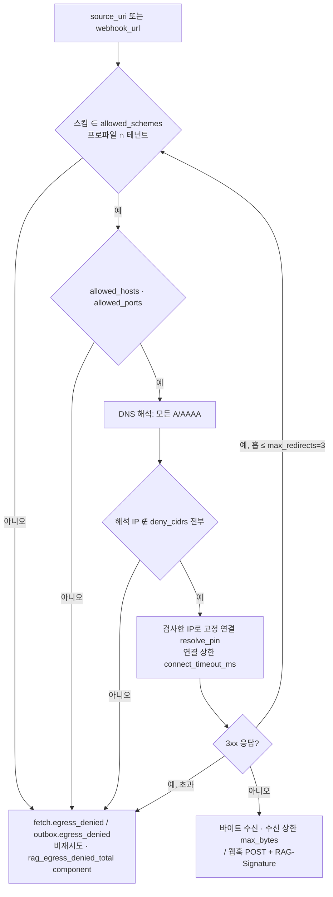

# ADR-0038: 아웃바운드 egress 정책(SSRF 방어)과 웹훅 HMAC 서명

## 맥락과 문제

플랫폼은 크롤러가 아니라 풀(pull) 모델이다(브리프 R1). 테넌트는 `IngestRequest.source_uri`로 "어디에서 가져올지"를, `callback.webhook_url`·`subscriptions.webhook_url`로 "어디로 알릴지"를 지정한다. 이 두 필드는 플랫폼 구성요소 가운데 `worker`(`fetch` 스테이지)와 `relay`(아웃박스 릴레이)가 **테넌트가 고른 목적지로 아웃바운드 연결을 여는** 유일한 지점이다. 두 컨테이너는 PostgreSQL·Qdrant·OpenSearch·Valkey·Temporal·사이드카(`parser-workers`, `ocr-gpu`, `embedding-server`)와 같은 내부망에 있고(바이블 §2.2~2.3), 클라우드 환경에서는 인스턴스 메타데이터 엔드포인트(`169.254.169.254`)에도 닿는다. 따라서 `source_uri`에 내부 Qdrant 주소를, 웹훅에 메타데이터 주소를 넣는 것만으로 서버 측 요청 위조(Server-Side Request Forgery, SSRF)가 성립한다 — 내부 서비스 탐색, 자격 증명 탈취, 그리고 다른 테넌트 데이터에 대한 간접 접근이다.

바이블 1.0.0의 강제 지점 15개에는 이 경로가 없었다. 설계 리뷰는 SSRF(워커·릴레이 경유 내부망·클라우드 메타데이터 탐색)를 리스크 #3(교차 테넌트 누출)의 확장으로 지목했고, 1.1.0에서 E16(아웃바운드 egress)이 추가되었다(바이블 「범위」 절 변경 이력 1.1.0(2026-09-22), §15 #3, ADR-0027 대안 6). 기술 지형 연구는 이 주제를 직접 다루지 않았다. 매트릭스 `uri_fetcher` 행은 "연구 문서 없음 — 아키텍트 잠정 권고(fsspec + httpx + smbprotocol, 확인 필요 as of 2026-09)"이고, 08 문서는 웹훅을 아웃박스 릴레이의 목적지로만, 12 문서는 API 키 `ip_allowlist`와 서비스 간 mTLS·내부 네트워크 정책만 언급한다. 웹훅에는 두 번째 문제가 있다. 08 문서는 릴레이 중복 발행에 대해 "소비자는 `id` 기준 멱등"만 요구하는데, 멱등은 중복을 막을 뿐 **위조·재생(replay)** 을 막지 못한다. 수신자는 "이 이벤트를 정말 플랫폼이 지금 보냈다"를 검증할 수단이 있어야 한다.

본 ADR은 바이블 §5.3 `EgressPolicy`, §6.2 웹훅 서명, §7.4 (12), §10.3 E12·E16, §13.1 `tenants`·`subscriptions`에 확정된 결정을 근거·대안과 함께 기록한다. 페처(fetcher) 라이브러리 선정은 바이블 미해결 이슈 5(04-pipelines/02 작성 전 조사)로 남아 있고 본 ADR의 범위가 아니다 — 정책은 어댑터가 바뀌어도 불변이어야 한다.

## 결정 동인(decision drivers)

| # | 동인 | 출처 |
|---|------|------|
| DR-1 | **테넌트 제어 목적지는 두 곳이고 둘 다 내부망 컨테이너가 연다**: `fetch`(`source_uri`)와 릴레이(`webhook_url`). SSRF는 필터 누락과 같은 등급의 격리 위반이다 | 바이블 §2.3 `worker`·`relay`, §15 #3, 브리프 §7 보안 |
| DR-2 | **문자열 검사는 우회된다**: 공개 DNS 이름이 사설 IP를 가리킬 수 있고(DNS 리바인딩), 검사 뒤 연결 시 재해석되면 다른 IP로 붙으며, 허용 호스트가 `http://169.254.169.254`로 리다이렉트할 수 있다. 검사는 해석된 IP에 대해, 그리고 리다이렉트 매 홉에서 반복되어야 한다 | 바이블 §5.3 `resolve_pin`·`max_redirects`, E16 검증 목록 |
| DR-3 | **fail-closed + 비재시도**: 정책 위반은 재시도해도 결과가 같다. 즉시 비재시도 코드로 종료해 `fetch` 5회·릴레이 재시도 예산을 낭비하지 않고 위반을 계량한다 | 바이블 §4.4 `fetch` 행, §5.7 오류 카탈로그, §6.5 |
| DR-4 | **이중 방어**: 보안 불변식은 애플리케이션 검사 하나에 걸지 않는다(D-09의 DLS/RLS와 같은 원칙). 네트워크 계층은 두 번째 방어선이며 첫 번째가 아니다 | 매트릭스 공통 요구 7, 12 문서 §3.3, 바이블 E8·E16 |
| DR-5 | **축소 불가 기본선**: 사설·루프백·링크로컬·메타데이터 CIDR 거부는 프로파일 상속(`extends`, 배열 교체)이나 운영자 실수로 사라지면 안 된다. 테넌트 정책은 더 좁힐 수만 있다 | 바이블 §5.6 `Profile.extends`, §7.4 (12), §5.3 "프로파일 AND 테넌트" |
| DR-6 | **웹훅 진위·재생 방지**: 소비자 멱등(`event_id`)은 위조를 막지 못한다. 비밀은 `secret_ref` 간접 참조로만 다루고 로그·트레이스에 값을 남기지 않는다 | 08 문서 아웃박스 절, 바이블 §6.2, §6.6 |
| DR-7 | **웹훅은 데이터 채널이 아니다**: 릴레이는 테넌트별 구독만 전달하고 `data`에 콘텍스트 본문을 넣지 않는다. 그래야 허용된 목적지라도 누출 표면이 ID·해시·상태로 제한된다 | 바이블 §5.1·§5.3 `CloudEventEnvelope`, E12 |
| DR-8 | **어댑터 독립성**: 페처 라이브러리가 미확정(미해결 이슈 5)이므로 판정기는 `security/egress_policy`에 두고 `fetcher` 플러그인 교체에도 정책은 그대로다 | 매트릭스 `uri_fetcher` 행, 바이블 §12 |

## 고려한 대안

### 대안 1 — `EgressPolicy`(스킴·호스트·CIDR·해석 고정·리다이렉트 재검사·크기·시간·포트) 프로파일 AND 테넌트 + NetworkPolicy 이중 방어 + `RAG-Signature` HMAC 웹훅 (채택)

- 설명: 프로파일 `runtime.egress`와 테넌트 `policies.egress_policy`가 각각 `EgressPolicy`를 선언하고, 연결은 두 정책을 **모두** 통과해야 한다. 판정은 (1) 스킴 허용 목록, (2) `allowed_hosts`(설정 시 나열 호스트만), (3) `allowed_ports`, (4) DNS 해석 후 **모든** 해석 IP를 `deny_cidrs`와 대조, (5) 검사한 IP로 고정 연결(`resolve_pin`), (6) 3xx마다 (1)~(5) 재검사·`max_redirects=3`, (7) `connect_timeout_ms`(연결)·`max_bytes`(수신) 상한 순서다. 이 (1)~(7)은 바이블 §5.3·§10.3 E16이 정하지 않은 세부를 설명하기 위한 순서이며 정본이 아니다 — 판정 순서·프로파일 AND 테넌트 합성 규칙·`allowed_hosts` 일치 방식의 정본은 `EgressPolicy` 계약을 소유하는 03-contracts/15 §8이고, 스키마 정의는 `common-types.schema.json` `$defs/EgressPolicy`(03-contracts/00)다. 위반은 `fetch.egress_denied`/`outbox.egress_denied`(비재시도)로 종료하고 `rag_egress_denied_total{component}`로 계량한다. 워커·릴레이 NetworkPolicy가 내부망 egress를 차단해 두 번째 방어선을 이룬다. 웹훅은 `subscriptions.secret_ref`의 비밀로 `RAG-Signature: t={unix_ts},v1={hex(HMAC-SHA256(secret, f"{unix_ts}.{body}"))}`를 붙이고 수신자는 5분 재생 창을 검증한다.
- 장점: DR-1~DR-8 모두 충족. 검사 대상이 URL 문자열이 아니라 **실제 연결될 IP**이므로 DNS 리바인딩·재해석·리다이렉트 우회(DR-2)가 닫힌다. 판정기가 `security/egress_policy` 하나라 `fetch`·릴레이·구독 등록(`POST /v1/subscriptions`)이 같은 코드를 쓰고 계약 테스트 6종(E16)이 한 곳을 검증한다. 서명 형식은 타임스탬프를 서명 입력에 결합하는 널리 쓰이는 HMAC 방식이라 수신자 구현이 수십 줄이고, 08 문서가 이미 요구한 소비자 멱등(`event_id`)과 결합해 중복·위조·재생을 각각 막는다. 매트릭스 `task_queue_light`·프로파일 "이벤트·API" 행의 "아웃박스 → 웹훅/SSE(Procrastinate 릴레이 / Temporal 액티비티)" 구조를 바꾸지 않는다.
- 단점: 리다이렉트마다 DNS 해석·검사를 반복하므로 원천 fetch에 홉당 지연이 붙는다. `resolve_pin`은 HTTP 클라이언트가 "해석된 IP로 연결하되 TLS SNI·`Host`는 원 호스트명으로" 보내는 훅을 제공해야 하며, 선택 라이브러리(httpx 잠정)에서의 구현 방법은 확인 필요(as of 2026-09; 미해결 이슈 5). 사설망에 있는 원천(사내 파일 서버, `smb://`)은 기본 정책으로 수집할 수 없다(재검토 조건). 수신자에게 서명 검증 구현을 요구한다.

### 대안 2 — 스킴 허용 목록만 (기각)

- 설명: `source_uri`·`webhook_url`의 스킴이 `https`·`s3`·`gs`·`az`(옵트인 `http`)인지만 검사하고 호스트·IP는 보지 않는다.
- 장점: 구현이 URL 파싱 한 줄이고 지연이 없다. 매트릭스 `uri_fetcher` 행이 스킴별 라이브러리 매핑(fsspec 계열 / httpx / smbprotocol)만 제안한 것과 형태가 맞는다.
- 단점: `https://attacker.example`이 302로 `http://169.254.169.254/`를 가리키면 그대로 따라가고, 공개 DNS 이름이 `10.0.0.5`로 해석되면 사설 Qdrant·PostgreSQL에 붙는다(DNS 리바인딩·리다이렉트 우회, DR-2). E16 검증 목록 6종 중 "`169.254.169.254`, RFC1918, `localhost`, 리다이렉트 우회, DNS 리바인딩" 5종이 통과하지 못한다. 바이블 §5.3은 스킴 외에 `deny_cidrs`·`resolve_pin`·`max_redirects`를 필수(Y)로 둔다.

### 대안 3 — NetworkPolicy 단일 방어 (기각)

- 설명: 애플리케이션은 검사하지 않고, 워커·릴레이 파드의 Kubernetes NetworkPolicy(또는 방화벽)로 사설 CIDR·메타데이터 목적지를 차단한다.
- 장점: 코드 변경이 없고 배포 계층에서 일괄 적용된다. 12 문서 §3.3이 서비스 간 통신에 "메시 또는 내부 네트워크 정책"을 권고한 것과 결이 같다.
- 단점: (a) `lite` 개발 모드는 compose이고(바이블 §11.6) `LocalRunner`는 api와 같은 프로세스라 NetworkPolicy가 존재하지 않는다 — 개발·CI에서 SSRF 테스트가 불가능하다. (b) 워커는 PostgreSQL·Qdrant·사이드카에 접근해야 하므로 내부망을 전면 차단할 수 없고, 허용 규칙 안의 주소(예: Qdrant HTTP 포트)는 그대로 SSRF 대상이다. (c) L3/L4 정책은 스킴·리다이렉트·`max_bytes`·재생을 모르며, 차단이 연결 타임아웃으로 나타나 `fetch.timeout` 재시도 5회(§4.4)를 소모한 뒤에야 실패한다 — 비재시도 코드·`rag_egress_denied_total` 계량이 불가능하다(DR-3). 바이블 E16은 NetworkPolicy를 "이중 방어"로만 둔다.

### 대안 4 — 서명 없는 웹훅(URL 내 비밀 토큰 또는 소비자 멱등만) (기각)

- 설명: `webhook_url`에 테넌트가 비밀 쿼리 파라미터를 넣거나, 08 문서의 "소비자 `event_id` 멱등"만으로 충분하다고 본다.
- 장점: 릴레이가 비밀을 다루지 않아 `secret_ref`·KeyProvider 의존이 없다. 수신자 구현이 가장 단순하다.
- 단점: URL 내 비밀은 프록시·접근 로그·트레이스에 남고 회전할 수 없다. 멱등은 같은 `event_id`의 재전달을 무해하게 할 뿐, 제3자가 봉투를 위조해 `ingest.document.indexed`를 보내거나 가로챈 정상 이벤트를 나중에 재생하는 것을 막지 못한다(DR-6). 테넌트 스코프(E12)는 릴레이 쪽 규칙이라 수신자가 "누가 보냈는가"를 확인할 길이 없다. 바이블 §6.2·E12·E16은 `RAG-Signature` HMAC-SHA256과 5분 재생 창을 필수로 둔다.

### 대안 5 — `deny_cidrs` 프로파일별 축소 허용 (기각)

- 설명: 온프레미스 배포에서 원천이 사설망(예: 사내 파일 서버)에 있는 경우를 위해 프로파일이 기본 `deny_cidrs`에서 일부 대역을 제거할 수 있게 한다.
- 장점: 사설망 원천을 별도 장치 없이 수집할 수 있다.
- 단점: 축소는 한 프로파일의 **모든 테넌트**에 열린다 — 프로파일은 컬렉션 단위 공유 자산이고 `extends`는 배열을 교체하므로(§5.6) 상위 프로파일의 실수가 하위 전부에 전파된다. 메타데이터 대역(`169.254.0.0/16`)과 사내 서버 대역(`10.0.0.0/8`)을 구분해 일부만 열더라도 클라우드 환경마다 내부 서비스 대역이 달라 검사 목록이 배포 지식이 되고, CI 게이트가 "기본 목록 포함"을 기계 검증할 수 없게 된다(DR-5). 바이블 §7.4 (12)는 "기본 목록을 포함해야 하며 축소 불가"로 확정한다. 사설망 원천은 오브젝트 스토리지 경유(`s3://`) 또는 커넥터 푸시(브리프 §6: 커넥터는 비목표이나 훅 제공)로 다루고, 그 규칙은 04-pipelines/02가 정한다.

## 결정

**결정:** 바이블 §3.1 D-09·§4.2·§5.3·§5.4·§5.7·§6.2·§6.5·§7.4·§10.3·§13.1의 다음 문장을 그대로 채택한다.

- E16 아웃바운드 egress: `fetch`(원천 `source_uri`)·릴레이(`webhook_url`)의 아웃바운드 연결은 `EgressPolicy`(§5.3: 스킴 허용 목록, 사설·루프백·링크로컬·클라우드 메타데이터 CIDR 거부, DNS 해석 IP 검사 후 고정 연결, 리다이렉트마다 재검사·`max_redirects`, 크기·시간 상한)를 프로파일 정책 AND 테넌트 정책으로 강제한다. 사이드카 호출은 서비스 디스커버리 주소만. 웹훅은 `subscriptions.secret_ref`로 `RAG-Signature: t={ts},v1=HMAC-SHA256(secret, "{ts}.{body}")`를 붙이고 수신자는 5분 재생 창을 검증한다. 워커·릴레이 NetworkPolicy로 내부망 egress 차단(이중 방어). 실패 시 `fetch.egress_denied` / `outbox.egress_denied`(비재시도). 검증: 계약 테스트(`169.254.169.254`, RFC1918, `localhost`, 리다이렉트 우회, DNS 리바인딩, `file://` 운영 거부), `rag_egress_denied_total{component}` — 바이블 §10.3.
- `EgressPolicy`: `allowed_schemes`, `allowed_hosts`, `deny_cidrs`, `max_redirects`, `resolve_pin` — array<string> / array<string> \| null / array<string(cidr)> / integer / boolean — Y/N/Y/Y/Y — 기본 `allowed_schemes=[https, s3, gs, az]`(`file`은 개발 프로파일만, `http`는 테넌트 옵트인), `deny_cidrs=[10.0.0.0/8, 172.16.0.0/12, 192.168.0.0/16, 127.0.0.0/8, 169.254.0.0/16, 0.0.0.0/8, ::1/128, fc00::/7, fe80::/10]`(사설·루프백·링크로컬·클라우드 메타데이터), `max_redirects=3`(리다이렉트마다 재검사), `resolve_pin=true`(DNS 해석 IP를 검사 후 고정 연결 — 재해석 우회 차단). 프로파일 정책 AND 테넌트 정책(§10.3 E16). `max_bytes`, `connect_timeout_ms`, `allowed_ports` — integer / integer / array<integer> — N/N/N — 기본 `fetch.max_bytes` / 5,000 / `[443, 80(옵트인)]` — 바이블 §5.3. 인벤토리: `EgressPolicy` 1.0.0, `egress-policy.schema.json`, 생산 프로파일·테넌트 정책, 소비 `fetch`·릴레이(E16), 4KB — 바이블 §5.1.
- 웹훅 서명(E16): `RAG-Signature: t={unix_ts},v1={hex(HMAC-SHA256(secret, f"{unix_ts}.{body}"))}` — `secret`은 `subscriptions.secret_ref`, 수신자는 5분 재생 창 검증 — 바이블 §6.2.
- `rag profile validate` (12): `runtime.egress.deny_cidrs`는 기본 목록(§5.3)을 포함해야 하며 축소 불가 — 바이블 §7.4. `Profile.runtime = {orchestrator, queues, tenant_concurrent_jobs_max, acl_propagation_slo, outbox_lag_slo, egress: EgressPolicy}` — 바이블 §5.6; §7.3 YAML `runtime.egress` 블록(`allowed_schemes`, `deny_cidrs`, `max_redirects: 3`, `resolve_pin: true`)이 `standard` 정본이다.
- `IngestRequest.source_uri`: `s3://`, `gs://`, `az://`, `file://`, `http(s)://`, `smb://`(플러그인). `fetch`가 `EgressPolicy`(E16)로 검사 — 사설망·메타데이터 IP·비허용 스킴은 `fetch.egress_denied`. `callback.webhook_url`(N): 릴레이가 `EgressPolicy`(E16)로 검사, `subscriptions.secret_ref`로 HMAC 서명(§6.2) — 바이블 §5.4.
- `fetch` 스테이지: **캐시 없음**(`stage_key` 미적용, 항상 다운로드; `EgressPolicy` 적용 §10.3 E16); `fetch.access_denied`·`fetch.not_found`·`fetch.too_large`·`fetch.scheme_unsupported`·`fetch.egress_denied` 비재시도; 네트워크·5xx·`fetch.timeout` 재시도 5(지수). `publish` 스테이지: 웹훅 대상이 `EgressPolicy` 위반이면 `outbox.egress_denied`(비재시도, E16) — 바이블 §4.2. `StagePolicy(fetch).non_retryable_error_codes`에 `fetch.egress_denied` 포함 — 바이블 §4.4.
- 오류 카탈로그: `fetch.egress_denied`(E16) 재시도 no; `outbox.egress_denied`(E16) 재시도 no; `outbox.relay_failed` 재시도 yes — 바이블 §5.7. 메트릭 정본 목록에 `rag_egress_denied_total{component}`; 라벨은 저카디널리티만, **`tenant_id` 라벨 금지** — 바이블 §6.5.
- E12 이벤트·웹훅: 아웃박스 이벤트 `tenantid` 필수, 릴레이는 테넌트별 구독만 전달, `data`에 콘텍스트 본문 금지, 웹훅은 `RAG-Signature` HMAC(§6.2); 실패 시 미전달; 검증 계약 테스트 — 바이블 §10.3.
- 원장: `tenants` — `policies jsonb`(llm_enrichment_allowed, allow_distribution_documents, classification_max, egress_policy); `subscriptions` — `subscription_id` PK, `tenant_id`, `webhook_url`(등록 시 `EgressPolicy` 검사), `events[]`, `secret_ref`(웹훅 HMAC-SHA256 서명 키 참조, E16) — 바이블 §13.1. API: `GET/POST/DELETE /v1/subscriptions` · `/v1/subscriptions/{subscription_id}`, `PATCH /v1/tenants/{tenant_id}/policies` — 바이블 §14.
- 모듈: `security/ … egress_policy …`, `orchestration/outbox/{relay_core(순수 함수 3개) temporal_relay procrastinate_relay webhook_signer}` — 바이블 §12. 용어: 아웃바운드 정책(`EgressPolicy`) / 웹훅 서명(`RAG-Signature`) — SSRF 방어(E16, ADR-0038) — 바이블 §16.



`standard` 프로파일의 `runtime.egress`를 `EgressPolicy` JSON으로 표현하면 다음과 같다(`max_bytes`는 §7.3 `ingest.fetch.max_bytes`에서 상속, `allowed_hosts=null`은 "호스트 제한 없음").

```json
{
  "allowed_schemes": ["https", "s3", "gs", "az"],
  "allowed_hosts": null,
  "deny_cidrs": ["10.0.0.0/8", "172.16.0.0/12", "192.168.0.0/16", "127.0.0.0/8", "169.254.0.0/16", "0.0.0.0/8", "::1/128", "fc00::/7", "fe80::/10"],
  "max_redirects": 3,
  "resolve_pin": true,
  "max_bytes": 209715200,
  "connect_timeout_ms": 5000,
  "allowed_ports": [443]
}
```

## 결과

### 긍정

- 테넌트가 제어하는 아웃바운드 목적지 두 곳(`source_uri`, `webhook_url`)이 하나의 판정기(`security/egress_policy`)를 지나며, 검사 대상이 URL 문자열이 아니라 실제 연결 IP다. E16 계약 테스트 6종이 개발 모드(`LocalRunner`, compose)에서도 실행된다 — NetworkPolicy 단일 방어로는 불가능한 일이다.
- 위반은 즉시 비재시도로 끝나고(`fetch.egress_denied`·`outbox.egress_denied`) 재시도 예산(`fetch` 5회, 릴레이)을 쓰지 않는다. `rag_egress_denied_total{component}`로 공격 시도·설정 오류를 구성요소별로 본다.
- 기본 `deny_cidrs`는 어떤 프로파일도 줄일 수 없고(§7.4 (12), 로딩 시 `profile.invalid`) 테넌트 정책은 좁히기만 하므로, 옵트인(`http`, 포트 80)이 다른 테넌트에 새지 않는다.
- 웹훅 수신자는 위조(HMAC 불일치)·재생(`t`가 5분 창 밖)·중복(`event_id` 멱등, ADR-0017)을 각각 구분해 막을 수 있고, 비밀은 `secret_ref` 간접 참조라 회전이 원장 갱신으로 끝난다. E12와 결합해 웹훅이 허용된 목적지라도 본문이 아닌 ID·해시·상태만 나간다.
- 매트릭스가 확정한 릴레이 구조(아웃박스 → 웹훅/SSE, Procrastinate/Temporal 실행기)와 페처 후보(fsspec/httpx)는 그대로다. 정책은 어댑터와 분리되어 미해결 이슈 5의 결론에 영향받지 않는다.

### 부정

- 원천 fetch에 홉당 DNS 해석·CIDR 대조가 붙고 리다이렉트는 최대 3회로 제한된다. 프리사인 URL이 여러 번 리다이렉트하는 원천은 실패한다.
- `resolve_pin`은 HTTP 클라이언트가 "해석 IP로 연결 + 원 호스트명으로 SNI·`Host`" 훅을 제공해야 성립한다. httpx에서의 구현 가능성·API는 확인 필요(as of 2026-09)이며 04-pipelines/02의 조사 항목이다.
- 사설망 원천(사내 파일 서버, `smb://` 플러그인, 사설 엔드포인트의 S3 호환 스토리지)은 기본 정책으로 수집되지 않는다. 대체 경로(오브젝트 스토리지 경유, 커넥터 푸시, 운영자 설정 엔드포인트의 취급)는 아직 확정되지 않았다(재검토 조건).
- 웹훅 수신자에게 HMAC 검증·시계 동기화(5분 창)를 요구한다. 클라이언트 SDK(05-api/06)가 검증 헬퍼를 제공해야 채택 부담이 줄어든다.
- 릴레이가 `secret_ref`를 해소하는 KeyProvider(`RAG_SECRETS__PROVIDER`, §6.6)에 의존하므로 비밀 저장소 장애는 웹훅 전송 장애(`outbox.relay_failed` 재시도)가 된다.

### 중립

- "프로파일 AND 테넌트"의 자연스러운 읽기는 "두 정책이 모두 허용해야 연결"이다(허용 집합은 교집합, 거부 집합은 합집합, 상한은 더 작은 값). 정확한 합성 규칙·판정 순서와 `allowed_hosts` 일치 방식(정확 일치·접미사)은 `EgressPolicy` 계약을 소유하는 03-contracts/15 §8이 표현하며, 본 ADR 대안 1의 (1)~(7)과 다이어그램은 그 설명일 뿐 정본이 아니다. `egress-policy.schema.json`은 `common-types.schema.json` `$defs/EgressPolicy`(03-contracts/00 소유)를 가리키는 `$ref` 래퍼다.
- `s3`·`gs`·`az` 스킴은 네트워크 목적지가 URI의 호스트가 아니라 클라이언트 설정 엔드포인트다. CIDR 검사가 이 엔드포인트에도 적용되는지, 운영자 설정 엔드포인트를 어떻게 취급하는지는 바이블이 정하지 않았고 본 ADR도 정하지 않는다(04-pipelines/02, 재검토 조건).
- `file` 스킴은 "개발 프로파일만"이다. `ProfileTier`에는 `lite, standard, premium, korean-gov`만 있으므로 "개발"이 `runtime.orchestrator: local`을 뜻하는지, `lite` 전체를 뜻하는지는 프로파일 정본(03-contracts/15·09-operations/02)이 고정한다. 운영 프로파일에서 `file://` 거부는 E16 테스트로 고정되어 있다.
- 서명은 봉투 전송 본문(`body`) 바이트 그대로에 대해 계산되므로 CloudEvents HTTP 바인딩 모드(구조화·바이너리; 08 문서 2.x SDK) 선택은 서명 방식에 영향을 주지 않는다. 모드 선택은 05-api/07의 몫이다.

## 준수 확인 방법

| 강제 수단 | 내용 | 실패 시 |
|-----------|------|---------|
| 스키마 제약 | `egress-policy.schema.json`(`common-types.schema.json` `$defs/EgressPolicy`의 `$ref` 래퍼; 바이블 §5.1 인벤토리 행은 파일명·크기 4KB만 정한다): 바이블 §5.3 표대로 `allowed_schemes`·`deny_cidrs`·`max_redirects`·`resolve_pin` 필수(Y), `deny_cidrs.items` CIDR 형식, `max_redirects`·`connect_timeout_ms`·`max_bytes` 정수. 닫힌 객체(`additionalProperties: false`)와 `allowed_schemes` `minItems: 1` 같은 추가 제약은 바이블 정본이 아니라 `$defs` 소유 문서 03-contracts/00이 확정한 것이다(ADR-0031 §준수 확인 방법 5·8과 같은 방식). `profile.schema.json`: `runtime.egress` 필수(`$ref` `EgressPolicy`; 바이블 §5.6 `Profile.runtime`). `ingest-request.schema.json`: `source_uri`·`callback.webhook_url` `format: uri`. `stage-policy.schema.json`: `fetch` 행 `non_retryable_error_codes`에 `fetch.egress_denied` | 스키마 검증 실패 / 400 `contract.violation` |
| 프로파일 로딩 게이트(§7.4 (12)) | `rag profile validate`·`POST /v1/profiles/validate`: 상속 해소 후 `runtime.egress.deny_cidrs` ⊇ 기본 9개 CIDR; 빌트인 `base/lite/standard/premium/korean-gov` YAML 전부에 대해 CI 실행 | `profile.invalid`, 빌드 실패 |
| CI 열거·이름 대조(§1.2) | 오류 코드 `fetch.egress_denied`·`outbox.egress_denied`·`outbox.relay_failed`, 메트릭 `rag_egress_denied_total`, 라벨 `component` 저카디널리티(`tenant_id` 라벨 없음), 헤더 상수 `RAG-Signature`·버전 접두 `v1` | 빌드 실패 |
| E16 계약 테스트(`tests/security`) | 판정기 단위: `169.254.169.254`, RFC1918 3대역, `localhost`·`127.0.0.1`·`::1`, `0.0.0.0`, 링크로컬 IPv6, 공개 이름 → 사설 IP 해석(DNS 리바인딩 모의), `https` → `http://169.254.169.254` 302(리다이렉트 우회), 4번째 리다이렉트, 운영 프로파일 `file://`, `http` 미옵트인, 비허용 포트 — 모두 거부 코드 + 카운터 증가. 통합: `fetch`는 `fetch.egress_denied`로 1회 시도 후 종료(재시도 0), 릴레이는 `outbox.egress_denied`로 `attempts` 증가 없이 종료 | CI 실패 |
| 웹훅 서명 테스트 | `webhook_signer` 결정성(같은 `unix_ts`·`body`·`secret` → 같은 `v1`), 참조 검증기와의 왕복(round-trip), `t`가 현재 시각 ±5분 밖이면 거부, `body` 1바이트 변경 시 거부, `secret_ref` 회전 후 새 비밀로 서명, 로그·스팬에 비밀 값 부재 | CI 실패 |
| 구독 등록·이벤트 스코프 테스트(E12) | `POST /v1/subscriptions`의 `webhook_url`이 정책 위반이면 RFC 9457 거부(상태 코드·`code`는 05-api/07·03-contracts/13이 확정), 다른 테넌트 구독으로 이벤트 미전달, `CloudEventEnvelope.data`에 `text`·`context_prefix` 문자열 부재 | CI 실패 |
| 배포 매니페스트 검사 | `deploy/helm`·`deploy/compose`의 `worker`·`relay`에 사설 CIDR·메타데이터 목적지 egress 거부 규칙과 서비스 디스커버리 허용 규칙 존재(사이드카·PostgreSQL·Qdrant·OpenSearch·Valkey·Temporal만) — 09-operations/01·05 체크리스트 | 릴리스 차단 |
| 메트릭·알림 | `rag_egress_denied_total{component}` 급증 알림(테넌트 식별은 로그 `tenant_id_hash`로), `rag_outbox_lag_seconds` ≤ `runtime.outbox_lag_slo` | 운영 알림 |
| 코드 리뷰 체크리스트 | (1) 테넌트 입력에서 파생된 URL로 소켓·HTTP 연결을 여는 코드는 `fetch`·릴레이·구독 등록 외에 없다, 생기면 E16 적용, (2) HTTP 클라이언트의 자동 리다이렉트 따라가기 비활성(홉마다 재검사), (3) 해석 IP 검사와 연결 사이에 재해석 없음(`resolve_pin`), (4) `deny_cidrs` 기본 목록을 코드·YAML 어디서도 필터링·재정의하지 않음, (5) 비밀은 `secret_ref`로만, `webhook_url`에 비밀 없음, (6) 웹훅 본문에 콘텐츠 필드 없음(E12) | 리뷰 반려 |

## 재검토 조건

- 04-pipelines/02의 페처 조사(미해결 이슈 5)에서 선택 라이브러리가 `resolve_pin`(해석 IP 고정 + 원 호스트명 SNI/`Host`)을 구현할 수 없을 때 — 대안(전용 egress 프록시, 자체 전송 계층)을 ADR 개정으로 다룬다.
- `s3`·`gs`·`az` 스킴의 클라이언트 설정 엔드포인트, `smb://` 플러그인, 온프레미스 사설망 원천의 취급 규칙이 확정될 때 — `deny_cidrs` 축소 불가를 유지한 채 "운영자 설정 엔드포인트"를 어떻게 예외 처리할지(또는 처리하지 않을지) 정한다.
- 판정기 `security/egress_policy`를 `adapters/fetch`·`orchestration/outbox`가 어떻게 받는지(셸 주입 vs `sdk` 이동)가 바이블 §12 의존 방향("`security`는 `api`·`retrieval`·`adapters/index`에서만 사용")과 함께 02-architecture/05·10-development/01에서 확정될 때.
- 웹훅 수신자 생태계가 특정 서명 규격(헤더 이름·다중 키 회전 표기)을 요구해 `RAG-Signature` 형식 변경이 필요할 때 — `v1` 접두를 유지한 채 `v2`를 병기하는 방식으로만 검토한다.
- 릴레이의 목적지가 웹훅 외로 확장될 때(08 문서: Knative Eventing `Broker` URL, NATS JetStream 조건부, Centrifugo 발행 API) — 운영자 설정 목적지에 `EgressPolicy`를 어떻게 적용할지 정한다.
- `rag_egress_denied_total`이 정상 운영에서 지속 발생해(예: CDN 다중 리다이렉트) `max_redirects=3`·`connect_timeout_ms=5000`(초안 목표) 조정이 필요할 때 — §1.2 minor 절차.
- IPv6 전용·듀얼스택 환경에서 `deny_cidrs` 기본 목록(`::1/128`, `fc00::/7`, `fe80::/10`)이 클라우드 메타데이터 IPv6 주소를 포함하지 못함이 확인될 때 — 기본 목록 확장(축소 아님)을 §1.2 절차로 반영한다.

## 참조

- [설계 브리프](../00-vision/00-design-brief.md) — §2 R1(풀 모델·URI 스킴), §3 원칙 9, §4 D-08·D-09·D-14, §6(커넥터 비목표·훅), §7 보안(아웃바운드 egress 통제·웹훅 서명), §9.7
- [설계 바이블](../02-architecture/00-design-bible.md) — 「범위」 절 변경 이력(1.1.0, E16 추가), §2.2~2.3 `worker`·`relay`, §3.1 D-09, §3.3 0038 행, §4.2 `fetch`·`publish`, §4.4 `fetch` 행, §5.1 `EgressPolicy`·`CloudEventEnvelope`, §5.3 `EgressPolicy`·`CloudEventEnvelope`, §5.4 `IngestRequest.source_uri`·`callback.webhook_url`, §5.6 `Profile.runtime`, §5.7 오류 카탈로그, §6.2 웹훅 서명, §6.5 `rag_egress_denied_total`, §6.6 비밀 규약, §7.3 `runtime.egress`, §7.4 (12), §10.3 E12·E16, §11.6, §12 `security/egress_policy`·`outbox/webhook_signer`, §13.1 `tenants`·`subscriptions`, §14 `/v1/subscriptions`·`/v1/tenants/{tenant_id}/policies`, §15 #3, §16, 미해결 이슈 5
- [기술 지형 종합: 선정 매트릭스](../07-tech-landscape/00-summary-and-selection-matrix.md) — `uri_fetcher` 행(연구 공백·잠정 권고), `task_queue_light` 행, 프로파일별 기본 조합 "이벤트·API" 행, 어댑터·플러그인 공통 요구 7(보안 불변식·이중 방어), CI 게이트, 종합 리스크 #4, 미해결 이슈(`uri_fetcher`)
- [오케스트레이션·메시징·API 프레임워크](../07-tech-landscape/08-orchestration-messaging-and-api-frameworks.md) — 트랜잭셔널 아웃박스·릴레이·소비자 `id` 멱등, CloudEvents 2.x SDK HTTP 바인딩, Knative `Broker`·Centrifugo 목적지, O-06 권고
- [보안·멀티테넌시·PII·라이선스](../07-tech-landscape/12-security-multitenancy-pii-and-licensing.md) — §3.2 API 키 스코프(`ip_allowlist`), §3.3 mTLS·내부 네트워크 정책
- 관련 ADR: [ADR-0017](./0017-event-delivery-outbox-cloudevents-no-broker.md)(아웃박스·릴레이·`tenantid`, 웹훅 전달 경로), [ADR-0027](./0027-security-context-injection-and-acl-enforcement-points.md)(강제 지점 17개, 대안 6에서 E16 도입 근거), [ADR-0018](./0018-api-rest-sse-mcp-no-grpc-rfc9457.md)(RFC 9457 오류 모델), [ADR-0031](./0031-profile-schema-extends-and-quality-gates.md)(`extends` 배열 교체·로딩 검증), [ADR-0032](./0032-plugin-sdk-stage-protocol-and-conformance-kit.md)(`fetcher` 플러그인 계약), [ADR-0033](./0033-sidecar-convert-contract-and-isolation-ladder.md)(사이드카 서비스 디스커버리 호출), [ADR-0037](./0037-artifact-cache-scope-and-stage-key-composition.md)(`fetch` 캐시 제외)
- 하류 문서(문서 맵): [멀티테넌시·보안 아키텍처](../02-architecture/07-multi-tenancy-and-security-architecture.md), [배포 아키텍처](../02-architecture/08-deployment-architecture.md), [IngestRequest 계약](../03-contracts/01-ingest-request.md), [잡·이벤트·상태 계약](../03-contracts/12-jobs-events-and-status.md), [컬렉션·프로파일·정책 계약](../03-contracts/15-collection-profile-and-policy-contracts.md), [페칭과 원천 해소](../04-pipelines/02-fetching-and-source-resolution.md), [웹훅과 이벤트](../05-api/07-webhooks-and-events.md), [관리 API](../05-api/04-management-api.md), [클라이언트 SDK](../05-api/06-client-sdks.md), [보안·컴플라이언스](../09-operations/05-security-and-compliance.md), [배포 가이드](../09-operations/01-deployment-guide.md)
