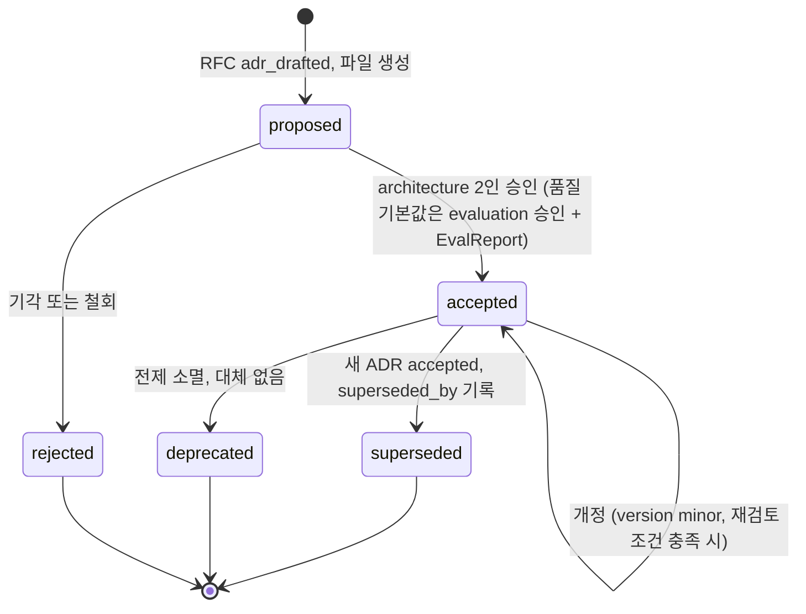
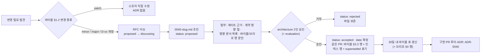

# ADR 인덱스 (Architecture Decision Records)

## 목적

`docs/06-adr/`에 있는 아키텍처 결정 기록(ADR, Architecture Decision Record) 39건의 **단일 목록**이다. 설계 바이블 §3.3이 배정한 번호·slug·우선순위·관련 결정을 파일 실측과 대조해 표로 싣고, 각 ADR의 `## 결정` 절을 한 줄로 요약한다. 아울러 이 저장소가 쓰는 MADR(Markdown Any Decision Records) 형식의 작성 규칙, 상태값 정의, 주제별 진입점, 새 ADR을 발의하는 절차를 한 곳에 정한다. 다른 문서가 이 인덱스에 위임한 두 가지 결정 — ADR 상태값 이름([설계 원칙](../00-vision/02-design-principles.md) 미해결 이슈 12, DP-07.R6)과 MADR 템플릿의 "계약 영향" 절([스키마 버전 관리](../03-contracts/14-schema-versioning-and-compatibility.md) §3.3) — 도 여기서 확정한다.

## 범위

- 포함: ADR 목록(2026-09-23 실측 39건, ADR-0039 신설 포함), MADR 형식과 바이블 §1.2 변경 절차의 관계, frontmatter·절 구성 규약, 상태 정의와 전이, 주제별 그룹, P0 우선 읽기 순서, 새 ADR 절차.
- 제외: 각 결정의 근거·대안(각 ADR 본문), 결정의 정본 문구(바이블 §3~§14; ADR은 바이블 표를 바꾸지 못한다), RFC 이슈 운영 세부([기여 가이드](../10-development/07-contributing.md) §4).
- 정본 관계: 번호·slug·우선순위·관련 결정은 **바이블 §3.3 표가 정본**이고 이 인덱스는 그 표와 파일 frontmatter에서 파생된 목록이다. 셋이 어긋나면 바이블을 기준으로 파일과 인덱스를 고친다.

---

## 1. MADR과 이 저장소의 ADR

### 1.1 ADR의 지위

바이블 §1.1의 우선순위는 **브리프 > 바이블 > ADR > 개별 설계 문서**다. ADR은 바이블의 결정 하나를 **맥락·동인·대안·결과·준수 확인·재검토 조건**까지 기록하는 문서이며, 바이블 표(타입명·필드·열거값·기본 파라미터)를 ADR 본문이 바꾸지는 못한다. 브리프 §4의 확정 결정(D-xx)이 연구 결과로 개정될 때는 바이블 §3.1이 `amended`로 표기하고 브리프 §4 행에 `(개정 v1.x, 근거: ADR-xxxx)`를 단다. 따라서 ADR 본문의 `**결정:**` 문장은 브리프·바이블 문구를 **절 번호와 함께 그대로 인용**하는 것이 원칙이고, ADR이 새로 정하는 것은 그 결정을 읽는 해석·경계·검증 수단이다.

### 1.2 바이블 §1.2 변경 절차와의 관계

ADR은 바이블 §1.2 변경 절차의 **발의 문서**다. 변경 종류에 따라 ADR이 첨부해야 하는 것이 다르다.

| 바이블 §1.2 변경 종류 | ADR | ADR에 첨부·기재할 것 | 바이블 버전 / 계약 `schema_version` |
|----------------------|-----|---------------------|--------------------------------------|
| 오탈자·설명 보강·예시 추가 | 불필요(소유자 직접 수정) | — | patch / 불변 |
| 필드 추가(선택), 열거값 추가, 기본 파라미터 값 변경 | 필수 | 게이트 근거(바이블 §7.4, `EvalReport.gate_result.passed`), `## 계약 영향` 절(§1.4) | minor / minor(가산만) |
| 필드 제거·의미 변경·필수화, 열거값 제거·개명, 타입명·스테이지 경계 변경, 명명 규약 변경 | 필수 | 영향 문서 목록, `## 계약 영향` 절(업캐스터·재처리·폐기 일정 포함) | major / major |
| 브리프 확정 결정(D-xx) 개정 | 필수 | 바이블 §3.1 `amended` 행 문안, 브리프 §4 행 갱신 문안(v1.x), 건드리는 계약마다 위 행 중 하나 | minor / 해당 계약 규칙 |

- 품질 기본값(프로파일에 `gate`가 붙은 값)은 하네스 결과와 ADR 없이는 바뀌지 않는다(바이블 §7.4). 이 경우 ADR의 `## 준수 확인 방법`에 게이트 정의를, `## 재검토 조건`에 재측정 조건을 적는다.
- 바이블 §3.3 표의 행(번호·slug·우선·관련 결정)은 ADR 채택 PR에서 함께 추가한다([기여 가이드](../10-development/07-contributing.md) §4.3 `adr_drafted`). 표 갱신은 바이블 patch다(설명 보강 행).

### 1.3 파일과 frontmatter

| 요소 | 규칙 |
|------|------|
| 파일명 | `docs/06-adr/{NNNN}-{slug}.md`. `NNNN`은 4자리 순번, slug는 kebab-case ≤ 80자. 바이블 §3.3 표와 글자 단위로 일치 |
| `title` | `"ADR-NNNN: 제목"`. 제목은 §3.3 표의 제목과 같다 |
| `status` | §2의 다섯 값 중 하나. 초안은 `proposed`, 채택되면 `accepted` |
| `date` | **결정일**(채택된 날). 이후 편집으로 바뀌지 않는다 |
| `deciders`, `owner` | 결정 주체·문서 소유 팀. 현재 모두 `architecture` |
| `version`, `last_updated` | 문서 자체의 semver와 마지막 편집일(브리프 §9.1 공통 규약). 결정 내용이 바뀌는 개정은 minor, 문구 보강은 patch |
| `priority` | `P0`~`P3`(§3 정의). §3.3 표의 값 |
| `related` | 관련 결정 식별자 배열: `D-01`~`D-20`(브리프 §4·바이블 §3.1), `O-01`~`O-10`(바이블 §3.2), `K1`~`K7`(바이블 §2.1 핵심 아이디어), `E1`~`E17`(바이블 §10.3 강제 지점), `원칙 N`(브리프 §3), `§7 …`(브리프 §7 품질 목표) |
| `depends_on` | 읽어야 하는 문서의 상대 경로 배열. 브리프·바이블은 항상 포함 |
| `superseded_by` | 선택. `status: superseded`일 때 대체 ADR 번호(`ADR-NNNN`) |

### 1.4 절 구성(MADR 템플릿)

39건 모두 아래 8개 절을 같은 이름·같은 순서로 갖는다(실측, 1.3.0 신설 ADR-0039 포함). 새 ADR도 같다.

| 순서 | 절 | 적는 것 |
|------|----|---------|
| 1 | `## 맥락과 문제` | 무엇이 미정·충돌·결함이었는지. 브리프·바이블·매트릭스의 해당 절 인용 |
| 2 | `## 결정 동인(decision drivers)` | 원칙(브리프 §3), 라이선스 등급, 계약 불변식, 운영 제약 등 판단 기준 |
| 3 | `## 고려한 대안` | 대안마다 설명·장점·단점·기각 이유. 채택안도 대안 중 하나로 병기 |
| 4 | `## 결정` | `**결정:**`으로 시작. 브리프·바이블 문구를 절 번호와 함께 인용하고, 결정이 고정하는 계약·프로파일 표현을 표로 정리. Mermaid 다이어그램·JSON 예시 |
| 4a | `## 계약 영향` (조건부) | §1.2의 minor 이상 변경일 때 **필수**. (1) 바뀌는 스키마 파일과 `declared_level`, (2) `SchemaDiffReport` 요약, (3) 생산·소비 스테이지(바이블 §4.2·§4.3), (4) 저장 산출물 영향, (5) 외부 소비자 영향(SDK·웹훅·MCP), (6) `profile_hash` 영향, (7) 폐기 일정 — [스키마 버전 관리](../03-contracts/14-schema-versioning-and-compatibility.md) §3.3의 7항목 |
| 5 | `## 결과` | 긍정·부정·중립 결과. 다른 문서로 넘기는 확정 사항을 명시 |
| 6 | `## 준수 확인 방법` | 강제 지점·장치(스키마·린트·CI 게이트·적합성 키트)·실패 시 동작·정본 표. 코드 리뷰 체크리스트 |
| 7 | `## 재검토 조건` | 이 결정을 다시 여는 측정·사건·날짜 조건(§2.2 참조) |
| 8 | `## 참조` | 브리프·바이블·매트릭스·연구 문서·관련 ADR 링크 |

**결정:** `## 계약 영향` 절은 §1.2 표의 minor 이상 변경을 담는 ADR에 필수이며 `## 결정` 바로 뒤에 둔다. 2026-09-22에 채택된 기존 38건은 계약 `schema_version` 1.0.0 게시 전의 기준선이므로 이 절을 소급 추가하지 않는다(바이블 변경 이력 "하위 문서·스키마가 미게시 상태의 개정이므로 계약 `schema_version`은 1.0.0을 유지").

### 1.5 작성 규칙

- 길이 60~200행(브리프 §9.11). 한국어 본문, 식별자·필드·열거값은 영문 snake_case 그대로. 이모지 금지.
- 정본 예는 [ADR-0001](0001-license-grade-table-and-d02-interpretation.md). `**결정:**` 표기와 `**미정(O-xx):**` 표기는 브리프 §9.7.
- 금지: 바이블 표를 본문이 바꾸는 것, 브리프 D-xx 문구·열거 철자의 변형, 근거 없는 수치, 존재하지 않는 문서 링크. 확실하지 않은 외부 사실은 `확인 필요(as of 2026-09)`.
- 관련 ADR은 본문에서 링크 텍스트 `ADR-NNNN 짧은 제목`, 링크 대상은 같은 디렉터리의 상대 경로 `NNNN-slug.md`로 적고 `## 참조`에 다시 적는다.
- 검증: 문서 검증기(링크·frontmatter·행 수)와 `## 결정`의 ADR 번호가 바이블 §3.3과 일치하는지 확인([기여 가이드](../10-development/07-contributing.md) §4.4). 계약·스키마를 건드리면 `node tools/validate-contracts.mjs --root <repo>`가 0 오류여야 한다.

---

## 2. 상태 정의

### 2.1 상태값

frontmatter `status`는 다음 다섯 값만 쓴다(기여 가이드 §4.4와 동일 집합).

| 상태 | 의미 | 진입 조건 | 이 인덱스 표기 |
|------|------|-----------|----------------|
| `proposed` | 발의됨. 결정 문구가 있으나 승인 전 | RFC 이슈 `adr_drafted` 단계에서 PR로 파일 생성 | 표에 싣되 `우선`은 비움. 바이블 §3.3 행은 채택 PR에서 추가 |
| `accepted` | 채택됨. 바이블·브리프 표가 이 결정을 반영했거나 30일 내 반영 예정 | architecture 2인 승인 + 영향 팀 반대 없음(품질 기본값은 `evaluation` 승인 + `EvalReport`) | 기본 상태. `## 재검토 조건`이 비어 있지 않아야 한다 |
| `rejected` | 발의됐으나 기각됨. 기록 보존용 | 승인 거부 또는 발의자 철회. 파일은 남긴다 | 표에 싣고 요약에 기각 이유 한 줄 |
| `deprecated` | 결정이 더 이상 유효하지 않으나 대체 ADR이 없음 | 전제(라이브러리·스펙·요구)가 사라져 결정 자체가 무의미해진 경우 | 표에 싣고 요약에 사유 |
| `superseded` | 새 ADR이 대체함 | 새 ADR `accepted` + 이전 ADR에 `superseded_by` 기록, 새 ADR `related`에 이전 번호 | 표에 싣고 링크를 새 ADR로 안내 |

### 2.2 평가 없이 확정된 결정의 표기(DP-07.R6 해소)

**결정:** 골든셋 측정이나 실측 없이 채택된 결정을 위한 **별도 상태값(예: `provisional`)은 두지 않는다.** 그런 결정도 `status: accepted`이며, 대신 `## 재검토 조건`에 (a) 무엇을 측정해야 하는지(데이터셋·메트릭·`gate`), (b) 어떤 외부 사건(릴리스·라이선스 변경·스펙 개정)이 재검토를 촉발하는지, (c) 조건 충족 시 **같은 ADR 개정(`version` minor, `date` 유지)** 인지 **새 ADR로 대체(`superseded`)** 인지를 적는다. 이유는 셋이다: (1) 현재 38건 전부가 실측 전 기준선이라 별도 값을 두면 사실상 모두가 그 값이 되어 구분력이 없다, (2) 바이블 §7.4가 이미 "품질 기본값은 게이트 없이 바뀌지 않는다"로 실측의 의무를 프로파일 `gate`에 두고 있어 상태값이 중복된다, (3) 기여 가이드 §4.4의 다섯 값 집합을 유지해 문서 검증기·RFC 상태 기계와 어긋나지 않는다. 38건 모두 `## 재검토 조건` 절을 갖고 있음을 실측으로 확인했다.

---

## 3. 전체 표(39건, 2026-09-23 실측)

우선순위는 바이블 §3.3의 값이다. `P0`는 "다른 설계 문서가 전제로 삼는 것"(바이블 §3.3)이며, 이 인덱스는 나머지를 다음과 같이 읽는다 — `P1` 기본 프로파일의 구성요소·경로 선택, `P2` 정책·규약·운영 방식, `P3` 실측으로 조정될 세부값. 38건은 `status: accepted`, `date: 2026-09-22`이고, 1.3.0에서 신설된 ADR-0039는 `status: accepted`, `date: 2026-09-23`다. 관련 결정 열은 각 ADR frontmatter `related`의 값이다(범례는 §1.3).

| ID | 제목 | 상태 | 우선 | 관련 결정 | 요약 한 줄 | 링크 |
|----|------|------|------|-----------|-----------|------|
| ADR-0001 | 라이선스 등급표 A/B/C/D/X와 D-02 해석 지침 | accepted | P0 | D-02 | 의존성·모델을 A/B/C/D/X 등급으로 판정, `PluginMeta`에 `license`·`license_grade`·`territory` 필수, CI 라이선스 게이트(pip-licenses·liccheck·SBOM·`models.lock`) | [0001](0001-license-grade-table-and-d02-interpretation.md) |
| ADR-0002 | ParsedDocument provenance: element_path·char offset 필수, page/bbox nullable | accepted | P0 | D-04 | `ParsedDocument` 자체 소유; `element_path`·`char_start/char_end`(유니코드 코드포인트) 필수, `page`/`bbox`는 흐름 포맷에서 null, bbox는 좌상단 원점·PDF 포인트 | [0002](0002-provenance-element-path-and-nullable-page-bbox.md) |
| ADR-0003 | 오케스트레이터 중립 파이프라인과 비내구 LocalRunner | accepted | P0 | D-17 | 파이프라인 정의는 `PipelineContext`에만 의존(`temporalio` 임포트 금지), Temporal 실행 + 비내구 `LocalRunner`(개발·CI·하네스), 경계 페이로드는 `ArtifactRef`만, 검색은 오케스트레이터 미경유 | [0003](0003-orchestrator-neutral-pipeline-and-non-durable-local-runner.md) |
| ADR-0004 | 결정적 chunk_id·block_id 해시, 스코프·세대 합성 record_id/point_id와 D-06 ULID 예외 | accepted | P0 | D-06, E17 | 발급형 `*_id`는 ULID, 콘텐츠 파생 키는 BLAKE3 `H(label, …)`; `record_id = H("record", tenant, collection, document, generation, chunk_id)`, `point_id = uuid5(NAMESPACE_RAG_CHUNK, record_id)` | [0004](0004-deterministic-chunk-id-scoped-record-id-and-ulid-exception.md) |
| ADR-0005 | doc_version은 콘텐츠 해시만; ACL·메타데이터는 payload 갱신 | accepted | P0 | D-09, 원칙 4 | `doc_version = content_hash`(콘텐츠만); ACL·메타 변경은 재임베딩 없이 `update_acl` payload 갱신 + `aclrev:` 회수 힌트 + `acl.document.updated` | [0005](0005-doc-version-content-hash-only-and-acl-payload-update.md) |
| ADR-0006 | PDF 고속 텍스트 경로: PyMuPDF 제거, pypdfium2 + pdftext | accepted | P1 | D-18 | 디지털 PDF 고속 텍스트는 pypdfium2 + pdftext(`lite`), 레이아웃·표는 Docling(`standard`); PyMuPDF(AGPL, 인프로세스 대안·기각)는 별도 저장소의 옵트인 사이드카만 | [0006](0006-pdf-fast-path-pypdfium2-pdftext-replaces-pymupdf.md) |
| ADR-0007 | HWP 5.0 기본 경로: Apache-2.0 Java 사이드카, pyhwp 강등, H2Orestart GPL 격리 | accepted | P1 | D-18, O-07 | HWP 5.0은 Java 사이드카 → HWPX → 단일 OWPML 어댑터 1차, 폴백 unhwp → hwp-hwpx-parser → `lo-sidecar`(opt-in); pyhwp·H2Orestart는 대안·기각(GPL/AGPL 격리), `parser_chain[]` 기록 | [0007](0007-hwp5-java-sidecar-first-pyhwp-demoted.md) |
| ADR-0008 | OCR 기본값 RapidOCR PP-OCRv5 korean / GPU PaddleOCR / 폴백 Tesseract | accepted | P1 | D-18, O-08 | 기본 RapidOCR 3.9.x PP-OCRv5 korean mobile(ONNX), `premium` GPU PaddleOCR server(`ocr-gpu`), 폴백 Tesseract `kor+eng`; 페이지 단위 하트비트·`page_status[]`·`Block.confidence` | [0008](0008-ocr-default-rapidocr-ppocrv5-korean.md) |
| ADR-0009 | 임베딩 서빙: vLLM pooling + TEI + 인프로세스, Infinity 제외 | accepted | P1 | D-16 | 서빙은 vLLM pooling(BGE-M3 3-in-1) + TEI(dense·리랭커) + 인프로세스(`lite`); Infinity 제외; 같은 `embedding_space_id` 안의 스택 교체는 코사인 ≥ 0.9999 동등성 게이트 | [0009](0009-embedding-serving-vllm-pooling-tei-inprocess.md) |
| ADR-0010 | BGE-M3 유지 근거 재기술과 late_interaction 슬롯 분리 | accepted | P1 | D-16, O-04 | BGE-M3 dense+sparse 유지(3-in-1·생태계·드롭인 파인튠), 리랭커 bge-reranker-v2-m3; `late_interaction`은 별도 슬롯 기본 끔(KURE-v2를 M2 골든셋에서 채널 vs 리랭크 비교) | [0010](0010-bge-m3-rationale-and-late-interaction-slot.md) |
| ADR-0011 | 저장소 기본 이미지: Valkey, RustFS 또는 SeaweedFS | accepted | P1 | D-14 | PostgreSQL + S3 호환(RustFS 또는 SeaweedFS, 실측 후 택1; MinIO 대안·기각) + Valkey(Redis 호환 대체); Valkey는 가속기만이고 멱등 판정·ACL·잡 상태 정본은 PostgreSQL | [0011](0011-kv-and-object-storage-valkey-rustfs-seaweedfs.md) |
| ADR-0012 | 경량 프로파일 Qdrant 단독 BM25 계약(sparse_bm25) | accepted | P1 | D-15 | `lite`는 Qdrant 단독: 플랫폼이 형태소 토큰화 + BM25 TF 포화값을 계산해 `sparse_bm25`(`modifier: idf`)로 적재; 백엔드는 `IndexBackend` + `capabilities()` 뒤에 둔다 | [0012](0012-lite-profile-qdrant-only-client-bm25.md) |
| ADR-0013 | 융합 RRF k=60 → convex combination 2단계 전략, 다중 컬렉션 융합 규칙, 후처리 고정 순서와 pack 내부 순서 | accepted | P1 | O-01, D-07 | 플랫폼 `fuser` RRF(k=60, 1:1:1, 변형 0.5) → 골든셋 ≥ 200 qrels 시 `convex_minmax`; 다중 컬렉션은 RRF 그대로 투입; 후처리 순서와 `pack` 내부 `acl_recheck → budget_cut → reorder → citation_align` 고정 | [0013](0013-fusion-rrf-k60-then-convex-combination-and-postprocess-order.md) |
| ADR-0014 | sparse 표현: BGE-M3 sparse 기본, lexical 레그 유지 | accepted | P2 | O-02 | learned sparse 기본 BGE-M3(`vocab_id=xlm-roberta-250k`), lexical 레그는 항상 제3 레그; `vocab_id` 불일치는 `embed.space_mismatch`; sparse 모델 교체는 blue/green | [0014](0014-sparse-representation-bge-m3-lexical-leg-kept.md) |
| ADR-0015 | GraphRAG 외부 플러그인 / RAPTOR 코어 옵션 이분 | accepted | P2 | O-03 | GraphRAG 계열은 외부 플러그인 패키지(`channel=graph` + `enricher`), 코어는 계약 슬롯만; RAPTOR는 코어 `enricher` 옵션(`item_kind=summary`, 기본 끔); 저장소 PostgreSQL + Apache AGE, 별도 잡 `build_graph` | [0015](0015-graph-rag-external-plugin-raptor-core-option.md) |
| ADR-0016 | LLM 보강 기본 끔과 비용 정책(enrichment_budget_tokens) | accepted | P2 | O-05, D-19 | LLM 보강은 모든 프로파일 기본 끔(컬렉션 정책으로 켬), 비LLM 보강만 기본; `ingest-llm` 큐 + 토큰 버킷 + `enrichment_budget_tokens` + 1.5배 상한 초과 시 `partial`; 게이트 nDCG@10 +0.03 | [0016](0016-llm-enrichment-default-off-and-budget-policy.md) |
| ADR-0017 | 이벤트 전달: 브로커 없는 v1(아웃박스 + CloudEvents), 테넌트 스코프 멱등 키, NATS 추가 조건 | accepted | P2 | O-06, D-08 | v1 브로커 없음: CloudEvents 1.0.2 + PostgreSQL 트랜잭셔널 아웃박스 + 릴레이(웹훅·SSE); `Idempotency-Key` 판정 정본은 `idempotency_keys(tenant_id, key)`; NATS JetStream은 세 조건에서만 | [0017](0017-event-delivery-outbox-cloudevents-no-broker.md) |
| ADR-0018 | API 규약: REST + SSE + MCP, gRPC 미제공, RFC 9457·Idempotency-Key | accepted | P2 | O-10 | REST + SSE + MCP 확정, gRPC v1 미제공(필요 시 `connectrpc` 마운트); 오류 모델 하나 `StageError` ↔ RFC 9457 `type = urn:rag:error:{code}` 1:1; `RateLimit`·`Deprecation`·`Sunset` 헤더 | [0018](0018-api-rest-sse-mcp-no-grpc-rfc9457.md) |
| ADR-0019 | 청크 크기·토크나이저 기본값과 recount 스테이지 | accepted | P3 | O-09 | 예산 토크나이저 `hf:BAAI/bge-m3`(+`tiktoken:o200k_base` 병기); 자식 512 / 부모 2048 / 병합 하한 64 / 표 행 그룹 256; 임베더 교체 시 `recount` 스테이지(재청킹 아님); M2 그리드 | [0019](0019-chunk-size-tokenizer-defaults-and-recount-stage.md) |
| ADR-0020 | 기본 청커 StructureAwareChunker와 의존성 잠금(semchunk 3.2.5, tiktoken 0.12) | accepted | P1 | D-19 | 기본 청커는 `ParsedDocument` 네이티브 `StructureAwareChunker`(Docling 어댑터는 `[docling-chunker]` extra 2차 + CI 동등성); small-to-big; semchunk 3.2.5·tiktoken 0.12.0 잠금(pin-and-bump) | [0020](0020-default-chunker-structure-aware-and-dependency-locks.md) |
| ADR-0021 | 한국어 분석기: Kiwi 승격 조건과 공백기 기본(python-mecab-ko + kss) | accepted | P2 | 원칙 6, D-15 | 공백기 기본 python-mecab-ko 1.3.7 + kss 6.0, Kiwi는 `[kiwi]` extra(0.23.2 LGPL 정적 링크 wheel 거부); kiwipiepy 0.24 Apache-2.0 wheel 확인 후 ADR 개정으로 승격; OpenSearch Nori `mixed`/`discard` + 사용자 사전 | [0021](0021-korean-analyzer-kiwi-promotion-and-interim-mecab-kss.md) |
| ADR-0022 | 관측성 규약 고정(GenAI semconv 커밋·Weaver)과 라이선스 경계 | accepted | P2 | D-11 | OTel + GenAI semconv 커밋 고정·Weaver 생성 상수; 메트릭 `rag_<stage>_<name>_<unit>`, `tenant_id` 라벨 금지, 콘텐츠 캡처 기본 끔; Grafana·Loki·Langfuse·Phoenix는 OTLP 대상 분리 컨테이너만 | [0022](0022-observability-genai-semconv-pin-and-license-boundary.md) |
| ADR-0023 | 평가 하네스: qrels + answer_spans, nDCG 선형 이득, Holm 보정 | accepted | P2 | D-12 | 골든셋 TREC qrels/run + `answer_spans` JSONL(원문 코드포인트 구간, 재청킹 불변); nDCG 선형 이득·Holm 보정·인터리빙; 하네스는 동일 인프로세스 스테이지, 품질 기본값은 프로파일 `gate` | [0023](0023-evaluation-qrels-answer-spans-and-linear-ndcg.md) |
| ADR-0024 | Context Pack 순서 전략과 Anthropic search_result 렌더러 | accepted | P2 | D-20 | 공급자 중립 `ContextPack` + 렌더러 9종; Anthropic `search_result` 1차 / `document` 2차 + `citations`; `cite_id` 관련도순 불변, `litm_alternating` 공식(홀수 k → K−(k+1)/2, 짝수 k → k/2−1) | [0024](0024-context-pack-ordering-and-anthropic-search-result-renderer.md) |
| ADR-0025 | MCP 커서 페이지네이션과 도구 집합 | accepted | P2 | D-13 | MCP `mcp>=2,<3` Streamable HTTP, 도구 `search`·`get_document`·`list_collections`; 세션 대신 `cursor`/`next_cursor`(Valkey 10분, 테넌트 바인딩); `structuredContent` 슬림 팩 + 20k 토큰 상한 | [0025](0025-mcp-cursor-pagination-and-tool-set.md) |
| ADR-0026 | IndexCommit 세대 사가: 세대 합성 물리 키, 플립 중간 상태와 이전 세대 복원 보상, ID 발급·문서 직렬화, commit ledger | accepted | P0 | K6 | `index`는 세대 사가: N+1을 `is_current=false`로 적재 → 렉시컬 → 벡터 플립 → `committed`; 플립 전 삭제 / 플립 후 이전 세대 복원 보상; `index_commits` 원장, `cleanup_delay` 1h | [0026](0026-index-commit-generation-saga-and-ledger.md) |
| ADR-0027 | SecurityContext 서버 주입, 요청별 테넌트 JWT(DLS), ACL 회수 힌트와 강제 지점 17개 | accepted | P0 | D-09 | `SecurityContext` 서버 주입(`as_of = now()`, `QueryRequest`에 보안 필드 없음), 사전 필터 불변식(보안·전략·사용자 필터 분리), 강제 지점 E1~E17, OpenSearch DLS는 요청별 단명 JWT, `aclrev:` 회수 힌트 | [0027](0027-security-context-injection-and-acl-enforcement-points.md) |
| ADR-0028 | 테넌트 격리 등급 TieringPolicy | accepted | P2 | K7 | `TieringPolicy` 하나로 테넌트 격리 3단(`payload_filter`/`shard_key`/`index_per_tenant`) 선언·검증; 100만 청크 초과 시 `shard_key` blue/green 승격 잡 `tier_promotion`; `korean-gov`는 `index_per_tenant` 선택 | [0028](0028-tenant-isolation-tiering-policy.md) |
| ADR-0029 | 3-텍스트 규칙과 결정적 context_prefix | accepted | P1 | K2, D-19 | 청크는 `text`/`embed_text`/`index_text` 분리 보관, `strip_offsets`로 `enrich → strip` 대칭 강제; 결정적 `context_prefix`(제목·heading 경로·캡션) 기본 켬, LLM 접두어는 O-05 정책 | [0029](0029-three-text-rule-and-deterministic-context-prefix.md) |
| ADR-0030 | 단일 좌표계와 점수 원장(계약 골격) | accepted | P0 | D-05, K1, K3 | 13 계약 경계 유지(서브스테이지는 경계 타입 추가 없음); K1 단일 좌표계 — `IndexRecord.block_refs[]`·`sentence_spans[]`로 원문 역추적; K3 점수 원장 — `Σ contribution = fused_score`, `confidence_tier` | [0030](0030-single-coordinate-system-and-score-ledger.md) |
| ADR-0031 | 프로파일 스키마: extends 단일 상속과 품질 게이트 | accepted | P2 | K7 | 프로파일은 `extends` 단일 상속(`base → lite → standard → premium`, `korean-gov extends standard`), 깊은 병합·배열 교체; `gate`가 붙은 품질 기본값은 `EvalReport`와 ADR 없이 불변, 값 변경 = `profile_hash` 변경 = blue/green | [0031](0031-profile-schema-extends-and-quality-gates.md) |
| ADR-0032 | 플러그인 SDK: Stage 프로토콜 5멤버와 적합성 키트 | accepted | P1 | D-10 | entry points 14 확장 지점 유지, 서브 역할은 `PluginMeta.role`; `Stage[In, Out]` 5멤버(`plugin_id`·`config_schema`·`capabilities()`·`fingerprint()`·`run()`), I/O·시간·난수는 `ctx`만; 적합성 키트 | [0032](0032-plugin-sdk-stage-protocol-and-conformance-kit.md) |
| ADR-0033 | 사이드카 convert 계약과 격리 사다리 | accepted | P1 | K5, O-10 | 어댑터 격리 3단 `in_process`/`helper_process`/`sidecar`; 모든 변환 사이드카는 `POST /v1/convert`(`ConvertRequest`/`ConvertResponse`) + `GET /healthz`; 파생물은 `H("derived", content_hash, image_digest)`; GPL 사이드카는 별도 저장소 | [0033](0033-sidecar-convert-contract-and-isolation-ladder.md) |
| ADR-0034 | 검색 핫패스의 PostgreSQL 미의존, hydrate 서브스텝과 부모 텍스트 저장 정책 | accepted | P2 | §7 가용성, K1 | 검색 핫패스(`plan`~`render`)는 PostgreSQL을 읽지 않음; `hydrate`가 fused 상위 `top_n`의 payload를 1회 배치 조회(누락은 `degraded{hydrate}`); 부모 텍스트는 `ChunkTextStore`(`artifact_store` 번들, `vector_payload` 대안) | [0034](0034-retrieval-hot-path-postgres-independence-and-hydrate.md) |
| ADR-0035 | Python 버전·툴체인 고정 | accepted | P3 | D-01 | `requires-python >=3.12,<3.14`(3.14는 검증 후), Pydantic v2, FastAPI, uv(`uv lock --check`), ruff, mypy strict, import-linter 계층·금지 계약 4개; pin-and-bump + 계약 코퍼스 | [0035](0035-python-version-and-toolchain-pins.md) |
| ADR-0036 | 명명·식별자·열거 타입명·이벤트·메트릭 규약 | accepted | P2 | D-03, D-06 | 문서 한국어·식별자 영문 snake_case; 열거 타입명은 고유 PascalCase; ULID(대문자) vs BLAKE3 hex(소문자) 키 구분; 이벤트 `domain.entity.action`, 메트릭·스팬·환경 변수·오브젝트 키·Valkey 키 규약 정본 | [0036](0036-naming-and-identifier-conventions.md) |
| ADR-0037 | 산출물 캐시 스코프: stage_key에 tenant·collection·document 합성, fetch 캐시 제외 | accepted | P0 | K5, 원칙 4 | `stage_key = H("stage", stage_name, scope_key, input.blake3, fingerprint)`, `scope_key = tenant/collection/document`; 봉투 있는 산출물은 잡 스코프 안에서만 재사용, 봉투 없는 콘텐츠 캐시(원본·파생물·임베딩·LLM 보강)만 테넌트 내 공유; `fetch`는 캐시 없음 | [0037](0037-artifact-cache-scope-and-stage-key-composition.md) |
| ADR-0038 | 아웃바운드 egress 정책(SSRF 방어)과 웹훅 HMAC 서명 | accepted | P1 | D-09, §7 보안 | `EgressPolicy`(스킴 허용 목록, 사설·루프백·메타데이터 CIDR 거부, DNS 해석 IP 고정, 리다이렉트마다 재검사)를 `fetch`·릴레이에 프로파일 AND 테넌트로 강제(E16); 웹훅 `RAG-Signature` HMAC-SHA256 + 5분 재생 창 | [0038](0038-outbound-egress-policy-and-webhook-signing.md) |
| ADR-0039 | 바이블 1.3.0 가산 개정 묶음(선택 필드·열거값·이벤트·JobKind·§14 엔드포인트·해시 키, AM-26~AM-44) | accepted | P1 | §1.2 minor, FR-MGT-01 | 1.3.0 minor 가산 묶음 AM-26~AM-44를 ADR 한 건으로 기록; 가산만이라 §7.4 게이트 근거 해당 없음; 대안(major 동반 개정)은 기각(D4-3) | [0039](0039-bible-1-3-additive-amendment-bundle.md) |

집계: P0 9건(0001·0002·0003·0004·0005·0026·0027·0030·0037), P1 14건(0039 포함), P2 14건, P3 2건(0019·0035). 파일 39건은 바이블 §3.3의 39행과 번호·slug가 글자 단위로 일치하며 누락·추가는 없다(1.3.0에서 ADR-0039 신설).

---

## 4. 주제별 그룹

한 ADR은 한 그룹에만 속한다. 다른 그룹에서도 읽어야 하는 것은 `참조`로 적었다.

### 4.1 라이선스·의존성

- [ADR-0001](0001-license-grade-table-and-d02-interpretation.md) 라이선스 등급표 A/B/C/D/X — 모든 기본값 선택의 판정 규칙(P0).
- [ADR-0035](0035-python-version-and-toolchain-pins.md) Python 버전·툴체인 고정 — 인터프리터 범위, 정적 검사, import-linter 계약, 금지 임포트.
- 참조: 0020(semchunk·tiktoken 잠금), 0021(kiwipiepy LGPL 정적 링크 거부), 0022(관측 스택 AGPL·ELv2 경계), 0011(MinIO 대안·기각, Redis 호환 Valkey로 전환), 0006·0007(PyMuPDF·pyhwp 대안·기각, AGPL·GPL 파서 격리).

### 4.2 파싱·문서 모델

- [ADR-0002](0002-provenance-element-path-and-nullable-page-bbox.md) ParsedDocument provenance — 좌표계의 원천 필드(P0).
- [ADR-0006](0006-pdf-fast-path-pypdfium2-pdftext-replaces-pymupdf.md) PDF 고속 텍스트 경로 — pypdfium2 + pdftext, Docling, PyMuPDF 제외.
- [ADR-0007](0007-hwp5-java-sidecar-first-pyhwp-demoted.md) HWP 5.0 기본 경로 — Java 사이드카 → HWPX, 폴백 체인, pyhwp 대안·기각(GPL 격리).
- [ADR-0008](0008-ocr-default-rapidocr-ppocrv5-korean.md) OCR 기본값 — RapidOCR / PaddleOCR / Tesseract, 페이지 단위 상태.
- [ADR-0033](0033-sidecar-convert-contract-and-isolation-ladder.md) 사이드카 convert 계약과 격리 사다리 — 파서·OCR 사이드카의 공통 계약과 격리 모드.
- 참조: 0030(좌표계가 이 필드를 소비), 0037(파생물 캐시 키).

### 4.3 청킹·보강

- [ADR-0020](0020-default-chunker-structure-aware-and-dependency-locks.md) 기본 청커 StructureAwareChunker — 알고리즘, small-to-big, 표 행 그룹, 의존성 잠금.
- [ADR-0019](0019-chunk-size-tokenizer-defaults-and-recount-stage.md) 청크 크기·토크나이저 기본값과 recount — 512/2048/64, 토큰화 역할 분리.
- [ADR-0029](0029-three-text-rule-and-deterministic-context-prefix.md) 3-텍스트 규칙과 결정적 context_prefix — `text`/`embed_text`/`index_text`, `strip_offsets`.
- [ADR-0016](0016-llm-enrichment-default-off-and-budget-policy.md) LLM 보강 기본 끔과 비용 정책 — 비LLM 보강 기본, 예산·큐·`partial`.
- 참조: 0004(`chunk_id` 결합식), 0021(정규화 측 형태소 분석기), 0015(RAPTOR `enricher`).

### 4.4 임베딩·인덱스

- [ADR-0010](0010-bge-m3-rationale-and-late-interaction-slot.md) BGE-M3 유지 근거와 late_interaction 슬롯 — 모델 선택, 리랭커, 실험 슬롯.
- [ADR-0009](0009-embedding-serving-vllm-pooling-tei-inprocess.md) 임베딩 서빙 — vLLM pooling + TEI + 인프로세스, 동등성 게이트.
- [ADR-0014](0014-sparse-representation-bge-m3-lexical-leg-kept.md) sparse 표현 — learned sparse 기본, lexical 레그 유지, `vocab_id`.
- [ADR-0012](0012-lite-profile-qdrant-only-client-bm25.md) 경량 프로파일 Qdrant 단독 BM25 — 플랫폼 측 `sparse_bm25`, `IndexBackend` + `capabilities()`.
- [ADR-0021](0021-korean-analyzer-kiwi-promotion-and-interim-mecab-kss.md) 한국어 분석기 — mecab-ko + kss 공백기 기본, Kiwi 승격 조건, Nori 설정.
- 참조: 0026(색인 세대 사가), 0028(테넌트 격리 등급이 물리 인덱스 배치를 정함), 0004(`record_id`·`point_id`).

### 4.5 검색·패킹

- [ADR-0013](0013-fusion-rrf-k60-then-convex-combination-and-postprocess-order.md) 융합 RRF → convex combination, 후처리·pack 순서 — 검색 경로의 뼈대.
- [ADR-0034](0034-retrieval-hot-path-postgres-independence-and-hydrate.md) 검색 핫패스 PostgreSQL 미의존과 hydrate — payload 1회 배치 조회, 부모 텍스트 저장.
- [ADR-0024](0024-context-pack-ordering-and-anthropic-search-result-renderer.md) Context Pack 순서 전략과 렌더러 — `litm_alternating`, `search_result`, `cite_id`.
- [ADR-0015](0015-graph-rag-external-plugin-raptor-core-option.md) GraphRAG 외부 플러그인 / RAPTOR 코어 옵션 — 고급 검색의 경계.
- 참조: 0030(점수 원장·좌표계), 0027(사전 필터 불변식·`acl_recheck`), 0025(MCP 결과 형태).

### 4.6 오케스트레이션·원장

- [ADR-0003](0003-orchestrator-neutral-pipeline-and-non-durable-local-runner.md) 오케스트레이터 중립 파이프라인과 LocalRunner — 실행 셸의 경계(P0).
- [ADR-0026](0026-index-commit-generation-saga-and-ledger.md) IndexCommit 세대 사가와 commit ledger — 적재·플립·보상·정리(P0).
- [ADR-0037](0037-artifact-cache-scope-and-stage-key-composition.md) 산출물 캐시 스코프와 stage_key — 멱등성 키 = 캐시 키 = 산출물 경로(P0).
- [ADR-0005](0005-doc-version-content-hash-only-and-acl-payload-update.md) doc_version은 콘텐츠 해시만 — 문서 버전과 ACL 갱신 워크플로우(P0).
- [ADR-0017](0017-event-delivery-outbox-cloudevents-no-broker.md) 이벤트 전달 — 아웃박스 + CloudEvents + 릴레이, 테넌트 스코프 멱등 키.
- 참조: 0035(import-linter가 `pipelines`의 `temporalio` 의존을 차단), 0011(원장·아웃박스는 PostgreSQL, Valkey는 가속기).

### 4.7 보안·테넌시

- [ADR-0027](0027-security-context-injection-and-acl-enforcement-points.md) SecurityContext 서버 주입과 강제 지점 17개 — 멀티테넌시 정본(P0).
- [ADR-0028](0028-tenant-isolation-tiering-policy.md) 테넌트 격리 등급 TieringPolicy — `payload_filter`/`shard_key`/`index_per_tenant`.
- [ADR-0038](0038-outbound-egress-policy-and-webhook-signing.md) 아웃바운드 egress 정책과 웹훅 서명 — SSRF 방어(E16), `RAG-Signature`.
- 참조: 0005(ACL payload 갱신·회수 힌트, E9·E11), 0037(콘텐츠 키 스코프, E17), 0025(MCP 인증·커서 테넌트 바인딩, E14).

### 4.8 계약·명명

- [ADR-0030](0030-single-coordinate-system-and-score-ledger.md) 단일 좌표계와 점수 원장 — 계약 골격(P0).
- [ADR-0004](0004-deterministic-chunk-id-scoped-record-id-and-ulid-exception.md) 결정적 키·record_id와 ULID 예외 — 모든 식별자의 결합식(P0).
- [ADR-0036](0036-naming-and-identifier-conventions.md) 명명·식별자·열거 타입명·이벤트·메트릭 규약 — 철자의 정본.
- [ADR-0032](0032-plugin-sdk-stage-protocol-and-conformance-kit.md) 플러그인 SDK Stage 프로토콜과 적합성 키트 — 확장 지점의 계약.
- [ADR-0031](0031-profile-schema-extends-and-quality-gates.md) 프로파일 스키마 extends와 품질 게이트 — 프로파일 계약과 `gate`.
- [ADR-0039](0039-bible-1-3-additive-amendment-bundle.md) 바이블 1.3.0 가산 개정 묶음 — 계약 인벤토리 35종·공용 타입 승격·오류 코드 84종·`§14` 엔드포인트 등 가산 항목의 단일 기록.
- 참조: 0002(좌표 필드), 0018(오류 모델 ↔ RFC 9457), 0033(`ConvertRequest`/`ConvertResponse`).

### 4.9 운영·관측·평가

- [ADR-0022](0022-observability-genai-semconv-pin-and-license-boundary.md) 관측성 규약 고정과 라이선스 경계 — 스팬·메트릭·로그, 관측 스택 분리.
- [ADR-0023](0023-evaluation-qrels-answer-spans-and-linear-ndcg.md) 평가 하네스 — 골든셋 포맷, 메트릭, 통계 보정, `gate`.
- [ADR-0011](0011-kv-and-object-storage-valkey-rustfs-seaweedfs.md) 저장소 기본 이미지 — Valkey, RustFS 또는 SeaweedFS(실측 후 택1).
- 참조: 0031(품질 게이트의 프로파일 표현), 0016(보강 비용 정책·`usage_ledger`), 0035(CI 게이트 목록).

### 4.10 API·MCP

- [ADR-0018](0018-api-rest-sse-mcp-no-grpc-rfc9457.md) API 규약 — REST + SSE + MCP, gRPC 미제공, RFC 9457, `Idempotency-Key`.
- [ADR-0025](0025-mcp-cursor-pagination-and-tool-set.md) MCP 커서 페이지네이션과 도구 집합 — `search`/`get_document`/`list_collections`, `cursor`.
- 참조: 0017(`202 {job_id, status_url, events_url}`·SSE 릴레이), 0038(웹훅 서명·`subscriptions`), 0033(사이드카 `POST /v1/convert`), 0024(`mcp_tool_result` 렌더러).

---

## 5. 읽기 순서: P0 먼저

P0 9건은 03-contracts·04-pipelines·02-architecture 문서가 전제로 삼는다(바이블 §3.3). 다음 순서로 읽으면 뒤 문서가 앞 문서의 용어만 쓴다.

1. [ADR-0001](0001-license-grade-table-and-d02-interpretation.md) 라이선스 등급표 — "등급이 정성 우위를 이긴다"는 판정 원칙. 이후 모든 기본값 선택의 전제.
2. [ADR-0030](0030-single-coordinate-system-and-score-ledger.md) 단일 좌표계·점수 원장 — 13 경계와 `BlockRef`·`ScoreBreakdown` 골격.
3. [ADR-0002](0002-provenance-element-path-and-nullable-page-bbox.md) provenance — 좌표계가 읽는 원천 필드와 오프셋 단위.
4. [ADR-0004](0004-deterministic-chunk-id-scoped-record-id-and-ulid-exception.md) 결정적 키 — `H()` 결합식, `chunk_id`·`record_id`·`point_id`.
5. [ADR-0037](0037-artifact-cache-scope-and-stage-key-composition.md) 산출물 캐시 스코프 — `stage_key`와 캐시 경계.
6. [ADR-0005](0005-doc-version-content-hash-only-and-acl-payload-update.md) doc_version — 버전과 ACL·메타 갱신 경로.
7. [ADR-0026](0026-index-commit-generation-saga-and-ledger.md) 세대 사가 — 색인 커밋·플립·보상·원장.
8. [ADR-0027](0027-security-context-injection-and-acl-enforcement-points.md) SecurityContext·강제 지점 — E1~E17.
9. [ADR-0003](0003-orchestrator-neutral-pipeline-and-non-durable-local-runner.md) 오케스트레이터 중립 — 실행 셸, `LocalRunner`, 경계 페이로드.

그다음은 자기 문서의 그룹(§4)에서 P1을 먼저 읽는다. 파이프라인 문서 작성자는 0033·0032·0029·0020, 검색 문서 작성자는 0013·0034·0024·0010·0012, 운영 문서 작성자는 0011·0022·0038, API 문서 작성자는 0018·0025·0017 순이다. P3(0019·0035)은 값을 그대로 복사해 쓰는 문서이며 실측 후 개정된다.

---

## 6. 새 ADR 절차

다음 번호는 **0040**이다(바이블 §3.3의 마지막 행 0039; 기여 가이드 §4.3). 번호는 architecture 소유자가 채택 시 부여한다. 09-operations/08·10-development/08이 제안한 릴리스 버전 정책 ADR은 이 다음 빈 번호(0040~)로 발의한다(바이블 §3.3 결정).

1. **변경 종류 판정**: 바이블 §1.2 표에서 행을 고른다(§1.2). patch면 ADR 없이 소유자가 고친다.
2. **RFC 이슈**: 기여 가이드 §4.3의 `proposed → discussing` 단계. 브리프 D-xx 개정·major 변경은 토론 기간 14일.
3. **초안 파일**: `docs/06-adr/0040-{slug}.md`를 §1.3 frontmatter(`status: proposed`, `date`는 비워두거나 초안일)와 §1.4 절 구성으로 작성. 정본 예는 ADR-0001. 60~200행.
4. **첨부**: 품질 기본값이면 `EvalReport` 링크와 `gate` 정의, minor 이상 계약 변경이면 `## 계약 영향` 절, major면 영향 문서 목록, D-xx 개정이면 바이블 §3.1 행·브리프 §4 행 문안.
5. **채택**: architecture 2인 승인(+ 품질 기본값은 `evaluation`). `status: accepted`, `date`를 결정일로 확정.
6. **같은 PR에서**: 바이블 §3.3 표에 행 추가(번호·제목·slug·우선·관련 결정), 이 인덱스 §3 표에 행 추가와 §4 그룹 배치, 대체하는 ADR이 있으면 그 파일에 `status: superseded`·`superseded_by` 기록.
7. **30일 내**: 바이블 표 갱신(+ 브리프 §4 행) PR 머지(기여 가이드 §4.3 `adopted`; 넘기면 `blocked`). 구현 PR은 `ADR: ADR-0040` 푸터로 참조.
8. **검증**: 문서 검증기(링크·frontmatter·행 수), 계약 변경 시 `node tools/validate-contracts.mjs --root <repo>` 0 오류, 열거 대조(바이블 §1.2 CI 게이트).

체크리스트(PR 설명에 복사):

- [ ] 파일명·`title`·`priority`·`related`가 바이블 §3.3 새 행과 글자 단위로 같다
- [ ] `## 결정`이 `**결정:**`으로 시작하고 브리프·바이블 절 번호를 인용한다
- [ ] 바이블 표를 본문이 바꾸지 않는다(변경은 바이블 PR로)
- [ ] `## 재검토 조건`이 비어 있지 않다(§2.2)
- [ ] minor 이상 계약 변경이면 `## 계약 영향` 7항목이 있다
- [ ] 이 인덱스 §3 표·§4 그룹에 행을 추가했다

---

## 결정 사항 요약

- **결정:** ADR `status` 값은 `proposed`·`accepted`·`rejected`·`deprecated`·`superseded` 다섯 개다(§2.1). 기여 가이드 §4.4와 같은 집합.
- **결정:** 평가 없이 확정된 결정을 위한 별도 상태값은 두지 않는다. `accepted` + 비어 있지 않은 `## 재검토 조건`으로 표기한다(§2.2, DP-07.R6 해소).
- **결정:** `## 계약 영향` 절은 바이블 §1.2 minor 이상 변경을 담는 ADR에 필수이며 `## 결정` 뒤에 둔다. 2026-09-22 채택 38건에는 소급하지 않는다(§1.4).
- **결정:** 선택 frontmatter `superseded_by: ADR-NNNN`을 `status: superseded`인 ADR에 기록한다(§1.3).
- **결정:** 번호·slug·우선순위·관련 결정의 정본은 바이블 §3.3이고, 이 인덱스는 파생 목록이다. 새 ADR은 채택 PR에서 §3.3 행과 이 인덱스 행을 함께 추가한다(§6).
- 실측: 38건 모두 `accepted`(2026-09-22), 8개 절 구성 동일, 바이블 §3.3과 파일명 완전 일치, 누락 0건.

## 미해결 이슈

1. **frontmatter 누락 2건.** [ADR-0004](0004-deterministic-chunk-id-scoped-record-id-and-ulid-exception.md)는 `last_updated`가, [ADR-0029](0029-three-text-rule-and-deterministic-context-prefix.md)는 `owner`·`last_updated`가 없다(기여 가이드 §4.4 필수 항목). 해당 ADR의 patch 개정으로 보강한다.
2. **행 수 상한 초과 20건.** 브리프 §9.11의 "ADR은 60~200행"에 대해 2026-09-23 실측으로 20건이 201~239행이다(최대 ADR-0035 239행). 준수 확인 표·JSON 예시·Mermaid가 필수 구성이라 200행 안에 담기 어려우므로, 브리프 §9.11 상한을 250행으로 올리는 patch 개정을 제안한다. 채택되지 않으면 예시 축약으로 맞춘다.
3. **위임 문서의 후속 갱신.** [설계 원칙](../00-vision/02-design-principles.md) 미해결 이슈 12(DP-07.R6)와 [스키마 버전 관리](../03-contracts/14-schema-versioning-and-compatibility.md) §3.3의 "제안" 표기는 이 인덱스 §2.2·§1.4로 해소되었으므로 두 문서에서 해소 표시(링크)를 달아야 한다.
4. **인덱스 자동 검증.** 파일 목록 ↔ 바이블 §3.3 ↔ 이 인덱스 §3 표의 3자 대조(번호·slug·우선·관련 결정·상태)를 문서 검증기에 넣는 것을 제안한다. 현재는 수동 실측이다.
5. **`superseded_by` 필드와 검증기.** §1.3에 추가한 선택 필드를 기여 가이드 §4.4 frontmatter 표와 문서 검증기가 허용하도록 반영해야 한다.
6. **우선순위 P1~P3의 정의.** 바이블 §3.3은 P0만 정의한다. §3의 P1~P3 해석은 이 인덱스의 읽기이며, 바이블 §3.3에 한 줄로 반영하는 patch 개정을 제안한다.

## 참조

- [설계 바이블](../02-architecture/00-design-bible.md) — §1.1 우선순위, §1.2 변경 절차, §2.1 핵심 아이디어 K1~K7, §3.1 D-01~D-20, §3.2 O-01~O-10, §3.3 ADR 목록(정본), §7.4 게이트, §10.3 강제 지점 E1~E17
- [설계 브리프](../00-vision/00-design-brief.md) — §3 설계 원칙, §4 확정 결정, §5 개방 결정, §7 품질 목표, §9 문서 작성 규약(§9.7 결정 표기, §9.11 길이), §11 작성자에게
- [설계 원칙](../00-vision/02-design-principles.md) — 미해결 이슈 12(ADR 상태값 정의, DP-07.R6)
- [스키마 버전 관리와 호환성](../03-contracts/14-schema-versioning-and-compatibility.md) — §3.1 변경 종류별 절차, §3.3 ADR "계약 영향" 절
- [기여 가이드](../10-development/07-contributing.md) — §4.3 RFC 상태 기계, §4.4 ADR 문서 규약
- [기술 지형 종합: 선정 매트릭스](../07-tech-landscape/00-summary-and-selection-matrix.md) — ADR 필수 항목의 출처
- [용어집](../00-vision/03-glossary.md) — ADR, MADR
- [마일스톤](../11-roadmap/01-milestones.md) — ADR 0001~0038 완료 기준
- MADR 형식: adr.github.io/madr (외부; 이 저장소는 §1.4의 절 이름으로 고정한다)
