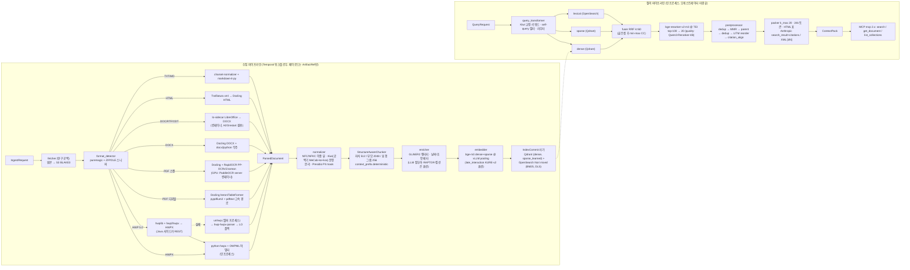

# 기술 지형 종합: 선정 매트릭스와 결정 권고

## 목적

07-tech-landscape의 14개 연구 문서(01~14, 2026-09-18 조사 · 2026-09-22 검증 반영)를 한 장으로 종합한다. 이 문서는 (1) 확장 지점(D-10)별 1차 선택·대안·라이선스·근거를 한 표에 고정하고, (2) 프로파일별 기본 조합을 제시하며, (3) 개방 결정 O-01~O-10에 대한 아키텍트 권고를 신뢰도와 함께 적고, (4) 연구 결과가 브리프의 확정 결정(D-xx)과 충돌하는 지점을 ADR 발의 대상으로 명시한다. 개별 문서의 권고가 서로 어긋나는 곳은 본 문서가 **판정**하고 근거를 적는다. 이 문서의 "결정"은 ADR로 기록되기 전까지 **권고**이며, 브리프 §4의 우선순위(브리프 > 설계 바이블 > ADR > 개별 문서)를 따른다.

## 범위

- 포함: 문서 수집 파이프라인(fetch → parse → normalize → chunk → enrich → embed → index)과 질의 파이프라인(query → retrieve → fuse → rerank → postprocess → pack)의 모든 확장 지점, 오케스트레이션·API·MCP, 평가·관측성, 보안·PII·라이선스, 한국어 NLP, 고급 RAG(그래프·요약 계층·late interaction·멀티모달).
- 제외: 계약(03-contracts)·파이프라인(04-pipelines) 문서의 필드 확정. 본 문서는 계약 **제안**을 교차 함의 절에 모아 전달만 한다. 개별 후보의 상세 비교·점수표·출처는 각 연구 문서가 정본이며 여기서는 결론만 인용한다.
- 판정 원칙: (a) 역할의 소유 문서(owner doc)가 1차 근거, (b) 라이선스 등급(12 문서 §6.1의 A/B/C/D/X)이 정성 우위를 이긴다, (c) 한국어 골든셋(D-12) 측정 전에는 "초안 목표"로 표기하고 승격 게이트를 명시한다, (d) 벤더 자체 벤치마크와 공개 1개월 이내 모델은 채택 근거로 쓰지 않는다.

## 문서 간 상충 판정

각 연구 문서가 자기 범위에서 낸 의견이 서로 어긋나는 여덟 곳을 먼저 판정한다. 이후 절의 매트릭스와 권고는 이 판정을 전제로 한다.

| # | 쟁점 | 문서별 의견 | 판정 | 근거 |
|---|------|-------------|------|------|
| J-1 | HWP 5.0 1차 경로 | 01: hwplib+hwp2hwpx Java 사이드카 → HWPX → 단일 OWPML 어댑터. 11: unhwp 1순위, hwplib 2순위. 03: LibreOffice 사이드카가 pyhwp 실패 시 변환. 12: LibreOffice+H2Orestart `office-converter`를 기본, pyhwp 사이드카 옵션 | **01 채택.** `standard`는 Java 사이드카(Apache-2.0) 1차, unhwp(헬퍼 프로세스, x64) 2차, hwp-hwpx-parser 3차, LibreOffice+H2Orestart(GPL 격리 컨테이너) 렌더 폴백. `lite`는 11의 unhwp-우선 순서를 그대로 쓴다. pyhwp는 기본에서 제외(AGPL 선택 플러그인) | 구조 보존(heading·셀 span·각주 앵커)이 D-19 청킹 품질을 좌우하며 hwp2hwpx 경로가 HWPX 어댑터 하나로 코드 중복을 없앤다. 03·12의 LibreOffice 경로는 렌더 기반이라 표 구조가 유실되고(02 문서 O-07 의견) GPL이므로 최후 폴백에만 적합하다 |
| J-2 | O-04 late interaction 위치 | 07: 리랭커 단계 전용(BGE-M3 colbert 재점수). 05·14: 별도 `late_interaction` 슬롯, KURE-v2(128d)로 인덱스 단계 vs 리랭크 단계를 M2 골든셋에서 비교 후 확정 | **05·14 채택.** 기본 끔. BGE-M3 colbert(1024d)는 리랭크 단계 비교 기준으로만, 128d 한국어 모델(KURE-v2, Apache-2.0)은 두 위치를 같은 골든셋으로 비교 후 ADR | 07의 전제("허용 라이선스 한국어 128d 모델 부재")는 05·14의 재조사로 철회되었다. 1024d colbert 인덱스 저장(100만 청크 약 614GB 계산)은 비현실적이라 07의 "리랭크 전용" 결론은 BGE-M3 colbert에 한정해 유지한다 |
| J-3 | O-05 LLM 문맥 접두어 기본값 | 10: 수집 시 1회 LLM 문맥 헤더 기본 켬. 04·07·11·14: 결정적 접두어만 켬, LLM 보강은 기본 끔 | **기본 끔(다수 의견).** `context_prefix.deterministic`(제목·heading 경로·캡션)은 항상 켬, `context_prefix.generated`는 `contextual_llm` 프로파일·컬렉션 정책으로 켬. 승격 게이트는 09 문서 기준(nDCG@10 +0.03 이상 & 문서당 보강 비용 상한 이하) | 10의 근거(실패율 -35~-67%)는 인정하되 재현 연구의 비용(약 $1.02/M 토큰 또는 20GB VRAM)·문서 내 검색 저하 보고와 재현성 원칙(원칙 4: LLM 출력은 비결정적)이 기본값 반대 근거다. 켜는 비용은 프로파일 값 하나로 끝나므로 기본은 보수적으로 둔다 |
| J-4 | O-08 OCR 기본값 | 02: RapidOCR(PP-OCRv5 korean mobile, ONNX) 기본, PaddleOCR server는 GPU 프로파일. 11·13: PaddleOCR 기본(생태계 수렴) | **02 채택.** `standard`(CPU 가능) 기본은 RapidOCR, `premium(GPU)`는 PaddleOCR PP-OCRv5 server + 전처리 모듈. 두 엔진의 한국어 인식 가중치는 동일하므로 실질 충돌이 아니다 | 13 문서도 "GPU 기본 PaddleOCR / 경량 기본 RapidOCR"로 같은 구조다. 기본 프로파일이 GPU를 전제하지 않으므로 RapidOCR가 기본이다. `OCRVersion.PPOCRV5` + `ModelType.MOBILE` 명시는 필수(v3.9.0+ 기본 PP-OCRv6는 한국어 미포함) |
| J-5 | O-09 청크 크기 초안 | 04·13: 자식 512 / 부모 2048(bge-m3 토크나이저). 11: 자식 256 / 부모 1024 | **04·13 채택.** 512/2048 초안, 그리드 {256, 384, 512, 768}에 11의 값 포함 | 04가 소유 문서이며 13의 직접 측정(bge-m3 기준 512토큰 ≈ 한국어 900~1,000자 = 법령 1개 조·개조식 소절 하나)이 뒷받침한다. 11의 값은 Dify 관행 인용이다 |
| J-6 | O-10 내부 사이드카 프로토콜 | 01: 내부 사이드카는 gRPC 권고. 03·08: REST(FastAPI) 우선, 필요 시 ConnectRPC. 06: Qdrant 클라이언트 `prefer_grpc=True` | **REST 기본(03·08 채택).** 사이드카 요청·응답은 오브젝트 스토리지 참조(`ArtifactRef`)만 주고받으므로 gRPC 스트리밍 이득이 작다. gRPC가 필요해지면 `connectrpc`를 같은 ASGI 앱에 마운트한다. Qdrant 클라이언트의 gRPC는 라이브러리 설정이라 무관 | 사이드카가 Java·LibreOffice·Rust·Python 넷으로 늘어나므로 계약 하나(REST + RFC 9457)로 통일하는 운영 단순성이 우선한다. 01의 gRPC 요구는 대용량 바이너리 전달 전제였고 `ArtifactRef` 설계로 해소된다 |
| J-7 | 플랫폼 측 한국어 분석기 공백기 기본 | 13: python-mecab-ko(BSD-3) + kss `punct`(BSD-3), Kiwi는 `[kiwi]` extra. 04: kss 또는 wtpsplit SaT. 06·11: Nori 서버 분석기 기본, Kiwi 옵션. 07: kiwipiepy 0.23.2(LGPL)를 extra로 잠정 사용 | **13 채택.** kiwipiepy 0.24.0(Apache-2.0) PyPI 공개 전 기본 설치는 python-mecab-ko + python-mecab-ko-dic + kss `punct`, Kiwi는 선택 extra, 공개 후 Kiwi로 승격. 서버 측(OpenSearch) 렉시컬 분석기는 항상 Nori `mixed` | 06·11의 "Nori 기본"은 서버 측 이야기이고 플랫폼 측(질의 이해·Qdrant sparse BM25 토큰화·문장 분리)에는 형태소 분석기가 별도로 필요하다. 13이 이 역할의 소유 문서이며 LGPL 정적 링크 휠(0.23.2)을 기본 설치에서 배제하는 것이 12 문서 §6.1 B 등급 규칙과 일치한다 |
| J-8 | 그래프 RAG 1차 엔진 | 11: LightRAG 1차, Cognee 병행. 14: LightRAG vs HippoRAG 2 보류(자체 측정 후) | **14 채택(보류).** 외부 플러그인으로 LightRAG·HippoRAG 2 어댑터를 모두 작성하고 1차는 자체 코퍼스 측정 후 확정. Cognee는 후속 비교 후보 | 두 후보 점수(405 vs 400)가 오차 범위이고 질의당 토큰 비용 근거(GraphRAG-Bench 본문 vs Fig. 9)가 10배 어긋난다. 코어에는 계약 슬롯만 두므로 보류 비용이 없다 |

## 선정 매트릭스

### 역할과 D-10 확장 지점 매핑

매트릭스의 역할 이름은 D-10의 14개 확장 지점을 기술 선정 단위로 세분한 것이다. 플러그인 레지스트리(entry point) 그룹은 D-10 이름을 그대로 쓰고, 역할은 그 안의 구현체 슬롯 이름이 된다.

| D-10 확장 지점 | 본 문서의 역할(role) | 비고 |
|---------------|----------------------|------|
| `fetcher` | `uri_fetcher` | 연구 공백(아래 표 첫 행) |
| `parser` | `format_detector`, `hwpx_parser`, `hwp5_parser`, `pdf_text_parser`, `pdf_layout_parser`, `ocr_engine`, `vlm_document_parser`, `docx_parser`, `doc_converter`, `html_extractor`, `text_decoder` | 포맷 라우터(04-pipelines/03)가 `format_detector` 결과로 파서를 선택 |
| `normalizer` | `korean_tokenizer`, `sentence_splitter`, `pii_detector` | 한국어 정규화 파이프라인(13)과 PII 훅(12)이 같은 스테이지 |
| `chunker` | `chunker_default`, `chunker_semantic` | late chunking은 `embedder`의 pooling 모드 |
| `enricher` | `contextual_enricher`, `graph_module`(엔티티·관계·RAPTOR 요약 부분) | LLM 보강은 O-05 정책 |
| `embedder` | `dense_embedder`, `sparse_encoder`, `late_interaction_model`, `embedding_server`, `visual_page_retriever`(페이지 인코딩 부분) | `embedding_space_id`가 컬렉션에 바인딩 |
| `index_backend` | `vector_index`, `lexical_index`, `server_lexical_analyzer`, `graph_module`(저장소 부분) | `capabilities` 선언 필수 |
| `query_transformer` | (07 문서: Kiwi 교정·키워드, self-query, 재작성, 라우터 — `korean_tokenizer` 공유) | 별도 역할 행 없음, 07 문서 프로파일 표 참조 |
| `retriever` | `vector_index`·`lexical_index` 어댑터의 `search`, `graph_module`(채널 `graph`), `visual_page_retriever`, `late_interaction_model`(인덱스 단계 시) | 채널 열거 `dense, sparse, lexical, graph, tree, visual, late_interaction` |
| `fuser` | `fusion_default` | 플랫폼 측 수행 |
| `reranker` | `reranker`, `llm_reranker`, `late_interaction_model`(리랭크 단계 시) | TEI/Cohere 스키마 2종 |
| `postprocessor` | `postprocessor_compression`(+ dedup·MMR·부모 확장·재배치·충분성 판정) | 순서는 07 문서 권고 |
| `packer` | `context_packer`/`context_renderer`, `mcp_sdk`(도구 결과 직렬화) | D-20 렌더러 |
| `evaluator` | `eval_framework`, `ir_metrics` | 하네스 3종 구현체 |
| (횡단) | `orchestrator`, `task_queue_light`, `event_bus`, `api_framework`, `tracing`, `license_scanner`, `authz_policy`, `cache_kv_store`, `object_store_local` | 확장 지점이 아닌 플랫폼 인프라 |

### 매트릭스

역할(role)은 D-10 확장 지점을 세분한 것이다. "1차 선택"은 `standard` 프로파일 기본값이며, 프로파일별 차이는 다음 절에 있다. 라이선스 등급은 12 문서 §6.1 규칙(A 자유 / B LGPL 조건부 / C 네트워크 분리 / D 모델 제한 / X 금지)을 따른다. 버전은 각 문서 확인일(2026-09-18~22) 기준이며 잠금 파일이 정본이다.

| 역할(role) | 1차 선택 | 대안(2차 → 폴백) | 라이선스 | 선정 근거 | 근거 문서 |
|-----------|----------|------------------|----------|-----------|-----------|
| `uri_fetcher` | **연구 문서 없음 — 아키텍트 잠정 권고**: fsspec 계열(s3fs/gcsfs/adlfs) + httpx(http/https) + smbprotocol(smb, 플러그인). 버전·API는 확인 필요(as of 2026-09) | obstore(Rust 기반 오브젝트 스토리지 클라이언트, Apache-2.0; 확인 필요) → boto3/google-cloud-storage/azure-storage-blob 개별 SDK | BSD-3(fsspec, httpx) / MIT(smbprotocol) — 확인 필요 | 14개 문서 중 `fetcher` 확장 지점을 조사한 문서가 없다(03이 SPA 렌더 훅만 언급). 04-pipelines/02 작성 전 별도 조사 항목으로 등록한다. 원본은 BLAKE3 콘텐츠 주소화로 S3에 저장(08) | 08 §스테이지 매핑, 03 §범위 |
| `format_detector` | puremagic 2.2.0 + 자체 ZIP(mimetype/Content_Types.xml/content.hpf)·OLE(FileHeader/WordDocument) 스니퍼, FileHeader 플래그(압축·암호·배포용) 사전 판정 | python-magic(Linux 컨테이너) → Magika 1.0.3(텍스트 계열 위장 보완, HWP 미지원) → Tika `/detect` | MIT / MIT / Apache-2.0 | libmagic 배포판 편차·Windows 개발 환경 회피. HWPX는 ZIP 내부 `mimetype`(`application/hwp+zip`, IANA 미등록) 또는 `content.hpf`로 확정하고 라이브러리 예외 타입에 의존하지 않는다 | 03, 01 |
| `hwpx_parser` | python-hwpx `>=6.4,<7`(pin-and-bump) + 자체 OWPML lxml 어댑터(heading·BinData·머리말은 lxml 직접 순회) | hwpxlib 1.0.9(Java 사이드카, 암호화 HWPX·교차 검증) → unhwp(헬퍼 프로세스) → H2Orestart → ODT → Docling | Apache-2.0 / Apache-2.0 / MIT / GPL-3.0(C) | 순수 Python, lxml 단일 의존, 표 병합·각주·필드 지원, 가중 455/500 1위. PyPI Alpha 선언·7주간 메이저 3회 상승이라 상한 고정 + 계약 테스트 코퍼스 CI 필수. Docling·Unstructured·LlamaIndex HWPReader는 HWPX 미지원 또는 평문 전용으로 기각 | 01, 11 |
| `hwp5_parser` | Java 사이드카(REST): hwplib 1.1.11 + hwp2hwpx + hwpxlib 1.0.9 → HWPX → `hwpx_parser` 어댑터 재사용 | unhwp 0.11.0(MIT, 헬퍼 프로세스, x64만) → hwp-hwpx-parser 1.0.0(순수 Python, arm64 포함) → LibreOffice 26.8 + H2Orestart v0.7.14(렌더 폴백, 03의 `lo-sidecar` 이미지 공유) → pyhwp 0.1b15(AGPL 선택 플러그인) | Apache-2.0 / MIT / Apache-2.0 / MPL-2.0+GPL-3.0(C) / AGPL-3.0(C) | 판정 J-1. 배포용 문서는 같은 Java 사이드카의 Tika 3.2.1 `HwpV5Parser` 텍스트 전용(`quality=degraded`, ViewText 복호화 실측 후 확정), 암호화 문서는 자격 증명 없으면 `document_encrypted` 실패. JPype 인프로세스는 JVM 1개·재기동 불가로 배제 | 01, 11, 03, 12 |
| `pdf_text_parser` | pypdfium2 5.13.0 + pdftext 0.7.1(블록/라인/스팬 + 폰트 메타로 heading 추론, 스캔/디지털 판별 프로브, 페이지 렌더) | Docling `PYPDFIUM2` 백엔드 → pdfminer.six / pdfplumber(선 기반 표) | Apache-2.0 OR BSD-3 / Apache-2.0 | D-18의 PyMuPDF(AGPL-3.0/상용 듀얼)를 인프로세스에서 제거. `pdf_fast_cpu` 프로파일이 §7 "텍스트 PDF 100p < 30s"를 확실히 달성하는 경로 | 02, 12, 03 |
| `pdf_layout_parser` | Docling 2.129.x(docling-parse THREADED 백엔드, `LayoutObjectDetectionOptions(DOCLING_LAYOUT_HERON)`, TableFormer ACCURATE, `do_cell_matching=True`) | PP-StructureV3(paddleocr 3.7, 별도 컨테이너) → Unstructured 0.27.6 hi_res(제2 의견); CPU 비용 절감 시 layout egret-m(334 vs 643 ms/img, mAP −0.011) | 코드 MIT, 모델 CDLA-Permissive-2.0(법무 검토, 위험 낮음) | 가중 86/100 1위. provenance(page/bbox/charspan) 내장, 플러그형 OCR, docling-serve. `OcrAutoOptions` 자동 선택은 금지(Linux에서 Nemotron-OCR가 먼저 잡힘). DocLayout-YOLO·PDF-Extract-Kit(AGPL), LayoutLMv3(NC), Surya layout(가중치)은 D-02상 제외 | 02 |
| `ocr_engine` | RapidOCR 3.9.2(`LangRec.KOREAN`, `OCRVersion.PPOCRV5`, `ModelType.MOBILE`, ONNX Runtime) via Docling `RapidOcrOptions(lang=["korean"], backend="onnxruntime")` | GPU: PaddleOCR 3.7 PP-OCRv5 server det + korean mobile rec + 방향/왜곡 보정(별도 OCR 컨테이너); Nemotron-OCR v2 multilingual(NVIDIA Open Model License 법무 검토 후 골든셋 비교) → 폴백 Tesseract 5.5 `kor+eng`(+`kor_vert` 세로쓰기 라우팅, 에어갭) | Apache-2.0 / Apache-2.0 / NVIDIA OML(D 상당) / Apache-2.0 | 판정 J-4. 한국어 라인 CER은 PP-OCRv5 계열이 소폭 우위(KORIE 영수증: Paddle 15.84 vs EasyOCR 17.36 vs Tesseract 25.43)이나 결정 근거는 라이선스·통합·운영비. Surya(가중치 OpenRAIL-M 매출 임계)는 옵트인, HunyuanOCR(대한민국 사용 비허가)·EasyOCR(정체)은 제외 | 02, 13, 11, 12 |
| `vlm_document_parser`(선택, GPU) | `pdf_vlm_gpu` 프로파일 전용, 기본 끔: PaddleOCR-VL 0.9B와 MonkeyOCRv2-B-Parsing 0.7B를 한국어 골든셋에서 나란히 비교 후 1순위 확정 | MinerU2.5-Pro(영·중), Granite-Docling-258M(경량, 한국어 미지원), OCRFlux-3B(다중 페이지 표 병합) → olmOCR 2(영문) | Apache-2.0(코드·가중치) | 두 후보 모두 한국어 명시·허용 라이선스. MonkeyOCRv2는 공개 2개월이라 우세해도 6개월 릴리스 추적 후 승격. VLM 텍스트는 디지털 페이지의 텍스트 레이어를 대체하지 않는다(환각 방지) | 02 |
| `docx_parser` | Docling `MsWordDocumentBackend` + docx2python 3.7.1 각주·미주 병합(**필수**, 선택 아님) | mammoth 1.12.2 → HTML → Docling(style_map 프로파일) → python-docx 1.2.0(메타·저수준) → Unstructured(플러그인) | MIT / MIT / BSD-2 | Docling·python-docx 모두 `footnote`/`endnote`를 처리하지 않음이 소스로 확정(msword_backend.py). 제목 계층·병합셀·이미지·수식·텍스트박스·머리말/꼬리말(furniture)을 보존하는 유일한 순수 Python 후보 | 03 |
| `doc_converter` | 자체 FastAPI `lo-sidecar`: LibreOffice 26.8 headless(Fresh)/26.2 Still → `docx:"MS Word 2007 XML"`; H2Orestart 포함(HWP 렌더 폴백 겸용); 프로파일 락 분리·프로세스 그룹 KILL·tini·네트워크 차단 | unoserver 3.7(상주 리스너, 처리량 프로파일) → Apache Tika 4.0 서버(Markdown, degraded) → `lite`: odfdo 3.26(ODT), striprtf(RTF, degraded); DOC은 `unsupported_format` | MPL-2.0(LibreOffice) / GPL-3.0(H2Orestart, C) / MIT(unoserver) / Apache-2.0(Tika) | 구조를 보존하는 유일한 오픈소스 DOC 경로. Gotenberg는 PDF 출력 전용(이슈 #455 종결)이라 제외, Collabora CODE·JODConverter는 풀·재시작 설계 참조 구현. antiword/catdoc/wvWare는 GPL·정체·CVE로 탈락. 이 컨테이너 하나가 DOC/RTF/ODT 변환과 HWP 최후 폴백을 모두 맡는다(J-1) | 03, 01 |
| `html_extractor` | Trafilatura 2.2.0(`output_format="xml"`, `with_metadata=True`, `include_tables=True`) → Docling `HTMLDocumentBackend`(순서 고정) | 2차(기사형) readability-lxml 0.9 / 2차(docs-site·포럼 후보) magic-html 0.1.8(한국어 골든셋 A/B 후) → `html2txt()` 최대 recall → MinerU-HTML(LLM 기반, 선택 플러그인) | Apache-2.0(`>=1.8` 핀; 이전 GPLv3+) / Apache-2.0 / Apache-2.0 | 자체 평가 F 0.924 1위(990문서), ScrapingHub F1 0.958. Docling HTML 백엔드는 `<footer>`만 furniture로 분리하고 nav/header/aside는 본문에 남기므로 Trafilatura가 앞에 와야 한다. rs-trafilatura의 WCXB 우위는 저자 이해충돌·개발 세트 결과라 독립 검증 전 비채택. ReaderLM-v2(CC-BY-NC)·html2text(GPL) 제외 | 03 |
| `text_decoder` | charset-normalizer 3.5.1 + ftfy 6.3.1, WHATWG 스니핑 순서(BOM > HTTP charset > meta 1024B > 자동감지 > UTF-8), `euc-kr`→`cp949` 디코딩, NFC 정규화; Markdown은 markdown-it-py 4.2.0(토큰 `map`으로 char offset) | chardet 7.6.0(0BSD 재라이선스 분쟁 중 → 선택 플러그인) / mistune 3.3.4 | MIT / MIT | D-18 유지. chardet 7이 정확도·속도 우위를 주장하나 LGPL 파생물·LLM 생성 코드 분쟁(LWN, chardet#327)으로 법적 리스크 | 03 |
| `korean_tokenizer`(플랫폼 측 `korean_analyzer`) | Kiwi via kiwipiepy `>=0.24.0`(Apache-2.0). **공백기 기본 설치**: python-mecab-ko 1.3.7 + python-mecab-ko-dic; Kiwi는 `rag-platform[kiwi]` extra(0.23.2 LGPLv3 정적 링크 휠은 기본 미설치) | pecab(순수 Python, wheel 불가 환경) → OpenSearch `_analyze`(Nori) 호출 → lindera-python(lindera 백엔드 프로파일 토큰 일관성용) | Apache-2.0(0.24+) / BSD-3 + Apache-2.0 사전 / Apache-2.0 | 판정 J-7. 질의 이해(오타·띄어쓰기·키워드 NNG/NNP), Qdrant sparse BM25 토큰화, 문장 분리를 한 분석기가 공유. `analyzer_id`를 `IndexCommit`·`QueryPlan`에 기록해 색인·질의 토큰화 불일치를 감지. KoNLPy(GPL 엔진)·PyKoSpacing(GPL)은 평가 격리 컨테이너에서만 | 13, 06, 07 |
| `server_lexical_analyzer` | OpenSearch `analysis-nori`: 색인 `decompound_mode=mixed` / 질의 `discard`, `user_dictionary`, 커스텀 stoptags(J*·E*·S* 제거), 보조 필드 `cjk_bigram`(낮은 boost) | Milvus lindera ko-dic + `korean_stop_tags` → Weaviate `kagome_kr` → LanceDB `lindera/ko-dic` → pg_textsearch + textsearch_ko(postgres-only) | Apache-2.0 | Nori 기본 `discard`는 복합명사 원형을 버려 recall을 낮춘다. 사전은 mecab-ko-dic 2018-07 고정이므로 컬렉션별 사용자 사전 파이프라인(`UserDictEntry` 단일 소스 → Kiwi/Nori/synonym_graph 생성)이 필수 | 06, 13 |
| `sentence_splitter` | Kiwi `split_into_sents`(오프셋·서브문장); 공백기 기본 kss 6.0.6 `split_sentences(backend="punct")` | wtpsplit 2.2.1 SaT(다국어 컬렉션·골든셋 비교 후) → 정규식 종결부호 + 줄바꿈 | Apache-2.0(0.24+) / BSD-3 / MIT | Kiwi 1차 근거는 오프셋·모델 공유이며 kss 대비 정확도 우위는 근거로 삼지 않는다(두 자사 벤치마크 상반). 개조식 문단은 줄바꿈·글머리 기호를 경계로 강제 분리 | 13, 04 |
| `chunker_default` | 자체 `StructureAwareChunker`(ParsedDocument/NormalizedDocument 네이티브; Docling HybridChunker 알고리즘 재현: 요소 단위 → 초과 분할(Kiwi 문장 → semchunk 3.2.5) → 동일 heading 병합 → 부모 생성) + 헤더 반복 표 행 그룹(256토큰, `table_ref` 보존) + 결정적 `context_prefix` | `DoclingHybridChunkerAdapter`(ParsedDocument→DoclingDocument 빌더 역변환; 선택 extra `[docling-chunker]`, CI 동등성 검증) → `RecursiveTextChunker`(semchunk 단독) | 자체 Apache-2.0 / MIT(semchunk, docling-core) | Docling 청커는 DoclingDocument만 받고 HWP/HWPX 백엔드가 없어 HWPX·Trafilatura 경로에 직접 적용 불가. 점수 88:88 동점이므로 통합 제약이 선정 근거. docling-core[chunking] 2.97.x가 `semchunk<4.0.0`·`tiktoken<0.13.0`을 고정하므로 semchunk 3.2.5 + tiktoken 0.12.0 잠금(3.x/4.x 공통 API만 호출), 유료 Isaacus 모드는 설정 표면에서 제외 | 04 |
| `chunker_semantic`(선택) | Chonkie 1.7.0 `SemanticChunker`(`minishlab/potion-base-32M`, threshold 0.8) — `semantic_experimental` 프로파일 | LlamaIndex `SemanticSplitterNodeParser` 개념 / Chroma `ClusterSemanticChunker` → LLM·신경망 분할은 플러그인(Meta-Chunking Apache-2.0, LumberChunker 라이선스 확인, HiChunk 평가용) | MIT | Vectara·LumberChunker·SIGIR 2026 재현에서 구조 기반 대비 일관된 우위 없음 → 구조가 빈약한 TXT/장단락에만 옵션. langchain-experimental(sunset)·Chonkie NeuralChunker(영어 모델 3종 고정) 제외. late chunking은 청커가 아니라 임베더 pooling 모드(mean pooling 장문 모델 강제; BGE-M3 dense는 [CLS] 기반이라 비호환) | 04 |
| `contextual_enricher` | `context_prefix.deterministic`(문서 제목 + heading_path + 캡션) 항상 켬, 본문 `text`와 분리 저장; 비LLM 보강(GLiNER2 엔티티, Kiwi NNG/NNP 키워드, 날짜·법령 조항 파생 메타) 켬 | `context_prefix.generated`(Anthropic Contextual Retrieval 방식, 프롬프트 캐싱; dsRAG AutoContext 문서·섹션 1회 요약을 저비용 기준선) — `contextual_llm` 프로파일·컬렉션 예산 정책 → 없음 | 자체 / Apache-2.0(GLiNER2) | 판정 J-3. 분리 저장이 Context Pack 중복 제거·BM25 필드 가중·Contextual BM25(sparse/BM25 입력 = prefix + text 조립)를 가능케 한다. Onyx의 `enrich/strip` 대칭(임베딩 텍스트와 반환 텍스트 분리)을 계약으로 강제 | 04, 07, 10, 11, 14 |
| `dense_embedder` | `BAAI/bge-m3`(568M, 1024d, 8192 토큰; dense+sparse 단일 패스) | `ko-quality`: `nlpai-lab/KURE-v1`(1차, 프롬프트 없음·8192) / `dragonkue/snowflake-arctic-embed-l-v2.0-ko`(2차, `"query: "` 프리픽스, 약 1,300 토큰 초과 저하) / `telepix/PIXIE-Rune-v1.5`(3차); `quality-max`: `Qwen/Qwen3-Embedding-4B`(MRL 1024 절단); `lite`: bge-m3 ONNX int8 / `intfloat/multilingual-e5-large`; 감시 목록: harrier-oss-v1-0.6b, pplx-embed-v1-0.6b, voyage-4-nano | MIT / MIT / Apache-2.0 / Apache-2.0 | 근거를 "dense 품질"에서 **"3-in-1 단일 패스 + 생태계 + 드롭인 한국어 파인튠"**으로 재기술한다(한국어 dense는 KURE-v1 80.76·arctic-ko 82.14·PIXIE 81.57·Qwen3-4B 81.37이 bge-m3 79.30을 앞섬). M2 게이트: `ko-quality`(KURE-v1 + PIXIE-Splade-v1.5)가 nDCG@10 +2p 이상이면 기본 교체. jina v3/v4/v5(CC-BY-NC·Qwen Research)·kanana(CC-BY-NC)는 D 등급으로 예시에서 제거 | 05, 12, 09 |
| `sparse_encoder` | BGE-M3 sparse(lexical weights, `vocab_id=xlm-roberta-250k`, 추가 비용 0) | `ko-quality`: `telepix/PIXIE-Splade-v1.5`(149M, MTEB(ko) 0.7671, `vocab_id=ax-encoder-50k`) / 8192 토큰 필요 시 `yjoonjang/splade-ko-v1`(동일 어휘); `unified-opensearch`: `inference-free-splade-ko-v1`(라이선스 태그 미기재 → 확인 후) 1차 비교, `opensearch-neural-sparse-encoding-multilingual-v1`(MIRACL-ko 0.607) 폴백; `lite`: Qdrant BM25 sparse(Kiwi 토큰 + TF 포화식) | MIT / Apache-2.0 / Apache-2.0 / 확인 필요 / Apache-2.0 | MIRACL-ko sparse 단독 61.5 vs BM25 37.1, MLDR 장문에서 sparse(62.2) > dense(52.5). SPLADE-v3는 CC BY-NC-SA + 영어 → 제외. sparse는 BM25 대체가 아니라 제3 레그(서브워드 vs 형태소, 13 문서). `SparseVector.vocab_id` 불일치는 어댑터 오류 | 05, 06, 12, 13 |
| `late_interaction_model`(선택) | 기본 끔. 별도 슬롯: `nlpai-lab/KURE-v2`(128d/토큰, 8192, MTEB(kor,v2) 0.8160 카드 자체 보고) — M2 골든셋에서 (a) 인덱스 단계 1차 검색(Qdrant `MultiVectorConfig(MAX_SIM)` + turbo4/1-bit TurboQuant 또는 PyLate PLAID) vs (b) 리랭크 단계 재점수(`m=0` prefetch → MaxSim) 비교 후 위치 확정 | `yjoonjang/colbert-ko-en-v2`(동일 백본 독립 학습) → `lightonai/mLateOn`(다국어) → BGE-M3 colbert(1024d, 리랭크 단계 비교 기준만) | Apache-2.0 / Apache-2.0 / Apache-2.0 / MIT | 판정 J-2. 100만 청크 × 300토큰: 128d fp16 약 77GB, turbo4 약 19GB, 1-bit+풀링 수 GB → 인덱스 단계가 저장량 면에서 배제되지 않음. 인덱스 단계 채택은 3-way를 4-way로 바꾸는 파이프라인 변경이므로 골든셋 근거 없이 기본값 변경 금지. colbert-xm은 영어 학습 제로샷·문서 256 토큰 상한으로 후순위. jina-colbert-v2(CC-BY-NC) 제외 | 05, 14, 07 |
| `embedding_server` | BGE-M3 3-in-1: vLLM 0.29 `--runner pooling`(`BgeM3EmbeddingModel` + `bge_m3_sparse_plugin`); dense 전용 모델·리랭커: TEI 1.9.4; 개발·`lite`: 인프로세스 FlagEmbedding 1.4.x / sentence-transformers `>=6.0`(ONNX/OpenVINO 백엔드) | late interaction·ColQwen3: vLLM `token_embed`(ModernBERT ColBERT 실측 확인 필요) → PyLate/`MultiVectorEncoder` 워커; CPU 서버형: OpenVINO Model Server 2026.4; 커스텀 임베더: BentoML/LitServe + FlagEmbedding | Apache-2.0 / Apache-2.0 / MIT·Apache-2.0 | D-16의 "TEI 또는 Infinity"로는 BGE-M3 sparse/colbert를 만들 수 없다(TEI `/embed_sparse`는 BERT MLM SPLADE 전용, `/embed_all`은 colbert 선형층 미적용; Infinity는 "no sparse" 명시 + 13개월 무릴리스). Infinity는 기본 목록에서 제외. 배포는 K8s Deployment + KEDA(Prometheus 스케일러), 대량 초기 색인만 Ray Data | 05, 08 |
| `vector_index` | Qdrant 1.19.x(named vectors `dense`·`sparse_learned`·선택 `late_interaction`/`page_multivector`; payload 파티셔닝 `is_tenant`, `payload_m=16, m=0`; Query API prefetch; ULID→UUID 결정적 변환) | Milvus 2.6.24(내장 BM25 + lindera ko-dic 단일 엔진 대안; 3.0.x는 안정화 후, `proxy.maxVectorFieldNum` 명시) → OpenSearch k-NN(렉시컬과 통합) → postgres-only: pgvector 0.8.6 + pgvectorscale 0.9.1 → dev/eval: LanceDB 0.39 | Apache-2.0 / Apache-2.0 / Apache-2.0 / PostgreSQL / Apache-2.0 | 가중 4.60 1위. 함정: 서버가 BM25를 계산하지 않고(IDF만 `modifier: idf`), 공식 빌드의 `text` 인덱스는 한국어 형태소 분석 없음(charabia `korean` 피처 비활성, 확정) → 한국어 키워드 필터는 형태소 토큰 keyword 배열 payload. RRF 기본 k=2(문헌 60)이므로 `fusion.k` 필수화. 멀티벡터 미지원 백엔드(pgvector)는 `capabilities.multivector=false`로 채널 자동 비활성 | 06, 12, 14 |
| `lexical_index` | OpenSearch 3.8(Lucene 10.5) + `analysis-nori`, 공유 인덱스 + `tenant_id` custom routing + filtered alias + Security 플러그인 DLS(이중 방어); 선택 neural sparse `rank_features` | Qdrant `sparse_bm25`(`lite`; 클라이언트가 Kiwi 토큰화 + `tf·(k1+1)/(tf+k1·(1−b+b·dl/avgdl))` 계산, k1=1.2, b=0.75, 1.19 테넌트별 IDF) → Milvus BM25 Function → Apache Solr 10 + analysis-nori(기존 Solr 조직) → postgres-only: pg_textsearch 1.4 + textsearch_ko(PG 16/17 빌드 검증 선행; 실패 시 PGroonga 바이그램) | Apache-2.0 / Apache-2.0 / Apache-2.0 / PostgreSQL + BSD-2 | Nori + neural sparse + hybrid processor 단일 엔진, 가중 4.35. Elasticsearch는 공식 바이너리가 ELv2/SSPL(AGPL은 소스만)이라 기본 배포 제외·어댑터 호환만. Typesense(GPL)·Marqo(deprecated) 제외. 포화식 생략 시 BM25가 아니라 TF×IDF로 퇴화(MIRACL-ko 연구 경고) | 06, 12, 13 |
| `fusion_default` | 플랫폼 `fuser` 플러그인 RRF(k=60, 채널 가중 1:1:1, 점수 분해 보존) → 골든셋 ≥200 qrels 확보 시 min-max convex combination(ranx `optimize_fusion` 오프라인 튠, 프로파일 고정) | DBSF 또는 z-score CC(sparse 롱테일 컬렉션) → 서버 융합 위임은 `lite`(Qdrant `Fusion.RRF`, `k=60` 명시)·`unified-opensearch`(normalization-processor)만 | 자체 / MIT(ranx, 오프라인) | 세 채널이 두 백엔드(Qdrant dense/sparse, OpenSearch BM25)에 걸치므로 융합은 플랫폼 측이어야 점수 분해(원칙 8)가 보존된다. Bruch et al. 2023: 튠된 CC가 RRF를 상회하나 튠 데이터가 필요 → 2단계 전략. multi-query 변형 질의는 가중 0.5 | 07, 06, 09, 11, 13 |
| `reranker` | `BAAI/bge-reranker-v2-m3` @ TEI(GPU, top-100→20, `max_tokens_per_text` 512, 모델 토크나이저로 절단) | 한국어 변종 `dragonkue/bge-reranker-v2-m3-ko`(골든셋 +2pt 시 모델 ID만 교체; 서빙 경로 동일) → CPU/`lite`: `Alibaba-NLP/gte-multilingual-reranker-base` @ TEI CPU(top-30→10) → FlashRank `ms-marco-MultiBERT-L-12` / llama.cpp `--rerank` + bge-v2-m3 GGUF → 리랭킹 생략(fused 순서) | Apache-2.0 / Apache-2.0 / Apache-2.0 / Apache-2.0·MIT | D-16 유지. 어댑터는 TEI(`texts`/`score`)·Cohere(`documents`/`relevance_score`) 스키마 2종 모두 파싱. 서버 타임아웃(초안 300ms) 시 fused 순서 폴백 + `rerank_skipped=true`. jina-reranker-v2/v3(CC-BY-NC)·mmarco-mMiniLMv2(한국어 미포함) 제외 | 07 |
| `llm_reranker`(`quality`·`agentic`) | `Qwen/Qwen3-Reranker-4B` @ vLLM(`hf_overrides` Qwen3ForSequenceClassification 레시피) 또는 SGLang, top-50→20 | `Qwen3-Reranker-0.6B`(MMTEB-R 66.36, bge-v2-m3 58.36 대비 +8.0) → listwise(RankZephyr/RankGPT via rank_llm 0.25.7)·추론형(Rank1 계열)은 오프라인 라벨 보조·`agentic` 실험만 | Apache-2.0 | 총점 90/100 1위이나 TEI 미지원(PR #835 진행 중)·디코더 지연 미실측이라 `default` 승격은 골든셋 +3pt & p95 800ms 이내 실측 후 ADR. `Qwen3-VL-Reranker-2B`는 `visual-pages` 멀티모달 리랭커. bge-reranker-v2-gemma는 Gemma Terms 상속 법무 확인 전 `experimental` | 07, 05, 14 |
| `postprocessor_compression`(선택) | 기본 끔. `overflow_policy = ["downgrade_tables", "truncate"]`; `compress`는 플러그인: 문장 단위 보존형 EXIT(인용 경계 유지, Gemma-2b-it 어댑터 승계·한국어 재학습 확인 후) 1차 후보 | LLMLingua-2 `xlm-roberta-large`(토큰 단위, 인용 오프셋 파손 → `text_compressed` 별도 필드) → 추출 요약(RECOMP 방식) | Apache-2.0(EXIT, 승계 확인) / MIT | 한국어에서 조사·어미 삭제 시 의미 훼손 위험, 공개 가중치가 영어 전용 → 골든셋 검증 전 기본 끔. Provence/xProvence(CC BY-NC-ND)·Sentinel(라이선스 미확인) 제외. 후처리 순서는 `dedup → MMR(λ 0.7) → parent_expand → dedup → sentence_window → compress → reorder(LITM, 관련도 오름차순 정렬 후 교대 배치) → citation_align → token_budget_pack` | 07, 10 |
| `graph_module`(선택) | **외부 플러그인**: LightRAG(MIT; PG+AGE/Qdrant 스토리지 주입)와 HippoRAG 2(MIT; 고정 의존이라 별도 워커 컨테이너) 어댑터 모두 작성, 1차는 자체 코퍼스 측정 후 확정. **코어 옵션 모듈**: RAPTOR collapsed tree 자체 구현 `enricher`(`item_kind=summary`, 기본 끔) | Microsoft GraphRAG(글로벌 요약 질의 전용, 유지보수 모드, 알고리즘 참조만) → Cognee(Apache-2.0) 후속 비교; 그래프 저장소 PostgreSQL + Apache AGE → NetworkX → 사용자 제공 Neo4j CE(GPL 서버, 네트워크 분리 ADR 필요) | MIT / MIT / MIT / Apache-2.0 / Apache-2.0 | 판정 J-8. 인덱싱 비용이 코퍼스 토큰의 수 배, 질의 비용 수십~수백 배(Fig. 9), 단일 홉에서 기본 RAG보다 열세 → 기본 배포에서 제외. 코어는 계약 슬롯(`item_kind`, `enrichment.entities/relations`, `channel=graph`, `QueryPlan.strategy`, `graph_path`)만. FalkorDB(SSPL)·Memgraph(BSL) 기본 제외 | 14, 11, 10, 09 |
| `orchestrator` | Temporal Server 1.32 + `temporalio` 1.33(MIT), 영속화·가시성 모두 PostgreSQL(advanced visibility; ES/Cassandra 미도입), 태스크 큐 `ingest-io`/`ingest-cpu`/`ingest-gpu-ocr`/`ingest-gpu-embed`/`ingest-llm`/`maintenance`, KEDA `temporal` 스케일러, `pydantic_data_converter`, `TracingInterceptor` | 경량 durable 러너: DBOS Transact 3.x(Postgres 단독, 3.0.x 안정화 후 ADR) → Dapr Workflows 1.18(조직이 Dapr 운영 시) → Celery 5.6(조직 표준일 때) | MIT / MIT / Apache-2.0 / BSD-3 | 하트비트·사가(Qdrant+OpenSearch 이중 커밋 보상)·시그널/업데이트/쿼리·스케줄·KEDA·Pydantic/OTel 내장을 모두 갖춘 유일한 MIT 후보(가중 4.15 1위). 파이프라인 정의는 오케스트레이터 중립 `PipelineContext`에만 의존(`temporalio` 임포트 금지 린트), 개발용 `LocalRunner`는 **비내구**. 페이로드는 `ArtifactRef`만(2MB 한계), 대량 재색인은 자식 워크플로우 + `continue_as_new`. 리트리벌 경로는 오케스트레이터를 거치지 않는다 | 08 |
| `task_queue_light` | Procrastinate 3.9(PostgreSQL 단독, `LISTEN/NOTIFY` + `SKIP LOCKED`, asyncio) — 경량 프로파일의 아웃박스 릴레이·웹훅 전송·평가 배치; `standard` 이상은 Temporal 액티비티 | TaskIQ 0.12(Valkey 브로커) → pgqueuer 1.4 / pgmq 1.13(+`pgmq` 1.1.4 클라이언트) | MIT / MIT / MIT·PostgreSQL | D-14 외 인프라 추가 없음. 릴레이 코어를 순수 함수(`select_unpublished → publish → mark_published`)로 두고 Temporal·Procrastinate 두 실행기가 감싼다. Dramatiq(LGPL)은 B 등급 법무 확인 전 제외, arq는 유지보수 전용 | 08 |
| `event_bus` | **v1 브로커 없음**: 제어 이벤트는 Temporal 시그널/업데이트/쿼리, 도메인 이벤트(`ingest.document.*`, `index.commit.*`, `job.*`)는 CloudEvents 1.0.2 봉투(`cloudevents>=2.2,<3`, 자체 Pydantic `CloudEventEnvelope`) + PostgreSQL 트랜잭셔널 아웃박스 + 릴레이(웹훅·SSE) | 조건 충족 시 NATS JetStream 2.15(외부 소비자 2개 이상 + 재생·보존, 감사 스트림, 멀티 리전; `regulated`) → Kafka 4.3 / Pulsar 4.2(조직 표준 클러스터일 때 각 4.50·4.35로 NATS 앞섬) → Redis Streams(Valkey) → Knative Eventing(K8s 표준 시 릴레이 목적지) | Apache-2.0 / Apache-2.0 / Apache-2.0 / BSD-3 | 일반 점수표 1위 아웃박스 4.55; 브로커 추가 조건에서만 조건부 점수표(NATS 4.15) 적용. Redpanda(BSL)·Restate(BSL)·Inngest(SSPL) 제외. 관측성 신호(OTLP)와 도메인 이벤트는 분리 | 08, 12, 09, 06 |
| `api_framework` | FastAPI 0.141 + Pydantic 2.13(OpenAPI 3.1) + uvicorn 0.53(HTTP/1.1; TLS·HTTP/2는 인그레스 종단) + sse-starlette 3.4; 규약: RFC 9457 Problem Details, `Idempotency-Key`(draft-07 의미론 400/422/409), 불투명 커서, `RateLimit`/`RateLimit-Policy`(draft-11) + 429, RFC 9745 `Deprecation` + RFC 8594 `Sunset` | granian 2.8(HTTP/2 끝단까지) → hypercorn; RPC: REST + SSE → ConnectRPC 0.12(같은 ASGI 앱, Connect/gRPC/gRPC-Web 단일 포트) → grpcio 독립 서버 | MIT / MIT / BSD-3 / Apache-2.0 | D-01 유지. gRPC는 v1 미제공(O-10), protobuf는 JSON Schema 정본에서 코드젠. 레이트 리밋 저장소는 `limits` + Valkey, 운영 fail-closed | 08, 12 |
| `mcp_sdk` | `mcp` 2.x `MCPServer`(스펙 2026-07-28, Streamable HTTP, 세션 없음 → 명시적 `cursor`/`next_cursor` 핸들; `/mcp`를 FastAPI에 마운트); 인증 외부 OIDC AS + JWT 검증(RFC 9728 PRM 게시); 결과 `response_format=concise`, 20k 토큰 상한, `structuredContent`=슬림 ContextPack | `fastmcp` 4.x(`OAuthProxy`) → 저수준 `mcp.server.Server`; 회귀 검증 `@modelcontextprotocol/conformance`(`--spec-version 2025-11-25`·`2026-07-28`) CI, MCP Inspector 수동 | MIT | 총점 4.55. 13개월 3회 파괴적 개정(세션·핸드셰이크 제거)이므로 `McpToolAdapter`로 격리, `mcp>=2,<3` 핀. 도구는 D-13 3종 + `search_batch`·`expand`(14) 제안, 루프는 클라이언트 | 10, 14 |
| `context_packer`/`context_renderer` | 순서 `litm_alternating`(r1 질의 직전, r2 처음; K 홀짝 무관), `k_max=20`, 기본 24k 토큰(초안), 리랭크 임계값 컷, 인용 ID `d1..dN` 관련도순(렌더 위치와 분리), 3단계 `confidence_tier`만 노출, 표 HTML 1차(병합 셀 무손실)/Markdown 2차/JSON 3차; Anthropic 렌더러 `search_result` + `citations`(1차), `document`(Custom content, 2차); 타 공급자·로컬 XML `<documents>` + `[dN]` + 구조화 출력 | `document_order`(규정·법령 프로파일) → `relevance_desc`; 렌더러 추가 제안 `dify_external_knowledge`, `plain_records`(11) | 자체 | D-20의 "Anthropic `document`+`citations`" 문구를 `search_result`/`document`로 보정. 토큰 예산은 대상 LLM 토크나이저(Anthropic `count_tokens`, Gemini `count_tokens`/`LocalTokenizer`, `tiktoken`은 OpenAI만, HF `tokenizers` 로컬) — Anthropic에 근사 카운터 금지, 근사 시 실측 `calibration_ratio` + 10% 마진 | 10, 11 |
| `eval_framework` | LLM-judge: RAGAS 0.4.3 `ragas.metrics.collections`(정의·클래스 채택; collections는 `adapt_prompts` 미지원 → 한국어 판정 프롬프트를 인스턴스 속성 교체로 자체 소유) + DeepEval 4.2.3(pytest CI 게이트, G-Eval·DAG) 병기; 골든셋 포맷 TREC qrels/run + `answer_spans` JSONL; 하네스는 `evaluator` 플러그인 3종(`RetrievalMetricEvaluator`, `JudgeEvaluator`, `SpanHitEvaluator`), 인프로세스 러너로 프로덕션 동일 코드 경로 실행 | 참조 없는 운영 평가 open-rag-eval 0.3(UMBRELA·AutoNuggetizer) → 쌍대 비교 RAGElo 0.6(Elo) → 합성 질의 RAGAS `TestsetGenerator` / DeepEval `Synthesizer` → 검수 UI Langfuse annotation queue + Label Studio Community(`answer_spans`) → 셀프호스팅 judge Atla Selene-1-Mini 8B / M-Prometheus(KoMT-Bench·LogicKor 사전 점검, κ·τ 교정 통과 후) → 자체 판정 프롬프트 폴백 | Apache-2.0 / Apache-2.0 / Apache-2.0 / Apache-2.0 / MIT / Apache-2.0 | RAGAS·DeepEval 동점 4.15, 메트릭 정의 표준성으로 RAGAS 1차(2026-01 이후 릴리스 정체는 DeepEval 병기로 상쇄). Phoenix evals(ELv2)·BERGEN(CC BY-NC-SA)·LangSmith(서버 비공개) 제외. 한국어 외부 종단 회귀 셋 1차는 Allganize RAG-Evaluation-Dataset-KO(MIT, PDF 63건·질의 300), 임베딩 선택은 `mteb` 2.21(한국어 리트리벌 10태스크) + KURE 재현 스크립트 | 09, 11 |
| `ir_metrics` | ranx 0.3.21(nDCG **선형 이득**(trec_eval 호환) 고정, 지수 이득은 `ndcg_exp@k` 별도명; `compare(stat_test="fisher")`, 다중 비교는 하네스가 Holm 보정, 3개 이상 시스템은 Tukey; `optimize_fusion`으로 O-01 튠) | ir_measures 0.4.3(trec_eval 동일성 검증, `Judged@k`) → pytrec-eval-terrier 0.5.10; 참조 구현 PyTerrier `pt.Experiment(correction="holm")`(MPL-2.0·JVM, dev 의존성만) | MIT / Apache-2.0 / MIT / MPL-2.0(dev only) | 가중 4.65 1위. 골든셋 진실값은 문서 ID + 정답 문자 구간(char offsets)으로 저장하고 청크 판정은 `Chunk.provenance`로 파생 계산(재청킹에 불변). CI 게이트: nDCG@10·Recall@20 §7 미달 실패, 베이스라인 대비 nDCG@10 −0.01 초과 & p<0.05 실패, `Judged@10<0.7` 경고 | 09 |
| `tracing`/`observability` | 코드 내 계측 API는 OpenTelemetry Python SDK 1.44만; 규약 `gen_ai.*`(semantic-conventions-genai 고정 커밋; retrieval 스팬 `gen_ai.data_source.id=collection_id`) + OpenInference `retrieval.documents.*`/`reranker.*` + 자체 `rag.*`(저카디널리티), 속성 상수는 OTel Weaver로 생성·`schema_url` 고정; 콘텐츠 캡처 기본 끔 + Collector redaction processor; 메트릭 Prometheus; 트레이스 `standard` Tempo·경량 Jaeger; 로그 structlog → OTel Logs → Loki; 대시보드 Grafana | LLM 관측 UI Langfuse 4.x(MIT 코어, OTLP HTTP `/api/public/otel`; Collector `transform`으로 `langfuse.observation.*` 부착; 2026-01 ClickHouse 인수 후 EE 경계 분기 재확인) → Phoenix(ELv2, 분리 서비스) → OpenLIT(Apache-2.0, `gen_ai.*` 네이티브) / Opik; AGPL 불가 환경: OpenSearch Observability(D-15 재사용) + Perses(대시보드) / SigNoz / VictoriaMetrics·VictoriaLogs + Jaeger; 자동 계측 OTel contrib 공식(`openai-v2` 등) 우선, 공식 계측기 없는 대상(Anthropic·LlamaIndex·벡터DB)만 OpenInference·OpenLLMetry | Apache-2.0 / AGPL-3.0(Grafana·Tempo·Loki, C 등급 분리 컨테이너) / MIT / Apache-2.0 | D-11 유지·정밀화. GenAI semconv는 Development 단계(속성 개명 위험) → 레지스트리 diff를 빌드 게이트로. 점수 분해는 스팬 속성이 아니라 `RankedSet.score_breakdown` + 스팬 이벤트에 기록(카디널리티). Grafana 계열·Phoenix는 pip/코드 의존성으로 포함 금지 | 09, 12 |
| `pii_detector` | Presidio(MIT) + spaCy `ko_core_news_lg`(CC BY-SA 4.0, 런타임 다운로드·미번들) + 내장 KR 인식기 5종을 레지스트리 설정으로 **명시 활성화**(기본 비활성) + 한국형 커스텀 인식기(주민등록번호 체크섬은 가점만: 2020-10 이후 미적용); `NormalizedDocument` 단계, 기본 정책 `mask`, 고유식별정보·계좌·카드는 `keep` 불가, `tokenize`는 `encrypt`+DEK 기본 | Presidio + GLiNER multi → 정규식 전용(`lite`); 인젝션 완화 L1 규칙 위생 + L3 데이터마킹 렌더 기본, L2 다국어 분류기(Qwen3Guard-Gen 0.6B/4B 또는 Granite Guardian 3.x, 골든셋 실측 후) → NeMo Guardrails retrieval rails | MIT / CC BY-SA 4.0(모델) / Apache-2.0 | 가중 84. protectai 인젝션 분류기·LLM Guard는 아카이브로 참조 설계만. PII 모델 로딩 실패 시 `keep` 폴백 금지(잡 실패). 외부 LLM 보강에는 PII 정책 적용 텍스트만 전달, 테넌트별 `llm_enrichment_allowed` 옵트인 | 12 |
| `license_scanner` | CI 게이트: pip-licenses + liccheck(허용 목록 A, B는 조건부, C/D/X 차단) + cyclonedx-bom(SBOM) + Syft + Trivy; 모델은 `models.lock`(id, revision, sha256, license, grade, territory) + safetensors 전용 + picklescan/ModelScan; REUSE 헤더; 플러그인 메타데이터 `license`·`territory` 필드 필수 | + ScanCode 주간 → pip-licenses만 | MIT / BSD / Apache-2.0 | D-02 실행 수단. HunyuanOCR(대한민국 사용 비허가)·NVIDIA OML·MinerU(귀속 표기 의무)·Gemma 3 이하(D)류의 의도치 않은 채택을 기계적으로 차단. 데이터셋 레지스트리에도 라이선스 필드 필수(KorQuAD CC BY-ND, AI Hub 재배포 불가, BERGEN NC) | 12, 02, 09 |
| `authz_policy` | Cedar 4.12(cedarpy) `AuthorizationPolicy` 포트; OIDC 검증 Authlib(JWKS); 레퍼런스 IdP Keycloak(Dex 경량); 모든 검색은 사전 필터(pre-filter), `security.tenant_id` 부재는 어댑터 예외; 메타 DB PostgreSQL RLS(`FORCE`) | OPA 사이드카 → 정적 역할 표; ReBAC 허용 집합은 OpenFGA `ListObjects`/SpiceDB(옵션); 키 관리 OpenBao Transit → 클라우드 KMS | Apache-2.0 / BSD-3 / Apache-2.0 / MPL-2.0(OpenBao) | 격리 기본: Qdrant payload 파티셔닝(88) + OpenSearch DLS(84) + PostgreSQL RLS(90). Zitadel(AGPL) 미채택 | 12 |
| `cache_kv_store` | Valkey 9.x(BSD-3, Redis 프로토콜 호환) — 캐시·레이트 리밋·멱등 키·MCP 커서 핸들·질의 임베딩 24h 캐시 | Redis 8(AGPLv3 선택, C 등급 분리 서비스) → PostgreSQL 단독 → 인메모리(단일 노드) | BSD-3 / AGPL-3.0(C) | D-14 "Redis" 문구 수정 대상. Redis 8.0부터 RSALv2/SSPLv1/AGPLv3 삼중 라이선스 | 08, 12 |
| `object_store_local` | RustFS(Apache-2.0, S3 호환) 1차 — 단, 12 문서 점수는 SeaweedFS(82)가 RustFS(81)를 근소 상회하며 RustFS 성숙도 3점이므로 **ADR에서 두 후보를 실측 후 확정** | SeaweedFS(Apache-2.0, 성숙도 5) → Apache Ozone(대규모) → 클라우드 S3 | Apache-2.0 / Apache-2.0 | D-14 "로컬은 MinIO" 수정 대상: MinIO community 저장소가 2026-04-25 아카이브·소스 전용 배포(AGPL-3.0)로 전환. 산출물은 BLAKE3 콘텐츠 주소화(원칙 4) | 12 |
| `visual_page_retriever`(선택, `visual-pages`) | 별도 컬렉션, 인덱스 단계 필수(텍스트 없음): ColQwen2 v1.0(백본 Apache-2.0 + 어댑터 MIT) 페이지 멀티벡터 + Qdrant 2단계(풀링 HNSW top-200 → `m=0` 전체 MaxSim top-20) **잠정** | `VAGOsolutions/SauerkrautLM-ColQwen3-2b-v0.1`(동급, Qwen3-VL) / `OpenSearch-AI/Ops-Colqwen3-4B`·`tomoro-colqwen3-embed-4b`(320d, 고품질·고비용) → 단일 벡터 저비용 대안 `Qwen3-VL-Embedding-2B` + `Qwen3-VL-Reranker-2B` → ColSmol-500M(CPU) | Apache-2.0·MIT / Apache-2.0 / Apache-2.0 | OCR 대체가 아닌 보완 채널(`ocr_confidence` 저조 페이지 폴백). SDS KoPub VDR·KoViDoRe·자체 HWPX 렌더 셋으로 3자 비교 후 확정. ColQwen2.5(Qwen Research)·ColPali(Gemma)·jina-v4(Qwen Research) 제외. 그림·차트 캡셔닝은 `enricher.figure_caption` → vLLM Qwen3-VL-8B(Apache-2.0), 캡션 텍스트를 BGE-M3로 임베딩 | 14, 05 |

## 프로파일별 기본 조합

프로파일은 컬렉션에 고정되는 버전드 프리셋(브리프 §10)이다. 아래 네 프로파일은 각 연구 문서의 프로파일 표(01 standard/lite/enterprise, 02 pdf_*, 05 default-hybrid/ko-quality/lite, 06 standard/lite, 07 default/quality/lite, 08 dev/lightweight/standard/enterprise, 09 dev/lightweight/standard/regulated, 12 lite/standard/regulated, 13 standard/lite/airgapped, 14 lite/default/graph/visual-pages)를 하나의 이름 체계로 접은 것이다. 세부 프로파일 ID(`pdf_fast_cpu`, `ko-quality`, `graph` 등)는 각 스테이지 옵션으로 프로파일 내부에서 참조된다.

| 컴포넌트 | `lite`(단일 노드, GPU 없음, Qdrant 단독) | `standard`(기본, 멀티테넌트) | `premium`(GPU, 품질 우선) | `korean-gov`(한국 공공·규제, ISMS-P) |
|----------|------|------|------|------|
| 포맷 판별 | puremagic + 자체 스니퍼 | 동일 | 동일 | 동일 + FileHeader 배포용·암호 플래그 정책(`allow_distribution_documents` 테넌트 옵트인, 감사 로그) |
| HWPX | python-hwpx + OWPML 어댑터(인프로세스) | 동일 | 동일 | 동일 + hwpxlib 사이드카(암호화 HWPX, 비밀번호 제공 시) + 한컴 고지 원문 `NOTICE` CI 검사 |
| HWP 5.0 | unhwp(헬퍼 프로세스, x64) → hwp-hwpx-parser(arm64 포함); 사이드카 없음, 배포용 문서는 `distribution_document` 오류 | Java 사이드카(hwplib+hwp2hwpx) → unhwp → hwp-hwpx-parser → `lo-sidecar`(H2Orestart, opt-in) | standard 동일 | standard + Tika `HwpV5Parser` 배포용 텍스트 폴백(quality=degraded) + `spacing_corrector` opt-in(공백 소실 보정) + 선택 상용 Hancom SDK 플러그인 |
| PDF 디지털 | `pdf_fast_cpu`(pypdfium2+pdftext) | `pdf_standard`(Docling heron+TableFormer, CPU 4 thread; egret-m 옵션) | `pdf_standard` GPU L4(약 11 s/100p) | standard + 2단·공문서 골든셋 회귀 |
| PDF 스캔 OCR | RapidOCR PP-OCRv5 korean mobile(CPU) | 동일(비트맵 영역만) | `pdf_scanned_gpu`: PaddleOCR PP-OCRv5 server 컨테이너(+Nemotron-OCR v2 비교); `pdf_vlm_gpu`: PaddleOCR-VL / MonkeyOCRv2-B 골든셋 후 | standard + 세로쓰기 감지 시 Tesseract `kor_vert` 라우팅 + 에어갭 `pdf_airgapped`(Tesseract, 모델 사전 번들) |
| DOC/RTF/ODT | DOC 미지원(`unsupported_format`), ODT odfdo, RTF striprtf(degraded) | `lo-sidecar` → DOCX → Docling | 동일 | 동일 + `archive` 프로파일(unoserver 풀) 선택 |
| DOCX / HTML / TXT | Docling+docx2python / Trafilatura → 자체 lxml 어댑터 / charset-normalizer+markdown-it-py | Docling+docx2python / Trafilatura(xml) → Docling HTML / 동일 | 동일 | 동일 + HTML `docs-site` 프로파일(정부 보도자료·법령 포털 선택자 훅) |
| 한국어 정규화·문장 분리 | python-mecab-ko + kss `punct`(Kiwi extra 선택) | Kiwi(0.24+ 공개 후) / 공백기 python-mecab-ko + kss | 동일 | Kiwi + 컬렉션별 사용자 사전(기관명·법령 약칭) 필수, NFC 표시/NFKC 색인 이중 뷰, 한자 독음 치환 |
| 청킹 | `default_ko_structured`(자식 512/부모 2048/오버랩 0) + `flat_text`(384, 10%) | 동일 + 표 행 그룹 256 + 결정적 접두어 | 동일 + `contextual_llm`(컬렉션 옵션) + RAPTOR(`graph`/`advanced`) | standard + `law_article` 장르 라우팅(법령 조항 경로 heading) |
| 임베딩 | bge-m3 dense ONNX int8 인프로세스(sentence-transformers) + Qdrant BM25 sparse(Kiwi 토큰, TF 포화식) | bge-m3 dense+sparse @ vLLM pooling(GPU 1) 또는 FlagEmbedding | `quality-max`: Qwen3-Embedding-4B(MRL 1024) 또는 `ko-quality`: KURE-v1 + PIXIE-Splade-v1.5; `ko-late-interaction`: KURE-v2(M2 평가) | standard 기본, `ko-quality`는 M2 게이트 통과 시; 가중치·LICENSE 자체 미러링 필수 |
| 인덱스 | Qdrant 단독(`dense` + `sparse_learned` + `sparse_bm25`, 1.19 테넌트 IDF, payload 파티셔닝) | Qdrant + OpenSearch(Nori `mixed`, custom routing, DLS) | standard + Qdrant multivector(`late_interaction`/`page_multivector`, turbo4) | standard + 대형 테넌트 전용 shard_key/인덱스, 감사 로그 OpenSearch 별도 인덱스 |
| 융합 | Qdrant `prefetch` + `Fusion.RRF`(`k=60`) 또는 플랫폼 fuser | 플랫폼 fuser RRF k=60 → 골든셋 후 min-max CC | 동일 + multi-query(변형 0.5)·HyDE(dense 채널) | standard(가중 CC는 골든셋 캘리브레이션 후) |
| 리랭커 | gte-multilingual-reranker-base @ TEI CPU(top-30→10) → FlashRank | bge-reranker-v2-m3 @ TEI GPU(top-100→20) | Qwen3-Reranker-4B @ vLLM/SGLang(top-50→20) + 선택 KURE-v2/BGE-M3 colbert MaxSim 1차 경량 단계 | standard + dragonkue ko 변종 A/B(+2pt 시 교체) |
| 후처리·패킹 | dedup → reorder → pack, k_max 10, 12k 토큰, Markdown 표, XML 렌더러 + `json_schema` 인용(로컬 LLM) | dedup → MMR → parent → dedup → reorder → citation_align → pack, k_max 20, 24k, HTML 표, `search_result`+citations | standard + 충분성 LLM 판정·LLMLingua-2/EXIT 옵션 | `regulatory-ko`: `document_order`, 버전 상충 표지, `get_document` 유도, 데이터마킹 렌더(L3), `classification_max` 전달 |
| 그래프·요약 계층 | 끔 | 끔(GLiNER2 엔티티 추출은 필터·부스트용으로 켬) | `graph` 플러그인(LightRAG/HippoRAG 2, PG+AGE) + RAPTOR enricher, 채널 `graph` 융합 | 끔 기본(다중 홉 골든셋 게이트 통과 컬렉션만) |
| 오케스트레이션·큐 | Temporal 단일 바이너리 + PostgreSQL(또는 DBOS ADR 후); Procrastinate 부수 큐; `LocalRunner`는 개발·CI만 | Temporal(frontend/history/matching 분리, Postgres visibility), 큐별 워커 Deployment + KEDA | standard + `ingest-gpu-ocr`/`ingest-gpu-embed`/`ingest-llm` 큐, MIG 또는 전용 GPU | standard + 멀티 네임스페이스(테넌트 등급별), 야간 재색인·평가 스케줄 |
| 이벤트·API | 아웃박스 → 웹훅/SSE(Procrastinate 릴레이); FastAPI + MCP | 아웃박스 → 웹훅/SSE + KEDA `postgresql`; FastAPI + MCP(`mcp` 2.x) | 동일 | + NATS JetStream(감사 스트림 손실 불가·순서 보장, 2년 보존) 조건부; mTLS |
| 저장소 | PostgreSQL, RustFS/SeaweedFS(ADR), Valkey, Qdrant | + OpenSearch | 동일 | + OpenBao Transit(테넌트 DEK, 크립토 셰레딩), 저장 암호화 확인 |
| 보안·PII | API 키 + 정적 역할, Presidio 정규식 + KR 인식기, L1+L3 | OIDC(Keycloak/Dex) + Cedar + limits/Valkey, Presidio + spaCy ko, L1+L3(+L2 실측 후) | standard | 인덱스-퍼-테넌트 옵션, `tokenize`+`encrypt`, 주민등록번호 `reject`, L2 분류기 필수 + NeMo rails, 감사 로그 2년, 사람 라벨 게이트 100% |
| 평가 | ranx + DeepEval pytest(소형 골든셋), 판정 LLM 로컬 | ranx + ir_measures + RAGAS/DeepEval + UMBRELA 라벨러 + RAGElo + 인터리빙 | standard + O-04/O-05/O-03 ablation 프로파일 | standard + 셀프호스팅 judge(Selene/M-Prometheus, 교정 후) + KoPub 골든셋(공공누리 제1유형) + Allganize KO |
| 관측성 | OTel → Jaeger + Prometheus(Grafana 선택) | Collector(redaction) → Tempo/Loki/Prometheus + Grafana(분리), Langfuse | standard | AGPL 불가 시 OpenSearch Observability + Perses(또는 VictoriaMetrics/Logs + Jaeger), 콘텐츠 캡처 `NO_CONTENT` 강제, 청크 ID·해시만 기록 |
| LLM(보강·판정·`answer` 예시) | Ollama/llama.cpp 로컬 | 공급자 중립(Anthropic 렌더러 1차 예시) | vLLM Qwen3(-VL) 계열 | 온프레미스 Qwen3 계열(Apache-2.0) 기본 예시; EXAONE(NC)은 평가용, HyperCLOVA X SEED는 조건 확인 후; 외부 LLM API는 테넌트 옵트인 |

### `standard` 프로파일 구성도

선정 매트릭스의 1차 선택을 D-05 스테이지 경계 위에 놓은 그림이다. 실선은 기본 경로, 점선은 프로파일 옵션·폴백이며, 상자 안의 괄호는 격리 경계(인프로세스 / 헬퍼 프로세스 / 사이드카 컨테이너)다.

## 개방 결정 권고

신뢰도: **높음** = 3개 이상 문서가 독립 근거로 일치하고 라이선스·통합 제약이 결정적, **중간** = 방향은 일치하나 한국어 골든셋 측정이 남음, **낮음** = 후보 간 오차 범위·자체 측정 전.

| ID | 권고 | 신뢰도 | 승격·확정 게이트 | 근거 문서 |
|----|------|--------|------------------|-----------|
| O-01 융합 기본값 | **RRF(k=60, 1:1:1) 기본 → 컬렉션 골든셋 ≥200 qrels 확보 시 min-max convex combination으로 전환**(ranx `optimize_fusion`으로 오프라인 튠, 홀드아웃으로 과적합 확인, 프로파일 고정). DBSF·z-score는 sparse 롱테일 컬렉션 옵션. 융합은 플랫폼 `fuser`에서 수행(점수 분해 보존), 서버 융합은 `lite`·`unified-opensearch`만. `fusion.k` 프로파일 필수(Qdrant 기본 k=2 함정) | 높음 | 하네스 그리드 `rrf_k ∈ {10,30,60,100}` × CC 가중 0.05 단위; Fisher p<0.05; 학습 기반 융합은 qrels ≥2,000에서 재검토 | 07, 06, 09, 11, 13 |
| O-02 sparse 표현 | **기본 BGE-M3 sparse**(동일 패스, 추가 인코더 없음). `ko-quality` 대안 PIXIE-Splade-v1.5(8192 필요 시 splade-ko-v1, 동일 어휘 `ax-encoder-50k`), `unified-opensearch`는 inference-free-splade-ko-v1(라이선스 확인 후) 1차 비교 + opensearch multilingual-v1 폴백. **SPLADE-v3 제외**(CC BY-NC-SA, 영어). sparse는 BM25 대체가 아닌 제3 레그이므로 lexical 레그는 항상 유지 | 높음 | 1차 검색 지표 Recall@100·`Judged@100`; MIRACL-ko·LawIRKo·자체 공공문서 셋 3종에서 일관 우세 시 교체; `vocab_id` 계약 필수 | 05, 06, 09, 12, 13 |
| O-03 GraphRAG/RAPTOR 위치 | **이분한다.** GraphRAG 계열(LightRAG, HippoRAG 2, MS GraphRAG)은 **외부 플러그인**(`retriever` 채널 `graph` + `enricher`), 코어에는 계약 슬롯(`item_kind`, `enrichment.entities/relations`, `channel=graph`, `QueryPlan.strategy`, `graph_path`)만. **RAPTOR는 코어 옵션 `enricher`**(collapsed tree, 자체 구현, 기본 끔). 그래프 저장소 PostgreSQL + Apache AGE. 1차 엔진(LightRAG vs HippoRAG 2)은 자체 측정까지 보류(J-8) | 높음(이분) / 낮음(1차 엔진) | MultiHop-RAG·KoStrategyQA 다중 홉 회귀에서 `default` 대비 유의 개선 + 우리 코퍼스 질의당 프롬프트 토큰 측정 후 `graph` 프로파일 공개 | 14, 11, 10, 09 |
| O-04 late interaction 위치 | **모델·차원별로 나눈다(J-2).** 기본 끔. BGE-M3 colbert(1024d)는 리랭크 단계 비교 기준만(인덱스 저장 불가). 128d 한국어 ColBERT(KURE-v2, Apache-2.0)는 별도 `late_interaction` 슬롯에서 (a) 인덱스 단계 1차 검색 vs (b) 리랭크 단계 재점수를 M2에서 비교 후 위치 확정. 페이지 이미지(ColQwen 계열)는 `visual-pages` 별도 컬렉션에서 인덱스 단계 필수. 두 구성 모두 질의 시 후보 재인코딩 금지(p95 800ms) | 중간 | 같은 한국어 골든셋에서 nDCG@10·p95·인덱스 크기 비교; 인덱스 단계는 dense+sparse 융합 대비 +2p 이상, 리랭크 단계는 크로스인코더 GPU 병목 시 대안; `capabilities.multivector` 미지원 백엔드는 자동 비활성 | 05, 14, 07, 06 |
| O-05 LLM 보강 기본값·비용 정책 | **비LLM 보강만 기본 켬**(결정적 `context_prefix`, GLiNER2 엔티티, Kiwi 키워드, 날짜·조항 파생 메타). **LLM 보강(문맥 접두어·관계 추출·RAPTOR 요약·그림 캡션·표 요약)은 기본 끔**, 프로파일·컬렉션 정책으로 켬(J-3). 비용 정책: 별도 큐 `ingest-llm` + 워커 `max_concurrent_activities` + Valkey 토큰 버킷으로 테넌트별 한도, 컬렉션 `enrichment_budget_tokens`와 코퍼스 대비 배수 상한(예: 1.5배) 초과 시 잡 `partial` 종료, `rag_enrich_llm_tokens_total`/`_cost_usd_total` 계측. 질의 측(HyDE·multi-query)은 `default` 끔·`quality` 켬. 충분성·상충 LLM 판정 기본 끔. 외부 LLM에는 PII 정책 적용 텍스트만, 테넌트 옵트인 | 높음(기본 끔) / 중간(게이트 값) | 켬/끔 ablation: nDCG@10 +0.03 이상이면서 문서당 보강 비용이 설정 상한 이하일 때 컬렉션 켬; dsRAG AutoContext(문서·섹션 1회)를 저비용 기준선으로 병행 | 04, 07, 08, 09, 10, 11, 12, 14 |
| O-06 이벤트 버스 | **v1은 브로커 없음.** 제어 이벤트 = Temporal 시그널/업데이트/쿼리, 도메인 이벤트 = CloudEvents 1.0.2 봉투 + PostgreSQL 트랜잭셔널 아웃박스 + 릴레이(웹훅·SSE). NATS JetStream 추가 조건: (a) 외부 소비자 2개 이상 + 재생 요구, (b) 감사 스트림 장기 보존(`korean-gov`/`regulated`에서 손실 불가·순서 보장), (c) 멀티 리전 팬아웃. 조직 표준 Kafka/Pulsar/Dapr pub/sub가 있으면 그것을 우선. Redpanda(BSL) 제외. 관측성 신호(OTLP)와 도메인 이벤트는 분리 | 높음 | 외부 소비자 요구 확인 시 ADR; 릴레이 지연 `rag_outbox_lag_seconds` 감시 | 08, 12, 09, 06, 01, 11 |
| O-07 HWP 5.0 지원 범위·LibreOffice 의존 | **HWP 5.0을 1급으로 지원하되 LibreOffice는 선택적 최후 폴백**(J-1). 1차 Apache-2.0 Java 사이드카(hwplib 1.1.11 + hwp2hwpx + hwpxlib 1.0.9) → HWPX → 단일 OWPML 어댑터; `lite`는 unhwp(헬퍼 프로세스, x64) → hwp-hwpx-parser(arm64 포함)로 JVM 없이 동작; 배포용 문서는 Tika `HwpV5Parser` 텍스트 전용(`quality=degraded`, 테넌트 옵트인, ViewText 복호화 실측 후 확정); 암호화 문서는 자격 증명 없으면 `document_encrypted`; LibreOffice+H2Orestart(GPL)는 03의 `lo-sidecar` 이미지(DOC 변환 겸용)에서 opt-in 렌더 폴백; **pyhwp는 기본에서 제외**(AGPL 선택 플러그인). D-18 개정 ADR 발의 | 높음 | hwp2hwpx × hwpxlib 1.0.9 조합 골든셋 변환 테스트(표 셀·각주·그림 일치율, 공공문서 200건); `Preview/PrvText` 유사도 손실 감지; HWP 경로는 `spacing_corrector` opt-in 비용 포함 | 01, 11, 03, 12, 02, 13 |
| O-08 스캔 PDF OCR 기본값 | **RapidOCR(PP-OCRv5 korean mobile, ONNX Runtime; `OCRVersion.PPOCRV5` + `ModelType.MOBILE` + `LangRec.KOREAN` 명시) 기본**, GPU 정확도 프로파일 PaddleOCR PP-OCRv5 server + 전처리(별도 컨테이너; Nemotron-OCR v2 multilingual은 NVIDIA OML 법무 검토 후 비교), 폴백 Tesseract 5 `kor+eng`(에어갭·배포판) + 세로쓰기 `kor_vert` 라우팅. **Surya는 옵트인**(가중치 OpenRAIL-M 매출 임계), EasyOCR(정체)·HunyuanOCR(대한민국 제외) 제외. Docling `OcrAutoOptions` 자동 선택 금지(J-4) | 높음(라이선스·통합) / 중간(정확도) | 한국어 스캔 골든셋(공문서·보고서·영수증·2단 논문)에서 CER/WER·처리량 재측정 후 ADR; KORIE 수치는 영수증 도메인이라 일반화 금지 | 02, 13, 11, 12, 05, 14 |
| O-09 청크 크기·오버랩·토크나이저 | **예산 토크나이저 = 프로파일 임베딩 모델의 HF 토크나이저(`hf:BAAI/bge-m3`)**, `token_counts`에 `tiktoken:o200k_base` 병기(cl100k 아님). 초안 기본값: 자식 512(병합 하한 64) / 부모 2048(반환 단위만, 임베딩 안 함) / 구조 청크 오버랩 0 / 폴백 텍스트 분할 오버랩 10%(15%도 후보) / 표 행 그룹 256 / `flat_text` 문장 윈도우 ±2(J-5). 렉시컬 토큰화는 형태소 분석기(Kiwi/Nori)로 분리 — 목적이 다르며 혼용 금지. ContextPack 예산은 대상 LLM 토크나이저로 **재계산(이중 카운트)**. 리랭커 절단도 리랭커 모델 토크나이저 기준 | 높음(토크나이저) / 중간(크기 값) | 한국어 골든셋 그리드 {256, 384, 512, 768} × {0, 10%, 15%}(오버랩은 폴백만) → nDCG@10·Recall@20·IoU·Span hit rate@k; 한국어 팽창률(13 측정: bge-m3 1.05배 vs cl100k 2.6배)은 골든셋 코퍼스로 재측정해 프로파일 계수 고정 | 04, 13, 05, 06, 07, 09, 10, 11 |
| O-10 gRPC 제공 여부 | **REST + SSE + MCP 우선 확정, gRPC는 v1 미제공.** 필요 시 `connectrpc`를 같은 ASGI 앱에 마운트(Connect/gRPC/gRPC-Web 단일 포트), protobuf는 JSON Schema 정본에서 코드젠. 내부 사이드카(Java/LibreOffice/Tika/OCR)도 REST(`ArtifactRef` 교환)로 통일(J-6); Qdrant 클라이언트 `prefer_grpc=True`는 라이브러리 설정으로 허용; 내부 OTLP는 gRPC 가능하되 Langfuse가 HTTP만 받으므로 Collector 경유. gRPC 제공 시 인증은 REST와 동일 `PrincipalResolver` | 높음 | 도입 전 리트리벌 핫패스 p95 측정으로 직렬화 이득 정당화(ContextPack 수십 KB에서는 미미 예상) | 08, 03, 10, 12, 14, 01, 06, 11 |

## 브리프 수정 제안

연구 결과가 브리프의 확정 결정과 충돌하거나 정밀화가 필요한 항목이다. **라이선스 충돌(D-02 위반)은 모두 ADR 필수**로 표시했다. ADR은 `06-adr/`(현재 비어 있음, 인덱스 생성 후 링크)에 MADR 형식으로 기록한다.

| ID | 문제 | 제안 | 구분 | 근거 문서 |
|----|------|------|------|-----------|
| D-18 (PDF) | "PyMuPDF(고속 텍스트)": PyMuPDF 1.28.2는 AGPL-3.0/Artifex 상용 듀얼. 파서 워커 `import`는 인프로세스 링크 → D-02 "AGPL은 네트워크 분리 서비스로만" **위반** | pypdfium2 5.13 + pdftext 0.7(Apache/BSD) 또는 Docling `PYPDFIUM2` 백엔드로 대체. PyMuPDF는 옵트인·별도 컨테이너만 | **ADR 필수(라이선스)** | 02, 03, 12 |
| D-18 (HWP 5.0) | "pyhwp/hwp5 + LibreOffice(H2Orestart) 폴백": pyhwp는 AGPL-3.0+, 최신 릴리스 2020-05(0.1b15), 문서상 Python ≤3.8. 정체된 AGPL 컴포넌트를 기본 파서로 두면 항상 사이드카 + 유지보수 리스크. H2Orestart는 MIT가 아니라 **GPLv3** | 기본을 "Apache-2.0 Java 사이드카(hwplib + hwp2hwpx) → HWPX → 동일 어댑터"로, `lite`는 unhwp → hwp-hwpx-parser, pyhwp는 AGPL 선택 플러그인으로 강등, H2Orestart는 GPL 격리 컨테이너 폴백(opt-in) | **ADR 필수(라이선스·정체)** | 01, 11, 12, 03 |
| D-18 (OCR) | 후보 나열 "PaddleOCR/Tesseract-kor/RapidOCR"이 우선순위·조건 없음; Tesseract 한국어는 공개 비교 최하위; RapidOCR v3.9+ 기본은 한국어 미포함 PP-OCRv6 | "기본 RapidOCR(PPOCRV5+MOBILE 명시), GPU 프로파일 PaddleOCR server, 폴백 Tesseract(세로쓰기·에어갭)"로 재정의 | ADR(O-08 확정 시 통합) | 02, 13 |
| D-18 (DOCX·HTML) | "Docling/python-docx"는 계층 관계이며 둘 다 각주·미주 미처리(소스 확정); "Trafilatura + Docling"은 순서 미명시 | DOCX에 "docx2python 각주·미주 병합 필수" 추가; HTML은 "Trafilatura(xml) → Docling HTML" 순서 명시 | 문구 보정(ADR 불필요) | 03 |
| D-16 (서빙) | "서빙은 TEI 또는 Infinity": TEI는 BGE-M3 sparse/colbert를 생산할 수 없고(`/embed_sparse` BERT MLM 전용, `/embed_all` 선형층 미적용), Infinity는 "no sparse" 명시 + 최종 릴리스 2025-08(13개월 무릴리스). 즉 D-16의 "dense + sparse" 기본값이 D-16의 서빙 선택으로 **실현 불가** | "vLLM pooling(BGE-M3 3-in-1) + TEI(dense 전용 모델·리랭커) + 인프로세스(개발·lite)"로 수정, Infinity 제외 | **ADR 필수(실현 불가)** | 05, 08 |
| D-16 (교체 후보) | "jina-v3/v4": v3 CC-BY-NC-4.0, v4 Qwen Research License, v5 CC-BY-NC-4.0, jina-reranker-v2/v3 CC-BY-NC → Apache-2.0 플랫폼의 권장 목록에 둘 수 없음(D-02) | 문서·프로파일 예시에서 제거, D 등급 "BYO 모델"(`model_license_ack` 필수)로만. `Qwen3-VL-Embedding`/`Qwen3-VL-Reranker`(Apache-2.0)를 시각 문서용 후보로 추가 | **ADR 필수(라이선스)** | 05, 07, 12, 14 |
| D-16 (colbert·근거) | "선택적 colbert": BGE-M3 colbert 1024d는 128d 모델의 8배 저장량이라 인덱스 단계 불가능; 한국어 128d 모델(KURE-v2) 공개. "기본 BGE-M3" 근거도 한국어 dense 리더보드에서 뒤집힘 | late interaction을 별도 `late_interaction` 슬롯으로 분리(기본 KURE-v2 후보, 프로파일 게이팅·저장량 경고); BGE-M3 유지 근거를 "3-in-1 단일 패스 + 생태계 + 드롭인 파인튠"으로 재기술하고 M2 교체 게이트(+2p) 명시 | ADR(근거 재기술) | 05, 14, 07 |
| D-14 (Redis) | Redis 8.0부터 RSALv2/SSPLv1/AGPLv3 삼중 라이선스(7.2 이하만 BSD-3). AGPL 선택 + 분리 서비스로는 허용되나 컴플라이언스 설명 부담 | 기본 이미지를 Valkey(BSD-3, 프로토콜 호환)로, "Redis 호환 KV"로 표기, Redis 8은 호환 옵션 | **ADR 필수(라이선스)** | 08, 12 |
| D-14 (MinIO) | "로컬은 MinIO": MinIO community 저장소 2026-04-25 아카이브, 소스 전용 배포(AGPL-3.0). 유지보수 종료 컴포넌트가 기본 로컬 스토리지 | RustFS(Apache-2.0) 또는 SeaweedFS(Apache-2.0)로 교체(둘을 ADR에서 실측 후 확정; 12 점수는 SeaweedFS 82 > RustFS 81) | **ADR 필수(라이선스·정체)** | 12 |
| D-15 (경량 프로파일) | "Qdrant 단독(sparse BM25 포함)": Qdrant 서버는 BM25를 계산하지 않고 IDF만 적용; 기본 FastEmbed BM25는 한국어 형태소 미처리; 포화식 생략 시 TF×IDF로 퇴화; 공식 빌드 `text` 인덱스는 한국어 형태소 분석 없음 | "플랫폼이 Kiwi(공백기 MeCab-ko)로 토큰화하고 BM25 TF 포화값(k1=1.2, b=0.75, avgdl 정책)을 계산한 sparse 벡터를 `modifier: idf` + 1.19 테넌트 IDF로 적재; 한국어 키워드 필터는 형태소 keyword 배열 payload; 경량 프로파일 전제 조건에 플랫폼 측 `korean_analyzer` 필수"로 정밀화 | 문구 정밀화(ADR 권고) | 06, 13 |
| D-15 (백엔드 목록·Nori) | 교체 가능 목록에 라이선스 깨끗한 Apache Solr 10(analysis-nori 동봉)·pg_textsearch(PostgreSQL License, 메타 DB 동거 가능)가 빠짐; Elasticsearch 공식 이미지는 ELv2/SSPL; Nori 기본 `decompound_mode=discard`가 복합명사 원형을 버림 | 목록에 Solr·pg_textsearch 추가, Elasticsearch는 어댑터 호환만(공식 이미지 미제공); "Nori 인덱스 분석기 `mixed` + 사용자 사전 파이프라인 필수" 조건 명시 | 목록 확장(ADR 불필요) | 06, 13 |
| D-02 (정책 공백) | LGPL(kiwipiepy 0.23.2 정적 링크 휠, Dramatiq, selectolax Modest 번들), BSL/SSPL/RSAL(Restate·Inngest·Redpanda·Redis 8), GPL **서버**(Neo4j CE·Typesense·LibreOffice 확장), MPL-2.0(PyTerrier·LibreOffice·OpenBao), CDLA-Permissive-2.0(Docling 모델), 지역 제한(HunyuanOCR 대한민국 제외), 매출 임계(OpenRAIL-M), 귀속 의무(MinerU)에 대한 규칙이 없음 | 12 문서 §6.1 등급표(A/B/C/D/X)를 D-02 해석 지침으로 채택: LGPL은 동적 링크·선택 extra 허용·정적 링크 휠 기본 설치 금지(B), GPL/AGPL/SSPL/ELv2/BUSL 서버는 별도 컨테이너 + 네트워크 API로만·우리 이미지 미포함(C), 모델 제한 라이선스는 기본 프로파일 금지 + `model_license_ack`(D), MPL-2.0은 A(파일 단위 카피레프트; PyTerrier는 dev 의존성 한정), 플러그인·모델 메타데이터에 `license`·`territory` 필드 필수, CI 라이선스 게이트 | **ADR 필수(정책)** | 12, 04, 06, 07, 08, 09, 13, 14, 02, 03 |
| D-04 | "provenance: page/bbox 필수 보존": HWP/HWPX·DOCX·HTML·MD는 흐름 포맷으로 페이지·bbox가 존재하지 않음 | `provenance.page`/`bbox`는 nullable, `element_path` + 문자 오프셋(char offset)은 필수로 표현 조정. bbox는 좌상단 원점·PDF 포인트 단위로 정규화 | 계약 표현 조정(03-contracts/03) | 01, 03, 02, 11 |
| D-19 | "Docling HybridChunker 계열": Docling 청커는 DoclingDocument만 받고 HWP/HWPX 백엔드가 없음. "문맥 보강 기본"이 LLM 요약으로 읽히면 O-05와 충돌. "late chunking 프로파일"은 mean pooling 전제인데 기본 임베딩 BGE-M3 dense는 [CLS] 기반 | 기본 청커를 "ParsedDocument 네이티브 StructureAwareChunker(HybridChunker 알고리즘 재현), Docling 어댑터는 2차"로; 문맥 보강을 "결정적 접두어(기본 켬) + LLM 접두어(O-05)"로 분리; late chunking 프로파일에 mean pooling 장문 모델 강제 검증 규칙 + 기대치 하향(구조 경계에서 이득 ≈0) | 문구 보정 + ADR(chunker-default) | 04 |
| D-17 | "인프로세스 러너(같은 워크플로우 정의 재사용)"이 내구성·재사용 방식을 명시하지 않음 → `@workflow.defn` 직접 재사용은 로컬 모드에서 실행 불가 | "비내구(non-durable) 인프로세스 러너; 파이프라인 정의는 오케스트레이터 중립 `PipelineContext`에만 의존(`temporalio` 임포트 금지 린트); 프로덕션 경량 프로파일은 Temporal 단일 바이너리 + Postgres(또는 DBOS ADR 후)"로 정밀화 | 명세 보강 | 08 |
| D-11 | "GenAI semantic conventions 준수"는 Development 단계 규약(별도 저장소, `schema_url` TODO); "Langfuse/Arize Phoenix 익스포터"는 OTLP 엔드포인트 설정으로 충분하고 Phoenix는 ELv2(비OSI); Grafana·Tempo·Loki는 AGPL-3.0-only | "특정 저장소 커밋에 고정, 속성 상수는 Weaver 생성 단일 모듈"; "OTLP 대상으로만, Phoenix·Grafana 계열은 pip/코드 의존 금지·분리 컨테이너"; AGPL 불가 환경 대안(OpenSearch Observability·Perses·SigNoz·Victoria*) 문서화 | 정밀화 + **ADR(라이선스 경계)** | 09, 12 |
| D-12 | "골든셋 포맷(qrels)": 문서 단위 qrels만으로는 청킹 전략 비교(O-09) 불가 | TREC qrels/run + `answer_spans` JSONL(문서 ID + 정답 문자 구간)로 확장; A/B 비교에 인터리빙·쌍대 비교(RAGElo형) 추가; nDCG는 선형 이득으로 정의 고정 | 계약 추가(08-evaluation) | 09, 04 |
| D-20 | "Anthropic Messages `document`+`citations`": RAG 전용 GA 경로는 `search_result` 블록(항목별 source/title, 블록 단위 인용, `tool_result` 내 사용). 인용은 `output_config.format`(구조화 출력)과 병용 불가(400) | "Anthropic `search_result`/`document` + `citations`"로 보정; 레퍼런스 `answer`는 인용 켠 텍스트 응답 1차, 구조화 필요 시 2단계 호출 또는 `bracket_id` | 문구 보정(아키텍트 확인) | 10 |
| D-13 | MCP 2026-07-28 스펙이 세션을 제거 → "더 보기"를 세션 상태로 설계 불가 | `search`·`get_document`에 `cursor` 입력/`next_cursor` 출력 추가; 도구 `search_batch`·`expand` 추가 검토 | 계약 추가(05-api/05) | 10, 14 |
| D-01 | "Python 3.12+": Unstructured 0.27.6 `<3.14`, RapidOCR 3.9.2 `≤3.13`, Nemotron-OCR extra 3.12 한정, flytekit `<3.13` | 파서 워커 이미지는 3.12/3.13 고정, 3.14 채택 전 호환성 검증; 외부 앱 SDK는 인프로세스 의존에서 제외(HTTP만) | 명세 보강 | 02, 04, 11, 08 |
| §7 처리량 | "텍스트 PDF 100페이지 < 30s": Docling CPU 표준 프로파일은 공개 근거(8 thread·EasyOCR·혼합 코퍼스 0.79 s/page, OCR-off 추정 약 32 s)로 충족·미달을 확정할 수 없음 | 목표에 프로파일 조건 명시: `pdf_fast_cpu` 또는 GPU 워커 기준 달성; Docling CPU 표준 프로파일은 자체 재측정(RapidOCR·heron, 4/8 thread, egret-m) 후 별도 목표 결정 | 표 각주 보정 | 02 |
| 원칙 6 | "Nori/Kiwi"를 동급으로 명명하나 Kiwi Python 바인딩은 0.24.0(Apache-2.0) PyPI 미배포(0.23.2 LGPLv3), Nori 사전은 2018-07 고정 | "플랫폼 측 Kiwi(Apache 버전 공개 후; 공백기 python-mecab-ko + kss), 서버 측 Nori `mixed` + 사용자 사전 필수"로 역할 분리 명시 | 문구 보정 | 13, 06, 07, 04 |

### ADR 발의 목록(우선순위)

위 표의 "ADR 필수" 항목과 개방 결정을 MADR 문서 단위로 묶은 초안이다. 번호는 `06-adr/` 인덱스 생성 시 부여한다. P0은 다른 설계 문서(03-contracts·04-pipelines·02-architecture)가 전제로 삼는 것이라 먼저 기록해야 한다.

| 우선 | ADR 제목(가칭) | 뒤집거나 정밀화하는 결정 | 핵심 내용 | 근거 문서 |
|------|----------------|--------------------------|-----------|-----------|
| P0 | 라이선스 등급표와 D-02 해석 지침 | D-02 | A/B/C/D/X 등급, LGPL·BSL/SSPL·GPL 서버·MPL·모델 라이선스·`territory`, CI 게이트 | 12, 02, 04, 06~09, 13, 14 |
| P0 | ParsedDocument provenance 표현(page/bbox nullable, element_path 필수) | D-04 | 흐름 포맷(HWP/HWPX·DOCX·HTML·MD) 수용, bbox 좌표 규약 | 01, 02, 03, 11 |
| P0 | 파이프라인 정의의 오케스트레이터 중립성과 비내구 로컬 러너 | D-17 | `PipelineContext`, `ArtifactRef` 전용 페이로드, 자식 워크플로우 + `continue_as_new` | 08 |
| P1 | PDF 고속 텍스트 경로: PyMuPDF 제거, pypdfium2 + pdftext 채택 | D-18 | AGPL 인프로세스 링크 금지, `pdf_fast_cpu` 프로파일 | 02, 03, 12 |
| P1 | HWP 5.0 기본 경로: Apache-2.0 Java 사이드카, pyhwp 강등, H2Orestart GPL 격리 | D-18, O-07 | 판정 J-1, 배포용·암호화 문서 정책, `lo-sidecar` 공유 | 01, 11, 03, 12 |
| P1 | 임베딩 서빙: vLLM pooling + TEI + 인프로세스, Infinity 제외 | D-16 | BGE-M3 3-in-1 실현 경로, 동등성 게이트 0.9999 | 05, 08 |
| P1 | BGE-M3 유지 근거 재기술과 교체 후보 정비(jina 제외, late interaction 슬롯 분리) | D-16 | `ko-quality` M2 게이트 +2p, `late_interaction` 역할 신설 | 05, 07, 14, 12 |
| P1 | 저장소 기본 이미지: Valkey, RustFS 또는 SeaweedFS | D-14 | Redis 8 삼중 라이선스, MinIO 아카이브 | 08, 12 |
| P1 | 융합 기본값 RRF k=60 → CC 2단계 전략 | O-01, D-07 | 플랫폼 fuser, `fusion.k` 필수, 후처리 순서 dedup → MMR → parent → dedup | 07, 06, 09 |
| P1 | OCR 기본값 RapidOCR / GPU PaddleOCR / 폴백 Tesseract, Surya 옵트인 | O-08, D-18 | PPOCRV5+MOBILE 명시, `OcrAutoOptions` 금지, 세로쓰기 라우팅 | 02, 13 |
| P1 | 기본 청커 StructureAwareChunker와 의존성 잠금(semchunk 3.2.5, tiktoken 0.12) | D-19, D-01 | Docling 어댑터 extra 분리, 문맥 보강 분리 정의, late chunking mean pooling 규칙 | 04 |
| P1 | 경량 프로파일 Qdrant 단독 BM25 구현 규약과 한국어 분석기 전제 | D-15 | TF 포화식·`modifier: idf`·테넌트 IDF, 형태소 keyword payload, Solr·pg_textsearch 목록 추가 | 06, 13 |
| P2 | 한국어 분석기·문장 분리기: Kiwi 승격 조건과 공백기 기본(python-mecab-ko + kss) | 원칙 6 | `analyzer_id`·`dictionary_hash`, `UserDictEntry` 단일 소스 | 13, 06, 07, 04 |
| P2 | 이벤트 전달: 브로커 없는 v1(아웃박스 + CloudEvents), NATS 추가 조건 | O-06, D-08 | 조건부 점수표, 관측성 신호 분리 | 08, 12 |
| P2 | API 규약: REST 우선, gRPC 미제공(ConnectRPC 유보), RFC 9457·Idempotency-Key·RateLimit·Deprecation | O-10, D-01 | 내부 사이드카도 REST(J-6) | 08, 03, 10 |
| P2 | 관측성 규약 고정과 라이선스 경계(GenAI semconv 커밋 고정, Weaver, Grafana·Phoenix 분리) | D-11 | `gen_ai.*` + OpenInference + `rag.*`, AGPL 불가 환경 대안 | 09, 12 |
| P2 | 평가 하네스: ranx/ir_measures, RAGAS+DeepEval, qrels + `answer_spans`, nDCG 선형 이득 | D-12 | Holm 보정, CI 게이트 정책, Allganize KO 외부 셋 | 09 |
| P2 | Context Pack 기본 전략과 Anthropic 렌더러(`search_result`) | D-20 | LITM 교대 배치, cite_id 분리, 표 HTML 1차, 토큰 이중 카운트 | 10 |
| P2 | GraphRAG 외부 플러그인 / RAPTOR 코어 옵션 이분 | O-03 | 계약 슬롯, PG+AGE, 1차 엔진 보류 | 14, 11, 10 |
| P3 | late interaction 위치(M2 평가 후) | O-04 | KURE-v2 인덱스 vs 리랭크, `visual-pages` 별도 컬렉션 | 05, 14, 07 |
| P3 | 청크 크기·오버랩(M2 그리드 후) | O-09 | 512/2048/0 초안, 임베딩 모델 토크나이저 | 04, 13 |
| P3 | LLM 보강 기본값과 비용 정책(ablation 후) | O-05 | 결정적 접두어 켬, LLM 끔, `enrichment_budget_tokens` | 04, 07, 08, 09, 10, 14 |

## 교차 함의

여러 문서가 동시에 요구하는 공통 사항이다. 계약 필드는 **제안**이며 03-contracts 소유자가 확정한다(브리프 §11).

### 계약(03-contracts) 제안 묶음

| 계약 | 공통 제안 필드·규칙 | 요구 문서 |
|------|---------------------|-----------|
| 공용 타입 | `ArtifactRef{uri, blake3, media_type, schema_version, size_bytes}` — 모든 스테이지 경계 페이로드는 이것만(Temporal 2MB 한계, 원칙 4); CloudEvents 1.0.2 봉투 `CloudEventEnvelope` | 08, 06 |
| `IngestRequest` | `acl` 구조, `pii_policy: enum[mask, tokenize, exclude, keep, reject]`, `pii_tokenize_mode`, 문서 비밀번호 필드, 테넌트 `allow_distribution_documents`, `llm_enrichment_allowed`, JSON 배열 다중 문서 분할 힌트 | 12, 01, 03 |
| `ParsedDocument` | `provenance.element_path`(필수) + `char_start/char_end`(필수), `page`/`bbox`(nullable, 좌상단 원점·포인트), `source_kind: enum[born_digital, scanned, mixed, pre_ocr]`, `parser_fingerprint`(파서·모델·사이드카 이미지 태그·프로파일 ID), `page_status`, `quality: enum[full, degraded]` + `warnings[]`, `block.furniture`(머리말/꼬리말/nav), `heading_inferred`, `numbering_label`, `caption_of`/`target_block_id`, `container=text_box`, `footnote.kind`, 표 셀 `row_span/col_span/is_header/header_kind`, `table.quality.merged_cells_preserved`, `figure.caption_generated/caption_model`, `metadata.navigation_text`, `metadata.web`, `annotations`(변경 추적·메모·PII), `source_encoding`, `document.genre`(장르 라우팅), 페이지 이미지 참조; Block 타입 추가 후보 `page_header`, `page_footer`, `toc`, `form_field`; 타입드 오류 `document_encrypted`, `distribution_document`, `unsupported_variant`, `corrupt_container`, `sidecar_unavailable`, `conversion_failed` | 01, 02, 03, 04, 12, 14 |
| `NormalizedDocument` | `display_text`(NFC) / `lexical_text`(NFKC) 이중 뷰, `sentence_spans`, `normalization_report`, `annotations.pii_spans[]`·`offset_map`·`content_risk[]` | 13, 12, 04 |
| `ChunkSet` | `parent_chunk_id`/`level`/`ordinal`, `window`, `table_ref{header_row_indices, row_range, col_range, serialization}`, `context_prefix{deterministic, generated}`(`text`에 미포함), `token_counts{tokenizer_id: count}` 다중, `block_refs[]`(page/bbox/char_*), `lexical_terms[]`, `item_kind: enum[chunk, summary, community_report, entity, page_image, table, figure]`, `tree_level`, `child_ids`, `page_image_ref`; `chunk_id = BLAKE3(document_hash + chunker_config_hash + block_path + char_range)`; 불변식: block_refs 합집합이 text 재구성, level 0은 max_tokens 이내 | 04, 10, 14, 13 |
| `EnrichedChunkSet` | `enrichment.entities[]`, `enrichment.relations[]`, `enrichment.dates[]`, `enrichment.figure_caption`, `risk_flags[]`/`risk_score`/`pii_entity_counts`; `enrich(chunk) -> (embed_text, index_text)` / `strip(index_text) -> original` 대칭 강제 | 14, 12, 13, 11 |
| `EmbeddedChunkSet` / `IndexRecord` | `embedding_space_id = blake3(model_id + revision + dimensions + normalized + prompt_hash + quantization)`(컬렉션은 정확히 하나에 바인딩), `SparseVector.vocab_id`(불일치 시 `EmbeddingSpaceMismatch`), `MultiVector.dim` 필수, `mode: query|document`(프롬프트는 어댑터 소유), `pooling`(late), `vectors.{dense, sparse_learned, sparse_bm25, late_interaction, page_multivector, pooled_page_multivector, page_dense}`, `tenant_id`/`collection_id`/`acl_allow[]`/`acl_deny[]`/`acl_visibility`/`acl_embargo_until`/`acl_expires_at`/`acl_classification`, `pii_policy_applied`, `risk_score`, `payload.entity_ids`, `content_hash`, `is_current` 또는 `index_generation`, ULID→UUID 결정적 변환(Qdrant) | 05, 06, 12, 14 |
| `IndexCommit` / `CollectionSpec` | 사가(insert-then-delete, 보상 `index.rollback`), commit ledger(PostgreSQL), `analyzer_id`·`dictionary_hash`(변경 시 렉시컬 재색인), `korean_analyzer_policy{decompound_mode, stop_tags, user_dictionary_ref}`, `bm25_params{k1, b, avgdl_policy}`, `multivector: optional`, blue/green alias swap 순서 "렉시컬 → 벡터" | 06, 13, 08 |
| `IndexBackendCapabilities` | `supports_server_bm25`, `korean_analyzer`, `supports_server_fusion[]`, `tenant_isolation`, `supports_alias_swap`, `supports_multivector`, `max_vector_dim`(nullable), `max_multivector_elements` | 06, 14 |
| `QueryRequest` / `QueryPlan` | `normalized_query`, `rewritten_queries[]{text, role, weight}`, `sub_queries[]`, `lexical_terms[]`, `filters`(D-09 필터와 AND), `route`/`complexity`, `strategy: enum[hybrid, graph_local, graph_global, tree_collapsed, visual_pages, iterative]`, `fusion{method, k, weights}`(k 필수), `rerank{model_id, top_n_in, top_n_out}`, `security_context`(서버 주입, 읽기 전용), `analyzer_id`, `budget{max_tool_calls, max_context_tokens, max_latency_ms}`, `session_id`/`exclude_ids`, `response_format`, `k_max`, `target_model`, `experiment_id`/`team_assignment`, `degraded[]` | 07, 12, 13, 14, 10, 09 |
| `CandidateSet` / `RankedSet` | `channel: enum[dense, sparse, lexical, graph, tree, visual, late_interaction]`, `scores{...}`·`ranks{...}`·`source_query_id`, `graph_path[]`, `score_breakdown{dense, sparse, lexical, fused, rerank, graph, late_interaction}` + 채널별 `rank`·`contribution`, `normalized_rerank_score`, `explain`(`rerank_skipped` 등) | 07, 09, 11, 14 |
| `ContextPack` | `items[]{cite_id(d1..dN 관련도순, 불변), chunk_id, parent_id?, item_kind, position, header{title, section_path, doc_date, source_uri}, segments[], tables[]{html, markdown, json}, confidence_tier, conflicts_with[]}`, `sufficiency: enum[not_needed, sufficient, insufficient, unknown]`, `stop_signal{sufficient, coverage_estimate, reason}`, `compression{method, rate}`, `token_stats`/`budget{tokenizer, calibration_ratio}`, `overflow_policy[]`, `omitted[]{reason}`, `redaction_summary`, `classification_max`, `render_hints.data_marking`, `explain`(선택), `session_id`, `trace_id`; 렌더러 열거 `anthropic_search_result`, `anthropic_document`, `openai_messages`, `xml_documents`, `markdown`, `dify_external_knowledge`, `plain_records`, MCP `structuredContent` | 10, 07, 12, 14, 11, 09 |
| 잡·이벤트·평가 | 이벤트 이름 `ingest.document.{fetched,parsed,normalized,chunked,enriched,embedded,indexed,retried}`, `job.state.changed`, `index.commit.{published,rolled_back}`, `audit.*`, `feedback.query.cited`; `EvalDataset{content_hash, qrels_uri, answer_spans_uri, judgment_level, label_provenance}`, `EvalRun{profile_id, index_commit_ids, judge_model}`, `EvalReport{metrics, comparison, gate_result}`; `POST /v1/feedback` | 08, 09, 12 |

### 어댑터·플러그인 공통 요구

1. **격리 경계 3단계**: 인프로세스는 순수 Python(A 등급)만; ctypes·네이티브 크래시 위험(unhwp)은 헬퍼 프로세스(`multiprocessing spawn`); JVM(hwplib/hwpxlib/Tika)·LibreOffice·CUDA 결합 OCR(PaddleOCR·Nemotron)·AGPL/GPL(pyhwp·H2Orestart·Redis 8·Grafana)은 별도 컨테이너 + REST. 경계 밖 크래시는 `sidecar_unavailable`/`conversion_failed` 타입드 오류로 변환하고 Temporal 액티비티 타임아웃·하트비트와 결합한다. 사이드카 이미지는 `parser-workers`(Java)·`lo-sidecar`(LibreOffice+H2Orestart)·`ocr-gpu`(PaddleOCR) 셋으로 묶고 GPL/AGPL 이미지는 별도 저장소·별도 고지·Helm opt-in.
2. **결정성과 버전 고정**: 모든 어댑터는 순수 함수(`Stage[In, Out]`), 출력 ID는 BLAKE3 콘텐츠 주소. `parser_fingerprint`·`embedding_space_id`·`analyzer_id`·`chunker_config_hash`·프로파일 해시가 `IndexCommit`에 기록되어 재현성(§7)을 보장한다. 모델은 `model_id + HF revision(SHA) + 서빙 이미지 digest`, 가중치·LICENSE는 자체 오브젝트 스토리지에 미러링(jina v3 비상업 전환, gated 모델, 개인 저장소 소실 대비). 같은 space 내 서빙 스택 교체는 코사인 ≥0.9999 동등성 게이트 필수.
3. **pin-and-bump**: 빠른 릴리스 의존성(python-hwpx Alpha, Docling 주 2회, vLLM, MCP SDK, semchunk/tiktoken 상한)은 `uv lock` 정확 고정 + 업스트림 릴리스마다 계약 테스트 코퍼스 통과 후 범프. `uv lock --check` CI, "sunset 공지 패키지 금지"(langchain-experimental, `langchain_classic` 2026-12 EOL), 외부 앱 SDK(RAGFlow 3.13 고정 등)는 HTTP 어댑터만.
4. **프롬프트·토크나이저 소유권**: 임베딩 질의/문서 프롬프트(`query: `, `Instruct:`, `prompt_name="query"`)는 어댑터가 소유하고 `prompt_hash`가 공간을 정의한다. 토큰 카운터는 세 종류를 구분한다 — 청크 예산은 임베딩 모델 토크나이저, 리랭커 절단은 리랭커 토크나이저, ContextPack 예산은 대상 LLM 토크나이저(Anthropic은 `count_tokens` API만). 구성 검증에서 공급자·카운터 불일치는 거부.
5. **capabilities 선언**: `IndexBackend`(multivector·server_bm25·korean_analyzer·fusion), `Embedder`(dense/sparse/multivector·max_input_tokens·requires_instruction), `Reranker`(`response_schema: tei|cohere`), `Parser`(`can_parse`, 지원 플래그·아키텍처) 능력을 선언하고 프로파일 검증 시 요구 기능과 대조한다. 미지원 조합(예: pgvector + `late_interaction`, CLS pooling 모델 + late chunking, Nemotron + 에어갭)은 로딩 시점에 거부하거나 채널을 자동 비활성하고 `QueryPlan.degraded`에 기록한다.
6. **한국어 처리 일관성**: 색인·질의가 같은 `analyzer_id`·`dictionary_hash`를 참조해야 BM25 점수가 자기 일관적이다. `UserDictEntry` 단일 소스에서 Kiwi 사용자 사전·Nori `user_dictionary_rules`·`synonym_graph`를 생성하고 사전 해시 변경은 렉시컬 재색인 트리거다. 표시 텍스트 NFC / 색인 뷰 NFKC 분리, 띄어쓰기 교정은 opt-in·색인 뷰만.
7. **보안 불변식**: `IndexBackend.search`에 `security.tenant_id`가 없으면 예외, 모든 검색은 사전 필터, `acl`·`tenant_id`·`collection_id` 누락 레코드는 배치 전체 거부, OpenSearch DLS·PostgreSQL RLS 이중 방어, 트레이스는 콘텐츠 캡처 기본 끔(`rag.tenant_id`는 해시). 이 불변식은 어댑터 단위 계약 테스트 + 카나리 테넌트 침투 테스트로 검증한다.

### 운영·평가 공통 요구

- **골든셋 우선(원칙 7)**: 거의 모든 기본값이 "초안 목표"다. D-12 하네스의 첫 산출물은 한국어 골든셋 4종 — (1) HWPX/HWP 공공문서(공공누리 제1유형, 개요 없는 번호 문단·표·각주·배포용 포함), (2) PDF(디지털·스캔·2단·표·각주·공문서 5종 × 50페이지 이상, SynthDoG-ko 합성 보강), (3) HTML 200+ 페이지(포털 뉴스·보도자료·위키·기술 문서·포럼), (4) 문장 분리·형태소 표본(개조식·날짜·인용문). 외부 셋은 Allganize KO(MIT)·MIRACL-ko·MLDR-ko·KoStrategyQA·LawIRKo·SDS KoPub VDR·KoViDoRe·AutoRAGRetrieval. 진실값은 문서 ID + `answer_spans`로 저장해 재청킹에 불변.
- **M2 평가 게이트 목록**(ADR 트리거): `ko-quality` 임베딩 교체(+2p), `dragonkue` 리랭커 교체(+2pt), Qwen3-Reranker 기본 승격(+3pt & p95 800ms), late interaction 위치(O-04), LLM 문맥 접두어(+0.03 & 비용 상한), 그래프 프로파일 공개(다중 홉 유의 개선), OCR 기본값 재확정(CER/WER), 청크 그리드(O-09), 융합 CC 전환(≥200 qrels), VLM 파서 1순위, `visual-pages` 모델, 그래프 1차 엔진, 문장 분리기 1차, HTML 2차 추출기, Docling CPU §7 판정.
- **CI 게이트**: 라이선스 스캐너(등급표 + `territory`), `Replayer` 히스토리 회귀(Temporal 결정론), 점수표 기계 재검산(각 문서 `check_scores` 스니펫; 행 수 == assert 수 린트), OTel Weaver 레지스트리 diff, 한컴 고지 원문 문자열 검사, 계약 테스트(문서 내용 문자열이 스팬에 없음, `tenant_id` 필터 존재, LongContextReorder 상위 2개가 양 끝), `uv lock --check`, 문서 링크 검사(미작성 문서는 경고).
- **관측 메트릭 표준**: `rag_<stage>_<name>_<unit>` — `rag_retrieve_latency_seconds`, `rag_rerank_latency_seconds`, `rag_query_latency_seconds`, `rag_pack_tokens_count`, `rag_enrich_llm_tokens_total`, `rag_ingest_stage_duration_seconds`, `rag_eval_metric_value`, `rag_outbox_lag_seconds`, `rag_rerank_fallback_total`, `rag_parser_sidecar_unavailable_total`, `rag_pii_detector_errors_total`, `rag_acl_propagation_seconds`, `rag_index_bytes_total`.
- **문서 맵 링크**: 02-architecture·03-contracts·04-pipelines·05-api·06-adr·08-evaluation·09-operations 문서가 아직 없어 14개 문서의 상호참조가 깨져 있다. 링크 검사는 문서 맵 허용 목록을 경고로 처리하고, 각 문서 작성 시 본 문서의 계약 제안 묶음을 입력으로 삼는다.

## 종합 리스크 Top 10

| # | 리스크 | 영향 | 가능성 | 완화 | 출처 |
|---|--------|------|--------|------|------|
| 1 | **한국어 문서 수준 골든셋 부재** — 파서·OCR·청킹·임베딩·융합·리랭커의 모든 기본값이 라인 OCR·영어 벤치마크·벤더 수치·리더보드에 의존하며, HWPX 공개 리트리벌 벤치마크는 존재하지 않음 | 품질 목표(nDCG@10 ≥ 0.80) 미달을 늦게 인지, 잘못된 기본값 고착 | 확실 | D-12 하네스를 M1 산출물로 앞당김; 위 골든셋 4종 + 외부 셋; 모든 수치에 "초안 목표"·"벤더" 라벨; M2 게이트 목록으로 ADR 트리거 | 02, 05, 07, 09, 13, 14 |
| 2 | **라이선스 지뢰** — D-18/D-14/D-16의 PyMuPDF·pyhwp·H2Orestart·MinIO·Redis 8·jina·Infinity가 AGPL/GPL/비상업/정체; 모델 가중치의 매출 임계(Surya·Marker·Chandra)·지역 제한(HunyuanOCR)·귀속 의무(MinerU)·백본 승계(Gemma 파생 harrier·bge-reranker-v2-gemma·EXIT) | Apache-2.0 채택성 훼손, 한국 내 사용 비허가 모델 유입 | 높음 | 본 문서 "브리프 수정 제안"의 ADR 필수 항목 일괄 발의; 12 §6.1 등급표를 CI 게이트로; `models.lock` + `territory`; 가중치·LICENSE 미러링 | 12, 02, 05, 07, 08, 14 |
| 3 | **HWP 파서 생태계의 취약성** — python-hwpx PyPI Alpha·단일 메인테이너·7주 24회 릴리스, unhwp 12 stars·ctypes 크래시·arm64 미지원, hwp2hwpx × hwpxlib 1.0.9 조합 미검증, hwp2hwpx 변환 손실, Tika ViewText 복호화 미실측 | R1 1급 요구(HWPX/HWP) 품질·안정성 | 높음 | 상한 고정 + pin-and-bump 계약 코퍼스; lxml 직접 경로로 교체 가능성; 3중화(python-hwpx / Java 사이드카·unhwp·hwp-hwpx-parser / LO 폴백); 골든셋 변환 일치율; 업스트림 기여; Upstage Document Parse를 정확도 베이스라인으로 | 01, 11 |
| 4 | **교차 테넌트 누출** — 필터 누락·ACL 갱신 지연·그룹 확장 폭증·저선택도 다중 필터에서 ANN recall 급락 | 치명(보안), Recall@20 ≥ 0.92 미달 | 중 | 어댑터 불변식 + 계약 테스트 + DLS/RLS 이중 방어 + 카나리 침투 테스트; payload 인덱스·`is_tenant`·ACORN 평가; 대형 테넌트 shard 승격; `rag_acl_propagation_seconds` SLO | 12, 06 |
| 5 | **두 백엔드(Qdrant + OpenSearch) 정합성 붕괴** — 부분 커밋, alias 교체 비원자성, 백업 시점 불일치, lite 프로파일 클라이언트 BM25의 TF×IDF 퇴화·avgdl 상수 왜곡 | 검색 누락·중복, 한국어 렉시컬 recall 저하 | 중 | IndexCommit 사가 + commit ledger + 주기 정합성 검사; `index_generation`; 산출물 재적재(replay)를 복구 1순위; 어댑터가 포화식 강제, bm25s 참조 구현과 점수 일치 테스트 | 06, 08, 13 |
| 6 | **Kiwi 라이선스 전환 지연·한국어 분석기 단일 메인테이너 의존** — kiwipiepy 0.24.0(Apache) PyPI 미배포(이슈 #233 open), kss·pecab·python-mecab-ko 모두 개인 프로젝트, Nori 사전 2018 고정, Kiwi/Nori 토큰 불일치 | 플랫폼 측 분석기가 extra에 머물러 lite 품질 저하(유니코드 경계 BM25 nDCG 0.36대), 사전 운영 없이는 기관명 recall 저하 | 중 | 공백기 python-mecab-ko + kss; `analyzer_id` 기록으로 전환 시 재색인 강제; `UserDictEntry` 단일 소스; Nori(ASF) 폴백; lindera-python 대안; 컬렉션 온보딩 체크리스트에 사용자 사전 | 13, 06, 07, 04 |
| 7 | **빠른 릴리스 의존성의 API 파손과 잠금 충돌** — Docling(주 2회, `LayoutOptions` deprecated), docling-core[chunking] 상한(semchunk<4, tiktoken<0.13), vLLM pooling API, MCP 스펙(13개월 3회 파괴적 개정, SDK v1→v2), OTel GenAI 속성 개명(Development), RAGAS 정체(2026-01 이후), Infinity·FlashRank·Presidio 거버넌스 이전 | 어댑터 파손, 빌드 실패, 대시보드·Langfuse 매핑 깨짐 | 높음 | 마이너 고정·계약 스냅샷 테스트; semchunk 3.2.5/tiktoken 0.12 잠금 + Docling 어댑터 extra 분리 + 업스트림 상한 완화 이슈; `McpToolAdapter` 격리 + conformance CI; Weaver 상수 모듈·레지스트리 diff·Collector `transform`; DeepEval 병기 | 02, 04, 05, 09, 10 |
| 8 | **사이드카·GPU 운영 복잡도** — Java·LibreOffice(좀비 #95843/#117523, 행 #113259/#122192)·PaddlePaddle CUDA·vLLM·Langfuse(ClickHouse)·Temporal 4 서비스; CPU 바운드 액티비티 GIL; KEDA 0→1 지연; time-slicing GPU 경합 | 수집 지연·워커 누수·비용 증가 | 높음 | tini·프로세스 그룹 KILL·프로파일 락·헬스 체크·인스턴스 재시작; 큐별 워커 프로세스 다중화(슬롯은 고정 또는 리소스 튜너 택1); `minReplicaCount: 1`; 프로덕션은 전용 GPU 또는 MIG; lite 프로파일 제공; 변환 결과 콘텐츠 주소화 캐시 | 03, 01, 08, 02, 09 |
| 9 | **신규 모델 조기 채택** — KURE-v2(공개 1개월, 카드 자체 보고), MonkeyOCRv2-B(2개월), PIXIE 계열·harrier·pplx·voyage-4-nano·Qwen3-VL-Embedding·tomoro-colqwen3(6~9개월), LLM-judge 순환 편향(자기 리랭커 과대평가), 벤더 벤치마크 편향 | 수치 재현 실패, 기본값 오선정 | 중 | 감시 목록 + 12개월 관찰 + 골든셋 재현 게이트 후에만 승격; 판정 모델 계열 분리·κ·τ 교정·사람 라벨 게이트; 리더보드는 후보 선별에만 | 05, 02, 14, 09 |
| 10 | **비용 폭주 — LLM 보강·그래프 인덱싱·판정 LLM·멀티벡터 저장** — 그래프 인덱싱 코퍼스 토큰의 수 배(약 14M 토큰/5M 코퍼스), 질의 비용 수십~수백 배, contextual prefix $1.02/M 토큰, 1024d colbert 614GB/100만 청크, LLM-judge 배치 | 운영 비용·§7 처리량·지연 목표 위협 | 중 | O-05 기본 끔 + `enrichment_budget_tokens` + 테넌트 토큰 버킷 + `partial` 종료; 그래프는 외부 플러그인·증분 갱신·로컬 vLLM 추출; 128d + turbo4/1-bit·풀링 벡터만 저장 모드; judge 샘플링 1~5%·예산 카운터·소형 판정 모델(교정 후) | 14, 04, 08, 09, 05 |

## 결정 사항 요약

- **결정(권고):** 선정 매트릭스의 1차 선택을 `standard` 프로파일 기본값으로 채택하고, 각 확장 지점의 ADR(파서·청커·임베딩 서빙·인덱스·융합·리랭커·오케스트레이션·관측성·라이선스 정책)을 `06-adr/`에 순차 기록한다. 관련 ADR은 인덱스 생성 후 링크.
- **결정(권고):** 문서 간 상충 8건(J-1~J-8)은 본 문서의 판정을 따른다. 특히 HWP 5.0 1차는 Java 사이드카, late interaction은 별도 슬롯·기본 끔, LLM 보강은 기본 끔, OCR 기본은 RapidOCR, 내부 사이드카는 REST, 플랫폼 측 한국어 분석기 공백기 기본은 python-mecab-ko + kss.
- **결정(권고):** 브리프 수정 제안 중 라이선스 충돌 7건(D-18 PyMuPDF·pyhwp/H2Orestart, D-16 서빙·jina, D-14 Redis·MinIO, D-02 정책 공백, D-11 라이선스 경계)은 ADR 필수로 일괄 발의한다. 나머지는 문구 보정·계약 제안으로 처리한다.
- **결정(권고):** O-01·O-02·O-03(이분)·O-05(기본 끔)·O-06·O-07·O-08·O-10은 신뢰도 높음으로 확정 권고, O-04·O-09는 초안 기본값 + M2 골든셋 게이트로 확정한다.
- **미정(연구 공백):** `uri_fetcher` 역할은 연구 문서가 없다. 04-pipelines/02 작성 전 fsspec/obstore/httpx/smbprotocol 비교와 라이선스·버전 확인을 별도 조사 항목으로 등록한다.
- **미정(O-04, O-09, O-03 1차 엔진, O-05 게이트 값):** 위 "개방 결정 권고"의 게이트 절차로 확정.

## 미해결 이슈

1. `uri_fetcher` 조사 공백(위 결정 요약). `fetcher` 확장 지점의 스킴별 어댑터(s3/gs/az/file/http(s)/smb), 재시도·부분 다운로드·콘텐츠 주소화 저장, SPA 렌더 HTML 주입 훅(03)을 다루는 조사 문서 또는 04-pipelines/02 부록 필요.
2. 로컬 오브젝트 스토리지 1차(RustFS vs SeaweedFS): 12 문서의 1차(RustFS)와 점수(SeaweedFS 우위)가 어긋나므로 D-14 ADR에서 성숙도·S3 호환성 실측 후 확정.
3. 03 문서의 O-07 의견(pyhwp 1차 → LibreOffice 폴백)과 12 문서의 O-07 의견(LibreOffice `office-converter` 기본)은 01 문서 결론과 어긋난다(J-1). 두 문서 소유자에게 정합 수정을 전달한다. 13 문서 미해결 이슈 13(06 문서의 "Kiwi-CoNg 품질 우위" 문구 수정)도 같은 트랙.
4. 07 문서 O-04 의견(리랭크 단계 전용)은 05·14 문서의 재조사로 전제가 바뀌었다(J-2). 07 문서 개정 시 "BGE-M3 colbert에 한정한 결론"으로 범위를 좁힌다.
5. 10 문서 O-05 의견(LLM 문맥 헤더 기본 켬)은 다수 의견과 다르다(J-3). 10 문서에 게이트 조건(09 기준)을 병기하도록 전달한다.
6. 각 문서의 계약 제안 필드는 이름·타입이 문서마다 조금씩 다르다(예: `item_kind` 열거값, `score_breakdown` 채널명, `sufficiency` vs `stop_signal`). 03-contracts 작성자가 본 문서 "계약 제안 묶음"을 기준으로 통합한다.
7. 법무 검토 대기 목록(일괄): CDLA-Permissive-2.0(Docling 모델), NVIDIA Open Model License(Nemotron-OCR v2), MinerU Open Source License 추가 조건, Gemma Terms 승계(harrier 270m/27b, bge-reranker-v2-gemma, EXIT 어댑터), LGPL 정적 링크(kiwipiepy 0.23.2, selectolax Modest), Poppler CLI 서브프로세스, GPL 서버 네트워크 분리(Neo4j CE·Typesense), MPL-2.0 dev 의존성(PyTerrier), spaCy ko 모델 CC BY-SA 번들, OWPML 스펙에 대한 한컴 고지 동일 적용, `inference-free-splade-ko-v1` 라이선스 태그, LFM Open License, KoMT-Bench LGPL 데이터.
8. Docling 버전 표기가 문서 간 상이(2.128.0 in 03, 2.129.0 in 02·04). 잠금은 2.129.x 마이너 고정으로 통일하고 03 문서 개정 시 갱신.
9. python-hwpx는 조사 기간 중 6.5.0(2026-09-21)이 추가 공개되었다(03·11 문서 확인). 상한 `<7` 범위 내이므로 pin-and-bump 절차로 계약 코퍼스 통과 후 범프.
10. 본 문서가 링크하는 03-contracts·04-pipelines·05-api·06-adr·08-evaluation·09-operations 하위 문서는 문서 맵에 있으나 미작성이다. 링크 검사 CI에서 경고로 처리하고 작성 후 재확인.

## 참조

- [설계 브리프](../00-vision/00-design-brief.md)
- [01 HWPX/HWP 문서 파싱](./01-document-parsing-hwpx-hwp.md) (v0.2.1)
- [02 PDF 파싱·레이아웃 분석·OCR](./02-document-parsing-pdf-layout-ocr.md) (v0.3.0)
- [03 DOC/DOCX·HTML·TXT/MD 및 기타 포맷 파싱](./03-document-parsing-office-html-text.md) (v0.2.0)
- [04 청킹 전략과 라이브러리](./04-chunking-strategies-and-libraries.md) (v0.3.0)
- [05 임베딩·스파스·멀티벡터 모델과 서빙](./05-embedding-models-and-serving.md) (v0.3.0)
- [06 벡터·렉시컬 인덱스 백엔드와 하이브리드 검색 엔진](./06-vector-and-lexical-index-backends.md) (v0.3.0)
- [07 리트리벌 기법: 질의 이해·융합·리랭킹·후처리](./07-retrieval-techniques-fusion-reranking.md) (v0.2.0)
- [08 오케스트레이션·메시징·API 프레임워크](./08-orchestration-messaging-and-api-frameworks.md) (v0.3.0)
- [09 평가 프레임워크·벤치마크·관측성](./09-evaluation-and-observability.md) (v0.3.0)
- [10 LLM 컨텍스트 최적화·인용·MCP 연동](./10-llm-context-optimization-and-mcp.md) (v0.3.0)
- [11 기존 오픈소스 RAG 플랫폼 비교·갭 분석](./11-existing-rag-platforms-gap-analysis.md) (v0.2.0)
- [12 보안·멀티테넌시·PII·라이선스 컴플라이언스](./12-security-multitenancy-pii-and-licensing.md) (v0.2.0)
- [13 한국어 NLP: 형태소 분석·문장 분리·정규화·벤치마크](./13-korean-nlp-tokenization-and-language-resources.md) (v0.2.0)
- [14 고급 RAG: GraphRAG·RAPTOR·에이전틱·멀티모달·late interaction](./14-advanced-rag-graph-raptor-agentic-multimodal.md) (v0.2.0)
