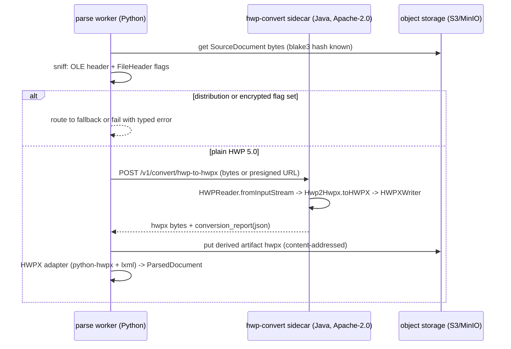
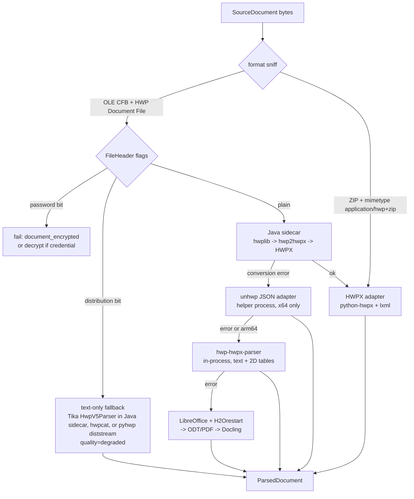
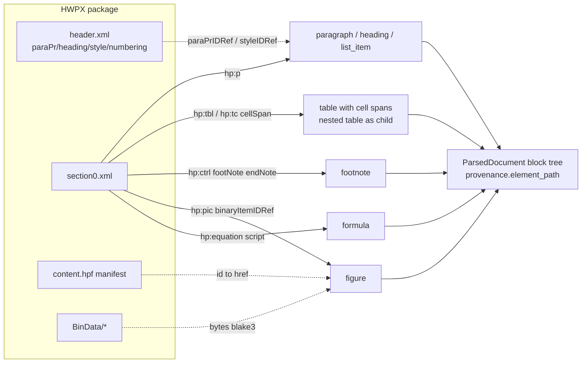

# HWPX/HWP 문서 파싱

## 목적

한국 공공·기업 문서의 사실상 표준인 HWPX(OWPML, KS X 6101)와 HWP 5.0 바이너리 포맷을 플랫폼의 표준 문서 모델 `ParsedDocument`로 변환하기 위한 오픈소스 후보를 조사하고, 브리프의 확정 결정 D-18(파서 기본값)과 개방 결정 O-07(HWP 5.0 지원 범위·LibreOffice 의존)에 대해 근거 있는 권고를 내린다. 모든 후보의 버전·라이선스·활동 상태는 2026-09-18 기준으로 웹에서 확인했으며(버전은 PyPI·Maven Central 메타데이터를 README보다 우선), 확인하지 못한 항목은 "확인 필요"로 표기한다. 0.2.0은 검증자 재확인 결과(점수표 재계산, hwpxlib 1.0.9, 한컴 고지 문구 원문, unhwp 배포 형태, python-hwpx Alpha 선언, Tika·LlamaIndex 후보 추가)를 반영한 판이고, 0.2.1(2026-09-22)은 점수표 가중합 기계 재검산(11행 모두 일치)과 HWP 5.0 스펙 rev1.3 개정일(2018-11-08) 확인을 반영했다.

## 범위

**포함**

- HWPX(ZIP 컨테이너: `mimetype`, `version.xml`, `Contents/content.hpf`, `Contents/header.xml`, `Contents/section*.xml`, `BinData/`, `Preview/`, `META-INF/`) 읽기 전용 파싱
- HWP 5.0(OLE compound file, zlib 압축 레코드 스트림) 읽기 전용 파싱 및 HWP → HWPX 변환 경로
- 표(셀 병합·중첩), 그림/OLE, 각주·미주, 개요 번호·문단 스타일 기반 heading 추론, 수식 스크립트, 글상자, 머리말/꼬리말, 필드(누름틀), 변경 추적, 문서 메타, 배포용 문서, 암호화 문서
- Java 라이브러리의 Python 통합 방식(JPype vs 사이드카) 비교
- AGPL/GPL 구성요소의 D-02 정책 준수 격리 방안
- `ParsedDocument` 블록 트리 매핑 포인트 제안

**제외**

- HWP 3.x 이하 레거시 포맷(LibreOffice 내장 `hwpfilter`가 HWP 2.0/2.1/3.0을 처리하므로 폴백 경로로만 언급)
- HWPX/HWP **쓰기·편집**(플랫폼 비목표)
- Hancom Office COM 자동화(Windows 전용, `pyhwpx` 등)는 서버 파이프라인에 부적합하여 제외
- 렌더링(PDF/PNG) 품질 자체의 평가(폴백 경로 설명에 필요한 범위만)

## 평가 기준

| 기준 | 가중치 | 측정 방법 |
|------|-------:|-----------|
| 한국어 지원 | 15 | 한국어 텍스트·문단 구조·표·각주·개요 등 HWP 고유 요소 복원 정도 |
| 라이선스 적합성(D-02) | 20 | Apache/MIT/BSD = 만점, GPL/AGPL은 프로세스 격리 가능 시 부분 점수, 상용/비공개 = 0 |
| 성숙도/유지보수 | 15 | 최신 릴리스 시점, 커밋·이슈 응답, 테스트·검증 코퍼스 유무 |
| 품질/성능 | 20 | 구조 보존(표 병합·중첩·각주·그림 참조), 실패 모드의 명시성, 처리 속도(내부 벤치마크 예정) |
| 통합 난이도 | 15 | Python 3.12 인프로세스 가능 여부, 의존성 크기, 사이드카 필요 여부 |
| 커뮤니티/생태계 | 5 | 스타·포크·파생 프로젝트·문서 |
| 운영 비용 | 10 | JVM/LibreOffice 등 추가 런타임, 메모리, 컨테이너 수 |

점수는 0~5 척도로 매기고 가중합(만점 500)을 낸다. 성능 수치는 아직 내부 벤치마크가 없어 구조 보존 범위와 공개 검증 코퍼스만으로 평가했다(성능 벤치마크는 `## 미해결 이슈` 참조).

## 후보 목록

확인일은 모두 2026-09-18이다.

| 이름 | 최신 버전(확인일) | 라이선스 | 성숙도 | 한국어 지원 | 핵심 강점 | 약점 |
|------|-------------------|----------|--------|-------------|-----------|------|
| python-hwpx (PyPI `python-hwpx`) | 6.4.0 (2026-09-09) | Apache-2.0 | 활발(2026-07-19 3.4.1 → 2026-09-09 6.4.0, 7주간 24회 릴리스·메이저 3회 상승). **PyPI Development Status: 3 - Alpha**(API 변경 가능 선언) | HWPX 전용, 표·각주·머리말·그림·필드·메모·변경추적 | 순수 Python, lxml 단일 의존, 한컴 렌더러 대조 검증 코퍼스(N=497) | HWP 5.0 미지원(예외로 거부, 예외 타입은 실측 필요), 암호화 HWPX 미지원(예외로 거부), Alpha 선언·단일 메인테이너(109 stars) |
| python-hwpx-automation | 7.1.0 (2026-09-09) | Apache-2.0 | 활발 | 위와 동일(python-hwpx 위 계층) | CLI `hwpx`, Markdown 변환, MCP 어댑터 | 자동화 지향, 읽기 전용 파이프라인에는 과함 |
| pyhwp (`hwp5`) | 0.1b15 (2020-05-30) | **AGPL-3.0-or-later** | 정체(마지막 릴리스 2020, 미공개 0.1b16.dev) | HWP 5.0 전용, ODT/HTML/TXT/XML 변환, 배포용 문서 스트림 디코드 | 스펙 기반 완전 레코드 모델, `hwp5proc` 진단 도구 | AGPL, 문서상 Python 2.7~3.8, 72개 미해결 이슈, 3.12 동작 확인 필요 |
| hwplib (Java, `kr.dogfoot:hwplib`) | 1.1.11 (Maven Central 2026-09-09) | Apache-2.0 | 활발(2026-09 커밋), 590 stars | HWP 5.0 읽기·쓰기 전체 객체 모델 | 표·각주·머리말·필드·수식·글상자까지 모델링, 상용 제품 기반 | JVM 필요, 암호화·배포용 문서 미지원(예외), 페이지 정보 없음 |
| hwpxlib (Java, `kr.dogfoot:hwpxlib`) | 1.0.9 (Maven Central 2026-01-23; README 변경 이력은 1.0.8/2025-11-14까지만 갱신) | Apache-2.0 | 유지(마지막 Maven 배포 2026-01, 이슈 응답 시점은 확인 필요), 183 stars | HWPX 읽기·쓰기 전체 객체 모델 | `TextExtractor`, `ObjectFinder`, 확장(`hwpxlib_ext`)으로 암호화 HWPX 지원 | JVM 필요, Java 7 호환 유지로 API가 장황 |
| hwp2hwpx (Java) | 2026-08-31 업데이트 | Apache-2.0 | 유지 | HWP 5.0 → HWPX 객체 변환 | hwplib+hwpxlib 조합, 단일 어댑터 경로 확보 | 변환 충실도 이슈 지속 수정 중(중첩 subList, 글꼴 대체 등) |
| H2Orestart (LibreOffice 확장) | v0.7.14 (2026-09-06) | **GPL-3.0** | 활발(Debian 패키지 `libreoffice-h2orestart`) | HWP·HWPX → ODT 임포트, PDF 변환 | 렌더링 기반 최후 폴백, 헤드리스 배치 가능 | GPL, JRE 8+ 및 LibreOffice 필요, 구조(표 병합 등) 손실 가능, HWP/HWPX 방향 내보내기 없음(임포트 전용 필터) |
| LibreOffice headless | 26.8 (2026-08-26) | MPL-2.0 | 매우 활발 | 내장 `hwpfilter`는 HWP 2.0/2.1/3.0만 | ODT/PDF/DOCX 변환 허브, `unoserver` 3.7(MIT)로 상주형 운영 | HWP 5.0/HWPX는 H2Orestart 확장 필수, 프로세스 기동 비용 |
| Hancom `hwpx-owpml-model` | 2023-10-24 마지막 갱신 | Apache-2.0 | 정체 | OWPML C++ 객체 모델(VS2017, x86) | 공식 참조 구현, 스펙 해석 기준점 | Windows/x86 빌드, Python 통합 부적합 |
| Hancom `hwpx-contents-extract` | 갱신일 확인 필요 | Apache-2.0 | 정체(3 stars) | Java 텍스트·이미지 추출 + Python TextRank 샘플 | 공식 예제 | 샘플 수준 |
| Hancom Hwp SDK | 상용 | 상용(비공개) | - | HWP/HWPX 변환·추출 약 1,000 함수 | 완전 호환 | 오픈소스 플랫폼 기본값 불가, 선택적 상용 플러그인 후보 |
| Docling | 2026-09 문서 기준 | MIT | 매우 활발 | **HWP/HWPX 미지원** | ODT·DOCX·PDF 파싱은 우수 | 폴백 경로(ODT/PDF 변환 후)에서만 사용 가능 |
| Unstructured | 2026-09 문서 기준 | Apache-2.0 | 활발 | 문서에는 `.hwp` 표기, `.hwpx` 없음; 오픈소스 `main`(2026-09-18) `file_utils/model.py`·`partition/auto.py`에 `hwp` 문자열 없음 → `.hwp`는 **API/플랫폼 전용** | - | 오픈소스 경로 없음, 채택 불가 |
| unhwp (Rust, PyPI `unhwp`) | 0.11.0 (2026-09-11) | MIT | 초기(12 stars)이나 릴리스 빈번 | HWP 5.0·HWPX·HWP 3.x(feature), heading·목록·표 병합·그림·수식·각주 → Markdown/JSON | 고성능, `py3-none-any` 휠 1개(8.3MB)에 linux-x64/linux-musl-x64/osx-x64/osx-arm64/win-x64 네이티브 번들, 병렬 섹션 파싱 | `ctypes.CDLL` 인프로세스 로딩(네이티브 패닉·세그폴트가 Python 워커를 죽임), **linux-arm64 미지원**(import 시 `OSError`), JSON 스키마 비표준, 암호화·배포용 문서 미지원(`Encrypted`/`DistributionRestricted` 오류), 단일 메인테이너 |
| hwp-hwpx-parser (Python) | 1.0.0 (2026-01-29) | Apache-2.0 | 초기(15 stars) | HWP 5.0·HWPX 텍스트·표·그림·각주·미주·메모 | 순수 Python, `olefile` 단일 의존, 암호화 감지 | 표는 2차원 텍스트 배열(병합 정보 확인 필요), heading 추론 없음 |
| hwpkit (Python) | 1.0.0 (2026-06-09) | MIT | 초기(1 star) | HWP 5.0·HWPX 텍스트 추출 및 편집 | 순수 Python | 인라인 컨트롤을 제거하는 평문 지향, 구조 추출 약함 |
| hwp-rs / libhwp (Rust+Python) | libhwp 0.2.0 (2022-11-11) | Apache-2.0 | 정체 | HWP 5.0 문단·표·BinData | 232 stars | 2022년 이후 PyPI 갱신 없음 |
| openhwp (Rust) | 릴리스 확인 필요 | MIT | 개발 중(93 stars) | HWP 5.0 읽기, HWPX 읽기·쓰기, 암호 문서 | HWP↔HWPX 중간 표현(IR) | 라이브러리 안정성 미확인, Python 바인딩 없음 |
| hwp-cli (Rust) | v0.17.0 | MIT OR Apache-2.0 | 초기(1 star) | HWP5·HWPX 읽기·쓰기·렌더링, 배포용 문서 읽기 | hwp↔hwpx 변환, MCP 서버 | 커뮤니티 극소, Python 바인딩 없음 |
| hanpama/hwp (Go) | v0.1.2 (2025-11-24) | MIT | 초기 | HWP 5.0·HWPX 텍스트, ASCII 표, 배포용 문서 AES-128 복호화 | `hwpcat` CLI, 단일 바이너리 | 그림은 `[IMAGE]` 플레이스홀더, 구조 출력 없음 |
| hwp.js (TypeScript) | 확인 필요 | Apache-2.0 | 유지 | HWP 5.0 뷰어·파서 | 브라우저 미리보기 용도 | 서버 파이프라인 대상 아님 |
| Apache Tika `HwpV5Parser` (Java, `org.apache.tika.parser.hwp`) | Tika 3.2.1 지원 포맷 목록 등재 | Apache-2.0 | 매우 활발(Tika 프로젝트) | HWP 5.0 **평문**(`PARA_TEXT` 레코드만), `\005HwpSummaryInformation` 메타, 미디어 타입 `application/x-hwp-v5` | 소스에 `ViewText`(배포용 문서) AES 복호화 경로 존재, Java 사이드카에 동거 가능, OpenSearch/Solr 인제스트 파이프라인과 호환 | 표·heading·각주 구조 없음, 암호화 문서는 `EncryptedDocumentException`, HWPX 미지원 |
| LlamaIndex `HWPReader` (`llama-index-readers-file`, `llama_index.readers.file.docs`) | 0.7.0 | MIT | 유지(LlamaIndex 모노레포) | HWP 5.0 **평문**(`HWPTAG_PARA_TEXT`=67만), `olefile` 기반, `FileHeader` 압축 비트만 검사 | 의존성 경량, 브리프가 언급한 LlamaIndex 생태계 | 암호·배포용 플래그 미처리, 표·구조·출처 경로 없음, HWPX 미지원 → **검토 후 기각** |

## 심층 비교

### 포맷 구조 요약

두 포맷의 구조를 먼저 고정한다. 매핑 설계와 실패 모드 정의의 기준이다.

| 항목 | HWPX (OWPML, KS X 6101) | HWP 5.0 |
|------|-------------------------|---------|
| 컨테이너 | ZIP(OPC 유사). `mimetype`, `version.xml`, `META-INF/container.xml`, `META-INF/manifest.xml` | OLE2 compound file(CFB) |
| 매니페스트/메타 | `Contents/content.hpf`(OPF 스타일 `opf:metadata`, BinData 항목 href) | `FileHeader`(256바이트: 시그니처, 버전, 플래그 비트: 압축/암호/배포용 등), `\005HwpSummaryInformation`(제목·작성자·시각) |
| 전역 정의 | `Contents/header.xml`: `hh:refList`(fontfaces, borderFills, charProperties, paraProperties, styles, numberings, bullets, memoProperties, trackChanges…) | `DocInfo` 스트림(zlib): `DOCUMENT_PROPERTIES`, `ID_MAPPINGS`, `BIN_DATA`, `FACE_NAME`, `CHAR_SHAPE`, `PARA_SHAPE`, `STYLE`, `NUMBERING`, `BULLET`… |
| 본문 | `Contents/section{N}.xml`: `hp:p` → `hp:run` → `hp:t` / `hp:ctrl` / `hp:tbl` / `hp:pic` / `hp:equation`… | `BodyText/Section{N}` 스트림(zlib): `PARA_HEADER`, `PARA_TEXT`, `PARA_CHAR_SHAPE`, `PARA_LINE_SEG`, `CTRL_HEADER`, `LIST_HEADER`, `TABLE`, `SHAPE_COMPONENT_*`, `EQEDIT`… |
| 인라인 컨트롤 표시 | XML 자식 요소 | `PARA_TEXT` 내 제어문자(코드 11 등) + 4바이트 컨트롤 ID(`tbl `, `gso `, `fn  `, `en  `, `head`, `foot`, `secd`, `cold`, `eqed`…) |
| 바이너리 | `BinData/image1.png` 등, `content.hpf`에서 id↔href 매핑 | `BinData/BIN0001.jpg` 스트림(압축), `BIN_DATA` 레코드로 매핑 |
| 미리보기 | `Preview/PrvText.txt`, `Preview/PrvImage.png` | `PrvText`, `PrvImage` 스트림 |
| 배포용 문서 | 해당 없음(HWPX는 암호화 패키지 별도) | 플래그 비트 + `ViewText` 스트림(레코드 단위 AES-128 암호화, 공개 스펙 rev1.2) |
| 스펙 | KS X 6101(2011-12-30 제정; 2015-07-28, 2018-11-08, 2024-10-30 개정 — 2024-10-30은 개정 고시 2024-15), Hancom OWPML 공개 문서 | 한컴 "한글 문서 파일 구조 5.0 revision 1.3:20181108"(2018-11-08 — PDF 표지 제목에 날짜가 포함되어 있으며 검색 인덱스 스냅숏으로 확인, 직접 다운로드는 2026-09-18·22 모두 HTTP 403; KS X 6101 2차 개정일과 같은 날짜이지만 별개 문서), 배포용 문서 rev1.2, 수식 rev1.3:20181108(rev1.2는 2014-10-30), 차트 rev1.2:20141120 |
| 네임스페이스 | 기존 파일: `http://www.hancom.co.kr/hwpml/2011/*`; python-hwpx 문서는 `http://www.owpml.org/owpml/2024/*`도 기술(2024 개정 반영 여부 확인 필요) | 해당 없음 |

한컴 공개 스펙 사용 조건(한컴 다운로드 센터 `hwpOwpml` 페이지, 2026-09-18 확인): 누구나 열람 가능, 스펙 원문은 무수정 배포만 허용. 파생 제품은 다음 문장을 **원문 그대로** 고지해야 한다.

> "본 제품은 한컴의 HWP 문서 파일(.hwp) 공개 문서를 참고하여 개발하였습니다."

기재 위치 조건 원문: "제품 내 유저인터페이스, 매뉴얼, 도움말 및 소스에 모두 기재하여야하며 제품이 이러한 구성물이 없을 시에는 존재하는 구성물에만 기재합니다." 우리 파서 어댑터는 UI가 없으므로 소스(`NOTICE`)·문서(운영 가이드)에 기재하면 조건을 충족한다. 페이지의 고지 조항은 `.hwp` 문서만 언급하며 OWPML(HWPX) 스펙에 동일 조건이 적용되는지는 원문에서 확인되지 않았다(확인 필요, as of 2026-09) — 보수적으로 HWPX 어댑터에도 같은 고지를 둔다. CI 검사는 위 원문 문자열을 기준으로 한다.

### 후보 A: python-hwpx (HWPX 1차)

- **동작 방식**: 순수 Python. ZIP을 열고 `lxml`로 `header.xml`/`section*.xml`을 파싱하여 객체 모델(`hwpx.document`, `hwpx.opc`, `hwpx.oxml`)을 구성한다. 읽기 전용 경로는 파일 손상 시 "정직한 거부" 정책을 취한다. 지원 매트릭스 문서는 "HWP 5.x 바이너리/OLE2 컨테이너는 예외로 거부", "암호화된 content part는 파싱 단계에서 예외로 거부"라고만 기술하고 구체적 예외 클래스는 문서화하지 않았다(예외 타입은 6.4.0에서 실측 필요, 버전에 따라 바뀔 수 있음). 우리 어댑터는 시그니처 사전 판정(아래 어댑터 계약)을 계약에 두므로 라이브러리 예외 타입에 의존하지 않는다.
- **진입점**
  - `from hwpx import HwpxDocument`; `HwpxDocument.open(path)`; `document.paragraphs`(문단 순회, `.text`)
  - `hwpx.tools.text_extractor.TextExtractor(path)`; `iter_document_paragraphs(include_nested=True)` → `ParagraphInfo(section.index, index, path, text())`, `path` 예: `sec/p[3]/run/tbl/tr[0]/tc[0]/subList/p`
  - `extract_text(annotations=AnnotationOptions(footnote="inline"|"placeholder"|"ignore", endnote=...))`
  - `hwpx.tools.object_finder.ObjectFinder(path).find_all(tag="tbl"|"tc"|...)`
  - `document.text.runs()`(런 단위, `char_pr_id_ref`), `document.notes.memos`, `document.fields.all`
  - 검증: `hwpx.tools.validator`, `hwpx.tools.package_validator`
  - CLI(자동화 패키지): `hwpx`(python-hwpx-automation), Markdown 변환 포함
- **출력 형식**: 객체 모델, 평문(주석 옵션), HTML, Markdown. 우리 `ParsedDocument`로는 객체 모델 또는 lxml 트리를 직접 순회해서 변환한다(라이브러리 Markdown 출력은 사용하지 않음. 출처 경로가 사라지기 때문).
- **품질 근거**: README 검증 기록(2026-08 기준) "한컴 열림 476/476(N=497), 무수정 영역 바이트 보존 497/497, 렌더 검증 416/476(한컴 PDF 내보내기 실패 43건 포함)". 이는 **쓰기 경로**의 보존성 지표이며 읽기 경로의 구조 복원율 지표는 아니다. 읽기 품질은 우리 골든셋으로 별도 측정해야 한다.
- **지원 매트릭스(문서 확인)**: 문단·표(테두리·병합·중첩) 완전, 각주·미주, 머리말/꼬리말, 그림(복합 임베디드 객체 제외), 수식(EqEdit 스크립트, 생성은 experimental), 글상자·도형(선·사각형·타원 확인, 다각형·호 experimental, 곡선·연결선 보류), 필드(누름틀·메일머지·날짜·교정부호), 메모, 변경 추적(insert/delete/replace). 미지원: 암호화(거부), HWP 5.x(거부), OLE 개체 생성 API 없음(파싱·보존은 가능), 차트는 파싱·보존만.
- **함정**
  - 개요(outline) 레벨 API가 문서에 명시적으로 드러나지 않는다(README에는 "paragraph properties and style names 기반 outline detection"이 있음). 안전하게는 `header.xml`의 `hh:paraPr/hh:heading[@type="OUTLINE"]/@level`과 `hh:style/@name`을 우리가 직접 조회한다.
  - 머리말/꼬리말·그림 BinData 접근은 편집 API(`doc.page.set_header`, `add_picture`) 중심으로 문서화되어 있어 읽기 경로는 lxml 트리 직접 접근이 필요할 수 있다(확인 필요).
  - 버전 상승이 매우 빠르고 프로젝트가 스스로 **Alpha**를 선언한다(PyPI `Development Status :: 3 - Alpha`; 2026-07-19 3.4.1 → 2026-09-09 6.4.0 사이 24회 릴리스, 메이저 3회 상승. 최근: 5.8.0 08-03, 6.0.2 08-04, 6.0.3 08-11, 6.1.0 08-15, 6.2.1 08-19, 6.3.0 08-22, 6.4.0 09-09). 성숙도 4점은 검증 코퍼스(N=497)·릴리스 빈도·테스트 CI를 근거로 하되 Alpha 선언을 감안해 5점을 주지 않는다. 대응: 상한 고정(`python-hwpx>=6.4,<7`) + **pin-and-bump 절차**(uv lock에 정확한 버전 고정, 업스트림 릴리스마다 공공 문서 코퍼스 계약 테스트를 돌려 통과 시에만 범프, 실패 시 어댑터의 lxml 직접 경로로 회귀 없이 유지).
  - PyPI의 `hwpx`(ilco, 1.1.1, MIT, COM 자동화 성격)와 `pyhwpx`(Windows COM)는 **다른 프로젝트**다. 의존성 선언 시 이름 혼동 주의.

### 후보 B: pyhwp / hwp5 (HWP 5.0, AGPL)

- **동작 방식**: `olefile`로 CFB를 열고 스펙 기반 레코드 모델(`hwp5.binmodel`, `hwp5.xmlmodel`)로 파싱한다. `hwp5proc xml`로 전체 문서를 XML로 덤프하고, XSLT로 ODT/HTML을 만든다.
- **진입점**: CLI `hwp5proc {version|header|summaryinfo|ls|cat|unpack|records|models|find|xml|rawunz|diststream}`, `hwp5txt`, `hwp5html`, `hwp5odt`, `hwp5view`(experimental). `hwp5proc xml --embedbin`은 BinData를 base64로 포함한 XML을 낸다. `hwp5proc diststream`은 "배포용 문서 스트림 디코드"를 수행한다.
- **출력 형식**: 자체 XML(레코드 트리), ODT, HTML, TXT.
- **성숙도**: PyPI 최신 0.1b15(2020-05-30). GitHub 1,551 커밋, 301 stars, 미해결 이슈 72. 문서상 지원 Python은 2.7, 3.5~3.8. Python 3.12에서의 동작은 **확인 필요**(마스터에 0.1b16.dev0 존재).
- **라이선스**: AGPL-3.0-or-later. D-02에 따라 인프로세스 임포트 불가. 네트워크 분리된 별도 컨테이너에서 HTTP/gRPC로만 호출 가능하며, 그 컨테이너 이미지의 소스 제공 의무는 pyhwp 자체(수정하지 않는다면 업스트림 링크로 충족)에 한정된다. 그래도 조직에 따라 AGPL 컨테이너 배포 자체를 금지하는 경우가 있어 **기본 프로파일에서 제외**하는 것이 안전하다.
- **함정**: 유지보수 정체로 신규 한컴 버전 문서에서 알려지지 않은 레코드가 나오면 실패할 수 있다. XML 덤프는 레코드 구조 그대로여서 문단·표를 의미 단위로 재구성하는 비용이 크다.

### 후보 C: hwplib + hwp2hwpx + hwpxlib (Java, Apache-2.0)

- **동작 방식**: hwplib이 HWP 5.0을 완전한 객체 모델(`HWPFile` → `BodyText` → `Section` → `Paragraph` → `Control`)로 읽고, hwp2hwpx가 이를 hwpxlib의 `HWPXFile` 객체로 변환한다. 이후 `HWPXWriter.toFilepath()`로 HWPX 파일을 쓰거나, `HWPXFile` 객체를 그대로 순회할 수 있다.
- **진입점(Java)**
  - `kr.dogfoot.hwplib.reader.HWPReader.fromFile(path)` / `fromInputStream`
  - `kr.dogfoot.hwplib.tool.textextractor.TextExtractor.extract(hwpFile, TextExtractMethod.{OnlyMainParagraph|InsertControlTextBetweenParagraphText|AppendControlTextAfterParagraphText})`
  - `kr.dogfoot.hwp2hwpx.Hwp2Hwpx.toHWPX(HWPFile)`; README 명시 최소 요구 버전: hwplib 1.1.4 이상, hwpxlib **1.0.1** 이상(프로젝트 자체 의존은 2025-03-10 변경 이력에서 hwpxlib 1.0.5로 상향됨). 사이드카 빌드는 최신 조합 **hwplib 1.1.11 + hwpxlib 1.0.9**로 고정하고, hwp2hwpx가 1.0.9와 함께 컴파일·동작하는지 골든셋으로 실측한다(README는 1.0.9 호환을 명시하지 않음)
  - `kr.dogfoot.hwpxlib.reader.HWPXReader.fromFilepath(path)`, `kr.dogfoot.hwpxlib.tool.textextractor.TextExtractor`, `ObjectFinder`, `HWPXWriter`
  - 암호화 HWPX: `hwpxlib_ext`(Apache-2.0, Java 8+ 기능 사용) — 커밋 3개, 릴리스 미확인
- **출력 형식**: Java 객체 모델. 우리 파이프라인으로는 (1) HWPX 파일로 저장 후 Python HWPX 어댑터가 처리하거나 (2) 사이드카가 자체 JSON(중간 표현)을 내보내는 두 방식이 가능하다. (1)이 어댑터 코드 경로를 하나로 유지하므로 우아하다.
- **성숙도**: hwplib 1.1.11(Maven Central 2026-09-09), 590 stars, 192 forks, 이슈 3개 미해결. hwpxlib 1.0.9(Maven Central 2026-01-23; README 변경 이력은 1.0.8/2025-11-14에서 멈춤 — 버전 확인은 Maven 메타데이터 기준). 상용 제품의 기반으로 쓰인다는 README 기술. hwp2hwpx는 2026-08-31에 중첩 `subList`·`EmptyStackException`·글꼴 대체·표 서식 수정.
- **한계**: 암호화 HWP 읽기·쓰기 미지원(README 명시). 배포용 문서는 "지원하지 않는다는 예외"로 처리(README 변경 이력 2022-07). 페이지 번호·총 페이지 수 없음(흐름 포맷 특성). 이미지/PDF 변환 없음.
- **함정**: Java 1.7 호환을 유지하는 API라 getter/setter가 장황하다. JVM 기동·메모리(수백 MB)가 필요하다. hwp2hwpx 변환 손실(글꼴, 도형 일부)은 텍스트·구조 인덱싱에는 대체로 무해하나 골든셋으로 검증해야 한다.

### 후보 D: H2Orestart + LibreOffice headless (렌더링 폴백, GPL)

- **동작 방식**: LibreOffice 임포트 필터 확장(Java, JRE 8+). HWP/HWPX를 ODT 문서 모델로 임포트하고 LibreOffice가 ODT/PDF/DOCX로 내보낸다.
- **진입점**: `soffice --headless --convert-to odt --outdir OUT file.hwp`(확장 설치 후 자동 감지, 필요 시 `--infilter="Hwp2002_File"`), 상주형은 `unoserver`(3.7, MIT) + `unoconvert`. 설치: LibreOffice Extensions 포털의 `.oxt`, Debian/Ubuntu `apt install libreoffice-h2orestart`, AUR.
- **출력 형식**: ODT(→ Docling ODT 파서로 구조화 가능), PDF(→ Docling PDF 레이아웃 파이프라인), DOCX.
- **성숙도**: v0.7.14(2026-09-06), 버그 수정 중심의 잦은 릴리스. Debian 공식 패키지화(ITP 2024-02).
- **라이선스**: GitHub 및 LibreOffice Extensions 포털 모두 GPL(v3)로 표기. 일부 집계 사이트가 MIT로 표기하나 **GPLv3로 취급**한다. LibreOffice 자체는 MPL-2.0. 우리는 이 둘을 라이브러리로 링크하지 않고 별도 컨테이너에서 프로세스로 실행하므로 D-02의 "GPL 라이브러리 링크 금지"에 저촉되지 않는다.
- **함정**: 렌더링 경로이므로 표 병합·각주·개요 정보가 ODT 구조로 근사된다(손실 가능). LibreOffice 내장 `hwpfilter`는 HWP 2.0/2.1/3.0 시그니처만 검사하므로(소스 `hwpfile.h` 확인) HWP 5.0/HWPX는 확장 없이는 열리지 않는다. 프로세스 기동 비용이 커서 unoserver 상주형이 필요하다(unoserver 문서: 상주형이 CPU 50~75% 절감).

### 후보 E: unhwp (Rust, MIT) 및 순수 Python 경량 파서

- **unhwp 0.11.0(2026-09-11)**: HWP 5.0·HWPX·HWP 3.x(feature) → Markdown/평문/JSON. heading 계층, 목록, 표(셀 병합·정렬), 그림 추출(Markdown 참조), 인라인 서식, 수식(스크립트 → LaTeX), 각주, 섹션 경계 마커. npm `@iyulab/unhwp`, NuGet, CLI `unhwp {convert|md|text|json|info|extract}`. 스트리밍 API, Rayon 병렬 섹션 파싱. 암호화·배포용 문서는 `Encrypted`/`DistributionRestricted` 오류로 거부. 12 stars, 159 커밋, 단일 메인테이너. JSON 출력의 스키마 안정성은 README에 보장 문구가 없어 **확인 필요**.
  - **배포 형태(PyPI 휠 실측, 2026-09-18)**: 플랫폼 태그 없는 단일 `unhwp-0.11.0-py3-none-any.whl`(8,274,602바이트) 안에 `unhwp/lib/{linux-x64,linux-musl-x64,osx-x64,osx-arm64,win-x64}/` 네이티브 라이브러리를 번들하고, `unhwp/_native.py`가 `platform.system()/machine()`으로 경로를 골라 `ctypes.CDLL`로 로드한다(musl 판별에 `subprocess.run(["ldd", ...])` 호출, `UNHWP_LIB_PATH` 환경변수로 경로 재지정 가능). **linux-aarch64(arm64) 바이너리는 없으며** `_get_linux_runtime_id`가 `OSError("Unsupported Linux architecture")`를 던진다 — Graviton 등 ARM 노드에서는 import 자체가 실패한다.
  - **격리**: ctypes 인프로세스 로딩이므로 Rust 패닉·세그폴트가 Python 파서 워커를 함께 죽인다. 이 문서가 JPype를 배제한 장애 격리 논리가 unhwp에도 그대로 적용된다. 경량 프로파일에서 unhwp를 쓸 때는 (a) 문서 1건마다 짧은 수명의 헬퍼 프로세스(`multiprocessing` spawn 또는 `python -m rag_parsers.unhwp_worker`)에서 호출하고 크래시를 `conversion_failed`로 변환하거나, (b) GitHub 릴리스의 `unhwp` CLI 바이너리를 서브프로세스로 호출하는 옵션을 둔다. (a)는 휠만으로 동작하므로 기본, (b)는 CLI 바이너리 배포 절차가 추가로 필요하다.
- **hwp-hwpx-parser 1.0.0(2026-01-29, Apache-2.0)**: `Reader`/`HWP5Reader`/`HWPXReader`, `extract_text()`, `extract_text_with_notes()`, `get_tables()`(`TableData.rows` 2차원 리스트), `get_images()`(`ImageData.data`), `get_memos()`; 텍스트에 `[^1]`, `[^e1]`, `[IMAGE: name]` 마커. `olefile>=0.46` 단일 의존. 병합 셀 span 정보 노출 여부 **확인 필요**. 15 stars.
- **hwpkit 1.0.0(2026-06-09, MIT)**: `extract_text_from_file()`, CLI `hwpkit-text`. 인라인 컨트롤(표, 그림, 각주 참조 등)을 제거한 평문 지향. 구조 파서로는 부적합.
- **libhwp 0.2.0(2022-11, Apache-2.0)**: hwp-rs의 Python 바인딩. 갱신 정체. 채택 불가.
- **hanpama/hwp(Go, MIT) 0.1.2**: HWP 5.0·HWPX 평문 + ASCII 표, **배포용 문서 AES-128 복호화 지원**. 단일 바이너리 `hwpcat`. 배포용 문서 텍스트 폴백 후보.
- **hwp-cli(Rust, MIT/Apache-2.0) v0.17.0**: 읽기·쓰기·렌더링·hwp↔hwpx 변환, 배포용 문서 읽기 전용, HWP5 EncryptVersion 4 및 HWPX 암호 프로파일 처리 주장. 1 star로 커뮤니티 검증이 부족하다.
- **openhwp(Rust, MIT)**: HWP↔HWPX IR, 암호 문서 지원 주장. 개발 중.

### 후보 F: Docling / Unstructured의 HWPX 지원 여부 (2026-09 확인)

- Docling 공식 "Supported formats" 페이지(2026-09-18 확인)에 HWP/HWPX가 없다. ODT·DOC·DOCX·PDF는 지원하므로 **변환 후 입력**은 가능하다. 다만 DoclingDocument로 들어간 ODT는 원본 OWPML 요소 경로를 잃는다.
- Unstructured 문서의 지원 파일 목록에는 `.hwp`가 있으나 `.hwpx`는 없다. 오픈소스 `main` 브랜치(2026-09-18 확인)의 `unstructured/file_utils/model.py`와 `unstructured/partition/auto.py`에는 `hwp` 문자열이 전혀 없으므로 `.hwp` 지원은 **API/플랫폼(호스티드) 전용**으로 확정한다. 오픈소스 배포판만 쓰는 우리 플랫폼에서는 경로가 존재하지 않는다.
- 결론: 두 프레임워크는 HWPX/HWP의 **1차 파서로 사용할 수 없다**. D-04(자체 표준 모델)와 D-18(HWPX → python-hwpx + 자체 OWPML 어댑터)의 방향이 옳다.

### 후보 G: Apache Tika `HwpV5Parser` / LlamaIndex `HWPReader` (평문 추출기, 검토 후 역할 한정)

검증자 지적으로 추가한 두 후보다. 둘 다 **구조 없는 평문 추출기**이므로 1차 파서가 될 수 없지만, 역할을 한정하면 쓸 곳이 있다.

- **Apache Tika `org.apache.tika.parser.hwp.HwpV5Parser`(Apache-2.0)**: Tika 3.2.1 지원 포맷 목록에 미디어 타입 `application/x-hwp-v5`로 등재. 소스(`HwpTextExtractorV5`, `tika-parser-miscoffice-module`)는 `FileHeader` 시그니처·플래그를 검사하고 압축 비트가 켜지면 `Inflater(true)`로 raw deflate를 풀며, `HWPTAG_PARA_TEXT`만 `<p>`로 내보낸다(표·heading·각주·그림 구조 없음). 암호화 문서는 `EncryptedDocumentException("document is encrypted")`. 주목할 점은 **`ViewText/Section` 경로(배포용 문서)에 대한 AES/ECB 복호화 코드가 있다**는 것이다(배포용 문서 스펙 rev1.2의 키 유도 방식). 즉 Apache-2.0 라이선스로 배포용 문서 텍스트를 뽑을 수 있는 유일한 JVM 후보다. 이미 두는 Java 사이드카에 Tika를 동거시키면 (1) hwp2hwpx 실패 시 텍스트 전용 폴백, (2) 배포용 문서 텍스트 전용 폴백, (3) OpenSearch/Solr 인제스트 파이프라인과의 호환 진단을 추가 컨테이너 없이 얻는다. 실제 배포용 문서 성공률·한컴 최신 버전 호환은 **실측 필요**. HWPX는 다루지 않는다.
- **LlamaIndex `HWPReader`(`llama-index-readers-file` 0.7.0, MIT, `llama_index.readers.file.docs.base`)**: `olefile`로 `FileHeader` 36번째 바이트의 비트 0(압축)만 검사하고 `BodyText/Section*`을 zlib 해제한 뒤 `HWPTAG_PARA_TEXT`(67) 레코드를 UTF-16으로 이어붙인다. 암호·배포용 플래그 미처리, 표·구조·출처 경로 없음, HWPX 미지원. 브리프(R2)가 LlamaIndex를 언급하므로 검토했으나 hwp-hwpx-parser보다 얻는 것이 없고 D-04 provenance를 채울 수 없어 **기각**한다. LlamaIndex 청커·리더 생태계는 다른 포맷에서 계속 후보다.

### Java 라이브러리의 Python 통합: JPype vs 사이드카

| 항목 | JPype(인프로세스) | 사이드카 서비스(gRPC/HTTP) |
|------|-------------------|----------------------------|
| 최신 버전 | JPype1 1.7.1 (2026-05-06), Apache-2.0(확인) | 자체 구현(Java 21 + Spring Boot/Javalin/gRPC-Java 등) |
| 장점 | 함수 호출 지연 최소, 객체 모델을 Python에서 직접 순회, 별도 배포 단위 없음 | 언어·런타임 격리, 워커 이미지 경량, 장애 격리(OOM·무한 루프가 Python 워커를 죽이지 않음), 독립 스케일링, Temporal 액티비티 타임아웃과 자연스럽게 결합 |
| 단점 | 프로세스당 JVM 1개, JVM 재기동 불가(`shutdownJVM` 후 재시작 불가), 모든 파서 워커 이미지에 JDK 포함, GIL과 JVM 스레드 상호작용 디버깅 난이도, mypy strict와 동적 프록시 타입의 불일치 | 직렬화 비용, 네트워크 홉, 두 개 코드베이스, 스키마(중간 표현) 관리 |
| D-02/운영 관점 | Apache 라이브러리라 라이선스 문제 없음 | Apache/GPL/AGPL 모두 수용 가능(격리 경계 통일) |
| 권고 | 로컬 개발·경량 프로파일에서 선택적 | **기본**. Java 사이드카는 "HWP 5.0 → HWPX 파일 변환"만 담당하고 구조 해석은 Python 어댑터가 수행 |

권고 근거: 사이드카는 Java 코드를 "변환기"로 최소화해 두 코드베이스 문제를 완화하고, 같은 격리 경계에 pyhwp(AGPL)·H2Orestart(GPL) 폴백을 동일한 인터페이스로 배치할 수 있다. 상태 없는 변환기이므로 멱등·재시도(D-17)와 궁합이 좋다.



## 권고안

### 프로파일별 조합

| 프로파일 | HWPX | HWP 5.0 | 폴백 | 런타임 |
|----------|------|---------|------|--------|
| `standard`(기본) | python-hwpx + 자체 OWPML 어댑터(인프로세스) | Java 사이드카(hwplib + hwp2hwpx) → HWPX → 동일 어댑터 | 변환 실패 시 unhwp(헬퍼 프로세스) → LibreOffice+H2Orestart 사이드카 → ODT/PDF → Docling; 배포용 문서는 같은 Java 사이드카의 Tika `HwpV5Parser` 텍스트 전용 폴백(실측 후 확정) | Python 워커 + Java 컨테이너 1 + LibreOffice 컨테이너 1(선택) |
| `lite`(JVM 없음) | python-hwpx + 자체 어댑터 | x64 노드: unhwp(헬퍼 프로세스 격리) → 실패 시 hwp-hwpx-parser(인프로세스); linux-arm64 노드: hwp-hwpx-parser만 | 없음(실패를 `unsupported_variant`/`conversion_failed`로 보고, 배포용 문서는 `distribution_document`) | Python 워커만 |
| `enterprise`(최대 호환) | standard와 동일 + hwpxlib 사이드카로 암호화 HWPX(비밀번호 제공 시) | standard와 동일 | H2Orestart + 선택적 상용 Hancom Hwp SDK 플러그인 | standard + 상용 플러그인 |

### 1차/2차/폴백

- **HWPX 1차**: python-hwpx 6.4.x(Apache-2.0). 객체 모델을 사용하되 heading·BinData·머리말 등 읽기 API가 불충분한 부분은 lxml 트리를 직접 순회하는 **자체 OWPML 어댑터**로 보완한다. 2차: hwpxlib(Java 사이드카, 교차 검증·암호화 HWPX). 폴백: H2Orestart → ODT → Docling.
- **HWP 5.0 1차**: hwplib + hwp2hwpx **Java 사이드카**(Apache-2.0)로 HWPX 변환 후 HWPX 어댑터 재사용. 2차: unhwp(MIT) JSON → 어댑터. 단, unhwp는 ctypes 인프로세스 네이티브 라이브러리이므로 **헬퍼 프로세스로 격리**해 호출하고 linux-arm64에서는 사용할 수 없다(경량 프로파일 및 사이드카 장애 시). 3차: hwp-hwpx-parser(순수 Python, 인프로세스; 표 span·heading 없음). 폴백: H2Orestart → ODT/PDF → Docling(렌더 기반). 배포용 문서: **텍스트 전용** 추출 후 `quality=degraded` 표시 — 1순위 검토 Tika `HwpV5Parser`(Apache-2.0, 기존 Java 사이드카 동거, `ViewText` 복호화 경로 실측 필요), 대안 hanpama/hwp(`hwpcat`, MIT, Go 바이너리), pyhwp `diststream`(AGPL, opt-in 사이드카).
- **2차 순위의 정성 근거(unhwp vs hwp-hwpx-parser)**: 아래 점수표에서는 hwp-hwpx-parser(380)가 unhwp(375)를 5점 앞선다. 그럼에도 x64 노드에서 unhwp를 먼저 두는 이유는 2차 경로의 목적이 **구조 보존**이기 때문이다. unhwp는 heading 계층·셀 span·각주 앵커·수식 LaTeX를 내지만 hwp-hwpx-parser는 표를 2차원 텍스트 배열로만 내고 heading이 없어 D-19 구조 인식 청킹에 필요한 정보를 잃는다. 반대로 hwp-hwpx-parser는 순수 Python이라 크래시 격리·플랫폼 문제가 없으므로 unhwp 실패 시와 linux-arm64에서 최종 인프로세스 경로가 된다. 두 후보의 점수 차는 오차 범위이며 순위는 이 정성 근거로 결정한다.
- **pyhwp**: 기본 프로파일에서 제외. `parser-hwp5-pyhwp-sidecar` 선택 플러그인으로만 제공(AGPL 컨테이너, 네트워크 분리).

### 선정 근거 점수표

가중치: 한국어 15, 라이선스 20, 성숙도 15, 품질 20, 통합 15, 커뮤니티 5, 운영 10. 점수 0~5. **가중합은 표의 점수에서 기계적으로 산출한다**(수동 계산 금지). 표를 고칠 때는 아래 스니펫으로 재계산해 붙인다.

```python
WEIGHTS = {"korean": 15, "license": 20, "maturity": 15, "quality": 20,
           "integration": 15, "community": 5, "operations": 10}  # 합 100, 만점 500


def weighted_total(scores: dict[str, int]) -> int:
    assert scores.keys() == WEIGHTS.keys()
    return sum(WEIGHTS[k] * scores[k] for k in WEIGHTS)
```

| 후보 | 한국어 | 라이선스 | 성숙도 | 품질 | 통합 | 커뮤니티 | 운영 | 가중합(/500) |
|------|-------:|---------:|-------:|-----:|-----:|---------:|-----:|-------------:|
| python-hwpx (HWPX) | 5 | 5 | 4 | 4 | 5 | 3 | 5 | **455** |
| hwplib+hwp2hwpx (HWP5, 사이드카) | 5 | 5 | 5 | 4 | 3 | 4 | 3 | **425** |
| hwpxlib (HWPX, 사이드카) | 5 | 5 | 4 | 4 | 3 | 3 | 3 | 405 |
| hwp-hwpx-parser | 4 | 5 | 2 | 3 | 5 | 1 | 5 | 380 |
| unhwp (HWP5/HWPX) | 4 | 5 | 2 | 4 | 4 | 1 | 4 | 375 |
| Tika HwpV5Parser (평문·배포용 텍스트 폴백) | 2 | 5 | 5 | 2 | 3 | 5 | 3 | 345 |
| LlamaIndex HWPReader (평문, 기각) | 2 | 5 | 3 | 1 | 5 | 4 | 5 | 340 |
| hanpama/hwp (배포용 폴백) | 3 | 5 | 2 | 2 | 3 | 1 | 5 | 315 |
| Docling/Unstructured 직접 | 0 | 5 | 5 | 0 | 5 | 5 | 4 | 315 |
| H2Orestart+LibreOffice (폴백) | 4 | 2 | 4 | 3 | 2 | 3 | 2 | 285 |
| pyhwp (HWP5) | 4 | 1 | 1 | 3 | 2 | 3 | 2 | 220 |

점수 변경 이력(0.2.0): 검증자 재계산으로 hwplib+hwp2hwpx 430→425, hwp-hwpx-parser 370→380, Docling/Unstructured 305→315를 정정했다. unhwp 운영 점수는 5→4로 낮췄다(추가 런타임은 없으나 ctypes 인프로세스 크래시 격리를 위해 헬퍼 프로세스가 필요하고 linux-arm64 노드에 배치할 수 없음). 통합 4점은 유지한다(pip 단일 휠, 의존성 없음). Tika·LlamaIndex는 평문 추출기라 품질·한국어 점수가 낮고, 총점이 하위 폴백보다 높은 것은 라이선스·성숙도 가중치 때문이므로 역할(텍스트 전용 폴백 / 기각)을 총점으로 해석하지 않는다.

점수 해석: 총점은 "플랫폼 기본 경로 적합성"이다. 역할별 순위(1차/2차/폴백)는 총점에 더해 위 "2차 순위의 정성 근거"처럼 역할 목적(구조 보존, 격리, 라이선스 경계)을 적용해 결정한다. 품질 점수는 문서화된 요소 지원 범위 기준이며, 골든셋 벤치마크 후 갱신한다.



## 통합 설계 함의

### 어댑터 계약

파서 플러그인(D-10 `parser` 확장 지점)은 `SourceDocument → ParsedDocument` 순수 변환이어야 한다. HWPX/HWP 어댑터의 계약 함의는 다음과 같다.

| 항목 | 함의 |
|------|------|
| 입력 감지 | 확장자가 아니라 시그니처로 판정: ZIP이고 `mimetype` 항목이 `application/hwp+zip`이면 HWPX(확정 — python-hwpx `src/hwpx/opc/package.py`의 `DEFAULT_MIMETYPE`, hwpxlib `commonstrings/MineTypes.java`의 `HWPX` 상수 모두 이 값; hwpxlib에는 `application/hwpml-package+xml`(`HWPML_Package`) 변형 상수도 있어 감지 규칙의 허용 목록에 후보로 포함). OLE CFB이고 `FileHeader` 시그니처가 `HWP Document File`이면 HWP 5.0. `FileHeader` 플래그로 압축·암호·배포용 여부를 파싱 전에 판정(비트 위치는 스펙 원문으로 재확인, 미해결 이슈 7). 어댑터는 라이브러리 예외 타입에 의존하지 않고 이 사전 판정 결과로 타입드 오류를 낸다 |
| 파생 산출물 | HWP → HWPX 변환 결과는 `derived_artifact`로 콘텐츠 주소화 저장(D-06 BLAKE3). 같은 원본 해시 + 같은 사이드카 이미지 태그면 재변환 생략 |
| 결정성 | 어댑터는 파일 시스템·시간·난수에 의존하지 않는다. python-hwpx·hwplib 버전을 `parser_version`으로 기록해 재현성 조건에 포함 |
| 오류 모델 | 타입드 오류: `document_encrypted`, `distribution_document`, `unsupported_variant`(HWP 3.x, 미지 레코드), `corrupt_container`, `sidecar_unavailable`, `conversion_failed`. 부분 성공은 `warnings[]`와 `quality` 필드로 표현(필드명은 `03-parsed-document` 계약에서 확정) |
| 타임아웃 | 사이드카 호출은 Temporal 액티비티 타임아웃·하트비트로 관리. 변환기 자체는 상태 없음 |
| 고지 의무 | 한컴 공개 스펙 참조 고지 원문 "본 제품은 한컴의 HWP 문서 파일(.hwp) 공개 문서를 참고하여 개발하였습니다."를 어댑터 패키지 `NOTICE`와 운영 문서에 포함(UI가 없으므로 "존재하는 구성물에만 기재" 조건 충족). CI는 이 원문 문자열의 존재를 검사 |
| 프로세스 격리 | JVM(hwplib/hwpxlib/Tika)·LibreOffice·pyhwp는 사이드카, unhwp(ctypes 네이티브)는 헬퍼 프로세스. 인프로세스로 허용되는 것은 순수 Python(python-hwpx, hwp-hwpx-parser)만. 격리 경계 밖의 크래시는 `conversion_failed`/`sidecar_unavailable`로 변환 |

### 표준 모델 매핑 (OWPML → ParsedDocument)

HWP 계열은 **흐름(flow) 포맷**이라 페이지·bbox가 없다. 출처(provenance)는 `element_path`(OWPML 경로)와 문자 오프셋으로 채우고 `page`/`bbox`는 null로 둔다. 페이지가 필요한 소비자는 폴백(PDF 렌더) 경로의 결과를 결합한다.

| OWPML 요소(HWPX) | HWP 5.0 대응 | Block 타입 | 매핑 규칙 |
|------------------|--------------|-----------|-----------|
| `hp:p`(본문 문단) | `PARA_HEADER`+`PARA_TEXT` | `paragraph` | `hp:run/hp:t` 텍스트 연결. 빈 문단은 블록 생성 없이 앞 블록의 `trailing_blank_lines` 힌트(제안) |
| `hp:p`이며 `paraPrIDRef`가 가리키는 `hh:paraPr/hh:heading[@type="OUTLINE"]` | `PARA_SHAPE` 속성의 heading type=outline, level | `heading` | `level = @level + 1`(0-based → 1-based). 개요 번호 문자열은 `numbering_label`(제안)로 보존하고 본문 텍스트에서는 분리 |
| `hp:p`이며 `styleIDRef`의 `hh:style/@name`이 `개요 N`/`Outline N`/`제목 N` | `STYLE` 레코드 이름 | `heading` | outline 정보가 없을 때의 2순위. 3순위는 휴리스틱(번호 패턴 `1.`, `1.1`, `가.`, `(1)`, 짧은 길이 + 굵게 + 큰 글자). 휴리스틱 결과는 `heading_inferred=true`(제안) |
| `hh:heading[@type="NUMBER"|"BULLET"]` 문단 | `PARA_SHAPE` heading type=number/bullet | `list_item` | `hh:numbering`/`hh:bullet` 정의로 `ordered`, `level` 결정 |
| `hp:tbl` | `CTRL_HEADER(tbl )`+`TABLE`+`LIST_HEADER`(셀) | `table` | `rowCnt`/`colCnt` → 격자. 셀 `hp:tc`의 `hp:cellAddr(colAddr,rowAddr)`와 `hp:cellSpan(colSpan,rowSpan)`을 그대로 셀 span으로. 병합 셀은 앵커 셀 하나만 내용 보유. 헤더 행 추정(첫 행 또는 `hp:tr`의 header 속성, 확인 필요) |
| `hp:tc/hp:subList/hp:p` | 셀 내부 문단 리스트 | 셀 콘텐츠 | 셀 안 문단은 셀 텍스트로 병합. 셀 안 `hp:tbl`(중첩 표)은 **자식 `table` 블록**으로 생성하고 부모 셀 텍스트에는 `[table:{block_id}]` 플레이스홀더. 깊이 제한 3 |
| `hp:tbl/hp:caption` | 표 캡션 리스트 | `caption` | 인접 `table` 블록의 `caption_of`(제안)로 연결 |
| `hp:pic` + `hc:img/@binaryItemIDRef` | `SHAPE_COMPONENT_PICTURE` + `BIN_DATA` | `figure` | `content.hpf` 매니페스트에서 href 해석 → `BinData/…` 바이트를 산출물 스토리지에 저장하고 BLAKE3 참조. 캡션 `hp:caption`은 `caption` 블록. 대체 텍스트 필드가 있으면 `alt_text`(확인 필요) |
| `hp:ole`, `hp:container`(그룹) | `SHAPE_COMPONENT_OLE` 등 | `figure`(kind=`ole`) | 바이너리 저장만. 텍스트화는 보강 단계(OCR·캡셔닝)에서 |
| `hp:ctrl/hp:footNote`, `hp:endNote` | `CTRL_HEADER(fn  )`, `(en  )` + `LIST_HEADER` | `footnote` | 본문 문단의 참조 위치(문자 오프셋)를 `anchor`로, 노트 본문은 별도 `footnote` 블록. 미주는 `kind=endnote`(제안) |
| `hp:ctrl/hp:header`, `hp:footer` | `CTRL_HEADER(head)`, `(foot)` | 본문 블록 아님 | 문서 `metadata.page_header_text`/`page_footer_text`(제안)로 보존. 정규화 단계에서 반복 보일러플레이트 제거 근거로 사용 |
| `hp:equation/hp:script` | `EQEDIT` 레코드 | `formula` | `script`(한컴 수식 스크립트 원문)를 필수 보존, `latex`는 선택 변환(자체 변환기 또는 unhwp 결과, 품질 확인 필요) |
| `hp:rect`/`hp:ellipse`/… + `hp:drawText/hp:subList` | `SHAPE_COMPONENT_*` + `LIST_HEADER` | `paragraph`(container=`text_box`, 제안) | 앵커 문단 직후에 자식 블록으로 배치. 글상자 안 표·그림도 동일 규칙 재귀 |
| `hp:fieldBegin[@type="CLICK_HERE"]` … `hp:fieldEnd` | `CTRL_HEADER(%clk)`(확인 필요) | 문단 텍스트 일부 | 필드 값 텍스트는 본문에 포함. 필드 이름·타입은 `fields[]`(제안) 메타로 보존 |
| `hp:fieldBegin[@type="HYPERLINK"]` | 하이퍼링크 필드 | 문단 텍스트 + `links[]` | URL을 링크 어노테이션으로 |
| 변경 추적(`header.xml` `hh:trackChanges`, 본문 삽입/삭제 마크; 요소명 확인 필요) | 대응 레코드 확인 필요 | 정책 적용 후 텍스트 | 기본 `accept_all`(삽입 포함, 삭제 제외). `metadata.has_tracked_changes=true` |
| `hp:memo`/`hh:memoProperties` | 메모 컨트롤 | 본문 블록 아님 | `annotations[]`(제안)로 보존, 인덱싱 제외 기본 |
| `Contents/content.hpf` `opf:metadata`(title, language, creator, 생성·수정 시각; 정확한 meta 이름 확인 필요) | `\005HwpSummaryInformation` 프로퍼티 셋 | `metadata` | `title`, `authors[]`, `created_at`, `modified_at`(RFC 3339 UTC), `language`(BCP 47, 기본 `ko`) |
| `hp:secPr`(구역 정의), `pageBreak` 속성 | `secd`, `PAGE_DEF` | `page_break`(구역 경계) | 구역 경계를 `section_index`로 기록. 실제 페이지 번호는 없음 |



### 실패 모드

| 상황 | 감지 | 처리 |
|------|------|------|
| 암호화 HWPX/HWP | HWPX: `header.xml` 파싱 실패 또는 암호화 매니페스트; HWP: `FileHeader` 암호 비트 | `document_encrypted` 오류. `IngestRequest`에 자격 증명 필드가 있으면 enterprise 프로파일에서 hwpxlib_ext/hwp-cli 경로 시도(확인 필요) |
| 배포용 문서 | `FileHeader` 배포용 비트, `ViewText` 스트림 존재 | 테넌트 정책 `allow_distribution_documents`가 true일 때만 텍스트 전용 폴백 실행(1순위 검토 Tika `HwpV5Parser` — Java 사이드카 동거, `ViewText` 복호화 경로 실측 필요; 대안 `hwpcat`, pyhwp `diststream` opt-in). 결과 `quality=degraded`, 표 구조 손실 경고 |
| unhwp 헬퍼 프로세스 크래시 / 미지원 아키텍처 | 비정상 종료 코드·시그널, import 시 `OSError("Unsupported Linux architecture")` | `conversion_failed`로 변환 후 hwp-hwpx-parser 경로. linux-arm64 노드는 프로파일 로딩 시 unhwp를 비활성화하고 경고 |
| HWP 3.x | 시그니처 `HWP Document File V3.00` 등 | LibreOffice 내장 필터로 ODT 변환 후 Docling. `unsupported_variant`로 경고 |
| hwp2hwpx 변환 예외 | 사이드카 5xx/`conversion_failed` | unhwp 경로로 자동 폴백. 사이드카 `conversion_report`를 산출물로 저장하여 재현 |
| 미지 OWPML 요소 | 어댑터 화이트리스트 밖 태그 | 텍스트 노드는 수집하고 `warnings[]`에 태그명 기록. 어댑터 단위 테스트에 코퍼스 추가 |
| 거대 문서(수천 페이지, 수백 MB BinData) | 크기 사전 검사 | BinData는 스트리밍으로 산출물 저장, 섹션 단위 순회. 사이드카 메모리 한도 초과 시 `sidecar_unavailable` 재시도 후 폴백 |
| 미리보기 텍스트 불일치 | `Preview/PrvText.txt`와 추출 텍스트 유사도 | 유사도가 임계치 미만이면 경고(파서 회귀 감지용 신호) |

### 리소스 요구(초안 목표)

| 구성요소 | 메모리 | CPU | 비고 |
|----------|--------|-----|------|
| Python 파서 워커(python-hwpx) | 문서 크기 × 약 5~10배(lxml DOM, 초안 추정, 벤치마크 필요) | 단일 코어 | 섹션 단위 순회로 상한 제어 |
| Java 변환 사이드카(hwplib+hwp2hwpx, 선택적 Tika HwpV5Parser 동거) | JVM 힙 512MB~2GB(초안) | 1~2 코어 | 상태 없음, 수평 확장 |
| unhwp 헬퍼 프로세스(x64 노드만) | 워커 외 수십 MB + 문서 크기 비례(초안, 벤치마크 필요) | 문서당 단기 프로세스 | 크래시 격리용, 기동 오버헤드는 `08-evaluation`에서 측정 |
| LibreOffice+H2Orestart 사이드카 | 1~2GB(초안) | 1~2 코어 | unoserver 상주형, 문서당 프로세스 격리 옵션 |
| 산출물 스토리지 | 원본 + HWPX 파생 + BinData | - | 콘텐츠 주소화로 중복 제거 |

수치는 모두 초안 목표이며 `08-evaluation` 벤치마크로 확정한다.

## 개방 결정에 대한 의견

- **O-07(HWP 5.0 지원 범위와 LibreOffice 의존)**: **권고 — HWP 5.0을 1급으로 지원하되 LibreOffice는 선택적 폴백으로만 둔다.** 1차 경로는 Apache-2.0 Java 사이드카(hwplib + hwp2hwpx)로 HWPX 변환 후 단일 OWPML 어댑터를 재사용하는 것이다. 경량 프로파일은 unhwp(헬퍼 프로세스 격리, x64 노드)와 hwp-hwpx-parser(순수 Python, linux-arm64 포함)로 JVM 없이 동작한다. 배포용 문서는 텍스트 전용(품질 저하 표시; Apache-2.0 경로로 Java 사이드카 내 Tika `HwpV5Parser`를 1순위 검토), 암호화 문서는 자격 증명 없으면 실패로 정의한다. LibreOffice+H2Orestart는 GPL 격리 컨테이너로 렌더 기반 최후 폴백에만 사용하며 필수 의존이 아니다.
- **O-08(OCR 엔진)**: HWP 계열은 텍스트 포맷이므로 본문 OCR이 불필요하다. 다만 `figure`(BinData 이미지, 스캔 이미지가 본문인 공문서)에 대한 OCR은 보강 단계에서 O-08 결정을 그대로 따른다.
- **O-09(청크 크기·토크나이저)**: HWPX 문단은 개요 레벨이 명확해 구조 인식 청킹(D-19)에 유리하다. heading 추론 정확도가 청킹 품질을 좌우하므로 골든셋에 "개요 없는 번호 문단" 사례를 반드시 포함해야 한다.
- **O-10(gRPC 제공 여부)**: 외부 API와 무관하게 **내부 사이드카 인터페이스는 gRPC를 권고**한다(바이너리 페이로드, 스트리밍, 타입드 스키마). 외부는 REST 우선 유지.
- **O-06(이벤트 버스)**: 사이드카 호출은 Temporal 액티비티로 충분하다. 추가 버스 필요성은 이 주제에서 발생하지 않는다.

## 브리프와의 충돌

| 결정 | 충돌 내용 | 권고 |
|------|-----------|------|
| D-18 "HWP 5.0 → pyhwp/hwp5 + LibreOffice(H2Orestart) 폴백" | pyhwp는 AGPL-3.0이며 최신 릴리스가 2020-05(0.1b15), 문서상 Python ≤3.8이다. D-02는 AGPL을 분리 서비스로 허용하지만, 정체된 AGPL 컴포넌트를 **기본** 파서로 두면 라이선스 회피 비용과 유지보수 리스크를 동시에 진다. 또한 H2Orestart는 MIT가 아닌 **GPLv3**다(일부 출처의 MIT 표기는 오류). | HWP 5.0 기본을 "Apache-2.0 Java 사이드카(hwplib + hwp2hwpx) → HWPX → 동일 어댑터"로 바꾸고 pyhwp는 선택 플러그인으로 강등하는 ADR 발의. H2Orestart는 GPL 격리 컨테이너 폴백으로 유지(어댑터 계약은 불변) |
| D-18 "HWPX → python-hwpx(+자체 OWPML 어댑터)" | 충돌 없음. 다만 python-hwpx의 읽기 API가 heading·BinData·머리말에 대해 충분히 문서화되지 않아 "자체 OWPML 어댑터" 비중이 예상보다 크다. | 어댑터가 lxml 트리 직접 접근을 1급 경로로 갖도록 설계 |
| D-04 provenance "page/bbox" 필수 보존 | HWP 계열은 흐름 포맷으로 페이지·bbox가 존재하지 않는다. | `page`/`bbox`를 nullable로 두고 `element_path` + 문자 오프셋을 필수로 하는 방향을 `03-parsed-document`에 제안 |
| D-02 "GPL 라이브러리 링크 금지" | LibreOffice(MPL)+H2Orestart(GPL) 및 pyhwp(AGPL)는 프로세스·네트워크 격리 시 저촉되지 않으나 배포 이미지 정책이 필요하다. | 폴백 컨테이너 이미지를 별도 저장소·별도 라이선스 고지로 배포, 기본 Helm 차트에서 opt-in |

## 리스크 및 완화

| 리스크 | 영향 | 완화 |
|--------|------|------|
| python-hwpx 단일 메인테이너·빠른 메이저 상승·**PyPI Development Status: Alpha**(API 변경 가능 선언) | API 파손, 유지 중단 | 버전 상한 고정(`>=6.4,<7`) + pin-and-bump(lock 파일에 정확 버전 고정, 업스트림 릴리스마다 계약 테스트 코퍼스(공공 문서 샘플) CI 통과 후에만 범프), 어댑터가 lxml 직접 경로를 보유하여 라이브러리 교체 가능성 확보 |
| unhwp ctypes 인프로세스 크래시·linux-arm64 미지원 | 파서 워커 다운, ARM 노드 import 실패 | 헬퍼 프로세스 격리(기본) 또는 CLI 서브프로세스, 아키텍처 감지 후 hwp-hwpx-parser로 자동 대체, 업스트림에 aarch64 휠 요청 |
| hwp2hwpx와 hwpxlib 1.0.9 조합 미검증 | 사이드카 빌드 실패·변환 회귀 | 사이드카 이미지 빌드 시 골든셋 변환 테스트, README 최소 요구(hwplib 1.1.4+/hwpxlib 1.0.1+)와 실제 고정 버전을 이미지 라벨에 기록 |
| hwp2hwpx 변환 손실 | 표·글상자 구조 누락 | 변환 후 `Preview/PrvText` 유사도 검사, 손실 감지 시 unhwp 경로와 텍스트 대조, 골든셋 회귀 테스트 |
| 배포용 문서 복호화의 정책·법적 민감성 | 테넌트 규정 위반 가능 | 기본 비활성, 테넌트 정책 플래그로 opt-in, 감사 로그 기록 |
| KS X 6101 2024 개정(네임스페이스 변경 가능) | 신규 파일 파싱 실패 | 네임스페이스를 설정 가능한 목록으로 관리, 2011/2024 둘 다 수용, 미지 네임스페이스 경고 |
| JVM·LibreOffice 사이드카 운영 비용 | 컨테이너 수·메모리 증가 | 경량 프로파일 제공, 사이드카 오토스케일, 변환 결과 콘텐츠 주소화 캐시 |
| Unstructured/Docling에 HWPX 지원이 추가될 경우 | 중복 투자 | 어댑터 계약 불변이므로 업스트림 지원이 성숙하면 어댑터만 교체 |
| 한컴 스펙 고지 의무 누락 또는 문구 변형 | 라이선스 컴플라이언스 | `NOTICE` 파일과 문서에 원문 "본 제품은 한컴의 HWP 문서 파일(.hwp) 공개 문서를 참고하여 개발하였습니다." 포함, CI에서 원문 문자열 존재 검사(변형 문구는 실패) |
| 성능 미검증 | SLA(텍스트 PDF 100p < 30s 대응 목표) 미달 | 100·1,000·10,000 문단 HWPX/HWP 벤치마크 세트를 `08-evaluation`에 정의 |

## 결정 사항 요약

- **결정:** HWPX 1차 파서는 python-hwpx(Apache-2.0) + 자체 OWPML 어댑터(lxml 직접 순회 포함). 관련 ADR은 `06-adr`에 신설 예정.
- **결정:** Java 라이브러리는 JPype 인프로세스가 아니라 상태 없는 gRPC/HTTP 사이드카로 통합한다.
- **결정:** Docling·Unstructured는 HWPX/HWP 1차 파서로 사용하지 않는다(2026-09 기준 미지원).
- **결정:** GPL(H2Orestart)·AGPL(pyhwp) 구성요소는 별도 컨테이너·네트워크 경계 뒤에서만, opt-in으로 제공한다.
- **결정:** 인프로세스 허용은 순수 Python 파서(python-hwpx, hwp-hwpx-parser)에 한정한다. unhwp(ctypes 네이티브)는 헬퍼 프로세스로 격리하고 linux-arm64에서는 비활성화한다.
- **결정:** 한컴 공개 스펙 고지는 원문 문자열 그대로 `NOTICE`·문서에 기재하고 CI가 원문 존재를 검사한다.
- **결정:** LlamaIndex `HWPReader`는 검토 후 기각(평문 전용, provenance 불가). Tika `HwpV5Parser`는 Java 사이드카 내 텍스트 전용 폴백(배포용 문서 포함) 후보로 실측 후 확정한다.
- **미정(O-07):** HWP 5.0 기본 경로를 hwplib+hwp2hwpx 사이드카로 변경하는 ADR 발의를 권고(D-18 수정 필요).

## 미해결 이슈

1. `ParsedDocument` 계약 제안 필드: `provenance.element_path`(필수), `provenance.page`/`bbox`(nullable), `heading_inferred`, `numbering_label`, `caption_of`, `container`(text_box), `footnote.kind`(footnote|endnote), `metadata.page_header_text`/`page_footer_text`, `metadata.has_tracked_changes`, `fields[]`, `annotations[]`, `quality`, `warnings[]`. `03-parsed-document` 작성자에게 전달.
2. `IngestRequest`에 문서 비밀번호 전달 필드(암호화 문서용)와 테넌트 정책 `allow_distribution_documents` 필요 여부.
3. python-hwpx 읽기 API로 heading level·BinData·머리말/꼬리말을 얻는 정확한 경로(문서 미기재) 실측 및 필요 시 업스트림 이슈 제기.
4. hwp2hwpx 변환 충실도 측정: 공공 문서 코퍼스 200건에서 표 셀 수·각주 수·그림 수 일치율.
5. unhwp JSON 출력 스키마의 안정성 검증(README에 보장 문구 없음), 헬퍼 프로세스 격리 오버헤드 측정, 업스트림 linux-aarch64 휠 요청 여부.
6. OWPML 2024 개정 네임스페이스(`owpml.org/owpml/2024`)의 실제 파일 출현 여부.
7. HWP 5.0 `FileHeader` 플래그 비트 위치(압축·암호·배포용)를 스펙 원문으로 재확인하여 감지 규칙 확정. (HWPX `mimetype` 값 `application/hwp+zip`은 python-hwpx·hwpxlib 구현체로 확정 — 종결. `application/hwpml-package+xml` 변형의 실제 파일 출현 여부만 남음.)
8. 성능 벤치마크 부재: 후보별 처리 시간·메모리 측정을 `08-evaluation/05-benchmark-plan-and-baselines`에 등록.
9. (종결) Unstructured 오픈소스 `main`(2026-09-18)에 HWP 코드 없음 — `.hwp`는 API/플랫폼 전용으로 확정.
10. python-hwpx 6.4.0이 HWP 5.0 입력·암호화 HWPX에 던지는 실제 예외 타입 실측(문서 미기재). 어댑터는 사전 판정으로 독립적이므로 기록 목적.
11. hwp2hwpx가 hwpxlib 1.0.9와 빌드·동작하는지 실측(README 최소 요구는 1.0.1+, 자체 의존은 1.0.5).
12. Tika `HwpV5Parser`의 `ViewText`(배포용 문서) 복호화 경로가 최신 한컴 배포용 문서에서 실제 동작하는지 실측 후 배포용 텍스트 폴백 1순위 확정.
13. (부분 종결) 한컴 "한글 문서 파일 구조 5.0 revision 1.3" 개정일은 PDF 제목 "revision 1.3:20181108"로 2018-11-08 확인(2026-09-22, 검색 인덱스 스냅숏; 직접 다운로드는 403). 남은 항목: OWPML(HWPX) 스펙에 `.hwp` 고지 조건이 동일 적용되는지 — 2026-09-22 재확인에서도 다운로드 센터 페이지는 `.hwp`만 언급하므로 한컴 문의 또는 보수적 적용(HWPX 어댑터에도 동일 고지) 유지.
14. 상호참조 링크 4건(`../04-pipelines/03`, `../04-pipelines/04`, `../03-contracts/03`, `./00-summary-and-selection-matrix`)은 문서 맵에 있으나 아직 작성되지 않았다. 링크 검사 CI에서 문서 맵 허용 목록으로 예외 처리하고 해당 문서 작성 후 재확인.

## 참조

확인일은 모두 2026-09-18.

- 설계 브리프: [설계 브리프](../00-vision/00-design-brief.md)
- 관련 문서 맵 경로(모두 **작성 예정**, 2026-09-18 기준 파일 없음): [파싱 라우터](../04-pipelines/03-parsing-router-and-format-detection.md)(작성 예정), [HWPX/HWP 파서 파이프라인](../04-pipelines/04-parser-hwpx-and-hwp.md)(작성 예정), [ParsedDocument 계약](../03-contracts/03-parsed-document.md)(작성 예정), [기술 지형 요약](./00-summary-and-selection-matrix.md)(작성 예정)
- python-hwpx PyPI: https://pypi.org/project/python-hwpx/ (6.4.0, 2026-09-09, Apache-2.0, `Development Status :: 3 - Alpha`; 릴리스 이력은 PyPI simple JSON API 기준)
- python-hwpx mimetype 상수: https://github.com/airmang/python-hwpx/blob/main/src/hwpx/opc/package.py (`DEFAULT_MIMETYPE = "application/hwp+zip"`)
- python-hwpx GitHub: https://github.com/airmang/python-hwpx
- python-hwpx 문서(지원 매트릭스, 순회 레시피, 스키마 개요): https://airmang.github.io/python-hwpx/ , https://airmang.github.io/python-hwpx/support-matrix.html , https://airmang.github.io/python-hwpx/recipes-traversal.html , https://airmang.github.io/python-hwpx/schema-overview.html
- python-hwpx-automation PyPI: https://pypi.org/project/python-hwpx-automation/ (7.1.0, 2026-09-09)
- pyhwp PyPI: https://pypi.org/project/pyhwp/ (0.1b15, 2020-05-30, AGPLv3+)
- pyhwp GitHub 및 문서: https://github.com/mete0r/pyhwp , https://pyhwp.readthedocs.io/en/latest/ , https://github.com/mete0r/pyhwp/blob/master/docs/hwp5proc.rst
- hwplib GitHub: https://github.com/neolord0/hwplib (1.1.11, Apache-2.0); Maven 메타데이터: https://repo1.maven.org/maven2/kr/dogfoot/hwplib/maven-metadata.xml (`lastUpdated` 20260909053410)
- hwpxlib GitHub: https://github.com/neolord0/hwpxlib (README 변경 이력 1.0.8/2025-11-14, Apache-2.0); Maven 메타데이터: https://repo1.maven.org/maven2/kr/dogfoot/hwpxlib/maven-metadata.xml (`latest` 1.0.9, `lastUpdated` 20260123054313)
- hwpxlib mimetype 상수: https://github.com/neolord0/hwpxlib/blob/master/src/main/java/kr/dogfoot/hwpxlib/commonstrings/MineTypes.java (`HWPX = "application/hwp+zip"`, `HWPML_Package = "application/hwpml-package+xml"`)
- hwpxlib_ext GitHub: https://github.com/neolord0/hwpxlib_ext
- hwp2hwpx GitHub: https://github.com/neolord0/hwp2hwpx (2026-08-31 갱신)
- H2Orestart GitHub: https://github.com/ebandal/H2Orestart (GPLv3)
- H2Orestart LibreOffice Extensions: https://extensions.libreoffice.org/en/extensions/show/27504 (v0.7.14, 2026-09-06)
- Debian ITP h2orestart: https://lists.debian.org/debian-devel/2024/02/msg00070.html
- LibreOffice hwpfilter 소스(HWP 2.0/2.1/3.0 시그니처): https://docs.libreoffice.org/hwpfilter/html/hwpfile_8h_source.html
- LibreOffice 26.8 릴리스(2026-08-26): https://www.phoronix.com/news/LibreOffice-26.8
- unoserver PyPI: https://pypi.org/project/unoserver/ (3.7, 2026-06-10, MIT)
- Hancom HWP·OWPML 문서 형식 공개(사용 조건·고지 문구 원문): https://www.hancom.com/support/downloadCenter/hwpOwpml
- 한글 문서 파일 구조 5.0 rev1.3(PDF 제목 "Hwp Document File Formats 5.0 revision 1.3:20181108" — 검색 인덱스 스냅숏으로 확인; 직접 접근은 2026-09-18·22 HTTP 403): https://cdn.hancom.com/link/docs/%ED%95%9C%EA%B8%80%EB%AC%B8%EC%84%9C%ED%8C%8C%EC%9D%BC%ED%98%95%EC%8B%9D_5.0_revision1.3.pdf
- 한글 문서 파일 구조 배포용 문서 rev1.2: https://cdn.hancom.com/link/docs/%ED%95%9C%EA%B8%80%EB%AC%B8%EC%84%9C%ED%8C%8C%EC%9D%BC%ED%98%95%EC%8B%9D_%EB%B0%B0%ED%8F%AC%EC%9A%A9%EB%AC%B8%EC%84%9C_revision1.2.pdf
- 한글 문서 파일 구조 수식 rev1.3: https://cdn.hancom.com/link/docs/%ED%95%9C%EA%B8%80%EB%AC%B8%EC%84%9C%ED%8C%8C%EC%9D%BC%ED%98%95%EC%8B%9D_%EC%88%98%EC%8B%9D_revision1.3.pdf
- KS X 6101 표준 정보(2011-12-30 제정; 2015-07-28, 2018-11-08, 2024-10-30 개정): https://standard.go.kr/KSCI/standardIntro/getStandardSearchView.do?menuId=503&topMenuId=502&ksNo=KSX6101&tmprKsNo=KSX6101&reformNo=01
- Hancom hwpx-owpml-model: https://github.com/hancom-io/hwpx-owpml-model (C++, Apache-2.0, 2023-10-24)
- Hancom hwpx-contents-extract: https://github.com/hancom-io/hwpx-contents-extract
- Hancom Hwp SDK(상용): https://www.hancom.com/en/product/sdk/hwpSdk
- Docling 지원 포맷: https://docling-project.github.io/docling/usage/supported_formats/
- Unstructured 지원 파일 형식: https://docs.unstructured.io/api-reference/supported-file-types
- Unstructured FileType 모델(HWP 항목 없음, 2026-09-18 main): https://github.com/Unstructured-IO/unstructured/blob/main/unstructured/file_utils/model.py , https://github.com/Unstructured-IO/unstructured/blob/main/unstructured/partition/auto.py
- unhwp: https://github.com/iyulab/unhwp , https://docs.rs/unhwp/latest/unhwp/ , https://pypi.org/project/unhwp/ (0.11.0, 2026-09-11, MIT; `unhwp-0.11.0-py3-none-any.whl` 8,274,602바이트, `unhwp/_native.py` 및 `unhwp/lib/{linux-x64,linux-musl-x64,osx-x64,osx-arm64,win-x64}` 휠 내용 실측)
- Apache Tika 3.2.1 지원 포맷(`HwpV5Parser`, `application/x-hwp-v5`): https://tika.apache.org/3.2.1/formats.html , https://tika.apache.org/3.2.1/api/org/apache/tika/parser/hwp/HwpV5Parser.html , 소스 https://github.com/apache/tika/tree/main/tika-parsers/tika-parsers-standard/tika-parsers-standard-modules/tika-parser-miscoffice-module/src/main/java/org/apache/tika/parser/hwp
- LlamaIndex `HWPReader`: https://developers.llamaindex.ai/python/framework-api-reference/readers/file/ , https://github.com/run-llama/llama_index/blob/main/llama-index-integrations/readers/llama-index-readers-file/llama_index/readers/file/docs/base.py , https://pypi.org/project/llama-index-readers-file/ (0.7.0, MIT)
- hwp-hwpx-parser: https://pypi.org/project/hwp-hwpx-parser/ , https://github.com/KimDaehyeon6873/hwp-hwpx-parser (1.0.0, 2026-01-29, Apache-2.0)
- hwpkit: https://pypi.org/project/hwpkit/ , https://github.com/psychofict/hwpkit (1.0.0, 2026-06-09, MIT)
- hwp-rs / libhwp: https://github.com/hahnlee/hwp-rs , https://libraries.io/pypi/libhwp (0.2.0, 2022-11-11)
- openhwp: https://github.com/openhwp/openhwp (MIT)
- hwp-cli: https://github.com/STAIxBWLB/hwp-cli (v0.17.0, MIT OR Apache-2.0)
- hanpama/hwp (Go): https://pkg.go.dev/github.com/hanpama/hwp (v0.1.2, 2025-11-24, MIT)
- hwp.js: https://github.com/hahnlee/hwp.js (Apache-2.0)
- JPype 릴리스: https://github.com/jpype-project/jpype/releases (1.7.1, 2026-05-06)
- PyPI `hwpx`(별개 프로젝트, 혼동 주의): https://pypi.org/project/hwpx/
- PyPI `pyhwpx`(Windows COM 자동화, 제외): https://pypi.org/project/pyhwpx/
