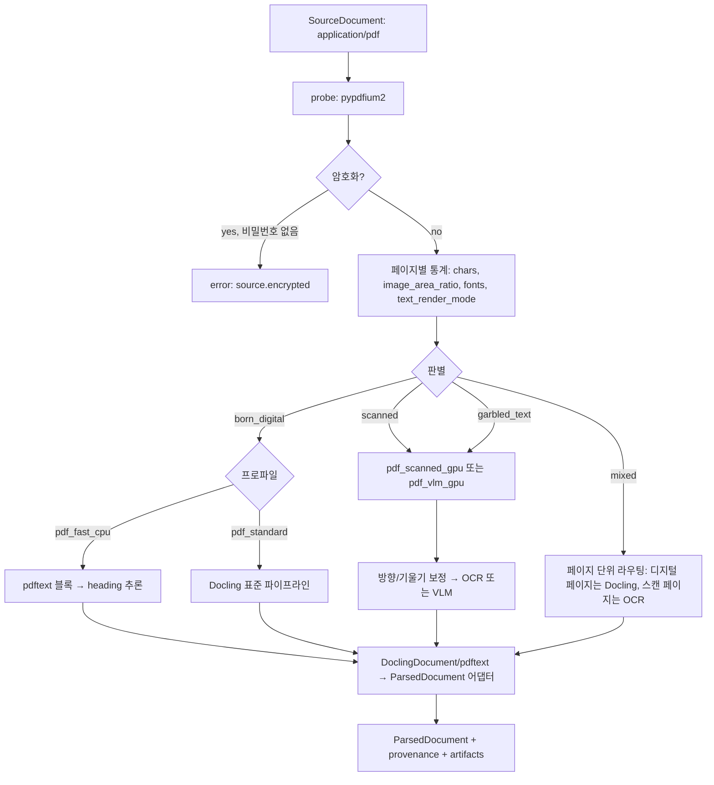
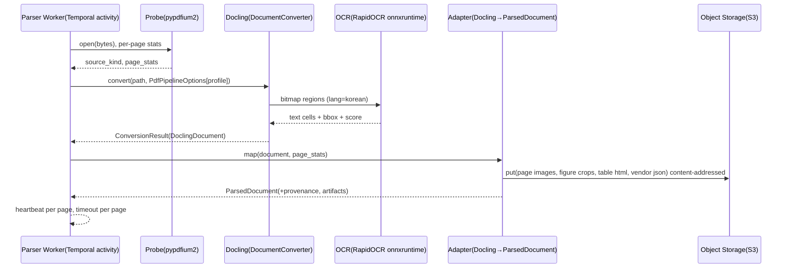

# PDF 파싱·레이아웃 분석·OCR

## 목적

디지털(born-digital) PDF와 스캔 PDF를 브리프 D-04의 표준 문서 모델 `ParsedDocument`로 변환하기 위해 필요한 오픈소스 기술 지형을 조사하고, 다음을 확정할 근거를 제공한다.

- PDF 파서 스택의 1차/2차/폴백 선정과 프로파일별 조합(D-18의 "세부는 07-tech-landscape 결과로 조정 가능" 조항에 따른 조정안).
- 개방 결정 **O-08**(스캔 PDF OCR 엔진 기본값: PaddleOCR vs Tesseract vs RapidOCR vs Surya)에 대한 명확한 권고.
- 라이선스 정책 **D-02**(Apache-2.0 플랫폼, AGPL은 네트워크 분리 서비스로만, GPL 링크 금지)에 비추어 위험한 후보의 식별.
- `parser` 플러그인(D-10) 어댑터가 벤더 모델(DoclingDocument, Unstructured Elements, MinerU content_list 등)을 `ParsedDocument`로 매핑할 때 보존해야 하는 출처(provenance) 정보의 정의.

모든 버전·라이선스·수치는 2026-09-18 기준으로 웹에서 확인했으며, 확인하지 못한 항목은 "확인 필요(as of 2026-09)"로 표기했다. v0.2.0은 검증 리뷰에서 지적된 사실 오류(한국어 PP-OCRv5 server 인식 모델 부재, Docling 자동 OCR 선택 동작, OmniDocBench v1.6 상위 모델 누락, docTR·MinerU 4.x·KORIE 수치, MonkeyOCR 가중치 라이선스 등)를 반영한 개정판이다. v0.3.0(2026-09-22)은 2차 검증에서 지적된 항목 — Docling 처리량 측정 조건(8 thread, EasyOCR, 혼합 코퍼스)과 §7 미달 결론의 완화, Nemotron-OCR v2 한국어 지원, MonkeyOCRv2-B-Parsing(Apache-2.0, 한국어 명시) 등 2026년 신규 VLM 파서 추가, KORIE PaddleOCR 수치(CER 15.84%), Chandra 2 점수, RapidOCR 열거형, Docling `LayoutObjectDetectionOptions`, heron/egret CPU 수치, HunyuanOCR 라이선스의 대한민국 제외 조항 — 을 반영했다.

## 범위

| 포함 | 제외 |
|------|------|
| PDF 텍스트 추출 라이브러리(디지털 PDF) | HWPX/HWP 파싱(`04-parser-hwpx-and-hwp` 및 별도 지형 문서) |
| 레이아웃 분석 모델(DocLayNet 계열, RT-DETR, YOLO, LayoutLM 계열) | DOCX/HTML/TXT 파서(별도 지형 문서) |
| 표 구조 인식(TableFormer, table-transformer, PP-Table) | 청킹·임베딩(별도 지형 문서) |
| OCR 엔진(전통형 detector+recognizer, VLM 기반 end-to-end) | 최종 답변 생성 |
| 읽기 순서 복원, 2단 컬럼, 각주, 헤더/푸터, 회전/기울기 보정 | 문서 편집·재생성 |
| 스캔/디지털 판별 휴리스틱 | 웹 크롤링·수집 |
| 한국어 OCR 정확도 근거 | 손글씨 특화 인식(범위 밖, 향후 과제) |

## 평가 기준

가중치는 브리프 원칙 6(Korean-First), D-02(라이선스), 원칙 7(평가 주도)을 반영한다. 점수는 1~5(5가 최고), 가중 합계는 100점 만점.

| 기준 | 가중치 | 5점의 의미 | 1점의 의미 |
|------|--------|-----------|-----------|
| 한국어 지원 | 20 | 한국어 전용 인식 모델 + 공개 정확도 근거 | 한국어 미지원 또는 근거 없음 |
| 라이선스 적합성(D-02) | 20 | Apache/MIT/BSD, 모델 가중치 포함 제한 없음 | AGPL/GPL 링크 또는 매출 임계 가중치 라이선스 |
| 성숙도/유지보수 | 15 | 최근 3개월 내 릴리스, 활발한 이슈 처리 | 12개월 이상 릴리스 없음 |
| 품질/성능 | 20 | 공개 벤치마크 최상위권 + 처리량 근거 | 근거 없음 또는 하위권 |
| 통합 난이도 | 10 | 순수 Python wheel, 기존 파이프라인 옵션으로 선택 가능 | 별도 프레임워크·서빙 서버·CUDA 버전 결합 필수 |
| 커뮤니티/생태계 | 5 | 광범위한 통합(LlamaIndex, LangChain, Dify 등) | 단일 벤더 의존 |
| 운영 비용 | 10 | CPU로 실용적 처리량 | 대형 GPU 필수 |

## 후보 목록

### A. 통합 PDF 파서(레이아웃 + 표 + OCR 오케스트레이션)

| 이름 | 최신 버전(확인일 2026-09-18) | 라이선스 | 성숙도 | 한국어 지원 | 핵심 강점 | 약점 |
|------|------------------------------|----------|--------|-------------|-----------|------|
| Docling (IBM → LF AI & Data) | 2.129.0 (2026-09-18; 확인일 당일 갱신, 직전 2.128.0은 2026-09-16), Python 3.10~3.14 | 코드 MIT; 모델(layout heron, TableFormer) CDLA-Permissive-2.0; Granite-Docling Apache-2.0 | 매우 높음(주 2회 수준 릴리스) | OCR 엔진 위임(RapidOCR `korean`, Tesseract `kor`, EasyOCR `ko`); v2.56+ 기본은 자동 선택(`OcrAutoOptions`)이므로 한국어는 엔진·언어·모델 버전 명시 필수; 레이아웃 모델은 언어 무관 | 풍부한 문서 모델(DoclingDocument, provenance 내장), 표 구조, 플러그형 OCR, VLM 파이프라인, docling-serve | 레이아웃 학습 데이터(DocLayNet)가 영문·중문 위주; CPU 처리량 제한; OmniDocBench 공식 리더보드 미등재; 자동 OCR 선택이 설치 환경(OS·onnxruntime·Nemotron 유무)에 따라 엔진과 모델 세대를 바꿈 |
| docling-serve | 1.34.0 (2026-09-17) | MIT | 높음 | Docling과 동일 | REST/async/WebSocket API, `ocr_preset`·`pdf_backend`·`table_mode` 요청 옵션(`ocr_engine`은 deprecated) | 요청에 엔진 미지정 시 EasyOCR가 기본으로 선택되는 이슈(#554, 2026-03-26 생성, open) |
| Marker (datalab) | marker-pdf 2.0.0 (2026-07-20) | 코드 Apache-2.0; **모델 가중치 modified OpenRAIL-M(매출/투자 5M USD 미만 무료)** | 높음 | Surya 2 다국어(내부 평가 한국어 86.7%) | 속도(B200 2.9 pg/s balanced), 마크다운 품질 | 가중치 라이선스가 D-02와 충돌; 2.0부터 vLLM/llama.cpp 추론 서버 필수 |
| MinerU (OpenDataLab) | mineru 4.0.2 (2026-09-17), Python 3.10~<3.15 | **MinerU Open Source License**(pyproject SPDX 표기 `LicenseRef-MinerU-Open-Source-License`; Apache-2.0 기반 + 추가 조건: MAU 1억 또는 월매출 2천만 USD 초과 시 상업 라이선스, 사용 사실 표시 의무) | 높음 | 모델 카드는 중·영 중심; 한국어 미언급 | OmniDocBench v1.6 상위권(MinerU2.5-Pro 95.75 리더보드 / 95.69 모델 카드 자체 보고; v1.6 4위권); 4.x는 기본 설치로 CPU 실행 가능(소형 모델 ONNX CPU 추론, VLM은 llama.cpp Vulkan) | 표시 의무 조항; 2.x pipeline 백엔드는 DocLayout-YOLO(AGPL-3.0) 의존 — 4.x 기본 의존성(docvortex MIT, onnxruntime)에는 없으나 다운로드되는 레이아웃 ONNX 가중치의 출처·라이선스 확인 필요(as of 2026-09); 고품질 티어(standard/advanced)는 GPU 권장 |
| Unstructured (OSS 라이브러리) | 0.27.6 (2026-09-14), Python >=3.11 <3.14 | Apache-2.0 | 높음(단, 회사는 SaaS 우선) | Tesseract `kor` 또는 PaddleOCR 에이전트 | 단순 API(`partition_pdf`), 요소 카테고리(Title/NarrativeText/Table/Header/Footer), `text_as_html` | hi_res 느림, 읽기 순서 모델 없음, pdf2image→Poppler(GPL) 서브프로세스 |
| PaddleOCR PP-StructureV3 | paddleocr 3.7.0 (2026-06-11) | Apache-2.0 | 높음 | PP-OCRv5 한국어 인식 모델(mobile) 내장 | 레이아웃(PP-DocLayoutV3)+표+OCR 원스톱, OmniDocBench v1.5 86.73 | PaddlePaddle 프레임워크 의존(CUDA 결합), API 변동 |
| Kreuzberg → Xberg | Xberg 1.0 (2026-07; Kreuzberg를 Rust 코어로 재구축, Python 등 바인딩) | MIT | 중(재구축 직후) | OCR 백엔드 위임: Tesseract(FFI/WASM)·PaddleOCR(ONNX Runtime)·VLM; HWP/HWPX 텍스트 추출 포함 107 포맷(벤더 표기) | 레이아웃 모델(PP-DocLayout-V3, RT-DETR)과 표 구조 모델(TATR, SLANet)로 읽기 순서·셀 그리드 복원(벤더 문서); Unstructured 대체 경량 라이브러리 | 레이아웃·표 모델은 PP-DocLayoutV3/RT-DETR·TATR/SLANet 위임(자체 실증 없음); 한국어 실증 부재; 재구축 직후로 API 안정성 미확인 → `pdf_fast_cpu` 대안으로 골든셋 비교 대상에 포함 검토 |

### B. 디지털 PDF 텍스트 추출 라이브러리

| 이름 | 최신 버전(확인일) | 라이선스 | 성숙도 | 한국어 지원 | 핵심 강점 | 약점 |
|------|-------------------|----------|--------|-------------|-----------|------|
| PyMuPDF (MuPDF) | 1.28.2 (2026-08-06) | **AGPL-3.0 또는 Artifex 상업 라이선스(듀얼)** | 매우 높음 | CJK 양호 | 최고 속도, 렌더링·주석·폰트 정보 | **D-02 위반(AGPL 링크)** — 별도 컨테이너로만 허용 |
| pypdfium2 (PDFium) | 5.13.0 (2026-08-13) | Apache-2.0 또는 BSD-3-Clause(선택) | 높음 | CJK 양호(Chromium PDF 엔진) | 렌더링·텍스트·객체 추출, 관대한 라이선스, Docling 백엔드 | 구조화 텍스트(블록/라인)는 직접 구현 필요 |
| pdftext (datalab) | 0.7.1 (2026-07-08) | Apache-2.0 | 중상 | CJK 지원 명시 | pypdfium2 위에 블록/라인/스팬 + 폰트 메타데이터, PyMuPDF 대비 97.54% 정렬 일치(벤더 벤치) | 벤더 벤치만 존재; RTL 미흡 |
| docling-parse | Docling 핀 `>=7.20.0,<8.0.0`(docling pyproject 기준) | MIT | 높음 | 양호 | Docling 기본 백엔드(`THREADED_DOCLING_PARSE`), 문자 단위 셀 + bbox | 단독 사용 문서 부족 |
| pdfplumber | 0.11.10 (2026-06-15) | MIT | 높음 | pdfminer.six 기반, CJK 가능 | 선(rule) 기반 표 추출, 시각 디버깅 | 느림(pdftext 벤치에서 3.40 s/doc), 스캔 불가 |
| pdfminer.six | 20260107 (2026-01-07) | MIT | 높음 | CJK·세로쓰기 지원 명시 | 순수 Python, 폰트·색상 메타 | 느림, 레이아웃 휴리스틱 한계 |
| pypdf | 6.19.0 (2026-09-16) | BSD-3-Clause | 높음 | 기본 | 순수 Python, 병합·분할·암호화 등 문서 조작 | 텍스트 추출 품질은 보조 수준 |
| Poppler / pdftotext | 26.09.0 (2026-09-03) | **GPL-2.0/GPL-3.0** | 매우 높음 | 양호 | `-layout`, `-bbox-layout` 옵션, 배포판 표준 | D-02: 라이브러리 링크 금지; CLI 서브프로세스도 법무 확인 권고 |

### C. OCR 엔진(전통형 detector + recognizer)

| 이름 | 최신 버전(확인일) | 라이선스 | 성숙도 | 한국어 지원 | 핵심 강점 | 약점 |
|------|-------------------|----------|--------|-------------|-----------|------|
| PaddleOCR (PP-OCRv5/v6) | 3.7.0 (2026-06-11) | Apache-2.0 | 매우 높음 | `korean_PP-OCRv5_mobile_rec`(14 MB) 정확도 88.0(벤더, 5,007 한국어 라인); **한국어 인식 모델은 mobile 단일 제공**(`PP-OCRv5_server_rec`는 중·영·일 전용); **PP-OCRv6 통합 50개 언어 모델은 한국어 미포함**(간체·번체 중국어·영어·일본어 4개 + 라틴 문자 46개 = 50) | 문서 방향·왜곡(UVDoc)·텍스트라인 방향 전처리 모듈, 언어 무관 server 검출 모델 | PaddlePaddle 의존, 배포 무게; 한국어 인식 정확도는 RapidOCR(동일 mobile 가중치)과 동등; KORIE(영수증) CER 15.84% / WER 26.73%(PP-OCR 버전 미기재) |
| RapidOCR | rapidocr 3.9.2 (2026-07-21), Python 3.8~3.13 | Apache-2.0 | 높음 | 3.3.0+ `Rec.lang_type=LangRec.KOREAN`(PP-OCRv5 한국어 mobile 모델, ONNX) | ONNX Runtime 경량, Docling 자동 OCR 선택 대상(v2.56+; Linux + onnxruntime 설치 시), 다중 백엔드(onnxruntime/openvino/paddle/torch/tensorrt/mnn) | 변환 1회당 단일 언어, 초회 모델 다운로드; **v3.9.0+ 기본 = PP-OCRv6 small(det/rec, 한국어 미지원) → `OCRVersion.PPOCRV5` + `ModelType.MOBILE` 명시 필수** |
| Tesseract 5 | 5.5.3 (2026-07-24) | Apache-2.0 | 매우 높음 | `kor`, `kor_vert` traineddata(tessdata/best/fast) | 배포판 패키지, CPU only, 에어갭 친화 | 한국어 CER 높음(KORIE 25.43%), 전처리 필요 |
| EasyOCR | 1.7.2 (2024-09-24) | Apache-2.0 | **낮음(2년 무릴리스)** | `ko` | 설치 간편 | 한국어 품질 저조(KORIE CER 17.36% — PaddleOCR 15.84% 대비 +1.5%p로 격차는 작음; SK 평가 "매우 떨어짐"), 유지보수 정체 |
| docTR / OnnxTR | docTR 1.1.0 (2026-08-21) / OnnxTR 0.9.0 (2026-08-24) | Apache-2.0 | 높음(한 달 전 대형 릴리스) | `korean` vocab 존재(`doctr/datasets/vocabs.py`: 현대 한글 음절 U+AC00~U+D7A3 + 숫자·문장부호·₩) — **한국어 사전학습 인식 체크포인트는 없음**(공개 모델은 french 계열 vocab 학습; 파인튜닝 필요, 확인 필요 as of 2026-09) | 경량, ONNX(OnnxTR); 1.1.0에 레이아웃 분석(LW-DETR, 11 클래스)·표 구조(TableCenterNet)·읽기 순서 내보내기·CLI 추가; Docling 플러그인 `docling-ocr-onnxtr` | 한국어 인식은 자체 파인튜닝 전제 → OCR 기본 후보 제외; 레이아웃·표 모델은 E절 대안 후보 |
| Surya (datalab) | surya-ocr 0.22.1 (2026-07-20) | 코드 Apache-2.0; **가중치 modified OpenRAIL-M(5M USD 임계)** | 높음 | 91개 언어 내부 평가 한국어 86.7%(벤더) | Surya 2(650M VLM) olmOCR-bench 83.3%(벤더), 레이아웃·표·읽기 순서 포함 | 가중치 라이선스, 추론 서버 필수 |
| NVIDIA Nemotron-OCR v2 | `nvidia/nemotron-ocr-v2` (2026-04-15); multilingual 변형 83.9M 파라미터; Docling `NemotronOcrOptions`(인식기 `english`/`multilingual`), 설치 extra `docling[feat-ocr-nemotron]` | **NVIDIA Open Model License**(후처리 스크립트 Apache-2.0; 법무 검토 필요) | 중 | **multilingual 변형이 영어·중국어(간체/번체)·일본어·한국어·러시아어 명시 지원**(정량 미공개) | Docling 내장 엔진; GPU 인식 정확도 프로파일 후보(O-08 골든셋 비교 대상) | **Linux x86_64 + Python 3.12 + CUDA 13.x 한정**(CPU·에어갭 불가); Docling `OcrAutoOptions`에서 Linux 환경 시 RapidOCR보다 먼저 자동 선택됨 → 라이선스 검토 전에는 엔진 명시로 차단 |
| PORORO (Kakao Brain) | 0.4.2 (2021-06 이후 릴리스 없음) | Apache-2.0 | **정체(5년 무릴리스)** | 한국어 OCR 포함(brainocr) | 한국어 OSS OCR 베이스라인 역할이었음 | 유지보수 중단, 구 PyTorch 의존 → **제외**(언급 가치 낮음) |
| OCRmyPDF | 최신 버전 확인 필요(as of 2026-09) | **MPL-2.0** | 매우 높음 | Tesseract `kor` 위임 | 스캔 PDF에 텍스트 레이어 삽입(`pre_ocr` 경로), PDF/A 산출, deskew·회전 보정, 멀티코어 | Tesseract 품질 상한; MPL-2.0은 파일 단위 카피레프트 → CLI 서브프로세스로 격리(법무 확인) |

### D. VLM 기반 end-to-end 문서 파싱 모델

| 이름 | 최신 버전(확인일) | 라이선스 | 성숙도 | 한국어 지원 | 핵심 강점 | 약점 |
|------|-------------------|----------|--------|-------------|-----------|------|
| Granite-Docling-258M (IBM) | 2025-09-17 릴리스 | Apache-2.0 | 중상 | 영어 주 지원, 일·아랍·중 실험적 지원, **한국어 미지원(모델 카드 기준)** | 초소형, DocTags → DoclingDocument, Docling `VlmPipeline` 통합 | 한국어 미지원, 소형 모델 한계 |
| SmolDocling-256M-preview | 2025-03 | Apache-2.0 | 실험(Granite-Docling으로 대체) | 미검증 | — | preview, 사용 비권장 |
| PaddleOCR-VL | VL 0.9B(2025-10); VL-1.5(2026-01); **VL-1.6(2026-05-28)** — 세 세대 모두 0.9B(HF 텐서 메타 약 1.0B; 모델명 `PaddleOCR-VL-1.6-0.9B`) | Apache-2.0 | 높음 | **VL 0.9B 카드: 109개 언어에 한국어 명시**; 논문(arXiv 2510.14528) Table 6 벤더 in-house 다국어 OCR 평가 한국어 edit distance 0.052(문서 수준 한국어 점수는 미공개); VL-1.5/1.6 카드는 "English, Chinese, multilingual"만 기술 → 한국어 명시 여부 확인 필요(as of 2026-09) | OmniDocBench v1.5 92.86; v1.6 94.18(VL) / 94.93(VL-1.5) / 96.34(VL-1.6, 공식 리더보드 등재); vLLM 공식 지원 | 한국어 정량 근거는 벤더 내부 평가; GPU 필요 |
| MinerU2.5-Pro-2604-1.2B | 2026-04-06 | Apache-2.0(가중치) | 높음 | 중·영 중심, 한국어 미언급 | OmniDocBench v1.6 95.75(리더보드) / 95.69(모델 카드 자체 보고); A100 2.12 pages/s(vLLM async) | 한국어 미검증; MinerU 툴킷 추가 조건 |
| TeleOCR (StarDoc-AI) | 1.2B, 2026-08-17 | Apache-2.0 | 중(신규) | 중·영·일 명시, **한국어 미명시** | **OmniDocBench v1.6 1위**(96.91 리더보드 / 96.87 모델 카드); 표 TEDS 97.05; 디지털·촬영 문서 통합 | 한국어 미검증 |
| OvisOCR2 (ATH-MaaS) | 0.8B, 2026-07(기술 보고서 2026-07-15) | Apache-2.0 | 중(신규) | 지원 언어 미기술, 한국어 미명시 | OmniDocBench v1.6 96.47(리더보드) / 96.58(모델 카드); PureDocBench 1위 주장 | 한국어 미검증 |
| GLM-OCR (zai-org/Zhipu) | 0.9B, 2026-03 | MIT | 중상 | 8개 언어(목록 미기술, 한국어 미확인) | OmniDocBench v1.5 94.62 / v1.6 95.22; vLLM·SGLang·Ollama 공식 지원; PP-DocLayoutV3(Apache-2.0) 결합 파이프라인 | 한국어 미검증 |
| Unlimited-OCR (Baidu) | 3B MoE(활성 파라미터 약 0.5B; 논문 arXiv 2606.23050 기준, HF 카드에는 MoE 미표기), 2026-06-22 | MIT | 중(신규) | 한국어 미확인 | OmniDocBench v1.6 94.00; R-SWA로 KV 캐시를 상수로 유지해 수십 페이지를 단일 forward(32K 컨텍스트)로 처리 → 100페이지 처리량 목표에 유리할 가능성 | 한국어 미검증; 신규(성숙도 낮음) |
| olmOCR 2 (Ai2) | olmocr 0.4.27 (2026-03-12); olmOCR-2-7B-1025-FP8 | Apache-2.0 | 높음 | **영문 중심** | olmOCR-bench 82.4; 1백만 페이지 200 USD 미만(벤더) | 7B, VRAM 12GB 이상, 한국어 미검증 |
| Infinity-Parser 7B / Infinity-Parser2-Pro·Flash (infly) | `infly/Infinity-Parser-7B`; 후속 Infinity-Parser2-Pro / Infinity-Parser2-Flash 공개(크기·점수 확인 필요 as of 2026-09) | Apache-2.0(HF 카드) | 중 | 미검증 | olmOCR-bench 82.5(7B) | 7B 비용; 한국어 미검증 → 참고 후보(Parser2 세대 추가 확인 대상) |
| Nanonets-OCR2-3B | Qwen2.5-VL-3B-Instruct 파인튜닝(카드 표기 4B params) | **모델 카드에 라이선스 미표기**(기반 Qwen2.5-VL은 Apache-2.0; 확인 필요 as of 2026-09) | 중 | **한국어 명시 지원**(영·중·불·서·포·독·이·러·일·한·아랍 등) | 시맨틱 태깅 마크다운; olmOCR-bench 69.5 | 벤치 하위권; 라이선스 미확정 |
| dots.ocr (rednote) | 1.7B | MIT(HF 카드·저장소 LICENSE 원문 모두 표준 MIT; 별도 부가 조건 문서 존재 여부 확인 필요, as of 2026-09) | 중 | 자체 벤치 100개 언어 주장, 한국어 명시 없음 | OmniDocBench v1.6 90.77 | 한국어 미검증; 라이선스 최종 확인 후 D-02 채택 가능 후보로 재분류 가능 |
| Dolphin (ByteDance) | Dolphin-v2 3B(v1 0.3B) | MIT | 중 | 지원 언어 미기술(중·영 중심) | OmniDocBench v1.5 89.78(v2) | 한국어 미검증; 참고 후보 |
| DeepSeek-OCR / -2 | 3B | MIT / Apache-2.0 | 중 | 미검증 | 시각 토큰 압축 | olmOCR-bench 75.7 |
| MonkeyOCR-pro-3B / pro-1.2B (v1) | v1.5 | 코드 Apache-2.0; **v1 가중치는 학술 연구·비상업 평가 전용(상업 배포는 별도 서면 라이선스)** | 중 | 영·중만 명시 | OmniDocBench v1.6 88.57 | **v1 가중치 비상업 → D-02 기본 채택 불가(제외; v1 가중치 한정 — 후속 v2는 아래 행)** |
| **MonkeyOCRv2-B-Parsing** (zenosai) | 0.7B(ViT 0.1B + LLM 0.6B), 2026-07-14 (HF `zenosai/MonkeyOCRv2-B-Parsing`, arXiv 2607.11562) | **코드·가중치 Apache-2.0** | 중(신규) | **17개 언어에 한국어(KO) 명시**; MDPBench(디지털·촬영 문서, 17개 언어) 오픈소스 1위 83.3 주장 | 초경량, vLLM/SGLang 서빙 지원, 한국어 명시 + 허용적 라이선스 → **`pdf_vlm_gpu` 1순위를 PaddleOCR-VL과 직접 경쟁** | OmniDocBench 파싱 점수 미공개; 신규(2026-07)로 성숙도·커뮤니티 미확인; 한국어 정량치는 벤더 벤치 |
| GOT-OCR2.0 | 0.7B | Apache-2.0 | 중 | "multilingual" 태그, 한국어 미확인 | 포맷 OCR·세부 영역 OCR | transformers 구버전 고정(4.37.2) |
| Qwen3-VL (Alibaba) | 2B/4B/8B/32B dense, 30B-A3B/235B-A22B MoE(크기 일부 확인 필요) | Apache-2.0 | 높음 | OCR 32개 언어 | 범용 VLM, 235B-A22B OmniDocBench v1.6 89.78 | 대형, 비용; 전용 파서보다 낮은 점수 |
| LightOnOCR-1B / LightOnOCR-2-1B | 1B; LightOnOCR-2-1B (2026-01) | Apache-2.0 | 중 | 유럽 언어 중심, **한국어 미명시** | LightOnOCR-1B olmOCR-bench 76.1; LightOnOCR-2-1B는 olmOCR-bench 최상위 주장(벤더, 수치 확인 필요 as of 2026-09) | **한국어 비적합으로 명시적 제외**(영문 전용 프로파일 후보로만 참고) |
| HunyuanOCR-1.5 (Tencent) | 1B | **Tencent Hunyuan Community License** — Territory 정의에서 EU·영국·**대한민국 제외**(그 밖의 지역·조건 외 사용은 비허가) | 중 | 미확인 | — | **라이선스 Territory에서 대한민국 제외(한국 내 사용 비허가) → 즉시 제외** |
| Nougat (Meta) | nougat-ocr 0.1.17 (2023-10-04) | 코드 MIT; **가중치 CC-BY-NC** | **정체** | 비라틴 취약 명시 | 학술 수식 | 상업 불가, 폐기 대상 |
| Chandra (datalab) | chandra-ocr 0.2.0 (2026-03-18), 모델 Chandra 2 (2026-03) | 코드 Apache-2.0; **가중치 OpenRAIL-M(2M USD 임계)** | 중 | 벤더 43개 언어 표에서 **한국어 81.5%**(Gemini 2.5 Flash 84.8% 대비) | olmOCR-bench **85.8 ± 0.8**(Chandra 2, README; PyPI 설명은 85.9) — 공개 결과 중 최상위; Chandra 1은 83.1 | 가중치 라이선스(2M USD 임계) → D-02 기본 채택 불가(제외 유지) |
| NVIDIA Nemotron-Parse v1.2 / 2.0 | 885M | **NVIDIA Nemotron Open Model License**(상업 사용 가능 표기; 법무 검토 필요) | 중 | 미확인 | 레이아웃 클래스·bbox·읽기 순서를 직접 출력하는 레이아웃 지향 VLM 파서 | 한국어 미검증; 라이선스 검토 전 참고 후보 |
| OCRFlux-3B (ChatDOC) | Qwen2.5-VL-3B 기반 | Apache-2.0 | 중 | 미확인 | **페이지 간 표·단락 병합 네이티브 지원** — 다중 페이지 표를 하나의 ParsedDocument 표로 합치는 요구와 직접 관련 | 한국어 미검증; 3B 비용 |
| FireRed-OCR (Xiaohongshu) | 2026-03 | 코드·가중치 Apache-2.0 | 중(신규) | 미확인 | OmniDocBench v1.5 92.94 | 한국어 미검증 |
| POINTS-Reader (Tencent) | 약 4B | Apache-2.0 | 중 | 미확인 | end-to-end 문서 변환 | 한국어 미검증; 4B 비용 |
| Logics-Parsing / Logics-Parsing-Omni (Alibaba) | 2025-09 / 2026-03 | 확인 필요(as of 2026-09) | 중 | 미확인 | OmniDocBench 등재 | 라이선스 미확정 → 보류 |
| dots.mocr (rednote) | 3B, 2026-03 (dots.ocr 후속) | 확인 필요(as of 2026-09) | 중(신규) | XDocParse 126개 언어 평가 → 한국어 포함 가능성 높음(확인 필요) | 다국어 확장 | 라이선스·한국어 확인 후 스크리닝 대상 |
| Youtu-Parsing (Tencent) | 2026-01 | **커스텀 'youtu-parsing' 라이선스** | 중 | 미확인 | — | 커스텀 라이선스 → D-02 부적합, **제외** |
| 2026 신규 스크리닝 대기(OmniDocBench·arXiv 등재) | OCRVerse, NaviDC-OCR(StarDoc-AI), Qianfan-OCR(Baidu, 2026-03), ABot-OCR(2026-05), GutenOCR(2026-01) | 각각 확인 필요(as of 2026-09) | 신규 | 미확인 | — | 라이선스·한국어 지원 스크리닝 후 D절 편입 여부 결정 |

### E. 레이아웃·표 모델 및 데이터셋

| 이름 | 종류 | 라이선스 | 비고 |
|------|------|----------|------|
| DocLayNet (IBM) | 데이터셋, 11 클래스 | CDLA-Permissive-1.0 | 대부분 레이아웃 모델의 학습 기준 |
| docling-layout-heron | RT-DETRv2 + ResNet-50, 42.9M, 17 클래스 | CDLA-Permissive-2.0 | Docling 기본(`LayoutObjectDetectionOptions.model_spec = DOCLING_LAYOUT_HERON`; `LayoutOptions`는 deprecated 별칭); DocLayNet mAP 0.776; A100 31 ms/img(batch 200), CPU(EPYC 7763, 4 thread, batch 32) 643 ms/img (arXiv 2509.11720 Table 5) |
| docling-layout-heron-101 | RT-DETRv2 + ResNet-101, 76.7M | CDLA-Permissive-2.0 | mAP 0.780; A100 28 ms/img; CPU 4-thread 988 ms/img |
| docling-layout-egret-m/l/x | D-FINE 계열, 19.5M/31.2M/62.7M | CDLA-Permissive-2.0 | egret-m mAP 0.765(egret-l 0.747보다 높음), A100 24 ms/img, CPU 4-thread 334 ms/img → **CPU 프로파일에서 heron 대비 약 2배 빠르고 mAP −0.011인 경량 옵션으로 검토** |
| Camelot / gmft / img2table | 표 추출 전용 라이브러리(Camelot: 선·스트림 기반; gmft: table-transformer 래퍼; img2table: 이미지·PDF 표) | 모두 MIT | pdfplumber 선 기반 폴백의 비교 대상(디지털 PDF 표 폴백 골든셋 병행 평가) |
| Donut + SynthDoG-ko (naver-clova-ix) | 한국어 합성 문서 생성기 + OCR-free 문서 이해 모델 | MIT | **SynthDoG-ko는 한국어 PDF 골든셋(D-12) 구축 시 합성 스캔 데이터 생성에 직접 활용 가능**; Donut 자체는 파서 후보 아님 |
| PDF-Extract-Kit (OpenDataLab) | 레이아웃·수식·표 모델 툴킷 | **AGPL-3.0** | D-02 제외 대상; MinerU 계열 의존성 추적용으로 명시 |
| TableFormer (docling-ibm-models) | 표 구조(FAST/ACCURATE) | CDLA-Permissive-2.0 | Docling 기본 `TableFormerMode.ACCURATE` |
| table-transformer (TATR, Microsoft) | DETR 기반 표 탐지/구조 | MIT | Unstructured 표 구조에 사용 |
| DocLayout-YOLO (OpenDataLab) | YOLO-v10 계열 | **AGPL-3.0** | D-02 링크 금지; MinerU 2.x pipeline 백엔드 의존(4.x 레이아웃 가중치 출처 확인 필요) |
| LayoutLMv3 (Microsoft) | 멀티모달 트랜스포머 | **CC-BY-NC-SA 4.0** | 상업 사용 불가 |
| unstructured-inference (yolox, detectron2_onnx) | 레이아웃 탐지 | Apache-2.0 | 기본 모델명·학습 데이터 확인 필요 |
| PP-DocLayoutV3 (PaddleOCR) | 레이아웃 탐지 | Apache-2.0 | PP-StructureV3 구성 요소(현행 모델명); GLM-OCR 파이프라인에도 결합 |
| docTR 1.1.0 layout + TableCenterNet | 레이아웃(LW-DETR, 11 클래스)·표 구조 | Apache-2.0 | 2026-08 공개; Docling heron의 Apache 대안 후보로 골든셋 병행 평가 대상 |
| Surya layout/table | 레이아웃·표 | 가중치 OpenRAIL-M | 기본 채택 불가 |

## 심층 비교

### Docling

| 항목 | 내용 |
|------|------|
| 동작 방식 | PDF 백엔드(`THREADED_DOCLING_PARSE` 기본, `PYPDFIUM2` 대안)가 문자 셀·bbox·비트맵을 추출 → 레이아웃 모델(heron, 17 클래스) → 비트맵 영역 OCR(플러그형 엔진) → TableFormer 표 구조 → 읽기 순서 → `DoclingDocument`(계층 트리 + provenance) |
| 진입점 | `pip install "docling[rapidocr]"`(onnxruntime 포함 extra; standard 번들 `pip install docling`은 `rapidocr`만 포함하고 onnxruntime 미포함); `docling.document_converter.DocumentConverter`, `PdfFormatOption`; `docling.datamodel.pipeline_options.PdfPipelineOptions`, `OcrAutoOptions`, `RapidOcrOptions`, `TesseractCliOcrOptions`, `EasyOcrOptions`, `NemotronOcrOptions`(extra `feat-ocr-nemotron`), `TableStructureOptions`, `TableFormerMode`, `LayoutObjectDetectionOptions`(`LayoutOptions`는 deprecated 별칭 — 어댑터는 신규 클래스 사용), `VlmPipelineOptions`; CLI `docling <path> --to md`; `docling-tools models download`(오프라인 프리페치); 버전 핀 정책: 마이너 고정(docling-parse는 `>=7.20.0,<8.0.0`) |
| 주요 옵션(확인) | `do_ocr=True`, `do_table_structure=True`, `table_structure_options.mode=ACCURATE`, `do_cell_matching=True`, `generate_page_images/generate_picture_images=False`, `images_scale=1.0`, `do_picture_description/do_picture_classification/do_formula_enrichment/do_code_enrichment=False`, `ocr_options` 기본값 `OcrAutoOptions()`(자동 선택), `OcrOptions.lang`, `OcrOptions.mode`(OcrMode; 구 `force_full_page_ocr`는 deprecated 매핑), `OcrOptions.scale=3.0`, `RapidOcrOptions.lang=["ch"]` 기본·`backend="onnxruntime"`, `max_num_pages`, `max_file_size`, `OMP_NUM_THREADS`(기본 4). **권고 구성**: `RapidOcrOptions(lang=["korean"], backend="onnxruntime")`를 명시해 자동 선택에 의존하지 않음 |
| OCR 엔진 | v2.56.0(2025-10-13)부터 기본은 **자동 선택(`OcrAutoOptions`, AutoOCR)** — 선택 순서(`auto_ocr_model.py`): ocrmac(macOS) → Nemotron-OCR(Linux, 런타임 검증 통과 시) → RapidOCR+onnxruntime → EasyOCR → RapidOCR+torch. 즉 Linux 컨테이너에서 Nemotron 미설치 + `docling[rapidocr]`(onnxruntime 포함) 설치 시 RapidOCR onnxruntime이 선택된다. 지원 엔진: RapidOCR, Tesseract(CLI/tesserocr), EasyOCR(deprecated 예정), ocrmac, Nemotron-OCR, KServe 원격; 서드파티 플러그인 가능(예: `docling-ocr-onnxtr`). v2.109.0(2026-07-03)부터 RapidOCR 기본이 PP-OCRv6로 전환됨(한국어 미포함 → 한국어 지정 시 PP-OCRv5 모델 사용 여부 확인 필수). 언어는 엔진 고유 코드 또는 `iso:` 접두 BCP-47(RapidOCR `korean`, Tesseract `kor`, EasyOCR `ko`) |
| 출력 형식 | `DoclingDocument`(JSON), Markdown, HTML, DocTags, 청크(JSONL); `ProvenanceItem(page_no, bbox, charspan)`; `TableData.table_cells[]`(row/col span, header 플래그); `PictureItem.captions`, `TableItem.captions` 참조 |
| 성능 근거 | arXiv 2501.17887(Docling 2.5.2, 기본 OCR **EasyOCR**; 89 PDF, 4,008 페이지 중 578페이지(약 14%)가 OCR 대상인 **혼합 코퍼스**): 페이지당 중앙값 x86 CPU(g6.xlarge, EPYC 7R13 8 vCPU, **OMP_NUM_THREADS=8**) 0.79 s, M3 Max 0.32 s, L4 GPU 114 ms; p95 16.3 s / 6.48 s / 2.08 s; **OCR을 끄면 x86 CPU 런타임의 60% 절감**(논문 명시) → 스캔 페이지 없는 텍스트 PDF의 CPU 추정치는 약 0.32 s/page(0.79 × 0.4). 현행 파이프라인(RapidOCR 기본, heron 레이아웃)은 측정 대상과 다르므로 자체 재측정 필요. 레이아웃 모델(arXiv 2509.11720 Table 5): heron A100 31 ms/img(batch 200), CPU(EPYC 7763, 4 thread, batch 32) 643 ms/img; heron-101 28 ms / 988 ms; egret-m 24 ms / 334 ms(mAP 0.765) |
| 함정 | (1) CPU 처리량 근거(0.79 s/page)는 8 thread·EasyOCR·OCR 14% 혼합 코퍼스 조건의 중앙값이다. 이를 텍스트 PDF에 그대로 적용해 "100p 약 79 s → §7 미달"로 결론 내리는 것은 근거와 맞지 않는다. OCR-off 60% 절감을 적용한 텍스트 PDF 추정치는 100p 약 32 s로 §7 목표(30 s)의 경계선이며, **자체 재측정 전까지 미달·충족 모두 미확정**. 안전한 달성 경로는 여전히 고속 텍스트 경로(`pdf_fast_cpu`) 또는 GPU. (2) bbox 좌표 원점이 PDF 관례(bottom-left)이므로 어댑터에서 정규화 필요(`coord_origin` 필드 확인 필요). (3) RapidOCR 기본 `lang=["ch"]` — 한국어는 명시 지정 필수. (4) docling-serve는 요청마다 `ocr_preset`/`ocr_lang`을 보내야 함(엔진 미지정 시 EasyOCR 기본, 이슈 #554 2026-03 open; `ocr_engine`은 deprecated). (5) 외부 벤더 벤치(Marker README)에서 Docling 50.3%로 낮게 측정 — 측정 조건이 벤더 유리이므로 자체 골든셋 재측정 필요. (6) **standard 번들은 onnxruntime 미포함** → 자동 선택이 RapidOCR torch 백엔드로 떨어지며, `RapidOcrOptions.lang` 설명에 따르면 torch 백엔드의 한국어는 PP-OCRv5가 아닌 PP-OCRv4 인식기로 라우팅됨(품질 강등). (7) **Linux에서 Nemotron-OCR가 설치돼 있으면 RapidOCR보다 먼저 자동 선택**됨(NVIDIA Open Model License 검토 전에는 의도치 않은 채택 위험) → 엔진 명시로 차단. (8) 주 2회 릴리스로 확인일 당일에도 버전이 갱신됨(2.128.0 → 2.129.0) → 마이너 고정 정책 유지 |

### Marker (+ Surya)

| 항목 | 내용 |
|------|------|
| 동작 방식 | pdftext(pypdfium2)로 텍스트 추출 + Surya 2(650M VLM) 레이아웃·OCR·표·읽기 순서 → 블록 트리 → Markdown/JSON/HTML. 2.0부터 Surya 추론은 vLLM(NVIDIA) 또는 llama.cpp(CPU/Apple) 서버로 분리 |
| 진입점 | `pip install marker-pdf`(또는 `[full]`); CLI `marker_single`, `marker`, `marker_server`(FastAPI). Python API는 1.x의 `marker.converters.pdf.PdfConverter` 계열 — 2.0 변경 여부 확인 필요 |
| 출력 형식 | Markdown, JSON(블록 타입·bbox·polygon), HTML, 청크 |
| 성능 근거 | Marker README(B200 1장, olmOCR-bench 1,403 PDF, 8 카테고리 macro-avg): balanced 76.0% / 2.9 pg/s, fast 66.6% / 7.4 pg/s, fast no-OCR 43.6% / 23.7 pg/s. olmOCR README: Marker 1.10.1 76.1. OmniDocBench v1.6: 78.44 |
| 라이선스 | 코드 Apache-2.0(LICENSE 파일 직접 확인). 가중치 modified OpenRAIL-M: 연구·개인·투자/매출 5M USD 미만 무료. Chandra는 2M USD 임계 |
| 함정 | 플랫폼 채택자가 5M USD 초과 기업이면 datalab 상업 계약 필요 → Apache-2.0 플랫폼 기본값으로 부적합. 벤더 벤치는 경쟁사에 불리한 설정 가능성 |

### MinerU

| 항목 | 내용 |
|------|------|
| 동작 방식 | 4.x(4.0.2, 2026-09-17) 기준: 소형 모델(레이아웃·OCR 등)은 ONNX CPU 추론, VLM(MinerU2.5 1.2B, 2단계: 축소 이미지 레이아웃 → 원본 해상도 크롭 인식)은 기본 llama.cpp Vulkan으로 실행되어 **기본 설치가 GPU 없이 동작**(README "default install works out of the box"). 품질 티어 flash/basic/standard/advanced, 추론 엔진 ONNX(기본)/PyTorch/llama.cpp/vLLM/LMDeploy/MLX. 2.x의 pipeline 백엔드(DocLayout-YOLO 레이아웃 + PP-OCRv5 + 수식/표 모델)는 4.x 구조로 재편됨 |
| 진입점 | `pip install mineru`(기본, CPU 실행 가능) 또는 추가 엔진 extra; CLI `mineru -p <in> -o <out>` + 티어/엔진 옵션(정확한 플래그명은 4.x 문서 확인 필요 as of 2026-09). 2.x 백엔드명 `pipeline`, `vlm-transformers`, `vlm-vllm-engine`, `vlm-vllm-async-engine`, `vlm-http-client`는 4.x에서 티어·엔진 조합으로 대체 |
| 출력 형식 | Markdown + `*_content_list.json`(블록 타입·bbox·page_idx) + `*_middle.json`(중간 표현) |
| 성능 근거 | OmniDocBench v1.5: MinerU2.5 90.67(텍스트 edit 0.047, 표 TEDS 88.22, 읽기순서 0.044). v1.6: MinerU-Pipeline 86.47, MinerU2.5 93.04, MinerU2.5-Pro 95.75(리더보드; 모델 카드 자체 보고는 95.69) — v1.6에서는 TeleOCR 96.91, OvisOCR2 96.47, PaddleOCR-VL-1.6 96.34에 이어 4위권. 처리량(arXiv 2509.22186): RTX 4090 48G 1.70 pg/s, A100 80G 2.12 pg/s, H200 4.47 pg/s; 4.x CPU(ONNX·Vulkan) 처리량은 미공개(자체 측정 필요) |
| 라이선스 | 툴킷: MinerU Open Source License(pyproject SPDX `LicenseRef-MinerU-Open-Source-License`; Apache-2.0 + MAU 1억/월매출 2천만 USD 임계 + **UI 또는 공개 문서에 사용 사실 명시 의무**, 위반 시 자동 종료). MinerU2.5-Pro 가중치 Apache-2.0. 4.0.2 기본 의존성은 docvortex(MIT)·onnxruntime 등이며 doclayout_yolo/ultralytics/paddleocr/rapidocr는 직접 의존성에 없음; **다운로드되는 레이아웃 ONNX 가중치의 출처·라이선스는 확인 필요(as of 2026-09)**. 2.x pipeline 백엔드의 DocLayout-YOLO는 AGPL-3.0 |
| 함정 | (1) 표시 의무는 우리 플랫폼 배포자에게 전가되는 조건 → 법무 검토. (2) 2.x pipeline 백엔드는 D-02 위반(AGPL 링크); 4.x는 레이아웃 가중치 라이선스 확인 전까지 별도 컨테이너로 격리. (3) 한국어 미검증 — OmniDocBench는 영·중 전용. (4) 4.x 대개편 직후로 CLI·출력 스키마 변동 가능 |

### Unstructured (오픈소스 라이브러리)

| 항목 | 내용 |
|------|------|
| 동작 방식 | `strategy`: `auto`/`fast`(pdfminer.six)/`hi_res`(레이아웃 모델 detectron2_onnx 또는 yolox + OCR + table-transformer)/`ocr_only`(Tesseract). 이미지 변환은 pdf2image → Poppler CLI |
| 진입점 | `pip install "unstructured[pdf]"`; `unstructured.partition.pdf.partition_pdf(filename, strategy="hi_res", infer_table_structure=True, languages=["kor","eng"], extract_image_block_types=["Image","Table"])`; OCR 에이전트는 환경변수 `OCR_AGENT`(tesseract 기본, paddle 선택) |
| 출력 형식 | Element 리스트(`Title`, `NarrativeText`, `ListItem`, `Table`(`metadata.text_as_html`), `Image`, `Header`, `Footer`); `metadata.coordinates`, `page_number`, `parent_id` |
| 성능 근거 | 공개 정량 벤치 부족. OmniDocBench에 "Unstructured" 평가 항목 존재(점수 확인 필요). `fast`는 모델 기반 대비 약 100배 빠르다고 문서 명시 |
| 함정 | Python <3.14 제약; hi_res 기본 모델명·학습 데이터 확인 필요; 읽기 순서 모델 부재(좌표 정렬); Poppler(GPL) 서브프로세스 의존 → 법무 확인; 회사 전략이 SaaS 우선이라 OSS 기능 격차 확대 가능 |

### PaddleOCR (PP-OCRv5 / PP-OCRv6 / PP-StructureV3 / PaddleOCR-VL)

| 항목 | 내용 |
|------|------|
| 동작 방식 | 문서 방향 분류 → 이미지 왜곡 보정(UVDoc) → 텍스트 검출(DB 계열) → 텍스트 라인 방향 분류 → 인식(SVTR 계열). PP-StructureV3는 레이아웃(PP-DocLayoutV3)·표·수식·차트까지 포함해 Markdown/JSON 출력. PaddleOCR-VL은 VLM end-to-end(VL·VL-1.5·VL-1.6 모두 0.9B, HF 텐서 메타 약 1.0B) |
| 진입점 | `pip install paddlepaddle paddleocr`; `from paddleocr import PaddleOCR, PPStructureV3`; `PaddleOCR(lang="korean", use_doc_orientation_classify=True, use_doc_unwarping=True, use_textline_orientation=True).predict(path)`; CLI `paddleocr ocr -i  --lang korean` |
| 한국어 | `korean_PP-OCRv5_mobile_rec`(14 MB): 벤더 평가셋(한국어 텍스트 이미지 5,007장) 정확도 88.0, 전 세대 대비 +65.0. 한국어+영어 동시 인식. **한국어 인식 모델은 mobile 단일 제공** — `PP-OCRv5_server_rec`/`mobile_rec`(0.8401/0.8015)는 중·영·일 전용 모델의 수치로 한국어 인식 품질과 무관. 검출 모델은 언어 무관(`PP-OCRv5_server_det`/`mobile_det`)이므로 GPU 프로파일에서 얻는 이점은 server 검출 + 전처리 모듈에 한정. **PP-OCRv6 단일 50개 언어 모델은 한국어 미포함**이므로 한국어는 PP-OCRv5 전용 모델 유지. 한국어 GPU 인식 정확도 자체를 높이려면 PaddleOCR-VL(109개 언어, 한국어 명시; 논문 Table 6 벤더 in-house 한국어 edit distance 0.052) 프로파일, Nemotron-OCR v2 multilingual(한국어 명시, 라이선스 검토 필요) 또는 MonkeyOCRv2-B-Parsing(한국어 명시, Apache-2.0)이 대안 |
| 성능 근거 | PP-OCRv5 문서(200장): V100 GPU mobile 0.62 s/img(1,054 chars/s), server 0.74 s/img; CPU Xeon Gold 6271C mobile 1.75 s/img, server 4.34 s/img; 전처리 모듈 모두 켬 시 mobile GPU 0.62→1.09 s(+76%), mobile CPU 1.75→3.13 s(+79%), server GPU 0.74→1.09 s(+47%). PP-StructureV3 OmniDocBench v1.5 86.73. PaddleOCR-VL: v1.5 92.86; v1.6 94.18(VL 0.9B), 94.93(VL-1.5), 96.34(VL-1.6 0.9B, 2026-05-28, 공식 리더보드 등재) |
| 라이선스 | Apache-2.0(코드·모델·PaddleOCR-VL 가중치 모두) |
| 함정 | PaddlePaddle 프레임워크(CUDA 버전 결합, 대용량 wheel) → 파서 워커와 분리된 OCR 컨테이너 권장. 2.x → 3.x API 비호환. 벤더 한국어 수치는 자체 데이터셋 기준 |

### RapidOCR

| 항목 | 내용 |
|------|------|
| 동작 방식 | PP-OCR(v4/v5/v6) 모델을 ONNX 등으로 변환하여 onnxruntime/openvino/paddle/torch/tensorrt/mnn 백엔드로 실행. det → cls(180도) → rec. **v3.9.0부터 기본 = PP-OCRv6 small(det/rec), 엔진 ONNXRuntime/OpenVINO**(이전 기본 PP-OCRv4 mobile)이며 PP-OCRv6 인식기는 한국어를 포함하지 않음 |
| 진입점 | `pip install rapidocr onnxruntime`(GPU는 `onnxruntime-gpu`); 확정 예시: `from rapidocr import RapidOCR, EngineType, ModelType, OCRVersion, LangRec` → `RapidOCR(params={"Rec.lang_type": LangRec.KOREAN, "Rec.ocr_version": OCRVersion.PPOCRV5, "Rec.model_type": ModelType.MOBILE, "Rec.engine_type": EngineType.ONNXRUNTIME})`. 열거형(`rapidocr/utils/typings.py` 소스 확인): `EngineType.{ONNXRUNTIME,OPENVINO,PADDLE,TORCH,TENSORRT,MNN}`, `ModelType.{MOBILE,SERVER,TINY,SMALL,MEDIUM}`(v3.9.0+ 기본은 `SMALL`), `OCRVersion.{PPOCRV4,PPOCRV5,PPOCRV6}`, `LangRec.KOREAN`(PP-OCRv5 한국어는 `MOBILE` 전용). Docling에서는 `RapidOcrOptions(lang=["korean"], backend="onnxruntime")` |
| 출력 형식 | 박스·텍스트·점수 배열(`boxes`, `txts`, `scores`), Markdown 변환 유틸 |
| 성능 근거 | 자체 처리량 공개치 미확인(확인 필요). PP-OCRv5 korean mobile 모델과 동일 가중치이므로 정확도는 PaddleOCR 한국어(mobile 단일)와 동등하다고 가정 가능(검증 필요) |
| 라이선스 | Apache-2.0 |
| 함정 | **v3.9+ 기본 PP-OCRv6 small은 한국어 미지원 → RapidOCR를 직접 쓰는 모든 경로(OCR 컨테이너, 자체 워커)에서 `Rec.ocr_version=OCRVersion.PPOCRV5` + `Rec.model_type=ModelType.MOBILE` 명시 필수**(미지정 시 한국어 모델이 선택되지 않거나 오류); 변환 1회당 단일 언어(한국어 모델은 영어 동시 인식 가능); 모델 초회 다운로드 → 에어갭은 사전 번들; Python 3.14 지원 미확인 |

### Tesseract 5

| 항목 | 내용 |
|------|------|
| 동작 방식 | LSTM 라인 인식기(`--oem 1`), 페이지 분할 모드 `--psm`, OSD(`--psm 0`)로 회전 감지 |
| 진입점 | 배포판 패키지 `tesseract-ocr`, `tesseract-ocr-kor`; CLI `tesseract in.png out -l kor+eng --psm 3 tsv`(hOCR/ALTO/TSV 출력); Python 바인딩 `pytesseract`(Apache-2.0) 또는 `tesserocr`(MIT); Docling `TesseractCliOcrOptions(lang=["kor","eng"])` |
| 한국어 | `kor.traineddata`, `kor_vert.traineddata`(tessdata / tessdata_best / tessdata_fast) |
| 성능 근거 | KORIE(MDPI Mathematics 14(1):187, 2026-01, 한국 영수증): CER 25.43%, WER 35.26% — 비교군 중 최고 오류. SK Devocean(2023-11, 정성 평가): "중" |
| 함정 | 이진화·기울기 보정 등 전처리 의존; 한글+숫자 혼합 소형 텍스트 취약; 레이아웃 분석 약함 → Docling 레이아웃 뒤의 인식기로만 사용 |

### EasyOCR / docTR

| 항목 | EasyOCR | docTR / OnnxTR |
|------|---------|----------------|
| 최신 릴리스 | 1.7.2 (2024-09-24) | docTR 1.1.0 (2026-08-21), OnnxTR 0.9.0 (2026-08-24) — 레이아웃(LW-DETR, 11 클래스)·표 구조(TableCenterNet)·읽기 순서·CLI를 추가한 대형 릴리스 |
| 한국어 | `ko` 지원, KORIE CER 17.36% / WER 31.43%(PaddleOCR 15.84 / 26.73과 CER 1.5%p 차이); SK 평가 "한글 인식률이 매우 떨어져 활용하기 힘듦" | `korean` vocab 존재(현대 한글 음절 전체)하나 한국어 사전학습 인식 체크포인트 없음(공개 모델은 french 계열 vocab; 파인튜닝 필요, 확인 필요 as of 2026-09) |
| 판정 | 유지보수 정체 + 품질 열위 → **제외** | 한국어 인식은 파인튜닝 전제 → OCR 기본 후보 **제외**; Apache-2.0 레이아웃·표 모델은 E절 대안 후보로 골든셋 병행 평가 |

### olmOCR 2 / PaddleOCR-VL / MinerU2.5 / Qwen3-VL (VLM 계열 요약)

| 항목 | olmOCR 2 | PaddleOCR-VL | MinerU2.5-Pro | Qwen3-VL |
|------|----------|--------------|---------------|----------|
| 크기 | 7B(FP8) | 0.9B(VL·VL-1.5·VL-1.6 공통; 텐서 메타 약 1.0B) | 1.2B | 2B~235B-A22B |
| 라이선스 | Apache-2.0 | Apache-2.0 | 가중치 Apache-2.0(툴킷 추가 조건) | Apache-2.0 |
| 한국어 | 영문 중심(미검증) | VL 0.9B 카드 109개 언어에 한국어 명시; 벤더 in-house 다국어 평가 한국어 edit distance 0.052(논문 Table 6), 문서 수준 한국어 점수는 미공개; VL-1.5/1.6 카드는 한국어 명시 확인 필요 | 중·영 중심 | OCR 32개 언어 |
| 벤치 | olmOCR-bench 82.4 | OmniDocBench v1.6 94.18(VL) / 94.93(VL-1.5) / 96.34(VL-1.6) | OmniDocBench v1.6 95.75(리더보드) / 95.69(모델 카드) | 235B: v1.6 89.78 |
| 처리량/비용 | 1백만 페이지 200 USD 미만(벤더), VRAM ≥12 GB | 미공개(vLLM 지원) | A100 2.12 pg/s | 대형, 비용 높음 |
| 진입점 | `pip install olmocr`(vLLM, poppler-utils 의존); `python -m olmocr.pipeline` | `paddleocr`(PaddleOCR-VL 파이프라인) 또는 vLLM OpenAI 호환 서버 | `mineru`(4.x 티어·엔진 옵션; vLLM 엔진 선택) | vLLM/transformers |
| 역할 제안 | 영문 학술·기술 문서 GPU 프로파일 | **한국어 스캔·복합 레이아웃 GPU 프로파일 1순위 후보**(근거: 라이선스 청정 + 한국어 명시 + vLLM 공식 지원; 최고점은 아님) — MonkeyOCRv2-B-Parsing(아래)과 골든셋에서 나란히 비교 | 영·중 기술문서 GPU 프로파일 | 난해 페이지 폴백, 그림 설명(enrichment) |

### 2026년 신규 허용적 라이선스 VLM 파서(TeleOCR / OvisOCR2 / GLM-OCR / Unlimited-OCR)

| 항목 | TeleOCR | OvisOCR2 | GLM-OCR | Unlimited-OCR |
|------|---------|----------|---------|---------------|
| 크기 / 공개 | 1.2B / 2026-08-17 | 0.8B / 2026-07 | 0.9B / 2026-03 | 3B MoE(활성 약 0.5B, 논문 기준; HF 카드 MoE 미표기) / 2026-06-22 |
| 라이선스 | Apache-2.0 | Apache-2.0 | MIT | MIT |
| 한국어 | 중·영·일 명시, 한국어 미명시 | 지원 언어 미기술 | 8개 언어(목록 미기술) | 미확인 |
| OmniDocBench v1.6 | 96.91(리더보드) / 96.87(카드) — 1위 | 96.47(리더보드) / 96.58(카드) | 95.22(v1.5 94.62) | 94.00 |
| 서빙 | 확인 필요 | 확인 필요 | vLLM·SGLang·Ollama 공식 | 확인 필요 |
| 역할 제안 | 골든셋 비교 대상(한국어 결과에 따라 `pdf_vlm_gpu` 대안) | 골든셋 비교 대상(0.8B 경량) | 골든셋 비교 대상(MIT, 서빙 편의) | 참고 후보(다중 페이지 단일 패스·32K 컨텍스트로 100페이지 처리량에 유리할 가능성; 한국어 미검증·신규) |

이들은 모두 PaddleOCR-VL(94.18)·VL-1.5(94.93)보다 OmniDocBench 점수가 높지만, 한국어 지원이 모델 카드에 명시되지 않았다. 한국어를 명시한 허용적 라이선스 후보는 PaddleOCR-VL과 아래의 MonkeyOCRv2-B-Parsing 둘이며, 한국어 골든셋에서 위 모델들이 이 둘을 앞서면 순위를 재조정한다(as of 2026-09).

### 한국어 명시 VLM 파서 비교(PaddleOCR-VL vs MonkeyOCRv2-B-Parsing) 및 v0.3.0 추가 후보

| 항목 | PaddleOCR-VL(0.9B) | MonkeyOCRv2-B-Parsing(0.7B) | Nemotron-OCR v2 multilingual(83.9M, 전통형) |
|------|--------------------|-----------------------------|---------------------------------------------|
| 공개 | 2025-10(VL) ~ 2026-05(VL-1.6) | 2026-07-14 (HF `zenosai/MonkeyOCRv2-B-Parsing`, arXiv 2607.11562) | 2026-04-15 (`nvidia/nemotron-ocr-v2`) |
| 라이선스 | Apache-2.0(코드·가중치) | **Apache-2.0(코드·가중치)** | NVIDIA Open Model License(후처리 스크립트 Apache-2.0) → 법무 검토 |
| 한국어 | 109개 언어에 명시; 벤더 in-house 한국어 edit distance 0.052 | **17개 언어에 KO 명시**; MDPBench(17개 언어, 디지털·촬영 문서) 오픈소스 1위 83.3(벤더) | 영·중(간/번)·일·한·러 명시(정량 미공개) |
| 문서 벤치 | OmniDocBench v1.6 94.18 / 94.93 / 96.34 | OmniDocBench 파싱 점수 미공개 | 라인 OCR 엔진(문서 파싱 벤치 해당 없음) |
| 크기·서빙 | 0.9B; vLLM 공식 | 0.7B(ViT 0.1B + LLM 0.6B); vLLM/SGLang | 83.9M; Docling `NemotronOcrOptions`; Linux x86_64 + Python 3.12 + CUDA 13.x 한정 |
| 성숙도 | 높음(3세대, PaddleOCR 생태계) | 낮음(공개 2개월, 커뮤니티 미확인) | 중(NVIDIA 유지) |
| 역할 제안 | `pdf_vlm_gpu` 1순위 후보(현행) | **`pdf_vlm_gpu` 1순위 경쟁 후보** — 골든셋에서 PaddleOCR-VL과 나란히 평가; 한국어 결과가 동등 이상이면 경량(0.7B) 이점으로 승격 가능 | O-08 GPU 정확도 프로파일 골든셋 비교 대상(PaddleOCR server와 함께); CPU·에어갭 불가 |

그 밖의 v0.3.0 추가 후보(D절 참조): Nemotron-Parse(레이아웃 지향 VLM, NVIDIA Nemotron Open Model License), OCRFlux-3B(Apache-2.0, 페이지 간 표·단락 병합 네이티브 → 다중 페이지 표 병합 요구와 직접 관련, 골든셋 표 항목에서 비교), FireRed-OCR(Apache-2.0, OmniDocBench v1.5 92.94), POINTS-Reader(Apache-2.0, 약 4B), Infinity-Parser2-Pro/Flash(Apache-2.0 계열), LightOnOCR-2-1B(Apache-2.0, 유럽 언어 중심), dots.mocr·Logics-Parsing(라이선스 확인 필요), Youtu-Parsing(커스텀 라이선스 → 제외), 스크리닝 대기(OCRVerse, NaviDC-OCR, Qianfan-OCR, ABot-OCR, GutenOCR). 모두 한국어 미검증이므로 골든셋 확보 전에는 참고 후보다.

### 벤치마크 종합(출처 병기)

| 벤치마크 | 언어 | 상위 결과(확인일) | 비고 |
|----------|------|-------------------|------|
| OmniDocBench v1.6 (OpenDataLab, 1,651 페이지, 영·중) | EN/ZH | MinerU2.5-Pro 95.75, PaddleOCR-VL-1.5 94.93, PaddleOCR-VL 94.18, MinerU2.5 93.04, Gemini 3 Pro 92.91, dots.ocr 90.77, Qwen3-VL-235B 89.78, MonkeyOCR-pro-3B 88.57, MinerU-Pipeline 86.47, Marker 78.44 | 한국어 미포함; Docling 미등재 |
| OmniDocBench v1.5 | EN/ZH | PaddleOCR-VL 92.86, MinerU2.5 90.67, PP-StructureV3 86.73 | 버전 간 점수 비교 불가 |
| olmOCR-bench (Ai2, 1,403 PDF) | 주로 EN | Chandra 2 85.8 ± 0.8(벤더 README; PyPI 85.9), Surya 2 83.3(벤더), Chandra 1 83.1, Infinity-Parser 82.5, olmOCR 2 82.4, PaddleOCR-VL 80.0, Marker 1.10.1 76.1, LightOnOCR-1B 76.1, DeepSeek-OCR 75.7, Nanonets-OCR2 69.5 | 단위 테스트 방식; LightOnOCR-2-1B 최상위 주장은 수치 확인 필요 |
| Marker README 자체 벤치(B200) | EN | Marker balanced 76.0, MinerU 72.7, Docling 50.3 | 벤더 실행, 조건 비대칭 가능 |
| KORIE (MDPI Mathematics, 2026-01; GitHub MahmoudSalah/KORIE README 베이스라인) | **KO**(영수증; 저장소 774장, 논문 초록 748장) | **PaddleOCR CER 15.84 / WER 26.73**, EasyOCR CER 17.36 / WER 31.43, Tesseract CER 25.43 / WER 35.26 | 공개 한국어 OCR 비교 중 최신; 영수증 도메인 한정; 사용 PP-OCR 버전 미기재; PaddleOCR–EasyOCR CER 차이 1.5%p로 소폭 |
| SK Devocean 8종 비교 (2023-11) | KO/EN | Clova·Upstage 상, Tesseract·PaddleOCR 중, EasyOCR 하 | 정성 평가 |
| PP-OCRv5 다국어 문서 | KO | korean_PP-OCRv5_mobile_rec 88.0(5,007 라인) | 벤더 내부 |
| Surya 다국어 내부 평가 | KO | Surya 2 한국어 86.7%(91개 언어 평균 87.2%) | 벤더 내부 |
| Chandra 43개 언어 내부 평가 | KO | Chandra 2 한국어 81.5%(Gemini 2.5 Flash 84.8%) | 벤더 내부 |
| PaddleOCR-VL in-house 다국어 OCR(논문 Table 6) | KO | 한국어 edit distance 0.052 | 벤더 내부 |
| MonkeyOCRv2 MDPBench(17개 언어) | KO 포함 | MonkeyOCRv2-B-Parsing 오픈소스 1위 83.3 | 벤더 벤치; 한국어 단독 점수 확인 필요 |

결론: 문서 수준(레이아웃·표·읽기 순서) 한국어 공개 벤치마크는 존재하지 않는다. 라인 수준 한국어 OCR에서는 공개 근거(KORIE 영수증)상 PaddleOCR(15.84) ≳ EasyOCR(17.36) > Tesseract(25.43) 순으로, PaddleOCR 계열의 우위는 영수증 라인 기준 소폭(EasyOCR 대비 CER 1.5%p)이며 사용 PP-OCR 버전이 미기재라 PP-OCRv5의 우위로 일반화할 수 없다. 따라서 D-12 평가 하네스에 **한국어 PDF 골든셋(디지털·스캔·2단·표·각주 포함)**을 구축하는 것이 모든 기본값 확정의 전제다.

### 처리량 요약(출처 병기)

| 구성 | 하드웨어 | 페이지당 시간(중앙값) | 100페이지 추정 | 출처 |
|------|----------|-----------------------|----------------|------|
| Docling 2.5.2 표준 파이프라인(EasyOCR, 혼합 코퍼스: OCR 페이지 14%) | x86 8 vCPU(EPYC 7R13), **8 thread**(OMP_NUM_THREADS=8) | 0.79 s | 약 79 s(혼합 코퍼스 기준) | arXiv 2501.17887 |
| Docling 텍스트 PDF(OCR-off) CPU **추정** | 동일(8 thread) | 약 0.32 s(0.79 × 0.4; 논문 "OCR-off 시 CPU 런타임 60% 절감" 적용) | 약 32 s(§7 경계선; **자체 재측정 전까지 미확정**) | 동일 논문 수치에서 유도 |
| Docling 표준 파이프라인 | M3 Max | 0.32 s | 약 32 s | 동일 |
| Docling 표준 파이프라인 | NVIDIA L4 24GB | 0.114 s | 약 11 s | 동일 |
| pdftext 텍스트 추출 | CPU(미상) | 0.69 s/문서(200 PDF 평균, 페이지수 미상) | — | pdftext README(벤더) |
| PP-OCRv5 mobile(det+rec) | V100 | 0.62 s/img | 약 62 s | PaddleOCR 문서 |
| PP-OCRv5 mobile | Xeon Gold 6271C CPU | 1.75 s/img | 약 175 s | 동일 |
| MinerU2.5 VLM | A100 80G(vLLM async) | 0.47 s(2.12 pg/s) | 약 47 s | arXiv 2509.22186 |
| Marker balanced | B200 | 0.34 s(2.9 pg/s) | 약 34 s | Marker README(벤더) |
| Surya 2 | RTX 5090 | 0.19 s(5.35 pg/s) | 약 19 s | Surya README(벤더) |

§7 목표 대비: "텍스트 PDF 100p < 30 s"는 CPU Docling 전체 파이프라인의 경우 공개 근거(혼합 코퍼스 0.79 s/page, OCR-off 추정 약 0.32 s/page)로는 **충족·미달을 확정할 수 없다**(현행 RapidOCR·heron 구성과 4 thread 기본값으로 자체 재측정 필요). pypdfium2/pdftext 고속 경로 또는 GPU(L4)는 여유 있게 충족. "스캔 PDF 100p < 5 min(GPU OCR)"는 Docling+RapidOCR(L4), PP-OCRv5(V100), MinerU2.5(A100) 모두 여유 있게 충족(중앙값 기준; p95 꼬리는 페이지 단위 타임아웃으로 관리).

## 권고안

### 선정 근거 점수표 — 통합 PDF 파서 역할

| 후보 | 한국어(20) | 라이선스(20) | 성숙도(15) | 품질(20) | 통합(10) | 커뮤니티(5) | 운영비용(10) | 가중 합계 |
|------|-----------|-------------|-----------|---------|---------|------------|-------------|----------|
| Docling | 3 | 5 | 5 | 4 | 5 | 5 | 4 | **86** |
| pypdfium2 + pdftext(고속 경로) | 4 | 5 | 4 | 3 | 5 | 3 | 5 | **83** |
| PP-StructureV3 | 4 | 5 | 3 | 4 | 2 | 4 | 3 | 75 |
| Unstructured | 3 | 5 | 4 | 3 | 4 | 4 | 3 | 74 |
| PyMuPDF | 4 | 1 | 5 | 4 | 4 | 5 | 4 | 72 |
| MinerU(VLM 백엔드) | 2 | 3 | 4 | 5 | 3 | 4 | 2 | 66 |
| Marker 2.0 | 3 | 1 | 4 | 4 | 3 | 4 | 2 | 58 |

### 선정 근거 점수표 — OCR 엔진 역할(O-08)

| 후보 | 한국어(20) | 라이선스(20) | 성숙도(15) | 품질(20) | 통합(10) | 커뮤니티(5) | 운영비용(10) | 가중 합계 |
|------|-----------|-------------|-----------|---------|---------|------------|-------------|----------|
| RapidOCR(PP-OCRv5 korean, ONNX) | 4 | 5 | 4 | 4 | 5 | 3 | 5 | **87** |
| PaddleOCR(PP-OCRv5, 네이티브) | 4 | 5 | 4 | 5 | 3 | 5 | 3 | **85** |
| PaddleOCR-VL(VLM) | 4 | 5 | 3 | 5 | 3 | 4 | 2 | 79 |
| Tesseract 5 | 2 | 5 | 5 | 2 | 4 | 5 | 5 | 74 |
| Surya 2 | 4 | 1 | 3 | 5 | 3 | 3 | 2 | 62 |
| EasyOCR | 2 | 5 | 2 | 2 | 4 | 4 | 4 | 62 |
| Nemotron-OCR v2 multilingual(GPU 전용) | 3 | 2 | 3 | 3 | 4 | 3 | 2 | 56 |

Nemotron-OCR v2는 한국어를 명시하나 정량 근거가 없고(한국어 3), NVIDIA Open Model License(라이선스 2), CUDA 13.x·Linux 한정(운영비용 2)이라 기본값 후보가 아니다. 다만 Docling 내장 엔진이므로 GPU 정확도 프로파일 골든셋 비교에는 PaddleOCR server와 함께 포함한다.

### 선정 근거 점수표 — VLM end-to-end 파서 역할(`pdf_vlm_gpu`, 참고)

| 후보 | 한국어(20) | 라이선스(20) | 성숙도(15) | 품질(20) | 통합(10) | 커뮤니티(5) | 운영비용(10) | 가중 합계 |
|------|-----------|-------------|-----------|---------|---------|------------|-------------|----------|
| PaddleOCR-VL(0.9B) | 4 | 5 | 4 | 5 | 3 | 4 | 3 | **82** |
| MonkeyOCRv2-B-Parsing(0.7B) | 4 | 5 | 2 | 4 | 3 | 2 | 3 | **73** |
| MinerU2.5-Pro(1.2B) | 2 | 3 | 4 | 5 | 3 | 4 | 3 | 68 |
| TeleOCR(1.2B) | 2 | 5 | 2 | 5 | 2 | 2 | 3 | 66 |
| Granite-Docling-258M | 1 | 5 | 3 | 3 | 5 | 4 | 4 | 66 |

MonkeyOCRv2-B-Parsing은 성숙도(공개 2개월)·커뮤니티에서만 뒤지고 한국어·라이선스는 PaddleOCR-VL과 동급이므로, 골든셋에서 한국어 결과가 동등 이상이면 순위가 뒤바뀔 수 있다.

### 1차 / 2차 / 폴백

| 역할 | 1차(기본) | 2차(프로파일 선택) | 폴백 | 제외(사유) |
|------|-----------|-------------------|------|-----------|
| 디지털 PDF 고속 텍스트 | **pypdfium2 + pdftext**(Apache/BSD) | Docling `PYPDFIUM2` 백엔드 네이티브 파이프라인 | pdfminer.six / pdfplumber(선 기반 표) | PyMuPDF(AGPL, D-02), Poppler 링크(GPL) |
| 레이아웃·표·읽기 순서 | **Docling**(heron + TableFormer ACCURATE) | PP-StructureV3(별도 컨테이너) | Unstructured hi_res(제2 의견) | DocLayout-YOLO(AGPL), LayoutLMv3(NC), Surya layout(가중치) |
| 스캔 PDF OCR(O-08) | **RapidOCR** `korean`(PP-OCRv5 mobile, ONNX Runtime; CPU 기본, `onnxruntime-gpu`/TensorRT로 GPU) | **PaddleOCR PP-OCRv5 server**(GPU OCR 컨테이너); Nemotron-OCR v2 multilingual(Docling 내장, 라이선스 검토 후 골든셋 비교) | **Tesseract 5** `kor+eng`(에어갭·배포판 패키지) | Surya(가중치 라이선스), EasyOCR(정체·품질), docTR(한국어 없음), PORORO(정체) |
| VLM end-to-end 파싱(GPU 프로파일) | **PaddleOCR-VL**(Apache-2.0, 한국어 명시) — **MonkeyOCRv2-B-Parsing**(Apache-2.0, 0.7B, 한국어 명시)과 골든셋 비교 후 1순위 확정·승격 | MinerU2.5-Pro(영·중 기술문서), Granite-Docling(경량), OCRFlux-3B(다중 페이지 표 병합) | olmOCR 2(영문) | Nougat(NC), Chandra·Marker(가중치 임계), MonkeyOCR v1(가중치 비상업), HunyuanOCR(대한민국 사용 비허가), Youtu-Parsing(커스텀 라이선스) |
| 난해 페이지·그림 설명 | Qwen3-VL(8B급) — enrichment 단계에서 선택(O-05 연계) | — | — | — |

### 프로파일별 조합

| 프로파일 ID | 대상 | 구성 | 리소스 | §7 목표 부합 |
|-------------|------|------|--------|-------------|
| `pdf_fast_cpu` | 단일 컬럼 디지털 PDF, 대량 백필 | pypdfium2 렌더 없음, pdftext 블록/라인/스팬 → 폰트 크기 기반 heading 추론 → ParsedDocument | CPU 1 vCPU/워커 | 텍스트 100p < 30 s 충족 예상(pdftext 0.69 s/doc 벤더치 기준; 자체 측정 필요) |
| `pdf_standard`(기본) | 일반 디지털·혼합 PDF | Docling 표준 파이프라인 + heron + TableFormer ACCURATE + RapidOCR `korean`(비트맵 영역만 OCR) | CPU 4 thread 또는 GPU L4 | CPU는 미확정(공개 근거는 8 thread·EasyOCR·혼합 코퍼스 0.79 s/page; 텍스트 PDF OCR-off 추정 약 32 s → 자체 재측정 필요; 레이아웃을 egret-m으로 바꾸면 CPU 레이아웃 비용 약 절반), GPU L4 충족(약 11 s) |
| `pdf_scanned_gpu` | 스캔 PDF | pypdfium2 200~300 DPI 렌더 → 방향/기울기 보정 → Docling 전면 OCR 모드 + RapidOCR(onnxruntime-gpu) 또는 PaddleOCR server OCR 컨테이너 | GPU L4/T4급 | 스캔 100p < 5 min 충족 |
| `pdf_vlm_gpu` | 복합 레이아웃 스캔, 한국어 공문서(검증 후) | PaddleOCR-VL 또는 MonkeyOCRv2-B-Parsing(vLLM; 골든셋 비교로 확정) → 어댑터 → ParsedDocument; 실패 페이지는 `pdf_scanned_gpu`로 재시도 | GPU A10/L4 이상 | 처리량 자체 측정 필요 |
| `pdf_airgapped` | 폐쇄망 | Docling + Tesseract CLI `kor+eng`, 모델 사전 번들(`docling-tools models download`) | CPU | 품질 하향 감수 |

### 결정 표기

**결정:** PDF 기본 파서는 Docling(MIT), 고속 텍스트 경로는 pypdfium2+pdftext(Apache/BSD)로 하고, PyMuPDF는 기본 스택에서 제거한다(ADR 후속: `06-adr/`에 등록 예정, 링크는 ADR 생성 후 추가).

**결정:** O-08 기본 OCR 엔진은 RapidOCR(PP-OCRv5 한국어 모델, ONNX Runtime)로 하고, GPU 프로파일에서 PaddleOCR PP-OCRv5 server, 폴백으로 Tesseract 5를 둔다. Surya는 옵트인 플러그인으로만 허용한다.

**미정(O-05 연계):** VLM 파서 1순위(PaddleOCR-VL vs MonkeyOCRv2-B-Parsing)와 기본 켬 여부는 한국어 골든셋 결과와 GPU 비용 정책으로 확정.

**미정(§7 연계):** Docling CPU 표준 프로파일의 텍스트 PDF 처리량이 §7 목표(100p < 30 s)를 충족하는지는 자체 재측정(RapidOCR·heron 구성, 4/8 thread) 후 판단한다. 별도 CPU 목표(예: 100p < 120 s) 제안은 재측정 후로 보류.

## 통합 설계 함의

### 라우팅 흐름

### 스캔/디지털 판별 휴리스틱(페이지 단위)

| 신호 | 측정 방법(pypdfium2) | 판정 규칙(초안 임계값, 골든셋으로 조정) |
|------|----------------------|------------------------------------------|
| 문자 수 | `PdfPage.get_textpage().count_chars()` | 페이지당 20자 미만이면 텍스트 없음 후보 |
| 이미지 면적 비율 | 페이지 객체 중 이미지 타입의 bbox 합 / 페이지 면적 | 0.5 초과 + 문자 없음 → `scanned` |
| 숨은 텍스트 레이어 | 텍스트 렌더 모드 3(invisible) 비율, 문자 있음 + 이미지 면적 0.5 초과 | `pre_ocr`(기존 OCR 레이어): 정책에 따라 신뢰/재OCR |
| 깨진 텍스트 | ToUnicode 누락, PUA(U+E000~F8FF) 비율 0.2 초과, 제어문자 비율 | `garbled_text` → OCR 재처리 |
| 한글 정규화 | NFD 분해 자모 비율(macOS 생성 PDF), 음절 단위 공백 삽입(HWP 출력 PDF 특성) | 정규화 단계에서 NFC 변환·공백 복원 |
| 회전 | `PdfPage.get_rotation()` + OCR 엔진 방향 분류(PaddleOCR doc orientation, Tesseract `--psm 0`) | 90/180/270 보정 후 처리 |
| 기울기 | 렌더 후 Hough/투영 프로파일(예: `deskew` 라이브러리, MIT; OpenCV) | 0.5도 초과 시 회전 보정 |

문서 수준 판정: 스캔 페이지 비율 0.8 이상 → `scanned`, 0.2 이하 → `born_digital`, 그 외 `mixed`. 결과는 `ParsedDocument` 메타에 `source_kind`(제안 필드, 미해결 이슈 참조)로 기록한다.

### 어댑터 계약(요지)

`parser` 플러그인(D-10)은 `SourceDocument → ParsedDocument` 순수 변환이다. PDF 어댑터가 준수해야 할 규약:

| 항목 | 규약 |
|------|------|
| 입력 | `SourceDocument`(로컬화된 바이트 또는 스토리지 경로), 파서 옵션(프로파일 ID, OCR 언어 목록 BCP 47 → 엔진 코드 매핑, 페이지 범위, DPI, 타임아웃) |
| 출력 | `ParsedDocument` 1개 + 산출물(페이지 이미지, 그림 크롭, 표 HTML, 벤더 원본 JSON) — 모두 BLAKE3 콘텐츠 주소화(D-06) |
| 멱등성 | 동일 바이트 + 동일 프로파일 + 동일 모델 버전 → 동일 출력. 모델 버전·엔진 버전을 `parser_fingerprint`(제안 필드)에 기록 |
| 부분 실패 | 페이지 단위 실패는 `page_status`(제안)로 기록하고 문서 전체 실패로 확대하지 않음; 재시도는 오케스트레이터(Temporal) 책임 |
| 좌표 | bbox는 페이지 좌상단 원점, PDF 포인트 단위(72 dpi), `[x0, y0, x1, y1]`로 정규화. Docling의 bottom-left 원점은 어댑터에서 변환 |
| 문자 오프셋 | 블록 텍스트 내 0-based UTF-8 코드포인트 오프셋. Docling `charspan`을 그대로 활용 |
| 언어 | 블록 언어는 정규화 단계에서 감지; 어댑터는 OCR 언어 힌트만 전달 |

### DoclingDocument → ParsedDocument 매핑

| Docling 라벨(`DocItemLabel`, 값 확인 필요) | ParsedDocument Block 타입(브리프 §10) | 속성 매핑 |
|--------------------------------------------|----------------------------------------|-----------|
| `TITLE` | `heading` | `level=1` |
| `SECTION_HEADER` | `heading` | `level = SectionHeaderItem.level + 1` |
| `TEXT`, `PARAGRAPH` | `paragraph` | — |
| `LIST_ITEM` | `list_item` | 부모 리스트 그룹은 트리 경로로 표현 |
| `TABLE` | `table` | 셀 구조는 아래 표 참조; `export_to_html()` 결과를 산출물로 보존 |
| `PICTURE` | `figure` | 이미지 산출물 해시, `captions` 참조 → caption 블록 ID |
| `CAPTION` | `caption` | `target_block_id`(제안) = 연결된 figure/table |
| `FOOTNOTE` | `footnote` | 본문 참조 마커 연결은 정규화 단계 |
| `PAGE_HEADER`, `PAGE_FOOTER` | `page_header`, `page_footer`(브리프 목록의 확장 "…"에 해당, 미해결 이슈로 제안) | 기본 청킹 제외, provenance 보존 |
| `FORMULA` | `formula` | LaTeX(enrichment 켬 시) |
| `CODE` | `code` | 언어 감지(enrichment) |
| `DOCUMENT_INDEX` | `table`(`role=toc` 속성 제안) | — |
| `KEY_VALUE_REGION`, `FORM`, `CHECKBOX_*` | `paragraph`(`role=form_field` 속성 제안) | — |
| 페이지 경계 | `page_break` | `page_no` |

표 셀 구조 매핑:

| Docling `TableCell` 필드 | ParsedDocument 표 셀(제안 필드명) | 설명 |
|--------------------------|-----------------------------------|------|
| `start_row_offset_idx`, `end_row_offset_idx` | `row`, `row_span` | `row_span = end - start` |
| `start_col_offset_idx`, `end_col_offset_idx` | `col`, `col_span` | — |
| `text` | `text` | — |
| `column_header`, `row_header`, `row_section` | `is_header`, `header_kind` | LLM 렌더 시 헤더 반복에 사용 |
| `bbox` | `provenance.bbox` | 셀 단위 출처 |
| `TableData.num_rows`, `num_cols` | `n_rows`, `n_cols` | — |

그림-캡션 연결: Docling `PictureItem.captions`/`TableItem.captions`는 참조 목록이므로 어댑터가 `caption` 블록을 생성하고 양방향 ID를 기록한다. 캡션이 레이아웃상 누락되면 위·아래 인접 `TEXT` 블록 중 "그림 N", "표 N", "Figure N", "Table N" 정규식 매칭으로 보완한다(정규화 단계 규칙).

폰트 크기 기반 heading 추론(`pdf_fast_cpu` 경로, pdftext 스팬 사용):

| 규칙 | 내용 |
|------|------|
| 본문 크기 | 문서 전체 스팬의 글자 수 가중 중앙값 폰트 크기 |
| heading 후보 | 라인 단일 스팬 그룹, 폰트 크기 ≥ 본문 × 1.15 또는 bold 플래그, 길이 ≤ 120자, 문장 종결 부호로 끝나지 않음 |
| 레벨 | 크기 클러스터(k ≤ 4)를 내림차순으로 `level 1..4` |
| 한국어 번호 체계 | `제\d+장`, `제\d+절`, `\d+\.`, `\d+\.\d+`, `[가-힣]\.`, `\(\d+\)`, `[①-⑳]` 접두 패턴이 있으면 레벨 보정 |
| 헤더/푸터 | 동일 y-대역(상하 8% 이내) 텍스트가 전체 페이지의 50% 이상에서 반복(페이지 번호 숫자 정규화 후) → `page_header`/`page_footer` |

### 시퀀스(표준 프로파일)

### 실패 모드

| 실패 모드 | 감지 | 처리 |
|-----------|------|------|
| 암호화 PDF | pypdfium2 열기 실패(비밀번호) | `source.encrypted` 오류, 재시도 불가로 표시 |
| 손상 PDF | 백엔드 예외 | `THREADED_DOCLING_PARSE` → `PYPDFIUM2` 백엔드 폴백 → pypdf 복구 시도 |
| 초대형 페이지·문서 | `max_num_pages`, `max_file_size`, 렌더 DPI 상한 | 분할 처리(페이지 범위 옵션), 산출물 스트리밍 |
| OCR 모델 미존재(에어갭) | 워커 기동 시 헬스체크 | 기동 실패로 조기 노출, 모델 번들 이미지 사용 |
| 페이지 타임아웃(p95 꼬리) | 페이지당 타임아웃(초안 60 s CPU, 20 s GPU) | 해당 페이지 `page_status=timeout`, 저해상도 재시도 후 스킵 |
| 깨진 폰트 텍스트 | PUA/제어문자 비율 | 페이지 OCR 재처리 |
| 한글 자모 분해 | NFD 비율 | NFC 정규화(정규화 단계) |
| VLM 환각 | 텍스트 레이어와 편집 거리 비교(디지털 페이지), 신뢰도 부재 | 디지털 페이지에는 VLM 텍스트 대신 텍스트 레이어 우선; VLM은 구조만 차용 |
| 표 구조 실패 | 셀 수 0 또는 행/열 불일치 | pdfplumber 선 기반 폴백(디지털), 표 이미지 + 캡션만 보존(스캔) |
| 읽기 순서 오류(2단) | 컬럼 간 y 겹침 통계 | Docling 순서 유지 + 컬럼 감지 시 좌→우 열 우선 재정렬 옵션 |

### 리소스 요구(초안)

| 구성 | CPU/메모리 | GPU | 모델 크기 | 비고 |
|------|-----------|-----|----------|------|
| pypdfium2/pdftext 워커 | 1 vCPU, 1 GB | 없음 | — | 대량 백필용 수평 확장 |
| Docling 표준 + RapidOCR | 4 vCPU, 4~8 GB | 선택(L4 시 약 7배 가속) | heron 42.9M 파라미터 + TableFormer + PP-OCRv5 mobile ONNX(수십 MB, 확인 필요) | `OMP_NUM_THREADS=4`(Docling 기본; 논문 측정은 8) — CPU 레이아웃 비용 절감이 필요하면 egret-m(334 ms/img vs heron 643 ms) 검토 |
| Nemotron-OCR v2 GPU 컨테이너(선택) | 2 vCPU | CUDA 13.x GPU(Linux x86_64) | multilingual 83.9M | 라이선스 검토 후 골든셋 비교용 |
| PaddleOCR server OCR 컨테이너 | 2 vCPU | T4/L4 | PP-OCRv5 server det/rec(크기 확인 필요) | PaddlePaddle CUDA 이미지 |
| PaddleOCR-VL(vLLM) | 4 vCPU, 16 GB | L4 24 GB 이상 | 0.9B(bf16 약 2 GB, 확인 필요) | OpenAI 호환 서버 |
| MinerU2.5-Pro(vLLM) | 4 vCPU, 16 GB | A100 권장(2.12 pg/s) | 1.2B | 별도 컨테이너(추가 조건) |
| olmOCR 2 | 4 vCPU | VRAM ≥ 12 GB(4090/L40S/A100/H100) | 7B FP8 | 30 GB 디스크 |

## 개방 결정에 대한 의견

### O-08 스캔 PDF OCR 엔진 기본값

**권고:** 기본값 **RapidOCR(PP-OCRv5 한국어 인식 모델, ONNX Runtime)**, GPU 정확도 프로파일 **PaddleOCR PP-OCRv5 server**, 폴백 **Tesseract 5 `kor+eng`**. **Surya는 기본값에서 제외**(옵트인 플러그인).

| 기준 | RapidOCR | PaddleOCR | Tesseract | Surya | Nemotron-OCR v2(추가 비교) |
|------|----------|-----------|-----------|-------|----------------------------|
| 한국어 정확도 근거 | PP-OCRv5 korean 모델과 동일 가중치(벤더 88.0); KORIE(영수증) PaddleOCR CER 15.84% — 비교군 최저이나 EasyOCR(17.36%)과 1.5%p 차이, PP-OCR 버전 미기재 | 동일(한국어 인식은 mobile 단일) + server 검출·전처리 | KORIE CER 25.43% 최악 | 벤더 내부 86.7% | multilingual 변형 한국어 명시(정량 미공개) |
| 라이선스 | Apache-2.0 | Apache-2.0 | Apache-2.0 | 가중치 OpenRAIL-M(5M USD 임계) → D-02 취지 위배 | NVIDIA Open Model License → 법무 검토 필요 |
| GPU 요구 | 불필요(선택) | server 모델은 GPU 권장 | 불필요 | 필수(vLLM 또는 llama.cpp) | 필수(CUDA 13.x, Linux x86_64) |
| 통합 | Docling 자동 선택 대상(v2.56+, Linux+onnxruntime), `RapidOcrOptions(lang=["korean"])` | Docling 네이티브 옵션 없음 → OCR 플러그인 또는 별도 컨테이너 | Docling `TesseractCliOcrOptions` | Marker 전용 | Docling `NemotronOcrOptions`(extra `feat-ocr-nemotron`) |
| 운영 | 단일 wheel + ONNX | PaddlePaddle CUDA 결합 | 배포판 패키지 | 추론 서버 | CUDA 13.x 결합, 에어갭·CPU 불가 |

근거 요약: (1) 한국어 라인 인식은 PP-OCRv5 계열(PaddleOCR·RapidOCR)이 공개 근거(KORIE 영수증 라인)상 소폭 우위이며 결정적 격차는 아니다 — 기본값 선정의 주 근거는 정확도보다 라이선스·통합·운영 비용이다, (2) RapidOCR는 동일 모델을 프레임워크 의존 없이 실행하며 Docling 기본 엔진이라 통합 비용이 0에 가깝다, (3) PaddleOCR 네이티브는 server 모델·전처리(방향·왜곡 보정)가 필요한 GPU 프로파일에서만 가치가 크다, (4) Tesseract는 품질이 낮지만 에어갭·배포판 호환성에서 대체 불가하다, (5) Surya는 품질이 우수하나 가중치 라이선스가 플랫폼 채택성을 해친다, (6) Nemotron-OCR v2 multilingual은 한국어를 명시하는 Docling 내장 GPU 엔진이므로 라이선스 검토를 전제로 GPU 정확도 프로파일 골든셋 비교(PaddleOCR server와 함께)에 포함한다. 최종 확정은 한국어 스캔 골든셋(공문서·보고서·영수증·2단 논문)에서 CER/WER과 처리량을 재측정한 뒤 ADR로 기록한다.

### O-05 LLM/VLM 기반 보강의 기본 켬/끔(관련)

PDF 파이프라인에서 VLM은 두 곳에 개입할 수 있다: (a) end-to-end 파서(PaddleOCR-VL, MonkeyOCRv2-B-Parsing 등), (b) 그림 설명·표 요약 enrichment. **권고:** (a)는 `pdf_vlm_gpu` 프로파일에서만 켬(기본 끔), (b)는 `figure` 블록에 한해 선택적 켬(비용 상한 정책 필요). VLM 텍스트는 디지털 페이지에서 텍스트 레이어를 대체하지 않는다(환각 방지).

### O-07 HWP 5.0 지원 범위(관련)

LibreOffice(H2Orestart) 변환 폴백이 PDF를 산출하는 경우 본 문서의 `pdf_standard` 프로파일로 흘러들어온다. 변환 PDF는 born-digital이므로 OCR은 발생하지 않으나, 표 구조는 원본 HWP 정보가 유실될 수 있어 HWPX 직접 파싱을 우선하는 결정을 지지한다.

## 브리프와의 충돌

| ID | 브리프 내용 | 연구 결과 | 권고 |
|----|------------|-----------|------|
| D-18 | "PDF → Docling(레이아웃·표) + **PyMuPDF**(고속 텍스트) + OCR" | PyMuPDF 1.28.2는 AGPL-3.0 또는 Artifex 상업 라이선스 듀얼. 파서 워커에 import하면 D-02 "AGPL은 네트워크 분리 서비스로만"과 충돌. Docling 자체는 PyMuPDF에 의존하지 않고 docling-parse(MIT)+pypdfium2(Apache/BSD)를 사용 | **PyMuPDF를 기본 스택에서 제거**하고 pypdfium2+pdftext(또는 Docling `PYPDFIUM2` 백엔드)로 대체. PyMuPDF는 옵트인 플러그인·별도 컨테이너로만 |
| D-18 | OCR 후보 순서 "PaddleOCR/Tesseract-kor/RapidOCR" | RapidOCR가 Docling 자동 OCR 선택 대상(v2.56+, Linux+onnxruntime)이며 동일 PP-OCRv5 한국어 모델을 프레임워크 없이 실행 | 기본 RapidOCR, GPU 프로파일 PaddleOCR, 폴백 Tesseract로 **순서 재정의**(O-08) |
| D-02 | "GPL 라이브러리 링크 금지" | Unstructured(pdf2image), olmOCR(poppler-utils)은 Poppler(GPL) CLI를 서브프로세스로 호출. 링크는 아니지만 배포 이미지에 GPL 바이너리 포함 | 법무 확인 항목으로 등록; 기본 프로파일은 Poppler 무의존(pypdfium2 렌더) 유지 |
| D-01 | "Python 3.12+" | Unstructured 0.27.6은 `<3.14`; RapidOCR 3.9.2는 3.13까지 명시 | 파서 워커 이미지는 3.12/3.13으로 고정, 3.14 채택 전 호환성 검증 |
| §7 | "텍스트 PDF 100페이지 < 30 s" | Docling CPU 공개 근거(arXiv 2501.17887)는 Docling 2.5.2 + EasyOCR, 8 thread, OCR 페이지 14% 혼합 코퍼스의 중앙값 0.79 s/page이며, OCR-off 시 60% 절감 → 텍스트 PDF 추정 약 0.32 s/page(100p 약 32 s, 경계선). 현행 구성(RapidOCR·heron)과 조건이 달라 **충족·미달 미확정** | 목표에 **프로파일 조건 명시** 권고: `pdf_fast_cpu` 또는 GPU 워커 기준으로는 확실히 달성. Docling CPU 표준 프로파일에 대한 별도 목표 제안(100p < 120 s 등)은 **자체 재측정 후로 보류** |
| D-18 | "Docling(레이아웃·표)" | Docling 코드 MIT, 모델은 CDLA-Permissive-2.0(OSI 미승인 데이터 라이선스이나 허용적) | 유지. 법무에 CDLA-Permissive-2.0 검토 요청(위험 낮음) |
| R2 | "오픈소스를 최대한 사용" | 벤치 최상위 도구(MinerU, Marker/Surya, Chandra)는 가중치·추가 조건 라이선스 | "최대한 사용"은 D-02 범위 내에서 해석; 상위 도구는 옵트인 플러그인으로 수용 |

## 리스크 및 완화

| 리스크 | 영향 | 가능성 | 완화 |
|--------|------|--------|------|
| 한국어 문서 수준 벤치마크 부재로 기본값 근거 약함 | 품질 목표 미달 인지 지연 | 높음 | 한국어 PDF 골든셋(D-12) 조기 구축: 디지털/스캔/2단/표/각주/공문서 5종 × 각 50페이지 이상 |
| Docling 레이아웃 모델의 한국어 문서 일반화 저하(DocLayNet 영·중 편향) | heading·표 오검출 | 중 | 골든셋 mAP 측정; 실패 유형별 후처리 규칙; 필요 시 PP-DocLayout(Apache) 병행 평가 |
| RapidOCR 단일 언어 제약(한·영 혼용 외 다국어 문서) | 다국어 페이지 인식 저하 | 중 | 페이지 언어 힌트로 모델 선택; 다국어 문서는 PaddleOCR-VL 프로파일 |
| 벤더 벤치마크 편향(Marker, Surya, PaddleOCR 자체 수치) | 잘못된 기대치 | 높음 | 모든 수치에 출처 표기; 자체 재측정 전까지 "벤더" 라벨 유지 |
| PaddlePaddle CUDA 결합으로 OCR 컨테이너 빌드 취약 | 배포 실패 | 중 | OCR 컨테이너를 파서 워커와 분리, 이미지 태그 고정, RapidOCR ONNX를 기본으로 유지 |
| 라이선스 변경(Marker는 GPL→Apache로, MinerU는 AGPL→맞춤 라이선스로 최근 변경) | 정책 재평가 필요 | 중 | 의존성 라이선스 스캐너(CI)와 분기별 재검토; 플러그인 메타데이터에 라이선스 필드 필수 |
| Docling 빠른 릴리스 주기(주 단위)로 API 변동 | 어댑터 파손 | 중 | 마이너 버전 고정, 계약 테스트(DoclingDocument 스냅샷) |
| p95 페이지 처리 시간 꼬리(16.3 s CPU) | 잡 지연 | 중 | 페이지 단위 타임아웃·하트비트(Temporal), 저해상도 재시도 |
| 에어갭 환경에서 모델 다운로드 불가 | 기동 실패 | 중 | 모델 번들 이미지, `docling-tools models download` 사전 실행, 헬스체크 |
| VLM 환각으로 인한 허위 텍스트 | 검색 품질 오염 | 중 | 디지털 페이지는 텍스트 레이어 우선, VLM 출력에 `confidence`(없으면 `unknown`)와 `source=vlm` 표기 |
| 개인정보 포함 스캔 문서의 외부 서비스 전송 | 규정 위반 | 낮음 | Docling `enable_remote_services` 기본 끔 유지, 원격 OCR(KServe) 사용 시 테넌트 정책 강제 |
| 지역 제한 라이선스 모델의 의도치 않은 채택(HunyuanOCR: 대한민국 제외; Nemotron: NVIDIA Open Model License) | 한국 내 사용 비허가·법무 리스크 | 중 | 플러그인 메타데이터에 라이선스·Territory 필드 필수; Docling 자동 OCR 선택 비활성(엔진 명시) |
| 신규 VLM 파서(MonkeyOCRv2-B-Parsing 2026-07 등)의 성숙도·유지보수 불확실 | 승격 후 유지보수 중단 | 중 | 골든셋 결과가 우세해도 6개월 릴리스·이슈 처리 추적 후 승격; PaddleOCR-VL을 병행 유지 |

## 결정 사항 요약

| # | 결정 | 상태 |
|---|------|------|
| 1 | PDF 기본 파서 Docling(MIT) + 고속 텍스트 pypdfium2/pdftext(Apache/BSD); PyMuPDF 기본 제외 | 권고(ADR 필요) |
| 2 | O-08: RapidOCR(PP-OCRv5 korean) 기본, PaddleOCR server GPU 프로파일, Tesseract 폴백, Surya 옵트인 | 권고(ADR 필요) |
| 3 | VLM 파서는 `pdf_vlm_gpu` 프로파일로 분리, 1순위 후보 PaddleOCR-VL(Apache-2.0)과 경쟁 후보 MonkeyOCRv2-B-Parsing(Apache-2.0, 0.7B, 한국어 명시)을 골든셋에서 나란히 비교 후 승격 | 미정(O-05 연계) |
| 4 | AGPL·NC·매출 임계·지역 제한 라이선스 모델(DocLayout-YOLO·PDF-Extract-Kit(AGPL), LayoutLMv3(NC), Nougat(NC), Marker/Surya/Chandra 가중치(매출 임계), MonkeyOCR **v1** 가중치(비상업), HunyuanOCR(대한민국 제외), Youtu-Parsing(커스텀))은 기본 스택 금지 | 권고 |
| 6 | Docling CPU 표준 프로파일의 §7 충족 여부는 자체 재측정 전까지 미확정; CPU 별도 목표 제안 보류 | 미정(재측정 필요) |
| 7 | Nemotron-OCR v2 multilingual은 라이선스 법무 검토를 전제로 O-08 GPU 정확도 프로파일 골든셋 비교 대상에 포함 | 권고 |
| 5 | ParsedDocument 매핑 규약(좌표 원점 좌상단·포인트 단위, 표 셀 span, 캡션 양방향 참조, page_header/footer 보존) | 권고(계약 문서에 반영 요청) |

## 미해결 이슈

| # | 이슈 | 제안 |
|---|------|------|
| 1 | `ParsedDocument`에 `source_kind`(born_digital/scanned/mixed/pre_ocr), `parser_fingerprint`, `page_status` 필드 필요 | `03-contracts/03-parsed-document.md`에 제안 |
| 2 | Block 타입에 `page_header`, `page_footer`, `toc`, `form_field` 추가 여부 | 계약 문서 작성자와 협의(브리프 §10의 "…" 확장 범위) |
| 3 | 캡션-대상 연결 필드명(`target_block_id`)과 표 셀 헤더 필드(`is_header`, `header_kind`) 표준화 | 계약 문서에 제안 |
| 4 | Docling `OcrOptions.mode`(OcrMode) 열거값과 `bitmap_area_threshold` 존치 여부 | 구현 시 소스 확인 |
| 5 | RapidOCR 3.x `params` 열거형 이름 — **해결**(`rapidocr/utils/typings.py`: `EngineType.{ONNXRUNTIME,OPENVINO,PADDLE,TORCH,TENSORRT,MNN}`, `ModelType.{MOBILE,SERVER,TINY,SMALL,MEDIUM}`, `LangRec.KOREAN`, `OCRVersion.PPOCRV6` 확인) | 해결(v0.3.0) |
| 6 | Unstructured hi_res 기본 모델명과 학습 데이터 | 구현 시 확인 |
| 7 | PaddleOCR-VL·MonkeyOCRv2-B-Parsing·MinerU2.5·Granite-Docling·Nemotron-OCR v2의 문서 수준 한국어 정량 성능 | 골든셋 측정 |
| 8 | KORIE에서 사용한 PP-OCR 버전(수치 자체는 GitHub README에서 확인: PaddleOCR CER 15.84 / WER 26.73) | 논문 원문·저장소 설정 확인 |
| 9 | Poppler CLI 서브프로세스 호출의 D-02 해석 | 법무 확인 |
| 10 | CDLA-Permissive-2.0(Docling 모델), MinerU Open Source License, NVIDIA Open Model License(Nemotron-OCR v2 / Nemotron-Parse)의 배포 적합성 | 법무 확인 |
| 11 | Docling CPU 표준 프로파일 텍스트 PDF 처리량(RapidOCR·heron 구성, 4/8 thread, egret-m 대체 포함) 자체 재측정 → §7 충족 판정 | D-12 하네스에서 측정 |
| 12 | MonkeyOCRv2-B-Parsing의 OmniDocBench 점수·한국어 단독 점수, dots.mocr·Logics-Parsing·2026 신규 스크리닝 대기 모델의 라이선스 | 웹 재확인(as of 2026-09) |
| 13 | PaddleOCR-VL-1.5/1.6 모델 카드의 한국어 명시 여부(VL 0.9B 카드만 109개 언어 명시) | 모델 카드·논문 재확인 |

## 참조

모든 URL 확인일: 2026-09-18(v0.3.0 추가 항목은 2026-09-22 검증 결과 기준).

| 주제 | URL |
|------|-----|
| Docling PyPI(2.129.0) | https://pypi.org/project/docling/ |
| Docling GitHub | https://github.com/docling-project/docling |
| Docling 지원 포맷 | https://docling-project.github.io/docling/usage/supported_formats/ |
| Docling 고급 옵션 | https://docling-project.github.io/docling/usage/advanced_options/ |
| Docling OCR 개념 | https://docling-project.github.io/docling/concepts/OCR/ |
| Docling pipeline_options 소스 | https://raw.githubusercontent.com/docling-project/docling/main/docling/datamodel/pipeline_options.py |
| Docling 효율성 논문(성능표) | https://arxiv.org/html/2501.17887 |
| Docling 기술 보고서 | https://arxiv.org/abs/2408.09869 |
| Docling 레이아웃 모델 논문(heron/egret) | https://arxiv.org/html/2509.11720v1 |
| docling-models(HF, CDLA-Permissive-2.0) | https://huggingface.co/docling-project/docling-models |
| DocLayNet(CDLA-Permissive-1.0) | https://huggingface.co/datasets/ds4sd/DocLayNet |
| Granite-Docling-258M(Apache-2.0) | https://huggingface.co/ibm-granite/granite-docling-258M |
| docling-serve 릴리스(1.34.0) | https://github.com/docling-project/docling-serve/releases/tag/v1.34.0 |
| docling-serve 사용법 | https://github.com/docling-project/docling-serve/blob/main/docs/usage.md |
| docling-serve 기본 OCR 엔진 이슈 #554 | https://github.com/docling-project/docling-serve/issues/554 |
| docling-ocr-onnxtr 플러그인 | https://pypi.org/project/docling-ocr-onnxtr/ |
| Marker GitHub/README | https://github.com/datalab-to/marker |
| Marker LICENSE(Apache-2.0) | https://raw.githubusercontent.com/datalab-to/marker/master/LICENSE |
| marker-pdf PyPI(2.0.0) | https://pypi.org/project/marker-pdf/ |
| Surya GitHub | https://github.com/datalab-to/surya |
| surya-ocr PyPI(0.22.1) | https://pypi.org/project/surya-ocr/ |
| Chandra MODEL_LICENSE | https://github.com/datalab-to/chandra/blob/master/MODEL_LICENSE |
| pdftext GitHub | https://github.com/datalab-to/pdftext |
| pdftext PyPI(0.7.1) | https://pypi.org/project/pdftext/ |
| MinerU LICENSE.md | https://github.com/opendatalab/MinerU/blob/master/LICENSE.md |
| MinerU 라이선스 논의 #2863 | https://github.com/opendatalab/MinerU/discussions/2863 |
| mineru PyPI(4.0.2) | https://pypi.org/project/mineru/ |
| MinerU2.5 논문(처리량) | https://arxiv.org/html/2509.22186v2 |
| MinerU2.5-Pro 모델 카드 | https://huggingface.co/opendatalab/MinerU2.5-Pro-2604-1.2B |
| OmniDocBench | https://github.com/opendatalab/OmniDocBench |
| DocLayout-YOLO LICENSE(AGPL-3.0) | https://github.com/opendatalab/DocLayout-YOLO/blob/main/LICENSE |
| LayoutLMv3(CC-BY-NC-SA 4.0) | https://huggingface.co/microsoft/layoutlmv3-base |
| table-transformer LICENSE(MIT) | https://github.com/microsoft/table-transformer/blob/main/LICENSE |
| unstructured PyPI(0.27.6) | https://pypi.org/project/unstructured/ |
| Unstructured 파티셔닝 문서 | https://docs.unstructured.io/open-source/core-functionality/partitioning |
| Unstructured 전략 문서 | https://docs.unstructured.io/open-source/concepts/partitioning-strategies |
| unstructured-inference | https://github.com/Unstructured-IO/unstructured-inference |
| PyMuPDF PyPI(1.28.2, AGPL/상업) | https://pypi.org/project/pymupdf/ |
| PyMuPDF 라이선스 안내 | https://pymupdf.readthedocs.io/en/latest/about.html |
| pypdfium2 PyPI(5.13.0) | https://pypi.org/project/pypdfium2/ |
| pypdfium2 GitHub | https://github.com/pypdfium2-team/pypdfium2 |
| pdfplumber PyPI(0.11.10) | https://pypi.org/project/pdfplumber/ |
| pdfminer.six PyPI(20260107) | https://pypi.org/project/pdfminer.six/ |
| pypdf PyPI(6.19.0) | https://pypi.org/project/pypdf/ |
| Poppler 릴리스(26.09.0) | https://poppler.freedesktop.org/releases.html |
| PaddleOCR PyPI(3.7.0) | https://pypi.org/project/paddleocr/ |
| PaddleOCR GitHub | https://github.com/PaddlePaddle/PaddleOCR |
| PP-OCRv5 문서(성능표) | https://github.com/PaddlePaddle/PaddleOCR/blob/main/docs/version3.x/algorithm/PP-OCRv5/PP-OCRv5.en.md |
| PP-OCRv5 다국어(한국어 88.0) | https://github.com/PaddlePaddle/PaddleOCR/blob/main/docs/version3.x/algorithm/PP-OCRv5/PP-OCRv5_multi_languages.en.md |
| korean_PP-OCRv5_mobile_rec | https://huggingface.co/PaddlePaddle/korean_PP-OCRv5_mobile_rec |
| PP-OCRv6 소개(50개 언어) | https://huggingface.co/blog/PaddlePaddle/pp-ocrv6 |
| PaddleOCR 3.0 기술 보고서 | https://arxiv.org/html/2507.05595v1 |
| PaddleOCR-VL 모델 카드(Apache-2.0, 109개 언어) | https://huggingface.co/PaddlePaddle/PaddleOCR-VL |
| PaddleOCR-VL 논문 | https://arxiv.org/pdf/2510.14528 |
| PaddleOCR-VL-1.5 논문 | https://arxiv.org/html/2601.21957v1 |
| RapidOCR PyPI(3.9.2) | https://pypi.org/project/rapidocr/ |
| RapidOCR GitHub | https://github.com/RapidAI/RapidOCR |
| RapidOCR 모델 목록 | https://rapidai.github.io/RapidOCRDocs/main/model_list/ |
| Tesseract 릴리스(5.5.x) | https://github.com/tesseract-ocr/tesseract/releases |
| tessdata kor / kor_vert | https://github.com/tesseract-ocr/tessdata |
| EasyOCR 릴리스(1.7.2, 2024-09) | https://github.com/JaidedAI/EasyOCR/releases |
| docTR 릴리스(1.1.0, 2026-08) | https://github.com/mindee/doctr/releases |
| OnnxTR | https://github.com/felixdittrich92/OnnxTR |
| olmOCR GitHub | https://github.com/allenai/olmocr |
| olmocr PyPI(0.4.27) | https://pypi.org/project/olmocr/ |
| olmOCR 2 블로그 | https://allenai.org/blog/olmocr-2 |
| Nougat PyPI(0.1.17, MIT/CC-BY-NC) | https://pypi.org/project/nougat-ocr/ |
| GOT-OCR2.0 모델 카드 | https://huggingface.co/stepfun-ai/GOT-OCR2_0 |
| dots.ocr 라이선스 | https://huggingface.co/rednote-hilab/dots.ocr |
| DeepSeek-OCR LICENSE | https://github.com/deepseek-ai/DeepSeek-OCR/blob/main/LICENSE |
| MonkeyOCR (v1) | https://github.com/Yuliang-Liu/MonkeyOCR |
| MonkeyOCRv2-B-Parsing 모델 카드(Apache-2.0, 한국어 명시) | https://huggingface.co/zenosai/MonkeyOCRv2-B-Parsing |
| MonkeyOCRv2 논문 | https://arxiv.org/abs/2607.11562 |
| Nemotron-OCR v2 모델 카드(NVIDIA Open Model License) | https://huggingface.co/nvidia/nemotron-ocr-v2 |
| Xberg GitHub(MIT) | https://github.com/xberg-io/xberg |
| KORIE GitHub(베이스라인 수치) | https://github.com/MahmoudSalah/KORIE |
| Chandra GitHub/README(Chandra 2 olmOCR-bench 85.8, 43개 언어 표) | https://github.com/datalab-to/chandra |
| Infinity-Parser-7B 모델 카드(Apache-2.0) | https://huggingface.co/infly/Infinity-Parser-7B |
| Unlimited-OCR 논문 | https://arxiv.org/abs/2606.23050 |
| RapidOCR 열거형 소스(typings.py) | https://github.com/RapidAI/RapidOCR/blob/main/python/rapidocr/utils/typings.py |
| HunyuanOCR-1.5 라이선스(Territory 대한민국 제외) | https://huggingface.co/tencent/HunyuanOCR-1.5 |
| OCRFlux-3B | https://huggingface.co/ChatDOC/OCRFlux-3B |
| LightOnOCR-2-1B | https://huggingface.co/lightonai/LightOnOCR-2-1B |
| Donut / SynthDoG-ko(MIT) | https://github.com/clovaai/donut |
| PDF-Extract-Kit(AGPL-3.0) | https://github.com/opendatalab/PDF-Extract-Kit |
| Camelot(MIT) | https://github.com/camelot-dev/camelot |
| gmft(MIT) | https://github.com/conjuncts/gmft |
| img2table(MIT) | https://github.com/xavctn/img2table |
| Qwen3-VL GitHub | https://github.com/QwenLM/Qwen3-VL |
| KORIE 한국어 영수증 OCR 벤치마크(MDPI Mathematics 14(1):187) | https://www.mdpi.com/2227-7390/14/1/187 |
| SK Devocean OCR 8종 비교(2023-11) | https://devocean.sk.com/blog/techBoardDetail.do?ID=165524&boardType=techBlog |
| OCR 비교(Tesseract/EasyOCR/PaddleOCR 속도) | https://toon-beerten.medium.com/ocr-comparison-tesseract-versus-easyocr-vs-paddleocr-vs-mmocr-a362d9c79e66 |
