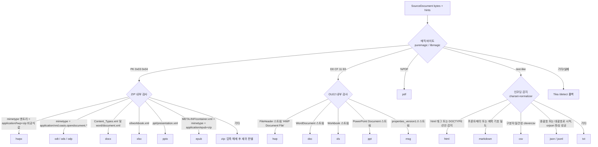
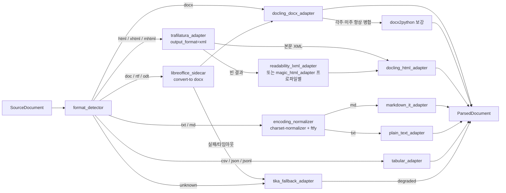
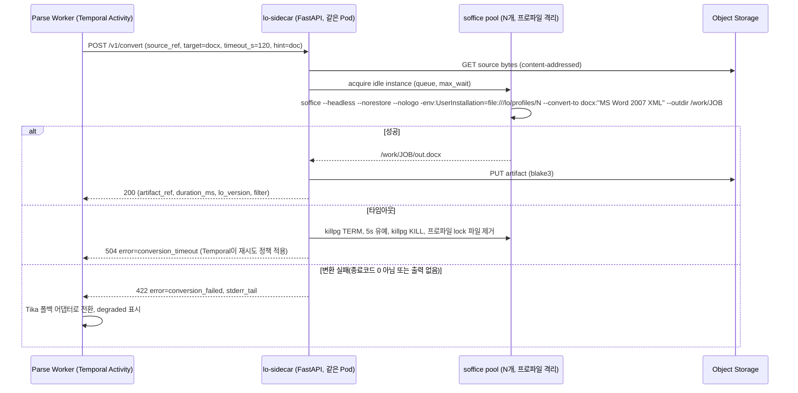

# DOC/DOCX·HTML·TXT/MD 및 기타 포맷 파싱

## 목적

이 문서는 RAG Platform이 수집하는 문서 중 **PDF·HWPX/HWP를 제외한 나머지 포맷**, 즉 DOCX·DOC(레거시 바이너리)·HTML·TXT/Markdown·CSV/JSON과 향후 지원 후보(PPTX/XLSX/EML/MSG)의 파싱 기술 지형을 조사하고, 브리프 D-18의 기본 파서 결정(DOCX → Docling/python-docx, DOC → LibreOffice headless 변환, HTML → Trafilatura + Docling, TXT/MD → charset-normalizer 후 구조 추론)을 **최신 릴리스 상태·라이선스·벤치마크 근거**로 검증한다. 산출은 `parser` 확장 지점(D-10)에 등록될 어댑터의 1차/2차/폴백 선정과, 표준 문서 모델 `ParsedDocument`(D-04)로의 매핑 포인트, 그리고 LibreOffice 사이드카 서비스의 운영 설계 제안이다.

모든 버전·날짜는 2026-09-18 기준으로 PyPI JSON API, 프로젝트 공식 문서, GitHub 소스에서 직접 확인하고, 2026-09-22 검증 회차에서 오류(릴리스 날짜·벤치마크 수치·라이선스 의존)를 정정했다. 확인하지 못한 항목은 "확인 필요(as of 2026-09)"로 표기했다.

## 범위

| 구분 | 포함 | 제외(다른 문서) |
|------|------|-----------------|
| 포맷 | DOCX, DOC(Word 97-2003), RTF/ODT(LibreOffice 경유), HTML/XHTML/MHTML, TXT, Markdown, CSV/TSV, JSON/JSONL, 포맷 판별(MIME 스니핑) | PDF([02-document-parsing-pdf-layout-ocr](./02-document-parsing-pdf-layout-ocr.md)), HWPX/HWP([01-document-parsing-hwpx-hwp](./01-document-parsing-hwpx-hwp.md)), 이미지 OCR |
| 향후 후보 | PPTX, XLSX/XLS/XLSB/ODS, EML/MSG | 오디오·비디오 ASR |
| 관심사 | 구조 보존(계층 제목·표·목록·각주·머리말/꼬리말), 출처(provenance), 인코딩, 보일러플레이트 제거, 라이선스(D-02), 운영(동시성·타임아웃·격리) | 청킹 전략([04-chunking-strategies-and-libraries](./04-chunking-strategies-and-libraries.md)), 임베딩, 라이선스 정밀 판정([12-security-multitenancy-pii-and-licensing](./12-security-multitenancy-pii-and-licensing.md)) |
| 비범위 | JS 렌더링이 필요한 SPA 페이지의 크롤링·렌더링(Playwright 등)은 **플랫폼 비범위**(브리프 §6: 크롤러는 non-goal). 단, `fetcher` 확장 지점에 렌더링된 HTML을 주입할 훅을 제안한다 | 웹 크롤링 자체 |

관련 문서(작성 완료): [HWPX/HWP 파싱](./01-document-parsing-hwpx-hwp.md), [PDF 레이아웃·OCR 파싱](./02-document-parsing-pdf-layout-ocr.md), [청킹 전략과 라이브러리](./04-chunking-strategies-and-libraries.md), [보안·멀티테넌시·PII·라이선스](./12-security-multitenancy-pii-and-licensing.md).

관련 문서(문서 맵상 경로, **작성 예정** — 생성 후 링크 검증 필요): `../03-contracts/03-parsed-document.md`(ParsedDocument 계약), `../04-pipelines/03-parsing-router-and-format-detection.md`(파싱 라우터와 포맷 판별), `../04-pipelines/06-parser-doc-and-docx.md`, `../04-pipelines/07-parser-html.md`, `../04-pipelines/08-parser-txt-md-and-others.md`, `../04-pipelines/01-pipeline-framework.md`, `../02-architecture/08-deployment-architecture.md`.

## 평가 기준

브리프 원칙 6(Korean-First), D-02(라이선스), 원칙 7(Evaluation-Driven)을 반영한 가중치다. 라이선스는 **게이트**(부적합 시 후보 탈락 또는 격리 서비스 강제)이자 점수다.

| 기준 | 가중치 | 판정 방법 |
|------|-------:|-----------|
| 한국어 지원 | 15 | CP949/EUC-KR 처리, 한글 폰트·글꼴 의존, 한국어 웹 사이트 본문 추출 정확도(정성), 형태소와 무관한 바이트 단위 안전성 |
| 라이선스 적합성(D-02) | 20 | Apache/MIT/BSD = 만점, MPL = 감점 없음(파일 단위 카피레프트, 분리 실행), LGPL = 동적 링크·분리 프로세스 조건부, GPL = 분리 프로세스만 허용, AGPL = 네트워크 분리 서비스만, CC-BY-NC = 상용 불가 탈락 |
| 성숙도/유지보수 | 15 | 최근 12개월 릴리스 수, 이슈 응답, 주요 배포판 패키징, 단일 메인테이너 리스크 |
| 품질/성능 | 20 | 공개 벤치마크(F1, ROUGE), 구조 보존 범위(표·목록·각주·머리말), 처리 속도 |
| 통합 난이도 | 10 | 순수 Python 여부, 시스템 의존(libmagic, Java, LibreOffice), 출력 모델의 ParsedDocument 매핑 용이성 |
| 커뮤니티/생태계 | 10 | GitHub 활동, 다운로드, LangChain/LlamaIndex 통합, 문서 품질 |
| 운영 비용 | 10 | 컨테이너 크기, 메모리, 사이드카 필요 여부, 콜드스타트 |

## 후보 목록

### DOCX / DOC / Office

| 이름 | 최신 버전(확인일) | 라이선스 | 성숙도 | 한국어 지원 | 핵심 강점 | 약점 |
|------|-------------------|----------|--------|-------------|-----------|------|
| Docling (`MsWordDocumentBackend`) | 2.128.0 (2026-09-16) | MIT | 높음(주간 릴리스, LF AI & Data) | 양호(유니코드 텍스트 그대로) | 제목 계층·목록·병합셀 표·이미지·수식(oMath→LaTeX)·텍스트박스·주석·머리말/꼬리말(furniture)·DrawingML 차트, Strict OOXML 정규화, DOCX 아카이브 새니타이즈 | **각주·미주 미처리**(소스 확인: `footnotes.xml`/`w:footnoteReference` 참조 없음, as of 2.128.0), DOC은 LibreOffice 필요, 무거운 의존 트리 |
| python-docx | 1.2.0 (2025-06-16) | MIT | 높음(사실상 표준, 릴리스 간격 김) | 양호 | 저수준 접근, 1.2.0에서 주석(`document.comments`) 추가, Docling DOCX 백엔드의 기반 | 각주·미주 미지원, 텍스트박스·머리말 접근은 우회 필요, 구조 트리 없음 |
| docx2python | 3.7.1 (2026-08-06) | MIT | 중상(단일 메인테이너, 활발) | 양호 | 머리말·꼬리말·각주·미주·주석·이미지·하이퍼링크·n×m 표·단락 스타일·수식·체크박스 일괄 추출 | 계층 트리 대신 중첩 리스트 출력, 표 병합 정보 손실 |
| mammoth | 1.12.2 (2026-09-12) | BSD-2-Clause | 높음 | 양호 | 스타일 기반 시맨틱 HTML, 각주·미주 지원, MarkItDown의 DOCX 엔진 | Markdown 출력 deprecated, 표 서식 무시, 이미지 base64 인라인 기본 |
| Unstructured (`partition_docx`/`partition_doc`) | 0.27.6 (2026-09-14) | Apache-2.0 | 높음 | 양호 | 60+ 포맷 단일 API, 요소 타입(Title/NarrativeText/Table/Header/Footer), `.doc`은 soffice 변환 내장 | 의존 트리 방대, 상용 플랫폼 중심 로드맵, 요소 평면 리스트(계층 약함) |
| MarkItDown | 0.1.7 (2026-07-29) | MIT | 중(MS 주도, 0.x) | 양호 | mammoth+markdownify+python-pptx+openpyxl 조합의 얇은 통합, LLM용 Markdown | 구조 모델 없음(문자열 출력), `.doc` 미지원, provenance 없음 |
| LibreOffice headless (`soffice`) | 26.8 Fresh (2026-08-26), 26.2.6 Still (2026-09-04) | MPL-2.0 | 매우 높음 | 우수(H2Orestart로 HWP/HWPX 임포트도 가능) | DOC/RTF/ODT/PPT/XLS → DOCX/PDF 변환의 사실상 표준 | 프로파일 락, 좀비 프로세스, 행 걸림, 콜드스타트, 컨테이너 1GB+ |
| unoserver | 3.7 (2026-06-10) | MIT | 중상 | 상동 | 상주 LibreOffice 리스너로 반복 기동 비용 제거(CPU 50-75% 절감 주장) | 단일 인스턴스 동시성 불가, 워커당 1개 필요 |
| Gotenberg | 8.37.0 (2026-09-11) | MIT | 높음(Docker pull 65M+) | 상동 | LibreOffice+Chromium을 HTTP API로 감싼 완성형 사이드카, `-libreoffice` 전용 이미지 | **PDF 출력 전용**(`/forms/libreoffice/convert`는 PDF만; MS 포맷 출력 요청 이슈 #455는 구현 없이 종결) → DOCX 변환 사이드카 대체 불가, Go 바이너리 커스터마이즈 어려움 |
| Collabora Online / CODE | 25.04 계열(확인 필요, as of 2026-09) | MPL-2.0 | 높음 | 상동 | `POST /cool/convert-to/<format>` REST API로 **DOCX·PDF 등 다중 출력** 지원, 완성형 LibreOffice 사이드카 | 협업 편집 서버 전체를 배포(이미지 1GB+), 변환 전용 튜닝 문서 부족 |
| JODConverter | 4.4.x (Java) | Apache-2.0 | 높음 | 상동 | `OfficeManager` 오피스 프로세스 풀·재시작·타임아웃·태스크 큐를 구현한 성숙한 사이드카 참조 구현(REST 샘플 포함) | JVM 의존, Python 워커에서는 REST 경유; lo-sidecar 설계의 **비교 대상** |
| Apache Tika | 4.0.0 (2026-08-21, Java 17), 3.3.2 (2026-07-16, Java 11) | Apache-2.0 | 매우 높음 | 양호 | 1,000+ 포맷 범용 폴백, 4.0은 Markdown 기본 출력·포크 프로세스 격리·JSON 설정, `apache/tika` 도커 이미지 | JVM 의존, 구조(표·계층) 출력 약함, 2.x EOL(2025-04) |
| tika-python / tika-client | 3.3.2 (2026-08-01) / 1.0.0 (2026-08-07) | Apache-2.0 / MPL-2.0 | 중 | - | REST 클라이언트. tika-client는 Java 불필요 순수 REST(MPL-2.0은 파일 단위 카피레프트로 D-02상 분리 실행 불필요) | tika-python은 JAR 자동 다운로드 등 부수 기능 과다 |
| extractous | 0.3.0 (2024-12-21); ISCC 포크 iscc-tika (2026-07 활동) | Apache-2.0 | 낮음(원본 정체, 포크 부활) | - | Tika를 GraalVM 네이티브로 컴파일, JVM 없이 Rust/Python 바인딩 | 릴리스 공백, 포크 분기 리스크 |
| kreuzberg | 4.10.4 (2026-09-21); 4.0.0은 2026-01-11 | MIT | 중(v4 **LTS 단계**: 2026년 말까지 보안 수정만) | - | Rust 코어, 91+ 포맷, async; v4에서 pandoc 의존 **완전 제거**(100% 네이티브 Rust 추출기; pandoc 의존은 v3 시절 사실) | 신규 개발이 후속 프로젝트 Xberg(v5+)로 이동, Docling 대비 계층 구조 모델 약함, 자체 구조 모델 |
| Xberg | 1.2.6 (2026-09-20) | MIT | 낮음(kreuzberg 후속, 1.x 초기) | - | kreuzberg v5+의 실제 활성 프로젝트. 다중 포맷 단일 API | 릴리스 초기, API 안정성 미검증 → 관찰 대상 |
| pandoc / pypandoc | 3.11 (2026-08-28) / 1.17 (2026-03-14) | GPL-2.0-or-later / MIT | 매우 높음 | 양호 | DOCX 리더(변경 추적 인식), 범용 변환 | GPL 바이너리(분리 프로세스만), 표 병합 손실 |
| odfdo | 3.26.1 (2026-09-19) | Apache-2.0 | 중상(활발) | 양호 | 순수 Python ODF(ODT/ODS/ODP) 파서·생성기. `lite` 프로파일에서 LibreOffice 없이 ODT 처리 | 구조 모델은 ODF XML 그대로(자체 어댑터 필요) |
| striprtf | 0.0.33 (2026-08-17) | BSD-3-Clause | 중(0.0.x, 단일 메인테이너) | 양호(유니코드 이스케이프 처리) | 순수 Python RTF→텍스트. `lite` 프로파일의 RTF 폴백 | 구조 없음(텍스트만) |
| textract | 2.1.0 (2026-09-01) | MIT | 중(2026년 부활) | - | 얇은 통합 래퍼 | 내부적으로 antiword 등 GPL 도구 호출, 구조 없음 |
| antiword / catdoc / wvWare | 0.37(2005 이후 무릴리스, Debian 패키징 유지) / 0.95(2025 DSA 보안 업데이트) / 1.2.4(2006, Debian orphaned) | GPL | 낮음 | 낮음(CP949 처리 불안) | 초경량 DOC 텍스트 덤프 | GPL, 유지보수 정지, 구조 없음, catdoc 2025년 CVE |

### HTML

| 이름 | 최신 버전(확인일) | 라이선스 | 성숙도 | 한국어 지원 | 핵심 강점 | 약점 |
|------|-------------------|----------|--------|-------------|-----------|------|
| Trafilatura | 2.2.0 (2026-07-31) | Apache-2.0 (1.8.0 이전 GPLv3+) | 높음 | 양호(`target_language="ko"`, 바이트 안전) | 자체 벤치마크 990문서 F 0.924로 1위, ScrapingHub 벤치마크 F1 0.958(Python 2.0.0; Rust/Go 포트는 0.970/0.960), 메타데이터·날짜·표·목록 옵션, 출력 `markdown/xml/xmltei/json/html/txt/csv`, 공식 평가 기준 상대 속도 3.2x(기준 도구 대비; 절대 시간은 하드웨어 의존, 제3자 측정 14-85 ms/페이지) | 문서형(매뉴얼·위키) 페이지에서 precision 모드가 본문을 과다 절단할 수 있음, 자체 구조 모델 없음, WCXB 다중 유형 벤치마크에서 Resiliparse(0.797)에 근소 열위(0.791) |
| magic-html | 0.1.8 (2026-06-28) | Apache-2.0 | 중(OpenDataLab, 0.1.x) | 미검증(중국어 중심 개발; 한국어 골든셋 필요) | Trafilatura 공식 벤치마크 **2위(F 0.889)**, 기사·포럼·위챗 등 다중 페이지 유형 대응(`html_type` 힌트), 규칙 기반 | 0.1.x 초기, 커뮤니티 작음, 문서 대부분 중국어 |
| MinerU-HTML | 2026 (OpenDataLab) | Apache-2.0 | 낮음(신규) | 미검증 | Qwen3-0.6B 기반(~0.8B) LLM 본문 추출기, WCXB **2위(F1 0.827)**, ReaderLM-v2와 달리 **상용 가능** 라이선스 | GPU/CPU 추론 비용, 지연(수백 ms~s/페이지), 문서형 페이지 프로파일의 선택 플러그인 후보 |
| readability-lxml | 0.9 (2026-08-27) | Apache-2.0 | 중상(2026년 재활성화) | 양호 | Trafilatura 벤치마크 F 0.826, 자체 166페이지 벤치마크 F1 0.973(P 0.991/R 0.956; 0.8.4.1은 0.926), 재현 픽스처 181건, lxml 6·Python 3.14 지원; ScrapingHub F1 0.922(0.8.4.1) | 기사형 페이지 특화, 메타데이터 없음 |
| readabilipy | 0.3.0 (2024-12-02) | MIT | 중(Alan Turing Institute, 릴리스 뜸) | 양호 | Mozilla Readability.js 래퍼(Node 필요) 또는 순수 Python 모드; ScrapingHub에서 readability_js F1 0.947로 readability-lxml(0.922)보다 우수 | Node.js 의존(js 모드), 릴리스 뜸 |
| news-please | 1.6.16 (2025-09-21) | Apache-2.0 | 중 | 양호 | 뉴스 크롤·추출 통합(newspaper·readability 등 앙상블), Trafilatura 벤치마크 F 0.836(3위), ScrapingHub F1 0.948 | 크롤러 포함 무거운 의존, 뉴스 특화 |
| newspaper4k | 0.9.6 (2026-07-19) | MIT | 중상 | 명시적 지원(80+ 언어, ko 포함) | 기사 메타데이터(저자·날짜·이미지), precision 우수(0.878), ScrapingHub F1 0.949(0.9.3.1) | Trafilatura 벤치마크 recall 낮음(0.736), nltk 의존 |
| Docling (`HTMLDocumentBackend`) | 2.128.0 | MIT | 높음 | 양호 | BeautifulSoup 기반 계층 구조(`_BLOCK_TAGS`: address, details, dl, figure, footer, h1-h6, img, ol, p, pre, signature, stamp, summary, table, ul), MHTML, provenance, `<title>` 추출, `<footer>`는 furniture 레이어로 분리 | **보일러플레이트 제거 없음**(script/noscript/style/hidden만 제거), nav/header/aside/쿠키 배너가 본문에 잔존 |
| Unstructured (`partition_html`) | 0.27.6 | Apache-2.0 | 높음 | 양호 | 요소 타입 분류, 청킹 연계 | 보일러플레이트 포함 반환 |
| BeautifulSoup4 / lxml / selectolax | 4.15.0 (2026-06-07) / 6.1.3 (2026-09-02) / 0.4.12 (2026-09-18) | MIT / BSD-3-Clause / MIT(래퍼; **Lexbor Apache-2.0 / Modest LGPL-2.1 엔진 정적 번들**) | 매우 높음 / 매우 높음 / 중상(활발) | 양호 | 파서 기반. selectolax(Lexbor)는 754도메인 벤치에서 bs4 61.0s, lxml 9.1s, selectolax 2.4s | selectolax는 CSS 선택 전용(XPath 없음); 휠에 Modest(LGPL-2.1) 엔진이 정적 포함되어 D-02의 LGPL 조건(동적 링크·분리 프로세스)과 충돌 소지 → **Lexbor 백엔드만 사용**하고 판정은 12-security 문서에 위임. lxml 6.1.3은 외부 매개 엔티티 취약점 수정 포함 |
| markdownify | 1.2.3 (2026-06-30) | MIT | 높음 | 양호 | HTML→Markdown, 표 변환(`table_infer_header`) | 구조 모델 없음 |
| html-to-markdown | 3.14.3 (2026-09-19) | MIT | 중상(Goldziher, 활발) | 양호 | Rust 코어 HTML→Markdown, markdownify 대비 고속 주장(자체 벤치마크; 독립 검증 필요) | 구조 모델 없음, 3.x에서 API 변경 잦음 |
| crawl4ai | 0.9.3 (2026-08-31) | Apache-2.0 | 높음(GitHub 활발) | 양호 | `PruningContentFilter`/`BM25ContentFilter` 기반 fit-markdown, Playwright 렌더링 훅 참고 구현(jina reader 대비 라이선스·구성 단순) | 크롤러 프레임워크 전체(비범위), Playwright 상주 |
| html2text | 2025.4.15 | **GPL-3.0-or-later** | 중 | 양호 | 오랜 역사 | **D-02 위반(GPL 링크 금지) → 탈락** |
| inscriptis | 2.7.4 (2026-08-10) | Apache-2.0 | 중상 | 양호 | 레이아웃 보존 텍스트(중첩 표 정렬), 어노테이션 추출, FastAPI 서비스 내장 | 본문 추출 아님(F 0.694, recall 0.991) |
| jina-ai/reader (r.jina.ai) | Apache-2.0, 자체 호스팅 Docker 이미지 제공 | Apache-2.0 | 중상 | 양호(CJK 폰트 포함 이미지) | Puppeteer 렌더링 + Readability + Turndown, JS 페이지 처리 | Node/Chrome 상주, 무거움. **ReaderLM-v2 모델은 CC-BY-NC-4.0**으로 상용 불가 |
| jina ReaderLM-v2 | 1.54B, 512K 토큰, 29언어 | **CC-BY-NC-4.0** | - | 한국어 포함(모델 카드 29개 언어에 Korean 명시) | HTML→MD ROUGE-L 0.84-0.86 | 비상업 라이선스 → 탈락. WCXB 벤치마크에서 휴리스틱 도구보다 낮은 F1 0.741 |
| extruct | 0.18.0 (2024-11-08) | BSD | 중(릴리스 뜸) | - | JSON-LD·Microdata·OpenGraph·RDFa·Dublin Core·microformats 일괄 추출 | 유지보수 속도 낮음 |
| htmldate / courlan | 1.10.0 / 1.4.0 (2026-06-01) | Apache-2.0 | 높음 | 양호 | 발행일 추출 / URL 정규화(Trafilatura 계열) | - |
| justext / goose3 / boilerpy3 / resiliparse | 3.0.2 (2025-02) / 3.1.22 (2026-07) / 1.0.7 (2023-11) / 1.0.9 | BSD-2 / Apache-2.0 / Apache-2.0 / Apache-2.0 | 중 / 중 / 낮음 / 중 | 양호 | Trafilatura 벤치마크 F 0.862 / 0.810 / 0.807 / 0.811; resiliparse는 WCXB 다중 유형에서 0.797로 Trafilatura(0.791)보다 근소 우위 | Trafilatura 대비 대체로 열위, 2차 후보 |

### TXT / Markdown / CSV / JSON / 인코딩

| 이름 | 최신 버전(확인일) | 라이선스 | 성숙도 | 한국어 지원 | 핵심 강점 | 약점 |
|------|-------------------|----------|--------|-------------|-----------|------|
| charset-normalizer | 3.5.1 (2026-08-15) | MIT | 높음(requests 의존성) | 우수(cp949/euc_kr 별칭 지원) | 대용량 파일에서 빠름(272 MiB 0.3s), 언어 추정 동반 | 자체 벤치 정확도 98%(chardet 99% 대비 소폭 열위) |
| chardet 7 | 7.6.0 (2026-08-14) | **0BSD(7.x 재작성; 7.0.0은 2026-03-02 MIT로 출시 후 0BSD로 변경)**; 6.x 이하 LGPL | 중(재작성 직후) | 우수(UHC 감지) | 99.7% 정확도(3130/3138)·chardet 6.0.0 대비 315배 속도 향상 주장, 언어·MIME 감지 추가 | **재라이선스 분쟁**(charset-normalizer 원저자가 LGPL 파생물 주장, LLM 생성 코드 저작권 논란; LWN "The relicensing of chardet", chardet#327) → 법적 리스크 |
| ftfy | 6.3.1 (2024-10-26) | Apache-2.0 | 높음 | 우수 | 모지바케(깨진 UTF-8) 복구 | 릴리스 뜸 |
| markdown-it-py | 4.2.0 (2026-05-07) | MIT | 높음(MyST/Jupyter 생태계) | 양호 | CommonMark 준수, `SyntaxTreeNode` AST, `mdit_py_plugins`(front_matter·footnote·tables) | 속도는 mistune 대비 느림(확인 필요) |
| mistune | 3.3.4 (2026-07-22) | BSD-3-Clause | 높음 | 양호 | `renderer=None`으로 AST 토큰 출력, table·footnote·strikethrough 내장 플러그인 | CommonMark 완전 준수 아님 |
| marko | 2.2.4 (2026-08-12) | MIT | 중상 | 양호 | CommonMark 0.31.2 준수, Docling `MarkdownDocumentBackend`의 기반 | 플러그인 생태계 작음 |
| mistletoe | 1.6.0 (2026-07-11) | MIT | 중상 | 양호 | CommonMark 준수, AST 렌더러(`ASTRenderer`) 내장, 순수 Python 중 빠른 편(자체 벤치마크) | 토큰 단위 줄 범위(`map`) 미제공 → offset provenance는 자체 계산 필요 |
| python-frontmatter | 1.3.0 (2026-05-20) | MIT | 중 | - | YAML/TOML/JSON 프론트매터 파싱 | - |
| Docling (`MarkdownDocumentBackend`, `CsvDocumentBackend`) | 2.128.0 | MIT | 높음 | 양호 | MD→DoclingDocument(HTML 블록은 HTML 백엔드 위임), CSV 방언 자동 감지 | 대용량 CSV 스트리밍 없음 |
| clevercsv | 0.8.5 (2025-01) | MIT | 중 | - | 비표준 CSV 방언 감지 97%(표준 라이브러리 대비 +21%p) | - |
| pyarrow | 25.0.1 | Apache-2.0 | 매우 높음 | - | 대용량 CSV/JSONL 스트리밍 읽기 | 바이너리 크기 |
| orjson / ijson | 3.12.0 / 3.5.1 | MPL-2.0 AND (Apache-2.0 OR MIT) / BSD-3 AND ISC | 높음 / 높음 | - | 고속 JSON / 스트리밍 JSON 파서 | - |

### 포맷 판별

| 이름 | 최신 버전(확인일) | 라이선스 | 성숙도 | 핵심 강점 | 약점 |
|------|-------------------|----------|--------|-----------|------|
| puremagic | 2.2.0 (2026-04-08) | MIT | 중상 | 순수 Python, 의존성 0, Python 3.12+ | 시그니처 DB가 libmagic보다 작음, ZIP 내부 구분 불가 |
| python-magic (libmagic) | 0.4.27 (2022-06-07) | MIT(래퍼) / BSD-2(libmagic) | 높음(릴리스 정체) | 가장 풍부한 시그니처 DB. 현행 file(1)은 HWPX를 "Hancom HWP (Hangul Word Processor) file, HWPX"로 식별(trailofbits/polyfile#3517 재현 로그) | 시스템 libmagic 필요, **배포판별 libmagic 버전 편차**(구버전은 HWPX를 일반 ZIP으로 판정), Windows DLL은 `python-magic-bin` 별도 |
| Google Magika | 1.0.3 (2026-05-04) | Apache-2.0 | 중상(Google, 1.0 도달) | 딥러닝 기반 200+ 타입 판별(~99% 주장), 확장자 위장·텍스트 계열(코드·마크다운·CSV) 구분에 강점, ONNX 모델 ~1MB | HWP 타입 미지원(요청 이슈 #51), 오피스 ZIP 계열 세부 구분은 여전히 내부 검사 필요 → puremagic 보완 후보 |
| filetype | 1.2.0 (2022-11-02) | MIT | 중(정체) | 의존성 0, 이미지·아카이브 중심 | 오피스 문서 구분 약함 |
| 자체 ZIP/OLE 스니퍼 | - | Apache-2.0(자체) | - | `mimetype` 첫 엔트리·`[Content_Types].xml`·OLE `FileHeader` 스트림으로 HWPX/DOCX/XLSX/PPTX/ODT/HWP/DOC 정확 구분 | 자체 유지 |

### 향후 포맷(PPTX/XLSX/EML/MSG)

| 이름 | 최신 버전(확인일) | 라이선스 | 비고 |
|------|-------------------|----------|------|
| python-pptx | 1.0.2 (2024-08-07) | MIT | Docling `MsPowerpointDocumentBackend` 기반. 슬라이드 노트 접근 가능 |
| openpyxl | 3.1.5 (2024-06-28) | MIT | Docling `MsExcelDocumentBackend` 기반. `read_only` 스트리밍 |
| python-calamine | 0.8.2 (2026-07-13) | MIT | Rust calamine 바인딩, XLS/XLSX/XLSB/ODS 통합 읽기(고속) |
| fastexcel | 0.21.0 (2026-08-19) | MIT | Rust calamine + Arrow PyCapsule. 대용량 XLSX를 Arrow RecordBatch로 스트리밍 → pyarrow 경로와 결합 용이. python-calamine과 비교 필요 |
| xlrd | 2.0.2 (2025-06-14) | BSD | `.xls` 전용(xlsx 지원 제거) |
| pyxlsb | 1.0.10 (2022-10) | **LGPLv3+** | python-calamine으로 대체 권고 |
| pptx2md | 2.0.6 (2024-12-03) | MIT | PPTX→Markdown 보조 |
| mail-parser | 4.6.5 (2026-08-19) | Apache-2.0 | EML 파싱(표준 라이브러리 확장). MSG는 extract-msg 백엔드를 권고하나 GPL이므로 python-oxmsg로 대체 |
| eml-parser | 3.0.4 (2026-09-07) | **AGPLv3+** | 포렌식 지향 EML 파서(GOVCERT.LU). D-02상 네트워크 분리 서비스만 허용 → 기본 경로 제외 |
| python-oxmsg | 0.0.2 (2025-02-03) | MIT | Outlook MSG 파서(python-docx 저자 Steve Canny). GPL extract-msg의 **D-02 적합 대체**(Unstructured가 채택). 0.0.x이나 의존성 얇음 |
| extract-msg | 0.56.x | **GPL-3.0** | D-02 위반 → python-oxmsg(MIT) 대체, 또는 msg_parser(BSD)·olefile 직접 파싱 |
| olefile / oletools | 0.47 (2023-12-01) / 0.60.2 (2024-07-02) | BSD-2 / BSD-2 | OLE2 컨테이너 접근(DOC·MSG·HWP 5.0 공통), 매크로·DDE 탐지 |
| msoffcrypto-tool | 6.0.0 (2026-01-12) | MIT | 암호화 Office(ECMA-376·레거시) 복호화 |
| Docling email 백엔드 | 2.128.0 | MIT | EML/MSG 입력 포맷 지원(2.128.0에서 표시 이름 개선) |

## 심층 비교

### DOCX

#### Docling `MsWordDocumentBackend`

- **동작 방식**: python-docx로 `word/document.xml`을 열고 lxml로 XML을 순회하며 `DoclingDocument` 아이템(SectionHeader, ListItem, Table, Picture, Formula 등)을 생성한다. XXE·DTD를 차단하는 보안 파서를 사용하고, Strict OOXML 네임스페이스를 Transitional로 정규화한다. 2026-09 릴리스에서 DOCX 아카이브 새니타이즈가 추가되었다.
- **진입점**: `docling.document_converter.DocumentConverter(allowed_formats=[InputFormat.DOCX]).convert(path)` → `result.document`(`DoclingDocument`). 백엔드 클래스 `docling.backend.msword_backend.MsWordDocumentBackend`. CLI `docling file.docx --to json`.
- **출력 형식**: `DoclingDocument`(Pydantic) → JSON/Markdown/HTML/DocTags. 머리말/꼬리말은 `furniture` 레이어로 분리되어 본문과 구분 가능.
- **처리 범위(소스 확인)**: 제목 레벨 추적, 번호/글머리 목록(카운터·그룹 재사용), 병합 셀 표, 인라인·VML 이미지(25px² 이하 스페이서 이미지 제거), oMath→LaTeX 수식, 현대·레거시 텍스트박스(중복 방지), 주석(단락 매핑), 머리말/꼬리말, DrawingML 차트(표 데이터 재구성; 렌더링은 LibreOffice 필요).
- **함정**: **각주·미주는 처리하지 않는다**(소스 확인 결과, as of 2.128.0: `msword_backend.py`에 `footnote`, `endnote`, `footnotes.xml`, `w:footnoteReference` 문자열이 전혀 없음). python-docx 자체도 각주를 지원하지 않으므로 본문 내 각주 참조 번호만 남고 각주 본문은 누락된다. 따라서 **docx2python 병합 어댑터는 선택이 아니라 필수**다(§어댑터 계약의 `docling_docx_adapter` → `docx2python 보강` 경로). 머리말/꼬리말 오인 보고(이슈 #1272, 입력 포맷 미명시)는 DOCX 전용 근거로는 약하며, DOCX 경로에서는 furniture 분리로 대응 가능하다.
- **성능**: DOCX 경로는 ML 모델을 사용하지 않아 PDF 대비 매우 빠르다(정량 수치는 공개 벤치마크 없음, 확인 필요).

#### python-docx

- **진입점**: `docx.Document(path)`; `document.paragraphs`, `document.tables`, `document.sections[i].header/footer`, `document.comments`(1.2.0), `document.inline_shapes`.
- **출력**: 객체 모델(단락·런·표). 문서 순서대로 단락과 표를 섞어 순회하려면 `document.element.body.iterchildren()`을 직접 다뤄야 한다.
- **함정**: 각주·미주 미지원(GitHub #1, PR #624 장기 미병합), 텍스트박스(`w:txbxContent`) 내용은 `paragraphs`에 나타나지 않음, 주석은 앵커 범위 미제공. 따라서 **단독 파서보다는 Docling 실패 시 보조 접근 또는 메타데이터(`core_properties`) 추출 용도**로 적합하다.

#### docx2python

- **진입점**: `docx2python.docx2python(path, html=False, paragraph_styles=True)` → `DocxContent`(`header`, `body`, `footer`, `footnotes`, `endnotes`, `comments`, `images`, `properties`).
- **출력**: `body`는 `[table][row][cell][paragraph]` 4중 리스트(항상 n×m). 단락 스타일(예: `Heading 1`)과 위치를 `Par` 타입으로 노출(v3).
- **강점**: **각주·미주·주석·머리말·꼬리말을 한 번에 얻는 유일한 순수 Python 후보**. 목록은 들여쓰기 추적으로 글머리·번호 텍스트를 복원한다.
- **함정**: 표 병합(vMerge/gridSpan) 정보가 n×m 정규화 과정에서 손실된다. 계층 트리를 만들려면 스타일 이름에서 제목 레벨을 역추론해야 한다.

#### mammoth

- **진입점**: `mammoth.convert_to_html(fileobj, style_map=..., convert_image=...)` → `result.value`(HTML), `result.messages`(경고). `convert_to_markdown`은 deprecated.
- **출력**: 시맨틱 HTML(`<h1>`, `<ol>`, `<table>`, `<sup>` 각주 링크). 표 테두리·셀 병합 서식은 무시된다.
- **역할**: DOCX → HTML → (Docling HTML 백엔드 또는 자체 HTML 어댑터)의 2단 경로. 스타일 매핑(`style_map`)으로 조직 고유 스타일명(예: "제목 1", "본문 들여쓰기")을 표준 태그로 정규화할 수 있어 **한국 공공기관 서식 문서에 유용**하다.

#### Unstructured

- **진입점**: `unstructured.partition.docx.partition_docx(filename=...)` / `partition_doc`(내부에서 `soffice --headless --convert-to docx` 호출) / 범용 `partition(filename=...)`.
- **출력**: `Element` 리스트(`Title`, `NarrativeText`, `ListItem`, `Table`(`metadata.text_as_html`), `Header`, `Footer`, `PageBreak`), `metadata.parent_id`·`category_depth`로 약한 계층.
- **함정**: `.doc`·`.ppt`·`.xls`에 LibreOffice 시스템 의존(GitHub #2500, 토론 #2610). 의존 트리가 매우 크고(60+ 포맷), 오픈소스 라이브러리는 상용 플랫폼의 보조 위치다. **Docling과 역할이 겹치므로 기본 경로에서는 제외하고 `parser` 플러그인 선택지로만 유지**한다.

#### Apache Tika 4.0

- **진입점**: `apache/tika:4.0.0` 컨테이너(9998) → `PUT /tika`(본문, `Accept: text/markdown` 기본), `PUT /meta`, `PUT /rmeta`(재귀 메타+본문 JSON). gRPC 이미지 `apache/tika-grpc`(9090).
- **강점**: 4.0에서 파싱이 **포크된 프로세스에서 격리**되어 손상 파일이 서버를 죽이지 않는다. 설정은 JSON. `.doc`·`.ppt`·`.xls`·RTF·구형 포맷을 LibreOffice 없이 텍스트화한다.
- **약점**: 구조 출력은 Markdown/XHTML 수준으로 제목 계층·표 병합 정보가 약하다. Java 17 런타임(컨테이너 ~500MB+).
- **역할**: **모든 파서가 실패했을 때의 최종 폴백**과 **손상 파일 탐지**(`/detect/stream`). 결과는 `ParsedDocument`의 단락 블록으로만 매핑되며 `quality.degraded=true` 표시를 제안한다(필드명은 계약 문서 제안 사항).

### DOC(레거시 바이너리)

브리프 D-18대로 **LibreOffice headless 변환 → DOCX → Docling** 경로가 유일하게 구조를 보존하는 오픈소스 경로다. 대안 평가:

| 경로 | 구조 보존 | 라이선스 | 운영 부담 | 판정 |
|------|-----------|----------|-----------|------|
| LibreOffice `soffice --headless --convert-to "docx:MS Word 2007 XML"` | 높음(표·목록·머리말 유지) | MPL-2.0 | 높음(사이드카 필요) | **1차** |
| Apache Tika 4.0 (`/tika`, Markdown) | 중(제목 일부·표 평면) | Apache-2.0 | 중(JVM 컨테이너) | **2차/폴백** |
| pandoc(DOC 리더 없음; DOCX만) | - | GPL | - | 해당 없음(DOC 미지원) |
| antiword / catdoc | 없음(텍스트) | GPL | 낮음 | 탈락(D-02, 유지보수 정지, catdoc 2025 CVE) |
| wvWare | 낮음 | GPL | 낮음 | 탈락(Debian orphaned) |
| textract 2.1 | 없음 | MIT(래퍼) | 낮음 | 탈락(내부 antiword 호출) |
| olefile 직접 파싱(`WordDocument` 스트림) | 없음 | BSD | 낮음 | 진단·폴백용(텍스트 조각 복구)만 |

LibreOffice headless의 확인된 운영 이슈(출처: 참조 §LibreOffice):

1. **프로파일 락**: 두 `soffice` 프로세스가 같은 사용자 프로파일을 공유하면 두 번째는 종료 코드 1로 **조용히 실패**하거나 첫 프로세스에 위임된다. 해법은 `-env:UserInstallation=file:///tmp/lo_profile_<worker_id>`로 워커별 프로파일 분리. 프로파일은 재사용(첫 부트스트랩 비용 회피)한다.
2. **행 걸림과 좀비**: 손상 입력은 실패 대신 무한 대기할 수 있다(Bugzilla #122192 "Converting docx in headless mode hangs", #148440 "Headless convert-to PDF dies with 100% CPU", #113259 "soffice --convert-to hangs on Windows Server 2016 when called multiple times"). `timeout`만으로는 자식 `soffice.bin`이 살아남으므로 **프로세스 그룹 단위 TERM → 유예 → KILL**이 필요하다. 컨테이너에서는 PID 1이 좀비를 회수하도록 `tini`/`dumb-init`을 사용한다(Bugzilla #95843 "Headless mode leaves zombie process", #117523 "Headless doc conversion leaves soffice.bin and GPG zombie processes" — AWS Lambda처럼 init이 없는 환경에서 좀비가 선형 증가; 버그 제목은 bugs.documentfoundation.org가 봇 차단 중이라 mail-archive 미러로 확인). JODConverter #367에도 Docker에서 동일한 좀비 누적이 보고되어 있다.
3. **동시성**: 단일 인스턴스에 동시 변환 요청은 안전하지 않다(unoconv #189, docspell #3345 데드락). 워커당 1 인스턴스 또는 unoserver 풀.
4. **필터명**: LibreOffice 7+에서 `--convert-to docx`만 쓰면 "no export filter" 오류가 날 수 있어 `docx:"MS Word 2007 XML"` 명시(Unstructured #777).
5. **폰트**: 한글 폰트(Noto Sans CJK KR, Nanum)가 없으면 PDF 변환 시 글리프 누락. DOCX 변환에는 영향이 적지만 페이지 수 계산에 영향.

### HTML

#### Trafilatura 2.2

- **동작 방식**: 규칙 기반 다단계 파이프라인(메타데이터 추출 → 본문 후보 XPath → 링크 밀도·텍스트 길이 휴리스틱 → 비교 폴백(readability-lxml·jusText 알고리즘 내장) → 마지막 수단 `html2txt`). ML·GPU 불필요.
- **진입점**: `trafilatura.extract(html, url=None, output_format="xml"|"markdown"|"json"|"txt"|"html"|"csv"|"xmltei", include_tables=True, include_links=False, include_images=False, include_comments=False, favor_precision=False, favor_recall=False, target_language="ko", with_metadata=True)`; `trafilatura.bare_extraction(...)` → `Document` 객체(`.title`, `.author`, `.date`, `.sitename`, `.categories`, `.tags`, `.fingerprint`, `.text`, `.raw_text`; `.as_dict()`); `trafilatura.html2txt(html)`(최대 recall 폴백).
- **출력 형식**: 우리 파이프라인에는 **`output_format="xml"`(TEI 유사 자체 XML: `<head>`, `<p>`, `<list>`, `<table>`, `<quote>`, `<code>`)이 가장 유용**하다. Markdown보다 구조가 명시적이고, 이를 자체 어댑터 또는 Docling HTML 백엔드(`output_format="html"`)로 넘겨 계층 블록을 만들 수 있다.
- **벤치마크 근거**: 자체 평가(2026-08-04, 990문서, 2,951 본문/2,966 보일러플레이트 세그먼트): trafilatura 2.2.0 표준 P 0.906 / R 0.943 / Acc 0.923 / F 0.924로 결과표의 13개 라이브러리(설정 변형 포함 16행) 중 1위. **2위 magic-html 0.1.8 F 0.889, 3위 news-please 1.6.16 F 0.836**, justext 0.862(순위는 F 기준 정렬 시 magic-html 다음), readability-lxml 0.826, newspaper4k 0.801. ScrapingHub 기사 추출 벤치마크(README 현행 표): rs_trafilatura F1 0.970±0.004, go_trafilatura 0.960±0.007, **trafilatura 2.0.0 0.958±0.006**, newspaper4k 0.9.3.1 0.949±0.008, news_please 0.948, readability_js 0.6.0 0.947, readability-lxml 0.8.4.1 0.922, dragnet 0.907, boilerpipe 0.860, html-text 0.665 — 기사형 페이지에서는 Python Trafilatura와 newspaper4k의 격차가 0.009로 작고, Rust/Go 포트가 상위다. Bevendorff et al. 2023(SIGIR)에서 ROUGE-LSum 기준 최고 단일 도구. 단, WCXB 다중 유형 벤치마크(arXiv 2605.21097, Table 5)에서는 rs-trafilatura 0.859 > MinerU-HTML 0.827 > Resiliparse 0.797 > **Trafilatura 0.791** > ReaderLM-v2 0.741 > magic-html 0.719로 비기사형 페이지에서 격차가 났다. **주의**: 논문 자체 고지에 따르면 rs-trafilatura는 제1저자가 개발했고 벤치마크 구축 중 개발 세트에 반복 테스트했으며 Table 5는 개발 세트 결과다. 즉 rs-trafilatura 우위(+0.068)는 이해충돌·과적합 가능성이 있어 **독립 검증 전에는 채택 근거로 쓰지 않는다**.
- **한국어**: 언어 필터는 `target_language="ko"`로 동작(py3langid). 한국어 사이트 특화 벤치마크는 공개된 것이 없다(확인 필요). 한국 포털·공공기관 페이지는 표 기반 레이아웃과 `<div>` 중첩이 많아 `favor_recall=True`와 `include_tables=True`가 필요할 가능성이 높다. **내부 골든셋(브리프 D-12)에 한국어 HTML 200페이지 이상을 포함해 precision/recall 모드를 결정**해야 한다.
- **함정**: 기본값에서 링크·이미지·주석이 제거된다. 문서형 페이지(API 레퍼런스, 위키, 매뉴얼)에서는 사이드바 목차와 본문의 구분이 어려워 precision 모드가 코드 블록·표를 제거할 수 있다.

#### readability-lxml 0.9

- **진입점**: `readability.Document(html).summary()` / `.title()` / `.short_title()`.
- **근거**: Trafilatura 벤치마크 F 0.826(0.8.4.1 기준). 0.9는 lxml 6·Python 3.14 지원, bytes 입력·인코딩 처리 수정, 자체 166페이지 벤치마크에서 P 0.971/R 0.884/F1 0.926(0.8.4.1) → P 0.991/R 0.956/F1 0.973(0.9)으로 개선(재현 픽스처 181건). 자체 벤치마크이므로 타 도구와의 순위 비교 근거로는 쓰지 않는다.
- **역할**: Trafilatura가 빈 결과를 낼 때의 **기사형 페이지 2차 추출기**. Trafilatura 내부에도 유사 알고리즘이 폴백으로 내장되어 있어 중복성이 있다. 의존성이 lxml 하나뿐이라 `lite` 프로파일에도 부담이 없다.

#### magic-html, news-please, MinerU-HTML (2차 추출기 재검토)

Trafilatura 공식 벤치마크 근거로 2차를 고른다면 readability-lxml(0.826)보다 **magic-html 0.1.8(F 0.889, 2위)**과 news-please 1.6.16(F 0.836, 3위)이 앞선다.

- **magic-html**(OpenDataLab, Apache-2.0, 0.1.8 2026-06-28): `GeneralExtractor().extract(html, base_url=..., html_type="article"|"forum"|"weixin")`. 규칙 기반이며 포럼·위챗 등 다중 페이지 유형을 명시적으로 다룬다. 단 WCXB에서는 0.719로 최하위권이어서 벤치마크 간 결과가 상반된다(WCXB는 문서형·상거래형 등 유형 폭이 넓음). 0.1.x 초기 버전, 커뮤니티가 작고 문서가 중국어 중심이며 한국어 페이지 검증이 없다. **판정**: `docs-site`·포럼형 프로파일의 **2차 후보**로 두고, 한국어 HTML 골든셋(미해결 이슈 5)에서 readability-lxml과 A/B 후 기본 2차를 확정한다. 확정 전까지 기본 2차는 성숙도·의존성 면에서 안전한 readability-lxml을 유지한다.
- **news-please**(Apache-2.0, 1.6.16 2025-09-21): 크롤러를 포함한 뉴스 수집 프레임워크로, 추출기만 쓰기에는 의존이 무겁다(브리프 §6 크롤러 비범위). 뉴스 프로파일에서 newspaper4k 대체·보완 후보로만 기록한다.
- **MinerU-HTML**(OpenDataLab, Apache-2.0, Qwen3-0.6B 기반 약 0.8B): WCXB 2위(0.827). ReaderLM-v2와 달리 상용 가능하지만 LLM 추론 비용이 든다. 문서형 페이지에서 휴리스틱이 실패하는 경우를 위한 **선택 플러그인** 후보(GPU 선택). 기본 경로에는 넣지 않는다.

#### Docling `HTMLDocumentBackend`

- **진입점**: `DocumentConverter(allowed_formats=[InputFormat.HTML]).convert(path_or_stream)`; 클래스 `docling.backend.html_backend.HTMLDocumentBackend`.
- **동작(소스 확인)**: BeautifulSoup4로 파싱, `script`/`noscript`/`style` 및 hidden 요소 제거, `_BLOCK_TAGS`(address, details, dl, figure, footer, h1-h6, img, ol, p, pre, signature, stamp, summary, table, ul; `code`는 `pre` 내부에서 처리되며 블록 태그 목록에는 없음) 순회, 부모 추적으로 중첩 구조 유지, `<title>`을 furniture 메타로, `<footer>`는 `_use_footer` 컨텍스트로 `ContentLayer.FURNITURE`에 분리, `<br>` 정규화, MHTML 지원, 로컬·원격 이미지 로딩 옵션, provenance 기록.
- **함정**: **본문 추출(readability류)을 하지 않는다.** `<footer>`는 furniture로 분리되지만 `<nav>`/`<header>`/`<aside>`·쿠키 배너는 본문 블록으로 남는다. 따라서 D-18의 "Trafilatura(본문) + Docling(구조)" 결합은 순서가 중요하다: Trafilatura로 **정제된 HTML/XML을 먼저 만들고** Docling에 넘겨야 한다.

#### newspaper4k, jusText, goose3, boilerpy3, resiliparse

모두 기사형 페이지 특화 휴리스틱. Trafilatura 벤치마크에서 F 0.80-0.86 대역으로 열위(단 resiliparse는 WCXB 다중 유형에서 0.797로 Trafilatura 0.791보다 근소 우위). newspaper4k는 한국어를 포함한 80+ 언어를 명시 지원하고 precision(0.878)이 높으며 ScrapingHub 기사 벤치마크에서는 F1 0.949로 Trafilatura(0.958)에 근접하므로 **뉴스 컬렉션 프로파일의 메타데이터 보강(저자·발행일·대표 이미지)**에 한정 사용을 권고한다. readabilipy(MIT)는 Readability.js 래퍼로 ScrapingHub F1 0.947이지만 Node.js 의존이 있어 Python 워커 기본 경로에서 제외한다.

#### jina-ai/reader와 ReaderLM-v2

- reader 서비스(r.jina.ai) 코드는 Apache-2.0이며 Chrome·LibreOffice·CJK 폰트를 포함한 Docker 이미지로 자체 호스팅 가능. 렌더링은 Puppeteer, 정제는 Readability, 변환은 Turndown.
- **ReaderLM-v2(1.54B)는 CC-BY-NC-4.0**으로 상업 서비스에 사용할 수 없다. 모델 카드는 29개 언어에 한국어를 명시하지만, 성능도 WCXB에서 F1 0.741로 휴리스틱 도구보다 낮다. **탈락.** LLM 기반 추출이 필요하면 상용 가능한 MinerU-HTML(Apache-2.0)을 검토한다.
- reader 서비스는 **JS 렌더링 훅**의 참고 구현으로만 가치가 있다(비범위). 같은 목적이라면 crawl4ai 0.9.x(Apache-2.0, Playwright 기반, `PruningContentFilter`/`BM25ContentFilter` fit-markdown)가 라이선스·구성 면에서 더 단순한 참고 구현이다.

#### 메타데이터(OpenGraph·schema.org)와 인코딩

- **extruct 0.18.0**(BSD): `extruct.extract(html, base_url=..., syntaxes=["json-ld","microdata","opengraph","rdfa","dublincore"], uniform=True)`. 릴리스가 2024-11 이후 없으나 기능은 안정적. Trafilatura의 `Document` 메타(title/author/date/sitename)와 병합해 `ParsedDocument.metadata`(브리프 용어 "메타")에 기록한다.
- **인코딩 결정 순서(WHATWG Encoding sniffing 준수)**: (1) BOM → (2) HTTP `Content-Type` charset(전송 계층) → (3) 첫 1024바이트 `<meta charset>`/`http-equiv` 프리스캔 → (4) charset-normalizer 자동 감지 → (5) UTF-8 기본. 한국어 사이트는 `EUC-KR`로 선언되었지만 실제 `CP949(UHC)` 확장 문자를 포함하는 경우가 흔하다. **EUC-KR은 CP949의 부분집합이므로 `euc-kr` 판정은 항상 `cp949`로 디코딩**한다(Mozilla #107841, chardet #164).
- lxml 6.1.3(2026-09-02)은 외부 매개 엔티티 기본 허용 취약점을 수정했다. XHTML/XML 입력에는 `resolve_entities=False, no_network=True` 파서 옵션을 강제한다.

### TXT / Markdown / CSV / JSON

#### 인코딩 감지: charset-normalizer vs chardet 7

| 항목 | charset-normalizer 3.5.1 | chardet 7.6.0 |
|------|--------------------------|---------------|
| 라이선스 | MIT | 0BSD(7.x); **재라이선스 정당성 분쟁 중** |
| 정확도(자체 보고) | 98% | 99.7%(3130/3138; chardet 측정에서 charset-normalizer 3.5.1은 86.6% → +13.1pp 주장) |
| 속도 | 대용량 우수(272 MiB 0.3s) | chardet 6.0.0 대비 315배(PyPI README는 312배); charset-normalizer(mypyc) 대비 총처리량 1.2배·중앙값 2.0배 주장 |
| 한국어 | cp949/euc_kr/ms949/uhc 별칭 | UHC 감지 |
| 리스크 | 낮음 | 원저자가 "LGPL 코드의 비클린룸 파생물" 주장, LLM 생성 코드 저작권 불확실 |

**판정**: 브리프 D-18대로 **charset-normalizer 1차**. chardet 7은 라이선스 분쟁이 해소될 때까지 **선택 플러그인**으로만 둔다. 감지 신뢰도가 낮은 경우(예: `best().coherence < 0.5`, 확인 필요) 두 엔진 투표 후 `cp949` 우선 규칙을 적용한다. 감지 후 `ftfy.fix_text`로 모지바케를 복구하고, 줄바꿈은 `\r\n`/`\r` → `\n`, 유니코드 정규화는 **NFC**(한글 조합형 자모 분리 방지; macOS 파일명 NFD 유입 대응)로 통일한다.

#### Markdown 구조 파싱

| 항목 | markdown-it-py 4.2.0 | mistune 3.3.4 | marko 2.2.4 |
|------|----------------------|---------------|-------------|
| 라이선스 | MIT | BSD-3-Clause | MIT |
| CommonMark | 준수 | 부분 | 0.31.2 준수 |
| AST | `SyntaxTreeNode(tokens)`; 토큰에 `map`(줄 범위) 포함 | `create_markdown(renderer=None)` → 토큰 리스트 | 파서 AST |
| 플러그인 | `mdit_py_plugins`: front_matter, footnote, tables(GFM), deflist, tasklists | table, footnote, strikethrough(내장), task_lists, def_list, math | GFM 확장 |
| 생태계 | MyST, Jupyter Book, Sphinx | 다수 웹 프레임워크 | Docling MD 백엔드 |
| 판정 | **1차**: `map`으로 char offset provenance 산출 용이 | 2차 | Docling 경로 사용 시 자동 포함 |

mistletoe 1.6.0(MIT, 2026-07-11)도 CommonMark 준수·AST 렌더러 내장으로 후보이나 토큰별 줄 범위를 제공하지 않아 offset provenance 계산이 markdown-it-py보다 번거롭다. 3차 후보로만 기록한다.

Markdown은 두 경로를 제공한다. (a) **직접 어댑터**: python-frontmatter로 메타 분리 → markdown-it-py 토큰 → `heading/paragraph/list_item/table/code` 블록. 토큰 `map`이 줄 범위를 주므로 원문 char offset을 정확히 기록할 수 있다. (b) **Docling 경로**: `InputFormat.MD`. HTML 블록이 섞인 문서는 Docling이 HTML 백엔드에 위임하므로 편리하지만 offset provenance가 약하다. 기본은 (a).

#### CSV / JSON

- CSV: `clevercsv.Sniffer`로 방언 감지(97%) → 헤더 행 추정 → **표 블록 1개** 또는 행 수가 큰 경우 N행 단위 표 블록 분할(청커가 표 전용 전략을 적용, D-19). 대용량은 pyarrow `csv.open_csv` 스트리밍. 셀 값은 문자열 그대로 두고 숫자 정규화는 하지 않는다(인용 정확성).
- JSON/JSONL: orjson 로드 → 스키마 추론(키 경로) → 객체 1건 = 단락 블록(키: 값 평탄화, `element_path`에 JSON Pointer 기록). JSONL은 ijson 스트리밍으로 라인 단위 처리. 배열 요소가 문서 리스트인 경우(`IngestRequest`의 힌트로 지정) 다중 `ParsedDocument` 분할을 허용할지는 계약 문서의 결정 사항이다(미해결 이슈 참조).

### 포맷 판별

판별은 **세 신호의 우선순위 결합**이다. 확장자와 HTTP `Content-Type`은 신뢰할 수 없는 힌트(사용자 지정·서버 오설정)이고, 매직 바이트가 진실이다. 단, ZIP 컨테이너 계열은 매직 바이트만으로 구분되지 않아 내부 엔트리를 읽어야 한다.



구현 원칙:

1. **매직 바이트 우선, 확장자·Content-Type은 동점 해소와 로깅용**. 불일치는 `format_detection.mismatch=true`로 기록하고 관측 메트릭 `rag_parse_format_mismatch_total`을 증가시킨다.
2. ZIP 내부 검사는 **중앙 디렉터리만** 읽어 엔트리 이름을 확인하고, `mimetype` 엔트리는 첫 엔트리·STORED 여부와 무관하게 내용을 읽는다(일부 HWPX 생성기가 순서를 지키지 않음; 존재하지 않으면 `Contents/content.hpf`·`version.xml` 존재로 판정).
3. ZIP 폭탄 방어: 엔트리 수·비압축 총량·압축률 상한(예: 10,000 엔트리, 2 GiB, 1:100) 초과 시 거부.
4. OLE2는 olefile(BSD)로 스트림 이름만 열람. 암호화 OOXML(`EncryptedPackage` 스트림)은 msoffcrypto-tool로 복호화 시도 후 재판별(비밀번호는 `IngestRequest` 메타로 전달되는 경우만).
5. 라이브러리 선택: **puremagic 1차**(의존성 0, Windows 개발 환경 호환), **python-magic 2차**(Linux 컨테이너에서 libmagic 설치 시 더 넓은 DB). 현행 file(1)은 HWPX를 정확히 식별하지만(trailofbits/polyfile#3517 재현 로그) 배포판별 libmagic 버전 편차가 크고 Windows 의존이 있어, HWPX·OOXML·ODF 구분은 **libmagic 결과와 무관하게 자체 ZIP 검사로 확정**한다. `application/hwp+zip`은 한컴 개발자 포럼이 "공식 등록되지 않은 MIME"이라고 답한 값이므로 ZIP 내부 `mimetype` 엔트리 매칭에는 유효하지만 **비공식(IANA 미등록)** 값으로 취급하고 HTTP `Content-Type` 힌트로 신뢰하지 않는다. Google Magika(Apache-2.0, 1.0.3)는 확장자 위장·텍스트 계열(코드/마크다운/CSV) 구분의 보완 후보이나 HWP 타입이 없어(이슈 #51) 1차로는 부적합하다. filetype은 오피스 구분이 약해 제외.

## 권고안

### 선정 점수표(100점 만점, 가중치 §평가 기준)

| 역할 | 후보 | 한국어 15 | 라이선스 20 | 성숙도 15 | 품질 20 | 통합 10 | 생태계 10 | 운영 10 | 합계 | 판정 |
|------|------|----------:|------------:|----------:|--------:|--------:|----------:|--------:|-----:|------|
| DOCX 구조 파서 | Docling DOCX | 12 | 20 | 14 | 17 | 8 | 10 | 7 | **88** | 1차 |
| | docx2python | 12 | 20 | 11 | 14 | 8 | 5 | 9 | 79 | **필수 보강**(각주·미주; Docling 미처리 확정) |
| | mammoth → HTML | 12 | 20 | 13 | 12 | 7 | 7 | 9 | 80 | 2차(스타일 매핑 프로파일) |
| | python-docx 단독 | 12 | 20 | 13 | 8 | 6 | 9 | 9 | 77 | 보조(메타·저수준) |
| | Unstructured | 12 | 20 | 12 | 12 | 5 | 8 | 4 | 73 | 플러그인 |
| | MarkItDown | 12 | 20 | 9 | 9 | 5 | 7 | 8 | 70 | 제외(구조 없음) |
| DOC 변환 | LibreOffice 사이드카 | 14 | 18 | 15 | 17 | 5 | 9 | 3 | **81** | 1차 |
| | Apache Tika 4.0 | 12 | 20 | 15 | 10 | 6 | 8 | 5 | 76 | 폴백 |
| | antiword/catdoc | 6 | 4 | 4 | 4 | 6 | 3 | 9 | 36 | 탈락 |
| HTML 본문 추출 | Trafilatura | 12 | 20 | 14 | 18 | 8 | 9 | 9 | **90** | 1차 |
| | readability-lxml | 11 | 20 | 11 | 14 | 8 | 7 | 9 | 80 | 2차(기사형; 골든셋 A/B 전 기본) |
| | magic-html | 8 | 20 | 8 | 15 | 8 | 4 | 9 | 72 | 2차 후보(문서형·포럼; 한국어 골든셋 A/B 후 확정) |
| | newspaper4k | 13 | 20 | 11 | 12 | 6 | 6 | 7 | 75 | 뉴스 메타 보강 |
| | news-please | 11 | 20 | 10 | 12 | 4 | 6 | 5 | 68 | 뉴스 프로파일 대안(크롤러 포함, 비채택) |
| | MinerU-HTML | 8 | 20 | 6 | 15 | 5 | 5 | 3 | 62 | 선택 플러그인(LLM 기반, GPU) |
| | jina reader(self-host) | 12 | 20 | 10 | 13 | 3 | 7 | 2 | 67 | JS 훅 참고 |
| | ReaderLM-v2 | 8 | 0 | 8 | 10 | 4 | 6 | 3 | 39 | 탈락(CC-BY-NC) |
| HTML 구조화 | Docling HTML | 12 | 20 | 14 | 13 | 8 | 10 | 7 | 84 | 1차(정제 후 입력) |
| | 자체 lxml/selectolax(Lexbor) 어댑터 | 12 | 18 | 12 | 12 | 9 | 8 | 10 | 81 | 2차(경량 프로파일; Modest LGPL 번들 판정은 12-security) |
| | markdownify | 12 | 20 | 13 | 9 | 7 | 7 | 10 | 78 | 렌더러용 |
| | html2text | 12 | 0 | 10 | 8 | 7 | 6 | 10 | 53 | 탈락(GPL) |
| 인코딩 감지 | charset-normalizer | 14 | 20 | 14 | 15 | 10 | 9 | 10 | **92** | 1차 |
| | chardet 7 | 14 | 10 | 8 | 17 | 10 | 8 | 10 | 77 | 선택 |
| MD 파서 | markdown-it-py | 12 | 20 | 14 | 16 | 9 | 9 | 10 | **90** | 1차 |
| | mistune | 12 | 20 | 14 | 14 | 9 | 8 | 10 | 87 | 2차 |
| 포맷 판별 | puremagic + 자체 ZIP/OLE | 14 | 20 | 11 | 15 | 10 | 5 | 10 | **85** | 1차 |
| | python-magic | 12 | 18 | 12 | 16 | 6 | 8 | 7 | 79 | 2차(Linux) |
| | Google Magika | 10 | 20 | 12 | 15 | 8 | 8 | 8 | 81 | 보완(텍스트 계열·확장자 위장; HWP 미지원) |
| 범용 폴백 | Apache Tika 4.0 서버 | 12 | 20 | 15 | 11 | 7 | 8 | 5 | 78 | 최종 폴백 |

점수는 연구자 판정(정성)이며, 골든셋 평가(D-12) 결과로 갱신한다.

### 프로파일별 조합

| 프로파일 | DOCX | DOC | HTML | TXT/MD | CSV/JSON | 판별 | 폴백 |
|----------|------|-----|------|--------|----------|------|------|
| `default`(품질 우선) | Docling DOCX + docx2python 각주 병합 | LibreOffice 사이드카 → DOCX → Docling | Trafilatura(xml, recall 모드는 도메인 규칙) → Docling HTML | charset-normalizer + ftfy + markdown-it-py | clevercsv/pyarrow, orjson/ijson | puremagic + 자체 스니퍼 | Tika 4.0 |
| `lite`(경량, 사이드카 없음) | Docling DOCX + docx2python | DOC **미지원**(Tika 컨테이너도 없으면 `unsupported_format` 오류); ODT는 odfdo, RTF는 striprtf(텍스트만, degraded) | Trafilatura → 자체 lxml 어댑터 | 동일 | 동일 | puremagic | 없음 |
| `news`(뉴스·블로그) | 동일 | 동일 | Trafilatura(precision) + newspaper4k 메타 + extruct | 동일 | 동일 | 동일 | readability-lxml |
| `docs-site`(매뉴얼·위키·API 문서) | 동일 | 동일 | Trafilatura(`favor_recall=True`, `include_links=True`) → Docling HTML; 도메인별 CSS 선택자 화이트리스트 훅 | 동일 | 동일 | 동일 | magic-html(골든셋 A/B 후) → Docling HTML 직접(보일러플레이트 감수); 선택 플러그인 MinerU-HTML |
| `archive`(레거시 사무문서 대량) | mammoth style_map 프로파일 병행 | LibreOffice 풀(unoserver) 확장 | 동일 | 동일 | 동일 | python-magic 병행 | Tika 4.0 |

### 라우팅 다이어그램



## 통합 설계 함의

### 어댑터 계약

모든 어댑터는 `parser` 확장 지점(D-10)에 entry point로 등록되고 다음 순수 함수 시그니처를 따른다(계약 상세는 `03-contracts/03-parsed-document`와 `04-pipelines/01-pipeline-framework`가 소유; 두 문서는 작성 예정).

```python
from typing import Protocol

class ParserAdapter(Protocol):
    name: str                      # 예: "docling_docx", "trafilatura_html"
    version: str                   # 어댑터 버전(래핑 라이브러리 버전과 함께 provenance에 기록)
    supported_formats: frozenset[str]   # format_detector가 산출한 형식 식별자 집합

    def can_parse(self, source: "SourceDocument") -> bool: ...
    def parse(self, source: "SourceDocument", options: "ParserOptions") -> "ParsedDocument": ...
```

- 어댑터는 **파일 시스템·네트워크 상태를 갖지 않는다**. LibreOffice·Tika 호출은 `SidecarClient` 의존성 주입으로 받고, 재시도·타임아웃은 Temporal 액티비티(D-17)가 책임진다.
- 어댑터는 실패를 예외 타입으로 구분한다: `UnsupportedFormatError`(라우팅 실패), `CorruptInputError`(재시도 무의미), `TransientParserError`(사이드카 일시 장애, 재시도 가능), `ParserTimeoutError`.
- 출력 `ParsedDocument`에는 `parser.name`, `parser.version`, 래핑 라이브러리 버전(예: `docling==2.128.0`)을 기록해 **동일 입력 + 동일 프로파일 → 동일 해시**(브리프 §7 재현성)를 검증 가능하게 한다. 라이브러리 버전이 바뀌면 재파싱 대상이다.

### 표준 모델 매핑 포인트

브리프 §10의 Block 종류(heading, paragraph, list_item, table, figure, caption, footnote, code, formula, page_break)와 provenance(page/bbox/char offset/element path) 기준이다.

| 소스 요소 | Docling DOCX | docx2python | Trafilatura XML | Docling HTML | markdown-it-py | ParsedDocument Block | provenance |
|-----------|--------------|-------------|-----------------|--------------|----------------|----------------------|------------|
| 제목 | SectionHeaderItem(level) | 스타일 `Heading N` | `<head rend="h2">` | SectionHeaderItem | `heading_open`(h1-h6) | `heading` + level | element_path(OOXML 단락 인덱스 / CSS 경로 / md 줄 범위) |
| 단락 | TextItem | 문자열 | `<p>` | TextItem | `paragraph_open` | `paragraph` | 상동 + char offset |
| 목록 항목 | ListItem(group) | 들여쓰기 접두 | `<list><item>` | ListItem | `list_item_open` | `list_item` + depth + ordered | 상동 |
| 표 | TableItem(셀 병합 포함) | n×m 리스트(병합 손실) | `<table><row><cell>` | TableItem | GFM table 토큰 | `table`(셀 그리드 + rowspan/colspan) | 표 인덱스 + 셀 좌표 |
| 그림 | PictureItem(+캡션) | `images` dict | `<graphic>`(include_images) | PictureItem | `image` 인라인 | `figure` + `caption` | 리소스 해시 |
| 각주/미주 | **미처리**(소스 확인, 2.128.0) | `footnotes`/`endnotes` | 미지원 | `<sup>` 링크 텍스트 | footnote 플러그인 | `footnote` + 참조 anchor | 각주 ID |
| 코드 | CodeItem | 문자열 | `<code>` | CodeItem | `fence`/`code_block` | `code` + language | 상동 |
| 수식 | FormulaItem(LaTeX) | 수식 텍스트 | - | - | math 플러그인(선택) | `formula` | 상동 |
| 머리말/꼬리말 | furniture 레이어 | `header`/`footer` | 제거 대상 | `<title>` furniture | 프론트매터 | **미해결**: furniture 표시 필드 제안 | - |
| 주석(comments) | 주석 매핑 | `comments` | - | - | - | **미해결**: 본문 외 어노테이션 저장 위치 | - |
| 페이지 | 없음(흐름 문서) | 없음 | 없음 | 없음 | 없음 | `page_break`는 LibreOffice → PDF 변환 시에만 산출 가능 | page=null 허용 필요 |

핵심 함의:

1. **흐름 문서(DOCX/HTML/MD)는 page/bbox가 없다.** provenance는 `element_path`와 `char_offset`(정규화된 본문 텍스트 기준)을 필수로, `page`/`bbox`는 선택으로 두어야 한다. 계약 문서가 이미 이렇게 정의했는지 확인이 필요하며, 아니라면 미해결 이슈로 제안한다.
2. **표 셀 병합**은 Docling만 보존한다. docx2python·Trafilatura 경로는 병합 정보를 잃으므로 `table.quality.merged_cells_preserved=false`류의 품질 플래그(제안)를 남겨 청커가 표 전용 전략 선택 시 참고하게 한다.
3. **HTML 메타데이터**(OpenGraph `og:title`, `article:published_time`, JSON-LD `@type`)는 `ParsedDocument.metadata` 하위에 `web` 네임스페이스로 보존을 제안한다. 브리프 §10 용어에는 "메타"만 있어 세부 필드는 계약 문서 결정 사항이다.
4. **인코딩·정규화 이력**(감지 인코딩, 신뢰도, NFC 적용, 줄바꿈 정규화)은 `NormalizedDocument` 단계의 책임이지만, 파서가 바이트를 디코딩하는 시점에 결정되므로 `ParsedDocument`에 `source_encoding`(제안)을 남겨야 재현성이 보장된다.

### LibreOffice 사이드카 서비스 설계 제안

D-18(DOC → LibreOffice), D-02(MPL은 분리 서비스로 자연 격리), O-07(HWP 5.0 폴백)을 한 컨테이너로 충족하는 설계다.



운영 규격(초안 목표; 부하 테스트로 확정):

| 항목 | 값 | 근거 |
|------|----|------|
| 이미지 | `libreoffice-core`, `libreoffice-writer`, `libreoffice-calc`, `libreoffice-impress`, `fonts-noto-cjk`, `fonts-nanum`, `libreoffice-h2orestart`(Debian 패키지), `tini` | H2Orestart로 HWP/HWPX → DOCX/PDF 변환 폴백 공유(O-07) |
| 인스턴스 모델 | 워커 프로세스당 `soffice` 1개, 프로파일 `-env:UserInstallation` 고정 경로 재사용 | 프로파일 락 회피, 부트스트랩 비용 1회 |
| 상주 여부 | 기본은 요청마다 기동(콜드스타트 1-3s, 확인 필요); 처리량 프로파일은 unoserver(MIT) 리스너 모드 | unoserver는 CPU 50-75% 절감 주장 |
| 타임아웃 | 기본 120s, 파일 크기 비례 상한 600s; 프로세스 그룹 KILL 보장 | 손상 파일 행 걸림 |
| 재시작 정책 | N회(예: 200) 변환 또는 RSS 1.5 GiB 초과 시 인스턴스 재기동 | 메모리 누수 방어 |
| 격리 | 네트워크 egress 차단, 읽기 전용 루트 FS, `/work` tmpfs, 비루트 UID, seccomp | 매크로·외부 링크 포함 문서 |
| 입력 위생 | 변환 전 oletools `olevba`로 매크로 존재 로그(실행은 어차피 headless에서 안 함), 크기 상한(예: 200 MiB) | 보안 감사 |
| 출력 | DOCX(구조 파싱용) + 선택적 PDF(페이지 수·렌더 검증용) | page provenance 필요 시 |
| 관측 | `rag_parse_lo_conversion_seconds`, `rag_parse_lo_failures_total{reason}`, `rag_parse_lo_pool_wait_seconds`, OTel span `lo.convert` | D-11 |
| 헬스 | `/healthz`: 샘플 DOC 1건 변환 5s 이내 | 좀비·행 걸림 조기 감지 |
| 대안 | Gotenberg 8.37.0은 **PDF 출력 전용**이므로 DOCX 변환 사이드카로 부적합(제외). 완성형 대안은 Collabora Online/CODE(MPL-2.0)의 `POST /cool/convert-to/docx`와 JODConverter(Apache-2.0, Java)의 `OfficeManager` 풀; 둘 다 이미지가 크거나 JVM을 요구하므로 **자체 FastAPI lo-sidecar를 기본**으로 하고 JODConverter의 풀·재시작·타임아웃 설계를 참조 구현으로 삼는다 | 운영 단순화 vs 이미지 크기 |

Apache Tika 4.0 서버는 **별도 선택 사이드카**(`apache/tika:4.0.0`)로 두고, `lo-sidecar` 부재(lite 프로파일) 또는 실패 시 폴백한다. Tika 4.0은 자체적으로 포크 프로세스 격리를 제공하므로 추가 격리 계층이 불필요하다.

### 실패 모드

| 실패 | 탐지 | 처리 | 재시도 |
|------|------|------|--------|
| 확장자 위장(`.docx`인데 HTML) | 매직 바이트 불일치 | 실제 형식으로 라우팅, `mismatch` 기록 | 불필요 |
| 암호화 Office | OLE `EncryptedPackage` / ZIP 열기 실패 | 비밀번호 힌트 있으면 msoffcrypto, 없으면 `encrypted_document` 오류 | 없음 |
| ZIP 폭탄 | 엔트리·비압축 상한 | 거부, 보안 이벤트 | 없음 |
| LibreOffice 행 걸림 | 타임아웃 | killpg, 프로파일 lock 정리 | 1회 재시도 후 Tika 폴백 |
| Docling DOCX 예외(손상 XML) | 예외 | mammoth → HTML → Docling HTML 2차, 실패 시 docx2python 텍스트, 실패 시 Tika | 없음(결정적) |
| Trafilatura 빈 결과 | `None`/길이 임계 미만 | readability-lxml → `html2txt` → Docling HTML 직접 | 없음 |
| 인코딩 오판(모지바케) | ftfy 변경률 임계 초과 또는 한글 음절 비율 급락 | 두 엔진 재투표, cp949 강제 재디코딩 | 없음 |
| 사이드카 불가(lite) | 연결 실패 | `unsupported_format_in_profile` 오류로 잡 실패, 웹훅 통지 | Temporal 정책 |

### 리소스 요구(초안 목표)

| 컴포넌트 | CPU | 메모리 | 이미지 크기 | 비고 |
|----------|-----|--------|-------------|------|
| 파서 워커(Docling DOCX/HTML/MD, Trafilatura) | 1 vCPU | 1-2 GiB | Docling 의존 포함 ~2 GiB(PDF 모델 제외 시 축소 가능, 확인 필요) | PDF 모델 가중치는 이 문서 범위 외 |
| lo-sidecar | 1 vCPU/인스턴스 | 0.5-1.5 GiB/인스턴스 | ~1 GiB | 인스턴스 N = 워커 수 |
| tika-server | 1 vCPU | 1-2 GiB(JVM) | ~600 MiB | 선택 |

## 개방 결정에 대한 의견

- **O-07(HWP 5.0 지원 범위와 LibreOffice 의존)**: DOC 처리를 위해 LibreOffice 사이드카는 **어차피 필요**하다. 따라서 HWP 5.0 폴백을 동일 사이드카(H2Orestart 확장 포함)로 흡수하는 것이 한계 비용이 가장 낮다. 권고: `lo-sidecar` 이미지에 `libreoffice-h2orestart`를 기본 포함하고, HWP 파서 문서([01-document-parsing-hwpx-hwp](./01-document-parsing-hwpx-hwp.md), 파이프라인 문서 `04-pipelines/04-parser-hwpx-and-hwp`는 작성 예정)는 pyhwp 1차 실패 시 `POST /v1/convert {target: "hwpx" 또는 "docx"}`를 호출하도록 계약을 공유한다. H2Orestart의 HWP 5.0 표·개체 충실도는 골든셋으로 별도 검증이 필요하다(확인 필요).
- **O-10(gRPC 제공 여부)**: 사이드카 내부 통신은 **REST(FastAPI) 우선**으로 충분하다. 변환 요청은 대용량 바이트가 아니라 오브젝트 스토리지 참조를 주고받으므로 gRPC의 스트리밍 이점이 작다. Tika 4.0이 gRPC 이미지를 제공하지만 REST 이미지로 통일한다. 외부 API의 gRPC는 이 문서 범위 밖이며 REST 우선 결정에 반대 근거 없음.
- **O-09(청크 크기·토크나이저)**: 직접 대상은 아니나, 이 문서의 파서가 산출하는 `heading` 계층과 `table` 블록 경계가 구조 인식 청킹(D-19)의 입력이므로, **파서는 제목 레벨을 정규화(1..6)하고 빈 제목·중복 제목을 제거**해 청커의 경계 품질을 높여야 한다. 토크나이저 선택에는 의견 없음.
- **O-05(LLM 보강 기본값)**: HTML 문서형 페이지에서 Trafilatura가 제거한 사이드바 목차는 문서 요약 문맥(contextual retrieval)의 좋은 재료다. 제거 전 `<nav>` 텍스트를 `metadata.navigation_text`(제안)로 보존해 보강 단계가 선택적으로 활용할 수 있게 하는 것을 권고한다. 비용 정책에는 의견 없음.

## 브리프와의 충돌

| 항목 | 브리프 결정 | 연구 결과 | 판정 |
|------|-------------|-----------|------|
| D-18 HTML | "Trafilatura(본문 추출) + Docling(구조)" | 타당하나 **순서 명시 필요**: Docling HTML 백엔드는 보일러플레이트를 제거하지 않으므로 Trafilatura 출력(xml/html)을 Docling 입력으로 넘겨야 한다. 문서형 페이지에는 recall 모드 프로파일 필요 | 충돌 없음, 세부 조정 |
| D-18 DOCX | "Docling/python-docx" | Docling DOCX 백엔드가 python-docx 위에 구축되어 있어 두 항목은 대체가 아닌 계층 관계. **각주·미주는 Docling·python-docx 모두 미처리(소스 확인)이므로 docx2python 보강이 필수** | 충돌 없음, 보강 필수 |
| D-18 TXT/MD | "charset-normalizer" | 유지. chardet 7이 0BSD로 재라이선스되었으나 분쟁 중이므로 채택 보류 | 충돌 없음 |
| D-02 라이선스 | "GPL 라이브러리 링크 금지, AGPL은 네트워크 분리 서비스만" | html2text(GPL-3), extract-msg(GPL-3), pyxlsb(LGPL), antiword/catdoc/wvWare(GPL), eml-parser(AGPL) 배제. kreuzberg는 v4에서 pandoc 의존을 제거해 라이선스상 문제가 없으나 v4 LTS 전환(후속 Xberg)과 약한 구조 모델로 비채택. **selectolax는 MIT 래퍼이지만 Modest(LGPL-2.1) 엔진이 휠에 정적 번들**되어 D-02의 LGPL 조건과 충돌 소지 → Lexbor 백엔드만 사용, 최종 판정은 [12-security](./12-security-multitenancy-pii-and-licensing.md). **주의(타 문서 범위)**: D-18의 PDF 경로에 명시된 PyMuPDF는 AGPL-3.0(또는 상용)이므로 워커 프로세스에 링크하면 D-02와 충돌한다. [02-document-parsing-pdf-layout-ocr](./02-document-parsing-pdf-layout-ocr.md)에서 pypdfium2(Apache-2.0/BSD-3) 대체 또는 분리 서비스화를 검토해야 한다 | **D-18/D-02 간 잠재 충돌(PDF 항목, selectolax 번들)** |
| D-04 provenance | "page/bbox/char offset/element path 필수 보존" | 흐름 문서(DOCX/HTML/MD)는 page/bbox가 원천적으로 없다. 계약에서 page/bbox를 **선택 필드**로 두어야 한다 | 계약 표현 조정 필요 |
| D-15/D-17 | 무관 | - | 없음 |

## 리스크 및 완화

| 리스크 | 영향 | 가능성 | 완화 |
|--------|------|--------|------|
| Docling의 빠른 릴리스 주기(주 1-2회)로 DOCX/HTML 백엔드 동작 변화 | 재현성(§7) 훼손, 골든셋 회귀 | 높음 | 라이브러리 버전 핀 고정(uv lock), 어댑터 회귀 테스트(골든 DOCX/HTML 50건), 버전 업 시 재파싱 잡 |
| LibreOffice 사이드카 운영 복잡도(락·좀비·행) | 수집 지연·워커 누수 | 높음 | §사이드카 규격 준수, tini, 프로세스 그룹 kill, 인스턴스 재시작 정책, 헬스 체크 |
| 한국어 HTML 본문 추출 정확도 미검증 | 검색 품질 저하 | 중 | 한국어 HTML 골든셋 200+ 페이지 구축(D-12), precision/recall 모드 A/B, 도메인별 선택자 훅 |
| chardet 7 재라이선스 분쟁 | 법적 리스크 | 중 | charset-normalizer 단독 채택, chardet은 플러그인·비기본 |
| libmagic 시스템 의존·Windows 개발 환경 | 개발 생산성 | 중 | puremagic 기본, python-magic은 Linux 컨테이너 선택 |
| 손상·악성 Office 파일(매크로, 외부 링크, XXE) | 보안 사고 | 중 | Docling 보안 XML 파서, lxml `resolve_entities=False`, 사이드카 네트워크 차단, oletools 스캔 로그, ZIP 상한 |
| Unstructured 로드맵의 상용 편향 | 플러그인 유지 부담 | 낮음 | 기본 경로에서 제외, 플러그인만 |
| Trafilatura 단일 메인테이너 | 유지보수 정지 | 낮음(활발) | readability-lxml·magic-html 2차 경로 확보. Rust 포크 rs-trafilatura는 대체 후보이나 WCXB 우위 수치는 포크 저자 자신의 개발 세트 결과(논문 고지)이므로 **독립 검증 후에만** 채택 |
| magic-html 등 신규 추출기의 한국어 미검증 | 2차 경로 품질 불확실 | 중 | 한국어 HTML 골든셋에서 readability-lxml vs magic-html A/B 후 프로파일별 2차 확정 |
| selectolax Modest(LGPL) 정적 번들 | D-02 해석 리스크 | 낮음 | Lexbor 백엔드 고정, 12-security 문서 판정 반영; 필요 시 lxml 단독 |
| 대용량 CSV/JSONL 메모리 폭발 | 워커 OOM | 중 | pyarrow/ijson 스트리밍, 행 수 상한 후 분할 문서 처리 |

## 결정 사항 요약

- **결정:** DOCX 1차 파서는 Docling `MsWordDocumentBackend`(MIT, 2.128.0). Docling·python-docx 모두 각주·미주를 처리하지 않음이 소스로 확정되었으므로 **docx2python(MIT) 각주·미주 병합은 필수 보강**이다. 스타일 정규화 프로파일은 mammoth(BSD-2) → Docling HTML 경로. 관련 ADR은 `06-adr`에 후속 작성.
- **결정:** DOC/RTF/ODT는 LibreOffice(MPL-2.0) 자체 FastAPI 사이드카(`lo-sidecar`)에서 DOCX로 변환 후 DOCX 경로 재사용. 사이드카는 워커별 프로파일 격리, 프로세스 그룹 타임아웃, tini, 네트워크 차단, H2Orestart 포함. Gotenberg는 PDF 출력 전용이라 제외; Collabora CODE·JODConverter는 참조 구현. `lite` 프로파일은 ODT를 odfdo(Apache-2.0), RTF를 striprtf(BSD-3, degraded)로 처리.
- **결정:** HTML은 Trafilatura 2.2(Apache-2.0) `output_format="xml"` → Docling HTML 백엔드 순서. 기본 2차는 readability-lxml 0.9(기사형), `docs-site`·포럼 프로파일 2차 후보는 magic-html 0.1.8(Apache-2.0; 한국어 골든셋 A/B 후 확정). 뉴스 프로파일에 newspaper4k·extruct 메타 보강. LLM 기반 추출이 필요하면 MinerU-HTML(Apache-2.0) 선택 플러그인. html2text(GPL)와 ReaderLM-v2(CC-BY-NC)는 배제. rs-trafilatura는 독립 검증 전 비채택.
- **결정:** 인코딩은 charset-normalizer(MIT) + ftfy, WHATWG 스니핑 순서, `euc-kr`은 `cp949`로 디코딩, NFC 정규화. Markdown은 markdown-it-py(MIT) 토큰 `map` 기반 offset provenance.
- **결정:** 포맷 판별은 puremagic(MIT) + 자체 ZIP/OLE 내부 스니퍼 우선, 확장자·Content-Type은 힌트. HWPX는 ZIP 내부 `mimetype` 엔트리(`application/hwp+zip`, 비공식·IANA 미등록 값) 또는 `Contents/content.hpf`로 판정하며 libmagic 결과에 의존하지 않는다.
- **결정:** MSG는 python-oxmsg(MIT)로 처리하고 extract-msg(GPL)·eml-parser(AGPL)는 배제. XLS/XLSB/ODS는 python-calamine(MIT), 대용량 XLSX 스트리밍은 fastexcel(MIT) 비교 후 결정.
- **결정:** Apache Tika 4.0 서버는 선택 폴백 사이드카. 결과는 degraded 표시.
- **미정(O-07):** HWP 5.0의 LibreOffice 폴백 충실도는 골든셋 검증 후 확정.

## 미해결 이슈

1. **(설계 과제)** Docling DOCX 각주·미주 미처리가 확정되었으므로 `docling_docx_adapter` + docx2python 병합 어댑터를 설계한다: 각주 참조 위치(본문 `w:footnoteReference` id)와 docx2python `footnotes` 항목을 id로 연결해 `footnote` 블록 + anchor를 생성하고, 두 라이브러리의 단락 순서 불일치를 검출하는 회귀 테스트를 둔다. 상세는 `04-pipelines/06-parser-doc-and-docx`(작성 예정)가 소유.
2. `ParsedDocument` 계약에 다음 필드 제안: `provenance.page`/`bbox` 선택화, `block.furniture: boolean`(머리말/꼬리말/네비게이션), `annotations`(주석·변경 추적), `metadata.web`(OpenGraph/JSON-LD), `source_encoding`, `table.quality.merged_cells_preserved`, `quality.degraded`. 계약 문서 소유자가 결정.
3. JSON 배열 입력 1건을 다중 `ParsedDocument`로 분할 허용 여부(`IngestRequest` 힌트 필요).
4. **(해소)** Gotenberg는 PDF 출력 전용으로 확인되어 사이드카 대체 후보에서 제외. 잔여 과제: Collabora CODE `convert-to` API와 JODConverter 풀 설계를 lo-sidecar 부하 테스트 시 비교군으로 포함할지 배포 아키텍처 소유자가 결정.
5. 한국어 HTML 골든셋 구축 범위(포털 뉴스, 정부 보도자료, 위키, 기술 문서, 커뮤니티 포럼) 및 Trafilatura precision/recall 기본값. 같은 골든셋으로 **2차 추출기 A/B(readability-lxml vs magic-html)**를 수행해 프로파일별 2차를 확정한다.
6. 워커 이미지에서 Docling PDF 모델 의존을 분리한 경량 설치(DOCX/HTML/MD 전용) 가능 여부와 이미지 크기.
7. D-18 PDF 항목의 PyMuPDF(AGPL) 채택이 D-02와 충돌하는지 PDF 문서와 아키텍처 소유자가 판정.
8. selectolax 휠의 Modest(LGPL-2.1) 정적 번들이 D-02의 LGPL 조건(동적 링크·분리 프로세스)에 부합하는지 12-security 문서 소유자가 판정. 부합하지 않으면 자체 HTML 어댑터는 lxml 단독으로 한다.
9. kreuzberg v4 LTS 종료(2026년 말) 후 Xberg의 성숙도를 재평가할지 여부(관찰 대상, 기본 비채택).

## 참조

확인일: 2026-09-18(초안), 2026-09-22(검증 회차에서 버전·날짜·벤치마크 재확인).

### DOCX / DOC / Office

- Docling PyPI: https://pypi.org/project/docling/ (2.128.0, 2026-09-16, MIT)
- Docling 지원 포맷: https://docling-project.github.io/docling/usage/supported_formats/
- Docling DOCX 백엔드 소스: https://github.com/docling-project/docling/blob/main/docling/backend/msword_backend.py
- Docling HTML 백엔드 소스: https://github.com/docling-project/docling/blob/main/docling/backend/html_backend.py
- Docling v2.128.0 릴리스: https://github.com/docling-project/docling/releases/tag/v2.128.0
- Docling 머리말/꼬리말 오인 이슈(입력 포맷 미명시): https://github.com/docling-project/docling/issues/1272
- python-docx PyPI: https://pypi.org/project/python-docx/ (1.2.0, 2025-06-16, MIT); 주석 문서: https://python-docx.readthedocs.io/en/latest/user/comments.html ; 각주 이슈: https://github.com/python-openxml/python-docx/issues/1
- docx2python GitHub/PyPI: https://github.com/ShayHill/docx2python , https://pypi.org/pypi/docx2python/json (3.7.1, 2026-08-06, MIT)
- mammoth PyPI/GitHub: https://pypi.org/project/mammoth/ (1.12.2, 2026-09-12, BSD-2-Clause), https://github.com/mwilliamson/python-mammoth
- Unstructured PyPI: https://pypi.org/project/unstructured/ (0.27.6, 2026-09-14, Apache-2.0); soffice 의존 이슈: https://github.com/Unstructured-IO/unstructured/issues/2500 , https://github.com/Unstructured-IO/unstructured/issues/777 , https://github.com/Unstructured-IO/unstructured/discussions/2610
- MarkItDown PyPI: https://pypi.org/pypi/markitdown/json (0.1.7, 2026-07-29, MIT); DOC 미지원 토론: https://github.com/microsoft/markitdown/discussions/335
- Apache Tika: https://tika.apache.org/ (4.0.0 2026-08-21, 3.3.2 2026-07-16); 4.0 공지: http://www.mail-archive.com/announce@apache.org/msg11753.html ; Docker: https://tika.apache.org/docs/4.0.x/using-tika/docker.html
- tika-python PyPI: https://pypi.org/pypi/tika/json (3.3.2, 2026-08-01); tika-client: https://pypi.org/pypi/tika-client/json (1.0.0, 2026-08-07, MPL-2.0)
- extractous PyPI: https://pypi.org/pypi/extractous/json (0.3.0, 2024-12-21, Apache-2.0); ISCC 포크: https://github.com/iscc/iscc-tika
- kreuzberg PyPI: https://pypi.org/pypi/kreuzberg/json (4.10.4, 2026-09-21; 4.10.3 2026-09-05; 4.0.0 2026-01-11; 마지막 3.x 3.22.0 2025-11-27; MIT; PyPI 설명에 "v4 LTS, 신규 개발은 Xberg" 명시); v4 릴리스 노트(pandoc 완전 제거): https://github.com/kreuzberg-dev/kreuzberg/releases ; Xberg PyPI: https://pypi.org/pypi/xberg/json (1.2.6, 2026-09-20, MIT)
- pandoc 릴리스: https://pandoc.org/releases.html (3.11 2026-08-28, 3.10.2 2026-08-11, 3.10.1 2026-07-21; GPL-2.0-or-later); pypandoc: https://pypi.org/pypi/pypandoc/json (1.17, 2026-03-14, MIT)
- odfdo PyPI: https://pypi.org/pypi/odfdo/json (3.26.1, 2026-09-19, Apache-2.0); striprtf: https://pypi.org/pypi/striprtf/json (0.0.33, 2026-08-17, BSD-3-Clause)
- textract PyPI: https://pypi.org/pypi/textract/json (2.1.0, 2026-09-01, MIT)
- antiword: https://en.wikipedia.org/wiki/Antiword , https://tracker.debian.org/pkg/antiword ; wvWare: https://wvware.sourceforge.net/ , https://tracker.debian.org/pkg/wv ; catdoc DSA: https://lists.debian.org/debian-security-announce/2025/msg00117.html
- olefile PyPI: https://pypi.org/pypi/olefile/json (0.47, BSD); oletools: https://pypi.org/pypi/oletools/json (0.60.2, BSD); msoffcrypto-tool: https://pypi.org/pypi/msoffcrypto-tool/json (6.0.0, 2026-01-12, MIT)

### LibreOffice 사이드카

- LibreOffice 26.8 릴리스(2026-08-26): https://www.theregister.com/applications/2026/08/28/libreoffice-268-is-out-local-first-and-with-no-ai/5293301 , https://www.phoronix.com/news/LibreOffice-26.8
- LibreOffice 26.2.6 Still(2026-09-04): https://blog.documentfoundation.org/blog/2026/09/04/libreoffice-26-2-6/
- headless 치트시트(프로파일 격리·타임아웃): https://github.com/converterer/libreoffice-headless-cheatsheet , https://www.converterer.com/blog/libreoffice-headless/
- 좀비 프로세스 버그(Bugzilla 본문은 2026-09 현재 Anubis 봇 차단으로 직접 열람 불가; 제목은 mail-archive 미러로 확인): #95843 "Headless mode leaves zombie process" https://bugs.documentfoundation.org/show_bug.cgi?id=95843 , 미러 https://www.mail-archive.com/libreoffice-bugs@lists.freedesktop.org/msg439425.html ; #117523 "Headless doc conversion leaves soffice.bin and GPG zombie processes" https://www.mail-archive.com/libreoffice-bugs@lists.freedesktop.org/msg505543.html ; JODConverter Docker 좀비 사례: https://github.com/jodconverter/jodconverter/issues/367
- 행 걸림 버그: #113259 "soffice --convert-to hangs on Windows Server 2016 when called multiple times" https://bugs.documentfoundation.org/show_bug.cgi?id=113259 ; #122192 "Converting docx in headless mode hangs" https://www.mail-archive.com/libreoffice-bugs@lists.freedesktop.org/msg558003.html ; #148440 "Headless convert-to PDF dies with 100% CPU" https://www.mail-archive.com/libreoffice-bugs@lists.freedesktop.org/msg860203.html
- 동시성 데드락 사례: https://github.com/eikek/docspell/issues/3345 , https://github.com/unoconv/unoconv/issues/189
- unoserver PyPI: https://pypi.org/pypi/unoserver/json (3.7, 2026-06-10, MIT)
- Gotenberg: https://gotenberg.dev/ , https://github.com/gotenberg/gotenberg (8.37.0, 2026-09-11, MIT); LibreOffice 라우트(PDF 출력만): https://gotenberg.dev/docs/routes#convert-with-libreoffice ; MS 포맷 출력 요청(미구현 종결): https://github.com/gotenberg/gotenberg/issues/455 ; gotenberg-client: https://pypi.org/pypi/gotenberg-client/json (1.0.0, MPL-2.0)
- Collabora Online convert-to API: https://sdk.collaboraonline.com/docs/conversion_api.html (MPL-2.0); JODConverter: https://github.com/jodconverter/jodconverter (Apache-2.0)
- unoconv PyPI: https://pypi.org/pypi/unoconv/json (0.9.0, 2019, GPLv2, 비활성)
- H2Orestart: https://github.com/ebandal/H2Orestart , https://extensions.libreoffice.org/en/extensions/show/27504 , https://packages.debian.org/unstable/text/libreoffice-h2orestart

### HTML

- Trafilatura PyPI: https://pypi.org/project/trafilatura/ (2.2.0, 2026-07-31, Apache-2.0)
- Trafilatura 벤치마크(2026-08-04): https://trafilatura.readthedocs.io/en/latest/evaluation.html
- Trafilatura 코어 함수: https://trafilatura.readthedocs.io/en/latest/corefunctions.html ; 마이그레이션: https://trafilatura.readthedocs.io/en/latest/deprecations.html
- ScrapingHub 기사 추출 벤치마크(README 현행 결과표: rs_trafilatura 0.970, go_trafilatura 0.960, trafilatura 2.0.0 0.958, newspaper4k 0.9.3.1 0.949, news_please 0.948, readability_js 0.6.0 0.947, readability-lxml 0.8.4.1 0.922): https://github.com/scrapinghub/article-extraction-benchmark
- Bevendorff et al. 2023 참조(Trafilatura 문서 인용); WCXB 벤치마크(Table 5 = 개발 세트; 제1저자가 rs-trafilatura 개발자임을 자체 고지): https://arxiv.org/pdf/2605.21097 ; rs-trafilatura: https://github.com/Murrough-Foley/rs-trafilatura
- readability-lxml PyPI(0.9 설명: 166페이지 벤치마크 P 0.991/R 0.956/F1 0.973, 픽스처 181건): https://pypi.org/project/readability-lxml/ (0.9, 2026-08-27, Apache-2.0)
- magic-html: https://github.com/opendatalab/magic-html , https://pypi.org/pypi/magic-html/json (0.1.8, 2026-06-28, Apache-2.0); MinerU-HTML: https://github.com/opendatalab/MinerU (Apache-2.0); news-please: https://pypi.org/pypi/news-please/json (1.6.16, 2025-09-21, Apache-2.0); readabilipy: https://pypi.org/pypi/readabilipy/json (0.3.0, 2024-12-02, MIT)
- newspaper4k PyPI: https://pypi.org/project/newspaper4k/ (0.9.6, 2026-07-19, MIT)
- BeautifulSoup4: https://pypi.org/pypi/beautifulsoup4/json (4.15.0, 2026-06-07, MIT); lxml: https://pypi.org/pypi/lxml/json (6.1.3, 2026-09-02, BSD-3-Clause); selectolax: https://pypi.org/pypi/selectolax/json (0.4.12, 2026-09-18, MIT; 설명에 Modest LGPL-2.1·Lexbor Apache-2.0 백엔드 라이선스 명시); 벤치마크: https://rushter.com/blog/python-fast-html-parser/ , https://github.com/rushter/selectolax/blob/master/examples/benchmark.py
- markdownify: https://pypi.org/project/markdownify/ (1.2.3, 2026-06-30, MIT); html-to-markdown: https://pypi.org/pypi/html-to-markdown/json (3.14.3, 2026-09-19, MIT); html2text: https://pypi.org/pypi/html2text/json (2025.4.15, GPL-3.0-or-later); inscriptis: https://pypi.org/pypi/inscriptis/json (2.7.4, 2026-08-10, Apache-2.0)
- jina reader: https://github.com/jina-ai/reader (Apache-2.0); ReaderLM-v2(모델 카드 29개 언어에 Korean 명시): https://huggingface.co/jinaai/ReaderLM-v2 (CC-BY-NC-4.0), https://arxiv.org/abs/2503.01151 ; crawl4ai: https://pypi.org/pypi/crawl4ai/json (0.9.3, 2026-08-31, Apache-2.0)
- extruct: https://pypi.org/pypi/extruct/json (0.18.0, BSD), https://github.com/scrapinghub/extruct ; htmldate: https://pypi.org/pypi/htmldate/json (1.10.0); courlan: https://pypi.org/pypi/courlan/json (1.4.0)
- justext / goose3 / boilerpy3 / resiliparse PyPI JSON: https://pypi.org/pypi/justext/json , https://pypi.org/pypi/goose3/json , https://pypi.org/pypi/boilerpy3/json , https://pypi.org/pypi/resiliparse/json
- WHATWG 인코딩 선언: https://blog.whatwg.org/meta-charset , https://www.w3.org/International/questions/qa-byte-order-mark
- 한국어 인코딩(EUC-KR vs UHC): https://bugzilla.mozilla.org/show_bug.cgi?id=107841 , https://github.com/chardet/chardet/issues/164

### TXT / MD / CSV / JSON / 인코딩

- charset-normalizer PyPI: https://pypi.org/project/charset-normalizer/ (3.5.1, 2026-08-15, MIT)
- chardet PyPI/GitHub: https://pypi.org/project/chardet/ (7.6.0, 2026-08-14, 0BSD; 7.0.0 2026-03-02 MIT → 0BSD), https://github.com/chardet/chardet ; 성능 문서(99.7% = 3130/3138, charset-normalizer 3.5.1 86.6%, chardet 6.0.0 대비 315x, charset-normalizer(mypyc) 대비 1.2x 총처리량/2.0x 중앙값): https://chardet.readthedocs.io/en/latest/performance.html ; 재라이선스 분쟁: LWN "The relicensing of chardet" https://lwn.net/Articles/1061534/ , https://github.com/chardet/chardet/issues/327
- ftfy: https://pypi.org/pypi/ftfy/json (6.3.1, Apache-2.0)
- markdown-it-py: https://pypi.org/pypi/markdown-it-py/json (4.2.0, 2026-05-07, MIT); mistune: https://pypi.org/project/mistune/ (3.3.4, 2026-07-22, BSD-3-Clause), AST 가이드: https://mistune.lepture.com/en/latest/guide.html ; marko: https://pypi.org/pypi/marko/json (2.2.4, 2026-08-12, MIT); mistletoe: https://pypi.org/pypi/mistletoe/json (1.6.0, 2026-07-11, MIT); python-frontmatter: https://pypi.org/pypi/python-frontmatter/json (1.3.0, MIT)
- Docling CSV 예시: https://docling-project.github.io/docling/examples/backend_csv/
- clevercsv: https://pypi.org/pypi/clevercsv/json (0.8.5, MIT); pyarrow: https://pypi.org/pypi/pyarrow/json (25.0.1, Apache-2.0); orjson: https://pypi.org/pypi/orjson/json (3.12.0); ijson: https://pypi.org/pypi/ijson/json (3.5.1)

### 포맷 판별

- puremagic: https://pypi.org/pypi/puremagic/json (2.2.0, 2026-04-08, MIT)
- python-magic: https://pypi.org/project/python-magic/ (0.4.27, 2022-06-07, MIT), https://github.com/ahupp/python-magic ; Windows DLL: https://pypi.org/project/python-magic-bin/
- filetype: https://pypi.org/pypi/filetype/json (1.2.0, 2022-11-02, MIT); Google Magika: https://pypi.org/pypi/magika/json (1.0.3, 2026-05-04, Apache-2.0), https://github.com/google/magika ; HWP 타입 요청 이슈: https://github.com/google/magika/issues/51
- HWPX MIME(`application/hwp+zip`; 한컴 포럼 답변 "공식 등록되지 않은 MIME") 및 구조: https://tech.hancom.com/hwpxformat/ , https://forum.developer.hancom.com/t/hwpx-http-content-type-application-hwp-zip/1752 ; 현행 libmagic의 HWPX 식별 재현 로그: https://github.com/trailofbits/polyfile/issues/3517
- OOXML/ODF ZIP 구조: https://en.wikipedia.org/wiki/Office_Open_XML_file_formats , https://en.wikipedia.org/wiki/Comparison_of_Office_Open_XML_and_OpenDocument
- OLE2 및 `WordDocument` 스트림: https://github.com/decalage2/olefile/blob/master/doc/OLE_Overview.rst

### 향후 포맷

- python-pptx: https://pypi.org/pypi/python-pptx/json (1.0.2, MIT); openpyxl: https://pypi.org/pypi/openpyxl/json (3.1.5, MIT); python-calamine: https://pypi.org/pypi/python-calamine/json (0.8.2, 2026-07-13, MIT); fastexcel: https://pypi.org/pypi/fastexcel/json (0.21.0, 2026-08-19, MIT); xlrd: https://pypi.org/pypi/xlrd/json (2.0.2, BSD); pyxlsb: https://pypi.org/pypi/pyxlsb/json (1.0.10, LGPLv3+); pptx2md: https://pypi.org/pypi/pptx2md/json (2.0.6, MIT)
- mail-parser: https://pypi.org/pypi/mail-parser/json (4.6.5, 2026-08-19, Apache-2.0); eml-parser: https://pypi.org/pypi/eml-parser/json (3.0.4, 2026-09-07, AGPLv3+); python-oxmsg: https://pypi.org/pypi/python-oxmsg/json (0.0.2, 2025-02-03, MIT), https://github.com/scanny/python-oxmsg ; extract-msg: https://pypi.org/pypi/extract-msg/json (GPL-3); msg_parser: https://github.com/vikramarsid/msg_parser (BSD)
- PyMuPDF 라이선스(참고, D-02 검토용): https://pypi.org/pypi/pymupdf/json (1.28.2, AGPL-3.0 또는 상용)
- python-hwpx(참고): https://pypi.org/pypi/python-hwpx/json (6.5.0 2026-09-21, 6.4.0 2026-09-09, Apache-2.0)
