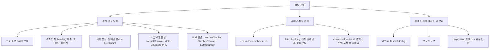
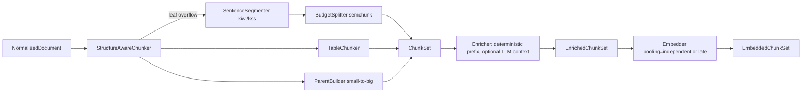
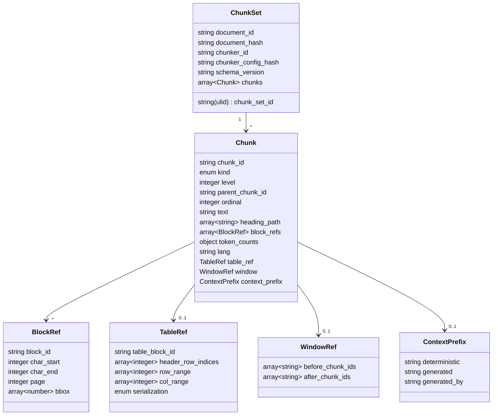

# 청킹 전략과 라이브러리

## 목적

이 문서는 RAG Platform의 `chunker` 확장 지점(D-10)에 채택할 청킹(chunking) 전략과 오픈소스 라이브러리를 조사·비교하고, 브리프의 확정 결정 D-19(구조 인식 계층 청킹 + 토큰 예산 병합 + 부모-자식 + 표 전용 청킹 + 문맥 보강)를 구현 가능한 수준으로 구체화한다. 또한 개방 결정 O-09(청크 크기·오버랩·토크나이저)에 근거 있는 권고를 제시하고, `ChunkSet` 계약(D-05)이 각 전략을 손실 없이 표현하기 위해 담아야 할 필드를 제안한다.

모든 버전·라이선스·수치는 2026-09-18에 웹(PyPI JSON API, GitHub raw 소스, arXiv, 공식 문서)으로 확인했고, 0.3.0 수정분은 2026-09-22에 재확인했다. 확인하지 못한 항목은 "확인 필요"로 표기했다. 0.2.0에서는 독립 검증자의 재확인 결과(점수표 산술, Meta-Chunking·NVIDIA 수치, Unstructured 토큰 청킹, Chonky 다국어 모델 언어 범위, Docling/LlamaIndex 진입점, langchain-experimental 유지보수 상태, semchunk 4.x 유료 모드)를 반영하고 누락 후보(wtpsplit/SaT, semantic-text-splitter, Haystack, dsRAG, HiChunk, PageIndex)를 추가했다. 0.3.0에서는 2차 검증 결과를 반영했다: **docling-core[chunking] 2.97.x가 semchunk <4.0.0, tiktoken <0.13.0을 고정한다는 의존성 충돌**(§1·§6·권고안·리스크·미해결 이슈 11), NVIDIA 수치·오버랩 결론의 정정, late chunking +6.41%의 분할 방식별 분해와 BGE-M3 [CLS] pooling 확정, wtpsplit/SaT 학회(EMNLP 2024), kss 릴리스 태그, Chroma IoU 비교 조건, docling-core export 목록·`HuggingFaceTokenizer` 자동 예산 동작, Meta-Chunking v1 모델 목록, Chonky 학습 언어 표기를 고쳤고, 누락 후보(Vectara 의미 분할 비용 연구, MoC, LGMGC, S2 Chunking, Vision-Guided/Visual Late Chunking, 2026 평가·라우팅 연구, FreeChunker, OpenSearch `text_chunking`, RAGFlow DeepDoc, Open-Parse, spaCy/Stanza 한국어)를 추가했다(§18).

## 범위

- 포함: 고정 토큰/재귀 문자 분할, 구조 인식(heading 계층) 청킹, Docling HybridChunker/HierarchicalChunker, 의미 분할(semantic splitter), Chonkie, LangChain text splitters, LlamaIndex node parsers, Unstructured `chunk_by_title`, semchunk, 부모-자식(small-to-big), 문장 윈도우, 표 청킹, 코드 청킹, Anthropic Contextual Retrieval, late chunking, proposition(Dense X Retrieval), LLM 기반 분할(LumberChunker, Meta-Chunking, Chonkie SlumberChunker/NeuralChunker), 청크 크기·오버랩 실증 연구, 한국어 문장 분리(kss, kiwipiepy, wtpsplit/SaT), 고속 스플리터(semantic-text-splitter), 참조 구현(Haystack 계층 분할·자동 병합, dsRAG AutoContext/RSE, HiChunk+HiCBench, PageIndex, RAGFlow DeepDoc 템플릿, Open-Parse), 인덱스 측 청킹(OpenSearch `text_chunking`), 레이아웃·비전 기반 청킹(S2 Chunking, Vision-Guided Chunking, Visual Late Chunking), 청킹 품질 지표·라우팅 연구(MoC, Adaptive Chunking, FreeChunker), 토큰 카운팅.
- 제외: 파서 선정(`01~03-*` 문서), 임베딩 모델 선정, 리트리벌 시점의 부모 확장 알고리즘 세부(04-pipelines/17), GraphRAG/RAPTOR(04-pipelines/18). 단, 청킹이 이들과 맞닿는 계약 요구사항은 다룬다.

## 평가 기준

| 기준 | 가중치 | 판단 근거 |
|------|--------|-----------|
| 한국어 지원 | 20 | 한국어 문장 경계·토큰 팽창을 다룰 수 있는가, 언어별 규칙(recipe) 유무, 모델 토크나이저 주입 가능 여부 |
| 라이선스 적합성(D-02) | 15 | Apache/MIT/BSD 우선. LGPL은 정적 링크 시 검토 필요. GPL 링크 금지 |
| 성숙도/유지보수 | 15 | 최근 6개월 릴리스, 이슈 대응, 프로젝트 거버넌스(재단 소속 등) |
| 품질/성능 | 20 | 공개 벤치마크(recall, nDCG, IoU) 근거, 구조 보존(heading/표/출처), 속도 |
| 통합 난이도 | 15 | 자체 `ParsedDocument`(D-04) 위에서 동작 가능한가, 입력 모델 종속성, 오프셋 반환 |
| 커뮤니티/생태계 | 10 | GitHub stars, 다운로드, 타 프레임워크 통합 |
| 운영 비용 | 5 | GPU/LLM 호출 필요 여부, 처리량 |

점수는 1~5점(5 최고) 척도이며, 총점 = Σ(점수 × 가중치)/100 × 20 으로 환산해 100점 만점으로 표기한다.

## 후보 목록

### 전략 분류(taxonomy)

이 분류는 Beyond Chunk-Then-Embed(SIGIR 2026, arXiv 2602.16974)의 2축(분할 방법 × 임베딩 순서)에 "검색 단위와 반환 단위 분리" 축을 추가한 것이다. 세 축은 직교하므로 프로파일은 각 축에서 하나씩 조합한다. 세 번째 축의 극단은 PageIndex(VectifyAI, MIT)처럼 청킹·벡터 없이 문서 트리 인덱스를 LLM이 추론 탐색하는 방식으로, 본 문서의 채택 대상은 아니지만 "검색 단위(자식)와 반환 단위(부모·섹션)를 분리한다"는 설계가 어디까지 확장될 수 있는지 보여 주는 참고 사례다(04-pipelines/18 경계).

### 라이브러리 후보

| 이름 | 최신 버전(확인일 2026-09-18) | 라이선스 | 성숙도 | 한국어 지원 | 핵심 강점 | 약점 |
|------|------------------------------|----------|--------|-------------|-----------|------|
| docling-core (HybridChunker/HierarchicalChunker/PageChunker) | 2.97.0 (2026-09-16); docling 2.129.0 (2026-09-18; 직전 2.128.0은 2026-09-16) | MIT | 높음(LF AI & Data 재단, IBM Research 출발) | 토크나이저 주입(HF/tiktoken)으로 한국어 토큰 카운트 정확. 문장 분리 규칙은 없음 | 문서 구조(heading 경로·표·캡션·prov) 보존, 토큰 예산 병합, 표 헤더 반복, `contextualize()` | 입력이 `DoclingDocument`로 고정. HWPX/HWP 백엔드 없음(backend 디렉터리 확인). 표 기본 직렬화가 triplet. **`chunking` extra가 `semchunk>=2.2.0,<4.0.0`, `chunking-openai` extra가 `tiktoken>=0.9.0,<0.13.0`을 고정**(v2.97.0 `pyproject.toml`; main 2.97.2도 동일) — semchunk 4.x·tiktoken 0.13+와 같은 환경에 설치 불가 |
| Chonkie | 1.7.0 (2026-07-07) | MIT | 중간~높음(빠른 릴리스, 스타 약 4.8k) | 언어별 recipe 56개 언어(PyPI 설명 기준; HF `chonkie-ai/recipes` 디렉터리는 pt/pt-BR 등 변형 포함 60+ 파일), `default_kr.json` 포함 | 청커 11종(Token/Fast/Sentence/Recursive/Semantic/Late/Code/Neural/Slumber/Table/TeraflopAI), `OverlapRefinery`, 경량 설치 | 입력이 문자열(구조 정보 없음). 1.3.0에서 청크 타입 통합 등 파괴적 변경 이력. SDPMChunker 제거됨. `NeuralChunker`는 허용 모델 3종(영어 전용)으로 고정되어 한국어 모델을 그대로 넣을 수 없음 |
| langchain-text-splitters | 1.1.2 (2026-04-16) | MIT | 높음 | `KonlpyTextSplitter`(konlpy 의존), `from_huggingface_tokenizer` | 구조 스플리터(Markdown/HTML header, HTMLSemanticPreservingSplitter), `Language` 코드 분할, 생태계 최대 | 문자열 입력, 출처 오프셋은 `add_start_index` 옵션에 한정, 의미 분할은 `langchain-experimental` 0.4.2에 분리되어 있고 그 패키지는 **종료(sunset) 진행 중**(PyPI 설명 첫 줄, langchain-experimental 이슈 #87) |
| llama-index-core (node parsers) | 0.14.24 (2026-08-19) | MIT | 높음 | 모델 토크나이저 주입 가능, 한국어 문장 규칙 없음 | `HierarchicalNodeParser`+`AutoMergingRetriever`, `SentenceWindowNodeParser`, `SemanticSplitterNodeParser`, `SemanticDoubleMergingSplitterNodeParser`; 별도 통합 패키지 `llama-index-node-parser-docling` 0.5.0(`DoclingNodeParser`)·`llama-index-node-parser-chonkie` 0.2.0(`Chunker`) (둘 다 2026-08-31, MIT) | 노드/관계 모델이 LlamaIndex 종속, 리트리벌까지 프레임워크에 묶임 |
| unstructured (`chunk_by_title`) | 0.27.6 (2026-09-14) | Apache-2.0 | 높음 | 기본은 문자 예산(500자)이나 `tokenizer` 지정 시 `max_tokens`/`new_after_n_tokens` 토큰 예산 가능(extra `unstructured[chunking-tokens]`, CHANGELOG 0.18.31) | 섹션 경계 보존, 표 격리(`isolate_table`, `Table`/`TableChunk`), 표 헤더 반복(`repeat_table_headers`, 0.22.10), `orig_elements` 추적 | 기본값이 문자 기준, Python <3.14 제약, 입력이 Unstructured Elements |
| semchunk | 4.1.1 (2026-06-13); **채택 버전은 3.2.5 (2025-10-28)** — docling-core[chunking] 상한 `<4.0.0` 때문 | MIT | 중간(Isaacus 유지, Docling 내부 의존) | 구분자 계층에 한국어 종결 부호 없음(`.`, `?`, `!` 위주). 토큰 카운터 주입 가능 | 가볍고 빠름, `offsets=True`로 오프셋 반환, `overlap` 지원(둘 다 3.0.0, 2024-12-31 추가 → 3.2.5에서 사용 가능) | 구조 인식 없음, 단일 함수 라이브러리. 4.x는 유료 Isaacus API 키가 필요한 선택적 "AI chunking" 모드(`chunking_model=`, `isaacus_client=`)와 `chunkerify()` 키워드 전용 인자화(파괴적 변경)를 추가했으나 우리 사용 범위는 오프라인 표준 모드로 한정(D-02·운영 비용). 4.x는 docling-core[chunking]과 같은 uv 잠금에 공존 불가(미해결 이슈 11) |
| kss | 6.0.6 (2025-11-13, PyPI 파일 메타데이터로 확인; GitHub Releases 최신 태그 v6.0.6 동일 일자, 릴리스 노트: mecab 사전 설치 요구 제거·`fast` 백엔드 버그 수정) | BSD-3-Clause | 중간(단일 메인테이너, 최근 릴리스 10개월 전) | 한국어 전용 문장 분리(`split_sentences`, backend mecab/pecab/punct/fast) | 형태소 기반 휴리스틱, 다중 백엔드 | mecab 수동 설치. 순수 파이썬 pecab 백엔드는 느린 것으로 알려져 있으나 배수 수치는 현 README에 없음(확인 필요, as of 2026-09; 자체 측정 예정, 미해결 이슈 4) |
| kiwipiepy | 0.23.2 (2026-06-11) | LGPLv3 (0.24.0부터 Apache-2.0 예정, 이슈 #233, 2026-09-17 개설) | 높음(활발) | 한국어 형태소 분석 + `split_into_sents`(오프셋·서브문장 반환) | C++ 고속, 오프셋 정확, Kiwi 코어는 이미 Apache-2.0 | 현재 wheel이 LGPL 정적 링크. 0.24.0 릴리스 전까지 라이선스 검토 필요 |
| tiktoken | 0.14.0 (2026-08-17); **채택 버전은 0.12.0 (2025-10-06)** — docling-core[chunking-openai] 상한 `<0.13.0` 때문(0.13.0은 2026-05-15 릴리스) | MIT | 높음 | `o200k_base`가 `cl100k_base`보다 한국어 효율 개선 | 빠른 BPE, LLM 예산 계산 표준 | 임베딩 모델 토크나이저와 불일치. Docling `OpenAITokenizer`를 쓰지 않으면 `chunking-openai` extra를 빼고 0.14.0을 쓸 수 있음(미해결 이슈 11) |
| Chonky 모델(mirth) | `chonky_distilbert_base_uncased_1`(66.4M), `chonky_modernbert_base_1`(150M), `chonky_modernbert_large_1`(396M), `chonky_mmbert_small_multilingual_1`(140M) (저장소 README 기준 파라미터 수) | MIT(HF 모델 카드 태그) | 낮음~중간(개인 유지) | **한국어 미지원(미평가)**: mmbert 다국어 모델의 평가 언어는 de, en, es, fr, it, nl, pl, pt, ru, sv, zh 11개(README Gutenberg 검증 표 기준); 학습 데이터의 언어 범위는 README·모델 카드에 미표기(확인 필요, as of 2026-09) | 학습된 토큰 분류로 의미 경계 탐지, Chonkie `NeuralChunker`가 사용 | 벤치마크 부족. Chonkie 1.7.0 `NeuralChunker`는 `SUPPORTED_MODELS` 3종(distilbert 기본, modernbert base/large)만 허용하고 그 외 모델명은 예외를 던지므로 다국어·한국어 모델을 쓰려면 자체 학습 모델 + 어댑터 필요 |
| wtpsplit (SaT, Segment any Text) | 2.2.1 (2026-04-11) | MIT | 중간~높음(EMNLP 2024 Main 논문 arXiv 2406.16678; 전작 WtP는 ACL 2023; 활발) | 85개 언어 다국어 문장·단락 분리 모델, **한국어 포함**(`sat-1l`~`sat-12l`, `-sm` 변형) | 구두점 없는 텍스트에도 강건, 언어 코드 불필요, ONNX 지원 | torch/모델 의존, 반환은 문자열 리스트(오프셋 재계산 필요), 한국어 정확도는 kss/kiwi와 골든셋 비교 필요 |
| semantic-text-splitter (benbrandt/text-splitter) | 0.32.0 (2026-06-16) | MIT | 중간~높음(Rust 코어 + Python 바인딩) | 문자/HF `tokenizers`/tiktoken 예산, 언어 규칙 없음(Unicode 문장·단어·grapheme 경계) | 고속, `MarkdownSplitter`(CommonMark 구조 인식), `CodeSplitter`(tree-sitter), 범위형 용량(`(min, max)`) | 구조 입력이 Markdown 문자열에 한정, 오프셋은 `chunk_indices()`로 별도 호출 |
| haystack-ai (`HierarchicalDocumentSplitter` + `AutoMergingRetriever`) | 3.1.1 (2026-09-03) | Apache-2.0 | 높음(deepset) | 언어 규칙 없음, 단어/문장/페이지 단위 | `block_sizes` 기반 다단 부모-자식 분할과 자동 병합 리트리버(small-to-big 참조 구현) | 프레임워크 `Document` 모델 종속, 토큰 예산 아님(단어·문자 단위) |
| dsRAG (D-Star-AI) | GitHub main(릴리스 태그 확인 필요), 스타 약 1.6k | MIT | 중간 | 언어 규칙 없음 | AutoContext(문서·섹션 문맥 헤더를 청크 앞에 부착) + Relevant Segment Extraction(질의 시 인접 청크를 세그먼트로 재조합) — 본 문서의 결정적 접두어 + 부모 확장 설계와 가장 가까운 기성 구현 | 자체 KnowledgeBase 추상에 묶임, LLM 호출로 문맥 생성 |
| OpenSearch `text_chunking` ingest processor | OpenSearch 2.13+ 내장(D-15 렉시컬 인덱스) | Apache-2.0 | 높음(OpenSearch 프로젝트) | 인덱스 분석기 토크나이저 사용(Nori 지정 가능 여부 확인 필요, as of 2026-09) | 알고리즘 `fixed_token_length`(`token_limit`, `overlap_rate`, `tokenizer`), `delimiter`; 인덱스 측에서 청킹 → 별도 청커 스테이지 없이 `flat_text` 폴백 가능 | 구조·prov 없음, 청크가 인덱스 내부 중첩 필드로만 존재해 `ChunkSet` 계약·Qdrant와 이중 상태. 경량 프로파일(Qdrant 단독)에는 해당 없음 |
| RAGFlow DeepDoc 청킹 템플릿 | ragflow v0.27.2(GitHub 기준, 스타 약 91k) | Apache-2.0 | 높음(infiniflow) | 중국어 중심 CJK 처리(구분자·토크나이저), 한국어 전용 규칙은 확인 필요(as of 2026-09) | 문서 유형별 템플릿(General/Q&A/Manual/Table/Paper/Book/Laws/Presentation/One 등) — 법령·논문·매뉴얼 구조 인식 규칙의 참조 구현 | 엔진 전체에 묶임(라이브러리 분리 불가), 코드 차용은 Apache-2.0 고지 필요. 참조 구현으로만 사용 |
| Open-Parse (Filimoa/open-parse) | GitHub main(릴리스 태그·최근 커밋 확인 필요, as of 2026-09) | MIT | 낮음~중간(유지보수 활동 확인 필요) | 언어 규칙 없음 | PDF 레이아웃 노드 기반 청킹 + 선택적 임베딩 클러스터링 의미 병합, 표 추출(unitable) | 파서+청커 결합 라이브러리, 임베딩 API(OpenAI) 의존 옵션. 구조 인식 청킹의 참조 구현 |
| spaCy `ko_core_news_sm/md/lg` / Stanza Korean | spaCy 모델(MIT), Stanza(Apache-2.0) — 버전·구성요소 확인 필요(as of 2026-09) | MIT / Apache-2.0 | 높음(Explosion / Stanford NLP) | 한국어 파이프라인 제공(문장 분리 senter/parser 기반) | 주류 다국어 OSS 세그멘터, 다국어 컬렉션 공용 `SentenceSegmenter` 후보, 문자 오프셋(`sent.start_char`) 제공 | 모델 다운로드·의존성 무게(spaCy ko는 형태소 토크나이저 의존, Stanza는 torch), 한국어 문장 분리 정확도는 kss·kiwi 대비 미검증(§16) |

### 알고리즘·연구 후보

| 이름 | 출처(확인일) | 코드/라이선스 | 핵심 주장 수치 | 비고 |
|------|--------------|---------------|----------------|------|
| Anthropic Contextual Retrieval | anthropic.com/engineering/contextual-retrieval (2024-09) | 쿡북 예제 | top-20 검색 실패율 5.7% → 3.7%(문맥 임베딩) → 2.9%(+문맥 BM25, -49%) → 1.9%(+리랭킹, -67%) | 문맥 50~100 토큰, 전처리 비용 약 $1.02/M 문서 토큰(프롬프트 캐싱) |
| Late chunking (Jina) | arXiv 2409.04701 v3 (2025-07-07) | github.com/jina-ai/late-chunking, Apache-2.0 | jina-embeddings-v2-small, 256토큰: NFCorpus nDCG@10 23.46 → 29.98, SciFact 64.20 → 66.10 | mean pooling 모델 전제. "long late chunking"으로 8192 초과 처리 |
| Dense X Retrieval (proposition) | arXiv 2312.06648 v3 (2024-10) | Propositionizer(flan-t5-large) | 비지도 리트리버 Recall@5 +12.0(SimCSE 34.3→46.3), +9.3(Contriever 43.0→52.7); GTR 65.2→68.0 | 위키 2.57억 proposition, 평균 11.2단어 |
| LumberChunker | arXiv 2406.17526, EMNLP 2024 Findings | github.com/joaodsmarques/LumberChunker, 라이선스 미표기(확인 필요) | GutenQA DCG@20 62.09 vs 재귀 54.72, 단락 49.00, 의미 44.74, proposition 46.19 | 서사 문서(책) 특화, LLM 호출 비용 큼 |
| Meta-Chunking | arXiv 2410.12788 v3 (2025-05-21) | github.com/IAAR-Shanghai/Meta-Chunking, Apache-2.0 | 2WikiMultihopQA F1(v3 Table 1): PPL Chunking(Qwen2-0.5B) 13.56 vs LumberChunker(Qwen2.5-14B) 13.28; MSP(Qwen2-7B) 13.20, MSP(Qwen2-0.5B) 12.13. 처리 시간은 v1 초록 기준 유사도 청킹의 45.8%(v3 표에서는 140.54s vs 416.45s ≈ 34%) | 소형 LM(v3: Qwen2-0.5B/7B, Baichuan2-7B; v1: Qwen2-1.5B, Internlm2-1.8B, Baichuan2-7B, Qwen2-7B + 1B 미만 Pythia-0.16B/0.41B·Qwen2-0.5B 실험 — v1 HTML 본문 확인)의 PPL 급변 또는 margin sampling으로 경계. LumberChunker를 앞선 것은 PPL(0.5B)이고 MSP는 그보다 낮음 |
| HiChunk + HiCBench (Tencent Youtu Lab) | arXiv 2509.11552 (2025-09) | github.com/TencentCloudADP/HiChunk — 코어 MIT, 단 Contriever 구성요소는 CC BY-NC 4.0(LICENSE 파일 명시, 비상업) | 계층 구조 주석이 붙은 문서로 증거 집약형 QA를 합성한 청킹 품질 벤치마크(HiCBench); 계층 청킹 + Auto-Merge 리트리벌로 조각 불완전성 완화(수치는 README 미기재, 논문 참조) | D-19 계층 청킹·부모 확장의 평가 자산으로 직접 사용 가능. CC BY-NC 부분은 코드·모델 분리 후 평가 환경에서만 사용(D-02 검토) |
| ClusterSemanticChunker / LLMChunker (Chroma) | trychroma.com/research/evaluating-chunking (2024-07) | github.com/brandonstarxel/chunking_evaluation, MIT | ClusterSemantic 400토큰 recall 91.3%, LLMChunker recall 91.9%; Recursive 200/0 precision 7.0% IoU 6.9% | 전략 간 recall 차이 최대 약 9%p |
| Beyond Chunk-Then-Embed | arXiv 2602.16974, SIGIR 2026 | github.com/ielab/Reproduce-chunking-2026 | 코퍼스 내 검색: 구조 기반이 최고(nDCG@10 0.41~0.50), proposition은 단락 대비 15~27% 하락; 문서 내 검색: LumberChunker가 단락 대비 10~30% 우세; late chunking 코퍼스 내 평균 +6.41%(jina-v2, Table 4 여섯 분할 방식 평균 — 방식별로는 Fixed-size +7.20, Sentence +4.16, Paragraph ≈0(+0.06/-0.02), Proposition +22.87, LumberChunker +4.68, Semantic -0.50), 문서 내 -5.16%~-53.17% | 과제 유형이 전략 선택을 좌우. late chunking 평균 이득은 proposition이 끌어올린 값이며 단락(구조) 경계에서는 사실상 0 |
| Systematic Investigation (36 methods) | arXiv 2603.06976 | - | Paragraph Group 청킹 평균 nDCG@5 약 0.459 최고, 고정 문자 청킹 <0.244 | 6 도메인 × 5 임베더 |
| When Is Complex Chunking Worth It | arXiv 2608.16586 | - | 8개 전략: 고비용 방법이 단순 방법 대비 일관된 이득 드묾 | 처리량·메모리 포함 다목적 평가 |
| NVIDIA chunking study | developer.nvidia.com (2025-06-18) | - | 페이지 청킹 평균 정확도 0.648(표준편차 0.107, 본문 명시); 토큰 기반 전략(256/512/1024/2048)은 평균 0.603~0.645 범위(본문 명시), 1024가 그 상단이라는 것은 Figure 2 판독치. 본문에 명시된 데이터셋별 수치: FinanceBench 1024토큰 0.579 vs 페이지 0.566, RAGBattlePacket 1024토큰 0.804 vs 2048토큰 0.749 | nv-embedqa-1b-v2, top-10. **오버랩 10/15/20% 비교 후 15%가 최선**(본문 명시, 토큰 청킹 전제) |
| Searching for Best Practices in RAG | arXiv 2407.01219 (2024) | - | 512토큰 faithfulness 97.59/relevancy 97.41 최고; 2048은 80.37; sliding window(175/512) 97.41/96.85 > small-to-big 96.67/95.37 | LlamaIndex 평가기 사용 |
| Reconstructing Context | arXiv 2504.19754 (2025-04) | - | NFCorpus 부분집합: contextual retrieval(jina-v3) nDCG@10 0.308 vs late 0.294; BGE-M3에서는 late chunking이 기본보다 하락 | contextual은 약 20GB VRAM 소요 |
| Is Semantic Chunking Worth the Computational Cost? (Vectara) | arXiv 2410.13070 (2024-10-16) | - | 문서 검색·근거 검색·답변 생성 3과제에서 고정 크기 vs 의미 분할 비교: 의미 분할의 계산 비용이 일관된 성능 이득으로 정당화되지 않음(초록) | §7 판단의 직접 근거. 세부 수치는 논문 표 참조(확인 필요, as of 2026-09) |
| MoC: Mixtures of Text Chunking Learners | arXiv 2503.09600 (2025-03, v2 2025-05-26; ACL 2025) | github.com/IAAR-Shanghai/Meta-Chunking `/MoC`, Apache-2.0 | 청킹 품질 직접 측정 지표 **Boundary Clarity**·**Chunk Stickiness** 제안; 3단계 처리로 LLM이 청킹 정규식 목록을 생성하는 granularity-aware 혼합 청커 | 08-evaluation 청킹 평가 지표 후보(미해결 이슈 12) |
| LGMGC (Passage Segmentation for Extractive QA) | arXiv 2501.09940 (2025-01-17; ECIR 2025) | 확인 필요 | Logits-Guided Multi-Granular Chunker: LLM 로짓 기반 경계 + 다중 granularity(부모-자식) 청크로 검색·E2E RAG 개선(초록) | §8 small-to-big 설계의 비교 기준 |
| S2 Chunking | arXiv 2501.05485 (2025-01-08) | github.com/Vprashant/s2-chunking-lib (라이선스 확인 필요) | 레이아웃 bbox + 텍스트 임베딩 가중 그래프에 스펙트럴 클러스터링으로 분할, 토큰 길이 제약 준수 | PDF/HWPX `prov(bbox)`를 청킹 신호로 쓰는 유일한 후보군 — `BlockRef.bbox`가 있어야 적용 가능 |
| Vision-Guided Chunking | arXiv 2506.16035 (2025-06-19, v2 2025-07-13) | - | 대형 멀티모달 모델이 PDF 페이지 배치를 보고 표·그림·다중 페이지 구조를 보존하며 청킹; 텍스트 전용 청킹 대비 복잡 레이아웃 문서에서 개선(초록) | 스캔 PDF·표 위주 문서용 플러그인 후보, LLM 비용 큼 |
| Visual Late Chunking (ColChunk) | arXiv 2604.10167 (2026-04-11) | - | 비전 임베더의 패치 임베딩에 2D 위치 prior를 결합한 계층 클러스터링으로 다중 벡터 압축: 저장량 -90%, nDCG@5 평균 +9(초록) | O-04(late interaction) 및 비전 리트리벌 문서와 공유할 참고; 텍스트 청커 범위 밖 |
| Chunking Methods on RAG — Effectiveness vs Computational Cost | arXiv 2606.00881 (2026-05-30) | - | 다수 청킹 방법의 체계적 비교; 많은 제안 기법이 다양한 시나리오에서 효과 근거 부족, 청킹이 "간과된 문제"를 유발(초록) | §15 최신 재현 연구. 방법별 수치는 확인 필요(as of 2026-09) |
| Adaptive Chunking (청킹 방법 선택) | arXiv 2603.25333 (2026-03-26) | - | 문서 내재 지표 5종(References Completeness, Intrachunk Cohesion, Document Contextual Coherence, Block Integrity, Size Compliance)으로 문서별 청킹 방법 선택; 답변 정확도 62~64% → 72%, 정답 수 +30%(법률·기술·사회과학 문서) | 프로파일 라우팅 규칙(heading 밀도·문서 길이)을 지표 기반으로 확장할 근거 |
| FreeChunker | arXiv 2510.20356 (2025-10-23, v2 2026-02-01) | - | 문장을 원자 단위로 색인하고 질의 시 임의 문장 조합을 검색(정적 청크 경계 제거); LongBench V2에서 우세, 계산 부담 감소(초록) | dsRAG RSE와 같은 "동적 세그먼트" 계열(04-pipelines/17 후처리 후보) |

## 심층 비교

### 1. Docling HybridChunker / HierarchicalChunker

- 동작: `HierarchicalChunker`가 `DoclingDocument` 요소(단락·표·목록·코드 등)마다 1청크를 만들고 heading 경로·캡션을 메타에 부착한다. `HybridChunker`는 그 위에 토크나이저를 적용해 (1) 초과 청크를 항목 경계 → 텍스트 내부(semchunk)로 분할, (2) 같은 heading을 공유하는 미달 청크를 병합(`merge_peers`)한다. 표는 `repeat_table_header=True`이면 분할된 각 조각에 헤더를 반복한다.
- 진입점(docling-core 2.97.0 소스 확인): `docling_core.transforms.chunker.HybridChunker(tokenizer: BaseTokenizer, merge_peers=True, repeat_table_header=True, omit_header_on_overflow=False, always_emit_headings=False, serializer_provider=ChunkingSerializerProvider())`. `max_tokens`는 생성자 필드가 아니라 `tokenizer.get_max_tokens()`를 돌려주는 읽기 전용 property이며, 예산은 토크나이저 객체(`HuggingFaceTokenizer(tokenizer=..., max_tokens=...)`)에서 설정한다. 생성자에 `max_tokens`나 문자열 `tokenizer`를 직접 넘기면 `@model_validator(mode="before") _patch`가 HuggingFaceTokenizer로 감싸 주지만 "Deprecated initialization parameter types for HybridChunker" 경고를 낸다. 같은 패키지 `__init__`(v2.97.0 원문 확인)가 export하는 이름은 `BaseChunk, BaseChunker, BaseMeta, DocChunk, DocMeta`(`doc_chunk.py`), `HierarchicalChunker(always_emit_headings=False)`, `HybridChunker`, `PageChunker`, 그리고 `code_chunking` 하위 모듈의 `BaseCodeChunkingStrategy, StandardCodeChunkingStrategy, CodeChunk, CodeChunkType, CodeDocMeta`와 `CodeLanguageLabel`이다. 줄 단위 분할기는 export되지 않은 `docling_core.transforms.chunker.line_chunker.LineBasedTokenChunker(tokenizer, prefix="", omit_prefix_on_overflow=False, serializer_provider=...)`로 직접 import해야 한다. 토크나이저: `docling_core.transforms.chunker.tokenizer.huggingface.HuggingFaceTokenizer(tokenizer=AutoTokenizer.from_pretrained(...), max_tokens=...)`, `...tokenizer.openai.OpenAITokenizer(tokenizer=tiktoken.get_encoding(...), max_tokens=...)`. 설치 extra: `docling-core[chunking]`(`transformers>=4.42,<6`, `semchunk>=2.2.0,<4.0.0`, `tree-sitter>=0.25,<0.27`), `docling-core[chunking-openai]`(`semchunk>=2.2.0,<4.0.0`, `tiktoken>=0.9.0,<0.13.0`). **의존성 제약(0.3.0 추가):** 이 상한 때문에 docling-core 2.97.x(main 2.97.2 포함)와 semchunk 4.1.1·tiktoken 0.14.0은 한 환경(D-01 uv 잠금)에 공존할 수 없다. docling 2.129.0 본체는 기본 의존성으로 `docling-core>=2.96.0,<3.0.0`(extra 없음)을, `feat-chunking` extra로 `docling-core[chunking]>=2.96.0,<3.0.0`을 끌어오므로 Docling 파서 경로만 쓰면 semchunk 상한은 걸리지 않지만, `HybridChunker` 어댑터(2차)를 같은 배포물에 두는 순간 `semchunk<4.0.0`이 강제된다. 본 문서는 **semchunk 3.2.5(2025-10-28; `offsets`·`overlap`은 3.0.0부터 지원, 오프라인 표준 모드 알고리즘은 4.x와 동일) + tiktoken 0.12.0(0.13.0 미만 최신)으로 잠금**하는 것을 1차 해법으로 권고하고, 상한 완화 업스트림 이슈 제기와 어댑터 extra 분리를 병행한다(권고안·미해결 이슈 11).
- 출력: `DocChunk(text, meta: DocMeta)`; `DocMeta`는 `schema_name`, `version`, `doc_items: list[DocItem]`(각 항목에 `prov`: 페이지·bbox·charspan), `headings: list[str] | None`, `captions`(deprecated), `origin`. `chunker.contextualize(chunk)`는 heading 경로 + 본문을 임베딩용 문자열로 렌더링한다.
- 표 직렬화: 기본 `TripletTableSerializer`("행, 열 = 값"). `ChunkingSerializerProvider`를 상속해 `ChunkingDocSerializer(table_serializer=MarkdownTableSerializer())`로 교체 가능(공식 예제 확인).
- 성능/근거: 공개 벤치마크 수치 없음. 구조 기반 청킹의 우위는 Beyond Chunk-Then-Embed·Systematic Investigation·NVIDIA(section/page-level)로 간접 지지된다.
- 함정: (a) 입력이 `DoclingDocument`이므로 HWPX(python-hwpx 6.4.0), HWP, Trafilatura 경로 산출물은 직접 넣을 수 없다. `DoclingDocument.add_title/add_heading/add_text/add_table/add_list_item/add_picture/add_code/add_group` 빌더 API가 있어 역변환(`ParsedDocument → DoclingDocument`)은 가능하다. (b) `HuggingFaceTokenizer.max_tokens`를 생략하면 소스(`tokenizer/huggingface.py`)가 HF Hub의 `sentence_bert_config.json`에서 `max_seq_length`를 읽어 채택하고(BGE-M3: 8192), 그 파일이 없는 토크나이저(순수 HF 모델)에서는 `RuntimeError("max_tokens could not be determined automatically; please set explicitly.")`를 던진다. 어느 경우든 청크 예산으로 8192가 들어가면 병합이 사실상 일어나지 않으므로 반드시 명시해야 한다. (c) triplet 직렬화는 LLM 가독성이 낮아 Context Pack 렌더링에는 부적합하다(임베딩용과 표시용 직렬화를 분리해야 함).

### 2. Chonkie

- 동작: 문자열 입력 → 토큰/문장/재귀 규칙/임베딩 유사도/신경망/LLM 기준으로 분할 → `Chunk(text, start_index, end_index, token_count, context, embedding)` 반환. `OverlapRefinery(context_size=0.25, mode="token"|"recursive", method="suffix"|"prefix"|"justified", merge=True)`로 오버랩을 후처리한다.
- 진입점(1.7.0 소스 확인): `chonkie.TokenChunker`, `FastChunker`, `SentenceChunker`, `RecursiveChunker(chunk_size=2048, min_characters_per_chunk=24)` 및 `RecursiveChunker.from_recipe(name, lang="en")`, `SemanticChunker(embedding_model="minishlab/potion-base-32M", threshold=0.8, chunk_size=2048, similarity_window=3, min_sentences_per_chunk=1, skip_window=0, filter_window=5)`(Savitzky-Golay 필터 + 피크 검출), `LateChunker(embedding_model, chunk_size=2048, rules, min_characters_per_chunk=24)`(RecursiveChunker 상속), `CodeChunker`(AST, 100+ 언어), `NeuralChunker(model=DEFAULT_MODEL, device_map="auto", min_characters_per_chunk=10)` — 1.7.0 태그 `chunker/neural.py`의 `DEFAULT_MODEL`은 `"mirth/chonky_distilbert_base_uncased_1"`이고 `SUPPORTED_MODELS`는 distilbert/modernbert_base/modernbert_large 3종만 허용한다(docs.chonkie.ai 문서는 기본값을 `chonky_modernbert_base_1`, `device_map="cpu"`로 적어 **문서와 소스가 불일치**하므로 어댑터는 모델명을 항상 명시), `SlumberChunker`(Genie 인터페이스 경유 LLM), `TableChunker(tokenizer="row", chunk_size=3)`(Markdown 표를 행 단위로), `TeraflopAIChunker`(외부 API). SDPMChunker는 제거되었다(DeepWiki "deprecated" 및 현재 `chunker/__init__.py` 미포함).
- 한국어: HF `chonkie-ai/recipes`에 `default_kr.json`(구분자·`include_delim` 규칙) 존재(PyPI 설명 기준 56개 언어). 문장 종결 부호 기반이므로 형태소 기반(kss/kiwi)보다 정밀도는 낮다. `NeuralChunker`용 Chonky 다국어 모델은 한국어에 대해 평가되지 않았고(평가 표는 10개 유럽어 + 중국어; 학습 언어 범위는 미표기, 확인 필요, as of 2026-09), Chonkie 1.7.0은 허용 모델 3종(모두 영어) 외의 모델명에 예외를 던지므로 한국어 신경망 분할은 자체 학습 모델 + 자체 어댑터가 없으면 불가능하다.
- 성능: 자체 주장 "토큰 청킹 최저 대안 대비 33배", "의미 청킹 최대 2.5배"(출처 README, 독립 검증 없음). Isaacus 법률 QA 벤치마크(semchunk README)에서는 "Chonkie's semantic and recursive chunkers" 행이 32.6%로 최하위(semantic 단독 수치가 아니며 자사 비교이므로 참고만).
- 함정: 구조 정보를 받지 않아 heading·표·prov를 스스로 잃는다. 따라서 우리 파이프라인에서는 "구조 인식 청커가 만든 리프 블록의 텍스트 내부 분할" 또는 "의미/late/neural 실험 프로파일"로 쓰는 것이 맞다. 1.3.0의 청크 타입 통합처럼 파괴적 변경이 잦아 어댑터로 버전을 고정해야 한다.

### 3. LangChain text splitters

- 진입점(`langchain_text_splitters` 1.1.2 `__init__` 확인): `RecursiveCharacterTextSplitter`(+`from_huggingface_tokenizer`, `from_tiktoken_encoder`, `from_language`), `CharacterTextSplitter`, `TokenTextSplitter`, `SentenceTransformersTokenTextSplitter`, `MarkdownHeaderTextSplitter`, `ExperimentalMarkdownSyntaxTextSplitter`, `MarkdownTextSplitter`, `HTMLHeaderTextSplitter`, `HTMLSectionSplitter`, `HTMLSemanticPreservingSplitter`, `RecursiveJsonSplitter`, `NLTKTextSplitter`, `SpacyTextSplitter`, `KonlpyTextSplitter`, `PythonCodeTextSplitter`, `JSFrameworkTextSplitter`, `LatexTextSplitter`, `Language` 열거. 의미 분할 `SemanticChunker(buffer_size=1, breakpoint_threshold_type="percentile"|"standard_deviation"|"interquartile"|"gradient", min_chunk_size)`는 `langchain-experimental` 0.4.2(MIT, 2026-05-22)에 있으나, 그 패키지의 PyPI 설명 첫 줄이 "`langchain-experimental` is being sunset. See #87 for details."이다. 종료 예정 패키지이므로 **참고용(비권고)** 으로만 다루고 의미 분할 구현 후보에서는 제외한다.
- 출력: `Document(page_content, metadata)`. heading 스플리터는 `metadata`에 헤더 계층을 넣는다. 오프셋은 `add_start_index=True` 시 `start_index`만 제공한다.
- 근거: Chroma 연구에서 `RecursiveCharacterTextSplitter` 200토큰/오버랩 0이 recall 88.1%, precision 7.0%, IoU 6.9%로 고정 토큰 분할보다 일관되게 우수. 800/400(OpenAI 기본값)은 recall 85.4%로 최하위이고, IoU 1.5%는 `TokenTextSplitter` 800/400(1.4%)에 이어 두 번째로 낮다.
- 함정: 문자열 기반이라 표·그림·prov가 사라진다. `KonlpyTextSplitter`는 konlpy(Java 의존) 필요. Markdown/HTML 헤더 스플리터는 우리 `ParsedDocument`가 이미 제공하는 구조를 중복 재추출하므로 채택 가치가 낮다.

### 4. LlamaIndex node parsers

- 진입점(`llama_index.core.node_parser` 0.14.24 소스 확인): `SentenceSplitter(chunk_size=1024, chunk_overlap=200)`(소스 상수 `SENTENCE_CHUNK_OVERLAP=200`; 문서 표기 20과 다름), `TokenTextSplitter`, `SentenceWindowNodeParser(window_size=3, window_metadata_key="window")`, `SemanticSplitterNodeParser(buffer_size=1, breakpoint_percentile_threshold=95, embed_model)`, `SemanticDoubleMergingSplitterNodeParser(initial_threshold, appending_threshold, merging_threshold, max_chunk_size[문자], language_config)`, `HierarchicalNodeParser(chunk_sizes=[2048, 512, 128], chunk_overlap=20)`, `MarkdownNodeParser`, `HTMLNodeParser(tags=[p,h1..h6,li,b,i,u,section])`, `JSONNodeParser`, `CodeSplitter(language, chunk_lines, chunk_lines_overlap, max_chars)`, `MarkdownElementNodeParser`, `UnstructuredElementNodeParser`, `LangchainNodeParser`. 코어 `node_parser/__init__.py`의 `__all__`에는 Chonkie·Docling 관련 클래스가 없고, 별도 통합 패키지로 제공된다: `llama-index-node-parser-chonkie` 0.2.0(`from llama_index.node_parser.chonkie import Chunker`, Chonkie 청커 래퍼)과 `llama-index-node-parser-docling` 0.5.0(`from llama_index.node_parser.docling import DoclingNodeParser`, DoclingDocument JSON을 노드로 변환). 둘 다 2026-08-31 릴리스, MIT. 리트리벌 측 `AutoMergingRetriever(vector_retriever, storage_context, simple_ratio_thresh=0.5)`는 자식의 50% 초과가 검색되면 부모로 치환한다.
- 출력: `TextNode` + `relationships`(PARENT/CHILD/PREVIOUS/NEXT), `metadata`, `start_char_idx/end_char_idx`.
- 근거: Wang et al.(2407.01219)에서 sliding window(175/512) faithfulness 97.41 > small-to-big 96.67 > 원본 95.74. Anthropic는 top-20이 top-5/10보다 우수함을 보고했는데, 부모 확장은 top-K를 늘리지 않고 문맥을 넓히는 대안이다.
- 함정: 노드·관계·저장소(`docstore`)가 프레임워크에 묶여 있어 우리 `ChunkSet`/`IndexBackend`와 이중 상태가 된다. 알고리즘(계층 분할, 윈도우 메타, 자동 병합 비율)은 단순하므로 **개념만 차용하고 계약 필드로 표현**하는 것이 원칙 2(Adapters over Forks)와 3(Pure Stages)에 부합한다.

### 5. Unstructured `chunk_by_title`

- 진입점(main 브랜치 `title.py` 시그니처 및 CHANGELOG 확인, 0.27.6에 모두 포함): `unstructured.chunking.title.chunk_by_title(elements, combine_text_under_n_chars=None, include_orig_elements=None, max_characters=None(기본 500), multipage_sections=None(기본 True), new_after_n_chars=None, overlap=None(기본 0), overlap_all=None(기본 False), max_tokens=None, new_after_n_tokens=None, tokenizer=None, repeat_table_headers=None, skip_table_chunking=None, isolate_table=None, ...)`; `unstructured.chunking.basic.chunk_elements`. 토큰 기반 인자(`max_tokens`/`new_after_n_tokens`/`tokenizer`, extra `unstructured[chunking-tokens]`)는 0.18.31, `repeat_table_headers`는 0.22.10, `skip_table_chunking`은 0.22.21, `isolate_table`은 0.22.30~31에 추가되었다. `by_page`, `by_similarity`는 API 전용.
- 동작: `Title` 요소에서 항상 새 청크 시작(섹션 경계 보존), 표는 기본 격리되어 `Table` 또는 초과 시 `TableChunk`(`text_as_html` 메타 보존, `repeat_table_headers=True`면 조각마다 헤더 반복), 결과는 `CompositeElement`. `include_orig_elements=True`면 `metadata.orig_elements`로 원 요소 추적.
- 함정: 기본값은 문자 기준(500자)이어서 한국어 토큰 팽창을 반영하지 않지만, `tokenizer`를 지정하면 토큰 예산으로 동작한다(임베딩 모델 토크나이저 주입 가능). Python <3.14 상한(D-01 3.12+와는 호환), 입력이 Unstructured Elements. Unstructured를 파서로 쓰는 경로에서만 파서 어댑터 내부의 사전 청킹 옵션으로 의미가 있다.

### 6. semchunk

- 진입점(4.1.1 소스 확인): `semchunk.chunkerify(tokenizer_or_token_counter, chunk_size=None, *, memoize=True, ...)` → 호출 가능 객체; `semchunk.chunk(text, chunk_size, token_counter, memoize=True, offsets=False, overlap=None)`. `offsets=True`면 (start, end) 문자 오프셋 반환, `overlap`은 비율(<1) 또는 토큰 수. CHANGELOG 기준 `chunkerify`는 0.3.0, `offsets`·`overlap`은 3.0.0(2024-12-31)부터 있으므로 **3.2.5에서도 같은 API를 쓸 수 있다**(4.0.0의 차이는 AI chunking 모드 추가, `chunkerify` 3번째 인자 이후 키워드 전용화, Python 3.9 지원 종료).
- **버전 제약(0.3.0 추가):** docling-core[chunking] 2.97.x가 `semchunk<4.0.0`을 고정하므로, Docling `HybridChunker` 어댑터와 같은 uv 잠금에 두려면 semchunk는 3.2.5로 내려야 한다. 어댑터는 `semchunk.chunk(..., offsets=True, overlap=...)`처럼 3.x·4.x 공통 시그니처만 호출하고 4.x 전용 인자(`chunking_model`, `isaacus_client`)는 쓰지 않으므로 코드 변경 없이 잠금 버전만 바뀐다.
- 동작: 구분자 계층(개행 → 탭 → 공백 → `.?!` → `;,()` 등 → `:—…` → `/\–&-` → 문자)으로 이진 탐색 분할. Docling `HybridChunker`가 초과 텍스트 분할에 내부적으로 사용한다(`hybrid_chunker.py`의 `semchunk.chunkerify(...)` 확인).
- 근거: Isaacus 자체 법률 QA 정답률(semchunk README, 자사 벤치마크) — 표준 모드 semchunk 35.5% vs LangChain 재귀 34.8% vs 고정 33.3% vs Chonkie semantic/recursive 32.6%. 4.x README는 유료 Isaacus API 기반 "AI chunking" 모드의 37.7%를 최상단에 내세우지만, 그 모드는 `ISAACUS_API_KEY`와 외부 호출이 필요하므로 **우리 사용 범위는 오프라인 표준 모드(35.5%)로 한정**한다(D-02 채택성·운영 비용, 원칙 3의 순수 스테이지).
- 함정: 한국어 종결 부호(`다.` 뒤 공백 등)는 `.`로 처리되므로 문장 인식은 되지만 인용·괄호·번호 매기기(예: "1." "가.")에서 오분할 가능. 리프 블록 내부 분할용 폴백으로 적합하며, 한국어는 kss/kiwi 문장 경계를 먼저 넣고 semchunk로 예산을 맞추는 2단계가 안전하다.
- 대안 semantic-text-splitter(0.32.0, MIT): Rust 코어로 문자/HF `tokenizers`/tiktoken 예산과 범위형 용량 `(min, max)`를 지원하고, `MarkdownSplitter`가 CommonMark 구조(heading·목록·코드 블록)를 인식한다. `TextSplitter.chunk_indices()`로 오프셋을 얻을 수 있어 semchunk와 동일한 역할(리프 초과 분할)의 교체 후보다. 한국어 규칙은 없으므로 마찬가지로 문장 경계는 앞단에서 넣어야 한다. 채택 판단은 골든셋에서 semchunk와 경계 품질·속도 비교 후(미해결 이슈 8).

### 7. 의미 분할(semantic splitter)

- 구현: LlamaIndex `SemanticSplitterNodeParser`(인접 문장 임베딩 유사도의 95 백분위 breakpoint), Chonkie `SemanticChunker`(피크 검출), Chroma `ClusterSemanticChunker`(50토큰 조각을 DP로 묶어 청크 내 유사도 합 최대화). LangChain experimental `SemanticChunker`(4종 임계 방식)는 소속 패키지 `langchain-experimental`이 종료(sunset) 진행 중이어서 참고용으로만 언급하고 구현 후보에서 제외한다.
- 근거: Chroma에서 `ClusterSemanticChunker` 400토큰이 recall 91.3%(최고 수준), 200토큰이 precision 8.0%/IoU 8.0%(최고). 반면 LumberChunker 논문에서 임베딩 breakpoint 방식(OpenAI ada-002 기반)은 DCG@20 44.74로 재귀 분할(54.72)보다 낮았고, Beyond Chunk-Then-Embed에서도 코퍼스 내 검색에서 구조 기반보다 우세하지 않았다(Table 4의 late chunking 이득도 Semantic 분할에서는 -0.50). Vectara "Is Semantic Chunking Worth the Computational Cost?"(2410.13070)는 문서 검색·근거 검색·답변 생성 3과제에서 의미 분할의 비용이 일관된 이득으로 정당화되지 않는다고 결론했고, When Is Complex Chunking Worth It(2608.16586)도 고비용 방법의 일관된 이득이 드물다고 결론.
- 판단: 결과가 임베딩 모델·문서 유형에 크게 의존하고, 문서에 구조가 있으면 구조가 더 강한 신호다. **구조가 빈약한 TXT/긴 단락**에서만 프로파일 옵션으로 켠다(D-19와 일치).

### 8. 부모-자식(small-to-big)과 문장 윈도우

- 개념: 작은 단위(자식 128~512토큰, 또는 문장)로 색인·검색하고, 반환은 부모(섹션 512~2048토큰) 또는 앞뒤 문장 윈도우로 확장한다. LlamaIndex는 `HierarchicalNodeParser` + `AutoMergingRetriever`, `SentenceWindowNodeParser` + `MetadataReplacementPostProcessor`로 구현.
- 참조 구현 비교: (a) Haystack 3.1.1(Apache-2.0) `HierarchicalDocumentSplitter(block_sizes={...}, split_overlap, split_by="word"|"sentence"|"page"|...)`가 다단 부모-자식 `Document`를 만들고 `AutoMergingRetriever(document_store, threshold=0.5)`가 자식의 임계 비율 초과 시 부모로 치환한다 — LlamaIndex와 같은 개념이며 단위가 토큰이 아니라 단어·문장이다. (b) dsRAG(MIT) Relevant Segment Extraction은 고정 부모가 아니라 질의 시 인접 청크의 관련도 점수를 합쳐 가변 길이 세그먼트로 재조합한다(부모 확장의 동적 변형; 04-pipelines/17 후처리 후보). (c) HiChunk(arXiv 2509.11552)는 계층 청킹 + Auto-Merge 리트리벌을 결합하고 HiCBench로 계층 구조 보존 품질을 측정한다. (d) LGMGC(arXiv 2501.09940, ECIR 2025)는 LLM 로짓으로 경계를 정한 뒤 여러 granularity의 부모-자식 청크를 동시에 만드는 학술 기준선이고, (e) FreeChunker(arXiv 2510.20356)는 문장을 원자 단위로 색인해 질의 시 임의 조합을 반환하는 "정적 청크 없는" 극단으로 dsRAG RSE와 같은 동적 세그먼트 계열이다. 다섯 구현 모두 우리 계약 필드(`parent_chunk_id`, `level`, `ordinal`, 문장 단위는 `sentence_spans`)로 표현 가능하다.
- 근거: Wang et al.에서 sliding window가 faithfulness/relevancy 모두 최고. NVIDIA에서 페이지 단위(큰 단위) 반환이 평균 최고. Dense X는 작은 단위(proposition) 색인이 검색 recall을 높임을 보였다. 즉 "작게 찾고 크게 돌려준다"는 두 결과를 동시에 취하는 설계다.
- 계약 함의: 청크에 `parent_chunk_id`, `level`, 형제 순서(`ordinal`), 문장 윈도우용 `neighbor_before_ids/neighbor_after_ids`가 있어야 리트리벌 후처리(D-07 "부모 확장")가 인덱스 재조회 없이 동작한다.

### 9. 표 청킹

| 방식 | 구현 | 장점 | 단점 |
|------|------|------|------|
| 헤더 반복 행 그룹 | Docling `HybridChunker(repeat_table_header=True)`, Unstructured `chunk_by_title(repeat_table_headers=True, isolate_table=True)`(0.22.10+), Chonkie `TableChunker(tokenizer="row", chunk_size=N)` | 각 조각이 자립적으로 해석 가능 | 큰 표는 조각 수 증가, 병합 셀(rowspan/colspan) 헤더 처리 필요 |
| 셀 선형화(triplet) | Docling `TripletTableSerializer` 기본("행헤더, 열헤더 = 값") | 임베딩·BM25 매칭에 유리(헤더 어휘가 모든 셀에 붙음) | LLM 가독성 낮음, 토큰 수 팽창 |
| Markdown 표 직렬화 | Docling `MarkdownTableSerializer`, Unstructured `text_as_html` | LLM이 자연스럽게 읽음 | 넓은 표는 토큰 예산 초과, 임베딩 품질은 triplet보다 불확실 |
| 표 요약(enrichment) | LLM 요약을 표 청크 앞에 부착(O-05) | 질의-표 매칭 개선 | 비용, 환각 위험 |
| 행 단위 청크 | Towards Data Science "Row-Level Chunks for RAG" 방식(헤더 + 1행) | 특정 값 질의에 정밀 | 집계형 질의에 취약, 청크 수 폭증 |

- 판단: **색인용 텍스트는 헤더 반복 행 그룹 + 셀 선형화(헤더 어휘 포함)**, **표시용은 Markdown/HTML**로 이원화한다. 따라서 `ChunkSet`은 표 청크에 대해 `table_ref(table_block_id, header_row_indices, row_range, col_range)`를 보존하고, 직렬화는 인덱싱·패킹 단계에서 선택한다(원본 셀 그리드는 `ParsedDocument`에만 둔다).

### 10. 코드 청킹

- 구현: Chonkie `CodeChunker`(tree-sitter AST, 언어 자동 감지), LangChain `RecursiveCharacterTextSplitter.from_language(Language.PYTHON, ...)`(언어별 구분자), LlamaIndex `CodeSplitter(language, chunk_lines=40, chunk_lines_overlap=15, max_chars=1500)`(tree-sitter), semantic-text-splitter `CodeSplitter`(tree-sitter), docling-core `code_chunking`(표준 전략).
- 근거: Chonkie 1.6.6 릴리스 노트가 CodeChunker 개선으로 색인 44.5% 고속화를 주장(자체). 검색 품질 벤치마크는 없음.
- 판단: 코드 블록(`Block.type = code`)은 문서 내 소량이므로 기본은 **코드 블록을 분할하지 않고 하나의 청크로 유지, 예산 초과 시에만 줄 단위(docling-core `line_chunker.LineBasedTokenChunker` 계열; 코드 펜스 접두어 `prefix` 반복)**로 분할한다. 소스 저장소 색인은 본 플랫폼 범위 밖(비목표).

### 11. Anthropic Contextual Retrieval

- 방식: 각 청크에 대해 문서 전체를 컨텍스트로 준 LLM(Claude 3 Haiku, 프롬프트 캐싱)에게 "이 청크를 문서 내에 위치시키는 짧은 문맥"을 생성시켜(50~100토큰) 청크 앞에 붙인 뒤 임베딩과 BM25 색인을 만든다.
- 수치(공식 글): 실패율(1 - recall@20) 5.7% → 문맥 임베딩 3.7%(-35%) → +문맥 BM25 2.9%(-49%) → +리랭킹 1.9%(-67%). 전처리 비용 약 $1.02/M 문서 토큰. 지식베이스가 20만 토큰 미만이면 RAG 없이 전체 삽입 권고.
- 독립 재현: Reconstructing Context(2504.19754)에서 NFCorpus 부분집합, jina-v3 기준 contextual nDCG@10 0.308 vs late chunking 0.294로 우세했으나, 로컬 LLM 사용 시 약 20GB VRAM과 큰 처리 시간이 들어 문서 300개로 실험을 제한했다. Beyond Chunk-Then-Embed는 문맥화가 코퍼스 내 검색은 올리지만 문서 내 검색은 떨어뜨림을 보고.
- 기성 구현: dsRAG(MIT) AutoContext가 가장 가깝다 — 문서 제목·요약과 섹션 요약을 "contextual chunk header"로 만들어 임베딩 전에 청크 앞에 붙인다(문서·섹션 요약은 LLM 생성이라 비용은 Anthropic 방식과 유사하되 청크마다가 아니라 문서·섹션마다 1회). 우리 설계의 결정적 접두어(비용 0) + LLM 생성 접두어(O-05) 분리는 이 두 단계를 각각 명시적으로 켜고 끌 수 있게 한 것이며, 골든셋 평가의 비교 기준선으로 dsRAG 조합(AutoContext + RSE)을 쓴다.
- 판단: D-19의 "문맥 보강 기본"은 **2단계**로 나눈다. (1) 결정적 문맥(deterministic prefix): 문서 제목 + heading 경로 + 표 캡션을 접두어로 붙임(비용 0, Docling `contextualize()`와 동일 아이디어). (2) LLM 문맥(generated prefix): O-05 비용 정책에 따라 컬렉션 단위로 켬. 두 접두어 모두 **본문과 분리 저장**해야 Context Pack에서 중복 없이 렌더링하고 BM25 필드 가중을 달리 줄 수 있다.

### 12. Late chunking (Jina)

- 방식: 장문 임베딩 모델로 문서(또는 8192토큰 macro-chunk) 전체를 한 번 통과시켜 토큰 임베딩을 얻고, 풀링 직전에 청크 경계로 나눠 각 청크 벡터를 만든다. 청크 텍스트는 그대로, 벡터만 문맥을 품는다. 추가 저장 공간 없음.
- 수치(jina-ai/late-chunking README, jina-embeddings-v2-small, 256토큰): SciFact 64.20 → 66.10, TRECCOVID 63.36 → 64.70, FiQA 33.25 → 33.84, NFCorpus 23.46 → 29.98(nDCG@10). 문서가 길수록 이득. Beyond Chunk-Then-Embed(Table 4, jina-v2): 코퍼스 내 평균 +6.41%는 **여섯 분할 방식 전체 평균**이며 방식별로는 Fixed-size +7.20, Sentence +4.16, **Paragraph ≈0(+0.06, 다른 판독 -0.02)**, Proposition +22.87(결합 시 최대 +27.11), LumberChunker +4.68, Semantic -0.50이다. 문서 내 검색은 -5.16~-53.17%.
- 제약: **mean pooling** 모델이 전제다. 기본 임베더 BGE-M3(D-16)의 dense 벡터는 논문 식 `e_q = norm(H_q[0])`대로 **[CLS] 토큰 기반**(arXiv 2402.03216 §3.1 확인, 0.3.0에서 "확인 필요" 해제)이어서 late chunking과 직접 호환되지 않으며, Reconstructing Context에서도 BGE-M3 + late chunking이 기본 청킹보다 하락했다. 적용 시 jina-embeddings-v3/v4, nomic 등 mean pooling 장문 모델을 프로파일에서 함께 지정해야 한다.
- 구현: Chonkie `LateChunker`(sentence-transformers 경로), Jina 레퍼런스 코드(Apache-2.0). 우리 구조에서는 `embedder` 스테이지가 `ChunkSet`의 오프셋을 받아 문서 단위로 인코딩해야 하므로 **청커가 아니라 임베더의 pooling 모드**로 모델링한다(`EmbeddedChunkSet.pooling = "late"`).
- 판단(0.3.0 보정): 우리 `late_chunking` 프로파일이 쓰는 구조(단락·heading) 경계에서는 SIGIR 2026 재현이 이득을 확인하지 못했다(Paragraph ≈0). 따라서 프로파일의 기대치를 "코퍼스 내 검색 +6%"가 아니라 "구조 경계에서는 중립, 문장/고정 크기 경계와 조합할 때만 +4~7%"로 낮추고, 평가 하네스에서는 `late_chunking`을 (a) StructureAware 경계, (b) kiwi 문장 경계, (c) 고정 384토큰 경계 세 변형으로 돌려 비교한다. proposition 결합(+22.87%)은 §13의 생성 비용 문제로 코어 제외.

### 13. Proposition / Dense X Retrieval

- 방식: 문서를 자립적 원자 사실(proposition, 평균 11.2단어)로 재작성해 색인. Propositionizer(flan-t5-large)로 위키 전체에서 2억 5,688만 개 생성.
- 수치: 비지도 리트리버 Recall@5 평균 +12.0(SimCSE), +9.3(Contriever); 지도 학습 GTR은 65.2 → 68.0으로 소폭. 그러나 Beyond Chunk-Then-Embed의 코퍼스 내 검색에서는 단락 기반 대비 15~27% 하락, LumberChunker 실험에서도 DCG@20 46.19로 하위.
- 판단: 생성 비용(전 문서 LLM 재작성)과 최근 재현 결과의 불일치로 **코어 옵션에서 제외**하고, 플러그인 `enricher`(가상 질문/원자 사실 생성, O-05)로 자리를 남긴다. 계약상 필요한 것은 "파생 텍스트가 어느 청크에서 왔는가"(`derived_from_chunk_id`)만이다.

### 14. LLM·학습 모델 기반 분할

| 방법 | 원리 | 비용 | 근거 수치 | 우리 적용 |
|------|------|------|-----------|-----------|
| LumberChunker | 단락 묶음을 LLM에 주고 주제 전환 지점을 고르게 함 | 문서 전체 LLM 호출(Gemini/ChatGPT) | GutenQA DCG@20 62.09(+7.37 vs 최고 기준선); 문서 내 검색에서 10~30% 우세(SIGIR 2026 재현) | 서사·비구조 장문 전용 플러그인 |
| Meta-Chunking(PPL/MSP) | 소형 LM의 perplexity 급변 또는 margin sampling으로 경계 | 소형 LM(v3: Qwen2-0.5B/7B, Baichuan2-7B; v1: Qwen2-1.5B, Internlm2-1.8B, Baichuan2-7B, Qwen2-7B + 1B 미만 Pythia-0.16B/0.41B·Qwen2-0.5B 실험), 처리 시간은 v1 초록 기준 유사도 청킹의 45.8%(v3 표 기준 약 34%) | 2WikiMultihopQA F1(v3 Table 1): PPL(Qwen2-0.5B) 13.56 > LumberChunker(Qwen2.5-14B) 13.28 > MSP(Qwen2-7B) 13.20 | 중국어·영어 중심, 한국어 검증 필요; 연구 플러그인 |
| Chonkie SlumberChunker | Genie(LLM) 인터페이스로 경계 결정 | LLM API 비용 | 벤치마크 없음 | 실험용 |
| Chonkie NeuralChunker / Chonky | 토큰 분류 모델로 경계 예측(distilbert 66.4M, ModernBERT 150M/396M; mmBERT 140M 다국어 모델은 10개 유럽어 + 중국어에서만 평가, 학습 언어 범위 미표기, 한국어 미평가) | CPU 가능, GPU 권장 | 벤치마크 없음 | 현재 Chonkie 1.7.0은 영어 모델 3종만 허용하므로 한국어 적용은 **자체 학습 모델(예: 한국어 문장·단락 경계 골든셋으로 토큰 분류기 파인튜닝) + 자체 어댑터**가 전제. 그 전까지 채택 보류 |
| HiChunk(Tencent) | LLM 파인튜닝 모델로 문서의 계층 경계를 예측하고 Auto-Merge로 검색 시 병합 | 모델 추론(GPU) | HiCBench 자체 벤치마크(README에 수치 미기재, 논문 참조) | 계층 청킹 평가 자산(HiCBench)으로 우선 활용; Contriever 구성요소 CC BY-NC 4.0은 평가 환경에 격리 |
| Chroma LLMChunker | GPT-4o에게 청크 경계 지시 | 문서 전체 LLM 호출 | recall 91.9% 최고, precision 3.9% | 실험용 |
| MoC(IAAR-Shanghai, ACL 2025) | LLM이 granularity 인식 청킹 정규식 목록을 생성하는 혼합 청커; Boundary Clarity·Chunk Stickiness 지표 | 소형~중형 LLM 호출 | 논문 표 참조(확인 필요, as of 2026-09) | 청커보다 **평가 지표**를 08-evaluation에 도입(미해결 이슈 12) |
| LGMGC(ECIR 2025) | LLM 로짓으로 경계 결정 + 다중 granularity 부모-자식 | LLM 추론 | 논문 표 참조(확인 필요, as of 2026-09) | small-to-big 비교 기준선 |
| Vision-Guided Chunking(2506.16035) | 대형 멀티모달 모델이 PDF 페이지 이미지 배치를 보고 청킹 | LMM 호출(페이지 이미지) | 텍스트 전용 대비 개선(초록) | 스캔 PDF·표 위주 문서용 플러그인 후보; `ParsedDocument`에 페이지 이미지 참조가 있어야 함 |
| S2 Chunking(2501.05485) | bbox 공간 관계 + 임베딩 유사도 가중 그래프 스펙트럴 클러스터링 | 임베딩 + 클러스터링(CPU) | 논문 표 참조(확인 필요, as of 2026-09) | `BlockRef.bbox`를 청킹 신호로 쓰는 유일한 후보; PDF/HWPX prov 활용 실험 프로파일 |

- 판단: 구조가 있는 업무 문서(HWPX/PDF 보고서·규정)는 구조 청킹이 이미 강하고, LLM 분할은 비용 대비 이득이 문서 내 검색(단일 긴 문서)에 편중된다. 코어에서는 제외하고 플러그인 인터페이스만 보장한다.

### 15. 청크 크기·오버랩 실증 연구 종합

| 연구 | 설정 | 최적 크기 | 오버랩 결론 | 비고 |
|------|------|-----------|-------------|------|
| Chroma (2024-07) | text-embedding-3-large, 5개 검색, 토큰 수준 recall/precision/IoU | 200~400토큰; 200이 precision·IoU 최고, 400이 recall 최고 | 같은 400토큰에서 오버랩 200→0: IoU 3.3→3.6, recall 88.1→89.5(RecursiveCharacter, Chroma 표) | 800/400 기본값 recall 85.4 최하위; IoU는 TokenTextSplitter 800/400(1.4)에 이어 RecursiveCharacter 800/400(1.5)이 두 번째로 낮음 |
| NVIDIA (2025-06) | nv-embedqa-1b-v2, top-10, 5 데이터셋 | 페이지 0.648(σ 0.107, 본문); 토큰 기반 256/512/1024/2048은 평균 0.603~0.645 범위(본문), 1024 상단은 Figure 2 판독치; FinanceBench 1024토큰 0.579 vs 페이지 0.566, RAGBattlePacket 1024토큰 0.804 vs 2048토큰 0.749(본문) | **10/15/20% 비교, 15% 최선**(토큰 청킹 전제, 본문 명시) | 사실형 질의 256~512, 분석형 1024+ (본문 서술) |
| Wang et al. (2407.01219) | LlamaIndex faithfulness/relevancy | 512토큰(97.59/97.41); 2048은 80.37 | sliding window(175/512) 최고 | 생성 품질 지표 |
| Beyond Chunk-Then-Embed (2026) | 6 BEIR + GutenQA, 4 임베더 | 크기 상관: 문서 내 r=0.41~0.57, 코퍼스 내 r=0.08~0.18 | - | 분할 방법 차이가 크기 효과보다 큼 |
| Systematic Investigation (2603.06976) | 36 방법, 6 도메인, 5 임베더 | Paragraph Group nDCG@5 약 0.459 | - | 고정 문자 <0.244 |
| Anthropic (2024-09) | 문맥 50~100토큰 접두어 | 명시 안 함(수백 토큰대 청크) | 경계·오버랩이 성능에 영향 | top-20이 최적 |
| Vectara (2410.13070, 2024-10) | 고정 크기 vs 의미 분할, 3과제(문서 검색·근거 검색·답변 생성) | 의미 분할의 일관된 이득 없음 | - | §7 판단 직접 근거 |
| Chunking Methods on RAG (2606.00881, 2026-05) | 다수 청킹 방법 체계적 비교, 계산 비용 포함 | 방법별 수치 확인 필요(as of 2026-09) | - | 많은 제안 기법이 시나리오 전반의 효과 근거 부족(초록) |
| Adaptive Chunking (2603.25333, 2026-03) | 문서 내재 지표 5종으로 문서별 방법 선택 | 단일 방법 대신 라우팅: 정확도 62~64% → 72% | - | 프로파일 라우팅 규칙의 지표화 근거 |
| FreeChunker (2510.20356, 2025-10) | 문장 원자 단위 + 질의 시 조합, LongBench V2 | 정적 청크 경계 제거 | - | 동적 세그먼트 계열 |

종합: (1) 검색 정밀도는 200~512토큰의 작은 단위가, 생성 품질·분석형 질의는 512~1024토큰 또는 페이지/섹션 단위가 유리하다 → 부모-자식으로 둘 다 취한다. (2) 구조 경계가 있으면 오버랩의 이득은 작고 IoU를 해친다(Chroma) → 구조 청크는 오버랩 0. 구조 경계가 없는 토큰 청킹에서는 NVIDIA가 10/15/20% 중 15%를 최선으로 보고했으므로 폴백 분할의 오버랩은 10%와 15%를 모두 그리드에 넣는다. (3) 어떤 연구도 한국어를 다루지 않았다 → 한국어 골든셋(D-12)으로 재검증이 필수다. (4) 2026년 연구(Adaptive Chunking, 2606.00881)는 "문서마다 최적 방법이 다르다"는 쪽으로 수렴하므로, 프로파일 라우팅 규칙을 heading 밀도·문서 길이 외에 청킹 품질 지표(MoC의 Boundary Clarity·Chunk Stickiness, Adaptive Chunking의 Block Integrity·Size Compliance)로 확장하는 것을 08-evaluation과 함께 검토한다.

### 16. 한국어 문장 분리(kss, kiwipiepy, wtpsplit/SaT)

| 항목 | kss 6.0.6 | kiwipiepy 0.23.2 | wtpsplit 2.2.1 (SaT) |
|------|-----------|------------------|----------------------|
| 라이선스 | BSD-3-Clause | LGPLv3(wheel 정적 링크). 0.24.0부터 Apache-2.0 전환 예정(이슈 #233, 2026-09-17). Kiwi C++ 코어는 이미 Apache-2.0 | MIT(모델 가중치도 HF `segment-any-text/*`로 공개) |
| 진입점 | `kss.split_sentences(text, backend="mecab"|"pecab"|"punct"|"fast", num_workers, strip, return_morphemes, ignores)` | `Kiwi().split_into_sents(text, ..., return_tokens=False, return_sub_sents=True)` → `Sentence(text, start, end, tokens, subs)` | `SaT("sat-3l-sm").split(text)` → 문자열 리스트; `split(..., do_paragraph_segmentation=True)`로 단락 단위; `.half().to("cuda")` 또는 ONNX |
| 오프셋 | 문자열 리스트(오프셋 별도 계산 필요) | `start`, `end` 문자 오프셋 제공, 서브문장(`subs`) 제공 | 문자열 리스트(원문 공백 보존 옵션으로 누적 길이 계산 가능) |
| 성능 | kss 문서의 과거 벤치마크에서 kss(mecab) 평균 정확도 0.769, kss(pecab) 0.768, Kiwi 0.665(확인 필요: 현재 README에서 표를 찾지 못함, kss 4.x 시절 수치). pecab 백엔드 속도 배수는 현 README에 없음(확인 필요, as of 2026-09) | C++ 형태소 분석 기반, 빠름. 기본 모델 CoNg(0.22.0부터) | 85개 언어 다국어 문장 분리에서 논문(EMNLP 2024, arXiv 2406.16678) 기준 최고 수준이라 주장, 한국어 포함. 한국어 단독 정확도는 미검증 |
| 의존성 | mecab 수동 설치(자동 설치 제거됨) 또는 순수 파이썬 pecab | 단일 wheel(Linux x86_64 약 11.5MB, Windows 약 3.7MB), 모델 별도 다운로드(`kiwipiepy-model` 0.23.0 sdist 87,976,912바이트 ≈ 84MiB 압축, PyPI 파일 메타데이터) | torch(또는 onnxruntime) + HF 모델 다운로드(`sat-1l`~`sat-12l`; 3층 `-sm` 모델이 속도·정확도 절충) |

- 판단: 정확도는 kss(mecab)가 근소 우세라는 과거 자료가 있으나 설치 난이도가 높고, kiwipiepy는 오프셋을 직접 주고 형태소 분석(BM25 Nori 대안, 원칙 6)과 공유할 수 있다. **kiwipiepy ≥0.24.0(Apache-2.0)을 1차, kss(punct/fast 백엔드 → mecab 가능 시 mecab)를 2차 폴백**으로 두고, 0.24.0 릴리스 전까지는 kiwipiepy를 선택 extra(`rag-platform[kiwi]`)로 분리해 D-02 검토를 통과시킨다. wtpsplit/SaT는 (a) 0.24.0이 지연될 때 LGPL을 우회하는 MIT 대안, (b) 다국어 컬렉션(원칙 6 "Multilingual-Ready")의 공용 `SentenceSegmenter` 구현 후보로 kss·kiwi와 함께 한국어 문장 분리 골든셋에서 정확도·속도를 같은 조건으로 측정한다(미해결 이슈 4). 세 구현 모두 `SentenceSegmenter` 인터페이스 뒤에 두므로 교체는 설정 변경으로 끝난다.
- 주류 다국어 세그멘터(0.3.0 추가): spaCy `ko_core_news_sm/md/lg`(MIT; `senter`/`parser` 기반 문장 분리, `Span.start_char/end_char` 오프셋 제공)와 Stanza Korean(Apache-2.0; 신경망 토크나이저·문장 분리)은 다국어 컬렉션에서 언어별로 같은 인터페이스를 쓸 수 있다는 점이 강점이지만, 한국어 형태소 토크나이저 의존(spaCy ko)과 torch 의존(Stanza), 그리고 kss·kiwi 대비 한국어 문장 분리 정확도가 미검증이라는 점에서 골든셋 비교(미해결 이슈 4)의 **참가 후보**로만 추가한다. 버전·구성요소는 확인 필요(as of 2026-09).

### 17. 토큰 카운팅

- 팽창률 근거: jangwook.net(285개 동일 내용 문서 쌍): 한국어/영어 토큰 비율 `cl100k_base` 1.82배, `o200k_base` 1.38배, Claude 토크나이저 1.88배; 문자당 토큰 영어 0.235 vs 한국어 0.408. tonybaloney(Tatoeba 200만 문장, cl100k): 한국어 2.36배. 즉 **같은 문자 수의 한국어 청크는 cl100k 기준 영어보다 1.8~2.4배 토큰**을 쓴다.
- 임베딩 모델 토크나이저: BGE-M3는 XLM-RoBERTa 어휘(약 25만) 기반, 최대 8192토큰. 한국어 팽창률은 cl100k와 다르므로 **청크 예산은 반드시 실제 임베딩 모델 토크나이저로 계산**해야 잘림(truncation)을 막을 수 있다(수치 측정 필요: 골든셋 표본으로 `AutoTokenizer("BAAI/bge-m3")` 문자당 토큰 측정).
- LLM 예산: Context Pack 토큰 예산(R6)은 소비 LLM마다 다르다. 제공자 중립 근사치로 `o200k_base`를 쓰고, Anthropic 렌더러는 `count_tokens` API로 정밀 계산(별도 문서).
- 도구: `tiktoken`(MIT; 최신 0.14.0이나 docling-core[chunking-openai] 상한 `<0.13.0` 때문에 잠금은 0.12.0 — `o200k_base` 인코딩은 0.7.0부터 있어 기능 차이 없음), HF `tokenizers`(Apache-2.0). Docling `HuggingFaceTokenizer`/`OpenAITokenizer`, Chonkie 토크나이저 프로토콜, semchunk `token_counter` 모두 호출 가능 객체 주입을 지원하므로 **하나의 `TokenCounter` 어댑터로 통일**한다. Docling `OpenAITokenizer`를 쓰지 않고 우리 `TokenCounter`만 주입하면 `chunking-openai` extra 자체가 불필요해 tiktoken 상한을 피할 수 있다(미해결 이슈 11).

### 18. 인덱스 측 청킹·참조 구현·레이아웃 기반 청킹(0.3.0 추가)

- OpenSearch `text_chunking` ingest processor(2.13+, Apache-2.0): 알고리즘 `fixed_token_length`(`token_limit`, `overlap_rate`, `tokenizer`는 인덱스 분석기 토크나이저)와 `delimiter`(구분자 문자열). D-15 렉시컬 인덱스가 OpenSearch이므로 `flat_text` 폴백·경량 프로파일에서 "청커 스테이지 없이 색인 시 분할"이 기술적으로 가능하다. 그러나 (a) 청크가 OpenSearch 내부 중첩 필드로만 존재해 Qdrant(dense)와 청크 ID·오프셋을 공유할 수 없고, (b) `ChunkSet` 계약·부모 확장(D-07)·Context Pack 출처(prov)가 끊기며, (c) 경량 프로파일은 Qdrant 단독이라 적용되지 않는다. 판단: **채택하지 않되**, OpenSearch 전용 "렉시컬 온리" 배포에서 초저비용 옵션으로 04-pipelines 문서에 각주만 남긴다. 기본값(`token_limit`, `overlap_rate` 상한 등)은 확인 필요(as of 2026-09).
- RAGFlow DeepDoc 청킹 템플릿(infiniflow/ragflow v0.27.2, Apache-2.0, 스타 약 91k): 문서 유형별 템플릿(General/Q&A/Manual/Table/Paper/Book/Laws/Presentation/One 등)이 법령의 조·항, 논문의 섹션, 매뉴얼의 heading, 표의 행을 각각 다르게 청킹한다. 우리 프로파일 라우팅(`default_ko_structured`/`flat_text`/…)이 "파서 산출 구조"로만 갈라지는 데 비해 RAGFlow는 "문서 장르"로 갈라지므로, 법령·규정(HWPX 다수)용 `law_article` 프로파일(조·항·호 경계 = 청크, 조 제목 = heading_path)을 추가할 근거가 된다. CJK 처리는 중국어 중심이며 한국어 전용 규칙은 확인 필요(as of 2026-09). 엔진에 묶여 있어 라이브러리로 차용하지 않고 규칙만 참조한다.
- Open-Parse(MIT): PDF 레이아웃 노드(단락·표·heading)를 파싱한 뒤 선택적으로 임베딩 클러스터링으로 인접 노드를 의미 병합한다. 파서와 청커가 결합된 구조라 우리 D-04 분리 원칙과 맞지 않지만, "레이아웃 노드 → 예산 병합" 알고리즘은 자체 `StructureAwareChunker` 병합 단계의 두 번째 참조 구현(첫째는 Docling)이다. 릴리스·유지보수 활동은 확인 필요(as of 2026-09).
- 레이아웃·비전 기반 청킹: S2 Chunking(bbox + 임베딩 그래프 스펙트럴 클러스터링)은 `BlockRef.bbox`가 있는 PDF/HWPX에서 "같은 페이지의 시각적 인접 블록을 한 청크로" 묶는 신호를 제공하고, Vision-Guided Chunking(2506.16035)은 페이지 이미지를 LMM에 넘겨 표·그림이 페이지를 넘나드는 문서를 청킹한다. 둘 다 `chunker` 플러그인 entry point로 수용 가능하지만 전제 조건(`ParsedDocument`의 bbox·페이지 이미지 참조)이 03-contracts에 있어야 한다. Visual Late Chunking(ColChunk, 2604.10167)은 비전 임베더의 다중 벡터 압축이라 텍스트 청커 범위 밖이며 O-04·비전 리트리벌 문서로 넘긴다.
- 계약 함의: 위 후보들이 요구하는 입력은 `BlockRef.page/bbox`(이미 제안), `ParsedDocument`의 페이지 이미지 참조(비전 청커), 문서 장르 힌트(`document.genre` 또는 컬렉션 메타; 라우팅용)다. 마지막 항목은 03-contracts/04-parsed-document 소유자에게 제안한다(미해결 이슈 13).

## 권고안

### 1차/2차/폴백

| 역할 | 1차 | 2차 | 폴백 |
|------|-----|-----|------|
| 구조 인식 계층 청킹 + 토큰 예산 병합(기본, D-19) | 자체 `StructureAwareChunker`(`ParsedDocument` 네이티브; Docling HybridChunker 알고리즘을 계약 위에서 재현: 항목 단위 → 초과 분할 → 동일 heading 병합) | `DoclingHybridChunkerAdapter`(`ParsedDocument → DoclingDocument` 빌더 변환 후 `HybridChunker`; 동등성 테스트·비교 기준선) | `RecursiveTextChunker`(semchunk 기반, heading 메타만 유지) |
| 리프 텍스트 초과 분할 | kiwipiepy 문장 경계 + semchunk 예산 맞춤(오프라인 표준 모드; **잠금 버전 3.2.5** — 2차 Docling 어댑터의 `docling-core[chunking]`이 `semchunk<4.0.0`을 고정하므로 같은 uv 잠금에서 4.x 불가, 미해결 이슈 11) | Chonkie `RecursiveChunker.from_recipe("default", lang="kr")` 또는 semantic-text-splitter `TextSplitter`(골든셋 비교 후 택1) | semchunk 단독 |
| 부모-자식 | 자체(섹션 = 부모, 병합 청크 = 자식; `parent_chunk_id`) | LlamaIndex/Haystack 개념 차용(3단 128/512/2048은 옵션); dsRAG RSE식 동적 세그먼트는 04-pipelines/17 후처리 후보 | 없음(단일 레벨) |
| 표 청킹 | 헤더 반복 행 그룹(색인: 셀 선형화, 표시: Markdown) | Chonkie `TableChunker`(Markdown 표 입력 시); Unstructured 파서 경로에서는 `repeat_table_headers=True` | 표 전체 1청크 + 잘림 경고 |
| 문맥 접두어 | 결정적 접두어(제목 + heading 경로 + 캡션) 기본 켬 | LLM 문맥(Contextual Retrieval / dsRAG AutoContext 방식) 컬렉션 옵션(O-05) | 없음 |
| 의미 분할(옵션) | Chonkie `SemanticChunker`(로컬 소형 임베더) | LlamaIndex `SemanticSplitterNodeParser` 개념, Chroma `ClusterSemanticChunker`(MIT) | -(langchain-experimental `SemanticChunker`는 패키지 sunset으로 비권고) |
| late chunking(옵션) | 임베더 pooling 모드(mean pooling 장문 모델 전제) | Chonkie `LateChunker` | - |
| LLM/신경망 분할(옵션) | 플러그인(`chunker` entry point): Meta-Chunking, LumberChunker, HiChunk(평가용) | NeuralChunker는 한국어 학습 모델 확보 후 | - |
| 한국어 문장 분리 | kiwipiepy ≥0.24.0 | kss(BSD) 또는 wtpsplit SaT(MIT, 다국어 컬렉션·LGPL 우회 시) — 골든셋 비교 후 택1 | 정규식(종결 부호) |
| 토큰 카운팅 | 임베딩 모델 HF 토크나이저 | tiktoken `o200k_base`(LLM 예산; 잠금 0.12.0 — `docling-core[chunking-openai]`가 `tiktoken<0.13.0` 고정. Docling `OpenAITokenizer`를 쓰지 않으면 해당 extra를 빼고 0.14.0 가능) | 문자 수 × 언어별 계수(측정값) |

### 프로파일별 조합

| 프로파일 | 파서 산출 | 청킹 조합 | 임베더 힌트 | 용도 |
|----------|-----------|-----------|-------------|------|
| `default_ko_structured` | HWPX/PDF/DOCX `ParsedDocument`(heading 계층 있음) | StructureAware(자식 max 512, 부모 max 2048, 오버랩 0) + 표 행 그룹 + 결정적 접두어 | BGE-M3 dense+sparse, 접두어 포함 텍스트 임베딩 | 공공·기업 문서 기본 |
| `flat_text` | TXT/HTML 본문(구조 빈약) | kiwi 문장 → semchunk 384토큰, 오버랩 10% + 문장 윈도우(±2) | BGE-M3 | 뉴스·게시글 |
| `semantic_experimental` | 임의 | 의미 분할(Chonkie) → 예산 병합 | BGE-M3 | 평가 하네스 비교용 |
| `late_chunking` | 임의 | 임베더 pooling=late + 경계 3변형 비교(StructureAware / kiwi 문장 / 고정 384토큰; §12 — 단락 경계에서는 SIGIR 2026 재현 이득 ≈0이므로 기대치 "중립~+7%") | jina-embeddings-v3(mean pooling) | 장문 문맥 실험 |
| `contextual_llm` | 임의 | default 조합 + LLM 문맥 접두어(Claude Haiku 계열, 프롬프트 캐싱) | BGE-M3 | 고가치 컬렉션 |
| `narrative_llm_split` | 서사 장문 | LumberChunker/Meta-Chunking 플러그인 | BGE-M3 | 소설·회의록 등 |

### 선정 근거 점수표

가중치: 한국어 20 / 라이선스 15 / 성숙도 15 / 품질 20 / 통합 15 / 커뮤니티 10 / 비용 5.

총점은 위 공식(Σ(점수 × 가중치)/100 × 20)으로 계산했고, 0.2.0에서 전 행을 재계산해 검증했다(예: Docling = (4·20 + 5·15 + 5·15 + 5·20 + 3·15 + 4·10 + 5·5)/100 × 20 = 88).

| 후보 | 한국어 | 라이선스 | 성숙도 | 품질 | 통합 | 커뮤니티 | 비용 | 총점(100) |
|------|--------|----------|--------|------|------|----------|------|-----------|
| 자체 StructureAwareChunker(ParsedDocument 네이티브, semchunk+kiwi 사용) | 5 | 5 | 3 | 5 | 5 | 2 | 5 | 88 |
| Docling HybridChunker(어댑터 변환) | 4 | 5 | 5 | 5 | 3 | 4 | 5 | 88 |
| Chonkie | 4 | 5 | 3 | 3 | 4 | 4 | 4 | 76 |
| semchunk(단독, 오프라인 표준 모드) | 3 | 5 | 3 | 3 | 5 | 3 | 5 | 74 |
| semantic-text-splitter(단독) | 3 | 5 | 4 | 3 | 4 | 3 | 5 | 74 |
| LlamaIndex node parsers | 3 | 5 | 5 | 4 | 2 | 5 | 4 | 78 |
| LangChain text splitters | 3 | 5 | 5 | 3 | 3 | 5 | 5 | 78 |
| Unstructured chunk_by_title | 3 | 5 | 4 | 3 | 2 | 4 | 4 | 69 |
| kiwipiepy(문장 분리) | 5 | 3(→5 at 0.24.0) | 5 | 4 | 5 | 3 | 5 | 86(→92) |
| kss(문장 분리) | 5 | 5 | 3 | 4 | 3 | 3 | 3 | 78 |
| wtpsplit/SaT(문장 분리) | 4 | 5 | 4 | 4 | 3 | 3 | 3 | 77 |

점수 변경 이력(0.2.0): Unstructured 한국어 2→3(`tokenizer` 지정 시 토큰 예산 가능함을 확인). Haystack·dsRAG·HiChunk·PageIndex는 코어 청커 후보가 아니라 참조 구현·평가 자산이므로 점수화하지 않았다.

**자체 StructureAwareChunker와 Docling HybridChunker(어댑터)는 88점 동점**이다. 두 후보의 알고리즘은 동일하고(자체 구현은 Docling 알고리즘의 계약 위 재현), 차이는 통합(5 vs 3)과 한국어(5 vs 4)를 성숙도(3 vs 5)와 커뮤니티(2 vs 4)가 상쇄하는 구조다. 따라서 1차 선정 근거는 점수가 아니라 **통합 제약**이다: Docling 청커는 `DoclingDocument`만 받고 Docling에는 HWP/HWPX 백엔드가 없어, HWPX(python-hwpx)·HWP·Trafilatura 경로 산출물에는 `ParsedDocument → DoclingDocument` 역변환(prov 손실 검증 미완, 미해결 이슈 6)을 거치지 않으면 적용할 수 없다. 모든 파서 경로에 동일하게 동작해야 하는 기본 청커는 계약 네이티브 구현이어야 하고, 그 구현이 Docling과 같은 알고리즘을 쓰므로 "Docling HybridChunker 계열"(D-19)이라는 표현은 유지된다. 성숙도 3점(신규 코드 리스크)은 Docling 어댑터를 2차로 유지해 두 구현의 청크 경계 일치율을 CI에서 검증함으로써 상쇄한다. 골든셋 평가에서 어댑터 경로가 유의하게 우세하면 ADR로 1차·2차를 뒤집는다.

## 통합 설계 함의

### 어댑터 계약

- `Chunker` 플러그인 인터페이스(제안): `chunk(doc: NormalizedDocument, config: ChunkerConfig, token_counter: TokenCounter) -> ChunkSet`. 순수 함수, 부수효과 없음. 동일 입력·설정 → 동일 `ChunkSet`(청크 ID는 `BLAKE3(document_hash + chunker_config_hash + block_path + char_range)`).
- `SentenceSegmenter` 인터페이스: `segment(text: str, lang: str) -> list[Span(start, end)]`. 구현: kiwipiepy, kss, 정규식. 언어 코드는 BCP 47(D-06).
- `TokenCounter` 인터페이스: `count(text) -> int`, `tokenizer_id: str`(예: `hf:BAAI/bge-m3`, `tiktoken:o200k_base`). 청크에 `token_counts: {tokenizer_id: int}`로 복수 기록 가능.
- 외부 라이브러리 어댑터(Docling/Chonkie/LlamaIndex)는 `ChunkSet`으로 변환할 때 오프셋을 원문 정규화 텍스트 기준으로 재계산해야 한다(Chonkie `start_index/end_index`, semchunk `offsets`, kiwi `start/end`는 입력 문자열 기준).

### ChunkSet 계약 요구사항(제안, 03-contracts/05-chunk-set에 반영 요청)

| 필드 | 타입 | 필수 | 설명 | 예시 |
|------|------|------|------|------|
| `chunk_id` | `string` | 예 | 결정적 해시(BLAKE3 hex) | `"9f3a…"` |
| `kind` | `enum[text, table, table_part, code, figure_caption, list, parent, sentence_window]` | 예 | 청크 종류 | `"table_part"` |
| `level` | `integer` | 예 | 0=리프(자식), 1=부모(섹션), 2=문서 | `0` |
| `parent_chunk_id` | `string` | 아니오 | small-to-big 부모 | `"7c1d…"` |
| `ordinal` | `integer` | 예 | 부모 내 순서(문장 윈도우·인접 확장용) | `3` |
| `text` | `string` | 예 | 색인 대상 본문(접두어 미포함) | `"제3조 …"` |
| `heading_path` | `array<string>` | 예 | 루트부터의 heading 텍스트 배열(비어 있을 수 있음) | `["제2장 운영", "제3조 절차"]` |
| `block_refs` | `array<BlockRef>` | 예 | `NormalizedDocument` 블록 ID와 문자 오프셋, 페이지·bbox(있으면) | `[{"block_id":"b12","char_start":0,"char_end":412,"page":3}]` |
| `token_counts` | `object` | 예 | `tokenizer_id → integer` | `{"hf:BAAI/bge-m3": 387, "tiktoken:o200k_base": 455}` |
| `lang` | `string(bcp47)` | 예 | 청크 언어 | `"ko"` |
| `table_ref` | `TableRef` | 표 청크만 | 헤더 행 인덱스·행/열 범위·직렬화 방식(`enum[triplet, markdown, html, row_json]`) | `{"table_block_id":"t4","header_row_indices":[0],"row_range":[1,8],"col_range":[0,5],"serialization":"triplet"}` |
| `window` | `WindowRef` | 아니오 | 문장 윈도우 확장용 앞뒤 청크 ID | `{"before_chunk_ids":["…"],"after_chunk_ids":["…"]}` |
| `context_prefix` | `ContextPrefix` | 아니오 | `deterministic`(제목+heading+캡션), `generated`(LLM 문맥), `generated_by`(모델 ID). **본문과 분리 저장** | `{"deterministic":"문서: 정보보호 지침 > 제2장 > 제3조", "generated": null}` |

불변식(제안): (1) `block_refs`의 오프셋 합집합은 `text`를 정확히 재구성한다(표 청크는 `serialization`으로 재구성). (2) `level=0` 청크의 `token_counts[primary_tokenizer] ≤ config.max_tokens`. (3) `parent_chunk_id`는 같은 `ChunkSet` 내 `level+1` 청크를 가리킨다. (4) `context_prefix`는 `text`에 포함되지 않는다(임베딩·BM25 입력은 `prefix + "\n" + text`로 인덱싱 단계가 조립).

### 표준 모델 매핑

| 외부 모델 | 우리 필드 |
|-----------|-----------|
| Docling `DocMeta.headings` | `heading_path` |
| Docling `DocMeta.doc_items[].prov(page_no, bbox, charspan)` | `block_refs[].page/bbox/char_*` (블록 ID는 self_ref 매핑) |
| Docling `contextualize()` 출력 | `context_prefix.deterministic + text` (분리 저장) |
| Chonkie `Chunk.start_index/end_index/token_count/context` | `block_refs[0].char_*`, `token_counts`, `context_prefix.deterministic` |
| LlamaIndex `relationships[PARENT]`, `metadata["window"]` | `parent_chunk_id`, `window` |
| Unstructured `CompositeElement.metadata.orig_elements`, `TableChunk.text_as_html` | `block_refs`, `table_ref.serialization="html"` |
| kiwi `Sentence.start/end` | 문장 경계 Span(청크 내부 보조 정보; 필요 시 `sentence_spans` 확장 필드로 제안) |

### 실패 모드

| 실패 | 탐지 | 처리 |
|------|------|------|
| 단일 블록이 `max_tokens` 초과(긴 단락·표 셀) | 토큰 카운트 | 문장 → semchunk 순으로 강제 분할, `kind` 유지, 경고 이벤트 `chunk.block.oversized` |
| 표 헤더 + 1행이 예산 초과 | 카운트 | `omit_header_on_overflow` 정책 적용(기본 false → 헤더 유지, 행 분할) |
| heading 계층 부재(TXT/HTML) | `heading_path` 빈 배열 비율 | `flat_text` 프로파일로 라우팅, 문장 윈도우 활성 |
| 문장 분리기 예외(kiwi 모델 미설치) | import/런타임 오류 | kss(또는 wtpsplit SaT) → 정규식 폴백, `chunker.segmenter.fallback` 메트릭 |
| 토크나이저 불일치(임베더 교체 후) | `token_counts`에 현재 임베더 키 없음 | 재청킹 대신 재카운트 스테이지, 초과 시 재청킹 잡 |
| 청크 수 폭증(행 단위 표, proposition) | 문서당 청크 상한 | 상한 초과 시 행 그룹 크기 증가 또는 표 요약 대체 |
| late chunking에 CLS pooling 모델 지정 | 프로파일 검증 | 프로파일 로딩 실패(사전 차단) |

### 리소스 요구

| 구성 | CPU/GPU | 메모리 | 외부 호출 | 처리량 근거 |
|------|---------|--------|-----------|-------------|
| StructureAware + kiwi + semchunk | CPU | kiwipiepy wheel 약 3.7~11.5MB, `kiwipiepy-model` 0.23.0 sdist 87,976,912바이트(≈84MiB 압축, PyPI 파일 메타데이터); 로드 후 상주 메모리는 측정 필요 | 없음 | 순수 CPU, 파싱 대비 무시 가능(측정 필요) |
| Chonkie SemanticChunker(potion-base-32M) | CPU | 소형(32M 파라미터) | 없음 | 자체 주장 고속(독립 검증 없음) |
| NeuralChunker(Chonky distilbert 66.4M / ModernBERT 150M·396M) | GPU 권장 | 가중치 fp32 산술치 약 0.27GB / 0.6GB / 1.6GB(파라미터 수 × 4바이트; 활성값 포함 실제 GPU 메모리는 측정 필요) | 없음 | 미측정. 한국어 모델 부재로 현재 채택 보류 |
| wtpsplit SaT(`sat-3l-sm`) | CPU 가능, GPU 권장 | 모델 크기·메모리 측정 필요 | 없음 | 미측정 |
| LLM 문맥 접두어(Claude Haiku 계열) | - | - | 문서당 청크 수 × 캐시된 문서 프롬프트 | 약 $1.02/M 문서 토큰(Anthropic 공식, 프롬프트 캐싱) |
| 로컬 LLM 문맥 접두어 | GPU | 약 20GB VRAM(Reconstructing Context 사례) | 없음 | 300문서 제한 사례 |
| late chunking | 임베더 GPU | 8192토큰 시퀀스 어텐션 메모리 | 없음 | 임베딩 단계 비용에 흡수 |

## 개방 결정에 대한 의견

**O-09 (청크 크기·오버랩·토크나이저)** — 권고:

| 항목 | 권고 기본값 | 근거 |
|------|-------------|------|
| 예산 토크나이저 | 임베딩 모델의 HF 토크나이저(`hf:BAAI/bge-m3`), 청크당 `token_counts`에 `tiktoken:o200k_base`도 병기 | 한국어 팽창률이 토크나이저마다 1.38~2.36배로 달라 cl100k 기준 예산은 잘림 또는 과소 활용을 유발. 잘림을 결정하는 것은 임베딩 모델 토크나이저 |
| 자식(리프) 최대 | 512토큰(모델 토크나이저 기준), 병합 하한 64토큰 | Wang et al. 512 최고; NVIDIA는 토큰 기반 전략 평균이 0.603~0.645 범위로 크기 간 차이가 작고(본문) 데이터셋별로 1024가 우세한 사례(FinanceBench, RAGBattlePacket)만 본문 명시; Chroma 200~400 정밀도 우위 → 검색 정밀도와 문맥의 절충. 결정적 접두어(50~100토큰)를 더해도 BGE-M3 8192 한도에 여유 |
| 부모(섹션) 최대 | 2048토큰, 초과 시 섹션 내 순차 분할 | LlamaIndex 계층 기본 2048; NVIDIA 페이지 단위 평균 0.648이 토큰 기반 범위 상단(0.645)보다 근소 우위(본문); 2048은 RAGBattlePacket에서 1024보다 열세(0.749 vs 0.804) → 부모는 임베딩하지 않고 반환 단위로만 사용 |
| 오버랩 | 구조 청크 0; 폴백 텍스트 분할은 10%(약 38~51토큰) 초안, **15%도 그리드 후보** | Chroma: 같은 400토큰에서 오버랩 200→0이 IoU 3.3→3.6, recall 88.1→89.5(구조 없는 재귀 분할에서도 오버랩 이득 없음); 반면 NVIDIA는 구조 경계 없는 토큰 청킹에서 10/15/20% 비교 후 15%를 최선으로 보고 → 폴백 오버랩은 10%·15% 모두 실험; tonybaloney 10~25% 권고도 구조 없는 텍스트 전제 |
| 문장 윈도우 | `flat_text`에서 ±2문장 | LlamaIndex 기본 3, Wang et al. sliding window 우위 |
| 표 | 행 그룹 목표 256토큰, 헤더 반복 | Docling 기본 동작과 정합, 조각 자립성 |
| 검증 | 한국어 골든셋에서 {256, 384, 512, 768} × 오버랩 {0, 10%, 15%} 그리드(오버랩은 폴백 텍스트 분할에만 적용), nDCG@10·Recall@20·IoU 비교 후 ADR 확정 | 모든 참고 연구가 영어; 원칙 7 |

**O-05 (LLM 보강 기본 켬/끔)** — 청킹 관점 의견: 결정적 접두어는 항상 켬(비용 0), LLM 문맥은 기본 끔, 컬렉션 정책으로 켬. 근거: Anthropic 수치는 강력하지만 재현 연구에서 비용(20GB VRAM 또는 $1.02/M 토큰)과 문서 내 검색 저하가 보고됨.

**O-02 (sparse 표현)** — 청킹 관점: 어떤 sparse 방식이든 `context_prefix`를 포함해 색인해야 Contextual BM25 효과(-49%의 절반 이상 기여)를 얻는다. 접두어 분리 저장이 이를 가능하게 한다.

**O-04 (late interaction)** — 청킹 관점: ColBERT 계열은 청크 길이에 민감(토큰 벡터 수 = 저장량). 자식 512토큰 상한이 저장량 상한을 결정하므로 O-04 결정 시 본 문서의 기본값을 입력으로 사용.

## 브리프와의 충돌

| 항목 | 내용 | 권고 |
|------|------|------|
| D-19 "Docling HybridChunker 계열" | Docling 청커는 `DoclingDocument` 입력만 받고 Docling에는 HWP/HWPX 백엔드가 없다(백엔드 디렉터리 확인). HWPX(python-hwpx), HWP, Trafilatura 경로는 그대로 넣을 수 없다 | 알고리즘을 `ParsedDocument` 위에서 자체 구현(1차)하고 Docling 어댑터(빌더 API로 역변환)를 동등성 검증용 2차로 둔다. "계열"이라는 표현은 유지 가능하나 04-pipelines/10에서 명시 필요 |
| D-19 "문맥 보강 기본" vs O-05 "LLM 보강 기본 켬/끔 미정" | 문맥 보강을 LLM 요약으로 읽으면 O-05와 충돌 | 문맥 보강을 결정적 접두어(기본 켬)와 LLM 생성 접두어(O-05)로 분리해 정의 |
| D-19 "late chunking 프로파일 옵션" vs D-16 "기본 임베딩 BGE-M3" | late chunking은 mean pooling 전제. BGE-M3 dense는 [CLS] 토큰 기반(논문 §3.1 `e_q = norm(H_q[0])`, 확정)이고 재현 연구에서 BGE-M3 + late chunking이 하락. 또한 SIGIR 2026 재현에서 단락(구조) 경계 + late chunking의 이득은 ≈0 | late chunking 프로파일은 mean pooling 장문 모델(jina-v3 등)을 강제하는 프로파일 검증 규칙 추가; 프로파일 기대치를 "구조 경계에서는 중립"으로 낮추고 문장/고정 크기 경계 변형과 함께 평가 |
| D-01 "패키지 관리 uv"(단일 잠금) vs 2차 Docling 어댑터 의존성 | `docling-core[chunking]` 2.97.x가 `semchunk<4.0.0`, `[chunking-openai]`가 `tiktoken<0.13.0`을 고정해 semchunk 4.1.1·tiktoken 0.14.0과 한 잠금 파일에 공존 불가 | (a) 1차 해법: semchunk 3.2.5 + tiktoken 0.12.0으로 잠금(API 동일, 코드 변경 없음). (b) 병행: Docling 어댑터를 선택 extra(`rag-platform[docling-chunker]`)로 분리해 코어 잠금이 상한에 묶이지 않게 하고, 평가 컨테이너에서만 설치. (c) 업스트림에 상한 완화 이슈 제기. 미해결 이슈 11 |
| 원칙 6 "Kiwi" vs D-02 라이선스 | kiwipiepy 0.23.2 wheel은 LGPLv3 정적 링크. D-02는 GPL 링크 금지·AGPL 분리만 명시하고 LGPL은 언급 없음 | 0.24.0(Apache-2.0) 릴리스까지 kiwipiepy를 선택 extra로 분리, 기본 배포 이미지에는 kss(BSD) 또는 wtpsplit SaT(MIT) 사용. D-02에 LGPL 정책(동적 링크 허용/정적 링크 검토) 명문화 제안 |
| D-02 vs HiChunk 평가 자산 | HiChunk 저장소는 코어 MIT이지만 Contriever 구성요소가 CC BY-NC 4.0(비상업) | 플랫폼 코드·배포물에는 포함하지 않고, HiCBench 데이터·평가 스크립트만 08-evaluation 하네스의 외부 평가 환경에서 사용. 비상업 구성요소 의존 여부를 도입 전 확인 |
| R2 "오픈소스 최대 사용" vs semchunk 4.x 유료 모드 | semchunk 4.x의 AI chunking은 유료 Isaacus API 의존 | 어댑터는 표준(오프라인) 모드만 노출하고 `chunking_model`/`isaacus_client` 인자를 설정 표면에서 제외 |
| D-01 Python 3.12+ | unstructured 0.27.6은 `>=3.11,<3.14` | 충돌 없음(3.12·3.13 사용 시). 3.14 이행 시 unstructured 상한 확인 필요 |

## 리스크 및 완화

| 리스크 | 영향 | 완화 |
|--------|------|------|
| 자체 StructureAwareChunker 버그(경계 누락·중복) | 검색 품질 저하 | Docling HybridChunker 어댑터와의 청크 경계 일치율 CI 테스트(PDF/DOCX 골든 문서), 불변식 (1)~(4) 스키마 검증 |
| `docling-core[chunking]` 상한(`semchunk<4.0.0`, `tiktoken<0.13.0`)과 최신 semchunk/tiktoken 충돌 → uv 잠금 해소 실패, CI 동등성 검증 자체가 설치 불가 | 1차·2차 청커 병존 설계 붕괴, 빌드 실패 | semchunk 3.2.5·tiktoken 0.12.0으로 잠금(3.x/4.x 공통 API만 호출); Docling 어댑터를 선택 extra·평가 컨테이너로 분리; 업스트림 상한 완화 이슈; 잠금 갱신 CI(`uv lock --check`)에서 docling-core 릴리스마다 상한 재확인 |
| semchunk 3.x 보안·버그 수정 중단(4.x만 유지) | 오래된 의존성 고정 | semchunk는 단일 함수 라이브러리라 필요 시 `RecursiveTextChunker`로 알고리즘 내재화(MIT) 가능; docling-core 상한 완화 시 즉시 4.x로 승격 |
| 한국어 골든셋 부재로 O-09 값 미검증 | 기본값이 영어 연구에 편향 | 08-evaluation 골든셋 구축 전까지 기본값을 "초안 목표"로 표기, 그리드 실험 ADR로 확정 |
| Chonkie 파괴적 변경 | 어댑터 파손 | 버전 고정(`chonkie>=1.7,<2`), 어댑터 계약 테스트 |
| Chonkie `NeuralChunker` 문서-소스 불일치(기본 모델·device_map) 및 영어 모델 3종 고정 | 한국어 신경망 분할 불가, 설정 오해 | 어댑터가 모델명을 항상 명시; 한국어 경계 모델은 자체 학습 여부를 별도 결정(미해결 이슈 7) |
| 종료 예정 의존성(langchain-experimental) 유입 | 유지보수 중단 | 의미 분할 후보를 Chonkie/LlamaIndex/Chroma 구현으로 한정, 의존성 정책에 "sunset 공지 패키지 금지" 추가 |
| kiwipiepy 라이선스 전환 지연 | D-02 위반 우려 | extra 분리, kss 폴백, 릴리스 모니터링 |
| LLM 문맥 접두어 비용 폭증 | 운영 비용 | 컬렉션별 예산 상한, 프롬프트 캐싱 필수, 접두어 캐시(문서 해시 + 청크 해시 키) |
| 표 행 그룹 조각이 집계형 질의에 취약 | 표 QA 실패 | 표 요약 청크(kind=table, level=1)를 부모로 두고 small-to-big으로 전체 표 반환 |
| 토크나이저 교체 시 예산 불일치 | 잘림 | `token_counts` 다중 기록, 임베더 변경 시 재카운트 스테이지 |
| 문서 내 검색(단일 장문) 시 구조 청킹 열세 | 특정 유형 성능 | `narrative_llm_split` 프로파일 제공, 라우팅 규칙(heading 밀도·문서 길이) |

## 결정 사항 요약

- **결정:** 기본 청커는 `ParsedDocument`/`NormalizedDocument` 네이티브 `StructureAwareChunker`(Docling HybridChunker 알고리즘 재현: 요소 단위 → 초과 분할(kiwi 문장 → semchunk) → 동일 heading 병합 → 부모 생성). Docling `HybridChunker`는 어댑터로 2차 제공. (ADR 예정: 06-adr에 "chunker-default" 기록)
- **결정:** 표는 헤더 반복 행 그룹으로 분할하고 `table_ref`를 보존, 색인 직렬화(triplet)와 표시 직렬화(Markdown/HTML)를 분리.
- **결정:** 문맥 접두어는 `context_prefix.deterministic`(기본 켬)과 `context_prefix.generated`(O-05)로 분리 저장하며 `text`에 포함하지 않는다.
- **결정:** late chunking은 청커가 아니라 임베더 pooling 모드로 모델링하고 mean pooling 모델을 강제한다.
- **결정:** 토큰 예산은 임베딩 모델 토크나이저로 계산하고 `o200k_base`를 병기한다.
- **결정:** 1차(자체)와 2차(Docling 어댑터)는 점수표에서 88점 동점이며, 1차 선정 근거는 통합 제약(비Docling 파서 경로에 동일 동작)이다. 골든셋에서 어댑터 경로가 유의하게 우세하면 ADR로 뒤집는다.
- **결정(0.3.0):** 의존성 잠금은 semchunk 3.2.5 + tiktoken 0.12.0으로 한다(docling-core[chunking] 2.97.x 상한 `semchunk<4.0.0`, `tiktoken<0.13.0`). 어댑터는 3.x/4.x 공통 API(`chunk(..., offsets=True, overlap=...)`)만 호출한다. Docling 어댑터는 선택 extra로 분리해 코어 잠금이 상한에 묶이지 않게 하고, 업스트림 상한 완화 이슈를 제기한다.
- **결정(0.3.0):** late chunking 프로파일은 단락(구조) 경계에서 이득이 확인되지 않았으므로(SIGIR 2026 Table 4 Paragraph ≈0) 경계 3변형(구조/문장/고정 384)으로 평가하고 기대치를 낮춘다. BGE-M3 dense가 [CLS] 기반임은 논문으로 확정(미해결 이슈 2 종결).
- **결정:** semchunk는 오프라인 표준 모드만 사용한다(유료 Isaacus AI chunking 모드 제외). 의미 분할 후보에서 `langchain-experimental`(sunset)은 제외한다. Chonkie `NeuralChunker`는 한국어 학습 모델과 어댑터가 확보될 때까지 채택을 보류한다.
- **결정:** 한국어 문장 분리 2차 후보는 kss와 wtpsplit/SaT를 같은 골든셋에서 비교해 택1한다(정확도·속도·오프셋 재계산 비용).
- **미정(O-09):** 자식 512 / 부모 2048 / 오버랩 0(폴백 10%, 15%도 후보 — NVIDIA 15% 최선 보고)은 초안 목표. 한국어 골든셋 그리드({256, 384, 512, 768} × {0, 10%, 15%}) 실험 후 ADR로 확정.
- **미정(O-05):** LLM 문맥 접두어 기본값.

## 미해결 이슈

1. `ChunkSet` 계약에 `table_ref`, `window`, `context_prefix`, `token_counts`(다중 토크나이저), `sentence_spans`(선택) 필드 추가 제안 — 03-contracts/05-chunk-set 소유자 검토 필요.
2. (0.3.0에서 해결: BGE-M3 dense는 [CLS] 기반 — arXiv 2402.03216 §3.1 `e_q = norm(H_q[0])` 확인) → 잔여 항목: late chunking 호환(mean pooling 장문) 모델 목록 확정(임베딩 문서 05와 공동).
3. 한국어 문자당 토큰 수(BGE-M3/XLM-R 토크나이저) 측정값 부재 — 골든셋 표본으로 측정해 본 문서 §17 갱신.
4. 한국어 문장 분리 벤치마크 부재 — kss 정확도 표(kss vs Kiwi 0.769/0.768/0.665)는 과거 README 기준이며 현재 README에서 확인하지 못했고, "pecab이 mecab 대비 약 160배 느림"이라는 수치도 현 README에 없어 0.2.0에서 삭제했다(출처가 확인되면 링크). 자체 한국어 문장 분리 골든셋에서 kss(mecab/pecab/punct/fast)·kiwipiepy·wtpsplit SaT의 정확도와 처리 속도를 같은 조건으로 측정해 §16을 갱신한다.
5. LumberChunker 저장소 라이선스 미표기 — 플러그인 채택 시 저자 확인 필요.
6. Docling `HybridChunker` 어댑터의 `ParsedDocument → DoclingDocument` 역변환에서 prov(bbox/charspan) 손실 여부 검증. 1차·2차 동점(88:88)이므로 이 검증 결과가 어댑터 경로의 채택 범위를 결정한다.
7. (0.2.0에서 해결: Unstructured `max_tokens`/`new_after_n_tokens`/`tokenizer`는 0.18.31부터 존재함을 CHANGELOG로 확인) → 대체 항목: Chonkie `NeuralChunker`의 문서-소스 불일치(기본 모델 `chonky_distilbert_base_uncased_1` vs 문서 `chonky_modernbert_base_1`, `device_map` auto vs cpu)를 업스트림에 보고하고, 한국어 경계 토큰 분류 모델을 자체 학습할지(골든셋 재활용) 결정.
8. semchunk vs semantic-text-splitter 리프 초과 분할 비교(경계 품질·속도·오프셋 정확성) — 골든셋 확보 후 택1.
9. dsRAG Relevant Segment Extraction 방식(동적 세그먼트 재조합)의 04-pipelines/17 부모 확장 후처리 편입 여부와, HiCBench(HiChunk)의 08-evaluation 도입 여부(CC BY-NC 구성요소 격리 조건 포함).
10. Chonky mmbert 다국어 모델에 한국어가 없으므로, 다국어 컬렉션용 신경망 분할이 필요해지면 wtpsplit SaT(문장·단락 단위)로 대체 가능한지 평가.
11. **docling-core[chunking] 의존성 상한(0.3.0 추가):** v2.97.0 `pyproject.toml`(main 2.97.2 동일)은 `semchunk>=2.2.0,<4.0.0`, `[chunking-openai]`는 `tiktoken>=0.9.0,<0.13.0`을 고정한다. semchunk 4.1.1·tiktoken 0.14.0과 같은 uv 잠금에서 해소가 실패하므로 (a) semchunk 3.2.5 + tiktoken 0.12.0 잠금(1차 해법, 본 문서 권고), (b) Docling 어댑터를 선택 extra/평가 컨테이너로 분리, (c) 업스트림 상한 완화 이슈 제기(이슈 링크는 제기 후 기록) 중 (a)+(b) 병행. 조치: D-01 uv 잠금 파일에서 `uv lock`으로 해소 가능성 확인(semchunk 3.2.5 + docling-core 2.97.x + docling 2.129.0 + tiktoken 0.12.0 조합), 결과를 06-adr "chunker-default"에 첨부. docling-core가 상한을 올리면 즉시 4.x로 승격.
12. **청킹 품질 직접 지표 도입 여부(0.3.0 추가):** MoC(ACL 2025)의 Boundary Clarity·Chunk Stickiness, Adaptive Chunking(2603.25333)의 Block Integrity·Size Compliance 등을 08-evaluation 청킹 평가 지표와 프로파일 라우팅 규칙에 도입할지 — nDCG·recall(리트리벌 결과 지표)과의 상관을 한국어 골든셋에서 먼저 측정.
13. **계약 확장 제안(0.3.0 추가):** 레이아웃·비전 청커(S2 Chunking, Vision-Guided Chunking)와 장르 라우팅(RAGFlow 템플릿식 `law_article` 프로파일)을 위해 `ParsedDocument`에 페이지 이미지 참조와 문서 장르 힌트(`document.genre` 또는 컬렉션 메타)가 필요 — 03-contracts/04-parsed-document 소유자 검토 필요.

## 참조

확인일: 2026-09-18(0.1.0·0.2.0 항목), 2026-09-22(0.3.0 추가·재확인 항목).

- Docling chunking 개념: https://docling-project.github.io/docling/concepts/chunking/
- Docling hybrid chunking 예제: https://docling-project.github.io/docling/examples/hybrid_chunking/
- Docling advanced chunking & serialization: https://docling-project.github.io/docling/_generated/examples/advanced_chunking_and_serialization/
- docling-core HybridChunker 소스: https://github.com/docling-project/docling-core/blob/main/docling_core/transforms/chunker/hybrid_chunker.py ; LineBasedTokenChunker 소스: https://github.com/docling-project/docling-core/blob/main/docling_core/transforms/chunker/line_chunker.py ; chunker `__init__`(export 목록, v2.97.0 태그): https://github.com/docling-project/docling-core/blob/v2.97.0/docling_core/transforms/chunker/__init__.py ; `DocChunk`/`DocMeta` 소스: https://github.com/docling-project/docling-core/blob/v2.97.0/docling_core/transforms/chunker/doc_chunk.py ; `HuggingFaceTokenizer`(자동 `max_tokens` 결정): https://github.com/docling-project/docling-core/blob/v2.97.0/docling_core/transforms/chunker/tokenizer/huggingface.py ; `pyproject.toml`(chunking extra 상한 `semchunk<4.0.0`, `tiktoken<0.13.0`): https://github.com/docling-project/docling-core/blob/v2.97.0/pyproject.toml
- docling-core PyPI: https://pypi.org/project/docling-core/ ; docling PyPI: https://pypi.org/project/docling/
- Docling 백엔드 디렉터리(HWP/HWPX 없음): https://github.com/docling-project/docling/tree/main/docling/backend
- Chonkie GitHub: https://github.com/feyninc/chonkie ; PyPI: https://pypi.org/project/chonkie/ ; 문서: https://docs.chonkie.ai/oss/chunkers/overview ; NeuralChunker: https://docs.chonkie.ai/oss/chunkers/neural-chunker ; 레시피: https://huggingface.co/datasets/chonkie-ai/recipes
- Chonky 모델(README에 파라미터 수·다국어 모델 언어 목록): https://github.com/mirth/chonky ; https://huggingface.co/mirth/chonky_distilbert_base_uncased_1 ; https://huggingface.co/mirth/chonky_modernbert_base_1 ; https://huggingface.co/mirth/chonky_mmbert_small_multilingual_1
- langchain-text-splitters PyPI: https://pypi.org/project/langchain-text-splitters/ ; 레퍼런스: https://reference.langchain.com/python/langchain-text-splitters ; langchain-experimental PyPI(sunset 공지): https://pypi.org/project/langchain-experimental/ ; sunset 이슈 #87: https://github.com/langchain-ai/langchain-experimental/issues/87 ; SemanticChunker 소스(참고용): https://github.com/langchain-ai/langchain-experimental/blob/main/libs/experimental/langchain_experimental/text_splitter.py
- llama-index-core PyPI: https://pypi.org/project/llama-index-core/ ; node parser 모듈 문서: https://developers.llamaindex.ai/python/framework/module_guides/loading/node_parsers/modules/ ; AutoMergingRetriever 소스: https://github.com/run-llama/llama_index/blob/main/llama-index-core/llama_index/core/retrievers/auto_merging_retriever.py ; 통합 패키지: https://pypi.org/project/llama-index-node-parser-docling/ ; https://pypi.org/project/llama-index-node-parser-chonkie/
- unstructured PyPI: https://pypi.org/project/unstructured/ ; chunk_by_title 소스: https://github.com/Unstructured-IO/unstructured/blob/main/unstructured/chunking/title.py ; CHANGELOG(토큰 청킹 0.18.31, repeat_table_headers 0.22.10, skip_table_chunking 0.22.21, isolate_table 0.22.30~31): https://github.com/Unstructured-IO/unstructured/blob/main/CHANGELOG.md ; 청킹 문서: https://docs.unstructured.io/api-reference/legacy-api/partition/chunking
- semchunk GitHub(README 벤치마크·4.x AI chunking): https://github.com/isaacus-dev/semchunk ; PyPI: https://pypi.org/project/semchunk/
- semantic-text-splitter GitHub: https://github.com/benbrandt/text-splitter ; PyPI: https://pypi.org/project/semantic-text-splitter/
- kss GitHub: https://github.com/hyunwoongko/kss ; PyPI(6.0.6 업로드 2025-11-13): https://pypi.org/project/kss/
- kiwipiepy PyPI: https://pypi.org/project/kiwipiepy/ ; kiwipiepy-model PyPI: https://pypi.org/project/kiwipiepy-model/ ; GitHub: https://github.com/bab2min/kiwipiepy ; 라이선스 전환 이슈 #233: https://github.com/bab2min/kiwipiepy/issues/233 ; Kiwi 코어 LICENSE(Apache-2.0): https://github.com/bab2min/Kiwi/blob/main/LICENSE
- wtpsplit / SaT GitHub: https://github.com/segment-any-text/wtpsplit ; PyPI: https://pypi.org/project/wtpsplit/
- Haystack HierarchicalDocumentSplitter: https://docs.haystack.deepset.ai/docs/hierarchicaldocumentsplitter ; AutoMergingRetriever: https://docs.haystack.deepset.ai/docs/automergingretriever ; PyPI: https://pypi.org/project/haystack-ai/
- dsRAG(AutoContext, Relevant Segment Extraction): https://github.com/D-Star-AI/dsRAG
- HiChunk + HiCBench: https://github.com/TencentCloudADP/HiChunk ; 논문: https://arxiv.org/abs/2509.11552 ; LICENSE(MIT + Contriever CC BY-NC 4.0): https://github.com/TencentCloudADP/HiChunk/blob/main/LICENSE
- PageIndex(vectorless 트리 인덱스, 참고): https://github.com/VectifyAI/PageIndex
- tiktoken PyPI: https://pypi.org/project/tiktoken/ ; GitHub: https://github.com/openai/tiktoken
- 한국어 토큰 팽창(285 문서 쌍): https://jangwook.net/en/blog/en/multilingual-llm-token-tax-experiment/
- CJK 토큰화·청킹 실무(Tatoeba 측정): https://tonybaloney.github.io/posts/cjk-chinese-japanese-korean-llm-ai-best-practices.html
- BGE-M3 모델 카드(8192, XLM-R 기반): https://huggingface.co/BAAI/bge-m3 ; 논문: https://arxiv.org/abs/2402.03216
- Anthropic Contextual Retrieval: https://www.anthropic.com/engineering/contextual-retrieval
- Late Chunking 논문: https://arxiv.org/abs/2409.04701 ; 코드·결과표: https://github.com/jina-ai/late-chunking ; Jina 해설: https://jina.ai/news/late-chunking-in-long-context-embedding-models/ ; https://jina.ai/news/what-late-chunking-really-is-and-what-its-not-part-ii/
- Dense X Retrieval: https://arxiv.org/abs/2312.06648
- LumberChunker: https://arxiv.org/abs/2406.17526 ; https://github.com/joaodsmarques/LumberChunker
- Meta-Chunking(v3, 2025-05-21; Table 1 수치 출처): https://arxiv.org/abs/2410.12788v3 ; v1(45.8% 시간 수치 출처): https://arxiv.org/abs/2410.12788v1 ; 코드: https://github.com/IAAR-Shanghai/Meta-Chunking
- Chroma "Evaluating Chunking Strategies for Retrieval": https://www.trychroma.com/research/evaluating-chunking ; 코드: https://github.com/brandonstarxel/chunking_evaluation
- NVIDIA "Finding the Best Chunking Strategy for Accurate AI Responses": https://developer.nvidia.com/blog/finding-the-best-chunking-strategy-for-accurate-ai-responses/
- Wang et al. "Searching for Best Practices in RAG": https://arxiv.org/abs/2407.01219
- Beyond Chunk-Then-Embed(SIGIR 2026): https://arxiv.org/abs/2602.16974 ; https://github.com/ielab/Reproduce-chunking-2026
- A Systematic Investigation of Document Chunking Strategies and Embedding Sensitivity: https://arxiv.org/abs/2603.06976
- When Is Complex Chunking Worth It?: https://arxiv.org/abs/2608.16586
- Reconstructing Context(late chunking vs contextual retrieval): https://arxiv.org/abs/2504.19754
- Row-Level Chunks for RAG(표 행 청킹): https://towardsdatascience.com/retrieve-one-row-from-a-table-not-the-whole-table-row-level-chunks-for-rag/
- LangChain "Benchmarking RAG on tables": https://www.langchain.com/blog/benchmarking-rag-on-tables
- python-hwpx PyPI(HWPX 파서, 비Docling 경로 근거): https://pypi.org/project/python-hwpx/
- (0.3.0 추가) Vectara "Is Semantic Chunking Worth the Computational Cost?": https://arxiv.org/abs/2410.13070
- (0.3.0 추가) MoC: Mixtures of Text Chunking Learners(ACL 2025): https://arxiv.org/abs/2503.09600 ; 코드(Meta-Chunking 저장소 `/MoC`): https://github.com/IAAR-Shanghai/Meta-Chunking/tree/main/MoC
- (0.3.0 추가) LGMGC "Passage Segmentation of Documents for Extractive Question Answering"(ECIR 2025): https://arxiv.org/abs/2501.09940
- (0.3.0 추가) S2 Chunking: https://arxiv.org/abs/2501.05485 ; 코드: https://github.com/Vprashant/s2-chunking-lib
- (0.3.0 추가) Vision-Guided Chunking: https://arxiv.org/abs/2506.16035 ; Visual Late Chunking(ColChunk): https://arxiv.org/abs/2604.10167
- (0.3.0 추가) Chunking Methods on RAG — Effectiveness Evaluation Against Computational Cost and Limitations: https://arxiv.org/abs/2606.00881 ; Adaptive Chunking: https://arxiv.org/abs/2603.25333 ; FreeChunker: https://arxiv.org/abs/2510.20356
- (0.3.0 추가) OpenSearch `text_chunking` ingest processor: https://docs.opensearch.org/latest/ingest-pipelines/processors/text-chunking/
- (0.3.0 추가) RAGFlow(DeepDoc 청킹 템플릿): https://github.com/infiniflow/ragflow ; Open-Parse: https://github.com/Filimoa/open-parse
- (0.3.0 추가) spaCy 한국어 모델: https://spacy.io/models/ko ; Stanza: https://stanfordnlp.github.io/stanza/
- (0.3.0 추가) Segment Any Text(SaT, EMNLP 2024): https://arxiv.org/abs/2406.16678 ; kss GitHub Releases(v6.0.6): https://github.com/hyunwoongko/kss/releases
