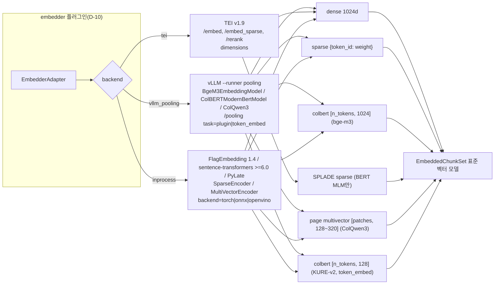
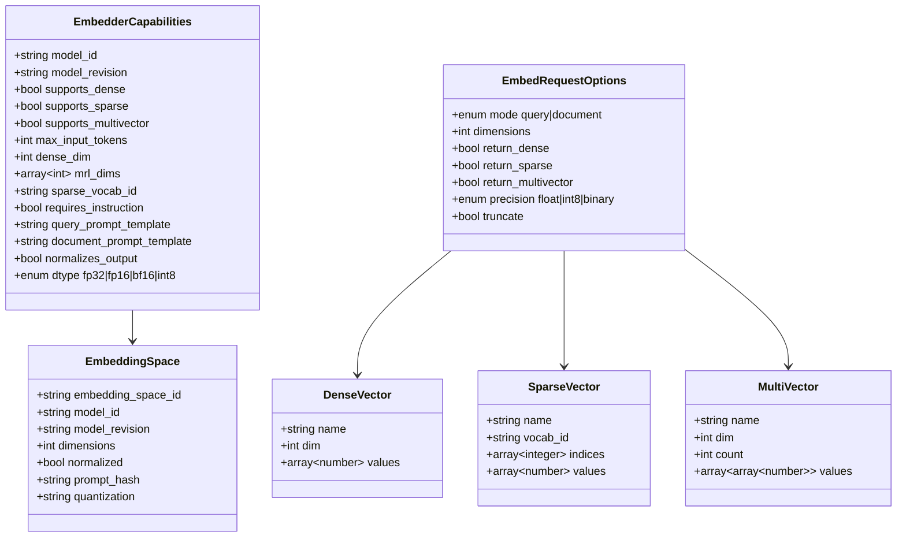
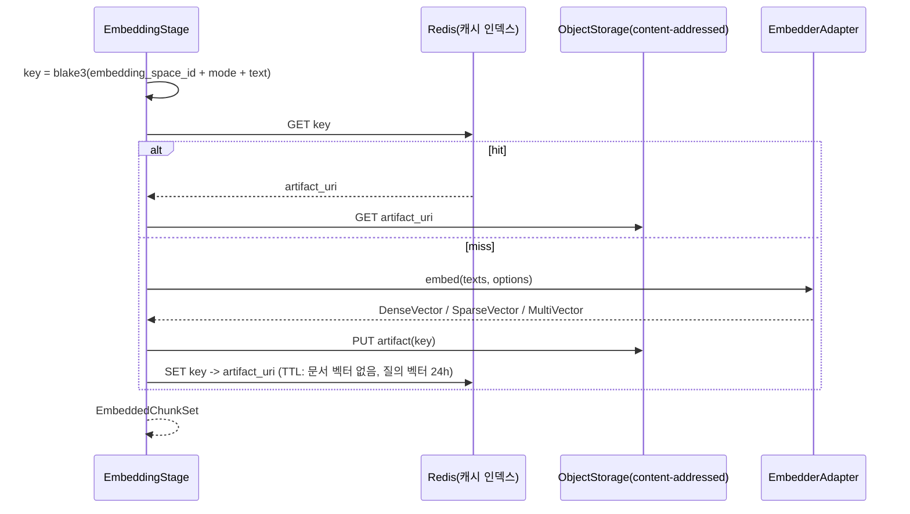

# 임베딩·스파스·멀티벡터 모델과 서빙

## 목적

브리프 D-16(기본 임베딩 BGE-M3, 서빙 TEI 또는 Infinity)과 개방 결정 O-02(sparse 표현), O-04(late interaction 위치)를 2026-09 시점의 공개 정보로 검증하고, `embedder` 확장 지점(D-10)이 수용해야 하는 모델·서빙 조합과 어댑터 계약의 함의를 정리한다. 모든 버전·라이선스·수치는 웹으로 확인했으며, 확인하지 못한 항목은 "확인 필요(as of 2026-09)"로 표기했다. 0.2.0은 검증 결과(sentence-transformers 버전 귀속, harrier 백본, PIXIE-Splade v1.5, colbert-xm, 프롬프트 매핑, Qdrant 멀티벡터 양자화, 출처 미확인 수치)를 반영한 개정판이다. 0.3.0은 2차 검증 결과를 반영한다: 한국어 학습 late interaction 모델(`nlpai-lab/KURE-v2`, `yjoonjang/colbert-ko-en-v2` 등)이 다수 공개되어 있어 O-04 권고의 전제("허용 라이선스 다국어 텍스트 ColBERT는 colbert-xm 1종")를 폐기하고 권고를 재기술했으며, 한국어 learned sparse(`yjoonjang/splade-ko-v1`, `inference-free-splade-ko-v1`), PIXIE-Rune-v1.5, ColQwen3 계열, vLLM의 ColBERT/ColQwen3 네이티브 지원, harrier-oss-v1-0.6b 한국어 수치(77.49), voyage-4-nano·Qwen3-VL-Embedding 카드 규약, Arctic 2.0 논문 수치 정정, TEI 이미지 태그, Qdrant TurboQuant, PIXIE-Splade 토크나이저 동일성(직접 해시 비교로 확인)을 반영했다.

## 범위

- 포함: 다국어·한국어 dense 임베딩 모델, learned sparse 모델, late interaction(ColBERT 계열, 페이지 이미지 ColPali 계열) 모델, 임베딩 서빙 스택(TEI, Infinity, vLLM, Ollama, sentence-transformers, ONNX Runtime/optimum, fastembed, Triton), Matryoshka 차원 축소, int8/binary 양자화, 콘텐츠 해시 캐싱, 모델 버전 고정과 재인덱싱 정책.
- 제외: 크로스인코더 리랭커 상세 비교(`../04-pipelines/16-reranking.md`), 벡터 인덱스 백엔드 비교(D-15, 별도 문서), 청킹 토크나이저 결정(O-09, 청킹 문서)은 접점만 다룬다.

## 평가 기준

| 기준 | 가중치 | 판단 근거 |
|------|--------|-----------|
| 한국어 지원 | 25 | 한국어 리트리벌 벤치마크(MTEB-ko 리더보드, KURE 벤치마크, MIRACL-ko, AutoRAG 한국어 벤치마크) 수치, 토크나이저 한국어 커버리지, 한국어 파인튠 존재 |
| 라이선스 적합성(D-02) | 20 | Apache/MIT/BSD = 5, Gemma·Qwen Research 등 조건부 = 3, CC-BY-NC·연구 전용 = 1(기본 배포 불가) |
| 성숙도/유지보수 | 10 | 최근 12개월 릴리스, 유지 주체(기업/학계/개인), 이슈 응답 |
| 품질/성능 | 15 | MMTEB(MTEB multilingual v2) 및 한국어 nDCG@10, 긴 문서(8k+) 처리, 3-in-1 출력 |
| 통합 난이도 | 10 | TEI/vLLM/sentence-transformers 지원, `trust_remote_code` 요구, 인스트럭션 프롬프트 필요 여부 |
| 커뮤니티/생태계 | 5 | 다운로드, 파생 모델 수, 서빙 스택 지원 폭 |
| 운영 비용 | 15 | 파라미터 수, fp16 VRAM, 토큰당 처리량, CPU 대체 가능성 |

점수는 1~5 척도 x 가중치, 만점 500, 백분율로 표기한다.

## 후보 목록

### Dense 임베딩

| 이름 | 최신 상태(확인일 2026-09-18) | 라이선스 | 성숙도 | 한국어 지원 | 핵심 강점 | 약점 |
|------|------|------|------|------|------|------|
| `BAAI/bge-m3` | 568M, 1024d, 8192 토큰, HF 월간 다운로드 3,820만 | MIT | 매우 높음 | MIRACL-ko all-mode nDCG@10 72.2, MTEB-ko 79.30 | dense+sparse+colbert 단일 패스, 서빙 지원 최광범위, 한국어 파인튠 다수 | dense 단독 품질은 2026년 0.5B급 선두 대비 1.5~3.5p 열세, MRL 미지원, MMTEB 59.56 |
| `nlpai-lab/KURE-v1` | bge-m3 파인튠(CachedGISTEmbedLoss, 2M 한국어 쌍), 1024d, 8192 | MIT | 중간(학계) | MTEB(kor,v2) nDCG@10 0.7616(bge-m3 0.7509, GitHub README 기준; HF 카드 표는 구 벤치마크 0.6947 vs 0.6872), MTEB-ko 80.76 | bge-m3와 동일 아키텍처·토크나이저로 드롭인 교체, 질의 프롬프트 없음 | dense 전용(sparse/colbert 헤드 없음), 도메인 편향 가능 |
| `dragonkue/snowflake-arctic-embed-l-v2.0-ko` | arctic-l-v2.0 한국어 추가 학습(CachedGISTEmbedLoss, 배치 20,000, 2 epoch, bf16), 1024d | Apache-2.0 | 낮음(개인) | MTEB-ko 82.14(2위); 카드 평균 nDCG@10 0.7404(기반 0.7241) | 오픈 모델 중 한국어 최상위, TEI 즉시 서빙 | 개인 유지, 재현 데이터 비공개, 질의 `"query: "` 프리픽스 필수, 카드가 약 1,300 토큰 초과 장문에서 성능 저하 명시 |
| `telepix/PIXIE-Rune-v1.5` (v1.0 병기) | `XLMRobertaModel` 0.5B(safetensors 567,754,752 파라미터로 `BAAI/bge-m3`와 동일: bge-m3/XLM-R-large 계열 파생으로 추정), 1024d, 6144 토큰, v1.5 2026-04-22(PIXIE-Splade-v1.5와 동일 날짜), v1.0 2026 초 | Apache-2.0 | 낮음(2026 신규, 기업) | 카드 MTEB(ko) nDCG@10 v1.5 0.7651 / v1.0 0.7603(bge-m3 0.7483), STELLA 0.6559 / 0.6345, RTEB(영어) 0.5546; OnAnd0n MTEB-ko 81.57(v1.0 등재, v1.5 등재 여부 확인 필요 as of 2026-09) | 한국어·영어 최적화, Apache, bge-m3와 동일 크기·차원이라 인덱스 크기 동일 | 신규, 커뮤니티 미형성, 6144 토큰, 질의에 `prompt_name="query"` 필수, 학습 데이터 미공개 |
| `telepix/PIXIE-Spell-Preview-0.6B` / `-1.7B` | Qwen3 decoder 기반 임베딩, 2025-08 | Apache-2.0 | 낮음(Preview, 기업) | MTEB-ko 0.7612 / 0.7882(카드 보고) | 같은 조직의 decoder 계열, 1.7B가 PIXIE-Rune보다 높은 수치 | Preview 상태, 0.6B/1.7B 비용, 프롬프트 규약 카드 확인 필요(as of 2026-09) |
| `Snowflake/snowflake-arctic-embed-l-v2.0` | 568M(XLM-R Large/BGE-M3-RetroMAE 기반), 1024d, 8192, MRL 256 | Apache-2.0 | 높음(기업) | MTEB-ko 80.00 | MRL·양자화 인지 학습, TEI 공식 지원 | 74개 언어, sparse 없음, 질의 `"query: "` 프리픽스 |
| `Snowflake/snowflake-arctic-embed-m-v2.0` | 305M(GTE 아키텍처), 768d, MRL 256, 8192 | Apache-2.0 | 높음(기업) | 한국어 개별 수치 미공개(확인 필요, as of 2026-09) | L 모델의 절반 비용, MRL, TEI 공식 지원 | `lite`/CPU 후보, 한국어 수치 없음 |
| `ibm-granite/granite-embedding-278m-multilingual` | 278M, 768d, 12개 언어(ko 포함) | Apache-2.0 | 높음(IBM) | 한국어 개별 수치 미공개(확인 필요, as of 2026-09) | 기업 유지, 경량 | 512 토큰(확인 필요), 한국어 리더보드 미등재 |
| `voyageai/voyage-4-nano` | Qwen3 계열 346M(`Qwen3ForCausalLM`), 기본 2048d, MRL 2048/1024/512/256, 32k 컨텍스트, QAT로 float32/int8/uint8/binary 출력, 2026-01-06 | Apache-2.0 | 낮음(신규, 기업) | 한국어 개별 수치 미공개 | Voyage AI 최초 오픈 가중치, TEI supported_models 등재(Qwen3 아키텍처), 양자화 인지 학습 | 신규, 기본 2048d는 bge-m3 대비 인덱스 2배(MRL 1024 절단 필요), 질의·문서 프롬프트 필수(카드 명시, 표준 매핑 참조) |
| `Qwen/Qwen3-Embedding-0.6B` | 0.6B, 1024d(MRL 32~1024), 32k 토큰, 2025-06 | Apache-2.0 | 높음(기업) | MTEB-ko 75.88, MMTEB 64.33 | 32k 컨텍스트, MRL, 인스트럭션 | 한국어 리트리벌은 bge-m3보다 낮음 |
| `Qwen/Qwen3-Embedding-4B` | 4B, 2560d(MRL 32~2560), 32k | Apache-2.0 | 높음 | MTEB-ko 81.37, MMTEB 69.45 | 다국어 품질 최상위권, MRL | fp16 약 8GB, 처리량 bge-m3 대비 약 1/7 |
| `Qwen/Qwen3-Embedding-8B` | 7.57B, 4096d(MRL 32~4096), 32k | Apache-2.0 | 높음 | MMTEB 70.58(2025-06 1위) | 오픈 가중치 최상위 | fp16 약 15GB, 인덱스 크기 4배 |
| `microsoft/harrier-oss-v1-0.6b` | Qwen3 기반 decoder(`Qwen3Model`, 596M), 1024d, 32k, 2026-03-30; 형제 모델 270m/27b는 Gemma 3 기반(`Gemma3TextModel`) | MIT(0.6b; 270m/27b는 HF 표기 MIT이나 Gemma 3 파생으로 Gemma Terms 승계 여부 법무 확인 필요) | 낮음(신규) | MTEB-ko 77.49(OnAnd0n 10위; bge-m3 79.30보다 1.8p 낮고 mE5-large-instruct 77.27 바로 위) | MTEB v2 multilingual 69.0(0.6B급 최고), TEI v1.9.4 지원 | 신규, MRL 미언급, 인스트럭션 필수, 한국어는 bge-m3 열세 |
| `perplexity-ai/pplx-embed-v1-0.6b` / `-4b` | Qwen3 계열, 1024d/2560d, 32k, MRL, int8 네이티브, 2026-02 | MIT | 낮음(신규) | 4B가 MTEB-ko 82.79(1위); 0.6B 미공개 | 인스트럭션 불필요, int8/binary 네이티브, TEI v1.9.2+ | 신규, 4B는 비용 높음 |
| `intfloat/multilingual-e5-large-instruct` | 560M, 1024d, 512 토큰 | MIT | 매우 높음 | MTEB-ko 77.27, MMTEB 63.22 | 안정적, 광범위 지원 | 512 토큰 한계, 인스트럭션 필요 |
| `nlpai-lab/KoE5` | multilingual-e5-large 한국어 파인튠, 512 토큰 | MIT | 중간 | OnAnd0n 리더보드 미등재; 카드 자체 보고 8개 한국어 검색셋 Recall@1 평균 0.5016(mE5-large 0.5005, bge-m3 0.5178) | 한국어 특화 | 512 토큰, 카드 자체 표에서도 KURE-v1에 밀림 |
| `google/embeddinggemma-300m` | 308M, 768d(MRL 128~768), 2048 토큰, 2025-09 | Gemma Terms | 높음 | MTEB-ko 78.19, MTEB multilingual v2 61.15 | 온디바이스·CPU 친화, QAT | Gemma 라이선스(조건부), 2048 토큰, fp16 활성화 미지원(bf16/fp32) |
| `nomic-ai/nomic-embed-text-v2-moe` | 475M(활성 305M) MoE, 768d(MRL 256), 512 토큰 | Apache-2.0 | 높음 | MIRACL 65.80(공식), 한국어 개별 수치 없음 | MoE로 저비용, TEI 지원 | 512 토큰, 프리픽스 필수 |
| `Alibaba-NLP/gte-multilingual-base` | 305M, 768d(elastic 128~768), 8192, sparse 출력 | Apache-2.0 | 높음 | AutoRAG 한국어 벤치마크 상위권(k=50 동률 1위) | 경량, dense+sparse | `trust_remote_code` 필요, 70+ 언어 |
| `BAAI/bge-multilingual-gemma2` | Gemma-2-9B 기반 | Gemma | 중간 | MIRACL SOTA 주장(수치 확인 필요) | 품질 | 9B 비용, Gemma 라이선스 |
| `jinaai/jina-embeddings-v3` / `v4` / `v5-text-small` | v3 570M; v4 3.8B(Qwen2.5-VL); v5 677M, MMTEB 67.7, 2026-02 | v3 CC-BY-NC-4.0, v4 Qwen Research License, v5 CC-BY-NC-4.0 | 높음 | v5 MTEB-ko 80.29 | late chunking, 멀티모달(v4) | 비상업 라이선스: 기본 배포 불가(D-02) |
| `tencent/KaLM-Embedding-Gemma3-12B-2511` | 11.76B, MMTEB 72.32(1위) | tencent-kalm-embedding-community(커스텀) | 중간 | 미확인 | 절대 품질 상한 | 12B 비용, 커스텀 라이선스 |
| `Qwen/Qwen3-VL-Embedding-2B` / `-8B` | 2.13B / 8.14B, 단일 벡터 멀티모달(텍스트·이미지·페이지), 기본 2048d(MRL 64~2048 사용자 지정), 기본 시스템 프롬프트 `Represent the user's input.`(커스터마이즈 가능), 동반 리랭커 `Qwen3-VL-Reranker-2B`, arXiv 2601.04720, 2026-01-07 | Apache-2.0 | 낮음(신규, 기업) | 한국어 개별 수치 미공개; MMEB-V2 73.2, MMTEB 63.87(카드) | 페이지 이미지를 단일 벡터로 인덱싱(ColQwen 멀티벡터 대비 저장량 소) | 신규, 한국어 VDR 평가 없음, 2B도 fp16 약 4.3GB, 기본 2048d |
| `kakaocorp/kanana-nano-2.1b-embedding` | 2.1B, ko/en, 2025-02 | CC-BY-NC-4.0 | 중간(기업) | 한국어 특화 | 국내 기업 유지 | 비상업 라이선스: 기본 배포 불가(D-02), 표에 제외 사유로만 기재 |
| `nvidia/llama-embed-nemotron-8b` | 7.5B, 2025-10 | NVIDIA 커스텀(customized-nscl-v1) | 중간(기업) | 미확인 | 다국어 품질 상위권 | 커스텀 라이선스 + 8B 비용: 제외 |

### Learned sparse

| 이름 | 최신 상태 | 라이선스 | 성숙도 | 한국어 지원 | 핵심 강점 | 약점 |
|------|------|------|------|------|------|------|
| BGE-M3 sparse(lexical weights) | dense와 동일 패스, 어휘 250k(XLM-R) | MIT | 매우 높음 | MIRACL-ko sparse 단독 61.5(BM25 37.1) | 추가 비용 0, MLDR 긴 문서에서 dense(52.5)보다 sparse(62.2) 우수 | 단독 품질은 dense보다 낮음, TEI/Infinity 미지원 |
| `telepix/PIXIE-Splade-v1.5` | ModernBertForMaskedLM + SPLADE 풀링(max, ReLU), safetensors 149,372,240 파라미터(카드 표기 0.1B), 출력 차원 50,000, 5,632 토큰, ko/en, 2026-04-22. 백본은 `skt/A.X-Encoder-base`(Apache-2.0, ModernBERT, 16,384 토큰)와 토크나이저 어휘가 동일(2026-09-22 `tokenizer.json` 직접 비교: WordPiece 어휘·정규화·전처리 해시 일치, 절단 길이만 상이) | Apache-2.0 | 낮음(신규, 기업) | MTEB(ko) nDCG@10 0.7671; OnAnd0n sparse 리더보드 78.19(1위) | 한국어 최상위 learned sparse, `SparseEncoder.encode_query/encode_document` 직접 지원, 루씬 인버티드 인덱스 호환 | 신규, 5,632 토큰(splade-ko-v1의 8192보다 짧음), STELLA-ko 0.4821로 도메인 편차 큼 |
| `yjoonjang/splade-ko-v1` | `skt/A.X-Encoder-base` 기반 ModernBertForMaskedLM 149M, 출력 50,000차원, 최대 8192 토큰, 2025-10-04 | Apache-2.0 | 낮음(개인) | OnAnd0n sparse 리더보드 77.00(2위); 카드 7셋 평균 nDCG@10 0.7376(bge-m3 dense 0.7339, OpenSearch multilingual 0.5383) | 8192 토큰(PIXIE-Splade-v1.5 대비 장문 유리), PIXIE-Splade와 어휘 동일(직접 확인)로 vocab_id 공유 가능, 학습 손실 공개(SpladeLoss + FlopsLoss) | 개인 유지, MIRACL 하드네거티브 54.57로 PIXIE-v1.5(48.66)보다 높으나 LawIR 63.62로 낮음 |
| `yjoonjang/inference-free-splade-ko-v1` | 비대칭 SPLADE: 질의 측 `SparseStaticEmbedding`(inference-free, 50,000차원), 문서 측 A.X-Encoder-base MLM + SPLADE 풀링, 8192 토큰, 2025-11 | 라이선스 태그 미기재(확인 필요, as of 2026-09) | 낮음(개인) | OnAnd0n sparse 리더보드 76.75(3위); 카드 7셋 평균 nDCG@10 0.7206(splade-ko-v1 0.7376) | OpenSearch neural sparse 경로(질의 inference-free)에서 한국어 품질이 opensearch multilingual-v1(0.5383)보다 훨씬 높음 | 라이선스 미기재로 D-02 채점 불가, PublicHealthQA 49.38로 데이터셋 편차 큼 |
| `telepix/PIXIE-Splade-Preview` | 동일 계열 최초 공개, A.X-Encoder-base 기반, 3072 토큰, 2025-08 | Apache-2.0 | 낮음 | OnAnd0n sparse 74.79(4위) | v1.0/v1.5의 계보 확인용 | v1.5에 열세: 채택 대상 아님 |
| `telepix/PIXIE-Splade-v1.0` | 동일 계열 전 버전, 0.1B, 어휘 50k(v1.5와 동일), 5,632 토큰, 2026 초 | Apache-2.0 | 낮음 | MTEB(ko) 0.7025(BM25 0.6589, OpenSearch multilingual 0.5358); 리더보드 70.4(5위) | v1.5의 회귀 비교 기준 | v1.5에 전 벤치마크 열세: 신규 채택 대상 아님 |
| `opensearch-project/opensearch-neural-sparse-encoding-multilingual-v1` | 160M, 105,879차원, 15개 언어(ko 포함) | Apache-2.0 | 높음(OpenSearch 프로젝트) | MIRACL-ko 0.607(BM25 0.371); splade-ko-v1 카드 인용 7셋 평균 0.5383 | 질의 측 inference-free(토크나이저 + IDF 룩업), OpenSearch neural sparse 네이티브, 기업 유지 | 한국어 절대 품질은 PIXIE-Splade·splade-ko 계열보다 크게 낮음 |
| `naver/splade-v3` 계열 | BERT(영어) | CC BY-NC-SA 4.0 | 높음 | 없음(영어) | SPLADE 참조 구현 | 비상업 + 영어 전용: 제외 |
| Qdrant BM25 / BM42 (fastembed) | 통계 기반 sparse | Apache-2.0 | 높음 | 토크나이저 의존(한국어 형태소 미적용) | 모델 불필요, 경량 프로파일 | learned sparse 아님, 한국어 형태소 분석 없음 |

### Late interaction / 멀티벡터

| 이름 | 최신 상태 | 라이선스 | 성숙도 | 한국어 지원 | 핵심 강점 | 약점 |
|------|------|------|------|------|------|------|
| `nlpai-lab/KURE-v2` | `skt/A.X-Encoder-base`(ModernBERT) 기반 한·영 이중언어 ColBERT, 149~154M, 토큰당 128d, 문서 8192 토큰, 2026-08-17 | Apache-2.0 | 낮음(학계, 신규) | 카드 MTEB(kor,v2) 9태스크 nDCG@10 0.8160(KURE-v1 0.7616, bge-m3 dense 0.7509, Qwen3-Embedding-8B 0.7826, mLateOn 0.7906, pplx-embed-v1-late-0.6b 0.7381, colbert-ko-en-v2 0.8063) | 한국어 학습 late interaction 1차 후보; 1-bit 양자화 + 토큰 풀링으로 9코퍼스 인덱스 1.7GB(단일벡터 HNSW 13.1~50GB 대비, 카드 주장); PyLate·`MultiVectorEncoder` 로드; ModernBERT 백본이라 vLLM `ColBERTModernBertModel` 경로 서빙 가능(확인 필요, as of 2026-09) | 신규(1개월), 카드 수치는 자체 보고, 인덱스 압축 수치는 PyLate 설정 의존 |
| `yjoonjang/colbert-ko-en-v2` | A.X-Encoder-base 기반 149M, 128d, 문서 8192 / 질의 64 토큰, 2026-08-07 | Apache-2.0 | 낮음(개인) | MTEB(kor,v2) 0.8063(카드) | KURE-v2와 동일 백본·차원의 독립 학습 대안, PyLate | 개인 유지, 다운로드 적음 |
| `yjoonjang/colbert-ko-v1.0` / `dragonkue/colbert-ko-0.1b` | 한국어 전용 학습 ColBERT, 2025-09-27 / 2026-01-25 | Apache-2.0 | 낮음(개인) | colbert-ko-v1.0 카드 5셋 평균 nDCG@10 0.7172 | 한국어 학습 계열의 이전 세대 | v2·KURE-v2에 열세: 계보 확인용 |
| `perplexity-ai/pplx-embed-v1-late-0.6b` | `PPLXQwen3Model` 596M late-interaction, 128d/토큰, 2026-03-13 | MIT | 낮음(신규, 기업) | KURE-v2 카드 표에서 MTEB(kor,v2) 0.7381; 카드 BEIR 56.61, MIRACL(18개 언어) 66.62 | 기업 유지 다국어 ColBERT, PyLate·`MultiVectorEncoder`·maxsim 커널 | 한국어는 KURE-v2 대비 -7.8p, 0.6B로 149M 계열의 4배 연산 |
| `lightonai/mLateOn` | `jhu-clsp/mmBERT-base` 기반 307M 다국어 ColBERT, 128d, 8192 토큰, 2026-06-22(arXiv 2607.27178) | Apache-2.0 | 낮음(신규, 기업) | 카드 지원 언어에 한국어 없음; KURE-v2 카드 표에서 MTEB(kor,v2) 0.7906 | 기업(LightOn) 유지, PyLate 기본 지원 | 한국어 비대상 학습, KURE-v2 대비 -2.5p |
| BGE-M3 colbert 벡터 | 토큰당 1024d, dense와 동일 패스 | MIT | 높음 | MIRACL-ko multi-vec 71.2 | 추가 모델 불필요 | 토큰당 1024d로 저장량 매우 큼(128d 모델의 8배); 128d 한국어 모델이 공개된 이후 인덱스 단계 용도로는 열세 |
| `antoinelouis/colbert-xm` | `facebook/xmod-base` 기반 모듈형 다국어 ColBERT(81개 언어 어댑터, 약 0.85~0.9B 총 파라미터), 토큰당 128d, 질의 32/문서 256 토큰, MS MARCO 6.4M 트리플(영어) 학습 | MIT | 낮음(개인) | Mr.TyDi-ko 제로샷 MRR@100 41.3 / R@100 77.6(10개 언어 평균 49.0 / 87.5); 한국어 학습 없음 | `MultiVectorEncoder`·PyLate·colbert-ai 로드 가능 | 영어 학습의 제로샷 전이라 한국어 품질 미검증, 문서 256 토큰 상한, XMOD 백본은 vLLM 미지원: 한국어 학습 모델 공개로 후순위 |
| `colbert-ir/colbertv2.0` | BERT-base 110M, 128d | MIT | 높음 | 없음(영어) | PLAID 참조, vLLM `HF_ColBERT` | 영어 전용 |
| `jinaai/jina-colbert-v2` | 0.6B, 128/96/64d(MRL), 94개 언어, 8192 | CC-BY-NC-4.0 | 높음 | MIRACL 평균 0.627 | 다국어 ColBERT, vLLM `ColBERTJinaRobertaModel` | 비상업: 제외 |
| `lightonai/GTE-ModernColBERT-v1` | ModernBERT, 128d | Apache-2.0 | 중간 | 없음(영어) | PyLate 기본 모델, vLLM `ColBERTModernBertModel` | 영어 전용 |
| `vidore/colqwen2-v1.0` | Qwen2-VL-2B, 128d/패치, 페이지 이미지, 2024 | 백본 Apache-2.0 + 어댑터 MIT | 높음 | 한국어 공공문서 VDR 벤치마크 존재(SDS KoPub VDR, arXiv 2511.04910) | 스캔·시각 문서 페이지 검색, OCR 불필요, 생태계 성숙 | 페이지당 최대 768 패치 x 128d 저장; vLLM 미등재(Qwen2-VL 백본); ColQwen3 세대에 품질 열세 |
| `VAGOsolutions/SauerkrautLM-ColQwen3-2b-v0.1` | Qwen3-VL-2B 기반 2.1~2.2B(ColQwen2와 동급), 128d/패치, 2025-12-11 | Apache-2.0 | 낮음(기업) | 한국어 수치 없음; ViDoRe v1 nDCG@5 90.24(ColQwen2 +1.01), v3 54.32 | 동급 크기에서 ColQwen2 대체, sentence-transformers>=6.0 로드 | 커뮤니티 모델(v0.1), vLLM 등재 여부 확인 필요(as of 2026-09) |
| `OpenSearch-AI/Ops-Colqwen3-4B` / `-8B` | Qwen3-VL-4B-Instruct 기반, 128~2560d 선택, 30개 이상 언어, 2026-01-23 | Apache-2.0 | 낮음(기업) | 한국어 수치 없음; ViDoRe v3 nDCG@10 61.32(1280d) / 60.23(128d) | vLLM `OpsColQwen3Model` 네이티브 서빙, 다국어 | 4B fp16 약 8GB, `trust_remote_code` |
| `TomoroAI/tomoro-colqwen3-embed-4b` / `-8b` | Qwen3-VL-4B-Instruct + Qwen3-Embedding-4B 병합, 320d/토큰, 2025-11-25 | Apache-2.0 | 낮음(기업) | ViDoRe v3 multilingual nDCG@5 0.5708 | vLLM `ColQwen3` 네이티브 서빙 | 320d로 128d 모델 대비 저장량 2.5배, 4B 비용 |
| `vidore/colqwen2.5-v0.2` | Qwen2.5-VL-3B | 백본 Qwen Research License + 어댑터 MIT | 높음 | 동일 | 품질 개선 | 백본 라이선스 비상업: 제외 |
| `vidore/colpali-v1.3` | PaliGemma-3B, 약 1,030 패치/페이지, 128d | 백본 Gemma + 어댑터 MIT | 높음 | 동일 | 원조 구현 | Gemma 라이선스(조건부) |
| `Qwen/Qwen3-VL-Embedding-2B` (단일 벡터 대안) | 페이지 이미지를 단일 벡터로 임베딩, 2.13B, 2048d(MRL 64~2048), 2026-01-07 | Apache-2.0 | 낮음(신규) | 한국어 VDR 수치 없음 | ColQwen 멀티벡터 대비 저장량 1/수백, 기존 dense 인덱스 경로 재사용 | late interaction 아님(정밀도 열세 가능), `Qwen3-VL-Reranker-2B`와 세트 평가 필요 |

### 서빙 스택

| 이름 | 최신 상태 | 라이선스 | 지원 아키텍처/기능 | 강점 | 약점 |
|------|------|------|------|------|------|
| Text Embeddings Inference(TEI) | v1.9.4(2026-09-15, harrier-oss-v1 지원 추가); v1.9.3(2026-03-23); v1.9.2(2026-02-25, pplx-embed-v1 지원). Docker `ghcr.io/huggingface/text-embeddings-inference:<tag>-1.9`, 태그: `cpu`, `cpu-arm64`, Ampere 8.0(A100/A30)은 접미사 없는 `1.9`, `86`(A10/A40), `89`(L4/RTX 40), `hopper`(H100), 그리고 experimental 표기인 `turing`(T4), `100`(B200), `120`(RTX Pro Blackwell), `121`(DGX Spark GB10) | Apache-2.0(2024-04-08부터, 되돌리지 않음 명시) | BERT, CamemBERT, XLM-RoBERTa, JinaBERT, NomicBERT(MoE 포함), Mistral, GTE, Qwen2, Qwen3, MPNet, ModernBERT, Gemma3, DebertaV2, harrier-oss-v1, pplx-embed; 엔드포인트 `/embed`, `/embed_all`, `/embed_sparse`, `/rerank`, `/predict`, `/similarity`, `/tokenize`, `/v1/embeddings`; `dimensions`(MRL) 파라미터; Flash Attention, cuBLASLt, 동적 배칭 | 러스트/Candle 고성능, 가장 넓은 GPU 매트릭스, 프로메테우스 메트릭 | `/embed_sparse`는 BERT/DistilBERT MaskedLM SPLADE 풀링 전용: BGE-M3 sparse 미지원; `/embed_all`은 풀링 전 토큰 벡터라 BGE-M3 colbert 선형층 미적용; CUDA CC < 7.5 미지원 |
| Infinity(`infinity-emb`) | 최종 릴리스 0.0.77(2025-08-22, PyPI), 최종 커밋 2026-03-24(직전 2026-02-05) | MIT | torch/optimum(ONNX)/CTranslate2, 임베딩·리랭크·CLIP·CLAP·ColBERT·ColPali·텍스트 분류, OpenAI 호환 API | 광범위한 모델 유형 | 유지보수 정지 위험, BGE-M3 sparse 미지원(README 테스트 모델 목록에 "BAAI/bge-m3, no sparse" 명시; issue #340은 Closed이나 종결 사유 미확인) |
| vLLM(pooling runner) | v0.29.0(2026-09-09); 직전 v0.28.0(2026-08-26) | Apache-2.0 | `--runner pooling`, `BgeM3EmbeddingModel`로 `embed`/`token_classify`(sparse)/`token_embed`(colbert), `bge_m3_sparse_plugin` IO 프로세서로 dense&sparse 단일 응답; Qwen3-Embedding/Reranker; 텍스트 ColBERT 네이티브(`token_embed` 태스크: `HF_ColBERT`(BERT: colbertv2.0, answerai-colbert-small-v1), `ColBERTModernBertModel`(ModernBERT: GTE-ModernColBERT-v1 등), `ColBERTJinaRobertaModel`(jina-colbert-v2), `ColBERTLfm2Model`(LFM2-ColBERT-350M)); 멀티모달 late interaction(`ColQwen3`: tomoro-colqwen3-embed-4b/8b, `OpsColQwen3Model`: Ops-Colqwen3-4B/8B, `Qwen3VLNemotronEmbedModel`, `ColQwen3_5`); `/v1/embeddings`, `/pooling`, `/score`, `/rerank` | BGE-M3 3-in-1을 서버로 제공하는 유일한 검증 경로, ModernBERT 기반 한국어 ColBERT(KURE-v2, colbert-ko 계열)와 ColQwen3 계열을 같은 스택으로 서빙, LLM 서빙과 동일 운영 스택 | 소형 인코더에는 무거움, 메모리 사전 할당, 버전 변동 잦음; XMOD(colbert-xm)·Qwen2-VL(ColQwen2)은 지원 목록에 없음 |
| sentence-transformers | 최신 v6.1.0(2026-09-18, 문서·입력 처리 개선); v6.0.1(2026-08-31, PyLate 프리픽스 복원). 이력: v3.2.0(2024-10-10) dense `SentenceTransformer` ONNX/OpenVINO 백엔드(CPU 약 2.5배, GPU fp16 약 2배) + `StaticEmbedding`(model2vec); v5.0(2025-07) `SparseEncoder`, `encode_query`/`encode_document`, Router; v5.1.0(2025-08-06) `SparseEncoder` ONNX/OpenVINO 백엔드(CPU 약 3배, GPU bf16 1.81배); v6.0.0(2026-08-18) `MultiVectorEncoder`(ColBERT·ColPali·ColQwen; colqwen2 카드는 `sentence-transformers[image]>=6.0.0` 요구) | Apache-2.0 | 모든 HF 인코더, SPLADE/inference-free/OpenSearch sparse, ColBERT·ColPali 멀티벡터, 크로스인코더 | 인프로세스 표준, 어댑터 작성 최단 경로, 4개 모델 유형을 단일 API로 | 서버가 아님(배칭·큐 자체 구현 필요); `MultiVectorEncoder`는 v6.0 미만에서 부재 |
| model2vec / `StaticEmbedding` | sentence-transformers v3.2+ 통합, 정적 토큰 임베딩(50~500배 고속, 카드 주장) | MIT | 다국어 정적 모델(`minishlab/potion-*`), CPU 전용 | 초경량 1차 필터·근사 중복 제거 보조 채널 | 문맥 의존 표현 부재로 1차 리트리버 부적합 |
| FlagEmbedding | 1.4.2(2026-08-24, PyPI) | MIT | `BGEM3FlagModel.encode(return_dense, return_sparse, return_colbert_vecs)` | BGE-M3 참조 구현(sparse/colbert 정답 기준) | 서버 아님, 의존성 무거움 |
| Ollama | `/api/embed`(`model`, `input`, `truncate`, `dimensions`, `keep_alive`), 라이브러리 `bge-m3`(567M, 1.2GB), `embeddinggemma`, `qwen3-embedding` | MIT | GGUF dense 임베딩 | 개발자 로컬 환경 최단 경로 | dense 전용(BGE-M3 sparse/colbert 없음), 양자화 손실 미공개 |
| fastembed | 0.x, ONNX Runtime CPU/GPU | Apache-2.0 | dense 25종(다국어는 `intfloat/multilingual-e5-large`(2.24GB) 등에 한정; arctic 계열은 영어 전용 v1 `snowflake-arctic-embed-{xs,s,m,m-long,l}`만 등재, 다국어 `arctic-embed-m-v2.0`·`BAAI/bge-m3` 미등재), sparse(Splade_PP_en_v1, BM25, BM42), late interaction(colbertv2.0, jina-colbert-v2, answerai-colbert-small), 이미지(CLIP) | 의존성 최소, Qdrant 통합 | bge-m3·arctic-m-v2.0은 커스텀 모델 등록(`add_custom_model`) 없이는 불가, 모델 목록 제한 |
| ONNX Runtime / optimum | sentence-transformers `backend="onnx"`, `export_optimized_onnx_model`, `export_dynamic_quantized_onnx_model`(int8) | MIT / Apache-2.0 | CPU 추론 가속, int8 동적 양자화 | GPU 없는 경량 프로파일 | 8192 토큰 XLM-R ONNX 변환 메모리 부담 |
| OpenVINO Model Server(OVMS) | 2025.x~2026.x(버전 확인 필요, as of 2026-09) | Apache-2.0 | OpenAI 호환 `/v1/embeddings`, Cohere 호환 `/v1/rerank`, Intel CPU/iGPU/NPU 최적화 | GPU 없는 `lite` 프로파일의 서버형 대안(인프로세스 ONNX 대신) | Intel 하드웨어 편중, 모델 변환(IR) 단계 필요 |
| SGLang(임베딩 모드) | `--is-embedding`; Qwen3-Embedding, gte-Qwen2, e5-mistral, CLIP, Qwen3-VL-Embedding 계열(공식 문서 URL 이동으로 지원 목록 확인 필요, as of 2026-09) | Apache-2.0 | decoder 기반 임베딩·멀티모달 임베딩, OpenAI 호환 API | LLM 서빙 스택을 SGLang으로 통일한 환경의 vLLM 대안 | BGE-M3 3-in-1 미지원, 소형 인코더에 과함 |
| Triton Inference Server | 25.x~26.x(확인 필요, as of 2026-09) | BSD-3 | ONNX/TensorRT/Python 백엔드, 동적 배칭, 멀티모델 | 엔터프라이즈 표준, 다중 모델 동시 서빙 | 모델 리포지토리 구성 부담, 임베딩 특화 기능 없음 |

## 심층 비교

### BGE-M3 (dense + sparse + colbert)

- 동작 방식: XLM-RoBERTa-large를 RetroMAE로 8192 토큰까지 확장한 568M 인코더. `[CLS]` 벡터가 dense(1024d), 토큰 은닉 상태에 선형+ReLU를 적용한 스칼라가 sparse(lexical weight, 동일 토큰은 max 집계), 토큰 은닉 상태에 `colbert_linear`를 적용한 것이 멀티벡터.
- 진입점: `FlagEmbedding.BGEM3FlagModel('BAAI/bge-m3', use_fp16=True).encode(texts, return_dense=True, return_sparse=True, return_colbert_vecs=True)`; vLLM `vllm serve BAAI/bge-m3 --runner pooling --hf-overrides '{"architectures":["BgeM3EmbeddingModel"]}' --pooler-config.task embed|token_classify|token_embed` 또는 `--io-processor-plugin bge_m3_sparse_plugin`(`embed_task: "dense&sparse"`); TEI/Infinity/Ollama는 dense만.
- 출력 형식: dense `float32[1024]`(정규화), sparse `dict[token_id:int -> weight:float]`, colbert `float32[n_tokens, 1024]`. 모델 카드 권고 융합 가중치 `[dense 0.4, sparse 0.2, colbert 0.4]`.
- 벤치마크(논문 arXiv 2402.03216, MIRACL nDCG@10): 평균 dense 67.8 / sparse 53.9 / multi-vec 69.0 / dense+sparse 68.9 / all 70.0 (mE5-large 65.4, E5-mistral-7b 62.2, OpenAI-3 54.9). 한국어(ko): BM25 37.1, mE5-large 66.5, dense 69.9, sparse 61.5, multi-vec 71.2, dense+sparse 71.3, all 72.2. MLDR(긴 문서) 평균: dense 52.5, sparse 62.2, multi-vec 57.6, all 65.0. MTEB-ko 리더보드(OnAnd0n) 79.30, KURE 벤치마크 nDCG@10 0.7509. MMTEB 59.56(codesota 스냅샷 2026-05-17, 2차 출처).
- 함정: (1) MRL 미학습이라 차원 절단 시 손실 미보증. (2) sparse 어휘가 XLM-R 250k 토큰 id이므로 다른 모델의 sparse와 혼합 불가. (3) 8192 토큰 배치는 활성화 메모리가 급증하므로 TEI `--max-batch-tokens`(기본 16384)와 vLLM `max_num_batched_tokens`를 청크 크기에 맞춰 조정. (4) 벤더 서빙(Azure AI Foundry 등)도 dense만 노출하는 사례가 있어 sparse 경로는 자체 검증 필수. (5) 한국어 파인튠(KURE-v1, dragonkue/BGE-m3-ko(Apache-2.0), upskyy/bge-m3-korean(라이선스 확인 필요))은 dense 헤드만 재학습되어 sparse/colbert 헤드 품질은 보증되지 않음.

### 한국어 특화 dense: KURE-v1, arctic-l-v2.0-ko, PIXIE-Rune-v1.5

| 항목 | KURE-v1 | dragonkue/snowflake-arctic-embed-l-v2.0-ko | telepix/PIXIE-Rune-v1.5 (v1.0 병기) |
|------|---------|--------------------------------------------|-------------------------|
| 기반 | BAAI/bge-m3 | Snowflake/snowflake-arctic-embed-l-v2.0 | `XLMRobertaModel` 0.5B; safetensors 파라미터 수 567,754,752가 bge-m3와 동일하여 bge-m3/XLM-R-large(8192) 계열 파생으로 추정(카드 미명시) |
| 학습 | CachedGISTEmbedLoss, 배치 4096, 약 2M 한국어 쌍 x 하드 네거티브 5 | CachedGISTEmbedLoss, 디바이스당 배치 20,000(클러스터링 기반 배치 구성), 2 epoch, bf16 | 미공개(모델 카드 확인 필요) |
| MTEB-ko 리더보드(nDCG@5,10 평균) | 80.76 | 82.14 | 81.57(v1.0 등재; v1.5 등재 여부 확인 필요, as of 2026-09) |
| 자체 보고 수치 | GitHub README 기준 MTEB(kor,v2) 9개 태스크 nDCG@10 0.7616(bge-m3 0.7509), Recall@10 0.8629; HF 카드 표는 구 벤치마크로 nDCG@10 0.6947 vs bge-m3 0.6872, Recall@10 0.7968 vs 0.7920 | 카드 평균 nDCG@10 0.7404(기반 arctic-l-v2.0 0.7241, 약 +2.2%); XPQARetrieval 0.4436 vs 0.4302 | v1.5: MTEB(ko) 0.7651, STELLA(항공우주) 0.6559, RTEB(영어) 0.5546(bge-m3 0.7483 / - / 0.5104); v1.0: MTEB(ko) 0.7603, STELLA 0.6345, BEIR 0.5872 |
| 질의 프롬프트 | 없음 | `"query: "` 프리픽스(질의만, 카드 명시) | `encode(queries, prompt_name="query")`(카드 명시; 실제 문자열은 `config_sentence_transformers.json` 확인) |
| 라이선스 | MIT | Apache-2.0 | Apache-2.0 |
| 서빙 | bge-m3와 동일(TEI XLM-R dense, vLLM) | TEI XLM-R | TEI XLM-R(`XLMRobertaModel` + CLS 풀링이므로 bge-m3와 동일 경로로 예상, 실측 확인 필요 as of 2026-09) |
| 유지 주체 | 고려대 NLP&AI 연구실 | 개인 | TelePIX(기업) |
| 함정 | dense 전용 | 개인 저장소 소실 위험, 학습 데이터 비공개, 카드가 약 1,300 토큰(약 2,500자) 초과 장문에서 성능 저하를 명시(장문은 KURE-v1·gte-multilingual-base 권고) | 6144 토큰, 신규, 프롬프트 누락 시 품질 저하 |

세 모델 모두 bge-m3 dense 대비 한국어 nDCG에서 +1.5~+2.8p 우위이나, 모두 dense 전용이므로 sparse는 별도 모델이 필요하다. AutoRAG 한국어 임베딩 벤치마크(Marker-Inc-Korea, 16개 모델, F1/Recall/Precision/mAP/mRR/nDCG@{1,3,5,10,50}; 데이터 도메인은 README에 명시되지 않음)에서는 bge-m3가 k=5에서 KU-HIAI-ONTHEIT-large-v1.1과 공동 1위, k=10 단독 1위, k=50에서 Upstage·gte-multilingual-base와 공동 1위였다. 즉 리더보드(OnAnd0n)에서 bge-m3를 앞서는 한국어 파인튠 모델이 다른 평가셋에서는 역전되므로, 리더보드 수치는 후보 선별에만 쓰고 채택은 내부 골든셋(원칙 7)으로 결정한다.

### Qwen3-Embedding 0.6B / 4B / 8B

- 동작 방식: Qwen3 decoder에 last-token 풀링, 인스트럭션 프롬프트(`Instruct: {task}\nQuery: {query}`)로 질의 측 조건화, MRL(0.6B 32~1024, 4B 32~2560, 8B 32~4096), 32k 컨텍스트, 100+ 언어. 인스트럭션이 성능을 1~5% 개선한다고 모델 카드가 명시.
- 진입점: `SentenceTransformer("Qwen/Qwen3-Embedding-0.6B").encode(q, prompt_name="query")`; vLLM `vllm serve Qwen/Qwen3-Embedding-0.6B --runner pooling`; TEI Qwen3 아키텍처 지원(supported_models 표에 0.6B/4B/8B 등재).
- 벤치마크(모델 카드): MMTEB mean(task) 0.6B 64.33 / 4B 69.45 / 8B 70.58; MTEB English v2 70.70 / 74.60 / 75.22; C-MTEB 66.33 / 72.27 / 73.84. MTEB-ko 리더보드 0.6B 75.88, 4B 81.37. PIXIE-Rune 카드 인용 MTEB(ko) 0.6B 0.7017.
- 함정: 0.6B는 한국어 리트리벌에서 bge-m3보다 낮다. 4B 이상은 품질 최상위이지만 fp16 가중치 약 8GB(4B)/15GB(8B, 계산값)로 수집 처리량이 568M급 대비 약 1/7~1/13이다. 인덱스 시점과 질의 시점의 인스트럭션 문자열이 다르면 품질이 급락하므로 프로파일에 문자열을 고정해야 한다.

### 2026 신규: Harrier-OSS-v1, pplx-embed-v1

| 항목 | microsoft/harrier-oss-v1 (270m / 0.6b / 27b) | perplexity-ai/pplx-embed-v1 (0.6b / 4b) |
|------|------|------|
| 공개 | 2026-03-30; HF 표기 MIT. 단, 270m/27b는 Gemma 3 파생이므로 Gemma Terms 승계 여부 법무 확인 필요(0.6b만 Qwen3 백본으로 MIT 5점 적용) | 2026-02(arXiv 2602.11151), MIT |
| 구조 | decoder-only, last-token 풀링, L2 정규화. 270m: Gemma 3 기반(`Gemma3TextModel`, 268.1M); 0.6b: Qwen3 기반(`Qwen3Model`, 596M); 27b: Gemma 3 기반(`Gemma3TextModel`, 27.0B). 차원 640/5376은 Gemma 3 270M/27B hidden size와 일치 | Qwen3 기반 확산 지속 사전학습, mean 풀링 |
| 차원 / 컨텍스트 | 640 / 1024 / 5376, 32,768 토큰 | 1024 / 2560, 32k, MRL |
| 인스트럭션 | 질의에 한 문장 태스크 설명 필수 | 불필요(모델 카드 명시) |
| 품질 | MTEB v2 multilingual 66.5 / 69.0 / 74.3 | 4B가 MTEB-ko 82.79(1위); MMTEB 미확인 |
| 특이점 | 0.6B로 MMTEB에서 Qwen3-4B(69.45)에 근접하나 한국어 리트리벌은 mE5-large-instruct(77.27) 수준 | int8 비정규화 임베딩 네이티브 출력(코사인 비교 필수) |
| 서빙 | sentence-transformers, TEI v1.9.4+ | sentence-transformers, ONNX, TEI v1.9.2+ |
| 한국어 | 0.6b: OnAnd0n MTEB-ko 77.49(10위, bge-m3 79.30 대비 -1.8p) | 4b 82.79(1위); 0.6b 미공개; late-interaction 형제 `pplx-embed-v1-late-0.6b`(MIT)는 KURE-v2 카드 표에서 MTEB(kor,v2) 0.7381 |
| 함정 | 한국어는 bge-m3 열세, 출시 6개월 미만 | 0.6B 한국어 수치 미공개, 출시 7개월 |

두 계열은 라이선스(MIT)와 MMTEB 기준 품질 대비 크기에서 경쟁력이 있으나, 한국어 리트리벌에서는 harrier-oss-v1-0.6b가 bge-m3에 1.8p 열세(77.49 vs 79.30)이고 pplx-embed-v1-0.6b는 수치가 없어 bge-m3의 기본값 지위를 위협하지는 않는다. 한국어 골든셋 평가와 12개월 유지보수 관찰 전에는 "감시 목록"으로 둔다. harrier는 D-02 채점 일관성(colpali-v1.3을 "백본 Gemma + 어댑터 MIT"로 조건부 처리한 것과 동일 기준)에 따라 0.6b만 감시 목록에 올리고, 270m/27b는 라이선스 확인 전까지 조건부(3점)로 취급한다. 같은 0.6B급으로 `voyageai/voyage-4-nano`(Apache-2.0, Qwen3 계열 346M, 기본 2048d·MRL 2048/1024/512/256, 32k, QAT int8/binary, 2026-01-06, TEI Qwen3 아키텍처로 서빙 가능; 질의 프롬프트 `Represent the query for retrieving supporting documents: `, 문서 프롬프트 `Represent the document for retrieval: `)도 감시 목록에 추가한다(한국어 수치 미공개).

### 기타 다국어 dense: e5, arctic, nomic, gte, EmbeddingGemma

| 항목 | multilingual-e5-large-instruct | snowflake-arctic-embed-l-v2.0 | nomic-embed-text-v2-moe | gte-multilingual-base | embeddinggemma-300m |
|------|------|------|------|------|------|
| 크기/차원/토큰 | 560M / 1024 / 512 | 568M / 1024(MRL 256) / 8192 | 475M(A305M) / 768(MRL 256) / 512 | 305M / 768(128~768) / 8192 | 308M / 768(128~768) / 2048 |
| 라이선스 | MIT | Apache-2.0 | Apache-2.0 | Apache-2.0 | Gemma Terms |
| 프롬프트 | `Instruct: ...\nQuery: ...` | 질의 프리픽스 | `search_query:` / `search_document:` | 없음 | `task: search result \| query: ` / `title: none \| text: ` |
| 공개 수치 | MMTEB 63.22, MTEB-ko 77.27 | MTEB-ko 80.00; Arctic 2.0 논문(arXiv 2412.04506v2, Table 1) nDCG@10: L 모델 MTEB-R 0.556 / CLEF 0.541 / MIRACL 0.649, M 모델 0.554 / 0.534 / 0.592, BGE-M3 0.488 / 0.410 / 0.678(MIRACL은 bge-m3 우위), gte-multilingual-base 0.511 / 0.479 / 0.621, mE5-large 0.514 / 0.431 / 0.651, mE5-base 0.489 / 0.432 / 0.608 | BEIR 52.86, MIRACL 65.80 | MIRACL/MLDR 경쟁력(수치 확인 필요) | MTEB multilingual v2 61.15, English v2 69.67, MTEB-ko 78.19 |
| TEI | 지원(XLM-R) | 지원 | 지원(NomicBERT MoE) | GTE 아키텍처 지원 | Gemma3 지원(gated) |
| 함정 | 512 토큰으로 청크 크기 제약 | sparse 없음 | 512 토큰 | `trust_remote_code` | fp16 미지원, HF gated 접근, 라이선스 조건부 |

### Learned sparse: BGE-M3 sparse vs PIXIE-Splade-v1.5 vs splade-ko-v1 계열 vs OpenSearch neural sparse

| 항목 | BGE-M3 sparse | telepix/PIXIE-Splade-v1.5 (v1.0 병기) | yjoonjang/splade-ko-v1 (inference-free-splade-ko-v1 병기) | opensearch-neural-sparse-encoding-multilingual-v1 |
|------|------|------|------|------|
| 어휘 크기 | 250k(XLM-R) | 출력 차원 50,000. `skt/A.X-Encoder-base` WordPiece 어휘와 동일(v1.0·Preview·splade-ko-v1 모두 `tokenizer.json`의 어휘·정규화·전처리·후처리 해시 일치, 절단 길이만 상이; 2026-09-22 직접 비교) | 출력 차원 50,000(PIXIE-Splade와 동일 어휘) | 105,879 |
| 파라미터 | 568M(dense와 공유) | 149,372,240(safetensors; 카드 표기 0.1B, ModernBertForMaskedLM) | 149,372,240(PIXIE-Splade와 동일) | 160M |
| 최대 토큰 | 8192 | 5,632 | 8192(양쪽 모두) | 512(확인 필요) |
| 질의 측 추론 | 인코더 필요 | 인코더 필요 | splade-ko-v1: 인코더 필요; inference-free-splade-ko-v1: 질의 측 `SparseStaticEmbedding`(inference-free) | inference-free(토크나이저 + IDF 룩업) 가능 |
| 한국어 수치 | MIRACL-ko 61.5(단독), dense+sparse 71.3 | MTEB(ko) nDCG@10 0.7671(v1.0 0.7025, BM25 0.6589); OnAnd0n sparse 리더보드 78.19(v1.0 70.4, Preview 74.79); STELLA-ko 0.4821 | OnAnd0n sparse 77.00 / 76.75(2·3위); 카드 7셋 평균 nDCG@10 0.7376 / 0.7206(bge-m3 dense 0.7339, OpenSearch multilingual 0.5383) | MIRACL-ko 0.607(BM25 0.371); PIXIE 카드 인용 MTEB(ko) 0.5358, splade-ko-v1 카드 인용 0.5383 |
| 라이선스 | MIT | Apache-2.0(v1.0·v1.5 동일) | splade-ko-v1 Apache-2.0; inference-free-splade-ko-v1 라이선스 태그 미기재(확인 필요, as of 2026-09) | Apache-2.0 |
| 공개 | 2024-01 | v1.5 2026-04-22, v1.0 2026 초, Preview 2025-08 | 2025-10-04 / 2025-11 | 2025 |
| 서빙 | vLLM `token_classify`/플러그인, FlagEmbedding | sentence-transformers `SparseEncoder.encode_query/encode_document`; TEI `/embed_sparse`는 BERT/DistilBERT MLM 전용이므로 ModernBERT SPLADE 지원 여부 확인 필요 | 동일(`SparseEncoder`, Router 비대칭 모듈); inference-free 변형은 OpenSearch neural sparse 경로에 적합 | sentence-transformers `SparseEncoder`, OpenSearch ml-commons 사전학습 모델(neural sparse 쿼리) |
| 인덱스 적합성 | Qdrant sparse named vector | Qdrant sparse / OpenSearch `rank_features` | Qdrant sparse / OpenSearch `rank_features` | OpenSearch neural sparse 네이티브, Qdrant sparse |
| 함정 | 단독 품질 낮음, dense 모델을 바꾸면 함께 사라짐 | 신규(5개월), 5,632 토큰, 도메인(STELLA) 편차 | 개인 유지(저장소 소실 위험), 데이터셋별 편차(inference-free는 PublicHealthQA 49.38) | 15개 언어 한정, 한국어 절대 품질 열세 |

PIXIE-Splade v1.0/v1.5/Preview와 splade-ko-v1·inference-free-splade-ko-v1은 모두 `skt/A.X-Encoder-base`(Apache-2.0, ModernBERT, 한·영, 16,384 토큰) 파생이며 토크나이저 어휘가 동일하므로 `vocab_id`를 `ax-encoder-50k` 하나로 통합할 수 있다(단, 학습된 가중치가 다르므로 모델 간 sparse 벡터의 내적은 여전히 무의미하다: `embedding_space_id`는 별도). SPLADE-v3(naver)는 CC BY-NC-SA 4.0이고 영어 BERT 기반이므로 후보에서 제외한다.

### Late interaction: ColBERT 계열과 ColPali 계열

- 텍스트 ColBERT(한국어 학습): 2025-09~2026-08 사이에 `skt/A.X-Encoder-base`(ModernBERT, 149M) 기반 한국어 late interaction 모델이 연속 공개되었다. 1차 후보는 `nlpai-lab/KURE-v2`(Apache-2.0, 2026-08-17, 128d/토큰, 문서 8192 토큰, 한·영)로 카드 보고 MTEB(kor,v2) 9태스크 nDCG@10 0.8160이며, 같은 표에서 KURE-v1(dense) 0.7616, bge-m3 dense 0.7509, Qwen3-Embedding-8B 0.7826을 앞선다. 독립 학습 대안 `yjoonjang/colbert-ko-en-v2`(Apache-2.0, 2026-08-07)는 0.8063, 이전 세대 `yjoonjang/colbert-ko-v1.0`(2025-09, 5셋 평균 0.7172)·`dragonkue/colbert-ko-0.1b`(2026-01)가 있다. 비한국어 학습 다국어 모델로는 `perplexity-ai/pplx-embed-v1-late-0.6b`(MIT, 596M, 0.7381)와 `lightonai/mLateOn`(Apache-2.0, 307M, 0.7906; 지원 언어 목록에 한국어 없음)이 있고, `antoinelouis/colbert-xm`(MIT, XMOD, 영어 학습 제로샷, 문서 256 토큰)은 후순위로 내린다. `colbertv2.0`·`GTE-ModernColBERT-v1`은 영어, `jina-colbert-v2`는 CC-BY-NC-4.0이다. 결과적으로 한국어 late interaction 경로는 (a) KURE-v2(128d, 한국어 학습·검증, 저장량 1/8), (b) BGE-M3 colbert(1024d, 추가 모델 불필요, 저장량 큼) 두 가지이며, 인덱스 단계 1차 검색용으로는 (a)가 유일한 현실적 선택이다.
- 서빙: KURE-v2·colbert-ko 계열은 ModernBERT 백본이므로 vLLM `--runner pooling` + `token_embed`(`ColBERTModernBertModel`) 경로로 서버 서빙이 가능할 것으로 예상된다(vLLM 문서의 예시는 GTE-ModernColBERT-v1이며 KURE-v2 실측은 확인 필요, as of 2026-09). 인프로세스는 PyLate `models.ColBERT` 또는 sentence-transformers>=6.0 `MultiVectorEncoder`. colbert-xm(XMOD)은 vLLM 미지원.
- 인덱스 라이브러리: PyLate(MIT, sentence-transformers 기반)가 PLAID(FastPLAID), WARP, TACHIOM(CPU) 인덱스와 `rank.rerank()` 리랭킹 함수를 제공한다. KURE-v2 카드는 PyLate에서 1-bit 양자화 + 토큰 풀링으로 9코퍼스 인덱스를 1.7GB로 압축(단일벡터 HNSW 13.1~50GB 대비)하고 MIRACL 약 150만 문서에서 p95 38ms(후보 생성 단계)를 보고한다. Qdrant는 `MultiVectorConfig(comparator=MAX_SIM)`(v1.10.0 도입)로 서버 측 MaxSim을 지원하고 dense prefetch 후 멀티벡터 재점수화 패턴을 문서화한다. 압축은 공식 튜토리얼(Qdrant 1.19)이 `turbo4`(4비트 datatype)를 멀티벡터에 적용하고 1-bit TurboQuant 양자화(v1.18.0+)와 결합 가능하다고 명시하므로 TurboQuant 경로는 확인되었다. scalar(int8)/binary 양자화의 멀티벡터 적용 여부는 여전히 미기재다(미해결 이슈 #10, 범위 축소).
- 저장량 계산(초안 근거: 벡터 수 x 차원 x 바이트): 평균 300토큰 청크 100만 개(3억 토큰 벡터)를 128d fp16(KURE-v2)으로 저장하면 약 77GB, turbo4(4비트)로 약 19GB, 1-bit + 토큰 풀링(PyLate, 풀링 계수 2~3 가정)으로 수 GB대다. BGE-M3 colbert(1024d) fp16은 약 614GB로 전량 인덱싱이 비현실적이다. 즉 128d 한국어 모델 + 압축이면 인덱스 단계 late interaction이 dense 인덱스(100만 x 1024d fp16 약 2GB)의 수 배~수십 배 수준으로 내려와 "보류"가 아닌 "비교 대상"이 된다.
- 페이지 이미지(ColPali 계열): D-02를 충족하는 후보가 세대별로 존재한다. (1) `vidore/colqwen2-v1.0`(Qwen2-VL-2B 백본 Apache-2.0 + MIT 어댑터, 2024): 생태계 성숙, 페이지당 최대 768 패치 x 128d, vLLM 미등재. (2) Apache-2.0 Qwen3-VL 백본의 ColQwen3 계열: `VAGOsolutions/SauerkrautLM-ColQwen3-2b-v0.1`(2.1~2.2B, ColQwen2와 동급 크기, ViDoRe v1 90.24로 ColQwen2 +1.01), `OpenSearch-AI/Ops-Colqwen3-4B`(30개 이상 언어, ViDoRe v3 61.32, 128~2560d 선택), `TomoroAI/tomoro-colqwen3-embed-4b`(320d, ViDoRe v3 multilingual nDCG@5 0.5708). 4B급 ColQwen3는 vLLM이 `ColQwen3`/`OpsColQwen3Model`로 네이티브 서빙한다. `colqwen2.5-v0.2`는 Qwen Research License, `colpali-v1.3`은 Gemma 라이선스로 제외·조건부. 인프로세스는 sentence-transformers `MultiVectorEncoder`(v6.0.0+, colqwen2 카드가 `sentence-transformers[image]>=6.0.0` 요구) 또는 `colpali-engine`(colqwen2 카드 요구 0.3.4+, 0.3.13부터 질의 프리픽스 `Query: ` 미전송). 한국어 공공문서 대상 SDS KoPub VDR 벤치마크(arXiv 2511.04910)로 ColQwen2 vs SauerkrautLM-ColQwen3-2b vs Ops-Colqwen3-4B를 비교하고, 저장량이 문제라면 단일 벡터 멀티모달 `Qwen/Qwen3-VL-Embedding-2B`(Apache-2.0, 2048d MRL 64~2048)를 `Qwen3-VL-Reranker-2B`와 함께 같은 벤치마크로 평가한다(미해결 이슈 #14).

### 서빙 스택 비교

| 기능 | TEI | vLLM pooling | Infinity | sentence-transformers(인프로세스) | Ollama | fastembed |
|------|-----|--------------|----------|-----------------------------------|--------|-----------|
| BGE-M3 dense | O | O | O | O | O | X(미등재, 커스텀 등록 필요) |
| BGE-M3 sparse | X | O(`token_classify`/플러그인) | X | O(FlagEmbedding) | X | X |
| BGE-M3 colbert | X(`/embed_all`은 선형층 미적용) | O(`token_embed`) | 확인 필요 | O(FlagEmbedding) | X | X |
| SPLADE sparse | BERT/DistilBERT MLM만 | 확인 필요 | X | O(`SparseEncoder`) | X | SPLADE_PP_en만 |
| Qwen3/Harrier/pplx(decoder) | O | O | 확인 필요 | O | GGUF | X |
| ColPali/ColQwen | X | ColQwen3 계열 O(`ColQwen3`, `OpsColQwen3Model`, `Qwen3VLNemotronEmbedModel`) / ColQwen2(Qwen2-VL): 미등재 | O | O(`MultiVectorEncoder`, v6.0.0+) | X | X |
| 텍스트 ColBERT | X | O(`token_embed`; BERT/ModernBERT/Jina-XLM-R/LFM2 백본 — KURE-v2·colbert-ko 계열은 ModernBERT라 해당, 실측 확인 필요; XMOD인 colbert-xm은 미지원) | O | O(`MultiVectorEncoder`, v6.0.0+) / PyLate | X | X(colbertv2.0·answerai만) |
| MRL `dimensions` | O | 확인 필요 | O(0.0.73+) | 클라이언트 절단 | O | X |
| 리랭커 | O(`/rerank`, XLM-R/GTE/ModernBERT) | O(`/score`, `/rerank`) | O | O(`CrossEncoder`) | X | X |
| 동적 배칭 | O | O(continuous) | O | X | 제한적 | X |
| GPU 매트릭스 | T4~Blackwell, ROCm, ARM64 | CUDA/ROCm/기타 | CUDA | 전체 | CPU/GPU | CPU/ONNX GPU |
| 메트릭 | Prometheus | Prometheus | Prometheus | 없음 | 없음 | 없음 |
| 유지보수 | 활발(v1.9.4 2026-09-15) | 활발(v0.29.0 2026-09-09) | 정지(최종 커밋 2026-03-24) | 활발(v6.1.0 2026-09-18) | 활발 | 활발 |

표에 없는 서버형 대안: OpenVINO Model Server(Apache-2.0)는 OpenAI 호환 `/v1/embeddings`와 Cohere 호환 `/v1/rerank`를 Intel CPU/iGPU에서 제공하므로 GPU 없는 `lite` 프로파일에서 인프로세스 ONNX 대신 "서버형"이 필요할 때의 1차 후보다. SGLang(Apache-2.0)은 `--is-embedding`으로 Qwen3-Embedding·gte-Qwen2·e5-mistral·Qwen3-VL-Embedding 계열을 서빙하며 vLLM과 동급의 LLM 스택 대안이지만 BGE-M3 3-in-1은 지원하지 않는다(지원 목록은 공식 문서 이동으로 확인 필요, as of 2026-09).

처리량 근거: HF 블로그(Inference Endpoints)에서 `BAAI/bge-base-en-v1.5`, A10G, 시퀀스 512, 배치 32 조건 450+ req/s. BGE-M3 A100 80GB에서 배치 512·FA2 조건 50k~80k 토큰/s, T4에서 BGE-large 배치 32 약 2k 토큰/s는 2차 출처(gigagpu, runpod 블로그)이므로 확인 필요. sentence-transformers 백엔드 가속은 릴리스 노트 기준 dense(v3.2.0) CPU ONNX 약 2.5배·GPU fp16 약 2배, `SparseEncoder`(v5.1.0) CPU ONNX int8 최대 3.08배·GPU bf16 1.81배다.

### 양자화와 Matryoshka

| 기법 | 근거 | 수치 |
|------|------|------|
| int8 스칼라 양자화 | HF 블로그 "Binary and Scalar Embedding Quantization"(MTEB Retrieval 15개 데이터셋) | 성능 유지 약 99.3%, 메모리 4배 절감, 검색 최대 4배 가속 |
| binary 양자화 | 동일 | 리스코어 없이 92.53%, int8/float 리스코어(`rescore_multiplier` 4) 시 96.45%, 메모리 32배 절감, 검색 15~45배 가속 |
| TurboQuant(Qdrant) | Qdrant 양자화 가이드(v1.18.0+), turbo4 멀티벡터 튜토리얼(Qdrant 1.19) | 무작위 회전 후 4/2/1.5/1비트 인코딩, 압축 8/16/24/32배; 4비트가 scalar 대비 2배 압축에서 유사 recall(가이드 주장); `turbo4` datatype 멀티벡터 + 1-bit TurboQuant 결합 가능(튜토리얼 명시) |
| MRL 차원 절단 | 모델 카드 | Qwen3 32~최대 차원, arctic-l-v2.0 256, nomic-v2-moe 256, EmbeddingGemma 128~768, voyage-4-nano 256~2048, Qwen3-VL-Embedding 64~2048, pplx-embed MRL; BGE-M3·KURE·PIXIE-Rune·e5는 미지원 |
| 멀티벡터 토큰 풀링 | KURE-v2 카드(PyLate) | 1-bit 양자화 + 토큰 풀링으로 9코퍼스 인덱스 1.7GB(카드 주장); 풀링 계수별 품질 손실은 골든셋 측정 필요 |
| 도구 | sentence-transformers `quantize_embeddings(precision="int8"|"binary"|"ubinary")`, `encode(precision=...)`; TEI/Ollama `dimensions`; Qdrant scalar/binary/TurboQuant quantization + `oversampling`/`rescore`; PyLate 인덱스 양자화·풀링 | - |

## 권고안

### 프로파일별 조합

| 프로파일 | dense | sparse(learned) | late interaction | 서빙 | 용도 |
|----------|-------|-----------------|------------------|------|------|
| `default-hybrid`(기본) | `BAAI/bge-m3` dense 1024d | `BAAI/bge-m3` sparse(동일 패스) | 끔 | vLLM pooling + `bge_m3_sparse_plugin`(GPU); 인프로세스 FlagEmbedding(개발) | 범용 한국어·다국어, D-07 3-way 하이브리드 |
| `ko-quality` | `nlpai-lab/KURE-v1`(1차) 또는 `dragonkue/snowflake-arctic-embed-l-v2.0-ko`(2차; `"query: "` 프리픽스, 약 1,300 토큰 초과 청크 비권장) 또는 `telepix/PIXIE-Rune-v1.5`(3차, `prompt_name="query"`) | `telepix/PIXIE-Splade-v1.5`(1차) 또는 `yjoonjang/splade-ko-v1`(8192 토큰 필요 시; 동일 어휘) | 끔(M2 평가 후 `ko-late-interaction` 승격 여부 결정) | TEI(XLM-R dense) + `SparseEncoder` 워커 | 한국어 골든셋 최대화 |
| `ko-late-interaction`(M2 평가 프로파일) | 프로파일 dense 유지(prefetch용) | 유지 | `nlpai-lab/KURE-v2`(128d/토큰, 8192) — (a) 인덱스 단계 1차 검색(PyLate PLAID 또는 Qdrant `MultiVectorConfig(MAX_SIM)` + turbo4/1-bit TurboQuant) vs (b) 리랭커 단계 재점수화, 두 구성을 같은 골든셋으로 비교; 대안 `yjoonjang/colbert-ko-en-v2` | vLLM pooling `token_embed`(ModernBERT ColBERT, 실측 확인 필요) 또는 PyLate/`MultiVectorEncoder` 워커 | O-04 결정용 비교 평가 |
| `quality-max` | `Qwen/Qwen3-Embedding-4B`(MRL 1024로 절단, 인덱스 크기 유지) | `telepix/PIXIE-Splade-v1.5` | 선택(KURE-v2) | vLLM 또는 TEI Qwen3 | 품질 우선, GPU 여유 |
| `lite`(CPU) | `BAAI/bge-m3` dense ONNX int8(1차) 또는 `intfloat/multilingual-e5-large`(fastembed 등재 유일 다국어 dense) 또는 `Snowflake/snowflake-arctic-embed-m-v2.0`·`Qwen/Qwen3-Embedding-0.6B`(sentence-transformers ONNX 경로만; fastembed 미등재) | Qdrant BM25(D-15 경량 프로파일) | 끔 | sentence-transformers `backend="onnx"`(1차); fastembed는 multilingual-e5-large 한정(bge-m3·arctic-m-v2.0 미등재); 서버형이 필요하면 OpenVINO Model Server | GPU 없는 개발·소규모 |
| `visual-pages`(플러그인) | 프로파일 dense 유지 | 유지 | `vidore/colqwen2-v1.0`(성숙) 또는 `VAGOsolutions/SauerkrautLM-ColQwen3-2b-v0.1`(동급 크기, Qwen3-VL) 또는 `OpenSearch-AI/Ops-Colqwen3-4B`·`TomoroAI/tomoro-colqwen3-embed-4b`(품질 우선) 페이지 멀티벡터(대안: `Qwen/Qwen3-VL-Embedding-2B` 단일 벡터) | 1차 vLLM pooling(ColQwen3 계열 네이티브); 인프로세스 sentence-transformers>=6.0 `MultiVectorEncoder` 워커 또는 `colpali-engine`(ColQwen2) | 스캔 PDF·HWPX 렌더 페이지 검색 |
| `watchlist`(평가 전용) | `microsoft/harrier-oss-v1-0.6b`(MTEB-ko 77.49), `perplexity-ai/pplx-embed-v1-0.6b`, `telepix/PIXIE-Rune-v1.5`(`prompt_name="query"`), `telepix/PIXIE-Spell-Preview-1.7B`, `voyageai/voyage-4-nano`(2048d MRL, 프롬프트 필수) | `yjoonjang/splade-ko-v1`, `yjoonjang/inference-free-splade-ko-v1`(라이선스 확인 후) | `nlpai-lab/KURE-v2`, `yjoonjang/colbert-ko-en-v2`, `perplexity-ai/pplx-embed-v1-late-0.6b`, `lightonai/mLateOn`; `antoinelouis/colbert-xm`은 후순위 | TEI / vLLM pooling / sentence-transformers>=6.0 | M2 골든셋 평가 후 기본 교체 후보 |

### 선정 근거 점수표(dense_embedder 역할)

| 후보 | 한국어(25) | 라이선스(20) | 성숙도(10) | 품질(15) | 통합(10) | 커뮤니티(5) | 비용(15) | 합계 | % |
|------|----|----|----|----|----|----|----|-----|----|
| KURE-v1 | 5 | 5 | 3 | 4 | 5 | 3 | 4 | 440 | 88 |
| Qwen3-Embedding-4B | 5 | 5 | 4 | 5 | 4 | 5 | 2 | 435 | 87 |
| bge-m3 | 4 | 5 | 5 | 3 | 5 | 5 | 4 | 430 | 86 |
| snowflake-arctic-embed-l-v2.0 | 4 | 5 | 4 | 4 | 5 | 4 | 4 | 430 | 86 |
| arctic-l-v2.0-ko | 5 | 5 | 2 | 4 | 5 | 2 | 4 | 425 | 85 |
| PIXIE-Rune-v1.5 | 5 | 5 | 2 | 4 | 4 | 2 | 4 | 415 | 83 |
| Qwen3-Embedding-0.6B | 3 | 5 | 4 | 4 | 4 | 5 | 4 | 400 | 80 |
| multilingual-e5-large-instruct | 3 | 5 | 5 | 3 | 4 | 5 | 4 | 395 | 79 |
| nomic-embed-text-v2-moe | 3 | 5 | 4 | 3 | 4 | 4 | 5 | 395 | 79 |
| harrier-oss-v1-0.6b | 3(MTEB-ko 77.49) | 5 | 2 | 5 | 4 | 3 | 4 | 385 | 77 |
| gte-multilingual-base | 3 | 5 | 4 | 3 | 3 | 4 | 5 | 385 | 77 |
| pplx-embed-v1-0.6b | 3(미확인) | 5 | 2 | 4 | 4 | 3 | 4 | 370 | 74 |
| embeddinggemma-300m | 3 | 3 | 4 | 3 | 4 | 5 | 5 | 360 | 72 |
| bge-multilingual-gemma2 | 4 | 3 | 3 | 4 | 3 | 3 | 1 | 310 | 62 |
| jina-embeddings-v3/v4/v5 | 4 | 1 | 4 | 4 | 3 | 4 | 4 | 330 | 66(라이선스 탈락) |

점수 상위 4개가 2점 이내로 밀집한다. 기본값 결정은 점수표가 아니라 다음 결정 논리로 확정한다. harrier-oss-v1 행의 라이선스 5점은 Qwen3 백본인 0.6b에만 적용되며, Gemma 3 파생 270m/27b는 3점(조건부)으로 채점한다. 한국어 리더보드 수치가 없는 후보(voyage-4-nano 2026-01, arctic-m-v2.0 2024-12, granite-278m 2024-12, Qwen3-VL-Embedding 2026-01, PIXIE-Spell-Preview)는 점수표에 넣지 않고 감시 목록에서 M2 평가 후 채점한다. PIXIE-Rune 행은 v1.5 기준이며 v1.0과 점수 차이는 없다(MTEB(ko) +0.5p는 등급 경계를 넘지 않음).

### 결정 논리

**결정(권고): 기본 프로파일의 dense+sparse는 `BAAI/bge-m3`를 유지한다. 단, 근거를 "dense 품질"에서 "단일 패스 3-in-1 + 생태계 + 드롭인 한국어 파인튠"으로 바꾸고, M2 골든셋 평가 게이트에서 `ko-quality` 조합(KURE-v1 + PIXIE-Splade-v1.5)이 nDCG@10 +2p 이상이면 기본을 교체하는 조건을 ADR에 명시한다.**

- bge-m3는 sparse를 무료로 제공한다. D-07의 3-way 하이브리드에서 learned sparse를 위해 두 번째 인코더를 상시 운용하는 비용을 기본 프로파일에서 제거한다.
- KURE-v1, arctic-l-v2.0-ko, PIXIE-Rune은 한국어 dense에서 bge-m3를 +1.5~+2.8p 앞서지만 sparse가 없고, 학계·개인·신규 기업 유지라는 성숙도 리스크가 있다.
- Qwen3-Embedding-4B는 품질 최상위이나 568M급 대비 약 7배 연산으로 수집 처리량 목표(텍스트 PDF 100페이지 < 30s) 달성에 GPU 증설이 필요하다. `quality-max`로 제공한다.
- Harrier-OSS-v1-0.6b와 pplx-embed-v1은 MIT + 0.6B에서 Qwen3-4B급 MMTEB를 보고하지만, harrier-0.6b의 한국어는 MTEB-ko 77.49로 bge-m3(79.30)에 뒤지고 pplx-0.6b는 한국어 수치가 없으며 출시 6~7개월이다. 감시 목록으로 두고 M2에서 평가한다(harrier 270m/27b는 Gemma 3 파생으로 라이선스 확인 전까지 제외).
- KURE-v1을 1차 한국어 대안으로 두는 이유는 프롬프트가 없고(bge-m3와 동일 호출 규약) 8192 토큰을 유지하기 때문이다. arctic-l-v2.0-ko는 리더보드 수치가 더 높지만 `"query: "` 프리픽스와 약 1,300 토큰 장문 저하(카드 명시)가 있어 2차다.

### 서빙 권고

**결정(권고): BGE-M3 3-in-1 서빙의 1차는 vLLM pooling runner(`BgeM3EmbeddingModel` + `bge_m3_sparse_plugin`), dense 전용 모델·리랭커의 1차는 TEI, 개발·`lite` 프로파일은 인프로세스(FlagEmbedding / sentence-transformers ONNX)로 한다. Infinity는 기본 서빙 목록에서 제외하고 폴백으로만 기재한다.**

## 통합 설계 함의

### 어댑터 계약(제안, 계약 문서 확정 전)

아래 필드명은 `../03-contracts/07-embedded-chunk-set-and-index-record.md`가 확정되기 전의 제안이며, 충돌 시 계약 문서가 우선한다.

| 계약 요소 | 요구 사항 | 근거 |
|-----------|-----------|------|
| `embedding_space_id` | `blake3(model_id + model_revision + dimensions + normalized + prompt_hash + quantization)`. 컬렉션은 정확히 하나의 space에 바인딩되고, space가 바뀌면 새 컬렉션 + 전량 재인덱싱 | Qwen3/e5/EmbeddingGemma는 프롬프트 문자열이 벡터 공간을 바꾸며, MRL 절단 차원도 공간을 정의한다 |
| `SparseVector.vocab_id` | 모델 어휘 식별자(예: `xlm-roberta-250k`, `ax-encoder-50k`, `opensearch-ms-105879`). 융합 단계는 vocab_id가 다른 sparse 벡터를 절대 내적하지 않는다. vocab_id 동일은 "토큰 id 공간 호환"만 뜻하며 모델 간 점수 호환을 뜻하지 않는다(`embedding_space_id`가 별도로 구분) | BGE-M3(250k), A.X-Encoder 파생 SPLADE 계열(PIXIE-Splade v1.0/v1.5/Preview, splade-ko-v1; 50k 동일 어휘), OpenSearch(105,879) 어휘가 상이 |
| `mode: query|document` | 어댑터가 모델별 프롬프트(`Instruct:`, `search_query:`, `query: `, `task: search result \| query:`, sentence-transformers `prompt_name="query"`)를 내부에서 부착. 호출자는 원문만 전달. `EmbedderCapabilities.requires_instruction`/`query_prompt_template`는 모델 카드에서 추출해 프로파일에 고정 | 비대칭 모델의 프롬프트 불일치가 가장 흔한 품질 사고(arctic 계열·PIXIE-Rune·Qwen3·e5·nomic·EmbeddingGemma·harrier 모두 질의 프롬프트 필요) |
| `max_input_tokens` | 청커(O-09)는 임베딩 모델 토크나이저로 토큰 수를 계산하고 `max_input_tokens - prompt_tokens` 이내로 청크를 자른다 | e5 512, EmbeddingGemma 2048, bge-m3 8192, Qwen3 32k로 편차가 크다 |
| `MultiVector` 저장 | 기본은 저장하지 않음. `ko-late-interaction`/`visual-pages` 프로파일에서만 Qdrant `MultiVectorConfig(MAX_SIM)` named vector(확인된 압축 경로: `turbo4` datatype + 1-bit TurboQuant; scalar/binary quantization의 멀티벡터 적용 가능 여부는 확인 필요) 또는 PyLate PLAID 인덱스(1-bit + 토큰 풀링) 또는 오브젝트 스토리지 사이드카에 저장. `MultiVector.dim`은 모델별로 128(KURE-v2, ColQwen2/3-2b), 320(tomoro-colqwen3), 1024(bge-m3)로 상이하므로 계약은 dim을 필수로 기록 | 저장량 계산 참조, 미해결 이슈 #10 |
| 정규화 | dense는 어댑터가 항상 L2 정규화하여 반환(pplx-embed의 비정규화 int8 출력도 float 변환 후 정규화). 유사도는 cosine으로 통일 | 융합 단계의 점수 스케일 일관성 |
| 결정성 | 동일 `embedding_space_id`와 동일 텍스트에 대한 벡터는 캐시 히트가 되어야 하며, 재계산 시 코사인 유사도 >= 0.9999를 동등으로 간주 | fp16/FA 커널 차이로 비트 단위 동일성은 보장 불가 |

### 표준 모델 매핑

| 모델 | dense name | sparse name / vocab_id | multivector name | 프롬프트(query / document) |
|------|------------|------------------------|------------------|----------------------------|
| bge-m3 | `dense` 1024 | `sparse` / `xlm-roberta-250k` | `colbert` 1024 | 없음 / 없음 |
| KURE-v1 | `dense` 1024 | - | - | 없음 / 없음(bge-m3와 동일) |
| arctic-l-v2.0, arctic-l-v2.0-ko, arctic-m-v2.0 | `dense` 1024(L) / 768(M), MRL 256 | - | - | `query: ` / 없음(카드 명시) |
| PIXIE-Rune-v1.5 (v1.0 동일 규약) | `dense` 1024 | - | - | `prompt_name="query"`(카드의 `config_sentence_transformers.json` 문자열을 프로파일에 고정) / 없음 |
| voyage-4-nano | `dense` 2048(MRL 256/512/1024/2048; `requires_instruction=true`; QAT로 `precision` float32/int8/uint8/binary) | - | - | `Represent the query for retrieving supporting documents: ` / `Represent the document for retrieval: `(카드 명시) |
| Qwen3-Embedding-* | `dense` N(MRL) | - | - | `Instruct: {task}\nQuery: {q}` / 없음 |
| multilingual-e5-large-instruct | `dense` 1024 | - | - | `Instruct: {task}\nQuery: {q}` / 없음 |
| nomic-embed-text-v2-moe | `dense` 768(MRL 256) | - | - | `search_query: ` / `search_document: ` |
| embeddinggemma-300m | `dense` 768(MRL) | - | - | `task: search result \| query: ` / `title: none \| text: ` |
| harrier-oss-v1 | `dense` 1024 | - | - | `Instruct: {task}\nQuery: {q}` / 없음 |
| pplx-embed-v1 | `dense` 1024/2560(MRL) | - | - | 없음 / 없음 |
| PIXIE-Splade-v1.5 / v1.0 / Preview | - | `sparse` / `ax-encoder-50k`(세 버전 어휘 동일 확인; `embedding_space_id`는 model_revision으로 구분) | - | `encode_query` / `encode_document`(프롬프트 없음, 풀링 경로만 상이) |
| splade-ko-v1 / inference-free-splade-ko-v1 | - | `sparse` / `ax-encoder-50k`(PIXIE-Splade와 동일 어휘) | - | `encode_query`(inference-free 변형은 정적 룩업) / `encode_document` |
| opensearch multilingual-v1 | - | `sparse` / `opensearch-ms-105879` | - | 질의는 IDF 룩업(inference-free) |
| KURE-v2 / colbert-ko-en-v2 | - | - | `colbert` 128(문서 8192 토큰; KURE-v2 토크나이저는 A.X-Encoder 어휘 + `[Q]`/`[D]` 마커 토큰 2개 추가, vocab_size 50,002) | ColBERT 마커·질의 패딩은 PyLate/`MultiVectorEncoder`/vLLM `token_embed`가 처리, 프로파일에 라이브러리 버전 고정 |
| colbert-xm(후순위) | - | - | `colbert` 128(질의 32 / 문서 256 토큰) | ColBERT `[Q]`/`[D]` 마커는 라이브러리(PyLate/MultiVectorEncoder)가 부착 |
| colqwen2-v1.0 / SauerkrautLM-ColQwen3-2b / Ops-Colqwen3-4B | - | - | `page_colbert` 128(Ops-Colqwen3는 128~2560 선택, tomoro-colqwen3는 320) | colpali-engine 버전별 프리픽스 고정(ColQwen2); ColQwen3 계열은 카드 프로세서 규약을 프로파일에 고정 |
| Qwen3-VL-Embedding-2B | `page_dense` 2048(MRL 64~2048) | - | - | 기본 시스템 프롬프트 `Represent the user's input.`(질의·문서 공통, 커스터마이즈 가능; 프로파일에 문자열 고정) |

### 캐싱과 버전 고정

| 정책 | 내용 |
|------|------|
| 모델 고정 | 프로파일에 `model_id` + HF `revision`(커밋 SHA) + 서빙 이미지 digest(TEI/vLLM) + 어댑터 라이브러리 버전을 기록. `latest`·`main` 금지 |
| 가중치 미러링 | 채택 모델의 가중치와 LICENSE 파일을 자체 오브젝트 스토리지에 미러링(HF 저장소 삭제·라이선스 변경·gated 전환 대비). 사례: jina 임베딩은 v2 계열이 Apache-2.0이었으나 v3부터 CC-BY-NC-4.0으로 정책이 바뀌었고, EmbeddingGemma·Gemma 계열은 gated 접근이다 |
| 재인덱싱 트리거 | `embedding_space_id` 변경 시에만 전량 재인덱싱. 같은 space에서 서빙 스택만 교체(FlagEmbedding -> vLLM)하는 경우 골든 샘플 1,000개로 코사인 >= 0.9999 동등성 테스트 통과 후 무중단 전환 |
| 블루/그린 | 새 space는 새 컬렉션에 적재 후 `IndexCommit` 단위로 별칭 전환(D-15 Qdrant collection alias) |
| 질의 캐시 | 질의 임베딩은 Redis에 `embedding_space_id + mode=query + normalized_text` 키로 24h 캐시(D-14) |

### 실패 모드

| 실패 | 증상 | 완화 |
|------|------|------|
| 프롬프트 불일치 | 인덱스 시 프롬프트 없이, 질의 시 프롬프트 있음(또는 반대) -> nDCG 급락 | `EmbedderCapabilities`가 프롬프트를 소유, `embedding_space_id`에 prompt_hash 포함 |
| sparse 어휘 혼합 | bge-m3 sparse 인덱스에 PIXIE sparse 질의 -> 무의미한 점수 | `vocab_id` 불일치 시 어댑터가 `EmbeddingSpaceMismatch` 오류 |
| 토큰 초과 | TEI `truncate=false` 기본으로 413/422, vLLM은 잘림 | 청커가 모델 토크나이저로 사전 검증, 어댑터는 `truncate=true` + 경고 메트릭 |
| 서빙 스택 간 미세 차이 | fp16/bf16, Flash Attention 유무로 벡터가 1e-3 수준 차이 | 동등성 임계값 0.9999, 같은 space 내 스택 교체는 테스트 게이트 필수 |
| 8192 토큰 배치 OOM | XLM-R 어텐션 활성화가 시퀀스 제곱 | `--max-batch-tokens`/`max_num_batched_tokens`를 청크 최대 토큰 x 배치로 산정, 긴 청크는 별도 큐 |
| EmbeddingGemma fp16 | 활성화 fp16 미지원으로 NaN | dtype을 bf16/fp32로 고정 |
| gated 모델 | HF 토큰 없이 CI 실패 | 미러링 저장소에서 로드 |
| Infinity 유지보수 정지 | 보안 패치 없음 | 기본 목록에서 제외 |
| sentence-transformers 버전 미달 | v6.0 미만에서 `MultiVectorEncoder` ImportError로 `visual-pages`·`ko-late-interaction`(KURE-v2) 어댑터 로드 실패 | 어댑터가 `sentence-transformers>=6.0` 핀(최신 v6.1.0), 플러그인 로드 시 버전 검사 |
| 멀티벡터 차원 혼합 | 128d(KURE-v2)와 1024d(bge-m3 colbert) 멀티벡터를 같은 named vector에 적재 | `MultiVector.dim`을 `embedding_space_id`에 포함, 컬렉션 생성 시 dim 고정 |
| arctic-l-v2.0-ko 장문 청크 | 약 1,300 토큰 초과 청크에서 nDCG 저하(카드 명시) | `ko-quality` 2차 프로파일은 청크 상한 1,024 토큰으로 제한하거나 KURE-v1 사용 |

### 리소스 요구(계산값: 파라미터 x 2바이트, 활성화 제외)

| 모델 | 파라미터 | fp16 가중치 | 권장 VRAM(배치·8k 토큰 고려) | CPU 대안 |
|------|----------|-------------|-------------------------------|----------|
| bge-m3 / KURE-v1 / arctic-l-v2.0 / PIXIE-Rune | 약 568M | 약 1.1GB | 6~8GB | ONNX int8 가능(느림) |
| Qwen3-Embedding-0.6B / harrier-0.6b / pplx-0.6b | 0.6B | 약 1.2GB | 6~8GB | ONNX/GGUF 가능 |
| Qwen3-Embedding-4B / pplx-4b | 4B | 약 8GB | 16GB+ | 비현실적 |
| Qwen3-Embedding-8B | 7.57B | 약 15GB | 24GB+ | 불가 |
| harrier-oss-v1-27b | 27B | 약 54GB | 80GB | 불가 |
| PIXIE-Splade-v1.5 / v1.0 / splade-ko-v1 | 149M(모두 동일) | 약 0.3GB | CPU 가능 | O |
| opensearch multilingual-v1 | 160M | 약 0.3GB | CPU 가능 | O(질의 inference-free) |
| arctic-m-v2.0 / granite-278m / voyage-4-nano | 305M / 278M / 346M | 약 0.6~0.7GB | 4GB | O(ONNX) |
| KURE-v2 / colbert-ko-en-v2 | 149~154M | 약 0.3GB | 4GB(8192 토큰 배치 고려) | O(PyLate CPU 인덱스 TACHIOM) |
| pplx-embed-v1-late-0.6b / mLateOn | 596M / 307M | 약 1.2GB / 0.6GB | 6~8GB / 4GB | 느림 / O |
| colbert-xm | 약 0.85~0.9B(언어 어댑터 포함) | 약 1.7GB | 6~8GB | 느림(PyLate CPU 인덱스 가능) |
| colqwen2-v1.0 / SauerkrautLM-ColQwen3-2b | 약 2.2B | 약 4.5GB | 12~16GB | 불가 |
| Ops-Colqwen3-4B / tomoro-colqwen3-embed-4b | 4B | 약 8GB | 16~24GB | 불가 |
| Qwen3-VL-Embedding-2B | 2.13B | 약 4.3GB | 12GB | 불가 |
| EmbeddingGemma-300m | 308M | bf16 약 0.6GB | 4GB | O(QAT Q8 60.93) |

## 개방 결정에 대한 의견

**O-02 (sparse 표현):** **권고: 기본 = BGE-M3 sparse(동일 패스, 추가 비용 0), `ko-quality` 대안 = `telepix/PIXIE-Splade-v1.5`(Apache-2.0, 149M, MTEB(ko) nDCG@10 0.7671, OnAnd0n sparse 리더보드 78.19; v1.0은 0.7025 / 70.4로 회귀 기준으로만 유지), 8192 토큰 청크가 필요하면 `yjoonjang/splade-ko-v1`(Apache-2.0, 77.00, 동일 어휘), 렉시컬 백엔드가 OpenSearch이고 질의 지연 최소화가 목표일 때 = `yjoonjang/inference-free-splade-ko-v1`(OnAnd0n 76.75; 라이선스 태그 확인 후)을 1차 비교 대상으로, `opensearch-neural-sparse-encoding-multilingual-v1`(Apache-2.0, 카드 인용 0.5383, 기업 유지)을 라이선스 확정 폴백으로 병기.** SPLADE-v3는 CC BY-NC-SA + 영어 전용으로 제외. 근거: MIRACL-ko에서 bge-m3 sparse 단독 61.5는 BM25 37.1을 크게 앞서고 dense+sparse 융합이 +1.4p를 더한다. MLDR 긴 문서에서는 sparse(62.2)가 dense(52.5)를 앞서므로 HWPX·PDF 장문 청크에서 sparse 채널의 가치가 크다. 한국어 learned sparse는 A.X-Encoder-base 파생 5종이 OnAnd0n 상위 5위를 독점하며 어휘가 동일하므로, `ko-quality` 내부에서 모델을 바꿔도 `vocab_id`는 `ax-encoder-50k`로 유지되고 인덱스 재구축만 필요하다. 계약 함의: `SparseVector.vocab_id` 필수, 컬렉션당 sparse 모델 1개.

**O-04 (late interaction 위치):** **권고: 기본 프로파일은 끔(리랭커 기본은 크로스인코더 bge-reranker-v2-m3, D-16). 위치는 사전 결정하지 않고 M2에서 `nlpai-lab/KURE-v2`(Apache-2.0, 128d/토큰, 8192 토큰, MTEB(kor,v2) 0.8160)로 (a) 인덱스 단계 1차 검색(PyLate PLAID 1-bit + 토큰 풀링, 또는 Qdrant `MultiVectorConfig(MAX_SIM)` + turbo4/1-bit TurboQuant)과 (b) 리랭커 단계 재점수화(수집 시 토큰 벡터 사전 계산 -> dense/sparse prefetch -> 서버 측 MaxSim)를 같은 한국어 골든셋에서 nDCG@10·p95 지연·인덱스 크기로 비교한 뒤 결정한다. 두 구성 모두 질의 시 후보 재인코딩은 하지 않는다(p95 < 800ms 목표). 페이지 이미지 검색(ColQwen2/ColQwen3)은 별도 `visual-pages` 컬렉션에서 인덱스 단계로 운용한다(페이지 수 << 청크 수).** 근거: 0.2.0의 전제("허용 라이선스 다국어 텍스트 ColBERT는 colbert-xm 1종, 한국어 미검증, 128d 대안은 문서 256 토큰 상한")는 사실이 아니었다. KURE-v2·colbert-ko-en-v2(Apache-2.0, 8192 토큰)가 한국어 학습·검증되어 있고, 100만 청크 x 300토큰을 128d fp16으로 저장하면 약 77GB, turbo4로 약 19GB, 1-bit + 풀링이면 수 GB대로 내려와 인덱스 단계 구성이 저장량 면에서 배제되지 않는다. 반면 KURE-v2 수치는 카드 자체 보고(2026-08 공개, 1개월)이고 인덱스 단계 구성은 D-07 3-way 하이브리드(dense+sparse+lexical)를 4-way로 바꾸는 파이프라인 변경이므로, 골든셋 근거 없이 기본값을 바꾸지 않는다. 리랭커 단계 구성은 크로스인코더 GPU가 병목일 때의 대안으로, 인덱스 단계 구성은 KURE-v2가 dense+sparse 융합 대비 +2p 이상일 때의 대안으로 자리매김한다. BGE-M3 colbert(1024d, 약 614GB)는 인덱스 단계 후보에서 제외하고 리랭커 단계 비교 기준으로만 남긴다.

**O-09 (토크나이저, 접점만):** 청크 토큰 예산은 cl100k가 아니라 **프로파일의 임베딩 모델 토크나이저**로 계산할 것을 권고한다. XLM-R SentencePiece(250k)와 Qwen3 BPE(151k)는 한국어 토큰 수가 다르며, e5(512)·EmbeddingGemma(2048) 프로파일에서는 청크 상한이 모델 한계로 결정된다.

**O-08 (OCR, 접점만):** 스캔 PDF는 OCR 텍스트 임베딩과 별도로 `visual-pages` 프로파일(ColQwen2 또는 ColQwen3 계열)을 병행하면 OCR 오류에 강건한 보조 채널이 된다. 기본 켬은 권고하지 않는다(GPU 비용).

## 브리프와의 충돌

| 대상 | 충돌 내용 | 권고 |
|------|-----------|------|
| D-16 "서빙은 TEI 또는 Infinity" | TEI는 BGE-M3 sparse(`/embed_sparse`는 BERT/DistilBERT MLM SPLADE 전용)와 colbert(`/embed_all`은 선형층 미적용)를 생산할 수 없다. Infinity는 BGE-M3 sparse 미지원(README가 "BAAI/bge-m3, no sparse"로 명시)이며 최종 릴리스 0.0.77(2025-08-22), 최종 커밋 2026-03-24로 비활성. 즉 D-16의 "BGE-M3 dense + sparse" 기본값은 D-16의 서빙 선택으로 실현 불가 | ADR로 서빙 문구를 "vLLM pooling(BGE-M3 3-in-1) + TEI(dense 전용 모델·리랭커) + 인프로세스(개발·lite)"로 수정, Infinity 제외 |
| D-16 교체 후보 "jina-v3/v4" | jina-embeddings-v3 CC-BY-NC-4.0, v4 Qwen Research License, v5 CC-BY-NC-4.0. Apache-2.0 플랫폼의 기본 배포 구성에 포함할 수 없음(D-02) | 문서·프로파일 예시에서 제거. 사용자가 자체 라이선스로 가져오는 "BYO 모델"로만 허용 |
| D-16 "선택적 colbert" | BGE-M3 colbert는 토큰당 1024d로 128d ColBERT 모델의 8배 저장량이며, 한국어 학습 128d 모델(KURE-v2, Apache-2.0)이 공개된 2026-09 시점에서는 late interaction을 "BGE-M3의 선택적 출력"으로 묶어 둘 이유가 없음. "선택적" 표기만으로는 운영자가 켤 때의 비용을 알 수 없음 | late interaction을 BGE-M3 옵션이 아닌 별도 모델 슬롯(`late_interaction` 역할, 기본 KURE-v2 후보)으로 분리하고 프로파일 게이팅과 저장량 경고를 계약·운영 문서에 명시(O-04 권고) |
| D-16 "기본 BGE-M3" 근거 | 2026-09 기준 한국어 dense에서 bge-m3(79.30)는 KURE-v1(80.76), arctic-l-v2.0-ko(82.14), PIXIE-Rune(81.57), Qwen3-4B(81.37)에 뒤진다. 결정 자체는 유지 가능하나 근거가 바뀌어야 함 | 근거를 "3-in-1 단일 패스 + 생태계 + 드롭인 한국어 파인튠"으로 재기술하고 M2 평가 게이트 조건을 ADR에 명시 |

## 리스크 및 완화

| 리스크 | 가능성 | 영향 | 완화 |
|--------|--------|------|------|
| 모델 라이선스 사후 변경 또는 저장소 삭제(jina 계열의 v3부터 비상업 전환, 개인 저장소 arctic-l-v2.0-ko·splade-ko-v1·colbert-ko-en-v2·colbert-xm; inference-free-splade-ko-v1은 라이선스 태그 자체가 없음) | 중 | 높음 | 채택 시점 가중치·라이선스 파일을 자체 스토리지에 미러링, 라이선스 SPDX를 프로파일 메타데이터에 기록 |
| HF 라이선스 태그와 백본 라이선스 불일치(harrier-oss-v1 270m/27b: 태그 MIT, 백본 Gemma 3) | 중 | 높음 | 백본 계보를 프로파일 메타데이터에 기록, 조건부(3점) 채점, 법무 확인 전 기본 구성 제외 |
| 서빙 스택 간 벡터 불일치로 재현성(원칙 4) 위반 | 높음 | 중 | 동등성 임계값 기반 테스트, 이미지 digest 고정, 동일 space 내 스택 교체는 게이트 필수 |
| vLLM pooling API 변동(`--hf-overrides`, 플러그인 인터페이스) | 중 | 중 | 어댑터가 vLLM 버전을 핀하고 계약 테스트로 응답 스키마 검증; FlagEmbedding 인프로세스를 폴백으로 유지 |
| Infinity 유지보수 정지 | 높음 | 낮음 | 기본 목록에서 제외 |
| 신규 모델(Harrier, pplx, PIXIE, KURE-v2, ColQwen3 계열) 조기 채택 리스크: KURE-v2 0.8160은 카드 자체 보고이며 공개 1개월 | 중 | 중 | 감시 목록 + 12개월 관찰 + 골든셋 평가 게이트; late interaction은 M2 비교 평가 전 기본 끔 유지 |
| 한국어 벤치마크 편향(리더보드·AutoRAG 평가셋 간 순위 역전, 도메인 편중) | 높음 | 중 | 내부 골든셋(HWPX 공공문서 포함) 우선, 리더보드 수치는 후보 선별에만 사용 |
| 8192 토큰 XLM-R OOM | 중 | 중 | 배치 토큰 상한, 긴 청크 별도 큐 |
| sparse 어휘 혼합(bge-m3 250k / A.X-Encoder 파생 SPLADE 50k / OpenSearch 105,879) 또는 동일 어휘 다른 모델의 점수 혼합(PIXIE-Splade-v1.5 인덱스에 splade-ko-v1 질의) | 중 | 높음 | `vocab_id` 계약 강제 + `embedding_space_id`(model_revision 포함) 불일치 시 오류 |
| 멀티벡터 저장 폭발 | 중 | 높음 | 기본 끔, 128d 모델(KURE-v2) 우선, Qdrant turbo4 + 1-bit TurboQuant 또는 PyLate 1-bit + 토큰 풀링, 컬렉션 선택 적용, bge-m3 colbert(1024d)는 인덱스 단계 제외 |
| GPU 부족 환경에서 품질 저하 | 중 | 중 | `lite` 프로파일(ONNX int8) + int8 임베딩 양자화(99.3% 유지) |

## 결정 사항 요약

- **결정(권고):** 기본 dense+sparse = `BAAI/bge-m3`, 근거 재기술, M2 평가 게이트로 `ko-quality` 교체 조건 명시(ADR 필요).
- **결정(권고):** 서빙 1차 = vLLM pooling(BGE-M3 3-in-1), TEI(dense 전용·리랭커), 인프로세스(개발·lite); Infinity 제외(ADR로 D-16 수정).
- **결정(권고):** O-02 기본 = BGE-M3 sparse, `ko-quality` 대안 = PIXIE-Splade-v1.5(v1.0 대체; 8192 토큰 필요 시 splade-ko-v1), OpenSearch 백엔드 = inference-free-splade-ko-v1(라이선스 확인 후) 1차 비교 + OpenSearch multilingual-v1 폴백; A.X-Encoder 파생 SPLADE 계열 `vocab_id`는 `ax-encoder-50k`로 통합; SPLADE-v3 제외.
- **결정(권고):** O-04 = 기본 끔, 위치는 M2에서 KURE-v2(128d, Apache-2.0)로 인덱스 단계 vs 리랭커 단계를 골든셋 비교 후 결정(0.2.0의 "인덱스 단계 보류" 철회); 압축은 Qdrant turbo4 + 1-bit TurboQuant 또는 PyLate 1-bit + 토큰 풀링; BGE-M3 colbert는 인덱스 단계 제외; colbert-xm 후순위; 페이지 이미지는 `visual-pages` 별도 컬렉션(ColQwen2 vs SauerkrautLM-ColQwen3-2b vs Ops-Colqwen3-4B를 KoPub VDR로 비교, 대안 Qwen3-VL-Embedding-2B).
- **결정(권고):** late interaction 서빙은 vLLM pooling `token_embed`(ModernBERT ColBERT·ColQwen3 네이티브) 1차, PyLate/`MultiVectorEncoder` 인프로세스 2차.
- **결정(권고):** 인프로세스 라이브러리는 sentence-transformers>=6.0(`MultiVectorEncoder` 포함; 최신 v6.1.0) + FlagEmbedding 1.4.x + PyLate로 핀.
- **결정(권고):** 비상업·커스텀 라이선스 모델(jina v3/v4/v5, jina-colbert-v2, SPLADE-v3, ColQwen2.5, kanana-nano-2.1b-embedding, llama-embed-nemotron-8b)은 기본 구성·문서 예시에서 제외; harrier-oss-v1 270m/27b는 라이선스 확인 전 조건부.
- **결정(권고):** `embedding_space_id`, `SparseVector.vocab_id`, `mode: query|document`(모델별 프롬프트는 어댑터 소유)를 계약 필수 요소로 제안.

## 미해결 이슈

| # | 이슈 | 담당 문서 |
|---|------|-----------|
| 1 | vLLM `token_classify` sparse 출력이 FlagEmbedding `lexical_weights`와 수치적으로 동일한지(특수 토큰 제거·max 집계) 골든 테스트 필요 | `../04-pipelines/12-embedding.md` |
| 2 | TEI `/embed_sparse`의 ModernBERT MaskedLM(PIXIE-Splade-v1.5) 지원 여부 | 본 문서 후속 개정 |
| 3 | bge-m3 dense ONNX int8의 한국어 품질 손실 측정(fastembed 미등재는 확정, 등재 여부 부분은 해소) | `lite` 프로파일 검증 |
| 5 | Harrier-OSS-v1-0.6b, pplx-embed-v1-0.6b, PIXIE-Rune-v1.5, PIXIE-Spell-Preview-1.7B, voyage-4-nano, PIXIE-Splade-v1.5, splade-ko-v1의 내부 한국어 골든셋 평가 | `../08-evaluation/05-benchmark-plan-and-baselines.md` |
| 7 | 계약 제안 필드(`embedding_space_id`, `vocab_id`, `mrl_dims`, `prompt_hash`, `query_prompt_template`, `MultiVector.dim`)의 채택 여부 | `../03-contracts/07-embedded-chunk-set-and-index-record.md` |
| 9 | arctic-m-v2.0·granite-278m 한국어 수치(arctic-L 논문 수치 부분은 해소) | 본 문서 후속 개정 |
| 10 | Qdrant 멀티벡터에 scalar(int8)/binary quantization이 적용되는지 확인(TurboQuant 1-bit + turbo4 조합은 확인됨) 및 MaxSim 재점수화 실제 지연(100만 청크, 128d) 측정 | `../09-operations/04-scaling-and-performance.md` |
| 11 | harrier-oss-v1 270m/27b의 Gemma 3 파생에 따른 Gemma Terms 승계 여부 법무 확인 | 라이선스 검토(ADR) |
| 12 | 한국어 late interaction 골든셋 평가: `nlpai-lab/KURE-v2`(1차)·`yjoonjang/colbert-ko-en-v2`를 (a) 인덱스 단계 1차 검색 vs (b) 리랭커 단계 재점수화 vs 기준선(bge-m3 dense+sparse 융합 + bge-reranker-v2-m3)으로 nDCG@10·p95·인덱스 크기 비교; BGE-M3 colbert·colbert-xm은 비교 기준으로만 | `../08-evaluation/05-benchmark-plan-and-baselines.md` |
| 14 | `visual-pages` 후보 비교: Qwen3-VL-Embedding-2B(단일 벡터) vs ColQwen2 vs SauerkrautLM-ColQwen3-2b vs Ops-Colqwen3-4B/tomoro-colqwen3-embed-4b의 SDS KoPub VDR 비교 및 vLLM 서빙 실측 | `../08-evaluation/05-benchmark-plan-and-baselines.md` |
| 15 | SGLang 임베딩 모드 지원 모델 목록(공식 문서 URL 이동) 및 OVMS 최신 버전 확인 | 본 문서 후속 개정 |
| 16 | `yjoonjang/inference-free-splade-ko-v1` 라이선스(HF 태그 미기재; 저자 확인 또는 제외) | 본 문서 후속 개정 |
| 17 | vLLM `token_embed`로 `nlpai-lab/KURE-v2`(ModernBERT ColBERT, vocab_size 50,002·마커 토큰)가 로드·서빙되는지와 PyLate 출력과의 동등성(코사인 >= 0.9999) 실측 | `../04-pipelines/12-embedding.md` |
| 18 | PIXIE-Rune-v1.5의 OnAnd0n 리더보드 등재 여부 및 TEI XLM-R 경로 실측 | 본 문서 후속 개정 |

해소된 이슈(0.2.0): #4 PIXIE-Splade-v1.5는 Apache-2.0·ModernBertForMaskedLM·2026-04-22 공개로 확인되어 O-02 대안으로 채택; #6 `MultiVectorEncoder`는 sentence-transformers v6.0.0(2026-08-18)에서 도입되었고 ColBERT 텍스트와 ColPali/ColQwen 모두 지원; #8 TEI v1.9.4는 2026-09-15 릴리스로 확정.

해소된 이슈(0.3.0): #13 PIXIE-Splade v1.0/v1.5/Preview와 splade-ko-v1, `skt/A.X-Encoder-base`의 `tokenizer.json`을 2026-09-22 직접 내려받아 비교한 결과 WordPiece 어휘(49,999 항목 + 특수 토큰, vocab_size 50,000)·정규화·전처리·후처리 해시가 모두 일치하고 절단 길이(3072/5632/8192)만 상이하므로 `vocab_id`를 `ax-encoder-50k`로 통합(KURE-v2는 같은 어휘에 `[Q]`/`[D]` 마커 2개를 추가한 50,002); #9의 arctic-L 부분은 Arctic 2.0 논문 Table 1에서 L 모델 0.556/0.541/0.649, bge-m3 0.488/0.410/0.678, mE5-large 0.514/0.431/0.651로 확인(0.2.0의 "mE5 0.489/0.432/0.608"은 mE5-base 행); 0.2.0의 "한국어 학습 텍스트 ColBERT 미확인" 갭은 KURE-v2 등 공개로 해소되어 #12를 재정의.

## 참조

2026-09-18 확인, 0.3.0 추가분은 2026-09-22 확인.

- BAAI/bge-m3 모델 카드: https://huggingface.co/BAAI/bge-m3
- BGE-M3 논문(MIRACL/MLDR 표): https://arxiv.org/html/2402.03216v3
- BGE 문서: https://bge-model.com/bge/bge_m3.html
- FlagEmbedding: https://github.com/FlagOpen/FlagEmbedding
- nlpai-lab/KURE: https://github.com/nlpai-lab/KURE , https://huggingface.co/nlpai-lab/KURE-v1
- nlpai-lab/KoE5: https://huggingface.co/nlpai-lab/KoE5
- 한국어 임베딩 리더보드(OnAnd0n): https://github.com/OnAnd0n/ko-embedding-leaderboard
- AutoRAG 한국어 임베딩 벤치마크: https://github.com/Marker-Inc-Korea/AutoRAG-example-korean-embedding-benchmark
- dragonkue/snowflake-arctic-embed-l-v2.0-ko: https://huggingface.co/dragonkue/snowflake-arctic-embed-l-v2.0-ko
- dragonkue/BGE-m3-ko: https://huggingface.co/dragonkue/BGE-m3-ko
- upskyy/bge-m3-korean: https://huggingface.co/upskyy/bge-m3-korean
- telepix/PIXIE-Rune-v1.5 / v1.0: https://huggingface.co/telepix/PIXIE-Rune-v1.5 , https://huggingface.co/telepix/PIXIE-Rune-v1.0
- telepix/PIXIE-Spell-Preview-0.6B / 1.7B: https://huggingface.co/telepix/PIXIE-Spell-Preview-0.6B , https://huggingface.co/telepix/PIXIE-Spell-Preview-1.7B
- telepix/PIXIE-Splade-v1.5 / v1.0 / Preview: https://huggingface.co/telepix/PIXIE-Splade-v1.5 , https://huggingface.co/telepix/PIXIE-Splade-v1.0 , https://huggingface.co/telepix/PIXIE-Splade-Preview
- yjoonjang/splade-ko-v1 / inference-free-splade-ko-v1: https://huggingface.co/yjoonjang/splade-ko-v1 , https://huggingface.co/yjoonjang/inference-free-splade-ko-v1
- skt/A.X-Encoder-base(PIXIE-Splade·splade-ko·KURE-v2·colbert-ko 공통 백본): https://huggingface.co/skt/A.X-Encoder-base
- nlpai-lab/KURE-v2(한·영 ColBERT 128d): https://huggingface.co/nlpai-lab/KURE-v2
- yjoonjang/colbert-ko-en-v2 / colbert-ko-v1.0, dragonkue/colbert-ko-0.1b: https://huggingface.co/yjoonjang/colbert-ko-en-v2 , https://huggingface.co/yjoonjang/colbert-ko-v1.0 , https://huggingface.co/dragonkue/colbert-ko-0.1b
- perplexity-ai/pplx-embed-v1-late-0.6b: https://huggingface.co/perplexity-ai/pplx-embed-v1-late-0.6b
- lightonai/mLateOn: https://huggingface.co/lightonai/mLateOn
- ColQwen3 계열: https://huggingface.co/VAGOsolutions/SauerkrautLM-ColQwen3-2b-v0.1 , https://huggingface.co/OpenSearch-AI/Ops-Colqwen3-4B , https://huggingface.co/TomoroAI/tomoro-colqwen3-embed-4b
- antoinelouis/colbert-xm(MIT 다국어 ColBERT, Mr.TyDi 제로샷 표): https://huggingface.co/antoinelouis/colbert-xm
- voyageai/voyage-4-nano: https://huggingface.co/voyageai/voyage-4-nano
- Qwen/Qwen3-VL-Embedding-2B / -8B: https://huggingface.co/Qwen/Qwen3-VL-Embedding-2B , https://huggingface.co/Qwen/Qwen3-VL-Embedding-8B
- Snowflake/snowflake-arctic-embed-m-v2.0: https://huggingface.co/Snowflake/snowflake-arctic-embed-m-v2.0
- ibm-granite/granite-embedding-278m-multilingual: https://huggingface.co/ibm-granite/granite-embedding-278m-multilingual
- 라이선스 탈락 기재용: kakaocorp/kanana-nano-2.1b-embedding https://huggingface.co/kakaocorp/kanana-nano-2.1b-embedding , nvidia/llama-embed-nemotron-8b https://huggingface.co/nvidia/llama-embed-nemotron-8b
- Qwen3-Embedding: https://huggingface.co/Qwen/Qwen3-Embedding-0.6B , https://huggingface.co/Qwen/Qwen3-Embedding-8B , https://github.com/QwenLM/Qwen3-Embedding , https://arxiv.org/pdf/2506.05176
- microsoft/harrier-oss-v1-0.6b: https://huggingface.co/microsoft/harrier-oss-v1-0.6b
- perplexity-ai/pplx-embed-v1-4b: https://huggingface.co/perplexity-ai/pplx-embed-v1-4b
- intfloat/multilingual-e5-large-instruct: https://huggingface.co/intfloat/multilingual-e5-large-instruct
- Snowflake/snowflake-arctic-embed-l-v2.0: https://huggingface.co/Snowflake/snowflake-arctic-embed-l-v2.0 , Arctic-Embed 2.0 논문 https://arxiv.org/html/2412.04506v2
- nomic-ai/nomic-embed-text-v2-moe: https://huggingface.co/nomic-ai/nomic-embed-text-v2-moe
- Alibaba-NLP/gte-multilingual-base: https://huggingface.co/Alibaba-NLP/gte-multilingual-base
- google/embeddinggemma-300m: https://huggingface.co/google/embeddinggemma-300m , https://developers.googleblog.com/en/introducing-embeddinggemma/
- BAAI/bge-multilingual-gemma2: https://huggingface.co/BAAI/bge-multilingual-gemma2
- jina-embeddings-v3/v4/v5: https://jina.ai/models/jina-embeddings-v3/ , https://huggingface.co/jinaai/jina-embeddings-v4 , https://huggingface.co/jinaai/jina-embeddings-v5-text-small
- jinaai/jina-colbert-v2: https://huggingface.co/jinaai/jina-colbert-v2
- tencent/KaLM-Embedding-Gemma3-12B-2511: https://huggingface.co/tencent/KaLM-Embedding-Gemma3-12B-2511
- MTEB 리더보드 스냅샷(2차 출처, 2026-05-17): https://www.codesota.com/benchmarks/mteb ; 공식: https://huggingface.co/spaces/mteb/leaderboard
- naver/splade-v3: https://huggingface.co/naver/splade-v3 , https://github.com/naver/splade
- opensearch-neural-sparse-encoding-multilingual-v1: https://huggingface.co/opensearch-project/opensearch-neural-sparse-encoding-multilingual-v1 , https://opensearch.org/blog/advancing-search-with-opensearch-v3-neural-sparse-models-and-a-multilingual-retrieval-model/
- vidore/colqwen2-v1.0, colqwen2.5-v0.2, colpali-v1.3: https://huggingface.co/vidore/colqwen2-v1.0 , https://huggingface.co/vidore/colqwen2.5-v0.2 , https://huggingface.co/vidore/colpali-v1.3 , https://github.com/illuin-tech/colpali
- SDS KoPub VDR(한국어 공공문서 시각 검색 벤치마크): https://arxiv.org/pdf/2511.04910
- PyLate: https://github.com/lightonai/pylate
- Text Embeddings Inference: https://github.com/huggingface/text-embeddings-inference , 릴리스 https://github.com/huggingface/text-embeddings-inference/releases , 지원 모델 https://huggingface.co/docs/text-embeddings-inference/en/supported_models , OpenAPI https://raw.githubusercontent.com/huggingface/text-embeddings-inference/main/docs/openapi.json , Apache-2.0 전환 공지 https://github.com/huggingface/text-embeddings-inference/issues/232
- TEI 처리량(bge-base, A10G, 450+ req/s): https://huggingface.co/blog/inference-endpoints-embeddings
- Infinity: https://github.com/michaelfeil/infinity , https://pypi.org/project/infinity-emb/ , BGE-M3 sparse 이슈 https://github.com/michaelfeil/infinity/issues/340
- vLLM pooling 모델(BGE-M3 3-in-1, IO 프로세서 플러그인): https://docs.vllm.ai/en/latest/models/pooling_models/specific_models/ , https://docs.vllm.ai/en/latest/models/pooling_models/embed/ , https://docs.vllm.ai/en/latest/models/pooling_models/scoring/ , 릴리스 https://github.com/vllm-project/vllm/releases
- sentence-transformers 릴리스: v3.2.0(dense ONNX/OpenVINO 백엔드, StaticEmbedding) https://github.com/UKPLab/sentence-transformers/releases/tag/v3.2.0 ; v5.0.0(SparseEncoder) https://github.com/UKPLab/sentence-transformers/releases/tag/v5.0.0 ; v5.1.0(SparseEncoder ONNX/OpenVINO) https://github.com/UKPLab/sentence-transformers/releases/tag/v5.1.0 ; v6.0.0(MultiVectorEncoder, 2026-08-18) https://github.com/UKPLab/sentence-transformers/releases/tag/v6.0.0 ; v6.0.1(2026-08-31) https://github.com/UKPLab/sentence-transformers/releases/tag/v6.0.1 ; v6.1.0(2026-09-18) https://github.com/UKPLab/sentence-transformers/releases/tag/v6.1.0 ; 효율화 문서 https://sbert.net/docs/sentence_transformer/usage/efficiency.html ; SparseEncoder https://sbert.net/docs/package_reference/sparse_encoder/SparseEncoder.html
- FlagEmbedding PyPI(1.4.2, 2026-08-24): https://pypi.org/project/FlagEmbedding/
- model2vec / StaticEmbedding: https://github.com/MinishLab/model2vec
- OpenVINO Model Server(embeddings/rerank 엔드포인트): https://github.com/openvinotoolkit/model_server , https://docs.openvino.ai/2025/model-server/ovms_docs_rest_api_embeddings.html
- SGLang 임베딩 모델 서빙(문서 URL 이동, 확인 필요 as of 2026-09): https://github.com/sgl-project/sglang , https://docs.sglang.ai/
- Qdrant 양자화(scalar/binary/TurboQuant v1.18.0+; scalar/binary의 멀티벡터 적용 범위 미기재): https://qdrant.tech/documentation/guides/quantization/
- OpenSearch neural sparse in sentence-transformers: https://opensearch.org/blog/neural-sparse-models-are-now-available-in-hugging-face-sentence-transformers/
- Ollama embed API: https://docs.ollama.com/api/embed , https://ollama.com/library/bge-m3
- fastembed 지원 모델: https://qdrant.github.io/fastembed/examples/Supported_Models/
- Qdrant 멀티벡터/late interaction: https://qdrant.tech/documentation/tutorials-search-engineering/using-multivector-representations/ , https://qdrant.tech/documentation/tutorials-search-engineering/turbo4-multivector-search/ , https://qdrant.tech/documentation/manage-data/vectors/
- 임베딩 양자화(int8 99.3%, binary 96.45% with rescoring): https://huggingface.co/blog/embedding-quantization
- BGE-M3 GPU 처리량(2차 출처, 확인 필요): https://gigagpu.com/bge-m3-self-hosted-on-gpu/ , https://www.runpod.io/blog/gpu-embedding-workloads-benchmark
