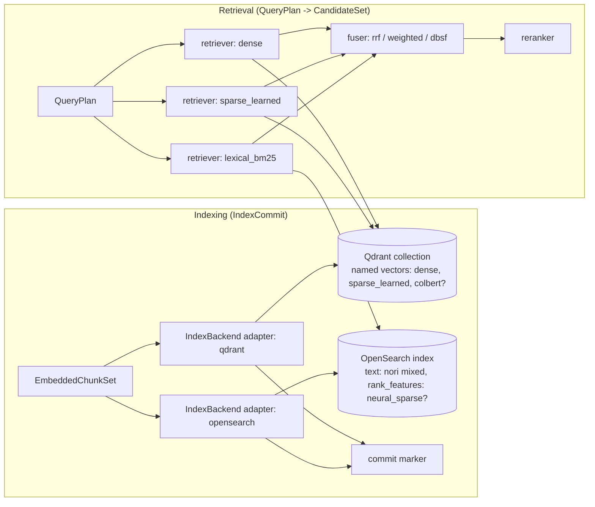
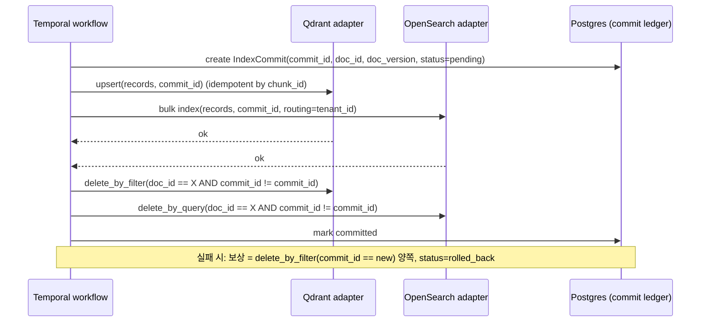

# 벡터·렉시컬 인덱스 백엔드와 하이브리드 검색 엔진

## 목적

이 문서는 RAG Platform의 `IndexBackend` 확장 지점(D-10) 뒤에 놓일 **벡터 인덱스(vector index)**, **렉시컬 인덱스(lexical index)**, **하이브리드 검색 엔진(hybrid search engine)** 후보를 2026-09-18 기준으로 조사하고, 설계 브리프의 확정 결정 D-15(기본 Qdrant + OpenSearch, 경량 프로파일은 Qdrant 단독)를 검증한다. 결과는 `04-pipelines/13-indexing`, `04-pipelines/15-hybrid-search-and-fusion`, `04-pipelines/19-update-delete-and-reindexing`, `03-contracts/07-embedded-chunk-set-and-index-record`의 입력이 된다.

핵심 질문은 네 가지다.

1. 한국어 문서(HWPX·PDF·DOC 등)에서 **형태소 기반 BM25**를 제대로 지원하는 백엔드는 무엇인가.
2. dense + learned sparse + lexical **3-way 하이브리드(D-07)** 를 한 엔진에서 처리할 수 있는가, 아니면 두 엔진이 필요한가.
3. **멀티테넌시(D-09)** 를 payload 필터로 처리할 때 필터링된 ANN(Approximate Nearest Neighbor) 성능 함정은 무엇이며 어떻게 피하는가.
4. 업서트·삭제·재색인(alias swap)·백업을 `IndexCommit` 계약(D-05)으로 표준화할 수 있는가.

## 범위

**포함**: Qdrant, Milvus, Weaviate, OpenSearch, Elasticsearch, Apache Solr, Vespa, PostgreSQL(pgvector + pgvectorscale + pg_textsearch + ParadeDB pg_search + VectorChord + PGroonga), LanceDB, Chroma, zvec, infinity(infiniflow), seekdb, Redis Open Source 8(RediSearch), Quickwit, Typesense, Meilisearch, Nixiesearch, Marqo, Vald, Vearch, Lucenia, 임베디드·SQL 계열 dev/eval 후보(Milvus Lite, DuckDB VSS+FTS, sqlite-vec + FTS5, ClickHouse 벡터 인덱스). 한국어 렉시컬 분석기: Nori, Kiwi, MeCab-ko(+ mecab-python3, python-mecab-ko, Pecab), seunjeon(은전한닢), khaiii, Komoran, Okt/KoNLPy, Lucene KoreanAnalyzer, bm25s, Tantivy + lindera. 멀티테넌시 패턴, 필터링된 ANN, 업서트·삭제·재색인, 백업, 스케일 수치.

**제외**: 임베딩·리랭커 모델 선정(별도 문서), 그래프 인덱스(GraphRAG, 별도 문서), 관리형 SaaS 전용 제품(Pinecone 등, D-02 오픈소스 원칙상 제외), 캐시 계층으로서의 Redis(D-14에서 확정; 본 문서는 인덱스 후보로서의 Redis 8 RediSearch만 짧게 다룬다).

**조사 방법**: 각 후보의 공식 릴리스 노트·문서·저장소를 2026-09-18에 웹으로 확인하고, 검증 지적 사항을 2026-09-22에 재확인했다(재확인으로 갱신한 버전은 날짜를 함께 적었다). 확인하지 못한 항목은 "(확인 필요, as of 2026-09)"로 표기했다. 벤치마크 수치는 출처와 조건을 함께 적었으며, 벤더 자체 벤치마크는 그렇게 명시했다.

## 평가 기준

가중치는 브리프의 원칙 5(Hybrid by Default), 6(Korean-First), R3(검색 품질 제1 지표)를 반영해 한국어 지원과 품질/성능에 각 20점을 두었다.

| 기준 | 가중치 | 5점 기준 | 1점 기준 |
|------|--------|----------|----------|
| 한국어 지원 | 20 | 서버 내장 형태소 분석기(mecab-ko-dic 계열) + 사용자 사전 + 품사 필터 | 공백/유니코드 경계 토크나이저만 제공 |
| 라이선스 적합성(D-02) | 15 | Apache-2.0 / MIT / BSD / PostgreSQL | GPL(링크 금지) 또는 소스만 AGPL이고 바이너리는 비오픈 |
| 성숙도/유지보수 | 15 | 5년 이상 프로덕션, 월 단위 릴리스, 주요 버전 호환 보장 | 0.x, 잦은 파괴적 변경 |
| 품질/성능 | 20 | 필터링된 ANN·양자화·sparse·multivector 모두 검증됨, 공개 벤치마크 | 단일 dense만, 필터 성능 미검증 |
| 통합 난이도 | 10 | Python 클라이언트 + gRPC/REST, 스키마 변경 무중단, 로컬 단일 컨테이너 | 전용 DSL·Java 앱 패키지, 다수 사이드카 필수 |
| 커뮤니티/생태계 | 10 | LlamaIndex/LangChain/Haystack 어댑터, 활발한 이슈 응답 | 어댑터 부재 |
| 운영 비용 | 10 | 단일 바이너리, 낮은 메모리, 디스크 기반 인덱스 옵션 | JVM 힙 튜닝·다중 컴포넌트·GPU 필수 |

## 후보 목록

| 이름 | 최신 버전(확인일 2026-09-18; 2026-09-22 재확인분은 날짜 병기) | 라이선스 | 성숙도 | 한국어 지원 | 핵심 강점 | 약점 |
|------|------------------------------|----------|--------|-------------|-----------|------|
| Qdrant | v1.19.1 (2026-09-04); 1.19.0 (2026-08-05) | Apache-2.0 | 높음 | 서버 `text` 인덱스는 한국어 형태소 분석 없음(유니코드 경계 분절만); sparse는 클라이언트 토크나이즈로 우회 | named/sparse/multivector, Query API prefetch + RRF/DBSF, filterable HNSW + ACORN, 테넌트별 IDF, TurboQuant 4-bit | 서버 측 BM25 계산 없음(sparse 벡터·TF 포화값을 클라이언트가 생성), 한국어 full-text payload 인덱스 부재 |
| Milvus | v3.0.2 (2026-09-20, 재확인); v3.0.1 (2026-09-09); v2.6.24 (2026-09-16) | Apache-2.0 | 높음(3.0은 신규) | lindera ko-dic 내장(2.6+ 사전 사전컴파일), `korean_stop_tags` 필터 | 내장 BM25 Function, SINDI sparse 인덱스, 벡터 필드 기본 최대 4개(설정 시 최대 10개) 하이브리드, partition key 격리 | 분산 배포 컴포넌트 다수(etcd·오브젝트 스토리지·Woodpecker), 3.0 Storage V3는 기본 비활성 |
| Weaviate | v1.39.5 (2026-09-15; 1.40.0-rc.1 2026-09-19 존재, 재확인); Python client 4.23.1 (2026-09-07) | BSD-3-Clause | 높음 | `kagome_kr`(mecab-ko-dic) 환경변수로 활성화, 리소스 집약 | 테넌트별 샤드 격리(노드당 50,000+ 샤드), HFresh 디스크 인덱스, BlockMax WAND BM25, hybrid alpha/fusion, collection alias(1.32+ GA) | 한국어 토크나이저 동시성 제한, learned sparse 벡터 필드 미지원(BM25로 대체) |
| OpenSearch | v3.8.0 (2026-08-05), Lucene 10.5.0 | Apache-2.0 | 매우 높음 | `analysis-nori` 플러그인(decompound_mode, 사용자 사전, 품사 필터) | Nori + k-NN(FAISS/Lucene) + neural sparse(다국어 모델 MIRACL ko 0.607) + hybrid query/normalization processor 단일 엔진 | JVM·힙 운영 부담, 벡터 전용 엔진보다 무거움, 3.0에서 nmslib 제거 |
| Elasticsearch | v9.5.x (9.5.0 2026-08-04, 최신 패치 9.5.4) | AGPL-3.0 / SSPL-1.0 / ELv2 트리플(소스). 공식 바이너리·Docker는 ELv2/SSPL | 매우 높음 | Nori 공식 플러그인(`elasticsearch-plugin install analysis-nori`, 별도 설치; 기본 배포 미번들) | OpenSearch와 동급 이상의 기능, BBQ 양자화 | D-02상 AGPL은 분리 서비스로만, 공식 이미지는 AGPL 아님 → 소스 빌드 필요 |
| Apache Solr | 10.0.0 (2026-03-03); 9.x는 9.10.1로 종료 | Apache-2.0 | 매우 높음 | Lucene `analysis-nori` 동봉(KoreanTokenizer, OpenSearch Nori와 동일 옵션) | Lucene/Nori 계열 중 라이선스가 깨끗한 OpenSearch 대안, dense vector(`DenseVectorField`, 스칼라·바이너리 양자화), RRF combined query(SOLR-17319, Fix Version 10.1·9.11; 10.0.0 미포함) | RRF는 10.1+에서만(10.0.0 운영 시 플랫폼 fuser 전제), SolrCloud는 ZooKeeper 의존, learned sparse 필드 없음, Python 어댑터 얇음 |
| Vespa | Vespa 8 (릴리스 8.75x대, CLI 8.753.16 2026-09-16); Vespa 9 예정 | Apache-2.0 | 매우 높음 | lucene-linguistics로 Korean 분석기(40개 언어 중 하나), 기본 OpenNLP는 한국어 미약 | HNSW + WAND BM25 + ColBERT 텐서 + phased ranking을 단일 엔진·단일 쿼리로 | Java 앱 패키지·services.xml·schema DSL 학습 곡선, 언어 자동 감지 없음 |
| pgvector (+pgvectorscale) | pgvector 0.8.6 (2026-07-29); pgvectorscale 0.9.1 (2026-09-04, DiskANN 보안 강화) | PostgreSQL License | 높음 | BM25는 별도 확장 필요 | 이미 D-14의 PostgreSQL에 동거, iterative index scan(0.8+), StreamingDiskANN | HNSW 인덱스 차원 상한 2,000(vector)/4,000(halfvec), 대규모 필터·다중 벡터 하이브리드는 SQL 직접 구현 |
| pg_textsearch (Timescale/TigerData) | v1.4.0 (2026-08-18); v1.3.1 (2026-06-23) | PostgreSQL License | 중간(1.x) | PostgreSQL 텍스트 검색 구성(`textsearch_ko`/MeCab 등)과 결합. textsearch_ko는 BSD-2-Clause, 커밋 29개·갱신 정체(PG 최신 버전 빌드 검증 필요) | BM25(`k1`, `b` 설정, 기본 1.2/0.75) + Block-Max WAND, 라이선스가 깨끗해 메타 DB(D-14)와 동거 가능, MIRACL-ko 연구 최고 하이브리드(0.7683) 구성요소 | 한국어 형태소는 별도 확장(textsearch_ko) 빌드 필요, 분산·샤딩 없음 |
| ParadeDB pg_search | 0.25.9 (2026-09-11) | AGPL-3.0(Enterprise는 상용) | 중간 | Tantivy 기반 `korean_lindera` 토크나이저(KoDic 사전, `reading_form` 한자→한글 옵션) — Milvus·LanceDB와 같은 lindera ko-dic 계열 | Postgres 안에서 BM25 + 벡터 하이브리드 | AGPL → D-02상 별도 컨테이너 격리 필요(메타 DB와 동거 불가) |
| VectorChord (+VectorChord-BM25) | 1.1.1 (2026-02-28) | AGPL-3.0 OR ELv2 이중 | 중간 | VectorChord-BM25 토크나이저의 한국어 지원 확인 필요 | RaBitQ 4/8-bit 양자화 기반 Postgres 벡터 인덱스, pgvector 대비 대규모 성능 대안, BM25 확장 동반 | AGPL/ELv2 → D-02상 분리 서비스 조건(메타 DB와 동거 불가) |
| LanceDB | 0.39.0 (2026-09-17) | Apache-2.0 | 중간 | 네이티브 FTS에 `lindera/ko-dic` 토크나이저 | 임베디드·오브젝트 스토리지 네이티브, FTS + 벡터 하이브리드(RRFReranker 기본) | 서버형 멀티테넌시·복제는 Enterprise, 한국어 스테머 없음 |
| zvec (Alibaba) | 0.7.0 (2026-08-24; PyPI 08-26) | Apache-2.0 | 낮음(0.x) | 유니코드 경계 분절만(utf8proc UAX#29 표준 토크나이저 + Snowball 스테머 34개 언어에 한국어 없음 + ngram 옵션); 형태소 분석기 없음 | 임베디드 dense + sparse + 풀텍스트 하이브리드 라이브러리(DiskANN, IVF-RaBitQ), C++ 코어 + Python 바인딩 | 0.x, 서버 모드·멀티테넌시 없음 → dev/eval 후보 |
| Chroma | 1.5.9 (2026-05-05) | Apache-2.0 | 중간 | 없음(공백 기반) | Rust 코어(1.0에서 4배 가속), 개발자 경험 | sparse(BM25/SPLADE) 인덱싱은 클라우드 전용, 로컬 미지원(2026-01 기준, 확인 필요) |
| infinity (infiniflow) | v0.7.3 (2026-08-06), SDK 0.7.3 | Apache-2.0 | 낮음(0.x) | `korean` 분석기(mecab + 한국어 사전, 리소스 파일 별도) | dense + sparse + tensor(ColBERT) + full-text를 단일 쿼리 플랜에서, RRF/weighted_sum/match_tensor | 0.x 성숙도, 커뮤니티 규모 작음, 임베디드 모드 중심 |
| seekdb (OceanBase) | v1.4.0 (2026-08-27); 첫 릴리스 v1.0.0 (2025-11-13) | Apache-2.0 | 낮음(신규) | 한국어 분석기 확인 필요(README 예시는 `WITH PARSER ik` 중국어 IK 파서만) | vector + full-text + scalar 필터를 단일 SQL 실행 계획에서 처리하는 하이브리드 엔진 | 신규, 커뮤니티 규모 작음, 한국어 분석기 미확인 |
| Redis Open Source 8.x | 8.x (패치 번호 확인 필요) | RSALv2 / SSPLv1 / AGPLv3 삼중 | 높음 | 없음(한국어 형태소 분석기 부재) | RediSearch 벡터 + 풀텍스트 내장, D-14 Redis와 단일 컨테이너 공유 가능 | AGPL 선택 시에도 D-02 분리 서비스 조건, 한국어 렉시컬 부적합 |
| Quickwit | 0.8.x (확인 필요) | Apache-2.0(Datadog 인수 2025-01-09 후 AGPL→Apache-2.0 재라이선스, LICENSE 파일 확인) | 중간 | Tantivy + lindera 경로(확인 필요) | Tantivy 기반 분산 검색, 오브젝트 스토리지 네이티브 | 로그 검색 지향, 벡터 없음(우선순위 낮음) |
| Typesense | v30.2 (2026-04-19) | GPL-3.0 | 높음 | ICU `locale: ko`(NFKD), 형태소 분석 없음 | 오타 허용, 낮은 운영 비용 | GPL → D-02 링크 금지, 한국어 recall 한계 |
| Meilisearch | v1.54.0 (2026-09-21, 재확인); v1.53.2 (2026-09-07) | MIT(Community Edition); Enterprise Edition은 BUSL(2025-08-27 발표) | 높음 | charabia + lindera ko-dic (약 2 MiB/s) | 경량, 한국어 분절 내장 | 벡터 검색은 부가 기능, RAG 규모 하이브리드 설계 아님 |
| Nixiesearch | 0.8.0 (2025-01-06; 이후 릴리스 확인 필요, as of 2026-09) | Apache-2.0 | 낮음(0.x) | Lucene 39개 언어 분석기 내장(Korean = Nori 계열; 옵션 노출 범위 확인 필요) | Lucene 기반 하이브리드 서버, RRF 융합 내장(`rrf.retrieve`, `rank_window_size`), S3 네이티브 인덱스 스토리지, 임베딩 추론 내장 | 0.x, 소규모 커뮤니티, learned sparse 필드·멀티테넌시 설계 미확인 |
| Marqo | OSS 저장소 deprecated 공지(README, 2026-09-22 확인) | Apache-2.0 | 중단 | Vespa 위 텐서 검색(한국어는 Vespa linguistics에 의존) | Vespa 기반 텐서/렉시컬 하이브리드 + 임베딩 추론 내장, Python 친화 API | "Marqo's Open Source project is deprecated and will no longer receive updates" → 제외 |
| PGroonga | 4.0.8 (2026-08-03) | PostgreSQL License | 높음 | `TokenBigram`(비ASCII 바이그램) 수준; 형태소 분석기 없음 | Groonga 기반 PostgreSQL 전문검색, 라이선스 깨끗해 메타 DB 동거 가능, 활발한 릴리스 | 바이그램은 형태소 BM25보다 recall·정밀도 열위(유니코드 경계 등급과 유사) → textsearch_ko 정체 시 폴백 후보 |
| Vald / Vearch / Lucenia | Vald(NGT 기반, Apache-2.0) / Vearch(JD 출신, Apache-2.0) / Lucenia(Lucene 기반 상용 지향, 라이선스 확인 필요) — 버전 확인 필요 | Apache-2.0 / Apache-2.0 / 확인 필요 | 중간 / 중간 / 낮음 | 없음(벡터 전용) / 없음(벡터 + 스칼라 필터) / Lucene 분석기(확인 필요) | 분산 ANN(Vald: Kubernetes 네이티브, NGT), Vearch: 벡터 + 스칼라 하이브리드, Lucenia: Lucene 벡터·풀텍스트 | 한국어 렉시컬 강점 없음, 커뮤니티 규모 작음 → 제외(한 줄 사유만 기록) |
| 임베디드/SQL dev-eval 후보 | Milvus Lite(pymilvus 동봉) / DuckDB VSS + FTS / sqlite-vec v0.1.9 (2026-03-31) + FTS5 / ClickHouse 벡터 인덱스(25.8+, experimental) | Apache-2.0 / MIT / MIT·Apache-2.0 / Apache-2.0 | 중간 | 모두 형태소 분석기 없음(외부 토크나이즈 필요) | 단일 파일·단일 프로세스, 평가 하네스 베이스라인 비교 폭 확장 | Milvus Lite는 FLAT 인덱스만·파티션 미지원; DuckDB HNSW 영속화는 experimental 플래그(크래시 시 인덱스 손상 경고); ClickHouse 벡터 인덱스 experimental → LanceDB·bm25s 기본 유지 |

한국어 렉시컬 분석기 후보는 별도로 정리한다.

| 분석기 | 최신 버전(확인일) | 라이선스 | 형태 | 강점 | 약점 |
|--------|-------------------|----------|------|------|------|
| Nori (Lucene analysis-nori) | Lucene 10.5.0 (OpenSearch 3.8 동봉) | Apache-2.0 | 서버 플러그인(OpenSearch/Elasticsearch/Vespa lucene-linguistics) | mecab-ko-dic 기반, `decompound_mode`, `user_dictionary`, `nori_part_of_speech`, `nori_readingform`, `nori_number` | 기본 `decompound_mode=discard`가 복합명사 원형을 버림 → `mixed` 필요 |
| Kiwi / kiwipiepy | Kiwi 0.24.0 (2026-09-13); kiwipiepy PyPI 0.23.2 (2026-06-11) | Kiwi 0.24.0+ **Apache-2.0**(0.23.2 이하 LGPLv3); kiwipiepy 0.23.2는 LGPLv3 | Python/C++ 라이브러리(Java·Rust·Go·C#·WASM 바인딩) | 통계 언어모델 기반 중의성 해소, 오타 교정, 자가 보고 정확도 웹 텍스트 약 87%·문어 약 94%, MIRACL-ko 연구에서 품질 우위 | kiwipiepy 0.24(Apache) PyPI 공개 확인 필요; 속도는 MeCab보다 느림 |
| MeCab-ko + mecab-ko-dic | mecab-ko-dic 2.1.1-20180720 계열(정체) | mecab-ko: GPL-2.0 / LGPL-2.1 / BSD-3 트리플; mecab-ko-dic: Apache-2.0(확인 필요) | C++ 라이브러리 + 사전 | 가장 빠름, Nori·kagome_kr·lindera ko-dic·infinity korean 분석기의 공통 사전 원천 | 사전 갱신 정체, 신조어 약함 |
| mecab-python3 | 1.0.x (확인 필요, as of 2026-09) | BSD-3-Clause(바인딩); MeCab 본체는 GPL/LGPL/BSD 트리플에서 BSD 선택 | Python 바인딩 | MeCab 본체를 BSD 조건으로 링크하는 가장 단순한 경로, mecab-ko-dic 그대로 사용 | 사전·본체 별도 설치, 네이티브 빌드 의존 |
| python-mecab-ko + python-mecab-ko-dic | python-mecab-ko 1.3.7 (2024-07-14); python-mecab-ko-dic 2.1.1.post1 계열 | python-mecab-ko BSD-3-Clause(mecab-ko 공유 라이브러리를 휠에 번들, BSD 선택); python-mecab-ko-dic Apache-2.0 | Python 바인딩(휠에 공유 라이브러리·사전 번들) | `pip install` 한 번으로 mecab-ko + 사전 설치, 네이티브 빌드 불필요, 라이선스 깨끗함 → mecab-python3 + 별도 사전 설치 경로보다 플랫폼 측 2차 분석기로 적합 | 사전은 mecab-ko-dic 2.1.1(2018) 정체 그대로, 바인딩 갱신 2024년 이후 확인 필요 |
| seunjeon(은전한닢) | 원본 2018 이후 정체; OpenSearch 플러그인 포크 Karoid/opensearch-seunjeon는 OpenSearch 2.3.0까지 | Apache-2.0 | Java/Scala 라이브러리 + ES/OpenSearch 플러그인 포크(likejazz, Karoid); AWS OpenSearch Service 공식 지원 | mecab-ko-dic 기반, 사용자 사전·복합명사 분해, JVM 내 동작 | 원본 정체, 최신 OpenSearch 3.x 플러그인 없음 → Nori 대비 비교 대상으로만 |
| Pecab | 1.0.x (확인 필요, as of 2026-09) | Apache-2.0 | pure-Python MeCab 호환 | 네이티브 링크 없이 mecab-ko-dic 호환 결과 → LGPL/GPL 해석 위험을 완전히 회피 | 순수 파이썬으로 느림, 유지보수 규모 작음 |
| khaiii (Kakao) | 0.4 계열(갱신 정체, 확인 필요) | Apache-2.0 | C++ 라이브러리 + Python 바인딩 | CNN 기반 형태소 분석, 세종 코퍼스 학습, Apache 라이선스 | 2020년 이후 갱신 정체, 사용자 사전 제한, 빌드 난이도 |
| Komoran | 3.3.x(Java), PyKomoran(확인 필요) | Apache-2.0 | Java 라이브러리(+ Python 래퍼) | 사용자 사전·오탈자 강건, 순수 Java(OpenSearch 외부 JVM 환경과 동거 가능) | JVM 필요, 속도 중간 |
| Okt / KoNLPy | KoNLPy 0.6.x(확인 필요) | Apache-2.0(KoNLPy·Okt); 래핑 엔진별 개별 라이선스 | Python 래퍼(JVM 기반 엔진) | MIRACL-ko 연구 Phase 1 비교 대상, 다중 엔진 단일 API로 평가 하네스 비교에 유용 | JVM 의존, 속도 느림, 갱신 정체 → 프로덕션 비권장 |
| Lucene KoreanAnalyzer | Lucene 10.x | Apache-2.0 | Java 라이브러리 | Nori의 라이브러리 형태, Vespa lucene-linguistics에서 사용 | JVM 필요 |
| bm25s | 0.3.11 (2026-08-25) | MIT | Python 라이브러리(numpy/scipy) | rank_bm25 대비 최대 500배(저자 벤치마크), 토크나이저 교체 가능 → Kiwi 결합 | 단일 프로세스 인메모리, 서버 아님(평가 하네스·경량 프로파일 보조용) |
| Tantivy + lindera | lindera v6.0.0 (2026-08-25) | MIT(lindera), ko-dic Apache-2.0(확인 필요) | Rust 라이브러리 | LanceDB·Milvus·Meilisearch(charabia)가 사용, `embedded-ko-dic` 피처 | 사용자 사전·품사 필터는 Nori보다 제한적 |

## 심층 비교

### Qdrant

**동작 방식**. 컬렉션(collection) 단위로 **named vectors**(이름별 독립 차원·거리), **sparse vectors**(반드시 이름 필요, `indices/values`), **multivector**(`comparator: max_sim`, ColBERT 계열)를 한 포인트에 담는다. 벡터 데이터타입은 float32/float16/uint8/turbo4(1.19). 양자화는 scalar/product/binary/1.5-2bit(1.15)/TurboQuant(1.18, 8배 압축; 1.19에서 원본을 보존하지 않는 4-bit 저장 데이터타입으로 최대 9배 저장 절감). HNSW는 `m`, `ef_construct`, `payload_m`, `full_scan_threshold`로 조정하며, payload 인덱스(keyword/integer/float/bool/geo/datetime/text/uuid)에 `is_tenant`, `is_principal` 힌트를 둘 수 있다.

**Query API**. `prefetch`로 하위 질의를 중첩하고 상위 질의를 그 결과에 적용한다. 융합은 `fusion: rrf`(상수 k 기본 2, 1.17부터 질의별 가중치) 또는 `fusion: dbsf`(3-sigma 정규화 후 합산). 재스코어링(작은 벡터로 prefetch → 큰 벡터/multivector로 재정렬), `query_points_groups()`(group_by 중복 제거), MMR(1.15), Relevance Feedback Query(1.17)를 제공한다. 제한: 분산 컬렉션에서 fusion은 반드시 최상위 질의여야 샤드 간 병합이 되고, `offset`은 최상위 질의에만 적용되며, formula 재스코어링과 fusion 결합은 단일 샤드 제약이 있다.

**실제 진입점**. 패키지 `qdrant-client`(Python, REST + gRPC). `QdrantClient.create_collection(vectors_config={...}, sparse_vectors_config={...})`, `upsert(points=[PointStruct(...)])`, `query_points(prefetch=[Prefetch(query=..., using="dense", limit=...), Prefetch(query=SparseVector(...), using="sparse", ...)], query=FusionQuery(fusion=Fusion.RRF))`, `update_collection_aliases(change_aliases_operations=[...])`, `create_payload_index(field_name="tenant_id", field_schema=KeywordIndexParams(type="keyword", is_tenant=True))`. 1.17부터 upsert에 insert-only/update-only 모드, 1.18부터 컬렉션 재생성 없이 named vector 추가·제거.

**출력 형식**. `ScoredPoint{id, score, payload, vector?, shard_key?, order_value?}` 배열. 융합 시 개별 prefetch 점수는 반환되지 않으므로 점수 분해(원칙 8)가 필요하면 prefetch를 각각 별도 질의로 실행해 플랫폼 측에서 융합해야 한다.

**한국어 렉시컬**. 두 경로가 있다. (1) payload `text` 인덱스의 `multilingual` 토크나이저는 charabia·vaporetto 기반이며, 1.15에서 토크나이저 패키지를 재편해 모든 토크나이저를 기본 빌드에 포함시켰다(과거의 `--features multiling-korean` 피처 플래그는 폐지, Dockerfile은 stacktrace/gpu 피처만 전달). 그러나 master의 `lib/segment/Cargo.toml`은 charabia 0.10.0을 `default-features = false`로 두고 `greek, hebrew, thai, chinese-segmentation, chinese-normalization` 피처만 켠다. charabia의 `korean`(lindera ko-dic) 피처는 활성화하지 않으며 일본어만 vaporetto로 처리한다. 따라서 **공식 빌드의 multilingual 토크나이저는 한국어 형태소 분석을 포함하지 않고 유니코드 경계 분절만 적용한다**(as of master 2026-09). 이는 MIRACL-ko 연구의 "Qdrant multilingual(charabia, Unicode-only) BM25 nDCG@10 0.36"과 일치한다. **한국어 키워드 필터 용도로 `text` 인덱스를 쓰지 않는다.** (2) **BM25 sparse 벡터**: Qdrant 서버는 BM25를 직접 계산하지 않는다. 클라이언트(FastEmbed `Qdrant/bm25` 또는 자체 토크나이저)가 토큰 해시 → `indices`, **BM25 TF 포화값** → `values`를 만들고, 컬렉션 sparse 설정 `modifier: idf`로 서버가 IDF를 곱한다. 서버가 적용하는 것은 IDF뿐이므로 TF 포화와 문서 길이 정규화는 전적으로 클라이언트 책임이다:

`values[t] = tf(t) · (k1 + 1) / (tf(t) + k1 · (1 − b + b · dl / avgdl))`, 기본 k1 = 1.2, b = 0.75. FastEmbed `Bm25`는 `avg_len`을 상수(기본 256.0)로 고정해 이 식을 계산한다.

토큰 빈도(TF)나 단순 정규화 TF를 그대로 `values`에 넣으면 결과는 BM25가 아니라 **TF×IDF**가 된다. 인용한 MIRACL-ko 연구도 MeCab 외부 토크나이즈 경로에 대해 "works but is TF × IDF, not true BM25 — no document-length normalization (k1, b)"라고 경고한다. 1.19의 **per-query IDF corpus**는 IDF 통계를 테넌트 필터 범위로 좁혀 멀티테넌트 BM25 점수 왜곡을 줄인다. 이 경로에 Kiwi(또는 Nori 호환 토큰화) + 위 포화식을 끼워 넣으면 한국어 형태소 BM25가 서버 변경 없이 동작한다. 이것이 D-15 경량 프로파일의 실제 구현 방식이다.

**멀티테넌시**. 공식 가이드는 (a) **payload 파티셔닝**: `tenant_id` keyword 인덱스에 `is_tenant: true`, HNSW `payload_m: 16, m: 0`으로 테넌트별 독립 그래프 구성, (b) **user-defined sharding**: `shard_key`로 대형 테넌트 전용 샤드, (c) **tiered multitenancy**(1.16): 소형 테넌트는 fallback 샤드에서 payload 필터, 성장하면 전용 샤드로 무중단 승격. "테넌트별 컬렉션은 드물게만 효율적"이며 Qdrant Cloud는 기본 클러스터당 1,000 컬렉션 상한을 둔다. 전체 테넌트 횡단 질의는 payload 파티셔닝에서 느려진다.

**필터링된 ANN**. filterable HNSW(payload 값별 추가 간선), 질의 플래너가 저카디널리티 필터는 payload 인덱스 + 전수 재스코어로 전환, 1.16 ACORN은 "다중 저선택도 필터"에서 2-hop 이웃을 탐색해 정확도를 보완(성능 비용 있음). 1.16 inline storage 벤치마크(벤더): 430 MiB 메모리에서 211 QPS vs 미적용 20 QPS.

**벤치마크 근거**. qdrant.tech/benchmarks(벤더, 마지막 갱신 2024-01/06): dbpedia-openai-1M(1536d), deep-image-96(10M), gist-960, glove-100; 서버 8 vCPU/32 GB. Qdrant가 "거의 모든 시나리오에서 최고 RPS·최저 지연", Elasticsearch는 10M 벡터 인덱싱이 10배 느림, Milvus는 인덱싱 최속·고차원 RPS 낮음. 오래된 벤더 벤치마크이므로 선정 근거가 아닌 참고치로만 사용한다. 독립 연구(MIRACL-ko 10K 문서/213 질의, jaesolshin 2026): Qdrant 1.15 + MeCab sparse + dense 하이브리드 nDCG@10 0.6924(이 연구의 sparse 레그는 길이 정규화 없는 TF×IDF였으므로 포화식을 적용하면 개선 여지가 있다), Unicode 경계 토크나이즈 BM25만 0.36.

**함정**. (1) BM25 IDF는 컬렉션 전역 기본 → 1.19 idf 파라미터로 테넌트 범위 지정. (2) 융합 결과의 점수 분해 불가. (3) 컬렉션 폭증 금지. (4) `text` 인덱스는 한국어 형태소 분석 없음(유니코드 경계 분절만) → 한국어 키워드 조건은 형태소 토큰 keyword 배열 payload로 대체. (5) 스냅샷은 노드 단위이며 S3 호환 스냅샷 스토리지 설정을 지원한다고 알려져 있으나 이번 조사에서 문서를 직접 확인하지 못했다(확인 필요, as of 2026-09). (6) 클라이언트 BM25에서 TF 포화·길이 정규화를 생략하면 TF×IDF로 퇴화하고, `avgdl`을 상수로 고정하면 컬렉션의 실제 평균 길이와 어긋나 긴 청크가 과대(또는 과소) 점수를 받는다 → 어댑터가 컬렉션 통계(평균 토큰 길이)를 주기적으로 갱신하거나, 청크 토큰 예산(D-19)에서 유도한 `avgdl`을 프로파일 상수로 고정하고 재색인 시에만 바꾼다. (7) 포인트 ID는 64-bit unsigned integer 또는 UUID만 허용 → ULID 문자열 불가(아래 매핑 절).

### Milvus

**동작 방식**. 컬렉션에 여러 벡터 필드(**기본 최대 4개**, `proxy.maxVectorFieldNum`, 허용 범위 1–10이므로 설정으로 최대 10개까지 확장; dense + learned sparse + BM25 sparse + ColBERT처럼 4개를 넘는 설계는 기본 설정에서 컬렉션 생성이 실패한다). 2.5부터 **BM25 Function**(`FunctionType.BM25`): `VARCHAR/TEXT` 필드에 `enable_analyzer=True` → 서버가 분석기로 토크나이즈해 `SPARSE_FLOAT_VECTOR`를 생성, `SPARSE_INVERTED_INDEX`(metric `BM25`, `bm25_k1` 1.2, `bm25_b` 0.75). 질의는 원문 텍스트로 가능. 3.0에서 sparse 인덱스를 **SINDI + Block-Max WAND/MaxScore**로 재구축, 압축 인덱스는 2.6 대비 약 3배 작음(벤더). 하이브리드는 `AnnSearchRequest` 목록 + `RRFRanker`/`WeightedRanker`/`Function(RERANK)`(decay·boost·model 리랭커)로 `client.hybrid_search()`.

**한국어**. 토크나이저 `lindera` + `dict_kind: ko-dic`, 필터 `korean_stop_tags`(예: `["SP","SSC","JKS","JKO","EP","ETM"]`)로 조사·어미 제거. 2.6+는 사전이 사전컴파일되어 즉시 사용, 2.5.x는 빌드 피처 필요. 2.5.11+ **multi-language analyzers**: `by_field`(언어 식별 필드) → 문서별 분석기 선택, `default` 필수. 내장 `korean` 분석기는 없으므로 커스텀 정의가 필요하다. Nori 대비 사용자 사전·복합명사 분해 옵션은 제한적(lindera 기능 범위).

**멀티테넌시**. database → collection → **partition key**(기본 16 파티션, `num_partitions`로 조정; 컬렉션당 상한은 `rootCoord.maxPartitionNum` 기본 1,024, 공식 설정 문서). 2.5+ **partition key isolation**은 HNSW에서 파티션 키 값별 독립 인덱스를 만들고, 필터가 단일 파티션 키 값을 지정할 때만 동작한다.

**진입점**. `pymilvus` `MilvusClient.create_schema()`, `schema.add_function(Function(name=..., function_type=FunctionType.BM25, input_field_names=["text"], output_field_names=["sparse"]))`, `client.hybrid_search(collection_name, reqs=[AnnSearchRequest(...)], ranker=RRFRanker(60), limit=k)`. 출력은 `[[{id, distance, entity}]]`.

**함정**. 3.0 Storage V3(Loon)·신규 인덱스 알고리즘은 수동 활성화이며 활성화 시 2.6 롤백 불가. 3.0.1(2026-09-09)·3.0.2(2026-09-20, 필터 검색·group-by·인덱스 빌드 핫패스 경합 제거) 패치가 연이어 나왔지만 3.0 계열은 아직 초기이므로 2차 백엔드로는 2.6.24(2026-09-16) 계열을 유지한다. 분산 모드는 etcd·오브젝트 스토리지·Woodpecker(3.0 독립 서비스) 등 컴포넌트가 많아 운영 비용이 높다. Standalone(Docker 단일)은 개발용으로 적합. 벡터 필드 수 기본 상한 4는 `proxy.maxVectorFieldNum`을 배포 매니페스트에서 명시적으로 올려야 한다.

### Weaviate

**동작 방식**. 컬렉션 + named vectors, HNSW/flat/dynamic + **HFresh** 디스크 기반 인덱스(1.38 GA), RQ4 4-bit 회전 양자화(1.39), BlockMax WAND BM25(1.39 대규모 재작업). **hybrid**: `alpha`(0 = 키워드, 1 = 벡터), `fusion_type` `relativeScoreFusion`(1.24부터 기본; autocut은 relativeScoreFusion에서만 동작) 또는 `rankedFusion`, BM25 `operator`(and / or + `minimumOrTokensMatch`), `max_vector_distance`, `target_vector`, 1.39 hybrid MMR. 다중 벡터 컬렉션에서는 MMR 불가.

**한국어**. 프로퍼티 토크나이저 `kagome_kr`(Kagome + mecab-ko-dic), `ENABLE_TOKENIZER_KAGOME_KR=true` 필요, "리소스 집약적"이며 `TOKENIZER_CONCURRENCY_COUNT`로 동시성 제한. 사용자 사전·품사 필터 옵션은 문서상 확인되지 않음.

**멀티테넌시**. **테넌트 = 샤드** 모델. 상태 ACTIVE / INACTIVE(디스크) / OFFLOADED(S3). 노드당 50,000+ 활성 샤드, 20노드 약 100만 테넌트(공식 문서). 격리는 가장 강하지만 소형 테넌트가 매우 많을 때 파일 디스크립터·메타데이터 부담. 1.39 Namespaces가 컨트롤 플레인 격리를 추가.

**진입점**. `weaviate-client` v4: `client.collections.create(name, vector_config=..., multi_tenancy_config=Configure.multi_tenancy(enabled=True))`, `collection.with_tenant("t1").query.hybrid(query=..., alpha=0.5, fusion_type=HybridFusion.RELATIVE_SCORE, limit=k, return_metadata=MetadataQuery(score=True, explain_score=True))`. `explain_score`가 점수 분해 문자열을 준다.

**함정**. 한국어 토크나이저 성능(리소스 집약·동시성 제한), learned sparse 벡터 필드 부재(sparse 레그를 BM25로 대체해야 함). 컬렉션 alias는 1.32에서 도입(GA, 공식 문서 "Added in v1.32")되어 blue/green 재색인에 사용할 수 있다.

### OpenSearch

**동작 방식**. Lucene 10.5.0(3.8). **k-NN**: 엔진 `faiss`(기본)·`lucene`(nmslib는 2.16 deprecated, 3.0 제거), 메서드 hnsw/ivf, 인코더 flat/sq/pq, byte·binary 벡터, 디스크 기반 모드(`mode: on_disk`, 2.17+, 압축 레벨 최대 32x; 세부 확인 필요). **Efficient filtering**: Lucene 엔진은 사전/사후/정확 탐색을 자동 선택, FAISS도 필터 지원; 3.8은 메모리 최적화 예산 소진 시 정확 검색으로 폴백. **Neural sparse**: `rank_features` 필드 + `neural_sparse` 질의, 2단계 처리 프로세서(neural sparse two-phase). **Hybrid**: `hybrid` 복합 질의 + search pipeline의 `normalization-processor`(정규화 `min_max`/`l2`/`z_score`, 결합 `arithmetic_mean`/`geometric_mean`/`harmonic_mean`, `weights`, `lower_bounds`; 단, `z_score`는 `arithmetic_mean` 결합만 허용 — 정규화·결합이 자유 조합은 아니다) 또는 `score-ranker-processor`(RRF, `rank_constant` 기본 60). `hybrid_score_explanation` 프로세서로 점수 분해. 제약(공식 문서 `_query-dsl/compound/hybrid`): hybrid 하위 질의(query clauses)는 **최대 5개**, `pagination_depth`는 1..`index.max_result_window`(기본 10,000), hybrid 질의는 `function_score`/`constant_score`/`script_score`/`boosting` 래퍼 안에 중첩할 수 없다. `score-ranker-processor`(RRF)는 2.19에서 도입되었고 `rank_constant` 기본 60, normalization-processor의 `weights`는 합이 1.0이어야 한다. 3.8은 호환되지 않는 검색 타입 조합을 차단.

**한국어**. `opensearch-plugin install analysis-nori`(Maven `org.opensearch.plugin:analysis-nori:3.x`). `nori_tokenizer` 옵션: `decompound_mode` none / **discard(기본)** / mixed, `discard_punctuation`(기본 true), `user_dictionary`, `user_dictionary_rules`, `lenient`. 필터 `nori_part_of_speech`(stoptags), `nori_readingform`, `nori_number`. 인덱스 분석기는 `mixed`, 검색 분석기는 `discard` 또는 `mixed`를 권장한다(아래 근거 절).

**Neural sparse 다국어 모델**. `opensearch-project/opensearch-neural-sparse-encoding-multilingual-v1`(Apache-2.0, 105,879차원): MIRACL 15개 언어 평균 nDCG@10 0.629(BM25 0.305), **한국어 0.607(BM25 0.371)**; prune_ratio 0.1에서 0.604. 모델 카드 수치(벤더 보고).

**멀티테넌시**. (a) 테넌트별 인덱스: 격리 강하지만 "인덱스 폭증"으로 클러스터 상태·힙 부담, (b) 공유 인덱스 + `tenant_id` 필터 + filtered alias, (c) 공유 인덱스 + **custom routing**(`routing=tenant_id`)으로 단일 샤드 조회. 샤드 크기 권고 10–50 GB(검색 워크로드 10–30 GB).

**스케일 수치**. OpenSearch 3.0은 1.3 대비 벡터 검색 9.5배(벤더). GPU(cuVS) 인덱스 빌드는 CPU 대비 9.3배 빠르고 3.75배 저렴(AWS 블로그, 벤더). 3.8: base64 벡터 인코딩으로 bulk 처리량 최대 4.16배, radial search 처리량 2.1배·재현율 0.85→0.97(릴리스 노트).

**진입점**. `opensearch-py` `OpenSearch.indices.create(index, body={"settings": {"index.knn": True, "analysis": {...nori...}}, "mappings": {...}})`, `client.search(index, body={"query": {"hybrid": {"queries": [...]}}}, params={"search_pipeline": "rag-hybrid"})`, `client.indices.update_aliases(body={"actions": [{"remove": ...}, {"add": ...}]})`(원자적).

**함정**. JVM 힙(권고 32 GB 이하)과 벡터 오프힙 메모리를 함께 산정해야 한다. 공유 인덱스에서 ACL 필터 누락은 데이터 유출 → filtered alias 또는 DLS(Document Level Security)로 이중 방어.

### Elasticsearch

기능은 OpenSearch와 동급 이상(BBQ 양자화, ELSER는 영어 전용)이고 Nori는 공식 플러그인이다(`sudo bin/elasticsearch-plugin install analysis-nori`로 별도 설치; 기본 배포에 번들되지 않으며 OpenSearch와 같은 설치 모델. Lucene 계열 중 Solr만 analysis-extras 모듈로 동봉). 그러나 **AGPL-3.0은 소스 코드에 추가된 옵션**이며 공식 바이너리·Docker 이미지는 ELv2/SSPL이다. D-02가 허용하는 "AGPL 네트워크 분리 서비스"로 쓰려면 소스 빌드 이미지를 자체 유지해야 하므로 기본 후보에서 제외하고, `IndexBackend` 어댑터 호환 대상(Lucene 문법 공유)으로만 유지한다.

### Vespa

**동작 방식**. 문서 스키마에 `tensor<float>(x[1024])`(HNSW), `tensor<float>(token{}, x[128])`(ColBERT 멀티벡터), 텍스트 필드(WAND BM25)를 함께 정의하고, **phased ranking**(first-phase → second-phase → global-phase)에서 `closeness`, `bm25`, `max_sim` 표현식을 조합한다. 단일 질의 왕복으로 3-way 하이브리드 + late interaction 재정렬이 가능해 아키텍처상 가장 우아하다. ColBERT 임베더·Long-Context ColBERT 내장.

**한국어**. 기본 linguistics는 OpenNLP(한국어 형태소 분석 없음). **lucene-linguistics** 컴포넌트를 `services.xml`에 등록하면 Lucene의 40개 언어 분석기 중 Korean(KoreanAnalyzer = Nori)을 `language=ko`로 사용할 수 있으나 언어 자동 감지가 없어 피드·질의 모두 언어를 넘겨야 한다. MIRACL-ko 연구에서 ICU 토크나이즈로 구성된 Vespa는 BM25 0.41, 하이브리드 0.4463에 그쳤는데 이는 형태소 분석 미적용의 결과로 해석되며 Vespa 자체 한계가 아니다.

**함정**. Java 앱 패키지 배포 모델, 월-목 매일 릴리스(운영 추적 부담), Python 생태계 어댑터가 pyvespa 중심으로 얇다. 대규모 단일 테넌트·최고 품질이 필요한 조직의 대안 프로파일로 적합.

### PostgreSQL: pgvector + pgvectorscale + pg_textsearch (+ pg_search, VectorChord)

**pgvector 0.8.6**(PostgreSQL License, PG 13+): `vector`(저장 16,000d, HNSW 인덱스 2,000d), `halfvec`(HNSW 4,000d), `bit`(64,000), `sparsevec`(인덱스 비영 1,000). **iterative index scans**(0.8+, `hnsw.iterative_scan = strict_order | relaxed_order`)로 필터 후 결과 부족 시 자동 확장. 멀티테넌시는 파티셔닝 권장. **pgvectorscale 0.9.1**(2026-09-04, PostgreSQL License): StreamingDiskANN, 병렬 빌드, 0.9.1은 DiskANN 보안 강화 패치.

**pg_textsearch v1.4.0**(Timescale/TigerData, 2026-08-18, PostgreSQL License; 1.4.0은 WHERE 필터 동반 top-k 최대 5배 가속과 zhparser 공식 예시 추가): PostgreSQL 텍스트 검색 구성(`tsvector` 파이프라인) 위에서 **BM25 랭킹(`k1`, `b` 인덱스 옵션, 기본 1.2/0.75) + Block-Max WAND top-k**를 제공한다. 임의의 텍스트 검색 구성을 받으므로 `textsearch_ko`(MeCab 기반 한국어 파서)나 zhparser(중국어, 공식 예시)를 그대로 결합할 수 있다. MIRACL-ko 연구는 `textsearch_ko`(MeCab) + `pg_textsearch` BM25 + pgvector + DB 측 RRF로 **nDCG@10 0.7683**(ES+Nori 0.7501, dense-only 0.7904)을 보고했다. 데이터가 10K 문서로 작고 "dense 우호적"이라는 점을 감안해야 한다. 라이선스가 깨끗하므로 **메타 DB(D-14) 인스턴스에 동거할 수 있는 유일한 BM25 확장**이며, postgres-only 프로파일의 렉시컬 레그 기본값으로 삼는다. 단, 한국어 파서 **textsearch_ko**(i0seph, BSD-2-Clause)는 런타임에 MeCab(GPL/LGPL/BSD 트리플 중 BSD 선택)을 링크하고, 저장소가 커밋 29개·README 예시 psql 9.3.5로 정체된 프로젝트라 PG 16/17에서의 빌드·동작 검증이 선행 조건이다. 정체가 확인되면 폴백은 PGroonga(PostgreSQL License, 바이그램 수준)이며 이때 한국어 품질은 유니코드 경계 등급으로 내려간다.

**pg_search 0.25.9**(ParadeDB, 2026-09-11, AGPL-3.0; Enterprise는 상용, Tantivy 기반): BM25·facet·하이브리드; 공식 토크나이저 문서가 **`korean_lindera`**(KoDic 사전, `reading_form=true`로 한자→한글 읽기 치환)를 문서화하므로 Milvus·LanceDB와 같은 lindera ko-dic 계열 형태소 분절을 제공한다(0.22.4부터 공백 기본 제거). **VectorChord 1.1.1**(TensorChord, 2026-02-28, AGPL-3.0 OR ELv2 이중): RaBitQ 4/8-bit 양자화 기반 Postgres 벡터 인덱스로 pgvector HNSW 대비 대규모(수천만 벡터)에서 메모리·빌드 시간 우위를 주장하며, 동반 확장 VectorChord-BM25가 BM25를 제공한다. 두 확장은 D-02상 **분리 인스턴스(컨테이너)** 에서만 허용된다.

**함의**. 메타 DB(D-14)와 인덱스를 한 PostgreSQL에 두는 "단일 DB 프로파일"은 소규모(수십만 청크)에서 운영 비용이 가장 낮다. 이때 확장 조합은 pgvector·pgvectorscale·pg_textsearch(PostgreSQL License) + textsearch_ko(BSD-2-Clause, MeCab은 BSD 조건 선택)로 모두 D-02 허용 라이선스다. pg_search·VectorChord는 AGPL 계열이므로 메타 DB 인스턴스에 설치할 수 없고 별도 인스턴스가 필요하다. PGroonga(PostgreSQL License)는 동거 가능하지만 바이그램 수준이라 textsearch_ko 폴백으로만 둔다.

### LanceDB

0.39.0(Apache-2.0). Lance 포맷 위 임베디드/서버리스, 오브젝트 스토리지 네이티브. 네이티브 FTS(Tantivy 계열) `base_tokenizer`: simple / whitespace / raw / ngram / icu / `jieba/default` / `lindera/ipadic` / **`lindera/ko-dic`**; 스테밍 언어 목록에 한국어 없음; 구문 질의는 `with_position=True` 필요(인덱스 크기 증가). 하이브리드는 `table.search(query_type="hybrid").rerank(RRFReranker())`. `table.create_fts_index("text", base_tokenizer="lindera/ko-dic", ...)`. 서버형 복제·멀티테넌시는 Enterprise. **평가 하네스와 개발자 로컬 프로파일**(단일 프로세스, 파일 기반)에 적합.

### Chroma

1.5.9(Apache-2.0), Rust 코어. 로컬 모드는 dense + 메타 필터 + full-text/regex. sparse(BM25/SPLADE) 인덱싱은 2025-11 도입되었으나 **로컬 단일 노드에서는 비활성, 클라우드 전용**(2026-01 이슈 기준, 확인 필요). 한국어 분석기 없음. 하이브리드 기본 프로파일 요건을 충족하지 못해 튜토리얼·데모 어댑터로만 유지.

### infinity (infiniflow)

v0.7.3(2026-08-06, Apache-2.0; v0.7.2는 2026-07-15). dense(HNSW)·sparse·tensor(ColBERT `match_tensor`)·full-text(BM25)를 단일 쿼리 플랜에서 실행, 융합 `rrf` / `weighted_sum` / `match_tensor`. 분석기: `standard`, `ngram-N`, `chinese`(jieba), `traditional`, `japanese`(mecab), **`korean`**(mecab + 한국어 사전, 리소스 파일 별도 다운로드), `rag`, `IK`. 임베디드 Python 모듈 또는 서버(23817). RAGFlow의 백엔드. 기능 집합은 이상적이지만 0.x 성숙도와 작은 커뮤니티가 리스크 → 실험 프로파일.

### Typesense / Meilisearch

Typesense v30.2는 GPL-3.0으로 D-02 위반이며 한국어는 ICU 분절만. Meilisearch v1.54.0(2026-09-21; 1.53.2는 2026-09-07) Community Edition은 MIT(Enterprise Edition은 BUSL, 2025-08-27 발표)이고 charabia + lindera ko-dic로 한국어 분절을 내장하지만 벡터·하이브리드가 RAG 규모 설계가 아니다. 둘 다 제외.

### 기타 후보: Apache Solr, Redis 8, seekdb, zvec, Quickwit, Nixiesearch, Marqo, PGroonga, Vald·Vearch·Lucenia, 임베디드/SQL 계열

- **Apache Solr 10.0.0**(2026-03-03, Apache-2.0; 9.x는 9.10.1로 종료). Lucene `analysis-nori`를 동봉하므로 OpenSearch와 동일한 `KoreanTokenizer` 옵션(`decompoundMode`, `userDictionary`, 품사 필터)을 쓸 수 있고, `DenseVectorField`(HNSW, 스칼라·바이너리 양자화)로 dense 검색을 지원한다. 서버 내장 하이브리드 융합은 **SOLR-17319 "Introduce support for Reciprocal Rank Fusion (combining queries)"** 가 2025-12-22 Resolved, Fix Version 10.1·9.11로 병합되어 `combiner=true`, `combiner.upTo` 파라미터의 RRF combined query가 제공된다. 단 10.0.0에는 포함되지 않고, 다운로드 페이지가 9.10.1을 9.x 마지막 릴리스로 명시하므로 9.11 출시는 불확실하다 → 10.1+ 운영 시 서버 RRF, 10.0.0에서는 플랫폼 fuser. learned sparse 필드는 없다. SolrCloud는 ZooKeeper 의존, Python 어댑터(pysolr)가 얇다. Lucene/Nori 계열에서 OpenSearch 외의 Apache-2.0 대안은 Solr와 Nixiesearch(아래)이며, 성숙도 기준으로 Solr를 이미 운영하는 조직을 위한 `lexical: solr` 어댑터 대상으로 둔다.
- **Redis Open Source 8.x**(RSALv2 / SSPLv1 / AGPLv3 삼중). RediSearch(벡터 HNSW/FLAT + 풀텍스트)가 코어에 내장되어 D-14의 Redis 컨테이너 하나로 캐시·벡터·풀텍스트를 겸할 수 있다. 그러나 한국어 형태소 분석기가 없고(공백·구두점 토크나이즈), AGPL 선택 시에도 D-02상 분리 서비스 조건이 붙는다. lite 프로파일의 "단일 컨테이너" 후보로 검토했으나 한국어 렉시컬 부적합으로 채택하지 않는다.
- **seekdb v1.4.0**(OceanBase, Apache-2.0; 릴리스 v1.0.0 2025-11-13, v1.1.0 2026-01-30, v1.2.0 04-15, v1.3.0 05-25, v1.4.0 2026-08-27). vector + full-text + scalar 필터를 단일 SQL 실행 계획에서 처리하는 AI-native 하이브리드 엔진. 분기 단위 릴리스는 확인되나 README 예시가 `WITH PARSER ik`(중국어 IK 파서)만 보여 한국어 분석기는 미확인(확인 필요, as of 2026-09). 관찰 대상.
- **zvec 0.7.0**(Alibaba, GitHub 2026-08-24·PyPI 08-26, Apache-2.0). 임베디드 dense + sparse + 풀텍스트 하이브리드 라이브러리(DiskANN, IVF-RaBitQ; C++ 코어 + Python 바인딩). LanceDB·Chroma와 같은 dev/eval 임베디드 후보군이며, sparse를 로컬에서 지원한다는 점이 Chroma보다 낫다. 풀텍스트 분석기는 릴리스 노트(v0.6.0, v0.7.0) 기준 utf8proc 기반 Unicode 17 UAX#29 단어 경계 표준 토크나이저 + Snowball 3.1.1 스테머(34개 언어, 한국어 없음) + ngram 토크나이저만 제공하고 형태소 분석기가 없다. **한국어는 Chroma·Typesense와 같은 유니코드 경계 등급**이므로 dev/eval 프로파일에서도 한국어 렉시컬 레그로는 부적합하며, dense + learned sparse 임베디드 베이스라인으로만 쓴다(렉시컬은 bm25s + Kiwi 병용).
- **Quickwit**(Apache-2.0, Tantivy 기반 분산 검색). Datadog 인수(2025-01-09)와 함께 AGPL→Apache-2.0 재라이선스가 공지되었고 저장소 LICENSE·README가 Apache License 2.0(저작권 Datadog, Inc.)이므로 D-02 라이선스 문제는 없다. Tantivy + lindera 경로의 서버형 구현으로 오브젝트 스토리지 네이티브지만 로그 검색 지향이며 벡터가 없어 우선순위가 낮고 어댑터 대상에 포함하지 않는다(제외 사유는 라이선스가 아니라 벡터 검색 부재·로그 검색 지향).
- **Nixiesearch**(Apache-2.0, 최신 릴리스 0.8.0 2025-01-06; 이후 릴리스 확인 필요). Apache Lucene 기반 하이브리드 검색 서버로 RRF 융합(`rrf.retrieve`, `rank_window_size`)·S3 네이티브 인덱스 스토리지·임베딩 추론·Lucene 39개 언어 분석기(Korean = Nori 계열)를 내장한다. Lucene/Nori 계열 Apache-2.0 서버로서 Solr 외의 두 번째 대안이지만 0.x·소규모 커뮤니티·멀티테넌시 설계 미확인이라 관찰 대상이다. Nori 옵션(decompound·사용자 사전) 노출 범위는 확인 필요.
- **Marqo**(Apache-2.0). Vespa 위에 구축된 텐서/렉시컬 하이브리드 검색 엔진(임베딩 추론 내장)으로 single-engine-vespa 프로파일의 Python 친화 대안으로 검토했으나, 저장소 README가 "Marqo's Open Source project is deprecated and will no longer receive updates"라고 공지(2026-09-22 확인)하므로 제외한다.
- **PGroonga 4.0.8**(2026-08-03, PostgreSQL License). Groonga 기반 PostgreSQL 전문검색 확장으로 활발히 릴리스되며 메타 DB(D-14)에 동거 가능하다. 한국어는 `TokenBigram`(비ASCII 바이그램) 수준이고 형태소 분석기가 없어 품질은 유니코드 경계 등급에 가깝다. postgres-only 프로파일에서 textsearch_ko(정체)가 PG 최신 버전에서 빌드되지 않을 때의 폴백으로만 둔다.
- **Vald / Vearch / Lucenia**. Vald(Apache-2.0, NGT 기반 Kubernetes 네이티브 분산 ANN)와 Vearch(Apache-2.0, JD 출신, 벡터 + 스칼라 필터)는 벡터 전용으로 한국어 렉시컬 강점이 없고 Qdrant 대비 생태계가 작아 제외. Lucenia(Lucene 기반, OpenSearch 창시자 창업, 라이선스·버전 확인 필요)는 상용 지향으로 어댑터 대상에 두지 않는다. 조사 범위 완전성을 위한 제외 기록.
- **임베디드/SQL dev-eval 후보**. Milvus Lite(pymilvus 동봉, sparse·multi-vector·hybrid search 지원하나 FLAT 인덱스만·파티션/alias 미지원), DuckDB VSS(HNSW; 영속화는 `hnsw_enable_experimental_persistence` 실험 플래그, 크래시 시 인덱스 손상 경고) + FTS 확장, sqlite-vec v0.1.9(2026-03-31, MIT/Apache-2.0) + FTS5, ClickHouse 벡터 인덱스(HNSW, 25.8+ experimental). 모두 한국어 형태소 분석기가 없어 렉시컬 베이스라인으로는 외부 토크나이즈가 필요하고, LanceDB(lindera ko-dic 내장)·bm25s + Kiwi가 dev/eval 기본을 유지한다. 평가 하네스에서 "임베디드 백엔드 간 dense recall 재현성" 비교용으로만 열어 둔다.

### 한국어 렉시컬 분석기 비교와 recall 근거

| 근거 | 조건 | 결과 | 출처 |
|------|------|------|------|
| 형태소 분석 vs 유니코드 경계 | MIRACL-ko 10K 문서/213 질의, BM25 단독 nDCG@10 | 형태소(PG+MeCab, ES+Nori) 0.61–0.64 vs 유니코드 경계(Vespa ICU 0.41, Qdrant 기본 0.36) | jaesolshin 2026 |
| 토크나이저 품질/속도 | 동일 연구 Phase 1: MeCab vs Kiwi vs Okt | "Kiwi-CoNg가 품질 우위, MeCab이 속도 우위", 후속 단계 기본은 MeCab | 동일 |
| learned sparse vs BM25 | MIRACL ko nDCG@10 | neural-sparse multilingual-v1 0.607 vs BM25 0.371 | OpenSearch 모델 카드 |
| 복합명사 분해 | Nori `decompound_mode` | `discard`: 가곡역 → 가곡, 역(원형 소실); `mixed`: 가곡역, 가곡, 역 | Elastic 문서, kimjmin 가이드 |
| Kiwi 정확도 | 자가 보고 | 웹 텍스트 약 87%, 문어 약 94% | Kiwi README |

해석: 한국어에서 **조사·어미 제거와 복합명사 분해는 BM25 recall에 절대값 0.2 이상의 차이**를 만든다. 유니코드 경계 토크나이저만 제공하는 백엔드(Chroma, Typesense, zvec, PGroonga 바이그램, Qdrant `text` 인덱스, Vespa 기본 OpenNLP)는 렉시컬 레그로 부적합하다. 분해 정책은 인덱스 `mixed`(원형 + 구성요소)로 recall을 확보하고, 질의는 동일 분석기로 처리하며, 사용자 사전(도메인 고유명사·약어)을 테넌트/컬렉션 단위로 관리해야 한다.

## 권고안

### 프로파일별 조합

| 프로파일 | 벡터(dense + learned sparse + multivector) | 렉시컬(BM25) | 융합 위치 | 대상 |
|----------|---------------------------------------------|--------------|-----------|------|
| **standard(기본)** | Qdrant 1.19+ (named vectors: `dense`, `sparse_learned`(BGE-M3), 선택 `colbert` multivector) | OpenSearch 3.8+ `analysis-nori`(`mixed`) + 선택 neural sparse multilingual-v1 | 플랫폼 `fuser`(RRF 기본, 점수 분해 보존) | 프로덕션, 멀티테넌트 |
| **lite(경량)** | Qdrant 단독: `dense` + `sparse_learned` + **`sparse_bm25`**(Kiwi 토크나이즈 + BM25 TF 포화값 `tf·(k1+1)/(tf+k1·(1−b+b·dl/avgdl))`을 클라이언트가 계산, 서버는 `modifier: idf`로 IDF만 적용, 1.19 테넌트 IDF) | Qdrant sparse_bm25 | Qdrant 서버 RRF 또는 플랫폼 fuser | 단일 컨테이너, 온프레미스 소규모 |
| **unified-opensearch** | OpenSearch k-NN(FAISS HNSW, fp16/on_disk) + neural sparse | 동일 인덱스 Nori | OpenSearch hybrid + normalization processor | 이미 OpenSearch를 운영하는 조직 |
| **single-engine-vespa(대안)** | Vespa HNSW + ColBERT 텐서 | Vespa lucene-linguistics(ko) WAND | Vespa phased ranking | 최고 품질·대규모 단일 테넌트 |
| **postgres-only(소규모)** | pgvector 0.8 (+pgvectorscale 0.9); 대규모 성능이 필요하면 분리 인스턴스 VectorChord(AGPL/ELv2) | **pg_textsearch**(PostgreSQL License, BM25 k1/b + Block-Max WAND) + textsearch_ko(MeCab) 기본; pg_search(AGPL)는 별도 인스턴스 옵션 | SQL RRF | 수십만 청크 이하, 운영 최소화, 메타 DB 동거 |
| **unified-solr(대안)** | Solr 10 `DenseVectorField` | 동일 인덱스 `analysis-nori` | 10.1+ 서버 RRF combined query(SOLR-17319) 또는 플랫폼 fuser(10.0.0) | 이미 Solr를 운영하는 조직 |
| **dev/eval** | LanceDB(`lindera/ko-dic`) 또는 bm25s + Kiwi; zvec(임베디드 dense+sparse, 한국어 렉시컬 레그로는 부적합 → bm25s 병용) | 동일 | 플랫폼 fuser | 로컬 개발, 평가 하네스 베이스라인 |

### 1차 / 2차 / 폴백

- **벡터 인덱스**: 1차 Qdrant, 2차 Milvus 2.6.24(내장 BM25 + lindera ko-dic로 단일 엔진 대안; 3.0.x는 안정화 후), 폴백 OpenSearch k-NN(렉시컬과 통합). 소규모 postgres-only는 pgvector(+pgvectorscale).
- **렉시컬 인덱스**: 1차 OpenSearch + Nori, 2차 Qdrant sparse_bm25 + Kiwi(경량, TF 포화식 클라이언트 계산), 폴백 Milvus BM25 Function + lindera ko-dic. postgres-only는 pg_textsearch + textsearch_ko, Lucene 계열 대안은 Apache Solr 10 + analysis-nori.
- **한국어 분석기(플랫폼 측)**: 1차 Kiwi(kiwipiepy 0.24+ Apache-2.0 공개 후; 그 전까지 LGPLv3 0.23.2를 선택적 플러그인으로), 2차 MeCab-ko(BSD 선택) + mecab-ko-dic — 설치 경로는 python-mecab-ko(BSD-3, 휠에 mecab-ko 번들) + python-mecab-ko-dic(Apache-2.0)를 우선하고 mecab-python3(BSD, 본체·사전 별도 설치)는 대안, 또는 Pecab(pure-Python, Apache-2.0, 네이티브 링크 없음), 폴백 Nori 서버 분석기 `_analyze` API 호출(토큰화 일관성 확보용). khaiii·Komoran·Okt/KoNLPy는 라이선스는 깨끗하지만 갱신 정체·JVM 의존으로 평가 하네스 비교용에만 쓴다.

### 선정 근거 점수표 (5점 척도, 가중 합계 100점 만점 환산)

| 후보 | 한국어(20) | 라이선스(15) | 성숙도(15) | 품질/성능(20) | 통합(10) | 커뮤니티(10) | 운영비용(10) | 가중 점수 |
|------|-----------|-------------|-----------|--------------|---------|-------------|-------------|-----------|
| Qdrant | 4 | 5 | 5 | 5 | 5 | 4 | 4 | **4.60** |
| OpenSearch | 5 | 5 | 4 | 4 | 4 | 5 | 3 | **4.35** |
| Milvus | 4 | 5 | 4 | 5 | 3 | 5 | 2 | 4.15 |
| Elasticsearch | 5 | 2 | 5 | 4 | 4 | 5 | 3 | 4.05 |
| Apache Solr | 5 | 5 | 5 | 3 | 3 | 4 | 2 | 4.00 |
| pgvector + pg_textsearch + textsearch_ko | 3 | 5 | 3 | 3 | 5 | 5 | 5 | 3.90 |
| Weaviate | 3 | 5 | 4 | 4 | 4 | 4 | 3 | 3.85 |
| Vespa | 3 | 5 | 5 | 5 | 2 | 3 | 2 | 3.80 |
| LanceDB | 4 | 5 | 3 | 3 | 4 | 3 | 5 | 3.80 |
| pgvector(+pg_search) | 4 | 3 | 4 | 3 | 5 | 5 | 5 | 3.95 |
| infinity | 4 | 5 | 2 | 4 | 3 | 2 | 3 | 3.45 |
| Meilisearch | 3 | 4 | 4 | 2 | 3 | 4 | 4 | 3.30 |
| Chroma | 1 | 5 | 3 | 2 | 5 | 4 | 5 | 3.20 |
| Typesense | 2 | 1 | 4 | 2 | 3 | 3 | 4 | 2.55 |

Qdrant의 한국어 점수 4는 "클라이언트 토크나이즈 sparse 경로(TF 포화식 포함)가 검증됨"을 전제로 하며, 서버 `text` 인덱스만 보면 1점이다(형태소 분석 부재 확정). Elasticsearch는 점수가 높지만 라이선스 기준에서 기본 채택 불가. Apache Solr는 라이선스·한국어·성숙도가 만점이지만 learned sparse 부재, 서버 RRF가 10.1+에만 있고(10.0.0 미포함) 필터링된 ANN·양자화의 공개 벤치마크가 얇아 품질/성능 3점, ZooKeeper 의존으로 운영 비용 2점을 받아 OpenSearch 대체가 아닌 "기존 Solr 조직용 어댑터"에 머문다. pgvector(+pg_search)는 `korean_lindera` 확인으로 한국어 점수가 Milvus·LanceDB와 같은 4점이 되어 3.95로 pgvector + pg_textsearch + textsearch_ko(3.90; 한국어 3점은 MeCab 품질은 높지만 textsearch_ko 정체·빌드 부담을 반영)보다 소폭 높다. 그러나 pg_search는 AGPL이라 메타 DB(D-14) 동거가 불가하고 별도 인스턴스가 필요하므로, 점수 차이(0.05)보다 배포 단순성을 우선해 postgres-only 프로파일의 기본은 pg_textsearch + textsearch_ko로 유지하고 pg_search는 분리 인스턴스 옵션으로 둔다. textsearch_ko가 PG 최신 버전에서 빌드되지 않으면 이 순위는 뒤집힌다(리스크 표 참조).

### 권고 구조



## 통합 설계 함의

### `IndexBackend` 어댑터 계약

어댑터는 백엔드 기능 차이를 **capabilities**로 선언하고, 파이프라인은 프로파일 검증 시 요구 기능과 대조한다.

| 필드 | 타입 | 필수 | 설명 | 예시 |
|------|------|------|------|------|
| `backend_id` | string | 예 | 어댑터 식별자 | `"qdrant"` |
| `backend_version` | string | 예 | 접속한 서버 버전 | `"1.19.1"` |
| `supports_named_dense` | boolean | 예 | 포인트당 다중 dense 벡터 | `true` |
| `supports_sparse` | boolean | 예 | sparse 벡터 필드 | `true` |
| `supports_multivector` | boolean | 예 | ColBERT 계열 max_sim | `true` |
| `supports_server_bm25` | boolean | 예 | 서버가 텍스트에서 BM25 계산 | Qdrant `false`, OpenSearch/Milvus `true` |
| `korean_analyzer` | enum[none, nori, lindera_ko_dic, kagome_kr, mecab_ko, client_side] | 예 | 렉시컬 레그의 한국어 분석기 | `"nori"` |
| `supports_server_fusion` | array<enum[rrf, dbsf, min_max, l2, z_score, relative_score, weighted]> | 예 | 서버 측 융합 종류 | `["rrf","dbsf"]` |
| `tenant_isolation` | enum[payload_filter, shard_key, index_per_tenant, tenant_shard, partition_key] | 예 | 채택한 격리 모드 | `"payload_filter"` |
| `supports_alias_swap` | boolean | 예 | 원자적 alias 교체 | `true` |
| `supports_delete_by_filter` | boolean | 예 | 필터 삭제 | `true` |
| `max_vector_dim` | integer \| null | 예 | 백엔드가 문서화한 인덱스 가능 최대 dense 차원. 문서화된 상한이 없으면 `null` | pgvector HNSW 2,000 / halfvec 4,000; Qdrant는 공식 문서에 dense 차원 상한 명시 없음 → `null`(확인 필요, as of 2026-09) |
| `max_multivector_elements` | integer \| null | 예 | 포인트당 multivector 총 원소 수 상한(`sub_vectors × dim`) | Qdrant 1,048,576(공식 vectors 문서, 비설정) / 미지원 백엔드는 `null` |

```python
from typing import Literal, Protocol
from pydantic import BaseModel, Field


class IndexBackendCapabilities(BaseModel):
    backend_id: str
    backend_version: str
    supports_named_dense: bool
    supports_sparse: bool
    supports_multivector: bool
    supports_server_bm25: bool
    korean_analyzer: Literal["none", "nori", "lindera_ko_dic", "kagome_kr", "mecab_ko", "client_side"]
    supports_server_fusion: list[Literal["rrf", "dbsf", "min_max", "l2", "z_score", "relative_score", "weighted"]]
    tenant_isolation: Literal["payload_filter", "shard_key", "index_per_tenant", "tenant_shard", "partition_key"]
    supports_alias_swap: bool
    supports_delete_by_filter: bool
    max_vector_dim: int | None = Field(default=None, gt=0)
    max_multivector_elements: int | None = Field(default=None, gt=0)


class IndexBackend(Protocol):
    def capabilities(self) -> IndexBackendCapabilities: ...
    def ensure_collection(self, collection_id: str, spec: "CollectionSpec") -> None: ...
    def upsert(self, collection_id: str, records: list["IndexRecord"], commit_id: str) -> "UpsertResult": ...
    def delete_by_filter(self, collection_id: str, filter: "IndexFilter") -> int: ...
    def search(self, collection_id: str, request: "RetrieverRequest") -> "CandidateSet": ...
    def swap_alias(self, alias: str, new_target: str) -> None: ...
    def snapshot(self, collection_id: str) -> "SnapshotRef": ...
```

```json
{
  "backend_id": "qdrant",
  "backend_version": "1.19.1",
  "supports_named_dense": true,
  "supports_sparse": true,
  "supports_multivector": true,
  "supports_server_bm25": false,
  "korean_analyzer": "client_side",
  "supports_server_fusion": ["rrf", "dbsf"],
  "tenant_isolation": "payload_filter",
  "supports_alias_swap": true,
  "supports_delete_by_filter": true,
  "max_vector_dim": null,
  "max_multivector_elements": 1048576
}
```

### 표준 `IndexRecord` → 백엔드 매핑

| IndexRecord 요소 | Qdrant | OpenSearch | Milvus | Weaviate | pgvector |
|------------------|--------|------------|--------|----------|----------|
| `vectors.dense[name]` (float32[1024]) | named vector `dense` | `knn_vector` 필드(faiss hnsw, fp16 옵션) | `FLOAT_VECTOR` 필드 | named vector | `halfvec(1024)` 컬럼 + HNSW |
| `vectors.sparse_learned` (indices/values) | sparse named vector(`modifier: none`) | `rank_features` 필드 | `SPARSE_FLOAT_VECTOR` | 미지원(BM25로 대체) | `sparsevec` |
| `vectors.multivector` (float32[n][128]) | multivector `comparator: max_sim` | 미지원(리랭커 단계) | `FLOAT_VECTOR` 다중 필드 우회 | 다중 벡터(1.30+) | 미지원 |
| `text.lexical` (정규화 본문 + 문맥 접두) | `sparse_bm25`(클라이언트 Kiwi 토크나이즈 + TF 포화값 → 서버 idf) | `text` 필드 `analyzer: nori_index`, `search_analyzer: nori_search` | `VARCHAR enable_analyzer` + BM25 Function(lindera ko-dic) | `text` 프로퍼티 `tokenization: kagome_kr` | `tsvector`(textsearch_ko) + pg_textsearch BM25 인덱스, 또는 분리 인스턴스 pg_search |
| `tenant_id`, `collection_id` | keyword payload 인덱스 `is_tenant: true` | `keyword` + custom routing(`tenant_id`) | partition key | tenant(샤드) | 파티션 키 |
| `acl` (array<string>) | keyword 배열 필터 `match_any` | `keyword` 배열 `terms` | `ARRAY<VARCHAR>` `array_contains_any` | `text[]` `ContainsAny` | `text[] &&` |
| `doc_id`, `chunk_id`, `parent_chunk_id`, `commit_id` | keyword/uuid payload | keyword | VARCHAR | text | text |
| `section_path`, `page`, `lang`, `updated_at` | keyword/integer/datetime | keyword/integer/date | VARCHAR/INT64 | text/int/date | 컬럼 |

`chunk_id`는 ULID(D-06)이며 가능한 백엔드에서는 포인트 ID로 그대로 사용한다. Qdrant는 포인트 ID로 **64-bit unsigned integer 또는 UUID만** 허용한다(공식 points 문서)고 확정되었으므로 ULID 문자열을 그대로 쓸 수 없고, ULID의 128비트를 UUID 표기로 재해석하는 결정적 변환 함수(`ulid_to_uuid`)와 역함수를 어댑터가 소유한다. 원본 ULID는 payload `chunk_id`에도 저장해 역변환 없이 조회할 수 있게 한다. 콘텐츠 해시 `content_hash`(BLAKE3)는 payload에 저장해 재색인 시 변경 감지에 쓴다.

### IndexCommit 프로토콜(두 백엔드 일관성)

두 엔진에 걸친 쓰기는 트랜잭션이 아니다. `IndexCommit`을 **사가(saga)** 로 정의하고 Temporal(D-17)이 보상 트랜잭션을 실행한다.



원칙: **insert-then-delete**(새 청크를 먼저 넣고 이전 버전 청크를 나중에 지움)로 검색 공백을 없앤다. 리트리벌은 `commit_id`가 `committed` 상태인 레코드만 통과시키도록 `QueryPlan` 필터에 `committed_commit_ids` 대신 "doc_version이 최신"임을 `IndexRecord.is_current` 불리언으로 표기하고, 커밋 완료 시점에 이전 버전을 `is_current=false`로 업데이트하는 대안도 있다. 백엔드가 부분 업데이트(Qdrant `set_payload`, OpenSearch `update_by_query`)를 지원하므로 가능하다. 어느 쪽을 택할지는 `04-pipelines/19-update-delete-and-reindexing`에서 확정한다.

### 재색인과 alias swap

| 백엔드 | 원자적 alias | 명령 | 비고 |
|--------|--------------|------|------|
| Qdrant | 예 | `update_collection_aliases([delete_alias, create_alias])` 한 요청 | 1.18+는 named vector 추가·제거로 in-place 모델 마이그레이션도 가능 |
| OpenSearch | 예 | `POST _aliases {actions:[remove, add]}` | filtered alias로 테넌트 뷰도 가능 |
| Milvus | 예 | `create_alias / alter_alias` | |
| Weaviate | 예 | collection alias(1.32+ GA) 생성·재지정 | alias는 컬렉션 단위, 테넌트 단위 alias는 아님 |
| pgvector | 예(트랜잭션) | `ALTER TABLE ... RENAME` 또는 뷰 교체 | pg_textsearch 인덱스도 같은 트랜잭션에 포함 |
| Solr | 예 | Collections API `CREATEALIAS`(SolrCloud) | standalone 모드는 core swap |

프로파일 변경(임베딩 모델·청커 교체)은 **blue/green**: `col_{collection_id}_{profile_hash}` 신규 컬렉션을 채우고 평가 하네스(D-12)가 통과하면 alias `{collection_id}`를 교체한다. 두 백엔드의 alias 교체는 동시 원자성이 없으므로 순서를 "렉시컬 → 벡터"로 고정하고 수 초의 혼합 상태를 허용하거나, `QueryPlan`에 `index_generation`을 명시해 리트리버가 같은 세대만 조회하도록 한다.

### 필터링된 ANN 실패 모드와 대응

| 실패 모드 | 증상 | Qdrant 대응 | OpenSearch 대응 |
|-----------|------|-------------|-----------------|
| 저선택도 다중 필터(tenant AND acl AND lang) | recall 급락 또는 타임아웃 | payload 인덱스 필수 생성, `is_tenant`, ACORN(1.16+) 활성 검토 | Lucene 엔진 smart filtering 또는 FAISS efficient filter, 정확 검색 폴백 |
| 초소형 테넌트 | HNSW 그래프 단절 | `payload_m=16, m=0`로 테넌트별 그래프 | 문서 수 < k면 정확 k-NN 자동 |
| 대형 테넌트 혼재 | 노이즈 이웃 | tiered multitenancy로 전용 샤드 승격 | custom routing + 전용 인덱스 |
| 필터 후 결과 부족 | top-k 미달 | `limit` 확대 후 플랫폼 후처리 | k-NN `k` 확대, pgvector는 iterative scan |

### 리소스 요구(초안 목표, 산정식 출처 명시)

| 항목 | 산정 | 출처 | 100만 청크 예시 |
|------|------|------|-----------------|
| Qdrant dense RAM | `memory_size = number_of_vectors × vector_dimension × 4 B × 1.5`(1.5는 메타데이터·인덱스·최적화 중 임시 세그먼트 여유) | Qdrant Capacity Planning 공식 문서(확정) | 1M × 1024 × 4 × 1.5 ≈ 6.1 GB; TurboQuant 4-bit 저장 시 원본 미보존으로 최대 1/9(벤더) |
| Qdrant sparse | 비영 항 수 × (4 B index + 4 B value) + 역색인 | 자료형 크기에서 유도한 초안 가정(공식 산정식 없음) | BGE-M3 sparse 평균 수십 항 → 수백 MB |
| OpenSearch 텍스트 인덱스 | 원문(_source 제외 인덱스 부분) 대비 약 0.6–1.4배 | Elastic "true story behind Elasticsearch storage 2.0" 블로그의 LZ4 기본 코덱 측정치 0.575–1.394(데이터 특성별); Nori `mixed`는 원형 + 구성요소를 모두 색인해 토큰 수가 늘어 상단 쪽으로 가정(**초안 가정**, 골든셋 색인 후 실측으로 교체) | 청크 평균 1,500자 → 원문 약 1.5 GB, 인덱스 약 0.9–2.1 GB(+_source 저장 시 원문 크기 추가) |
| OpenSearch k-NN(선택) | float32 HNSW: `1.1 × (4 × dimension + 8 × m) B/벡터`; fp16(SQ) HNSW: `1.1 × (2 × dimension + 8 × m) B/벡터` | OpenSearch k-NN 공식 문서(Methods and engines / vector quantization) 메모리 추정식 | fp16, m=16: 1M × (2×1024 + 128) × 1.1 ≈ 2.4 GB 오프힙 |
| 샤드 | 10–30 GB/샤드(검색 워크로드) | AWS OpenSearch 샤드 산정 가이드·OpenSearch 블로그(참조 절) | 1 프라이머리 + 1 레플리카 |

## 개방 결정에 대한 의견

- **O-01 융합 기본값**: **RRF(k=60) 기본, 가중 정규화(min-max)를 프로파일 옵션**으로 권고. 근거: RRF는 점수 분포가 다른 세 레그(dense cosine, learned sparse dot, BM25)를 튠 없이 결합하며 Qdrant·OpenSearch·Weaviate·Milvus·LanceDB 모두 서버 측 구현을 제공해 폴백이 쉽다. 가중 정규화는 골든셋에서 가중치를 학습했을 때만 우위가 재현되므로 평가 하네스(D-12)가 갖춰진 뒤 컬렉션별로 켠다. DBSF는 Qdrant 전용이므로 기본값 부적합. 융합은 **플랫폼 fuser에서 수행**해 점수 분해(원칙 8)를 보존하고, 서버 융합은 `lite` 프로파일 최적화로만 사용. 주의: Qdrant RRF의 k 기본값은 2, OpenSearch는 60으로 다르므로 플랫폼 fuser가 k를 명시한다.
- **O-02 sparse 표현**: 기본 **BGE-M3 sparse**(D-16과 동일 모델로 추론 비용 공유, Qdrant sparse에 직접 적재). 2차로 **OpenSearch neural sparse multilingual-v1**(MIRACL ko 0.607, Apache-2.0)을 `unified-opensearch` 프로파일에서 인덱스 측 추론(doc-only 모드)으로 사용. SPLADE-v3는 영어 중심으로 한국어 기본 부적합. BM25 형태소 레그는 sparse와 별개로 항상 유지(정확 매칭·고유명사·코드·수치 recall).
- **O-04 late interaction 위치**: **리랭커 단계 기본, 인덱스 단계는 옵션**. Qdrant multivector(`max_sim`)와 Vespa 텐서는 인덱스 측 ColBERT를 지원하지만 저장량이 토큰 수 배로 늘어난다(BGE-M3 colbert 128d × 청크당 수백 토큰). Qdrant 재스코어링 패턴(`m=0`으로 HNSW 미생성 + prefetch 후 max_sim)으로 인덱스 측을 켤 수 있게 `CollectionSpec.multivector: optional`로 둔다.
- **O-06 이벤트 버스**: 인덱스 백엔드 관점에서 별도 버스는 불필요. IndexCommit 사가는 Temporal 시그널로 충분하다.
- **O-09 토크나이저**: 청크 크기 산정은 임베딩 모델 토크나이저(XLM-R for BGE-M3)로, **렉시컬 토큰화는 형태소 분석기(Kiwi/Nori)로 분리**한다. 두 토크나이저는 목적이 다르며 혼용하면 BM25 recall이 무너진다. 렉시컬 정책 기본값: 인덱스 `decompound_mode=mixed`, 질의 `discard`, 품사 필터로 조사(J*)·어미(E*)·기호(S*) 제거, 사용자 사전은 컬렉션 메타로 관리.
- **O-10 gRPC**: 백엔드 어댑터는 Qdrant gRPC(`prefer_grpc=True`)를 기본으로 사용해 대량 업서트 지연을 줄인다. 플랫폼 외부 API는 REST 우선 유지.

## 브리프와의 충돌

1. **D-15 "경량 프로파일은 Qdrant 단독(sparse BM25 포함)"**: Qdrant 오픈소스 서버는 BM25를 계산하지 않으며 sparse 벡터를 클라이언트가 생성해야 한다. 기본 FastEmbed BM25 토크나이저는 공백·구두점 분할 + Snowball 스테머로 한국어 형태소를 처리하지 못한다. 결정 자체는 유효하지만 **"플랫폼이 Kiwi(또는 동등 분석기)로 토큰화하고 BM25 TF 포화값(k1, b, avgdl)을 계산한 sparse 벡터를 `modifier: idf`로 적재"** 로 문구를 정밀화하고, 1.19 테넌트별 IDF 사용을 명시해야 한다. 서버는 IDF만 곱하므로 포화식을 생략하면 "BM25 포함"이 아니라 TF×IDF가 된다(MIRACL-ko 연구의 경고). 형태소 토크나이즈를 생략하면 한국어 렉시컬 품질이 유니코드 경계 수준(nDCG@10 0.36대)으로 떨어진다.
2. **D-15 Qdrant payload 필터의 한국어 full-text**: Qdrant 공식 빌드의 `text` 인덱스는 한국어 형태소 분석을 포함하지 않는다(charabia `korean` 피처 미활성, 유니코드 경계 분절만; master 2026-09 기준 확정). 한국어 키워드 조건은 `text` 인덱스가 아니라 형태소 토큰을 keyword 배열 payload로 저장해 필터하는 방식으로 설계해야 한다.
3. **D-02와 Elasticsearch**: 브리프는 Elasticsearch를 교체 가능 백엔드로 열거한다. AGPL은 소스에만 적용되고 공식 바이너리·Docker 이미지는 ELv2/SSPL이므로 "AGPL 분리 서비스" 조건을 만족하려면 소스 빌드 이미지를 자체 유지해야 한다. 어댑터 호환은 유지하되 배포 매니페스트에서 공식 이미지를 제공하지 않아야 한다.
4. **원칙 6 "Kiwi"와 D-02**: 2026-09-18 기준 PyPI kiwipiepy 최신 0.23.2는 LGPLv3다. Kiwi 코어는 0.24.0(2026-09-13)부터 Apache-2.0으로 전환되었으나 Python 바인딩의 Apache 버전 공개는 확인되지 않았다. LGPL은 D-02의 "GPL 링크 금지"에 직접 해당하지 않지만, 정적 링크 휠 배포의 해석 위험이 있으므로 **kiwipiepy 0.24+ 공개 전까지 Kiwi는 선택 플러그인, 기본은 OpenSearch Nori 서버 분석기**로 두는 것이 안전하다.
5. **D-07 "lexical(BM25, 한국어 형태소)"**: Nori 기본 `decompound_mode=discard`는 복합명사 원형을 버려 정확 질의 recall을 낮춘다. 파이프라인 문서에서 인덱스 분석기 `mixed`를 기본값으로 못 박아야 한다.

6. **D-15 교체 가능 백엔드 목록**: 브리프는 Milvus/Weaviate/pgvector/Vespa/Elasticsearch/LanceDB를 열거한다. 연구 결과 라이선스가 깨끗한 두 후보가 빠져 있다 — **Apache Solr 10**(Lucene/Nori 계열에서 OpenSearch의 성숙한 Apache-2.0 대안; 같은 계열의 Nixiesearch는 0.x라 관찰 대상)과 **pg_textsearch**(PostgreSQL License BM25, 메타 DB 동거 가능). 충돌은 아니지만 어댑터 대상 목록에 추가할 것을 권고한다(ADR 불필요, 목록 확장).

이 외의 D-xx 결정(D-09 멀티테넌시 필터 강제, D-14 저장소 분리, D-16 BGE-M3 sparse)은 연구 결과와 부합한다.

## 리스크 및 완화

| 리스크 | 영향 | 가능성 | 완화 |
|--------|------|--------|------|
| 두 백엔드(Qdrant + OpenSearch) 간 정합성 붕괴(부분 커밋) | 검색 결과 누락·중복 | 중 | IndexCommit 사가 + commit ledger, 주기적 정합성 검사 잡(`doc_id` 별 청크 수 비교), 산출물 기반 재구축 |
| Kiwi 라이선스 전환 지연 | 경량 프로파일 한국어 품질 | 중 | Nori `_analyze` API 폴백 또는 MeCab-ko(BSD) 어댑터 |
| Qdrant 서버 `text` 인덱스의 한국어 형태소 분석 부재(확정) | 한국어 키워드 필터 기능 부재 | 확정(높) | 형태소 토큰 keyword 배열 payload 설계; charabia `korean` 피처 활성화 업스트림 요청은 별도 트랙 |
| lite 프로파일 클라이언트 BM25가 TF×IDF로 퇴화 | 한국어 렉시컬 recall 저하, 긴 청크 과대 점수 | 중 | 어댑터가 TF 포화식(k1, b, avgdl) 강제, avgdl 컬렉션 통계 갱신 또는 프로파일 상수화, 평가 하네스에서 bm25s 참조 구현과 점수 일치 테스트 |
| OpenSearch JVM·오프힙 메모리 과소산정 | OOM, 지연 | 중 | 샤드 10–30 GB, 힙 ≤ 32 GB, k-NN은 fp16/on_disk, 용량 산정표 유지 |
| 필터링된 ANN recall 저하(저선택도 다중 필터) | 품질 목표(Recall@20 ≥ 0.92) 미달 | 중 | payload 인덱스 필수, `is_tenant`, ACORN 평가, 골든셋에 테넌트 필터 포함 |
| Milvus 3.0 초기 안정성(3.0.1 09-09, 3.0.2 09-20 연속 패치) | 2차 백엔드 신뢰성 | 중 | 2.6.24 계열 유지, Storage V3 비활성, `proxy.maxVectorFieldNum` 명시; 배포 매니페스트는 3.0.x 패치 버전을 고정하지 않고 마이너 라인만 고정 |
| textsearch_ko 유지보수 정체(커밋 29개, README 예시 psql 9.3.5, BSD-2-Clause + MeCab 링크) | postgres-only 프로파일 한국어 레그가 PG 16/17에서 빌드·동작하지 않을 수 있음 | 중 | 채택 전 PG 최신 버전 빌드 CI 검증; 실패 시 분리 인스턴스 pg_search(`korean_lindera`, AGPL) 또는 PGroonga(바이그램, PostgreSQL License) 폴백; 장기적으로 pg_textsearch용 lindera/Kiwi 파서 자체 유지 검토 |
| 벤더 벤치마크 편향 | 잘못된 선정 | 높 | 내부 골든셋(D-12)으로 백엔드 A/B, 외부 수치는 참고치 |
| 백업의 교차 백엔드 시점 불일치 | 복구 후 정합성 | 중 | 진짜 소스는 오브젝트 스토리지의 콘텐츠 주소화 산출물(원칙 4); 인덱스 스냅샷은 복구 시간 단축용 |
| Weaviate/Vespa 한국어 토크나이저 운영 부담 | 대안 프로파일 채택 지연 | 낮 | 어댑터 계약만 구현, 기본 배포 제외 |

백업 표준: Qdrant 컬렉션 스냅샷(S3 호환 스토리지 설정 지원 여부 확인 필요), OpenSearch `repository-s3` 스냅샷, Milvus `milvus-backup`, Weaviate backup 모듈(S3/GCS). 복구 절차는 `09-operations/07-backup-and-disaster-recovery`에서 "산출물 재적재(replay)"를 1순위, 스냅샷 복원을 2순위로 둔다.

## 결정 사항 요약

- **결정:** 기본 프로파일은 Qdrant(벡터: dense + learned sparse + 선택 multivector) + OpenSearch(렉시컬: Nori `mixed`, 선택 neural sparse multilingual)이며 융합은 플랫폼 fuser(RRF k=60)에서 수행한다. D-15를 유지·정밀화한다.
- **결정:** 경량 프로파일은 Qdrant 단독이되, BM25 sparse 벡터는 플랫폼이 형태소 토크나이즈(Kiwi 또는 MeCab-ko)하고 **BM25 TF 포화값(k1=1.2, b=0.75, avgdl)을 `values`로 계산**하여 생성하며, 서버는 `modifier: idf` + 테넌트 IDF(1.19)로 IDF만 적용한다. Qdrant `text` 인덱스는 한국어 형태소 분석이 없으므로 키워드 필터는 형태소 keyword 배열 payload로 구현한다.
- **결정:** postgres-only 프로파일의 렉시컬 레그는 pg_textsearch(PostgreSQL License) + textsearch_ko를 기본으로 하고 AGPL 확장(pg_search, VectorChord)은 분리 인스턴스 옵션으로만 둔다. Apache Solr 10 + analysis-nori는 `lexical` 어댑터 대상에 추가한다.
- **결정:** 멀티테넌시 기본은 Qdrant payload 파티셔닝(`is_tenant`, `payload_m=16, m=0`) + OpenSearch 공유 인덱스 + custom routing + filtered alias. 대형 테넌트는 Qdrant shard_key/OpenSearch 전용 인덱스로 승격.
- **결정:** 재색인은 blue/green + alias swap, 문서 갱신은 insert-then-delete 사가.
- **결정:** Elasticsearch·Typesense는 기본 배포에서 제외(라이선스), Chroma는 데모 전용, infinity·Vespa·Milvus·LanceDB·pgvector는 어댑터 대상 프로파일. Quickwit(Apache-2.0)·Vald·Vearch·Lucenia는 벡터 부재 또는 한국어 렉시컬 부재로, Marqo는 OSS deprecated로 제외. zvec·PGroonga는 한국어 렉시컬 레그로 쓰지 않는다.
- **미정(O-01):** 가중 정규화 융합의 컬렉션별 활성 기준은 골든셋 결과로 확정.
- **미정(O-04):** 인덱스 측 ColBERT 활성 기준(청크 수·저장 예산)은 평가 후 확정.

## 미해결 이슈

종결된 이슈(0.2.0 개정에서 확정): Qdrant `multilingual` 토크나이저는 공식 빌드에서 한국어 형태소 분석을 포함하지 않음(charabia `korean` 피처 미활성); OpenSearch hybrid 하위 질의 최대 5개·`pagination_depth` 1..`index.max_result_window`·래퍼 중첩 불가; Weaviate collection alias 1.32+ GA; Qdrant 포인트 ID는 u64 또는 UUID만 허용.

종결된 이슈(0.3.0 개정, 2026-09-22 재확인으로 확정): Quickwit은 Apache-2.0(AGPL 아님); Apache Solr RRF combined query는 SOLR-17319로 병합(Fix Version 10.1·9.11, 10.0.0 미포함); pg_textsearch v1.4.0 릴리스일 2026-08-18; Milvus partition 상한 `rootCoord.maxPartitionNum` 기본 1,024; seekdb 릴리스 v1.0.0(2025-11-13)–v1.4.0(2026-08-27); ParadeDB pg_search `korean_lindera` 지원; zvec FTS는 유니코드 경계 + Snowball(한국어 없음) + ngram만; Elasticsearch Nori는 별도 설치 플러그인; OpenSearch `z_score`는 `arithmetic_mean` 결합만; Qdrant 메모리 산정식 ×1.5는 공식 문서 확정.

1. Qdrant 스냅샷 S3 호환 스토리지 설정과 분산 모드 복원 절차 문서 확인.
2. kiwipiepy 0.24(Apache-2.0) PyPI 공개 시점 확인 후 기본 분석기 결정. 공개 전 대안으로 Pecab(Apache-2.0, pure-Python)·python-mecab-ko(BSD-3, 휠 번들)·mecab-python3(BSD) 경로의 품질·속도를 평가 하네스에서 비교.
3. VectorChord-BM25·seekdb의 한국어 토크나이저 지원 여부 확인(pg_search·zvec는 종결).
4. Nixiesearch의 Nori 옵션 노출 범위·최신 릴리스(0.8.0 이후) 확인; Lucenia 라이선스 확인.
5. Qdrant dense 벡터 차원 상한(공식 문서에 명시 없음; multivector 상한 1,048,576 원소만 문서화)과 pgvector 이외 백엔드의 차원 상한 확인 후 `max_vector_dim` 값 확정.
6. textsearch_ko의 PG 16/17 빌드·동작 검증(CI)과 pg_textsearch 결합 검증; Solr 9.11 출시 여부(다운로드 페이지는 9.10.1을 9.x 마지막으로 명시) 및 10.1 출시일 확인.
7. lite 프로파일 `avgdl` 정책(컬렉션 통계 갱신 vs 프로파일 상수) — 골든셋에서 두 방식 비교 후 `04-pipelines/15-hybrid-search-and-fusion`에서 확정.
8. `IndexRecord`에 `is_current`(boolean) 또는 `index_generation`(integer) 필드 추가 제안 — `03-contracts/07-embedded-chunk-set-and-index-record`에 전달.
9. `CollectionSpec`에 `korean_analyzer_policy{decompound_mode, stop_tags, user_dictionary_ref}` 및 `bm25_params{k1, b, avgdl_policy}` 필드 추가 제안.
10. `IndexBackendCapabilities`에 `max_multivector_elements`(integer | null) 추가 및 `max_vector_dim`을 nullable로 변경하는 제안 — 계약 문서에 전달.

## 참조

확인일: 2026-09-18(기본), "재확인 2026-09-22" 표기 항목은 검증 반영 시 다시 확인.

- Qdrant 릴리스: https://github.com/qdrant/qdrant/releases (v1.19.1 2026-09-04)
- Qdrant Capacity Planning(`number_of_vectors × vector_dimension × 4 B × 1.5`): https://qdrant.tech/documentation/guides/capacity-planning/ (재확인 2026-09-22)
- Qdrant 1.19 블로그(2026-08-05): https://qdrant.tech/blog/qdrant-1.19.x/
- Qdrant 1.18 블로그: https://qdrant.tech/blog/qdrant-1.18.x/
- Qdrant 1.17 블로그: https://qdrant.tech/blog/qdrant-1.17.x/
- Qdrant 1.16 블로그(2025-11-19): https://qdrant.tech/blog/qdrant-1.16.x/
- Qdrant 1.15 블로그: https://qdrant.tech/blog/qdrant-1.15.x/
- Qdrant Hybrid Queries(prefetch, RRF, DBSF): https://qdrant.tech/documentation/concepts/hybrid-queries/
- Qdrant 멀티테넌시 가이드: https://qdrant.tech/documentation/guides/multiple-partitions/
- Qdrant Indexing(payload/text index): https://qdrant.tech/documentation/manage-data/indexing/
- Qdrant Collections(aliases, named vectors): https://qdrant.tech/documentation/concepts/collections/
- Qdrant Full-text(BM25 sparse, miniCOIL): https://qdrant.tech/documentation/search/text-search/full-text-search/
- Qdrant 필터링 가이드·ACORN: https://qdrant.tech/articles/vector-search-filtering/ , https://qdrant.tech/articles/filtered-vector-search-acorn/
- Qdrant 벤치마크(2024 갱신): https://qdrant.tech/benchmarks/
- Qdrant CJK 토크나이저 이슈: https://github.com/qdrant/qdrant/issues/1909 , https://github.com/qdrant/qdrant/issues/5258
- Qdrant 토크나이저 빌드 구성(charabia 피처, `korean` 미활성): https://github.com/qdrant/qdrant/blob/master/lib/segment/Cargo.toml
- Qdrant Points(ID 타입: u64 또는 UUID): https://qdrant.tech/documentation/concepts/points/
- Qdrant Vectors(multivector 상한 `sub_vectors × dim < 1,048,576`): https://qdrant.tech/documentation/concepts/vectors/
- FastEmbed Bm25(TF 포화식, `avg_len` 상수): https://github.com/qdrant/fastembed/blob/main/fastembed/sparse/bm25.py
- Milvus 릴리스(3.0.2 2026-09-20, 3.0.1 2026-09-09; 재확인 2026-09-22): https://github.com/milvus-io/milvus/releases
- Milvus rootCoord 설정(`rootCoord.maxPartitionNum` 기본 1,024): https://milvus.io/docs/configure_rootcoord.md
- Milvus Lite(FLAT만, 파티션·alias 미지원, sparse/hybrid 지원): https://milvus.io/docs/milvus_lite.md
- Milvus 2.6.24 릴리스(2026-09-16): https://github.com/milvus-io/milvus/releases/tag/v2.6.24
- Milvus proxy 설정(`proxy.maxVectorFieldNum` 기본 4, 범위 1–10): https://milvus.io/docs/configure_proxy.md
- Milvus Lindera 토크나이저(ko-dic): https://milvus.io/docs/lindera-tokenizer.md
- Milvus Analyzer 개요: https://milvus.io/docs/analyzer-overview.md
- Milvus Multi-language analyzers: https://milvus.io/docs/multi-language-analyzers.md
- Milvus Full-text search(BM25 Function): https://milvus.io/docs/full-text-search.md
- Milvus Hybrid search: https://milvus.io/docs/multi-vector-search.md
- Milvus Partition key: https://milvus.io/docs/use-partition-key.md
- Weaviate 릴리스 노트: https://docs.weaviate.io/weaviate/release-notes
- Weaviate 릴리스(v1.39.5 2026-09-15, v1.40.0-rc.1 2026-09-19; 재확인 2026-09-22): https://github.com/weaviate/weaviate/releases
- weaviate-client 4.23.1(2026-09-07): https://pypi.org/project/weaviate-client/
- Weaviate 토크나이저(kagome_kr): https://docs.weaviate.io/weaviate/config-refs/collections
- Weaviate Collection aliases("Added in v1.32"): https://docs.weaviate.io/weaviate/manage-collections/collection-aliases
- Weaviate Hybrid(autocut은 relativeScoreFusion 필요): https://docs.weaviate.io/weaviate/search/hybrid
- Weaviate Multi-tenancy: https://docs.weaviate.io/weaviate/concepts/data#multi-tenancy
- OpenSearch 3.8.0 릴리스 노트: https://github.com/opensearch-project/opensearch-build/blob/main/release-notes/opensearch-release-notes-3.8.0.md
- OpenSearch 릴리스 일정: https://opensearch.org/releases/
- OpenSearch Hybrid search: https://docs.opensearch.org/latest/vector-search/ai-search/hybrid-search/index/
- OpenSearch hybrid query DSL(하위 질의 최대 5개, `pagination_depth`, 래퍼 중첩 불가): https://docs.opensearch.org/latest/query-dsl/compound/hybrid/
- OpenSearch score-ranker-processor(RRF, 2.19+, rank_constant 60): https://docs.opensearch.org/latest/search-plugins/search-pipelines/score-ranker-processor/
- OpenSearch Normalization processor(`z_score`는 `arithmetic_mean`만): https://docs.opensearch.org/latest/search-plugins/search-pipelines/normalization-processor/
- OpenSearch k-NN methods/engines(HNSW 메모리 추정식 `1.1 × (4 × dimension + 8 × m)`): https://docs.opensearch.org/latest/mappings/supported-field-types/knn-methods-engines/
- OpenSearch k-NN vector quantization(fp16/바이너리 메모리 추정식): https://docs.opensearch.org/latest/vector-search/optimizing-storage/knn-vector-quantization/
- Elasticsearch 스토리지 비율 측정(LZ4 0.575–1.394): https://www.elastic.co/blog/elasticsearch-storage-the-true-story-2.0
- OpenSearch nmslib 제거 이슈: https://github.com/opensearch-project/k-NN/issues/2163
- OpenSearch neural sparse multilingual-v1 모델 카드: https://huggingface.co/opensearch-project/opensearch-neural-sparse-encoding-multilingual-v1
- OpenSearch v3 neural sparse 블로그: https://opensearch.org/blog/advancing-search-with-opensearch-v3-neural-sparse-models-and-a-multilingual-retrieval-model/
- OpenSearch analysis-nori 플러그인(Maven): https://mvnrepository.com/artifact/org.opensearch.plugin/analysis-nori
- OpenSearch GPU 벡터 인덱싱: https://opensearch.org/blog/gpu-accelerated-vector-search-opensearch-new-frontier/ , https://aws.amazon.com/blogs/big-data/how-gpu-acceleration-builds-billion-scale-vector-indexes-on-amazon-opensearch-service/
- OpenSearch 3.0 성능(9.5x, 벤더): https://cloudnativenow.com/features/opensearch-3-0-vector-search-gets-the-open-source-performance-boost-ai-applications-need/
- OpenSearch 샤드 크기 권고: https://aws.amazon.com/blogs/big-data/amazon-opensearch-service-101-how-many-shards-do-i-need/ , https://opensearch.org/blog/optimize-opensearch-index-shard-size/
- Elasticsearch/OpenSearch 멀티테넌시 패턴: https://bigdataboutique.com/blog/multi-tenancy-with-elasticsearch-and-opensearch-c1047b , https://dev.to/jon_handler_9bb3e6b4a2fd0/the-million-tenant-problem-why-your-opensearch-service-architecture-breaks-at-scale-5fef
- Elasticsearch 릴리스 노트(9.5.x): https://www.elastic.co/docs/release-notes/elasticsearch
- Elastic 라이선스 FAQ(AGPL 추가, 바이너리 불변): https://www.elastic.co/pricing/faq/licensing , https://www.businesswire.com/news/home/20240829537786/en/Elastic-Announces-Open-Source-License-for-Elasticsearch-and-Kibana-Source-Code
- Elastic analysis-nori 플러그인(별도 설치 `elasticsearch-plugin install analysis-nori`): https://www.elastic.co/docs/reference/elasticsearch/plugins/analysis-nori
- Elastic nori_tokenizer: https://www.elastic.co/docs/reference/elasticsearch/plugins/analysis-nori-tokenizer
- Nori decompound 실무 가이드: https://esbook.kimjmin.net/06-text-analysis/6.7-stemming/6.7.2-nori , http://kimjmin.net/2019/08/2019-08-how-to-analyze-korean/
- Vespa 릴리스: https://docs.vespa.ai/en/learn/releases.html , https://github.com/vespa-engine/vespa/releases
- Vespa Phased ranking: https://docs.vespa.ai/en/ranking/phased-ranking.html
- Vespa ColBERT embedder: https://blog.vespa.ai/announcing-colbert-embedder-in-vespa/ , https://blog.vespa.ai/announcing-long-context-colbert-in-vespa/
- Vespa Lucene linguistics: https://docs.vespa.ai/en/lucene-linguistics.html
- Vespa Linguistics(OpenNLP): https://docs.vespa.ai/en/linguistics/linguistics.html
- Vespa LICENSE(Apache-2.0): https://github.com/vespa-engine/vespa/blob/master/LICENSE
- pgvector(0.8.6): https://github.com/pgvector/pgvector , https://github.com/pgvector/pgvector/releases
- pgvectorscale(0.9.1, 2026-09-04, PostgreSQL License): https://github.com/timescale/pgvectorscale , https://github.com/timescale/pgvectorscale/releases
- pg_textsearch(v1.4.0 2026-08-18, v1.3.1 2026-06-23, v1.3.0 2026-05-29; PostgreSQL License, BM25 k1/b + Block-Max WAND; 재확인 2026-09-22): https://github.com/timescale/pg_textsearch , https://github.com/timescale/pg_textsearch/releases
- textsearch_ko(BSD-2-Clause, MeCab + mecab-ko-dic, 커밋 29개): https://github.com/i0seph/textsearch_ko
- PGroonga(4.0.8 2026-08-03, PostgreSQL License): https://github.com/pgroonga/pgroonga/releases , https://pgroonga.github.io/
- Groonga TokenBigram(비ASCII 바이그램): https://groonga.org/docs/reference/tokenizers/token_bigram.html
- ParadeDB pg_search(0.25.9, 2026-09-11, AGPL-3.0): https://github.com/paradedb/paradedb , https://www.paradedb.com/blog/agpl , https://pgxn.org/dist/pg_search/
- ParadeDB Lindera 토크나이저(`korean_lindera`, KoDic, `reading_form`): https://www.paradedb.com/docs/documentation/tokenizers/available-tokenizers/lindera (2026-09-22 직접 fetch는 404/리다이렉트; 검색 색인과 https://www.mimul.com/blog/paradedb-korean/ 실무 사례로 교차 확인)
- VectorChord(1.1.1, 2026-02-28, AGPL-3.0 OR ELv2): https://github.com/tensorchord/VectorChord , https://github.com/tensorchord/VectorChord/releases , https://github.com/tensorchord/VectorChord-bm25
- Apache Solr 10.0.0(Apache-2.0): https://solr.apache.org/downloads.html , https://solr.apache.org/guide/solr/latest/query-guide/dense-vector-search.html
- SOLR-17319 RRF combined query(Resolved 2025-12-22, Fix Version 10.1·9.11): https://issues.apache.org/jira/browse/SOLR-17319 , https://github.com/apache/solr/pull/2489
- Redis Open Source 8 라이선스(RSALv2/SSPLv1/AGPLv3): https://redis.io/legal/licenses/ , https://redis.io/docs/latest/develop/ai/search-and-query/
- seekdb(OceanBase, Apache-2.0; v1.4.0 2026-08-27, 재확인 2026-09-22): https://github.com/oceanbase/seekdb , https://github.com/oceanbase/seekdb/releases
- zvec(0.7.0, GitHub 2026-08-24·PyPI 08-26, Apache-2.0): https://pypi.org/project/zvec/ , https://github.com/alibaba/zvec , https://github.com/alibaba/zvec/releases
- zvec 0.6.0/0.7.0 릴리스 블로그(utf8proc UAX#29, Snowball 34개 언어, ngram): https://zvec.org/en/blog/2026-07-20-zvec-release/ , https://zvec.org/en/blog/2026-08-25-zvec-release/
- Quickwit(Apache-2.0; Datadog 인수 후 재라이선스): https://github.com/quickwit-oss/quickwit , https://quickwit.io/blog/quickwit-joins-datadog , https://www.datadoghq.com/blog/datadog-acquires-quickwit/
- Nixiesearch(Apache-2.0, RRF·S3 네이티브·Lucene 39개 언어): https://github.com/nixiesearch/nixiesearch , https://github.com/nixiesearch/nixiesearch/releases
- Marqo(Apache-2.0, OSS deprecated 공지): https://github.com/marqo-ai/marqo
- Vald(Apache-2.0, NGT): https://github.com/vdaas/vald
- Vearch(Apache-2.0): https://github.com/vearch/vearch
- Lucenia(Lucene 기반, 라이선스 확인 필요): https://lucenia.io/features/ , https://opensearch.org/solutions-providers/lucenia/
- DuckDB VSS(HNSW, `hnsw_enable_experimental_persistence`): https://duckdb.org/docs/current/core_extensions/vss.html
- sqlite-vec(v0.1.9, 2026-03-31): https://github.com/asg017/sqlite-vec/releases
- ClickHouse 벡터 유사도 인덱스(HNSW, 25.8+ experimental): https://clickhouse.com/docs/engines/table-engines/mergetree-family/annindexes
- MIRACL-ko 백엔드 비교 연구(PostgreSQL vs ES vs Qdrant vs Vespa): https://jaesolshin.com/posts/postgresql-replaces-elasticsearch/
- LanceDB PyPI(0.39.0): https://pypi.org/project/lancedb/
- LanceDB Full-text search(lindera/ko-dic): https://docs.lancedb.com/search/full-text-search
- LanceDB Hybrid search: https://docs.lancedb.com/search/hybrid-search
- Chroma PyPI(1.5.9): https://pypi.org/project/chromadb/
- Chroma sparse vector 발표·로컬 제한 이슈: https://www.trychroma.com/project/sparse-vector-search , https://github.com/chroma-core/chroma/issues/6185
- infinity 저장소·릴리스(v0.7.3, 2026-08-06): https://github.com/infiniflow/infinity , https://github.com/infiniflow/infinity/releases
- infinity 검색 가이드(분석기): https://infiniflow.org/docs/search_guide
- Typesense(GPL-3.0): https://github.com/typesense/typesense , https://github.com/typesense/typesense/issues/116
- Typesense 로케일: https://typesense.org/docs/guide/locale.html
- Meilisearch 릴리스(v1.54.0 2026-09-21, v1.53.2 2026-09-07; 재확인 2026-09-22): https://github.com/meilisearch/meilisearch/releases
- Meilisearch 라이선스(MIT/Enterprise BUSL): https://www.meilisearch.com/blog/enterprise-license , https://github.com/meilisearch/meilisearch/blob/main/LICENSE
- Meilisearch 언어 지원·charabia: https://www.meilisearch.com/docs/resources/help/language , https://github.com/meilisearch/charabia
- Kiwi 저장소·릴리스(0.24.0 Apache-2.0 전환, 2026-09-13): https://github.com/bab2min/Kiwi , https://github.com/bab2min/Kiwi/releases
- kiwipiepy PyPI(0.23.2, LGPLv3): https://pypi.org/project/kiwipiepy/
- mecab-ko 라이선스(GPL/LGPL/BSD 트리플): https://formulae.brew.sh/formula/mecab-ko
- mecab-ko-dic: https://bitbucket.org/eunjeon/mecab-ko-dic/
- mecab-python3(BSD-3-Clause 바인딩): https://github.com/SamuraiT/mecab-python3
- python-mecab-ko(1.3.7, BSD-3-Clause, 휠에 mecab-ko 번들): https://pypi.org/project/python-mecab-ko/ , https://python-mecab-ko.readthedocs.io/en/latest/install/
- python-mecab-ko-dic(Apache-2.0, 사전 휠 패키징): https://pypi.org/project/python-mecab-ko-dic/
- seunjeon(은전한닢, Apache-2.0) OpenSearch 플러그인 포크: https://github.com/Karoid/opensearch-seunjeon , https://bitbucket.org/eunjeon/seunjeon/
- Pecab(Apache-2.0, pure-Python MeCab 호환): https://github.com/hyunwoongko/pecab
- khaiii(Kakao, Apache-2.0): https://github.com/kakao/khaiii
- Komoran(Apache-2.0): https://github.com/shineware/KOMORAN , https://github.com/shineware/PyKOMORAN
- KoNLPy / Okt(Apache-2.0): https://github.com/konlpy/konlpy , https://github.com/open-korean-text/open-korean-text
- bm25s(0.3.11, MIT): https://github.com/xhluca/bm25s , https://github.com/xhluca/bm25s/releases
- lindera(v6.0.0, 2026-08-25): https://github.com/lindera/lindera/releases , https://crates.io/crates/lindera-ko-dic , https://docs.rs/lindera-tantivy/latest/lindera_tantivy/
- Lucene nori DecompoundMode: https://lucene.apache.org/core/9_11_1/analysis/nori/org/apache/lucene/analysis/ko/KoreanTokenizer.DecompoundMode.html
- 필터링된 벡터 검색 연구: https://arxiv.org/pdf/2601.01291 (Curator), https://arxiv.org/pdf/2507.11907 (SIEVE)
- 설계 브리프: [설계 브리프](../00-vision/00-design-brief.md)
- 같은 연구 묶음: [검색 기법·융합·리랭킹](./07-retrieval-techniques-fusion-reranking.md), [한국어 NLP·토크나이제이션](./13-korean-nlp-tokenization-and-language-resources.md), [보안·멀티테넌시·PII·라이선스](./12-security-multitenancy-pii-and-licensing.md)
- 관련 후속 문서(문서 맵 경로, 2026-09-22 기준 **작성 예정**이라 규약 6에 따라 링크하지 않고 경로만 표기; 생성 후 링크로 전환): `04-pipelines/13-indexing`, `04-pipelines/15-hybrid-search-and-fusion`, `04-pipelines/19-update-delete-and-reindexing`, `03-contracts/07-embedded-chunk-set-and-index-record`, `02-architecture/07-multi-tenancy-and-security-architecture`, `09-operations/07-backup-and-disaster-recovery`
