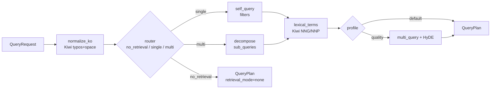
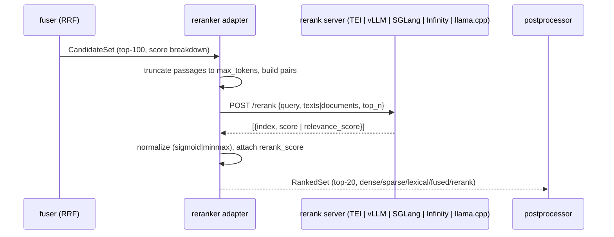
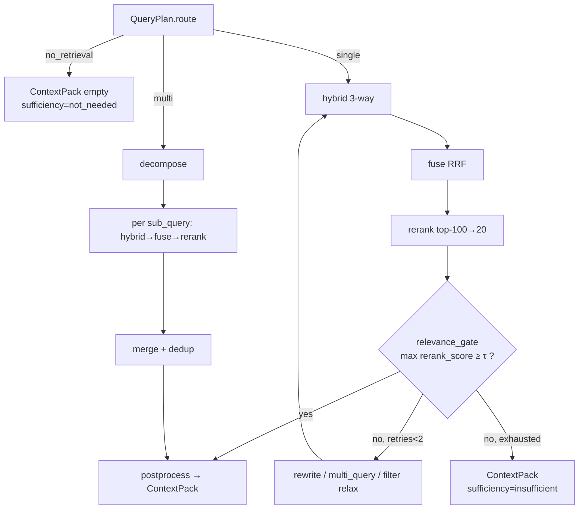

# 리트리벌 기법: 질의 이해·융합·리랭킹·후처리

## 목적

이 문서는 브리프 D-07(기본 검색 파이프라인: 3-way 하이브리드 → 융합 → 크로스인코더 리랭킹 → 후처리)과 D-16(기본 리랭커 `bge-reranker-v2-m3`)을 실증 근거로 검증하고, 질의 이해(query understanding)·융합(fusion)·리랭킹(reranking)·후처리(post-processing)·적응형 검색(adaptive retrieval) 네 영역에서 채택 가능한 오픈소스 기법과 라이브러리를 조사한다. 결과물은 다음 결정의 근거가 된다.

- `query_transformer`, `fuser`, `reranker`, `postprocessor`, `packer` 확장 지점(D-10)의 1차/2차/폴백 선정.
- 개방 결정 **O-01**(융합 기본값: RRF vs 가중 정규화 vs DBSF)과 **O-04**(late interaction의 위치)에 대한 명시적 권고.
- `QueryPlan`, `CandidateSet`, `RankedSet`, `ContextPack` 계약(D-05)이 각 기법을 손실 없이 표현하기 위해 담아야 할 필드 제안.
- 품질 목표(§7: 리트리벌 p95 < 800ms GPU / < 1.5s CPU, nDCG@10 ≥ 0.80)를 만족하는 프로파일 조합.

모든 버전·라이선스·수치는 2026-09-18에 웹(Hugging Face 모델 카드, GitHub README, 공식 문서, arXiv 초록)에서 직접 확인하고, 2026-09-22 검증 라운드에서 오류 14건을 교정하고 누락 후보 14종을 추가했다(PyPI JSON·GitHub 이슈·릴리스 노트·LlamaIndex 소스 재확인). 확인하지 못한 항목은 "확인 필요(as of 2026-09)"로 표기했다. RRF 원논문 PDF는 페치에 실패해(403) 지식 기반으로 서술하고 표시했다.

## 범위

| 포함 | 제외 |
|------|------|
| 질의 재작성, HyDE, query2doc, multi-query, RAG-Fusion, step-back, 질의 분해, 의도/라우팅 분류, self-query(메타데이터 필터 추출), 한국어 오타·띄어쓰기 교정, BM25용 키워드 추출 | 임베딩 모델 선정([05-embedding-models-and-serving.md](05-embedding-models-and-serving.md)) |
| RRF, CombSUM/CombMNZ, min-max/z-score 가중합, DBSF, 학습 기반 융합, 백엔드 내장 융합(Qdrant/OpenSearch/Weaviate), 융합 참조 구현(ranx) | 인덱스 백엔드 자체 비교([06-vector-and-lexical-index-backends.md](06-vector-and-lexical-index-backends.md)) |
| 크로스인코더·LLM 기반·late interaction 리랭커, 리랭커 서빙(TEI/Infinity/vLLM/SGLang/llama.cpp), 경량 라이브러리(FlashRank, rerankers, rank_llm) | GraphRAG/RAPTOR 인덱스 구조(04-pipelines/18에서 다룸; 여기서는 질의 시점 라우팅만) |
| MMR, 근중복 제거, 부모 확장, 문장 윈도우, LongContextReorder, 컨텍스트 압축, 충분성 판정, 인용 단위 정렬 | Context Pack 직렬화 포맷 자체(../03-contracts/11-context-pack.md) |
| Self-RAG, CRAG, Adaptive-RAG, IRCoT, FLARE, 검색 필요성 판단 | 최종 답변 생성 UI |

## 평가 기준

가중치는 브리프 원칙 6(Korean-First), D-02(라이선스), 원칙 7(Evaluation-Driven), §7 지연 목표를 반영한다. 점수는 1~5(5 최고), 총점 = Σ(점수 × 가중치) / 5 로 100점 만점 환산.

| 기준 | 가중치 | 5점의 의미 | 1점의 의미 |
|------|-------:|-----------|-----------|
| 한국어 지원 | 20 | 한국어 학습 데이터 포함 또는 다국어 벤치마크(MIRACL/MMTEB/MLDR)에서 한국어 성능 공개 | 영어 전용 |
| 라이선스 적합성(D-02) | 20 | Apache-2.0/MIT/BSD | CC-BY-NC, 비공개, GPL 링크 필요 |
| 성숙도/유지보수 | 15 | 12개월 내 릴리스, 활발한 이슈 대응, 주요 프레임워크 통합 | 1년 이상 방치, 단일 기여자 |
| 품질/성능 | 20 | 공개 벤치마크(BEIR/MTEB-R/MMTEB-R/MLDR)에서 동급 최상 | 벤치마크 없음 또는 하위 |
| 통합 난이도 | 10 | TEI/Infinity/vLLM/SGLang 중 두 곳 이상에서 즉시 서빙, 표준 입력(query, texts) | 커스텀 프롬프트·trust_remote_code·전용 런타임 필요 |
| 커뮤니티/생태계 | 10 | 다운로드·스타·프레임워크 어댑터 다수 | 소규모 |
| 운영 비용 | 5 | CPU에서 실용적 | 다중 GPU 필수 |

## 후보 목록

### 리랭커 모델

| 이름 | 최신 버전(확인일) | 라이선스 | 성숙도 | 한국어 지원 | 핵심 강점 | 약점 |
|------|------------------|----------|--------|-------------|-----------|------|
| `BAAI/bge-reranker-v2-m3` | 2024-03-18 공개(FlagEmbedding 릴리스 노트, 2026-09-22 확인) | Apache-2.0 | 높음 | 다국어(bge-m3 기반, 한국어 포함) | 0.6B 경량, TEI·vLLM·Infinity·SGLang·llama.cpp 모두 서빙, 사실상 표준 | MTEB-R 57.03·MMTEB-R 58.36으로 최신 LLM 기반 리랭커 대비 열위 |
| `dragonkue/bge-reranker-v2-m3-ko` | 2025-04 공개(확인) | Apache-2.0 | 중 | 한국어 특화(v2-m3 한국어 미세조정) | 카드 공개 한국어 금융 벤치마크 F1@1 0.9123 vs base 0.8772; TEI 등 v2-m3와 동일 서빙 경로 | 단일 도메인 벤치마크, 범용 한국어 수치 없음 → 골든셋 A/B |
| `Qwen/Qwen3-Reranker-0.6B/4B/8B` | 2025-06-05 공개(확인) | Apache-2.0 | 중상 | 다국어(MMTEB-R 66.36/72.74/72.94) | 동급 0.6B에서 bge-v2-m3 대비 MMTEB-R +8.0, 32K 컨텍스트, 인스트럭션 주입 | TEI 미지원(PR #835 진행 중, as of 2026-09), vLLM `hf_overrides` 또는 SGLang 필요, yes/no 로짓 방식, 4B/8B는 GPU 필수 |
| `tomaarsen/Qwen3-Reranker-0.6B-seq-cls` | 2025 공개(확인) | Apache-2.0 | 중 | Qwen3-Reranker와 동일 | Qwen3-Reranker를 `Qwen3ForSequenceClassification`으로 변환한 체크포인트 → sentence-transformers `CrossEncoder` 경로, TEI PR #835 병합 시 즉시 서빙 후보 | 커뮤니티 변환본(공식 아님), 4B/8B 변환본은 별도 확인 필요 |
| `Qwen/Qwen3-VL-Reranker-2B/8B` | 2026-01 공개(확인) | Apache-2.0 | 낮음(신규) | 다국어(Qwen3-VL 기반) | 텍스트·이미지·비디오 멀티모달 리랭커, SGLang 서빙 지원 | 시각 문서용 별도 플러그인 범위(O-04), 한국어 수치 없음 |
| `Alibaba-NLP/gte-multilingual-reranker-base` | 2024-07-29 공개(확인) | Apache-2.0 | 중상 | 70+ 언어 | 306M·8192 토큰, TEI 공식 지원, Infinity README 테스트 모델, Qwen 표에서 MTEB-R 59.51·MLDR 66.33으로 bge-v2-m3 상회 | `trust_remote_code` 필요, 한국어 단독 수치 미공개 |
| `mixedbread-ai/mxbai-rerank-large-v2` / `base-v2` | 2025-03-13 공개(블로그; 논문 2025-06) | Apache-2.0 | 중 | 100+ 언어(카드) | BEIR 57.49(large), 55.57(base); 기반 Qwen2.5-1.5B/0.5B(블로그 확인); 전용 패키지 `mxbai_rerank` | "Multilingual 29.79"의 벤치마크 정의 불명, 한국어 수치 없음, A100 지연 0.89s |
| `zeroentropy/zerank-1-small` | 2025-07 공개(확인) | Apache-2.0 | 낮음(신규) | 언어 태그 영어 → 한국어 확인 필요 | 1.7B Qwen3 기반 크로스인코더, Cohere Rerank 3.5 상회 주장(자체 벤치마크) | 한국어 미검증, 디코더 기반이라 TEI 미지원 |
| `jinaai/jina-reranker-v3` | 2025-09-29 공개(확인) | CC-BY-NC-4.0 | 중 | 다국어 | BEIR nDCG@10 61.94, 0.6B, listwise "last but not late" interaction | **비상업 라이선스 → D-02 위반, 기본 채택 불가** |
| `jinaai/jina-reranker-v2-base-multilingual` | 2024 공개(확인) | CC-BY-NC-4.0 | 중 | 다국어(MKQA 26개 언어) | 278M, MLDR recall@10 68.95(bge-v2-m3 59.73) | **비상업 라이선스**, 1024 토큰 한계 |
| `BAAI/bge-reranker-v2-gemma` | 2024-03-18 공개(확인) | Apache-2.0(카드) | 중 | 다국어 | bge 계열 중 최고 품질(BAAI 주장), `FlagLLMReranker` | 기반 Gemma-2B의 Gemma Terms 상속 여부 확인 필요, ~3B GPU 필수 |
| `BAAI/bge-reranker-v2-minicpm-layerwise` | 2024-03-18 공개(확인) | Apache-2.0 | 중 | 영어·중국어 중심 | `cutoff_layers` 8~40으로 속도/정확도 조절 | 한국어 약함, MiniCPM 라이선스 상속 확인 필요 |
| `cross-encoder/ms-marco-MiniLM-L6-v2` 계열 | sentence-transformers 문서 기준(확인) | Apache-2.0 | 매우 높음 | 영어 전용 | TREC DL19 nDCG@10 74.30, V100 1,800 docs/s | 한국어 불가; 다국어 변종 `cross-encoder/mmarco-mMiniLMv2-L12-H384-v1`(Apache-2.0)은 mMARCO 14개 언어에 **한국어 미포함** → 후보 제외 |
| `Dongjin-kr/ko-reranker` | 2023-12(확인) | MIT | 낮음(갱신 없음) | 한국어 특화 | MS MARCO 한국어 번역 499,184 triplet 학습, 내부 평가 MRR 0.80→0.87 | 기반 `bge-reranker-large`(v1), 512 토큰, 공개 벤치마크 부재 |
| `upskyy/ko-reranker-8k` | 확인 필요(as of 2026-09) | Apache-2.0 | 낮음 | 한국어 특화 | `bge-reranker-v2-m3`를 `ko-wiki-reranking`으로 미세조정 | 벤치마크 미공개, 단일 기여자 |
| `sigridjineth/ko-reranker-v1.1` | 2025 공개(확인) | 카드 확인 필요(as of 2026-09) | 낮음 | 한국어 특화 | 한국어 미세조정 크로스인코더; `instructkr/reranker-simple-benchmark`(한국어 크로스인코더 벤치마크 러너)로 비교 가능 | 단일 기여자, 라이선스·기반 모델 확인 필요 |
| `castorini/rank_zephyr_7b_v1_full` (RankZephyr) | 2023-12 논문, rank_llm 0.25.7(2025-08-25) | Apache-2.0(코드) / 모델 Zephyr 계열 | 중 | 영어 중심 | GPT-4 listwise 증류, DL19/20·BEIR에서 GPT-4 근접 | 7B GPU, sliding window로 top-20당 수 초, 한국어 미검증 |
| Rank1 / Rank-K / ReasonIR | Rank1: Weller et al. COLM 2025(확인) | 모델별 확인 필요(as of 2026-09) | 낮음(연구) | 영어 중심 | 추론 체인(test-time compute)을 생성한 뒤 판정하는 생성형 리랭커; 복합 질의·인스트럭션 준수 강점 | 문서당 수백 토큰 생성 → 지연 수 초, 한국어 미검증 |
| KaLM-Reranker-V1 nano 0.27B / small 1B / large 4B | arXiv 2606.22807(2026-06) | 가중치·라이선스 확인 필요(as of 2026-09) | 낮음(신규) | 다국어 주장 | "fast but not late interaction" 인코더-디코더 리랭커, BEIR SOTA 주장 | 공개 가중치·서빙 경로 미확인 |
| Querit-Reranker | arXiv 2606.19037(2026-06) | 확인 필요(as of 2026-09) | 낮음(신규) | 다국어 주장 | 라벨 없는 분포 적응으로 학습한 소형 다국어 리랭커 | 라이선스·가중치 미확인 |
| `monoT5` / `RankT5` / `LiT5` | rank_llm 포함(확인) | Apache-2.0 | 높음(연구용) | 영어(mT5 변종 별도) | pointwise/pairwise(DuoT5) 표준 베이스라인 | 한국어 모델 부재, 최신 크로스인코더 대비 이점 없음 |
| ColBERT 리랭킹(`rerankers[transformers]` colbert 타입, `rerankers[pylate]`) | rerankers 0.10.0(확인) | Apache-2.0 | 중 | BGE-M3 colbert 벡터로 다국어 가능 | 저장된 multivector에 MaxSim만 계산 → 매우 저지연 | 크로스인코더 대비 정확도 열위, 저장 비용 |
| `nlpai-lab/KURE-v2` (late interaction) | 2025 공개(확인) | MIT | 중 | 한국어 특화(고려대) | 128d 토큰 벡터 MaxSim, 한국어 학습 → O-04 1차 경량 단계에서 BGE-M3 colbert 대안 | 별도 멀티벡터 저장 필요, 크로스인코더 대비 정확도 열위 |

### 리랭커 라이브러리·서빙

| 이름 | 최신 버전(확인일) | 라이선스 | 성숙도 | 핵심 강점 | 약점 |
|------|------------------|----------|--------|-----------|------|
| Text Embeddings Inference(TEI) | v1.9.4(2026-09-15; v1.9.0은 2026-02-17) | Apache-2.0 | 높음 | `/rerank` 엔드포인트, XLM-RoBERTa·GTE·ModernBERT 시퀀스 분류 지원, CPU/GPU 이미지 | **Qwen3-Reranker 등 디코더 리랭커 미지원**(Qwen3는 임베딩만). "Support Qwen3-Reranker" PR #835(2026-02-20 생성, 이슈 #643/#691/#763 연결) 진행 중(as of 2026-09) → 병합 시 재평가 |
| SGLang | 최신 문서 기준(확인) | Apache-2.0 | 높음 | `/v1/rerank`로 bge-reranker-v2-m3(`--is-embedding`), Qwen3-Reranker(디코더 yes/no logprob), Qwen3-VL-Reranker 공식 지원 | GPU 전제; 크로스인코더 전용 서버 대비 무거움 |
| vLLM(pooling runner) | 최신 문서 기준(확인) | Apache-2.0 | 높음 | `/score`, `/v1/score`, `/rerank`, `/v1/rerank`, `/v2/rerank`(Jina·Cohere 호환), bge-v2-m3 및 Qwen3-Reranker 공식 레시피 | GPU 전제, 크로스인코더에는 과한 런타임 |
| llama.cpp `llama-server --rerank` | 최신 빌드 기준(확인) | MIT | 중상 | bge-reranker-v2-m3 GGUF를 `/v1/rerank`로 CPU 서빙, 양자화로 메모리 절감 → `lite` 프로파일 폴백 후보 | Qwen3-Rerank 등 일부 모델 결과 오류 이슈 #16407(as of 2026-09) → bge-v2-m3 GGUF에 한정 |
| Infinity(`infinity_emb`) | v2 CLI(패치 버전 확인 필요, as of 2026-09) | MIT | 중상 | Cohere 호환 `/rerank`, torch/optimum/CTranslate2, 임베딩·리랭커·ColBERT·CLIP 동시 서빙; README 테스트 모델에 `BAAI/bge-reranker-v2-m3`·`Alibaba-NLP/gte-multilingual-reranker-base` 명시 | Qwen3-Reranker 지원 여부 확인 필요(as of 2026-09) |
| `rerankers`(AnswerDotAI) | 0.10.0(확인) | Apache-2.0 | 중상 | 단일 API로 cross-encoder/t5/colbert/rankgpt/rankllm/flashrank/llm-layerwise/monovlm/mxbaiv2/api(TEI 포함) 교체. extras: `transformers`, `api`, `gpt`, `flashrank`, `llmlayerwise`, `monovlm`, `rankllm`, `pylate`, `all` | 추상화 계층 추가, 배치·비동기 제어 제한 |
| FlashRank | 0.2.10(2025-01-06, 확인; 마지막 릴리스 20개월 경과) | Apache-2.0 | 중 | onnxruntime 전용(torch 불필요), `ms-marco-MultiBERT-L-12`(~150MB, 100+ 언어) | 모델 선택 폭 좁음, 최신 모델 부재, 릴리스 정체 |
| `rank_llm`(castorini) | 0.25.7(2025-08-25, 확인) | Apache-2.0 | 중상 | RankZephyr/RankVicuna/RankGPT/RankGemini/FIRST/LiT5/MonoT5/DuoT5 통합 | 연구 지향, 프로덕션 배치 API 미흡 |
| FlagEmbedding(`FlagReranker`, `FlagLLMReranker`, `LayerWiseFlagLLMReranker`) | 최신 버전 확인 필요(as of 2026-09) | MIT | 높음 | bge 계열 공식 구현, `normalize=True` 시그모이드 | torch 의존, 서버 아닌 라이브러리 |
| `instructkr/reranker-simple-benchmark` | GitHub(확인) | 저장소 확인 필요(as of 2026-09) | 낮음 | 한국어 크로스인코더 전용 벤치마크 러너 → 골든셋 전 사전 스크리닝 도구 | 데이터셋 구성·라이선스 확인 필요 |
| OpenSearch `rerank` 응답 프로세서 | 2.12+(ml_opensearch), `by_field` 2.18+(확인) | Apache-2.0 | 중상 | OpenSearch 단독 구성에서 크로스인코더(ml-commons 커넥터) 또는 필드 기반 백엔드 내장 리랭킹; 2.19 score-ranker-processor(RRF)와 조합 | 우리 3-way 채널은 Qdrant+OpenSearch에 걸쳐 있어 기본 경로 아님 |
| `ranx`(AmenRa) | 최신 PyPI(확인) | MIT | 중상 | RRF/CombSUM/CombMNZ/가중 융합 등 20+ 알고리즘, `optimize_fusion` 그리드 탐색, 평가 지표 내장 | 평가·오프라인 튠용(numba 의존); 온라인 fuser는 자체 구현 |

### 질의 이해·후처리·적응형 기법(논문·라이브러리)

| 기법 | 출처(확인) | 효과 크기(논문 수치) | 비용 | 한국어 |
|------|-----------|---------------------|------|--------|
| HyDE | Gao et al. 2022-12 (arXiv 2212.10496) | Contriever 대비 유의미 개선, 미세조정 모델에 근접; Mr.TyDi에 ko 포함 | LLM 1회 + 임베딩 1회 | 논문에서 ko 실험 존재 |
| query2doc | Wang et al. EMNLP 2023 (arXiv 2303.07678) | BM25 +3~15%(MS MARCO/TREC DL), dense도 개선 | LLM 1회(few-shot) | 미검증 |
| Step-back prompting | Zheng et al. ICLR 2024 (arXiv 2310.06117) | PaLM-2L: MMLU Physics +7, Chemistry +11, TimeQA +27, MuSiQue +7 | LLM 1회 | 미검증 |
| Multi-query / RAG-Fusion | Rackauckas 2024-02 (arXiv 2402.03367) | 답변 포괄성 향상(수작업 평가); 생성 질의가 벗어나면 off-topic | LLM 1회 + 검색 N회 | 미검증 |
| IRCoT | Trivedi et al. ACL 2023 (arXiv 2212.10509) | 검색 recall 최대 +21pt, QA 최대 +15pt(HotpotQA 등) | LLM 다회 반복 | 미검증 |
| FLARE | Jiang et al. EMNLP 2023 (arXiv 2305.06983) | 생성 중 저신뢰 토큰이 나오면 다음 문장을 질의로 재검색; 4개 장문 생성 과제에서 단발 검색 상회 | LLM 생성 중 조건부 검색 다회 | 미검증 |
| Self-RAG | Asai et al. ICLR 2024 (arXiv 2310.11511) | 7B/13B가 ChatGPT·RA-Llama2-chat 상회(PopQA/PubHealth/ARC/ASQA) | 전용 미세조정 모델, 세그먼트별 다중 생성 | 모델 영어 전용 |
| CRAG | Yan et al. 2024-01(v3 2024-10) (arXiv 2401.15884) | 4개 데이터셋에서 RAG·Self-RAG 상회(수치는 본문 확인 필요) | T5-large 평가기 + 웹 검색 폴백 | 평가기 영어 |
| Adaptive-RAG | Jeong et al. NAACL 2024 (arXiv 2403.14403) | 3단계 복잡도 분류로 정확도·시간 균형 | T5-large 분류기 1회 | 분류기 영어 |
| Lost in the Middle | Liu et al. TACL 2023 (arXiv 2307.03172) | U자형 성능 곡선(처음·끝 우세) | 재정렬만, 무비용 | 모델 일반 |
| LLMLingua-2 / LongLLMLingua | Microsoft (MIT) | 최대 20x 압축, LLMLingua 대비 3~6x 고속; LongLLMLingua NQ +21.4%(1/4 토큰) | 소형 인코더 1회 | `bert-base-multilingual-cased` 변종 존재, 한국어 정확도 확인 필요 |
| Provence | Naver Labs Europe, ICLR 2025 | 7개 데이터셋에서 성능 손실 거의 없이 문장 프루닝 | DeBERTa-v3-large 430M | **영어 전용, CC-BY-NC-ND 4.0 → 채택 불가** |
| RECOMP | Xu et al. ICLR 2024 (arXiv 2310.04408) | 압축률 최저 6%까지 성능 손실 최소, 선택적 보강(빈 출력) | 학습된 추출/생성 압축기 | 영어 |
| Sufficient Context | Joren et al. 2024-11(v3 2025-04) (arXiv 2411.06037) | 충분성 자동판정 + 선택적 생성: **응답한 경우의 정답 비율(선택적 정확도)** +2~10%(Gemini/GPT/Gemma), 미응답(abstain) 증가 동반 — 전체 정답률 개선치가 아님 | LLM 판정 1회 | 프롬프트 기반, 언어 중립 |
| Contextual Retrieval | Anthropic 2024-09 | top-20 실패율 5.7%→3.7%(-35%), +BM25 2.9%(-49%), +리랭킹 1.9%(-67%) | 인덱싱 시 LLM, 검색 시 리랭커 | 언어 중립 |
| AutoMergingRetriever | LlamaIndex 문서(확인) | 60문항 평가에서 correctness 4.27 vs 4.21, pairwise 52.5% 선호(사실상 동률) | 무비용(docstore 조회) | 언어 중립 |

## 심층 비교

### 1. 질의 이해(Query Understanding)

#### 1.1 기법별 동작과 진입점

| 기법 | 동작 방식 | 실제 진입점(구현 권고) | 출력(QueryPlan 매핑) | 함정 |
|------|-----------|----------------------|---------------------|------|
| 질의 재작성(rewrite) | 대화 맥락 해소·동의어 확장·오타 교정 후 단일 질의 생성 | 자체 `query_transformer` 플러그인: Pydantic 구조화 출력(LLM tool use) | `rewritten_queries[0]` | 과교정으로 원 의도 상실; 원 질의는 항상 보존해 함께 검색 |
| HyDE | LLM이 가상 답변 문서 생성 → 임베딩 → dense 검색 | 자체 구현(LlamaIndex `HyDEQueryTransform` 참고) | `hypothetical_documents[]` → dense 전용 | 사실 오류가 있는 가상 문서가 검색을 오도; 도메인 특수 용어 부재 시 역효과. dense 채널에만 적용하고 lexical은 원 질의 유지 |
| query2doc | few-shot 가상 문서를 질의에 **덧붙임**(BM25는 원 질의를 반복해 가중) | 자체 구현 | `expanded_lexical_query` | BM25에 가상 문서 전체를 넣으면 잡음 증가 → 키워드만 추출해 부착 |
| multi-query / RAG-Fusion | LLM이 3~5개 변형 질의 생성, 각각 검색 후 RRF | 자체 구현(LangChain 1.x `langchain_classic.retrievers.multi_query.MultiQueryRetriever` 참고) | `rewritten_queries[]` + `fusion.method = rrf` | 검색 호출 N배, off-topic 변형이 최종 순위 오염(Rackauckas 2024). 변형 질의에 낮은 가중 |
| step-back | 상위 개념 질의 생성 → 원 질의와 함께 검색 | 자체 구현 | `rewritten_queries[]`(`role = abstraction`) | 사실형 단답 질의에는 무용; 라우터가 "설명형"으로 분류한 경우만 |
| 질의 분해(sub-questions) | 복합 질의를 독립 하위 질의로 분해, 각각 검색 후 합성 | 자체 구현(LlamaIndex `SubQuestionQueryEngine` 참고) | `sub_queries[]` | 하위 질의 간 의존성 있는 경우 IRCoT로 승격 |
| 의도/라우팅 분류 | 검색 불필요/단일/다단계, 컬렉션 선택, 표·그림 우선 등 분류 | 소형 분류기(Adaptive-RAG 방식) 또는 LLM 구조화 출력 | `route`, `retrieval_mode` | 학습 데이터 없는 초기에는 규칙 + LLM, 골든셋 축적 후 소형 분류기 증류 |
| self-query(메타데이터 필터 추출) | 자연어에서 날짜·부서·문서유형 등 필터를 구조화 | 자체 구현: `AttributeInfo` 스키마 → Pydantic 필터 모델(LangChain 1.x `langchain_classic.retrievers.self_query.base.SelfQueryRetriever` 개념 차용; Qdrant/OpenSearch 필터로 번역) | `filters`(D-09 `tenant_id`/`collection_id`/`acl`와 AND 결합) | 추출 필터가 과도하게 좁히면 0건 → 필터 완화 폴백 필수 |
| 한국어 오타·띄어쓰기 교정 | 형태소 분석기 내장 오타 모델 + 띄어쓰기 복원 | `kiwipiepy`: `Kiwi(typos='basic' | 'continual' | 'basic_with_continual_and_lengthening')`, `Kiwi.space(text, reset_whitespace=False)`; 형태소 내부 공백 허용치는 메서드 인자가 아니라 객체 속성 `kiwi.space_tolerance = N`(또는 `Kiwi.global_config.space_tolerance`)으로 설정 | `normalized_query` | kiwipiepy 0.23.2 이하 LGPLv3, **0.24.0부터 Apache-2.0**(이슈 #233, 2026-09-17 공지). 단 **kiwipiepy 0.24.0은 PyPI 미배포**(2026-09-22 기준 최신 0.23.2, 분류자 LGPLv3; Kiwi C++ 코어 0.24.0은 2026-09-13 Zenodo 등록) → 하한 `>=0.24.0`은 배포 전까지 설치 불가. `py-hanspell`은 비공식 네이버 API 의존으로 제외 |
| 키워드 추출(BM25용) | 명사·고유명사 추출, 불용어 제거, 복합명사 분리 | `kiwipiepy` 품사 태그(NNG/NNP/SL/SN) 기반 자체 추출; 선택적으로 BGE-M3 sparse 가중치 상위 토큰 | `lexical_terms[]`(가중치 포함) | OpenSearch Nori와 Kiwi의 분절 불일치 → 인덱스 분석기와 동일 규칙 사용 권고 |

#### 1.2 비용·효과 요약

| 기법 | 추가 지연(추정, 초안) | 추가 LLM 호출 | 효과 근거 | 기본 프로파일 |
|------|----------------------|--------------|-----------|---------------|
| 한국어 교정 + 키워드 추출 | < 5ms(CPU) | 0 | Kiwi 정확도 웹 87%/문어 94%(README) | 켬 |
| self-query 필터 추출 | 300~800ms | 1 | 필터 정합 시 후보 잡음 대폭 감소(정성) | 켬(캐시) |
| 질의 재작성 | 300~800ms | 1 | 대화형 질의에서 필수(정성) | 켬(대화 맥락 있을 때만) |
| multi-query(3개) | 검색 3배 + LLM 1회 | 1 | Rackauckas 2024: 포괄성 향상, off-topic 위험 | 끔(`quality` 프로파일 켬) |
| HyDE | LLM 1회 + 임베딩 1회 | 1 | Gao et al.: unsupervised dense 대비 개선; 미세조정 dense 대비 이점 불명 | 끔(`quality` 선택) |
| query2doc | LLM 1회 | 1 | BM25 +3~15% | 끔(lexical 전용 실험) |
| step-back | LLM 1회 | 1 | 추론형 QA +7~27pt | 끔(라우터가 설명형일 때) |
| 질의 분해 | LLM 1회 + 검색 N배 | 1+ | 다중 홉에서 IRCoT 대비 저비용 | 라우터 결정 |

"추가 지연"은 실측 전 초안 추정치이며 평가 하네스로 대체한다.



### 2. 융합(Fusion)

#### 2.1 알고리즘 비교

| 방법 | 수식/동작 | 튜닝 파라미터 | 강건성(이기종 점수) | 실증 품질 | 백엔드 지원(확인) |
|------|-----------|--------------|--------------------|-----------|------------------|
| RRF | score(d) = Σ_r 1/(k + rank_r(d)) | k(원논문 k=60; Cormack et al. SIGIR 2009 — PDF 페치 실패, 지식 기반) | 매우 높음(점수 무시) | Bruch et al. 2023: 튠된 convex combination(CC)에 **일관되게 열위**, k에 민감 | Qdrant `Fusion.RRF`(**기본 k=2**, v1.16.0부터 `rrf.k` 설정, v1.17.0 weighted RRF); OpenSearch score-ranker-processor(2.19 도입, 공식 블로그); Weaviate `rankedFusion`; ranx `fuse(method="rrf")` |
| CombSUM / CombMNZ | 정규화 점수 합 / 합 × 등장 리트리버 수 | 정규화 방식 | 중(정규화 의존) | Cormack 2009에서 RRF가 CombMNZ 상회(지식 기반) | 자체 구현; ranx `combsum`/`combmnz` |
| min-max 가중합(CC) | Σ_r w_r · (s − min)/(max − min) | w_r(합 1) | 중(이상치에 민감) | Bruch et al.: in-domain·OOD 모두 RRF 상회, 정규화 방식에 둔감, 소량 샘플로 α 튠 가능 | OpenSearch normalization-processor `min_max` + `arithmetic_mean` weights; Weaviate `relativeScoreFusion`(v1.24부터 기본, alpha); ranx `wsum` + `optimize_fusion` |
| z-score 가중합 | Σ_r w_r · (s − μ)/σ | w_r | 중상 | Bruch et al.: min-max와 동등 | OpenSearch `z_score` 정규화(2.19 도입, 중간 신뢰 — 릴리스 노트 재확인 권고) |
| DBSF | ŝ = (s − (μ − 3σ)) / 6σ 후 합 | 없음(가중 선택) | 높음(분포 기반, 이상치 완화) | 공개 학술 비교 부재(Qdrant 문서·Mazzeschi 2023 블로그, 확인 필요) | Qdrant `Fusion.DBSF` |
| 학습 기반(LTR) | LightGBM LambdaMART 등으로 dense/sparse/lexical 점수+피처 결합 | 모델 | 높음 | 골든셋 규모에 비례; 소량이면 CC가 더 효율적(Bruch et al.) | 자체 구현(후속) |

핵심 실증 근거(Bruch, Gai, Ingber, "An Analysis of Fusion Functions for Hybrid Retrieval", ACM TOIS 2023, arXiv 2210.11934): (1) convex combination이 RRF를 in-domain·out-of-domain 모두에서 상회, (2) RRF는 기존 통념과 달리 파라미터에 민감, (3) CC 학습은 정규화 선택(min-max/z-score/theoretical)에 거의 무관, (4) CC는 단일 파라미터를 소량 예제로 튠 가능해 실용적.

참조 구현·튠 도구: `ranx`(MIT)는 RRF/CombSUM/CombMNZ/가중합 등 20종 이상의 융합 함수와 `optimize_fusion`(qrels 기반 파라미터 그리드 탐색)을 제공한다. 온라인 `fuser` 플러그인은 의존성을 줄이기 위해 자체 구현하되, 평가 하네스(08-evaluation)에서 CC 가중치·RRF k 그리드 탐색과 자체 구현의 정확성 검증(동일 입력에 대한 결과 일치 테스트)에 ranx를 사용한다.

#### 2.2 3-way 하이브리드에서의 함의

D-07은 dense + sparse(learned) + lexical(BM25) 세 채널이다. 세 채널이 서로 다른 백엔드(Qdrant dense/sparse, OpenSearch BM25)에 있으므로 **융합은 백엔드 내장 기능이 아니라 플랫폼 `fuser` 플러그인에서 수행**해야 한다. Qdrant 단독 경량 프로파일에서만 Qdrant `prefetch` + `Fusion.RRF/DBSF`를 위임할 수 있고, OpenSearch 단독 구성에서는 score-ranker-processor(RRF, 2.19+)·normalization-processor와 `rerank` 응답 프로세서를 위임할 수 있다.

| 상황 | 권고 융합 | 이유 |
|------|-----------|------|
| 골든셋 없음(신규 컬렉션) | RRF, k=60, 채널 가중 1:1:1 | 무튠 강건성 |
| 골든셋 ≥ 200 qrels | min-max CC, 가중치 그리드(0.05 단위, ranx `optimize_fusion`) 튠 후 프로파일 고정 | Bruch et al. 근거 |
| 점수 분포 왜곡(sparse 롱테일) | DBSF 또는 z-score CC | 분포 기반 정규화 |
| multi-query 변형 질의 포함 | 변형 질의 채널에 가중 0.5, 원 질의 1.0 | RAG-Fusion off-topic 완화 |

### 3. 리랭킹(Reranking)

#### 3.1 크로스인코더(인코더 기반)

**bge-reranker-v2-m3** — 동작: XLM-RoBERTa(bge-m3) 기반 pointwise 크로스인코더, `[query, passage]` 쌍당 로짓 1개. 2024-03-18 공개(FlagEmbedding 릴리스 노트 "Release new rerankers, built upon powerful M3 and LLM"). 진입점: `FlagEmbedding.FlagReranker('BAAI/bge-reranker-v2-m3', use_fp16=True).compute_score([q, p], normalize=True)`(시그모이드 [0,1]); TEI `POST /rerank {"query": ..., "texts": [...]}`; vLLM `vllm serve BAAI/bge-reranker-v2-m3 --runner pooling` 후 `/v1/rerank`; SGLang `--is-embedding` 후 `/v1/rerank`; llama.cpp `llama-server -m bge-reranker-v2-m3-*.gguf --rerank` 후 `/v1/rerank`(CPU). 출력: 쌍별 실수 점수(정규화 선택). 근거: Qwen3 표에서 MTEB-R 57.03 / CMTEB-R 72.16 / MMTEB-R 58.36 / MLDR 59.51; jina-v3 논문 BEIR 56.51. 함정: 512~8192 토큰 입력에서 긴 passage는 잘림(bge-m3 8192 지원이나 리랭커 실사용 512~1024 권고, 확인 필요), 점수 절대값이 컬렉션 간 비교 불가(캘리브레이션 필요).

**gte-multilingual-reranker-base** — 306M, 8192 토큰, 70+ 언어. 진입점: `sentence_transformers.CrossEncoder("Alibaba-NLP/gte-multilingual-reranker-base", trust_remote_code=True).predict(pairs)`; TEI 공식 지원 목록 포함; Infinity README 테스트 모델 목록 포함. 근거: Qwen3 표 MTEB-R 59.51 / CMTEB-R 74.08 / MMTEB-R 59.44 / MLDR 66.33 — 파라미터 절반으로 bge-v2-m3를 MTEB-R·MLDR에서 상회. 함정: `trust_remote_code`, 한국어 단독 수치 미공개 → 골든셋 검증 필수. **CPU/경량 프로파일 1차 후보**.

**ms-marco-MiniLM-L6-v2** — 영어 전용. sentence-transformers 문서: TREC DL19 nDCG@10 74.30, MS MARCO dev MRR@10 39.01, V100 1,800 docs/s. 한국어 컬렉션에서는 사용 불가. 다국어 변종 `cross-encoder/mmarco-mMiniLMv2-L12-H384-v1`(Apache-2.0)은 존재하나 학습 데이터 mMARCO의 14개 언어에 한국어가 없어 한국어 후보에서 **명시 제외**한다.

**한국어 특화** — 골든셋 A/B 대상은 다음 네 모델이다(기본 채택 없음).

| 모델 | 기반 | 라이선스 | 공개 수치 | 비고 |
|------|------|----------|-----------|------|
| `dragonkue/bge-reranker-v2-m3-ko`(2025-04) | bge-reranker-v2-m3 | Apache-2.0 | 카드: 한국어 금융 벤치마크 F1@1 **0.9123** vs base 0.8772 | v2-m3와 동일 아키텍처 → TEI/vLLM/SGLang/Infinity 그대로 서빙. 단일 도메인 수치라 범용성은 골든셋으로 확인 |
| `Dongjin-kr/ko-reranker`(2023-12) | bge-reranker-large(v1) | MIT | 자체 평가 hit@k 0.93→0.96, MRR 0.80→0.87(리랭커 미사용 대비); Amazon Translate로 번역한 MS MARCO 499,184 triplet 학습 | 512 토큰, 2023년 이후 갱신 없음. 진입점 `AutoModelForSequenceClassification.from_pretrained("Dongjin-kr/ko-reranker")` |
| `upskyy/ko-reranker-8k` | bge-reranker-v2-m3 | Apache-2.0 | 미공개 | `ko-wiki-reranking` 미세조정, 단일 기여자 |
| `sigridjineth/ko-reranker-v1.1` | 확인 필요 | 확인 필요(as of 2026-09) | `instructkr/reranker-simple-benchmark`로 비교 가능 | 단일 기여자 |

사전 스크리닝 도구: `instructkr/reranker-simple-benchmark`(한국어 크로스인코더 전용 벤치마크 러너)와 AutoRAG passage_reranker 모듈을 골든셋 구축 전 1차 필터로 사용한다. dragonkue 모델은 서빙 경로가 기본 리랭커와 동일하므로, 골든셋 nDCG@10에서 base를 +2pt 이상 상회하면 `default` 프로파일의 모델 ID만 교체하는 저비용 승격이 가능하다.

#### 3.2 LLM 기반 pointwise 리랭커(디코더)

**Qwen3-Reranker-0.6B/4B/8B** — 동작: Qwen3 디코더가 인스트럭션 + 질의 + 문서를 받아 다음 토큰 "yes"/"no" 로짓의 softmax를 관련도로 사용. 32K 컨텍스트, 인스트럭션 커스터마이즈 가능(기본 "Given a web search query, retrieve relevant passages that answer the query."). 진입점: (a) vLLM `vllm serve Qwen/Qwen3-Reranker-0.6B --hf_overrides '{"architectures": ["Qwen3ForSequenceClassification"], "classifier_from_token": ["no", "yes"], "is_original_qwen3_reranker": true}'` 후 `/v1/rerank`; (b) SGLang 공식 Rerank models 문서의 Qwen3-Reranker 레시피(yes/no logprob) 후 `/v1/rerank`; (c) `tomaarsen/Qwen3-Reranker-0.6B-seq-cls`를 sentence-transformers `CrossEncoder`로 직접 로딩; (d) Transformers 직접 로딩. 근거(모델 카드 표):

| 모델 | 파라미터 | MTEB-R | CMTEB-R | MMTEB-R | MLDR | MTEB-Code | FollowIR |
|------|---------:|-------:|--------:|--------:|-----:|----------:|---------:|
| Qwen3-Reranker-0.6B | 0.6B | 65.80 | 71.31 | 66.36 | 67.28 | 73.42 | 5.41 |
| Qwen3-Reranker-4B | 4B | 69.76 | 75.94 | 72.74 | 69.97 | 81.20 | 14.84 |
| Qwen3-Reranker-8B | 8B | 69.02 | 77.45 | 72.94 | 70.19 | 81.22 | 8.05 |
| bge-reranker-v2-m3 | 0.6B | 57.03 | 72.16 | 58.36 | 59.51 | 41.38 | -0.01 |
| gte-multilingual-reranker-base | 0.3B | 59.51 | 74.08 | 59.44 | 66.33 | 54.18 | -1.64 |

함정: (1) **TEI 미지원** — TEI 리랭커 지원은 CamemBERT/XLM-RoBERTa 시퀀스 분류 + GTE + ModernBERT에 한정(공식 supported_models 문서 확인). 다만 "Support Qwen3-Reranker" PR #835(2026-02-20)가 열려 있어 병합 시 TEI 단일 스택으로 복귀 가능(as of 2026-09 미병합). 그때까지는 **vLLM 또는 SGLang**으로 서빙한다. (2) 프롬프트 템플릿을 어댑터가 정확히 재현해야 함(모델 카드 형식). (3) 0.6B라도 디코더 구조로 인코더 0.6B보다 지연이 큼(실측 필요). (4) 4B fp16은 약 8~10GB VRAM(추정). 한국어: MMTEB-R은 다국어 집계치이며 한국어 단독 수치는 카드에 없음 → 골든셋 검증.

**Qwen3-VL-Reranker-2B/8B**(Apache-2.0, 2026-01) — 텍스트·이미지·비디오를 함께 받는 멀티모달 리랭커로 SGLang이 서빙을 지원한다. O-04에서 "ColPali 등 시각 문서용 별도 플러그인"의 구체 후보로 두며, 이 문서의 텍스트 파이프라인 범위 밖이다.

**zerank-1-small**(zeroentropy, Apache-2.0, 1.7B, 2025-07) — Qwen3 기반 크로스인코더로 Cohere Rerank 3.5 상회를 주장하나 자체 벤치마크이며 언어 태그가 영어다. 한국어 확인 전까지 후보 표에만 둔다.

**mxbai-rerank-v2(base 0.5B / large 1.5B)** — Apache-2.0, 2025-03-13 블로그 공개(논문 arXiv 2025-06), 카드 "100+ languages", 기반 Qwen2.5-0.5B/1.5B(블로그·PyPI 설명 확인). 진입점: `from mxbai_rerank import MxbaiRerankV2; MxbaiRerankV2("mixedbread-ai/mxbai-rerank-large-v2").rank(query, documents, return_documents=True, top_k=k)`; rerankers 라이브러리 `model_type="mxbaiv2"`. 근거: 카드 표 BEIR 57.49(large)/55.57(base), A100 지연 0.89s/0.67s(배치 조건 미기재). jina-v3 논문 인용치 BEIR 61.44(large-v2, 평가 세팅 상이 가능). 함정: "Multilingual 29.79"의 벤치마크 정의 불명, 한국어 수치 없음, 디코더 기반이라 TEI 미지원.

**bge-reranker-v2-gemma / v2-minicpm-layerwise** — `FlagLLMReranker`, `LayerWiseFlagLLMReranker(...).compute_score(pairs, cutoff_layers=[28])`. gemma는 카드상 Apache-2.0이나 Gemma-2B 기반이라 Gemma Terms of Use 상속 가능성을 법무 검토해야 한다(확인 필요). minicpm-layerwise는 영어·중국어 중심으로 한국어 부적합.

**jina-reranker-v2/v3** — v3은 BEIR 61.94로 공개 모델 중 최상위이며 0.6B(Qwen3-0.6B 기반)로 최대 64문서를 131K 컨텍스트에 한 번에 넣는 listwise "last but not late" interaction. 그러나 **CC-BY-NC-4.0**으로 D-02(Apache 플랫폼, 상업 채택성)에 부합하지 않는다. 사용자가 상용 계약을 맺은 경우에만 `api`/로컬 어댑터로 옵트인.

**2026년 신규 후보(가중치·라이선스 미확인)** — KaLM-Reranker-V1(nano 0.27B / small 1B / large 4B, arXiv 2606.22807)은 "fast but not late interaction" 인코더-디코더 구조로 BEIR SOTA를 주장하고, Querit-Reranker(arXiv 2606.19037)는 라벨 없는 분포 적응으로 학습한 소형 다국어 리랭커다. 둘 다 공개 가중치·라이선스·서빙 경로가 확인되지 않아(as of 2026-09) 후보 표에 기록만 하고 점수표에서 제외한다.

#### 3.3 LLM listwise 리랭커

| 이름 | 방식 | 근거 | 비용 | 진입점 |
|------|------|------|------|--------|
| RankGPT | 프롬프트로 순열 생성, sliding window | Sun et al. EMNLP 2023: GPT-4가 지도학습 SOTA에 경쟁·상회, 440M 증류 모델이 BEIR에서 3B 지도 베이스라인 상회 | API 호출 다회(window 20, step 10) | `rank_llm`(`RankGPT`), `rerankers('rankgpt')` |
| RankZephyr | Zephyr-7B를 RankGPT-4/3.5로 증류 | Pradeep, Sharifymoghaddam, Lin 2023-12 (arXiv 2312.02724): DL19/20·BEIR에서 GPT-4 근접·일부 상회, 초기 순서 변동에 강건 | 7B GPU, sliding window | `rank_llm.rerank.listwise.ZephyrReranker().rerank_batch(requests)`, FlashRank `rank_zephyr_7b_v1_full`(~4GB) |
| FIRST | 첫 식별자 토큰 로짓으로 순위 직접 산출 | Reddy et al. 2024-06: 지연 50% 절감, BEIR 유지·개선 | 7B급 GPU 1회 forward | `rank_llm`(FirstMistral) |
| RankLLaMA | LLaMA-2 7B/13B pointwise 미세조정 | Ma et al. 2023-10: 소형 모델 상회, BEIR zero-shot 강함 | 7B~13B GPU | Hugging Face 체크포인트 |
| Rank1 / Rank-K / ReasonIR | 추론 체인(test-time compute)을 먼저 생성한 뒤 관련도 판정·순위 산출 | Rank1(Weller et al. COLM 2025): 추론 집약 과제(BRIGHT 등)·인스트럭션 준수에서 기존 리랭커 상회 | 문서당 수백 토큰 생성, 7B급 GPU | Hugging Face 체크포인트(라이선스 모델별 확인 필요, as of 2026-09) |

함정: 모두 영어 중심 학습이며 한국어 listwise 품질은 미검증. 지연이 수 초 단위라 §7 목표(p95 800ms)에 부합하지 않는다. `agentic`/오프라인 평가(골든셋 라벨 보조, 증류 교사)로 위치시킨다. 추론형 리랭커(Rank1 계열)는 `agentic` 프로파일의 복합 질의와 골든셋 라벨링 보조에서 우선 실험한다.

#### 3.4 Late interaction(ColBERT) 리랭킹

BGE-M3는 dense·sparse와 함께 colbert 멀티벡터를 출력한다(D-16 "선택적 colbert"). 리랭킹 단계에서는 저장된 토큰 벡터에 MaxSim만 계산하므로 크로스인코더 대비 한 자릿수 이상 저지연이나, 정확도는 크로스인코더에 미치지 못한다(일반 지식; 한국어 수치 확인 필요). 진입점: Qdrant multivector(`MultiVectorComparator.MAX_SIM`) prefetch 재점수; `rerankers[transformers]`의 `model_type="colbert"`; `rerankers[pylate]`/PyLate 직접 사용. 한국어 대안으로 `nlpai-lab/KURE-v2`(MIT, 고려대 KURE 프로젝트의 late-interaction 모델, 128d 토큰 벡터 MaxSim)가 있으며 BGE-M3 colbert와 골든셋에서 비교한다. **O-04 권고는 §"개방 결정" 참조.**

#### 3.5 리랭커 서빙 매트릭스

| 모델 | TEI 1.9.x | SGLang | vLLM pooling | Infinity v2 | llama.cpp `--rerank` | CPU 실용성 |
|------|-----------|--------|--------------|-------------|----------------------|-----------|
| bge-reranker-v2-m3(및 dragonkue ko 변종) | 지원(XLM-R 시퀀스 분류) | 지원(`--is-embedding`) | 지원(`--runner pooling`) | 지원(README 테스트 목록) | 지원(GGUF) | 가능(ONNX/CTranslate2/GGUF, 소량 후보) |
| gte-multilingual-reranker-base | 공식 목록 포함 | 확인 필요(as of 2026-09) | 확인 필요(as of 2026-09) | README 테스트 목록 포함 | 확인 필요 | 가능 |
| Qwen3-Reranker | **미지원**(PR #835 진행 중) | 지원(yes/no logprob) | 지원(`hf_overrides` 레시피) | 확인 필요(as of 2026-09) | 결과 오류 이슈 #16407 → 비권고 | 0.6B만 제한적 |
| Qwen3-VL-Reranker | 미지원 | 지원 | 확인 필요 | 미지원 | 미지원 | 부적합 |
| mxbai-rerank-v2 | 미지원(디코더) | 확인 필요 | 확인 필요 | 확인 필요 | 확인 필요 | 부적합 |
| FlashRank MultiBERT | 해당 없음(인프로세스 ONNX) | 해당 없음 | 해당 없음 | 해당 없음 | 해당 없음 | 최적 |

TEI는 `ghcr.io/huggingface/text-embeddings-inference:{cpu,turing,86,89,hopper,100,120,121}-1.9` 태그(최신 패치 v1.9.4, 2026-09-15)로 배포되며 CUDA compute capability < 7.5(V100 등)는 미지원. vLLM·SGLang·Infinity·llama.cpp의 `/v1/rerank`는 Jina·Cohere API 형태와 호환되어 클라이언트 어댑터 하나로 다섯 서버를 덮을 수 있다. 스키마 차이: 요청 필드 TEI `texts` vs Cohere 계열 `documents`; **응답 필드 TEI `[{"index", "score"}]` vs Cohere 계열 `[{"index", "relevance_score"}]`**. 어댑터는 두 스키마를 모두 파싱해 내부 `RerankScore.raw_score`로 통일한다.



### 4. 후처리(Post-processing)

| 단계 | 기법 | 진입점/구현 | 근거 | 함정 |
|------|------|-------------|------|------|
| 근중복 제거 | 임베딩 코사인 ≥ 0.95 또는 MinHash Jaccard ≥ 0.8 | `datasketch` 2.0.0(MIT): `MinHash(num_perm=128)`, `MinHashLSH(threshold=0.8, num_perm=128)`; 임베딩은 이미 `EmbeddedChunkSet`에 존재 | 표준 기법 | 부모 확장 후 부모-자식 중복 재발 → 확장 후 2차 dedup. **datasketch 2.0.0은 기본 순열 스킴을 `affine32`로 변경해 1.x 서명·LSH 인덱스와 비호환**(릴리스 노트: 재구축 또는 `MinHash(..., scheme='legacy')`) → 재현성(원칙 4)을 위해 프로파일에 `num_perm`·`seed`·`scheme`을 고정하고, 1차 dedup은 임베딩 코사인 우선 |
| 다양성(MMR) | argmax λ·rel − (1−λ)·max sim(선택집합) | 자체 구현(λ 기본 0.7, 초안) | Carbonell & Goldstein 1998 | 리랭크 점수 척도와 코사인 척도 혼합 → 리랭크 점수 min-max 후 적용 |
| 부모 확장(small-to-big) | 자식 청크 다수 적중 시 부모로 병합 | LlamaIndex `AutoMergingRetriever`(`simple_ratio_thresh=0.5`, `HierarchicalNodeParser` 2048/512/128) 개념을 `ChunkSet.parent_id`로 자체 구현 | LlamaIndex 60문항 평가: correctness 4.27 vs 4.21, pairwise 52.5% — 이득 미미 | 토큰 예산 급증; 표 청크는 부모 대신 표 전체+캡션으로 확장 |
| 문장 윈도우 확장 | 적중 문장 ±N 문장 복원 | LlamaIndex `SentenceWindowNodeParser` + `MetadataReplacementPostProcessor` 개념(경로 확인 필요) → 우리 `provenance.char_offset`으로 원문 슬라이스 | 정성 | 문장 경계 한국어 처리는 Kiwi 문장 분리 사용 |
| 순서 재배치 | 상위 결과를 앞·뒤에 교대 배치(U자형 대응) | `llama_index.core.postprocessor.LongContextReorder` 알고리즘 자체 구현: **관련도 오름차순 정렬 후** 짝수 인덱스는 `insert(0)`(앞), 홀수 인덱스는 `append`(뒤) → 결과적으로 1·2위가 양 끝, 최하위가 중앙(LlamaIndex `node.py` 소스 확인) | Liu et al. TACL 2023 U자형 곡선 | 정렬 방향을 빠뜨리고 관련도 내림차순 `RankedSet`에 "짝수 앞, 홀수 뒤"만 적용하면 1위가 정확히 중앙에 놓여 정반대 효과 → 단위 테스트에 "상위 2개가 첫·마지막 위치" 불변식 포함. 인용 번호 순서와 어긋남 → 인용 ID는 관련도 순으로 고정하고 배치만 변경 |
| 컨텍스트 압축 | 토큰 분류기로 저정보 토큰 제거 | LLMLingua-2: `PromptCompressor(model_name="microsoft/llmlingua-2-xlm-roberta-large-meetingbank", use_llmlingua2=True).compress_prompt(prompt, rate=0.33)` | 최대 20x, LongLLMLingua NQ +21.4%(1/4 토큰) | MeetingBank(영어) 학습; 한국어에서 조사·어미 삭제 시 의미 훼손 위험 → 기본 끔, 골든셋 검증 후 |
| 추출 요약 | 문장 단위 관련도 선택 | RECOMP 방식(자체 학습 필요) 또는 리랭커를 문장 단위로 재적용 | RECOMP 6% 압축률 | 학습 비용; 우선순위 낮음 |
| 충분성 판정 | 컨텍스트가 질문에 충분한지 LLM 판정 | Joren et al. 프롬프트(공개) → `ContextPack.sufficiency` | 자동판정 가능; 선택적 생성으로 **응답한 경우의 정답 비율** +2~10%(미응답 증가 동반, 전체 정답률 아님) | LLM 1회 추가; `answer` 레퍼런스 구현과 `agentic` 프로파일에서만. 미응답률 상승을 별도 지표로 추적 |
| 인용 단위 정렬 | 청크를 인용 가능한 최소 단위(문장/셀)로 정렬하고 ID 부여 | 자체 구현(`provenance` 기반) | D-20 Anthropic `citations` 요구 | 표 셀 인용은 행 단위로 |

권고 후처리 순서: `dedup(자식) → mmr → parent_expand → dedup(부모 포함) → sentence_window(선택) → compress(선택) → reorder → citation_align → token_budget_pack`. D-07의 나열 순서(중복 제거, 부모 확장, MMR)와 달리 **MMR을 부모 확장 앞에** 두어 확장 전 다양성을 확보하고, 확장 후 2차 dedup을 넣는다.

### 5. 적응형 검색(Adaptive Retrieval)

| 기법 | 핵심 메커니즘 | 효과(논문) | 비용 | 플랫폼 적용 위치 |
|------|--------------|-----------|------|-----------------|
| Adaptive-RAG | T5-large 분류기가 no/single/multi 3분류, 라벨은 모델 결과·데이터셋 편향에서 자동 수집 | 단일·다중 홉 혼합에서 정확도·시간 균형 개선 | 분류기 1회(<50ms 추정) | `query_transformer.router` — 초기에는 LLM 구조화 출력, 골든셋 축적 후 소형 분류기 증류 |
| CRAG | T5-large 평가기가 Correct/Incorrect/Ambiguous 판정, decompose-then-recompose 정제, 웹 검색 폴백 | RAG·Self-RAG 상회(4개 데이터셋) | 평가기 1회 + 조건부 재검색 | `postprocessor.relevance_gate` — 리랭크 점수 임계로 대체 가능(저비용 근사) |
| Self-RAG | 반성 토큰(Retrieve/ISREL/ISSUP/ISUSE)을 생성하는 전용 7B/13B 모델 | ChatGPT·RA-Llama2-chat 상회 | 전용 모델, 세그먼트별 다중 생성 | 플랫폼 범위 밖(생성기 측). 반성 토큰 개념만 `ContextPack.sufficiency`로 차용 |
| IRCoT | CoT 문장마다 검색 반복 | 검색 recall +21pt, QA +15pt | LLM 다회 | `agentic` 프로파일: MCP `search` 도구를 에이전트가 반복 호출(D-13) |
| FLARE | 생성 중 토큰 확률이 임계 미만인 문장을 질의로 재검색해 재생성 | 장문 생성(multihop QA·요약·상식 추론)에서 단발·고정 간격 검색 상회 | 생성기 로그확률 접근 + 조건부 검색 다회 | `agentic` 프로파일·`answer` 레퍼런스: 생성기가 logprob를 노출할 때만 적용(MCP `search` 재호출) |
| 검색 필요성 판단 | 라우터 `no_retrieval` 분기 | Adaptive-RAG 일부 | 분류기 1회 | 기본 켬(잡담·형식 변환 요청 차단) |



## 권고안

### 프로파일별 조합

| 프로파일 | 질의 이해 | 융합 | 리랭커(서빙) | 후처리 | 목표 지연(초안) |
|----------|-----------|------|--------------|--------|----------------|
| `default` | Kiwi 교정·키워드, self-query 필터, 대화 재작성, 라우터(no/single/multi) | RRF k=60, 1:1:1 → 골든셋 확보 후 min-max CC로 전환 | 1차 `bge-reranker-v2-m3`(TEI GPU) top-100→20; 골든셋 +2pt 시 `dragonkue/bge-reranker-v2-m3-ko`로 모델 ID만 교체 | dedup → MMR(λ 0.7) → parent → dedup → reorder → pack | p95 < 800ms |
| `quality` | default + multi-query(3) + HyDE(dense 채널) | RRF(원 1.0, 변형 0.5) 또는 튠된 CC | 1차 `Qwen3-Reranker-4B`(vLLM 또는 SGLang) top-50→20, 2차 `Qwen3-Reranker-0.6B` | default + 충분성 판정 + LLMLingua-2(옵션) | p95 < 2.5s |
| `lite`(Qdrant 단독, CPU) | Kiwi 교정·키워드, 규칙 라우터 | Qdrant `prefetch` + `Fusion.RRF`(`k=60` 명시) | 1차 `gte-multilingual-reranker-base`(TEI CPU) top-30→10, 폴백 FlashRank `ms-marco-MultiBERT-L-12`; 대안 llama.cpp `--rerank` + bge-v2-m3 GGUF(검토) | dedup → reorder → pack | p95 < 1.5s |
| `agentic` | Adaptive-RAG형 라우터, 질의 분해, IRCoT/FLARE 루프(MCP) | RRF | quality와 동일(+Rank1 계열 실험) | CRAG형 relevance gate, 충분성 판정 | 요청당 가변 |

### 선정 근거 점수표(리랭커)

| 후보 | 한국어(20) | 라이선스(20) | 성숙도(15) | 품질(20) | 통합(10) | 커뮤니티(10) | 비용(5) | 총점 |
|------|-----------:|-------------:|-----------:|---------:|---------:|-------------:|--------:|-----:|
| Qwen3-Reranker-4B | 5 | 5 | 4 | 5 | 3 | 5 | 2 | 90 |
| bge-reranker-v2-m3 | 4 | 5 | 5 | 3 | 5 | 5 | 4 | 87 |
| Qwen3-Reranker-0.6B | 4 | 5 | 4 | 4 | 3 | 5 | 3 | 83 |
| dragonkue/bge-reranker-v2-m3-ko | 5 | 5 | 3 | 3 | 5 | 2 | 4 | 82 |
| gte-multilingual-reranker-base | 4 | 5 | 4 | 3 | 5 | 3 | 5 | 81 |
| Dongjin-kr/ko-reranker | 5 | 5 | 2 | 3 | 5 | 2 | 4 | 76 |
| bge-reranker-v2-gemma | 4 | 4 | 3 | 4 | 3 | 4 | 2 | 73 |
| ms-marco-MiniLM-L6-v2 | 1 | 5 | 5 | 2 | 5 | 5 | 5 | 72 |
| mxbai-rerank-large-v2 | 3 | 5 | 3 | 4 | 3 | 3 | 2 | 71 |
| FlashRank MultiBERT-L-12 | 3 | 5 | 3 | 2 | 5 | 3 | 5 | 70 |
| jina-reranker-v3 | 4 | 1 | 3 | 5 | 2 | 4 | 3 | 64 |
| RankZephyr(rank_llm) | 2 | 5 | 3 | 4 | 2 | 3 | 1 | 64 |
| zerank-1-small | 2 | 5 | 2 | 4 | 2 | 2 | 2 | 60 |

(통합 점수는 SGLang 지원 반영으로 Qwen3 계열 2→3 상향.) Qwen3-Reranker-4B가 총점 1위이지만 §7 지연 목표와 TEI 서빙 경로를 고려해 **`default`는 bge-reranker-v2-m3, `quality`는 Qwen3-Reranker-4B**로 이원화한다. 두 모델의 한국어 골든셋 nDCG@10 격차가 +3pt 이상이고 p95가 800ms 이내로 실측되면 ADR로 기본값을 Qwen3-Reranker-0.6B/4B로 승격한다. TEI PR #835가 병합되면 Qwen3 계열의 통합 점수를 5로 재산정한다.

### 1차/2차/폴백 요약

| 역할 | 1차 | 2차 | 폴백 |
|------|-----|-----|------|
| 한국어 질의 정규화 | kiwipiepy `>=0.24.0`(Apache-2.0; PyPI 배포 대기, as of 2026-09) | 배포 전 잠정: kiwipiepy 0.23.2(LGPLv3, 동적 링크·미수정) — 리스크 표 참조 | 정규화 생략(원 질의) 또는 규칙 기반 |
| 구조화 질의 이해(라우팅·필터·재작성) | 자체 `query_transformer` + LLM 구조화 출력 | Adaptive-RAG형 소형 분류기(골든셋 후) | 규칙 기반(정규식 날짜·문서유형) |
| 융합 | RRF k=60(무튠) | min-max CC(튠; ranx `optimize_fusion`으로 오프라인 탐색) | DBSF |
| 리랭커(GPU) | bge-reranker-v2-m3 @ TEI | Qwen3-Reranker-0.6B/4B @ vLLM 또는 SGLang | ColBERT MaxSim(BGE-M3 multivector 또는 KURE-v2) |
| 리랭커(CPU) | gte-multilingual-reranker-base @ TEI CPU | FlashRank ms-marco-MultiBERT-L-12 / llama.cpp `--rerank` + bge-v2-m3 GGUF | 리랭킹 생략(fused 순서) |
| 리랭커 클라이언트 추상화 | 자체 어댑터(TEI/Cohere 스키마 2종: 요청 `texts`/`documents`, 응답 `score`/`relevance_score`) | `rerankers` 라이브러리(실험·평가용) | — |
| 근중복 제거 | 임베딩 코사인 | datasketch MinHash LSH(`scheme`·`seed`·`num_perm` 프로파일 고정) | 정확 해시(BLAKE3) |
| 컨텍스트 압축 | 끔 | LLMLingua-2 xlm-roberta-large(옵션) | — |
| 충분성 판정 | 끔(default) / LLM 프롬프트(agentic) | 리랭크 점수 임계 근사 | — |

## 통합 설계 함의

### 어댑터 계약(제안; 필드명은 03-contracts에서 확정)

```python
from typing import Protocol, Literal
from pydantic import BaseModel, Field

class RerankRequest(BaseModel):
    query: str
    texts: list[str]
    top_n: int | None = None
    max_tokens_per_text: int = 512
    instruction: str | None = None          # Qwen3-Reranker 인스트럭션 주입용

class RerankScore(BaseModel):
    index: int
    raw_score: float                         # 서버 원점수: TEI `score` 또는 Cohere 계열 `relevance_score`
    normalized_score: float = Field(ge=0.0, le=1.0)
    normalization: Literal["sigmoid", "minmax", "identity"]

class Reranker(Protocol):
    model_id: str
    backend: Literal["tei", "vllm", "sglang", "infinity", "llamacpp", "inprocess"]
    response_schema: Literal["tei", "cohere"]   # 응답 필드명 파싱 분기
    def rerank(self, req: RerankRequest) -> list[RerankScore]: ...

class Fuser(Protocol):
    method: Literal["rrf", "convex_minmax", "convex_zscore", "dbsf", "combmnz"]
    def fuse(self, runs: dict[str, list[tuple[str, float]]], weights: dict[str, float], k: int = 60) -> list[tuple[str, float]]: ...
```

### 표준 모델 매핑

| 계약 | 이 문서가 요구하는 필드(제안) | 이유 |
|------|------------------------------|------|
| `QueryPlan` | `normalized_query`, `rewritten_queries[] {text, role: original|rewrite|abstraction|hypothetical, weight}`, `sub_queries[]`, `lexical_terms[] {term, weight}`, `filters`, `route: enum[no_retrieval, single, multi]`, `fusion {method, k, weights}`, `rerank {model_id, top_n_in, top_n_out}` | 질의 이해 결과를 리트리버·퓨저·리랭커가 재해석 없이 소비 |
| `CandidateSet` | `candidates[] {chunk_id, scores {dense, sparse, lexical}, ranks {dense, sparse, lexical}, source_query_id}` | RRF는 rank, CC는 score가 필요; multi-query 출처 추적 |
| `RankedSet` | `results[] {chunk_id, fused_score, rerank_score, normalized_rerank_score, score_breakdown, explain}` | 원칙 8 설명 가능성; 게이트 임계 판단 |
| `ContextPack` | `items[] {citation_id, chunk_id, parent_id?, text, order_index, relevance_rank}`, `sufficiency: enum[not_needed, sufficient, insufficient, unknown]`, `compression {method, rate}`, `token_stats` | 재배치와 인용 ID 분리, 충분성 전달 |
| 프로파일(dedup) | `dedup.minhash {num_perm, seed, scheme: affine32|legacy, threshold}` | datasketch 2.0.0 순열 스킴 변경에 대한 재현성 고정 |

### 실패 모드

| 실패 | 감지 | 대응 |
|------|------|------|
| 리랭커 서버 타임아웃/5xx | 어댑터 타임아웃(초안 300ms) | fused 순서로 폴백, `RankedSet.explain.rerank_skipped=true`, 메트릭 `rag_rerank_fallback_total` |
| 리랭커 응답 스키마 불일치(`score` vs `relevance_score`) | 어댑터 파싱 실패 | `response_schema` 프로파일 필드로 명시, 두 필드 모두 허용하는 파서 + 계약 테스트 |
| LLM 질의 이해 실패/형식 오류 | Pydantic 검증 실패 | 원 질의 + Kiwi 키워드로 진행, `route=single` |
| self-query 필터 0건 | 후보 0 | 추출 필터 제거 후 재검색(ACL/tenant 필터는 유지) |
| RRF k 미설정으로 Qdrant 기본 k=2 적용 | 프로파일 검증 | 프로파일 스키마에서 `fusion.k` 필수화 |
| LongContextReorder 정렬 방향 오류(1위가 중앙) | 단위 테스트 불변식(상위 2개가 첫·마지막) | 오름차순 정렬 전제를 구현에 고정 |
| 압축으로 인용 오프셋 파손 | 오프셋 검증 | 압축 시 `citation_id`를 원문 청크에 유지, 압축문은 `text_compressed` 별도 필드 |
| 리랭크 점수 컬렉션 간 비교 불가 | 게이트 오탐 | 컬렉션별 캘리브레이션(골든셋 분포) 저장 |

### 리소스 요구(초안, 실측 대체)

| 구성 | GPU | CPU/RAM | 비고 |
|------|-----|---------|------|
| TEI + bge-reranker-v2-m3 | T4/A10 1장, fp16 ~1.5GB | — | top-100×512 토큰 배치 |
| vLLM/SGLang + Qwen3-Reranker-4B | A10/L4 1장, fp16 ~9GB(추정) | — | top-50 권고 |
| TEI CPU + gte-multilingual-reranker-base | — | 4 vCPU, 2GB | top-30 권고 |
| llama.cpp `--rerank` + bge-v2-m3 Q8 GGUF | — | 2~4 vCPU, ~700MB(추정) | lite 대안, 실측 필요 |
| FlashRank MultiBERT | — | 1 vCPU, 300MB | 인프로세스 |
| LLMLingua-2 xlm-roberta-large | 선택 | 2GB | 옵션 |

## 개방 결정에 대한 의견

**O-01 융합 기본값** — **권고: 초기 기본값은 RRF(k=60, 가중 1:1:1), 골든셋 200 qrels 이상 확보 시 min-max convex combination으로 전환하는 2단계 전략. DBSF는 sparse 점수 분포 왜곡이 확인된 컬렉션의 옵션.** 근거: Bruch et al. 2023이 튠된 CC의 우위와 RRF의 k 민감성을 보였으나, CC는 튠할 데이터가 필요하고 우리는 초기 컬렉션에 골든셋이 없다. Weaviate가 v1.24에서 기본을 relativeScoreFusion(점수 기반)으로 바꾼 것도 같은 방향이다. 주의: Qdrant RRF 기본 k=2는 문헌 k=60과 다르므로 프로파일에서 명시한다. 평가 하네스에 `rrf_k ∈ {10, 30, 60, 100}` × `cc_weights` 그리드를 기본 실험으로 포함하며 ranx `optimize_fusion`을 탐색 도구로 사용한다. 학습 기반 융합은 qrels 2,000 이상에서 재검토.

**O-04 late interaction 위치** — **권고: 리랭커 단계의 "1차 경량 리랭커"로 배치(인덱스 단계 기본 아님).** BGE-M3 colbert 멀티벡터를 Qdrant named vector로 선택 저장하고, prefetch 후 MaxSim 재점수(top-300→100)로 크로스인코더 입력을 줄인다. 한국어 특화 대안으로 `nlpai-lab/KURE-v2`(MIT, late-interaction)를 골든셋에서 BGE-M3 colbert와 비교한다. 인덱스 단계 late interaction(ColBERT 1차 검색)은 저장·메모리 비용이 크고 한국어 실증이 부족하다. 시각 문서용(ColPali 계열, `Qwen3-VL-Reranker`)은 별도 플러그인.

**O-05 LLM 기반 보강의 기본값** — 질의 측 관점의 의견: HyDE·multi-query 등 질의 시점 LLM 호출은 `default`에서 끔, `quality`에서 켬. 인덱싱 측 contextual retrieval(Anthropic 수치: 리랭킹 포함 시 실패율 -67%)은 검색 품질 기여가 커서 켬을 지지하나 최종 판단은 04-chunking·11-enrichment 문서에 위임.

**O-09 토크나이저** — 리랭커 입력 절단(`max_tokens_per_text`)은 리랭커 모델 토크나이저 기준으로 계산해야 한다(cl100k와 XLM-R 토큰 수 차이가 한국어에서 크다). 리랭커 어댑터가 모델 토크나이저를 로드하도록 계약에 반영.

## 브리프와의 충돌

| 결정 | 충돌/위험 | 권고 |
|------|----------|------|
| D-16 "리랭커 기본 bge-reranker-v2-m3" | 동급 0.6B Qwen3-Reranker가 MMTEB-R +8.0, MLDR +7.8로 우세(모델 카드). 단 TEI 미지원·지연 미실측 | 기본값 유지하되 `quality` 프로파일에 Qwen3 채택, 골든셋 결과로 ADR 재검토. 충돌이 아니라 조건부 승격. 한국어 미세조정 변종 dragonkue는 서빙 경로 동일 → 저비용 교체 후보 |
| D-16 교체 후보에 "jina-v3/v4" 포함 | jina-reranker-v2/v3(및 다수 jina 모델)는 CC-BY-NC-4.0. 플랫폼이 기본·권장 옵션으로 제시하면 D-02 취지에 어긋남 | 문서·설정 예시에서 "상용 라이선스 보유 시 옵트인"으로 명시. 임베딩 측 jina 라이선스는 05 문서에서 재확인 필요 |
| D-07 "RRF(기본)" | 방향은 타당. 단 Qdrant 위임 시 기본 k=2 함정; 3-way 채널이 두 백엔드에 걸치므로 융합은 플랫폼 측이어야 함 | 프로파일 스키마에 `fusion.k` 필수, `fuser` 플러그인이 기본 경로 |
| D-07 후처리 순서 "중복 제거, 부모 확장, MMR" | 부모 확장 후 MMR은 확장된 큰 텍스트 간 유사도로 다양성 판단이 둔화되고 부모 중복이 재발 | dedup → MMR → parent → dedup 순서 권고(위 §4) |
| §7 "p95 < 800ms(리랭커 GPU)" | LLM 기반 리랭커(Qwen3-4B, mxbai large 0.89s@A100 카드 수치)는 top-100에서 초과 가능 | `default`는 크로스인코더로 유지, LLM 리랭커는 top-50 이하로 제한 |
| D-02 "GPL 라이브러리 링크 금지"와 Kiwi | kiwipiepy는 0.23.2 이하 LGPLv3, 0.24.0부터 Apache-2.0(이슈 #233). **0.24.0 휠은 PyPI 미배포(as of 2026-09-22)** → 현재 설치 가능한 버전은 LGPLv3만 | 의존성 하한 `kiwipiepy>=0.24.0`으로 고정하고 배포 전에는 optional-extra(`rag-platform[ko]`)로 분리. LGPL은 D-02가 명시적으로 금지한 GPL과 다르며 동적 링크·미수정 사용은 일반적으로 허용되나, 별도 법무 판단 항목으로 등록(리스크 표) |

## 리스크 및 완화

| 리스크 | 영향 | 완화 |
|--------|------|------|
| 다국어 벤치마크 집계치가 한국어 성능을 대변하지 않음 | 리랭커 선정 오류 | 한국어 골든셋(08-evaluation) 우선 구축, MIRACL-ko·Ko-StrategyQA·AutoRAGRetrieval·`instructkr/reranker-simple-benchmark`로 사전 스크리닝, dragonkue 카드 수치(F1@1 0.9123 vs 0.8772)는 단일 도메인이라 참고만 |
| kiwipiepy 0.24.0(Apache-2.0) PyPI 미배포 | 배포 전까지 LGPLv3 0.23.2만 설치 가능 → D-02 준수 판단 필요 | (1) 하한 `>=0.24.0` 고정 + 배포 감시, (2) 배포 전 잠정 사용은 LGPL 동적 링크·미수정 조건으로 법무 확인 후 optional extra로 격리, (3) 미승인 시 규칙 기반 정규화 폴백 |
| TEI 리랭커 아키텍처 제한(디코더 미지원) | Qwen3 채택 시 서빙 스택 추가(vLLM 또는 SGLang) | 리랭커 어댑터를 TEI/Cohere 스키마 2종으로 표준화(응답 `score`/`relevance_score` 모두 파싱), vLLM/SGLang을 `quality`에서만 필수; TEI PR #835 병합 시 재평가 |
| 리랭크 점수 캘리브레이션 부재 | relevance gate·충분성 임계 오작동 | 컬렉션별 점수 분포 저장, 골든셋 기반 임계 학습 |
| LLM 질의 이해 지연·비용 | p95 초과 | 결과 캐시(Redis, 정규화 질의 키), 라우터로 필요 시만 호출, 스트리밍 아닌 배치 |
| multi-query off-topic 오염 | 정밀도 저하 | 변형 질의 가중 0.5, 리랭커가 최종 판정 |
| LLMLingua-2 한국어 훼손 | 의미 손실 | 기본 끔, 인용 원문 보존, 한국어 압축 평가 후 결정 |
| 라이선스 상속 불확실(Gemma/MiniCPM 기반 리랭커) | 배포 리스크 | 법무 검토 전 `experimental` 태그, 기본 프로파일 제외 |
| datasketch 2.0.0 순열 스킴 변경(affine32) | 라이브러리 업그레이드 시 dedup 결과 변동, 재현성 훼손 | 프로파일에 `num_perm`·`seed`·`scheme` 고정, 1차 dedup은 임베딩 코사인, 스킴 변경 시 서명 재구축 절차 문서화 |
| FlashRank 릴리스 정체(0.2.10, 2025-01) | 폴백 경로 유지보수 위험 | llama.cpp `--rerank`(MIT, GGUF)를 lite 폴백 대안으로 병행 검토 |
| 논문 수치의 재현성(영어 데이터셋 중심) | 기대 효과 과대 | 모든 기법을 A/B 프로파일로 골든셋에서 실측(원칙 7) |

## 결정 사항 요약

- **결정:** `default` 리랭커는 `BAAI/bge-reranker-v2-m3`(TEI), `quality`는 `Qwen/Qwen3-Reranker-4B`(vLLM 또는 SGLang), `lite`는 `Alibaba-NLP/gte-multilingual-reranker-base`(TEI CPU) → FlashRank 폴백(llama.cpp `--rerank` 대안 검토). (ADR 후속)
- **결정:** 융합은 플랫폼 `fuser` 플러그인에서 수행, 초기 RRF k=60, 골든셋 후 min-max CC 전환(ranx로 오프라인 튠). (O-01 권고, ADR 후속)
- **결정:** late interaction은 리랭킹 1차 경량 단계로만 사용(BGE-M3 colbert 기본, KURE-v2 비교). (O-04 권고)
- **결정:** CC-BY-NC(jina 리랭커, Provence) 및 라이선스 상속 불확실 모델은 기본 프로파일에서 제외.
- **결정:** 한국어 질의 정규화는 `kiwipiepy>=0.24.0`(Apache-2.0). 0.24.0 PyPI 배포 전에는 LGPLv3 0.23.2를 optional extra로 격리하고 법무 확인을 전제로 잠정 사용.
- **결정:** 리랭커 어댑터는 요청(`texts`/`documents`)·응답(`score`/`relevance_score`) 스키마 2종을 모두 지원한다.
- **미정(O-01):** CC 가중치 최종값 — 골든셋 실측 후.
- **미정:** Qwen3-Reranker의 한국어 골든셋 우위 폭과 p95 실측 → 기본값 승격 여부.
- **미정:** dragonkue/bge-reranker-v2-m3-ko의 범용 한국어 골든셋 우위 → `default` 모델 ID 교체 여부.

## 미해결 이슈

1. `QueryPlan.rewritten_queries[].role`, `QueryPlan.fusion`, `RankedSet.normalized_rerank_score`, `ContextPack.sufficiency`, `ContextPack.items[].order_index`, 프로파일 `dedup.minhash.scheme` 필드 신설 제안 — 03-contracts 소유자 검토 필요.
2. ~~TEI 패치 버전~~ 확인 완료: v1.9.4(2026-09-15), v1.9.0(2026-02-17). 잔여: PR #835(Qwen3-Reranker) 병합 여부 추적.
3. ~~FlashRank 최신 버전·mmarco 변종~~ 확인 완료: FlashRank 0.2.10(2025-01-06); `cross-encoder/mmarco-mMiniLMv2-L12-H384-v1`은 Apache-2.0이나 한국어 미포함 → 후보 제외.
4. OpenSearch score-ranker-processor(RRF) 2.19 도입 확인(공식 블로그); `z_score` 정규화 2.19 도입은 중간 신뢰 → 릴리스 노트 재확인.
5. ~~Infinity의 gte 지원~~ 확인 완료(README 테스트 모델). 잔여: Infinity의 Qwen3-Reranker 지원 여부.
6. bge-reranker-v2-gemma의 Gemma Terms 상속 여부 법무 검토.
7. LLMLingua-2 다국어 모델의 한국어 압축 품질 실측.
8. 한국어 리랭커 공개 벤치마크 — **부분 확인**: dragonkue 카드 수치(금융 도메인 F1@1 0.9123 vs 0.8772), `instructkr/reranker-simple-benchmark` 러너 존재. 범용 한국어 비교표는 여전히 부재 → 골든셋으로 대체.
9. kiwipiepy 0.24.0 PyPI 배포 시점 추적 및 배포 전 LGPLv3 잠정 사용에 대한 법무 판단.
10. llama.cpp `llama-server --rerank` + bge-reranker-v2-m3 GGUF의 CPU 지연·정확도 실측(lite 프로파일 폴백 후보; Qwen3-Rerank 결과 오류 이슈 #16407는 회피).
11. KaLM-Reranker-V1·Querit-Reranker·zerank-1-small·sigridjineth/ko-reranker-v1.1의 라이선스·가중치·한국어 성능 확인.

## 참조

확인일: 2026-09-18(초판), 2026-09-22(검증 라운드 재확인 항목은 본문에 표기).

- 설계 브리프: [00-design-brief.md](../00-vision/00-design-brief.md)
- Qwen3-Reranker-0.6B 모델 카드: https://huggingface.co/Qwen/Qwen3-Reranker-0.6B
- Qwen3-Reranker-8B 모델 카드(벤치마크 표): https://huggingface.co/Qwen/Qwen3-Reranker-8B
- Qwen3-VL-Reranker-2B: https://huggingface.co/Qwen/Qwen3-VL-Reranker-2B
- tomaarsen/Qwen3-Reranker-0.6B-seq-cls: https://huggingface.co/tomaarsen/Qwen3-Reranker-0.6B-seq-cls
- bge-reranker-v2-m3: https://huggingface.co/BAAI/bge-reranker-v2-m3
- FlagEmbedding 릴리스 노트(2024-03-18 v2 리랭커 공개): https://github.com/FlagOpen/FlagEmbedding
- dragonkue/bge-reranker-v2-m3-ko: https://huggingface.co/dragonkue/bge-reranker-v2-m3-ko
- bge-reranker-v2-gemma: https://huggingface.co/BAAI/bge-reranker-v2-gemma
- bge-reranker-v2-minicpm-layerwise: https://huggingface.co/BAAI/bge-reranker-v2-minicpm-layerwise
- gte-multilingual-reranker-base: https://huggingface.co/Alibaba-NLP/gte-multilingual-reranker-base
- mxbai-rerank-large-v2: https://huggingface.co/mixedbread-ai/mxbai-rerank-large-v2
- mxbai-rerank-base-v2: https://huggingface.co/mixedbread-ai/mxbai-rerank-base-v2
- Mixedbread 블로그 "Baked-in Brilliance: Reranking Meets RL with mxbai-rerank-v2"(2025-03-13): https://www.mixedbread.com/blog/mxbai-rerank-v2
- zeroentropy/zerank-1-small: https://huggingface.co/zeroentropy/zerank-1-small
- jina-reranker-v3: https://huggingface.co/jinaai/jina-reranker-v3
- jina-reranker-v2-base-multilingual: https://huggingface.co/jinaai/jina-reranker-v2-base-multilingual
- Dongjin-kr/ko-reranker: https://huggingface.co/Dongjin-kr/ko-reranker
- upskyy/ko-reranker-8k: https://huggingface.co/upskyy/ko-reranker-8k
- sigridjineth/ko-reranker-v1.1: https://huggingface.co/sigridjineth/ko-reranker-v1.1
- instructkr/reranker-simple-benchmark: https://github.com/instructkr/reranker-simple-benchmark
- cross-encoder/mmarco-mMiniLMv2-L12-H384-v1(한국어 미포함): https://huggingface.co/cross-encoder/mmarco-mMiniLMv2-L12-H384-v1
- sentence-transformers 크로스인코더 표: https://www.sbert.net/docs/cross_encoder/pretrained_models.html
- TEI README(`/rerank` 응답 `[{index, score}]`): https://github.com/huggingface/text-embeddings-inference
- TEI releases(v1.9.4 2026-09-15): https://github.com/huggingface/text-embeddings-inference/releases
- TEI PR #835 "Support Qwen3-Reranker": https://github.com/huggingface/text-embeddings-inference/pull/835
- TEI supported models: https://huggingface.co/docs/text-embeddings-inference/supported_models
- SGLang Rerank models: https://docs.sglang.ai/supported_models/rerank_models.html
- llama.cpp llama-server(`--rerank`): https://github.com/ggml-org/llama.cpp/tree/master/tools/server
- llama.cpp 이슈 #16407(일부 리랭커 결과 오류): https://github.com/ggml-org/llama.cpp/issues/16407
- Infinity: https://github.com/michaelfeil/infinity
- vLLM scoring/rerank: https://docs.vllm.ai/en/latest/models/pooling_models/scoring/
- rerankers(AnswerDotAI, extras·model_type 목록): https://github.com/AnswerDotAI/rerankers
- FlashRank(0.2.10, 2025-01-06): https://github.com/PrithivirajDamodaran/FlashRank
- rank_llm: https://github.com/castorini/rank_llm
- ranx(융합·평가, MIT): https://github.com/AmenRa/ranx
- RankGPT: https://arxiv.org/abs/2304.09542
- RankZephyr(Pradeep, Sharifymoghaddam, Lin 2023-12): https://arxiv.org/abs/2312.02724
- Rank1(Weller et al. COLM 2025): https://arxiv.org/abs/2502.18418
- FIRST: https://arxiv.org/abs/2406.15657
- RankLLaMA/RepLLaMA: https://arxiv.org/abs/2310.08319
- KaLM-Reranker-V1: https://arxiv.org/abs/2606.22807
- Querit-Reranker: https://arxiv.org/abs/2606.19037
- Qdrant hybrid queries(RRF/DBSF/formula): https://qdrant.tech/documentation/concepts/hybrid-queries/
- Weaviate hybrid search: https://docs.weaviate.io/weaviate/search/hybrid
- OpenSearch normalization processor: https://docs.opensearch.org/latest/search-plugins/search-pipelines/normalization-processor/
- OpenSearch score-ranker-processor(RRF, 2.19): https://docs.opensearch.org/latest/search-plugins/search-pipelines/score-ranker-processor/
- OpenSearch rerank 응답 프로세서: https://docs.opensearch.org/latest/search-plugins/search-pipelines/rerank-processor/
- Bruch, Gai, Ingber, "An Analysis of Fusion Functions for Hybrid Retrieval": https://arxiv.org/abs/2210.11934
- Cormack, Clarke, Buettcher, "Reciprocal Rank Fusion", SIGIR 2009(PDF 페치 403, 지식 기반): https://plg.uwaterloo.ca/~gvcormac/cormacksigir09-rrf.pdf
- RAG-Fusion: https://arxiv.org/abs/2402.03367
- HyDE: https://arxiv.org/abs/2212.10496
- query2doc: https://arxiv.org/abs/2303.07678
- Step-back prompting: https://arxiv.org/abs/2310.06117
- IRCoT: https://arxiv.org/abs/2212.10509
- FLARE(Active Retrieval Augmented Generation): https://arxiv.org/abs/2305.06983
- Self-RAG: https://arxiv.org/abs/2310.11511
- CRAG: https://arxiv.org/abs/2401.15884
- Adaptive-RAG: https://arxiv.org/abs/2403.14403
- Lost in the Middle: https://arxiv.org/abs/2307.03172
- LLMLingua(-2, LongLLMLingua): https://github.com/microsoft/LLMLingua
- Provence: https://huggingface.co/naver/provence-reranker-debertav3-v1
- RECOMP: https://arxiv.org/abs/2310.04408
- Sufficient Context(선택적 정확도 +2~10%): https://arxiv.org/abs/2411.06037
- Anthropic Contextual Retrieval: https://www.anthropic.com/news/contextual-retrieval
- LlamaIndex AutoMergingRetriever: https://developers.llamaindex.ai/python/examples/retrievers/auto_merging_retriever/
- LlamaIndex LongContextReorder(소스: 오름차순 정렬 후 짝수 insert(0)/홀수 append): https://github.com/run-llama/llama_index/blob/main/llama-index-core/llama_index/core/postprocessor/node.py
- LangChain 1.x `langchain_classic`(MultiQueryRetriever, SelfQueryRetriever): https://github.com/langchain-ai/langchain/tree/master/libs/langchain
- Kiwi(0.24.0부터 Apache-2.0, ≤0.23.2 LGPL): https://github.com/bab2min/Kiwi
- kiwipiepy: https://github.com/bab2min/kiwipiepy
- kiwipiepy 이슈 #233(라이선스 변경 공지, 2026-09-17): https://github.com/bab2min/kiwipiepy/issues/233
- kiwipiepy PyPI(최신 0.23.2, LGPLv3 분류자, 2026-09-22 확인): https://pypi.org/project/kiwipiepy/
- KURE(고려대 한국어 리트리벌 임베딩 모델, MIT; KURE-v2는 late-interaction): https://github.com/nlpai-lab/KURE
- AutoRAG passage reranker 모듈: https://marker-inc-korea.github.io/AutoRAG/nodes/passage_reranker/passage_reranker.html
- datasketch(2.0.0 affine32 기본 스킴, 1.x 비호환): https://github.com/ekzhu/datasketch/releases
