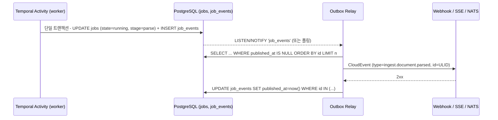
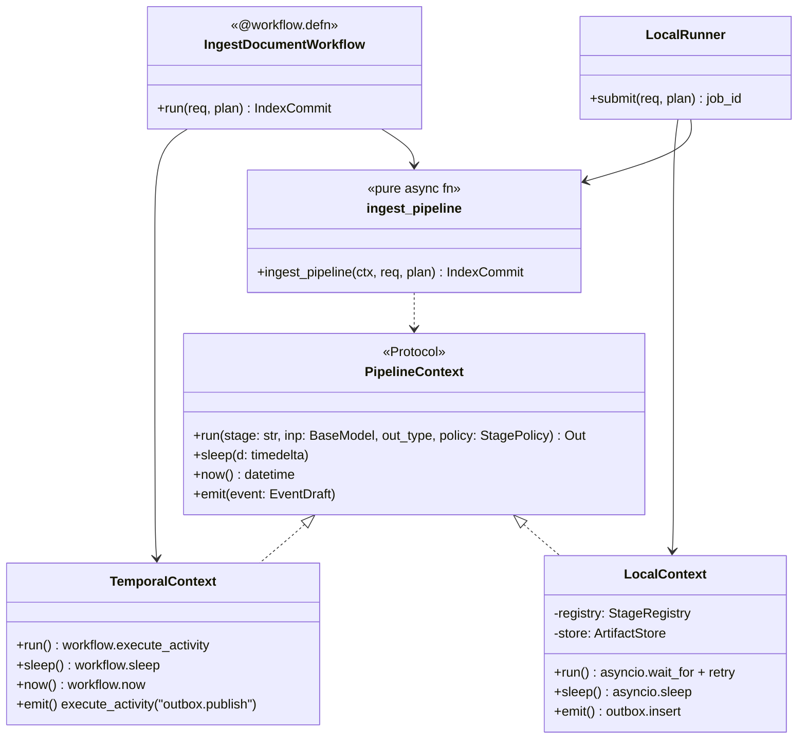
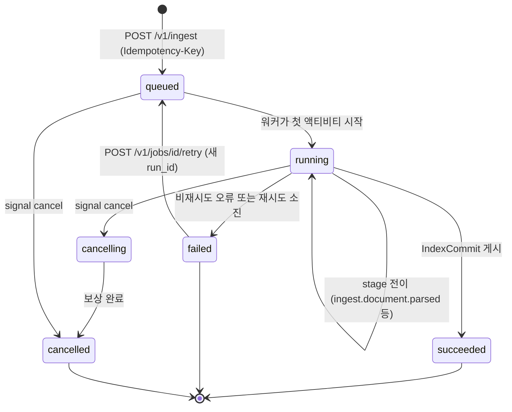
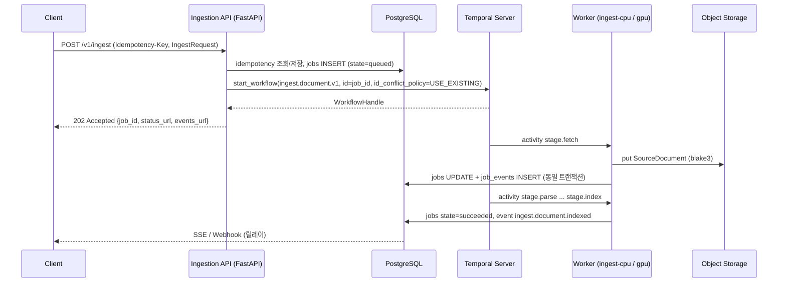

# 오케스트레이션·메시징·API 프레임워크

## 목적

설계 브리프의 확정 결정 D-17(Temporal 기본 + 인프로세스 러너), D-08(비동기 잡·표준 상태 이벤트), D-01(FastAPI + Pydantic v2), D-14(PostgreSQL/S3/Redis)와 개방 결정 O-06(이벤트 버스 필요성), O-10(gRPC 제공 여부)을 2026-09-18 시점의 공개 정보로 검증한다. 내구성 워크플로우(durable workflow) 엔진, 태스크 큐, 분산 배치, 이벤트 버스, API 프레임워크와 HTTP 규약, 모델 서빙 인프라의 후보를 비교하고, 파이프라인 프레임워크(`Stage[In, Out]`)와 잡/이벤트 계약이 수용해야 하는 어댑터 경계를 도출한다.

모든 버전·날짜·라이선스는 PyPI, GitHub 릴리스 피드, 공식 문서, IETF/RFC 원문에서 직접 확인했다. 기본 확인일은 2026-09-18이고, 0.3.0에서 재확인·추가한 항목은 2026-09-22 기준이며 표에 "(재확인 2026-09-22)"로 구분했다. 날짜는 GitHub 릴리스 피드의 게시 시각(UTC) 또는 PyPI 업로드 시각(UTC)을 따르며, 태그 생성일·공지일과 1~2일 차이가 날 수 있다. 확인하지 못한 항목은 "확인 필요(as of 2026-09)"로 표기했다. 벤치마크 수치는 출처가 있는 경우에만 기재한다. 가중 점수는 문서 하단의 검산 절차로 재계산했다(0.2.0에서 9개 행 정정, 0.3.0에서 0.2.0에 추가된 12개 행의 계산 오류를 다시 정정).

0.3.0 변경 요약: (1) 점수표 12개 행 정정(순위 일부 변동, 1위 결론 불변), (2) Temporal 부하 도구 Maru(2024-10 아카이브) → Omes 교체, (3) pgmq 공식 Python 클라이언트 `pgmq`로 교체, (4) NVIDIA DRA 드라이버의 `kubernetes-sigs/dra-driver-nvidia-gpu` 이관 반영, (5) Hatchet·Iggy·Restate·Inngest·Windmill·Redpanda 버전 확정, (6) 비교군 추가: Cadence, Absurd, Resonate, Metaflow/Kubeflow Pipelines, DolphinScheduler, Chancy, RocketMQ, Centrifugo, Sequin, grpclib, Xinference, OpenVINO Model Server, KAI Scheduler, Volcano.

## 범위

- 포함: 내구성 워크플로우 엔진(Temporal, Cadence, DBOS, Absurd, Resonate, Hatchet, Dapr Workflows, durabletask-python, Restate, Inngest, Windmill), 데이터·K8s·ML 오케스트레이터(Prefect 3, Dagster, Airflow 3, Kestra, Apache DolphinScheduler, Argo Workflows/Events, Flyte, Metaflow, Kubeflow Pipelines, Conductor OSS/Maestro), 태스크 큐(Celery, Dramatiq, arq, Huey, RQ, TaskIQ, Procrastinate, pgqueuer, pgmq, Chancy), 분산 배치(Ray Data, Dask), 이벤트·메시징(Kafka/Redpanda, Apache Pulsar, Apache RocketMQ, Apache Iggy, NATS JetStream, Redis Streams/Valkey, RabbitMQ, Knative Eventing, CloudEvents, 트랜잭셔널 아웃박스와 CDC 릴레이(Debezium, Sequin), 실시간 팬아웃 서버(Centrifugo)), API(FastAPI + Pydantic v2, Litestar, ASGI 서버(uvicorn/granian/hypercorn), gRPC(grpcio/grpclib)/ConnectRPC, SSE/WebSocket, RFC 9457, Idempotency-Key, 커서 페이지네이션, 레이트 리밋, RFC 9745/8594 폐기·일몰 헤더), 모델 서빙 인프라(TEI/Infinity/vLLM/Xinference/OpenVINO Model Server 컨테이너, KServe, Ray Serve, BentoML, Triton, LitServe, NVIDIA Dynamo, GPU 스케줄링(device plugin, MIG, MPS, HAMi, Kueue, KAI Scheduler, Volcano, DRA), KEDA).
- 제외: 임베딩·리랭커 모델 자체의 선택과 서빙 엔드포인트 세부(→ [임베딩 모델과 서빙](./05-embedding-models-and-serving.md)), 인덱스 백엔드(→ [벡터·렉시컬 인덱스 백엔드](./06-vector-and-lexical-index-backends.md)), MCP 서버 의미론(→ [MCP 서버](../05-api/05-mcp-server.md)), 관측성 스택 세부(→ [관측성](../09-operations/03-observability.md)).
- 이 문서의 결론은 [오케스트레이션과 워크플로우](../02-architecture/06-orchestration-and-workflows.md), [잡·이벤트·상태 계약](../03-contracts/12-jobs-events-and-status.md), [에러 모델](../03-contracts/13-error-model.md), [API 설계 지침](../05-api/01-api-design-guidelines.md)의 입력이 된다.

## 평가 기준

| 기준 | 가중치 | 측정 방법 |
|------|--------|-----------|
| 한국어 지원 | 5 | 인프라 계층이므로 낮게 둔다. 한국어 문서·커뮤니티 사례 존재 여부, 한국어 페이로드(UTF-8) 처리에 제약이 없는지 |
| 라이선스 적합성(D-02) | 20 | Apache/MIT/BSD = 5, MPL = 4, LGPL = 3(법무 확인), AGPL(분리 서비스로만) = 2, BSL/SSPL/RSAL(비OSI) = 1 |
| 성숙도·유지보수 | 20 | 최근 90일 릴리스, 주요 버전 안정성, 회사/재단 후원, 이슈 응답 |
| 품질·성능 | 15 | 내구성 보증(at-least-once, 재시도, 타임아웃, 하트비트, 결정론적 재생), 공개 벤치마크 또는 한계 수치 |
| 통합 난이도 | 15 | Python 3.12 + Pydantic v2 + asyncio 친화성, 어댑터로 감쌀 때 누출되는 개념의 수 |
| 커뮤니티·생태계 | 10 | 스타/포크는 참고만, 실제로는 KEDA 스케일러·OTel 계측·Helm 차트 등 주변 도구 존재 여부 |
| 운영 비용 | 15 | 필수 외부 의존성 수, 단일 바이너리/개발 모드 유무, 스키마 마이그레이션·업그레이드 부담 |

점수는 1~5. 가중 합계는 `Σ(점수 × 가중치) / 100`으로 5점 만점.

## 후보 목록

### A. 내구성 워크플로우·오케스트레이터

| 이름 | 최신 버전(확인일 2026-09-18) | 라이선스 | 성숙도 | 한국어 지원 | 핵심 강점 | 약점 |
|------|------------------------------|----------|--------|-------------|-----------|------|
| Temporal | Server v1.32.0(Docker Hub 태그 2026-09-12), Python SDK `temporalio` 1.33.0(PyPI 2026-09-15) | MIT(서버·SDK) | 매우 높음 | 커뮤니티 자료 소수 | 이벤트 소싱 기반 결정론적 재생, 시그널/쿼리/업데이트, 스케줄, 하트비트, 자식 워크플로우, KEDA 스케일러, Pydantic v2 컨버터·OTel 인터셉터 내장 | 별도 서버(4개 서비스)+DB 운영, 워크플로우 샌드박스·결정론 학습 곡선, 페이로드 2MB·히스토리 51,200 이벤트 한계 |
| DBOS Transact(Python) | `dbos` 3.0.0(PyPI 2026-09-16) | MIT | 중간(3.0 메이저 직후) | 없음 | Postgres만으로 durable execution, 큐·레이트리밋·중복 제거·스케줄·durable sleep, 공개 처리량 주장 >40K 워크플로우/스텝 초당 | 커뮤니티 규모 작음, 실행자 간 복구·대시보드는 상용 Conductor 의존, 3.0 스키마 변경 직후 |
| Hatchet | 엔진 v0.108.3(GitHub 2026-09-21, 재확인 2026-09-22; 확인일 09-18 당일 0.107.2), `hatchet-sdk` 1.40.3(PyPI 2026-09-18) | MIT | 중간 | 없음 | Postgres 단일 의존(RabbitMQ 선택), DAG·durable task·동시성 키·레이트리밋·우선순위·워커 라벨(GPU 라우팅), 내장 UI/OTel | 소규모 팀(약 8k 스타), 0.x 엔진 버전, durable task는 대기·자식 생성만 가능 |
| Dapr Workflows | Dapr 런타임 v1.18.4(GitHub 2026-09-09), Python SDK `dapr`/`dapr-ext-workflow` 1.18.3(PyPI 2026-07-15), Python >= 3.10 | Apache-2.0(CNCF 졸업) | 높음(런타임) / 중간(워크플로우 API) | 소수 | 사이드카 빌딩블록(pub/sub·상태·시크릿·바인딩)과 durable 워크플로우(`@wfr.workflow`/`@wfr.activity`, 타이머·외부 이벤트·자식 워크플로우·continue-as-new)를 한 런타임에서 제공, 45+ pub/sub 컴포넌트 | 사이드카 모델(파드마다 daprd), 워크플로우 상태는 액터 상태 저장소(Postgres/Redis 등) 의존, 시그널·쿼리·스케줄·하트비트가 Temporal보다 얇음, 결정론 검증 도구 없음 |
| durabletask-python | `durabletask` 1.10.1(PyPI 2026-09-04), Python >= 3.10 | MIT(Microsoft) | 중간 | 없음 | Durable Task Framework의 Python SDK(오케스트레이션·액티비티·타이머·외부 이벤트), Dapr Workflows와 동일 프로토콜 | 백엔드 사이드카 필요: Dapr 워크플로우 엔진 또는 Azure Durable Task Scheduler(상용). 단독 오픈소스 백엔드는 참조 구현(`durabletask-go`) 수준 |
| Restate | 서버 v1.7.10(GitHub 2026-09-14), `restate-sdk` 1.0.5(PyPI 2026-09-02, `requires_python>=3.10`) | 서버 BSL 1.1(4년 후 Apache-2.0), SDK MIT | 중간 | 없음 | 단일 바이너리, 가상 객체·워크플로우·서비스 3종, 낮은 지연 | BSL은 비OSI → D-02 위배(기본 채택 불가) |
| Inngest | 서버 v1.45.1(GitHub 2026-09-17) | 서버 SSPL + DOSP(지연 공개, Apache-2.0), SDK Apache-2.0 | 중간 | 없음 | 이벤트 주도 스텝 함수, 셀프호스트 SQLite/내장 Redis 기본, Postgres+Redis 프로덕션 | SSPL은 비OSI → D-02 위배, 셀프호스트는 DB 자동 정리 없음 |
| Windmill | v1.816.0(GitHub 2026-09-21, 재확인 2026-09-22; 09-18 기준 v1.815.0) | 코어 AGPLv3 + CE 바이너리 사유 + 엔터프라이즈 | 높음 | 없음 | Rust 워커, 스크립트→UI 자동 생성, Postgres 단일 의존 | 제품형 플랫폼(라이브러리 임베딩 부적합), AGPL은 분리 서비스로만 허용 |
| Cadence(Uber) | 서버 v1.4.1(안정, GitHub "Latest"; 게시일 확인 필요(as of 2026-09)), v1.4.2-prerelease15(2026-09-21, 재확인 2026-09-22) | Apache-2.0(서버; 과거 MIT에서 전환) | 높음 | 없음 | Temporal의 전신, 같은 이벤트 소싱·재생 모델, 스케줄·Active-Active 도메인·태스크리스트 멀티테넌시, `temporalio/benchmark-workers`에 cadence 태그 존재 | 공식 Python SDK 없음(Go/Java만; Python은 커뮤니티 수준) → D-01 Python 우선과 충돌, Cassandra 중심 영속화, 커뮤니티가 Temporal로 이동 |
| Absurd | `absurd-sdk` 0.5.0(PyPI 2026-08-04, `requires_python>=3.9`), 코어 `absurd.sql` 단일 파일(2025-11 공개) | Apache-2.0 | 낮음(2025-11 신규) | 없음 | Postgres 단독 SQL-only durable execution(스텝 체크포인트·이벤트 대기), 서버·코디네이터 없음, TS/Python/Go SDK, `absurdctl` CLI·Habitat UI 선택 | 신규·소규모, 시그널/쿼리·스케줄·하트비트 표현력 미검증, 처리량 근거 없음 → 경량 프로파일에서 DBOS의 비교 대상(관찰) |
| Resonate | 서버 v0.9.8(GitHub 2026-06-04), `resonate-sdk` 0.8.1(PyPI 2026-09-03, `requires_python>=3.12`) | Apache-2.0(서버·SDK; 일부 저장소 프로바이더의 별도 라이선스 유무는 확인 필요(as of 2026-09)) | 낮음(0.x) | 없음 | "Distributed Async Await" 모델(함수·프로미스), Restate 유사 단일 바이너리이면서 OSI 라이선스, 로컬 모드(서버 없이) 지원 | 0.x, 서버 릴리스 간격 3개월+, 커뮤니티 작음, Python 3.12+ 고정 → 관찰 대상 |
| Metaflow / Kubeflow Pipelines | `metaflow` 2.19.39(PyPI 2026-09-02), `kfp` 2.17.0(PyPI 2026-07-09, `requires_python>=3.9`) | Apache-2.0 / Apache-2.0 | 높음 / 높음 | 소수 / 소수 | Metaflow: `@step` 데코레이터, 아티팩트 버저닝, AWS Batch/K8s/Argo 실행. KFP: K8s 네이티브 ML 파이프라인, 컴포넌트 재사용, 아티팩트 계보 | 둘 다 ML 배치(학습·평가) 중심으로 Flyte와 같은 판정: 문서 단위 API 트리거 잡 부적합, durable 재생 없음, KFP는 Argo Workflows 위에서 동작(파드 오버헤드 동일) |
| Apache DolphinScheduler | 서버 3.4.3(GitHub 2026-09-10), `apache-dolphinscheduler` 4.1.0(PyPI 2025-01-12) | Apache-2.0 | 높음 | 소수(중국어 자료 다수) | 시각적 DAG 편집기, 워크플로우 정의 SDK(pydolphinscheduler), 다중 워커 그룹 | JVM 서버 + Zookeeper/DB, 데이터 배치 스케줄러(Airflow 계열), Python SDK 릴리스 20개월 정지 → 코어 아님 |
| Prefect 3 | 3.8.6(PyPI 2026-09-15), Python >= 3.10, < 3.15 | Apache-2.0 | 높음 | 소수 | `@flow/@task`, 트랜잭션(`transaction()`, `on_rollback`, `key`), 결과 캐시, 워크 풀(process/docker/k8s) | 결정론적 재생 없음(태스크 중간 크래시 시 재실행), 서버+워커 폴링 구조, 문서 단위 고빈도 잡에 오버헤드 |
| Dagster | 1.13.23(PyPI 2026-09-16), Python >= 3.10, < 3.15 | Apache-2.0 | 높음 | 소수 | 자산(asset) 중심, 파티션·센서·자산 검사, Pipes로 외부 프로세스 | 문서 단위 API 트리거 잡과 모델 불일치, webserver+daemon+Postgres 운영 |
| Airflow 3 | 3.3.2(PyPI 2026-09-17), Python >= 3.10, != 3.15 | Apache-2.0 | 매우 높음 | 다수(국내 데이터 팀) | Task SDK/Execution API로 워커 DB 접근 제거, DAG 버저닝, 자산 이벤트 스케줄링, React UI | 스케줄러 중심 배치, DAG run 오버헤드, API 트리거 초당 수십 건 잡에 부적합 |
| Kestra | v2.0.2(GitHub 2026-09-15; 1.3.39 LTS 병행) | Apache-2.0(OSS 코어) + 엔터프라이즈 | 높음(2025~2026 급성장) | 없음 | YAML 선언형 플로우, 이벤트 트리거(웹훅·Kafka·파일), 플러그인 수백 개, 내장 UI·코드 편집기 | JVM(Java) 서버, Python은 스크립트 태스크로 실행(라이브러리 임베딩 불가), durable 재생 없음 |
| Argo Workflows / Argo Events | Workflows v4.1.4(GitHub 2026-09-18), Events v1.9.11(2026-07-13) | Apache-2.0(CNCF 졸업) | 매우 높음 | 다수(K8s 조직) | K8s 네이티브 CRD(파드 = 스텝), DAG·아티팩트(S3)·재시도, Argo Events는 CloudEvents 소스·센서·트리거 | 스텝마다 파드 생성 오버헤드(초 단위), 문서 단위 고빈도 잡에 부적합, Python SDK(Hera)는 별도 프로젝트, K8s 없으면 사용 불가 |
| Flyte | Flyte v2.0.48(GitHub 2026-09-03), `flytekit` 1.16.28(PyPI 2026-08-18, `requires_python>=3.10,<3.13`) | Apache-2.0(LF AI & Data) | 높음 | 소수 | 타입 안전 태스크·워크플로우, 캐싱·버저닝·GPU 리소스 선언, K8s 실행 | ML 배치 중심, 워크플로우 컴파일 모델(동적 잡 부적합), flytekit 1.x가 Python 3.13 미지원(D-01 3.12+와 부분 충돌), 운영 무게 |
| Conductor OSS / Netflix Maestro | Conductor v3.33.0-rc5(GitHub 2026-09-18; 안정판 3.32.x 확인 필요(as of 2026-09)), Maestro 릴리스 태그 없음(main 브랜치) | Apache-2.0 | 높음(Conductor) / 낮음(Maestro, 재사용 가능 릴리스 부재) | 없음 | JSON 정의 워크플로우, 워커 폴링(Python SDK `conductor-python`), 사가·시그널 유사 기능 | JVM 서버 + Redis/Postgres + Elasticsearch(인덱싱) 의존, 코드 우선 정의가 아님, 커뮤니티 축소 추세 |

### B. 태스크 큐·분산 배치

| 이름 | 최신 버전(확인일) | 라이선스 | 성숙도 | 한국어 지원 | 핵심 강점 | 약점 |
|------|-------------------|----------|--------|-------------|-----------|------|
| Celery | 5.6.3(PyPI 2026-03-26), Python >= 3.9 | BSD-3-Clause | 매우 높음 | 다수 | canvas(chain/group/chord), 브로커 다양(RabbitMQ/Redis/SQS), 국내 레퍼런스 풍부 | 내구성 상태 없음(중간 크래시 시 태스크 재실행), chord는 결과 백엔드 필수, Redis 브로커 visibility timeout 함정, asyncio 네이티브 아님 |
| Dramatiq | 2.2.1, Python >= 3.10 | LGPL-3.0-or-later | 높음 | 소수 | 단순 API, RabbitMQ/Redis, 미들웨어 | LGPL(D-02 "GPL 링크 금지"의 회색지대, 법무 확인 필요) |
| arq | 0.28.0, Python >= 3.9 | MIT | 유지보수 전용(공식 표기) | 없음 | asyncio + Redis 최소 구현 | 유지보수 전용 모드 |
| Huey | 3.4.0 | MIT | 높음 | 소수 | Redis/SQLite/Postgres/파일 백엔드, 단일 파일 규모 | 분산 규모·관측성 부족 |
| RQ | 2.12.0, Python >= 3.10 | BSD-2-Clause | 높음 | 다수 | Redis/Valkey, 단순 | 기능 최소, 워크플로우 없음 |
| TaskIQ | 0.12.6, Python >= 3.10 | MIT | 중간 | 없음 | async 우선, 브로커 플러그인(Redis/NATS/AMQP), FastAPI 의존성 주입 통합 | 0.x, 커뮤니티 작음 |
| Procrastinate | 3.9.0(PyPI 2026-06-20), Python >= 3.10 | MIT | 높음 | 없음 | PostgreSQL 단독(`LISTEN/NOTIFY` + `SELECT ... FOR UPDATE SKIP LOCKED`), asyncio 네이티브(psycopg/asyncpg), 재시도·스케줄(cron)·잠금 큐·우선순위, Django 통합 | 워크플로우·내구성 상태 없음, 처리량은 Postgres 쓰기 한계에 종속 |
| pgqueuer | 1.4.0(PyPI 2026-09-14), Python >= 3.10 | MIT | 중간 | 없음 | PostgreSQL 단독 asyncio 큐(asyncpg/psycopg), 우선순위·스케줄·배치 dequeue, 경량 | 1.x 초기, 커뮤니티 작음, 워크플로우 없음 |
| pgmq | v1.13.0(GitHub 2026-09-07) | PostgreSQL 라이선스 | 높음 | 없음 | Postgres 확장(extension)으로 SQS 유사 큐(`send/read/archive/delete`, visibility timeout, 아카이브 테이블), 공식 Python 클라이언트 `pgmq`(PyPI 1.1.4, 2026-09-20, Apache-2.0, `requires_python>=3.10`, 저장소 `pgmq/pgmq-py`; 구 패키지 `tembo-pgmq-python`은 0.10.0(2025-03-31)에서 정지) | DB 확장 설치 권한 필요(관리형 Postgres 제약), 큐 프리미티브만 제공 |
| Chancy | 0.25.1(PyPI 2025-10-29), Python >= 3.11 | MIT | 중간(11개월 무릴리스) | 없음 | Postgres 단독 asyncio 태스크 큐 + 워크플로우(DAG)·cron·대시보드 플러그인, 잡 우선순위·재시도·유니크 잡 | 단일 메인테이너, 릴리스 정지 기간 김, 커뮤니티 작음 → Procrastinate 대비 유지보수 리스크 |
| Ray(Ray Data/Ray Serve) | 2.58.0(PyPI 2026-08-23), Python >= 3.10; KubeRay v1.7.0(2026-08-20) | Apache-2.0 | 매우 높음 | 소수 | `Dataset.map_batches`로 GPU 액터 풀 배치 임베딩, Ray Serve 오토스케일·배칭 | 클러스터 자체 운영, 소규모에서는 과도, 버전 간 API 변동 |
| Dask | 2026.8.0, Python >= 3.10 | BSD-3-Clause | 매우 높음 | 소수 | PyData 친화 병렬 처리 | GPU 액터 풀·모델 로딩 모델이 없어 임베딩 배치에 Ray보다 불리 |

### C. 이벤트·메시징

| 이름 | 최신 버전(확인일) | 라이선스 | 성숙도 | 한국어 지원 | 핵심 강점 | 약점 |
|------|-------------------|----------|--------|-------------|-----------|------|
| Apache Kafka | 4.3.1(downloads.apache.org 2026-06-23), KRaft 전용 | Apache-2.0 | 매우 높음 | 다수 | 사실상 표준, 재생·파티션·CDC 생태계, `confluent-kafka` 2.15.1(2026-09-10, Apache-2.0) | 운영 무게, 소규모에 과도 |
| Redpanda | v26.2.2(GitHub 2026-08-22) | 코어 BSL 1.1 + 엔터프라이즈 RCL(비OSI) | 높음 | 소수 | Kafka 호환 단일 바이너리 | D-02 위배(기본 채택 불가) |
| Apache Pulsar | 4.2.4(GitHub 2026-08-03), 5.0.0-M2 마일스톤(GitHub 릴리스 게시 2026-09-16, 피드 갱신 2026-09-18) | Apache-2.0 | 매우 높음 | 소수 | 계산·저장 분리(BookKeeper), 멀티테넌시(테넌트/네임스페이스) 1급, 지리적 복제, 계층형 저장, Python 클라이언트 `pulsar-client` | ZooKeeper/Oxia + BookKeeper + 브로커 3계층 운영 무게(Kafka 이상), 소규모에 과도 |
| Apache RocketMQ | rocketmq-all-5.5.1(GitHub 2026-08-20), `rocketmq-python-client` 5.1.2(PyPI 2026-09-14, `requires_python>=3.7`) | Apache-2.0 | 매우 높음(중국 대규모 사례) | 소수(중국어 자료 다수) | NameServer + 브로커 구조(ZooKeeper 불필요), 트랜잭션 메시지, 지연 메시지, 5.x gRPC 프로토콜 Python 클라이언트 | 국내·서구 사례 적음, Python 클라이언트 5.x가 비교적 신규, Kafka 대비 CDC·KEDA 생태계 얇음(KEDA 스케일러 없음) → 조직 표준일 때만 어댑터 |
| Apache Iggy | server-0.9.0(GitHub 2026-09-18 18:55 UTC 정식; 확인 시각 이전은 0.9.0-rc.1), Python SDK 0.9.0.dev8 | Apache-2.0(ASF 인큐베이팅) | 낮음(pre-1.0) | 없음 | Rust 단일 바이너리 영속 메시지 스트림, 파티션별 합의(0.9.0), QUIC/TCP/HTTP, 낮은 지연 | 인큐베이팅·pre-1.0·SDK dev 릴리스, 프로덕션 사례 부족 → 관찰 대상 |
| Knative Eventing | v1.23.0(GitHub `v1.23.0` 릴리스 2026-07-30; `knative-v1.23.0` 태그 2026-07-28) | Apache-2.0(CNCF) | 높음 | 소수 | CloudEvents 네이티브 Broker/Trigger/Channel, 소스(Kafka·API server·PingSource), 필터 기반 팬아웃 | K8s + Knative 스택 필요, 브로커 구현체(In-memory/Kafka/RabbitMQ) 별도 운영, 라이브러리 임베딩 불가 |
| NATS JetStream | nats-server 2.15.0(GitHub 2026-09-17), `nats-py` 2.16.0(PyPI 2026-09-16) | Apache-2.0 | 높음 | 소수 | 단일 바이너리, 스트림/컨슈머, at-least-once, KV/Object store, KEDA 스케일러 | 대규모 파티셔닝·CDC 생태계는 Kafka보다 얇음 |
| RabbitMQ | 4.3.6(GitHub 2026-09-14) | MPL-2.0 | 매우 높음 | 다수 | 쿼럼 큐, 스트림(오프셋 재생, 슈퍼 스트림), AMQP 1.0 | Erlang 운영, 스트림은 TTL/우선순위 없음 |
| Redis Streams / Valkey | Redis 8.x(트라이 라이선스), Valkey(BSD-3) | Redis 8+: RSALv2/SSPLv1/AGPLv3 택1, Valkey: BSD-3-Clause | 매우 높음 | 다수 | 이미 D-14에 존재, XADD/XREADGROUP/XACK/XAUTOCLAIM, 운영 추가 0 | 재생 보존은 MAXLEN 트리밍 의존, 멀티 컨슈머 그룹 관리 수동 |
| FastStream | 0.7.5(PyPI 2026-08-27) | Apache-2.0 | 중간 | 없음 | Kafka/RabbitMQ/NATS/Redis 통합 API, Pydantic 검증, AsyncAPI 문서 자동 생성 | 0.x, 브로커별 세부 기능 노출 제한 |
| Centrifugo | v6.9.6(GitHub 2026-09-14) | Apache-2.0 | 높음 | 없음 | 실시간 팬아웃 서버(WebSocket/SSE/HTTP-streaming/gRPC), 채널·JWT 구독 토큰, 서버 측 발행 API, Redis/NATS 엔진으로 수평 확장, 히스토리·복구(position 기반 재접속) | 별도 서버 운영, 앱 내 SSE로 충분한 v1 규모에서는 과도 → 다수 브라우저 클라이언트에 잡 이벤트를 팬아웃해야 할 때의 대안 |
| Sequin | v0.14.6(GitHub 2026-02-18; 이후 7개월 릴리스 없음) | MIT | 중간(유지 상태 확인 필요(as of 2026-09)) | 없음 | Postgres CDC(논리 복제) → Kafka/SQS/SNS/NATS/RabbitMQ/Redis Streams/웹훅 등 16종 싱크, 아웃박스 테이블 릴레이를 코드 없이 구성 | 2026-02 이후 업스트림 릴리스 정지, Elixir 런타임 운영, 소규모 팀 → Debezium 대비 채택 리스크 |
| CloudEvents | 스펙 v1.0.2, Python SDK `cloudevents` 2.2.0(PyPI 2026-06-11, 2.x 라인) / 1.13.0(2026-07-11, 1.x 라인 병행 유지), Python >= 3.10 | Apache-2.0 | 높음(CNCF 졸업) | 없음 | 이벤트 봉투 표준(id/source/specversion/type), HTTP binary/structured, Kafka/NATS/AMQP 바인딩 스펙; 2.x SDK는 `cloudevents.core.*` 재작성(HTTP·Kafka·AMQP 1.0 바인딩) | 스펙만 제공, 스키마 레지스트리는 별도; 2.x는 Pydantic 통합 없음(1.x `cloudevents.pydantic`은 2.0에서 제거) |

### D. API 프레임워크·HTTP 규약

| 이름 | 최신 버전(확인일) | 라이선스 | 성숙도 | 한국어 지원 | 핵심 강점 | 약점 |
|------|-------------------|----------|--------|-------------|-----------|------|
| FastAPI | 0.141.1(PyPI 2026-07-29), Python >= 3.10, `pydantic>=2.9` | MIT | 매우 높음 | 다수(한국어 공식 문서 일부) | OpenAPI 3.1 기본(0.99.0, 2023-06-30부터), Pydantic v2 지원(0.100.0, 2023-07-07부터), 의존성 주입, Starlette 기반 SSE/WebSocket | 0.x 버전 정책, 대용량 응답 직렬화는 Pydantic 설정 필요 |
| ASGI 서버: uvicorn / granian / hypercorn | uvicorn 0.53.0(PyPI 2026-09-14), granian 2.8.3(PyPI 2026-09-14), hypercorn 0.18.0(PyPI 2025-11-08); 모두 Python >= 3.10 | BSD-3 / BSD-3 / MIT | 매우 높음 / 높음 / 중간(릴리스 간격 김) | 다수 / 없음 / 없음 | uvicorn: HTTP/1.1 + WebSocket, `uvloop`/`httptools`, FastAPI 기본 조합. granian: Rust(hyper) 런타임, HTTP/1.1·HTTP/2·WebSocket, 워커 다중화 내장. hypercorn: HTTP/2·HTTP/3(aioquic)·WebSocket | uvicorn은 HTTP/2 미지원(TLS·HTTP/2는 인그레스가 종단), granian은 생태계 사례 적음, hypercorn은 유지보수 속도 느림. SSE는 세 서버 모두 HTTP/1.1 청크 응답으로 동작(브라우저 동일 오리진 6연결 한계는 HTTP/2 종단으로 완화) |
| Pydantic | 2.13.5(PyPI 2026-08-28) | MIT | 매우 높음 | 소수 | pydantic-core(Rust), JSON Schema 2020-12 생성, `model_validate_json` 직접 검증 | v1 호환 레이어 성능 저하, 중첩 모델 검증 비용 |
| Litestar | 2.24.0(PyPI 2026-06-11) | MIT | 높음 | 없음 | msgspec 직렬화, DTO, 채널(WebSocket pub/sub, Redis/Postgres 백엔드), SSE | D-01이 FastAPI 확정, 생태계 규모 차이, 공식 벤치마크 비교 미확인 |
| grpcio | 1.84.0, Python >= 3.10 | Apache-2.0 | 매우 높음 | 다수 | 표준 gRPC | 별도 포트/서버, 브라우저·프록시 제약, asyncio 통합 복잡(`grpc.aio`는 C 코어 위 래퍼) |
| grpclib | 0.4.9(PyPI 2025-12-14), Python >= 3.10 | BSD-3-Clause | 중간(단일 메인테이너, 9개월 무릴리스) | 없음 | 순수 Python asyncio 네이티브 gRPC(h2 기반), `grpcio`의 asyncio 통합 복잡성에 대한 직접 대안, 스트리밍·헬스체크·리플렉션 | 성능은 grpcio C 코어보다 낮음, 별도 포트 필요는 동일, 생태계(인터셉터·OTel 계측) 얇음 → ConnectRPC가 같은 문제(단일 포트·HTTP/1.1)를 더 넓게 해결 |
| ConnectRPC(`connectrpc`) | 0.12.1(PyPI 2026-09-04), Python >= 3.10 | Apache-2.0 | 중간(적합성 테스트 통과) | 없음 | Connect/gRPC/gRPC-Web 3프로토콜을 하나의 ASGI/WSGI 앱에서 제공, HTTP/1.1 호환, 스트리밍·압축 | 0.x, 사용자 수 적음 |
| sse-starlette | 3.4.11(PyPI 2026-09-05), Python >= 3.10 | BSD-3-Clause | 높음 | 없음 | W3C SSE, 연결 종료 감지, 우아한 종료 | 단독 재접속 재생 로직은 애플리케이션 책임 |
| slowapi | 0.1.10(PyPI 2026-06-13) | MIT | 중간 | 없음 | `limits` 기반, Redis/memcached/메모리 | 테넌트 단위 정책·헤더 표준(RateLimit) 직접 구현 필요 |
| RFC 9457 Problem Details | 2023-07 발행, RFC 7807 대체 | IETF | 표준 | 해당 없음 | `application/problem+json`, type/title/status/detail/instance + 확장 멤버 | 도메인 에러 코드 체계는 별도 설계 |
| Idempotency-Key 헤더 | draft-ietf-httpapi-idempotency-key-header-07(2025-10-15), 만료(expired) 상태 | IETF | 초안 | 해당 없음 | 400(누락)/422(페이로드 불일치)/409(처리 중 재시도) 규약, 서버 측 복합 키 권고 | RFC 미승격, Stripe 등 관행에 의존 |
| RateLimit 헤더 | draft-ietf-httpapi-ratelimit-headers-11(2026-05-23), 활성 | IETF | 초안 | 해당 없음 | `RateLimit`, `RateLimit-Policy` 구조화 필드 | 초안 변동 가능 |
| RFC 9745 Deprecation / RFC 8594 Sunset 헤더 | RFC 9745(2025-03, Proposed Standard), RFC 8594(2019-05, Informational) | IETF | 표준 | 해당 없음 | `Deprecation: @<unix-timestamp>`(구조화 필드 Date)로 폐기 시점 광고, `Sunset: <HTTP-date>`로 응답 중단 시점 광고, `Link rel="deprecation"/"sunset"`으로 안내 문서 링크 | API 버전 폐기 정책(유예 기간)은 별도 설계 |

### E. 모델 서빙 인프라

| 이름 | 최신 버전(확인일) | 라이선스 | 성숙도 | 한국어 지원 | 핵심 강점 | 약점 |
|------|-------------------|----------|--------|-------------|-----------|------|
| Text Embeddings Inference(TEI) | v1.9.4(GitHub 2026-09-15) | Apache-2.0 | 높음 | 해당 없음 | Rust/Candle, XLM-RoBERTa(BGE-M3 dense, bge-reranker 계열) 지원, `-grpc` 이미지, CPU/CUDA(CC >= 7.5)/ROCm/ARM64 | BGE-M3 sparse/colbert 헤드 미지원(→ 05 문서), CUDA 12.2+ 필요 |
| Infinity(`infinity-emb`) | 0.0.77(PyPI 2025-08-22) | MIT | 유지보수 정체(13개월 무릴리스) | 해당 없음 | torch/ONNX/CTranslate2, 리랭크·ColBERT·ColPali | D-16 대안으로는 위험, sparse 미지원 |
| vLLM | 0.29.0(PyPI 2026-09-09) | Apache-2.0 | 매우 높음 | 해당 없음 | pooling 러너로 임베딩·리랭크, BGE-M3 3중 출력 경로(→ 05 문서), LLM 서빙과 동일 스택 | 소형 인코더에 무거움, 릴리스 주기 빠름 |
| Xinference | 3.4.0(PyPI 2026-09-11), Python >= 3.10 | Apache-2.0 | 높음 | 소수(중국어 자료 다수) | BGE-M3 임베딩·`bge-reranker-v2-m3` 리랭크·LLM을 OpenAI 호환 API로 한 서버에서 서빙, 모델 레지스트리·UI, vLLM/SGLang/llama.cpp 백엔드 | 범용 모델 서버(임베딩 전용 최적화 아님), BGE-M3 sparse/colbert 출력 노출 여부는 05 문서 확인 필요, 컨테이너 크기 큼 → TEI 대안이 아닌 "임베더+리랭커+LLM 단일 서버" 프로파일용 |
| OpenVINO Model Server(OVMS) | v2026.4.0(GitHub 2026-09-17) | Apache-2.0 | 높음(Intel) | 없음 | CPU(및 Intel GPU/NPU) 최적화 임베딩·리랭크 서빙, OpenAI 호환 `/v3/embeddings`·`/v3/rerank` 엔드포인트, KServe v2 프로토콜 | GPU가 없는 CPU 전용 프로파일에서만 TEI CPU 이미지와 비교 대상, NVIDIA GPU 미지원, 모델을 OpenVINO IR로 변환 |
| KServe | v0.20.0(2026-08-06), v0.21.0-rc0(2026-09-10) | Apache-2.0 | 높음 | 없음 | `ServingRuntime` CRD로 임의 컨테이너(TEI) 등록, `InferenceService` RawDeployment KEDA 오토스케일링(v0.15.0, 2025-03-31부터), `LLMInferenceService`(llmisvc) direct KEDA scaling(v0.21.0-rc0) | Knative/Istio/Gateway API 등 K8s 스택 무게 |
| Triton Inference Server | 2.72.0(NGC 26.08, GitHub 2026-08-31), `tritonclient` 2.72.0(Python >= 3.12) | BSD-3-Clause | 매우 높음 | 소수 | 멀티 프레임워크 백엔드(TensorRT/ONNX/PyTorch/Python), 동적 배칭, 모델 앙상블, 모델 리포지토리 버저닝, KServe v2 추론 프로토콜 | 임베딩 전용 최적화(토크나이저 포함 Rust 서버)는 TEI가 단순, 모델 리포지토리 변환 작업, 컨테이너 크기(수 GB) |
| LitServe | 0.2.19(PyPI 2026-09-09), Python >= 3.10 | Apache-2.0 | 중간(0.2.x) | 없음 | FastAPI 기반 `LitAPI`(setup/decode/predict/encode) + 동적 배칭·스트리밍·멀티 GPU 워커, 커스텀 파이썬 임베더(BGE-M3 sparse/colbert)를 최소 코드로 서빙 | 0.x, Lightning AI 주도, 대규모 운영 사례 적음 |
| NVIDIA Dynamo | v1.4.x(GitHub 2026-09) | Apache-2.0 | 중간 | 없음 | 분리형(prefill/decode) LLM 서빙, KV 캐시 라우팅, vLLM/SGLang/TensorRT-LLM 백엔드, K8s 오퍼레이터 | 생성형 LLM 대상; 인코더 임베딩·리랭커에는 과도 → 선택적 `answer` 엔드포인트(브리프 §6)에서만 검토 |
| Ray Serve | Ray 2.58.0 | Apache-2.0 | 높음 | 소수 | `@serve.deployment`, `num_replicas="auto"`(기본 target_ongoing_requests 2, max_replicas 100), 분수 GPU, 동적 배칭 | Ray 클러스터 필요 |
| BentoML | 1.4.39, Python >= 3.9 | Apache-2.0 | 높음 | 소수 | 커스텀 파이썬 모델(FlagEmbedding 등)을 컨테이너로 패키징, 적응형 배칭 | 자체 런타임 개념(Bento) 학습 |
| NVIDIA k8s-device-plugin / GPU Operator | v0.20.0(2026-08-19) | Apache-2.0 | 매우 높음 | 없음 | time-slicing ConfigMap, MIG single/mixed 전략, CUDA MPS 공유(`sharing.mps`, device plugin v0.15.0+ 실험적) | time-slicing은 메모리·장애 격리 없음, MPS는 메모리 균등 한도만 있고 장애 격리 없음·MIG와 병용 불가 |
| HAMi | v2.10.0(GitHub 2026-08-21) | Apache-2.0(CNCF 샌드박스) | 중간 | 소수(중국어 자료 다수) | 소프트웨어 GPU 가상화: 컨테이너별 메모리 한도(`nvidia.com/gpumem`)·연산 비율(`nvidia.com/gpucores`) 강제, 스케줄러 확장, 멀티 벤더 | 장애 격리 없음(MIG 아님), CUDA 후킹 라이브러리 의존으로 드라이버/CUDA 버전 호환 확인 필요 |
| Kueue | v0.19.5(GitHub 2026-09-17), v0.20.0-rc.0 | Apache-2.0(Kubernetes SIG) | 높음 | 소수 | 배치 잡 큐잉·쿼터(ClusterQueue/LocalQueue), GPU 등 리소스 플레이버, 우선순위·선점, RayJob/Job 통합 | 온라인 서빙 스케일링 용도가 아님(배치 잡 승인 제어 전용) |
| NVIDIA KAI Scheduler | v0.17.2(GitHub 2026-09-16) | Apache-2.0(CNCF 샌드박스) | 중간 | 없음 | AI 워크로드용 K8s 스케줄러(Run:ai 기원): 분수 GPU 공유, 갱 스케줄링(PodGroup 계층), DRF 공정성·회수, 토폴로지 인식 배치, DRA ResourceClaim GPU 집계 | 별도 스케줄러 운영(기본 스케줄러 대체·병행), 분수 GPU는 소프트웨어 공유(격리 없음), Kueue와 역할 중복 → 대량 배치·팀 간 쿼터 경쟁이 큰 조직에서 Kueue 대안 |
| Volcano | v1.15.2(GitHub 2026-08-29), v1.16.0-alpha.2(2026-09-10) | Apache-2.0(CNCF 인큐베이팅) | 높음 | 소수(중국어 자료 다수) | 배치 스케줄러: 갱 스케줄링, 큐·공정 공유, 선점, Ray/Spark/PyTorch 잡 통합, DRA 용량 회계 | 별도 스케줄러 운영, 온라인 서빙 스케일링 용도 아님 → Kueue와 동일 범주(배치 승인 제어) |
| Kubernetes DRA + NVIDIA DRA 드라이버 | Kubernetes 1.34+(DRA 구조화 파라미터 GA, 2025-08; 드라이버 최소 요구는 1.32+ DRA 활성화), `kubernetes-sigs/dra-driver-nvidia-gpu` v0.5.0(GitHub 2026-08-19; NVIDIA 개발, Kubernetes SIG 호스팅, 구 `NVIDIA/k8s-dra-driver-gpu`는 리다이렉트) | Apache-2.0 | 중간(드라이버 0.x) | 없음 | `ResourceClaim`으로 GPU·MIG·ComputeDomain(멀티노드 NVLink) 선언적 할당, device plugin 이후 방향 | 드라이버 0.x, 클라우드 관리형 K8s 지원 편차, time-slicing/MPS 등 공유 모드는 README에 기재 없음(드라이버 기능 확인 필요(as of 2026-09)) |
| KEDA | v2.20.2(2026-07-31) | Apache-2.0(CNCF) | 매우 높음 | 소수 | Temporal(v2.17+), NATS JetStream, Kafka, Redis Streams, RabbitMQ, PostgreSQL, Prometheus, External 스케일러 | 백로그 기반 0→1 스케일은 인플라이트 작업 미고려 |

## 심층 비교

### 내구성 워크플로우 엔진

#### Temporal

- 동작 방식: 워크플로우 코드는 결정론적 함수로 작성되고, 서버가 이벤트 히스토리를 영속화한다. 워커가 크래시하면 다른 워커가 히스토리를 재생(replay)하여 같은 상태에 도달한 뒤 이어서 실행한다. 부작용은 액티비티(activity)로 격리되며 서버가 재시도·타임아웃·하트비트를 관리한다. 서버는 Frontend, History, Matching, Worker 4개 서비스로 구성되며 단일 바이너리로도 실행된다.
- 실제 진입점(`temporalio` 1.33.0):

| 기능 | 진입점 |
|------|--------|
| 워크플로우 정의 | `@temporalio.workflow.defn(name=...)`, `@workflow.run` |
| 액티비티 정의 | `@temporalio.activity.defn(name=...)`; 동기 함수는 `Worker(activity_executor=ThreadPoolExecutor(...))` 필수 |
| 액티비티 호출 | `workflow.execute_activity(name_or_fn, arg, result_type=..., task_queue=..., start_to_close_timeout=, schedule_to_close_timeout=, heartbeat_timeout=, retry_policy=RetryPolicy(initial_interval, backoff_coefficient, maximum_interval, maximum_attempts, non_retryable_error_types))` |
| 하트비트 | `activity.heartbeat(*details)`, 재시도 시 `activity.info().heartbeat_details`로 재개 지점 복원 |
| 비동기 완료 | `activity.raise_complete_async()` + `client.get_async_activity_handle(task_token=...).complete(...)` |
| 메시지 전달 | `@workflow.signal`, `@workflow.query`(동기 `def`), `@workflow.update`(+`@x.validator`), `handle.signal/query/execute_update/start_update`, `client.execute_update_with_start_workflow(..., start_workflow_operation=WithStartWorkflowOperation(...))` |
| 자식 워크플로우 | `workflow.execute_child_workflow / start_child_workflow(..., parent_close_policy=ParentClosePolicy.ABANDON)`(기본은 TERMINATE) |
| 히스토리 분할 | `workflow.continue_as_new(...)` |
| 스케줄 | `client.create_schedule(id, Schedule(action=ScheduleActionStartWorkflow(...), spec=ScheduleSpec(cron_expressions=[...] 또는 intervals=[ScheduleIntervalSpec(...)]), policy=SchedulePolicy(overlap=ScheduleOverlapPolicy...)))`, `ScheduleHandle.pause/backfill/trigger/update/delete` |
| 클라이언트 | `Client.connect(target, namespace=, data_converter=pydantic_data_converter, interceptors=[TracingInterceptor()])`, `client.start_workflow(fn, arg, id=, task_queue=, id_conflict_policy=...)` |
| 워커(공통) | `Worker(client, task_queue=, workflows=[...], activities=[...], activity_executor=, max_cached_workflows=, workflow_runner=SandboxedWorkflowRunner(restrictions=SandboxRestrictions.default.with_passthrough_modules("pydantic")), interceptors=[...])` + 아래 슬롯 옵션 중 **택1** |
| 워커 슬롯 (a) 고정 슬롯 | `max_concurrent_activities=`, `max_concurrent_workflow_tasks=`, `max_concurrent_local_activities=` — `tuner`와 상호 배타(문서 "Mutually exclusive with tuner"). 큐별 워커 Deployment에서 슬롯 수를 명시할 때 사용(예: `ingest-llm` 워커는 LLM 동시 호출 한도) |
| 워커 슬롯 (b) 튜너 | `tuner=WorkerTuner.create_resource_based(target_memory_usage=0.8, target_cpu_usage=0.9)` 또는 `WorkerTuner.create_fixed(workflow_slots=, activity_slots=, local_activity_slots=)`, `WorkerTuner.create_composite(workflow_supplier=, activity_supplier=, local_activity_supplier=)` — 위 `max_concurrent_*` 인자와 함께 넘기면 워커 생성 시 오류 |
| Pydantic v2 | `temporalio.contrib.pydantic.pydantic_data_converter`(Pydantic v1 미지원) |
| OpenTelemetry | `temporalio.contrib.opentelemetry.TracingInterceptor`(클라이언트·워커·워크플로우·액티비티·Nexus 스팬, 재생 안전) |
| 테스트 | `temporalio.testing.WorkflowEnvironment.start_time_skipping()`, `start_local()`, `ActivityEnvironment`(`on_heartbeat`), `temporalio.worker.Replayer.replay_workflows(histories)` |
| 개발 서버 | CLI `temporal server start-dev`(SQLite, 단일 프로세스, UI 포함) |

- 출력 형식: 워크플로우 입력·출력·액티비티 인자는 Payload(메타데이터 + 바이트)로 히스토리에 저장된다. 기본 컨버터는 JSON, Pydantic 컨버터는 `model_dump_json` 기반. 단일 페이로드 2MB, gRPC 메시지 4MB 제한(Temporal Cloud 문서 기준, 셀프호스트는 동적 설정 `limit.blobSize.error` 기본값 동일, 확인 필요).
- 셀프호스팅 의존성(2026-09 문서 기준):

| 항목 | 지원 | 비고 |
|------|------|------|
| 영속화(persistence) | PostgreSQL 12+, MySQL 8.0.17+, SQLite(개발), Cassandra | Helm 차트는 DB 서브차트를 설치하지 않음(직접 제공) |
| 가시성(visibility) | SQL advanced visibility(PostgreSQL 12+/MySQL 8.0.17+/SQLite 3.31+, 서버 v1.20+), Elasticsearch 7(v1.7+)·8(v1.18+), OpenSearch 2+(v1.30.1+) | Cassandra 가시성은 v1.21 비권고, v1.24 제거. 즉 Postgres만으로 영속화+가시성 모두 가능 |
| 서비스 | frontend, history, matching, worker(내부) | `numHistoryShards`는 클러스터 생성 시 고정, 이후 변경 불가 |
| 부가 | Web UI(별도 컨테이너), Prometheus 메트릭 | Helm 차트는 전용 테스트 파이프라인으로 테스트됨(README: "tested by a dedicated test pipeline"); 프로덕션 값(리소스·샤드·DB 커넥션) 튜닝은 사용자 책임 |

- 한계 수치(공식 문서): 이벤트 히스토리 51,200 이벤트 또는 50MB에서 종료(경고 10,240/10MB), 대기 중 액티비티·자식 워크플로우·시그널·취소 요청 각 2,000개, 동시 Nexus 오퍼레이션 30개. Temporal Cloud 네임스페이스 기본 500 APS(actions per second)는 "액션" 과금 모델의 참고치일 뿐 셀프호스트 처리량 상한이 아니다. 셀프호스트 처리량의 공식 수치는 공개되어 있지 않으나, 공식 부하 생성 도구가 있다: `temporalio/omes`(MIT, "a load generator for Temporal", Temporal 팀이 자체 벤치마크에 사용, `throughput_stress`·`fuzzer` 등 시나리오 내장, 릴리스 태그 없이 main 브랜치 빌드)와 `temporalio/benchmark-workers`(MIT, v1.11.0 2026-09-17, "Pre-written workflows and activities useful for benchmarking Temporal")를 써서 표준 프로파일 자체 부하 테스트를 수행한다(→ 미해결 이슈 1). 구 도구 Maru(`temporalio/maru`)는 2024-10-09 아카이브되었고 README가 "This tool is deprecated, please use Omes instead"라고 명시하므로 사용하지 않는다.
- 함정:
  1. 워크플로우 코드는 샌드박스에서 실행되며 비결정적 호출(`datetime.now`, 랜덤, I/O)이 차단된다. Pydantic 등 부작용 없는 모듈은 `imports_passed_through()`로 통과시켜야 성능이 나온다.
  2. 파서·OCR 같은 CPU 바운드 동기 액티비티는 GIL을 점유한다. 워커 프로세스당 슬롯을 낮게 두고(큐별 고정 슬롯 `max_concurrent_activities=` 또는 리소스 기반 튜너 `WorkerTuner.create_resource_based(...)` 중 택1, 둘은 상호 배타) 프로세스 수를 늘리거나(`worker_multiprocessing` 샘플), 액티비티 내부에서 `ProcessPoolExecutor`를 쓴다.
  3. 페이로드 2MB 제한 때문에 ParsedDocument·ChunkSet 같은 산출물을 직접 넘기면 실패한다. 콘텐츠 주소화 참조(ArtifactRef)만 전달해야 한다(원칙 4와 일치).
  4. 컬렉션 재색인처럼 문서 1만 건을 하나의 워크플로우에서 반복하면 히스토리 한계에 걸린다. 문서별 자식 워크플로우 + 슬라이딩 윈도우(`batch_sliding_window` 샘플) + `continue_as_new`가 필요하다.
  5. 사가(saga)는 SDK 기능이 아니라 패턴이다. 보상 액티비티 스택을 쌓고 예외 시 역순 실행한다(Temporal 블로그의 예시는 Java/Go, Python 공식 샘플은 없음).
  6. 워크플로우 코드 변경은 `workflow.patched()` 또는 워커 버저닝으로 관리해야 진행 중 실행이 깨지지 않는다.

#### DBOS Transact(Python)

- 동작 방식: 라이브러리다. `@DBOS.workflow()` 함수의 입력과 `@DBOS.step()` 출력이 Postgres 시스템 테이블에 체크포인트된다. 프로세스 재시작 시 미완료 워크플로우를 찾아 저장된 스텝 결과를 재사용하며 재실행한다. 스텝당 1회, 워크플로우당 2회 DB 쓰기.
- 진입점(3.0.0, `python/reference/contexts` 기준): `DBOS(config=...)`, `@DBOS.workflow()`, `@DBOS.step(retries_allowed=True, max_attempts=)`, `DBOS.start_workflow(fn, *args)`, `with SetWorkflowID(key):`(멱등 키), `DBOS.sleep()`, `DBOS.send/recv/set_event/get_event`, `@DBOS.scheduled(cron)`.
  - 큐 등록: `DBOS.register_queue(name, *, global_concurrency=, worker_concurrency=, limiter=QueueRateLimit(...), partition_concurrency=, partition_worker_concurrency=, partition_limiter=, polling_interval_sec=1.0, on_conflict="update_if_latest_version") -> Queue`.
  - 인큐: `DBOS.enqueue_workflow(queue_name, func, *args, **kwargs) -> WorkflowHandle`. `**kwargs`는 워크플로우 함수 인자로 그대로 전달되므로 중복 제거·우선순위·파티션 키는 인자가 아니라 컨텍스트 매니저로 지정한다: `with SetEnqueueOptions(deduplication_id=, priority=, queue_partition_key=):`. 타임아웃은 `with SetWorkflowTimeout(workflow_timeout_sec):`(감싼 모든 워크플로우 호출·인큐에 적용).
  - 관리: `DBOS.list_workflows(*, status=, name=, queue_name=, ...)`, `DBOS.resume_workflow(workflow_id, *, queue_name=)`, `DBOS.fork_workflow(workflow_id, start_step, *, application_version=, queue_name=, queue_partition_key=, timeout_seconds=)`, `DBOS.cancel_workflow(workflow_id)`.
- 출력 형식: 스텝 결과는 직렬화되어 Postgres 시스템 테이블에 저장(3.0.0에서 입력/출력 테이블 분리). 워크플로우 조회·재시작은 CLI(`dbos workflow list|resume|fork`) 또는 위 `DBOS.list_workflows/resume_workflow/fork_workflow` API로 수행한다.
- 성능 근거: 공식 아키텍처 문서 "단일 Postgres로 >40K workflows or steps per second 유지, 그 이상은 샤딩". 독립 벤치마크는 확인 필요(as of 2026-09).
- 함정: 실행자(프로세스) 간 자동 복구·대시보드는 상용 Conductor(웹소켓 제어 플레인)에 의존한다. 오픈소스만으로는 죽은 프로세스의 워크플로우를 다른 프로세스가 가져가는 로직을 큐 기반으로 설계해야 한다. 3.0.0(2026-09-16 출시, PyPI `requires_python>=3.10`)은 스키마 마이그레이션 직후이며, 3.0.0 릴리스 노트가 명시하듯 **HTTP 어드민 서버가 제거**되어 워크플로우 조회·재시작·포크는 CLI 또는 `DBOS.list_workflows/resume_workflow/fork_workflow`로만 수행한다(관리 API를 플랫폼의 Management API 뒤에 직접 노출해야 함).

#### Hatchet

- 동작 방식: Postgres를 큐·상태·관측 저장소로 쓰는 별도 엔진(Go). 워커는 gRPC로 엔진에 연결해 태스크를 받는다. 일반 태스크는 at-least-once 큐, `@hatchet.durable_task`는 대기(`ctx.aio_sleep_for`, 이벤트 대기)와 자식 생성만 허용하는 체크포인트 로그 기반 durable 실행이다.
- 진입점: `Hatchet()`, `@hatchet.task(...)`, `@hatchet.durable_task(...)`, `hatchet.workflow(name=...)`로 DAG 구성, `hatchet.worker(name, slots=, labels={"gpu": "a100"})`, 태스크 옵션 `retries`, `rate_limits`, `concurrency=ConcurrencyExpression(...)`, `priority`, `desired_worker_labels`.
- 셀프호스팅: API 서버 + 엔진 + 대시보드 + Postgres, RabbitMQ 선택. `hatchet-lite` 단일 이미지(개발·저처리량 프로덕션), Docker Compose, Helm.
- 함정: 엔진 0.x, 팀 규모 작음. durable task의 표현력이 Temporal 워크플로우보다 좁아 사가·시그널 기반 상태 기계는 일반 태스크 + 이벤트 조합으로 풀어야 한다.

#### Restate, Inngest, Windmill(라이선스 사유로 기본 후보 제외)

| 항목 | Restate | Inngest | Windmill |
|------|---------|---------|----------|
| 서버 버전 | v1.7.10(2026-09-14) | v1.45.1(2026-09-17) | v1.816.0(2026-09-21) |
| 서버 라이선스 | BSL 1.1(추가 사용 허가: 자체 서비스 호출·내부 플랫폼 허용, 제3자에게 Restate API를 노출하는 관리형 서비스 금지; 4년 후 Apache-2.0) | SSPL + DOSP(일정 지연 후 Apache-2.0) | AGPLv3(코어) + 사유 CE 바이너리 + 엔터프라이즈 |
| SDK | Python `restate-sdk` 1.0.5(PyPI 2026-09-02), MIT, `requires_python>=3.10`; TS/Java/Kotlin/Go/Rust | Python/TS/Go/Kotlin, Apache-2.0 | 스크립트 실행 모델(Python은 uv) |
| 모델 | Service / Virtual Object(키 기반 상태) / Workflow, 단일 바이너리 | 이벤트 → 스텝 함수, SQLite + 내장 Redis 기본, Postgres + Redis 프로덕션 | 스크립트·플로우·앱 빌더, Rust 워커, Postgres |
| D-02 판정 | 비OSI → 코어 의존 불가. 사용자가 이미 운영 중이면 플러그인으로 수용 가능 | 비OSI → 동일 | AGPL은 분리 서비스로만 허용되나 제품형 UX가 라이브러리 임베딩 목표와 불일치 |

#### Cadence, Absurd, Resonate(0.3.0 추가 내구성 실행 비교군)

| 항목 | Cadence 1.4 | Absurd(`absurd-sdk` 0.5) | Resonate 0.9 / `resonate-sdk` 0.8 |
|------|-------------|--------------------------|-----------------------------------|
| 내구성 모델 | Temporal과 같은 이벤트 소싱·결정론적 재생(Temporal의 포크 원본) | Postgres 테이블에 스텝 결과 체크포인트, 이벤트 대기(DBOS와 같은 계열, 서버 없음) | 프로미스 저장소(서버 또는 로컬) 기반 재개, 함수·프로미스 조합 |
| Python 진입점 | 공식 SDK 없음(Go `uber-go/cadence-client`, Java) | `absurd_sdk` 태스크 데코레이터·`ctx.step`·`ctx.await_event`(확인 필요(as of 2026-09)) | `Resonate.remote()/local()`, `@resonate.register`, `yield ctx.run/rfc/promise` |
| 필수 인프라 | 서버(frontend/history/matching) + Cassandra/MySQL/Postgres | Postgres만(`absurd.sql` 적용) | 단일 바이너리 서버(로컬 모드는 없음) |
| 라이선스 | Apache-2.0 | Apache-2.0 | Apache-2.0(서버·SDK) |
| 판정 | 제외. Python SDK 부재(D-01)·Temporal과 기능 중복·커뮤니티 이동 | 관찰. 경량 프로파일에서 DBOS와 같은 질문("Postgres만으로 durable")에 답하지만 2025-11 공개로 근거 부족. DBOS ADR에서 비교 대상으로만 언급 | 관찰. Restate 모델을 OSI 라이선스로 얻는 유일한 대안이나 0.x·Python 3.12+ 고정. Restate 계열이 필요해지면 재평가 |

세 후보 모두 `PipelineContext` 구현 하나로 흡수 가능하므로 계약에는 영향이 없다. Absurd·Resonate는 성숙도 2점으로 점수표에 포함했고 순위에 변화를 주지 않는다.

#### Prefect 3, Dagster, Airflow 3(데이터 오케스트레이터)

세 제품은 "스케줄된 배치 파이프라인 + 관측 UI"에 최적화되어 있다. 문서 1건 = 잡 1건인 R1의 수집 모델(초당 수십 건 API 트리거, 문서별 재시도·취소·우선순위)과 결이 다르다.

| 항목 | Prefect 3.8.6 | Dagster 1.13.23 | Airflow 3.3.2 |
|------|---------------|-----------------|---------------|
| 내구성 모델 | 태스크 결과 캐시 + 트랜잭션(`transaction(key=...)`, `on_rollback`, `on_commit`, 커밋 모드 LAZY/EAGER/OFF). 크래시 시 플로우 재실행, 캐시된 태스크는 건너뜀 | 런 단위 재시도, 자산 파티션 백필. 스텝 중간 상태 없음 | 태스크 인스턴스 재시도, XCom. Task SDK로 워커 격리 |
| 진입점 | `@flow`, `@task(retries=, cache_policy=)`, `flow.serve()`/`flow.deploy()`, 워크 풀(process/docker/kubernetes) | `@asset`, `@sensor`, `@schedule`, `@asset_check`, `PipesSubprocessClient` | `@dag`, `@task`, Assets(이벤트 주도), Execution API |
| 운영 | Prefect Server(Postgres/SQLite) + 워커 폴링 | webserver + daemon + Postgres | scheduler + api-server + workers + metadata DB |
| RAG 플랫폼 적합 지점 | 야간 재색인, 평가 하네스 실행(골든셋 → 메트릭 리포트) | 골든셋·평가 결과를 자산으로 관리 | 이미 Airflow를 운영하는 조직에서 외부 트리거(Ingestion API 호출) |
| 판정 | 코어 오케스트레이터 아님. `evaluator` 실행기 어댑터 후보 | 코어 아님. 외부 플러그인 | 코어 아님. 연동 예시 문서만 |

#### Dapr Workflows, durabletask-python, Argo Workflows, Kestra, Flyte, Conductor(추가 비교군)

0.2.0에서 추가한 후보들이다. 공통 판정 기준은 "문서 1건 = 잡 1건, 초당 수십 건 API 트리거, 수십 분 액티비티의 하트비트, 사가, 시그널/쿼리, 라이브러리 임베딩 가능"이다.

| 항목 | Dapr Workflows 1.18 | durabletask-python 1.10 | Argo Workflows 4.1 / Events 1.9 | Kestra 2.0 | Flyte 2.0 / flytekit 1.16 | Conductor OSS 3.33-rc / Maestro |
|------|---------------------|-------------------------|---------------------------------|------------|---------------------------|--------------------------------|
| 내구성 모델 | 이벤트 소싱 재생(Durable Task 프로토콜), 액터 상태 저장소에 히스토리 | 동일 프로토콜(Dapr 워크플로우 엔진 = 백엔드) | 스텝 = 파드, 재시도·아티팩트 전달, 워크플로우 상태는 CR | 태스크 재시도·재실행, durable 재생 없음 | 태스크 캐싱·재실행, 컴파일된 DAG | 태스크 폴링·재시도, 사가 유사 보상 정의 |
| Python 진입점 | `WorkflowRuntime`, `@wfr.workflow`, `@wfr.activity`, `ctx.call_activity/create_timer/wait_for_external_event/call_child_workflow/continue_as_new`, `DaprWorkflowClient.schedule_new_workflow/raise_workflow_event` | `TaskHubGrpcWorker`, `@worker.add_orchestrator/add_activity`, `TaskHubGrpcClient` | Python SDK Hera(별도 프로젝트) 또는 YAML CRD | Python은 `io.kestra.plugin.scripts.python` 스크립트 태스크 | `@task`, `@workflow`, `@dynamic`, `pyflyte run` | `conductor-python` 워커 SDK |
| 하트비트·장시간 액티비티 | 액티비티 타임아웃만(하트비트 없음, 확인 필요(as of 2026-09)) | 동일 | 파드 liveness | 없음 | 태스크 타임아웃 | 태스크 `responseTimeoutSeconds` |
| 필수 인프라 | daprd 사이드카 + 상태 저장소(Postgres/Redis) + 스케줄러 서비스 | Dapr 사이드카 또는 상용 스케줄러 | K8s 필수 | JVM + Postgres + (선택) Kafka/Elasticsearch | K8s + Postgres + 오브젝트 스토리지 | JVM + Redis/Postgres + Elasticsearch |
| D-02 | Apache-2.0 | MIT | Apache-2.0 | Apache-2.0(코어) | Apache-2.0 | Apache-2.0 |
| 판정 | **Temporal 대안 2순위 후보군에 포함**(K8s + 이미 Dapr를 쓰는 조직). 사이드카 전제와 시그널·쿼리·스케줄의 얇음, 결정론 검증 도구 부재로 기본 채택은 하지 않음. `PipelineContext` 구현 하나로 수용 가능 | 오픈소스 단독 백엔드가 없어 Dapr 경로로 흡수 | 코어 아님. K8s 조직의 야간 재색인 배치·평가 잡 외부 트리거 예시로만. Argo Events는 CloudEvents 소스로 아웃박스 릴레이의 목적지 후보 | 코어 아님. 라이브러리 임베딩 불가 | 코어 아님. flytekit 1.x Python 3.13 미지원 | 코어 아님. Maestro는 릴리스 부재로 제외 |

같은 계열의 추가 비교군(0.3.0): Metaflow 2.19(Netflix, Apache-2.0)와 Kubeflow Pipelines 2.17(Apache-2.0)은 Flyte와 동일하게 ML 학습·평가 배치 파이프라인이며, KFP는 Argo Workflows 위에서 스텝 = 파드로 실행되므로 판정도 동일하다(코어 아님; 평가 하네스를 이미 KFP/Metaflow로 운영하는 조직의 외부 트리거 예시로만). Apache DolphinScheduler 3.4(Apache-2.0)는 Airflow/Kestra 계열의 시각적 데이터 배치 스케줄러로 JVM + Zookeeper + DB를 요구하고 Python SDK(`apache-dolphinscheduler` 4.1.0)가 2025-01 이후 릴리스가 없어 코어 후보가 아니다.

Dapr Workflows를 DBOS보다 뒤에 두는 이유: DBOS는 D-14 Postgres만으로 서버 없이 durable 실행을 얻는 반면, Dapr는 사이드카·스케줄러·상태 저장소를 추가하면서도 Temporal이 제공하는 시그널/업데이트/쿼리·하트비트·스케줄 오버랩 정책·재생 테스트를 다 갖추지 못한다. 단, 조직이 이미 Dapr를 표준으로 운영하면 pub/sub 빌딩블록이 O-06의 브로커 추상화까지 겸하므로 `PipelineContext` 구현 + 아웃박스 릴레이 목적지로 한 번에 수용할 수 있다.

### 태스크 큐

내구성 워크플로우 없이 태스크 큐만으로 수집 파이프라인을 만들면 "파서 3분 후 크래시 → 처음부터 재실행", "청킹은 됐는데 임베딩 실패 → 어느 단계부터 재개?" 같은 상태 관리를 애플리케이션이 직접 Postgres에 기록해야 한다. 그 결과가 곧 자체 워크플로우 엔진이 된다(NIH 위배).

| 항목 | Celery 5.6.3 | Dramatiq 2.2.1 | TaskIQ 0.12.6 | RQ 2.12.0 / Huey 3.4.0 / arq 0.28.0 |
|------|--------------|----------------|---------------|--------------------------------------|
| 조합 프리미티브 | chain/group/chord/map/chunks; chord는 결과 백엔드 필수(`ignore_result=False`) | 파이프라인·그룹 | 의존성 주입, 브로커 플러그인 | 없음 또는 최소 |
| 전달 보증 | at-least-once(`acks_late=True`), Redis 브로커는 visibility timeout보다 긴 태스크가 재전달되는 함정(공식 문서 canvas 절은 미언급, 브로커 절 확인 필요) | at-least-once | 브로커 의존 | at-least-once |
| asyncio | 네이티브 아님 | 아님 | 네이티브 | arq만 네이티브(유지보수 전용) |
| 라이선스 | BSD-3 | LGPL-3.0+(법무 확인) | MIT | BSD-2 / MIT / MIT |
| 판정 | 폴백. 조직 표준일 때 `LocalRunner`의 실행 백엔드로 | 라이선스로 제외 | 경량 프로파일 백그라운드 작업(웹훅 전송 등) 후보 | 제외 |

Postgres 단독 태스크 큐(0.2.0 추가, 0.3.0에 Chancy 보강): D-14 인프라만으로 동작하는 asyncio 큐가 네 가지 있다.

| 항목 | Procrastinate 3.9.0 | pgqueuer 1.4.0 | pgmq v1.13.0 + `pgmq` 1.1.4 | Chancy 0.25.1 |
|------|---------------------|----------------|-----------------------------|---------------|
| 형태 | Python 라이브러리(psycopg/asyncpg), 자체 테이블 | Python 라이브러리(asyncpg/psycopg), 자체 테이블 | Postgres 확장(extension) + 공식 얇은 클라이언트(`pgmq`, Apache-2.0; 구 `tembo-pgmq-python` 정지) | Python 라이브러리(psycopg 3), 자체 테이블 + 플러그인(워크플로우·cron·대시보드) |
| 프리미티브 | `@app.task(queue=, lock=, queueing_lock=, retry=)`, `task.defer_async()`, cron 주기 태스크, 우선순위 | `entrypoint` 데코레이터, 우선순위, 스케줄, 배치 dequeue | `send/send_batch/read(vt)/pop/archive/delete`, visibility timeout, 아카이브 테이블 | `@job()` 데코레이터, 큐별 동시성, 우선순위·유니크 잡, 워크플로우 DAG·cron 플러그인 |
| 전달 보증 | at-least-once(`SKIP LOCKED` + 잠금 큐로 동일 키 직렬화) | at-least-once | at-least-once(visibility timeout 재전달) | at-least-once |
| 관측 | Prometheus 익스포터·CLI, 아웃박스처럼 SQL로 조회 가능 | 대시보드 CLI | SQL | 내장 웹 대시보드 플러그인 |
| 유지보수 | 2026-06 릴리스 | 2026-09 릴리스 | 확장 2026-09, 클라이언트 2026-09 | 2025-10 이후 무릴리스(11개월), Python 3.11+ |
| 판정 | **경량 프로파일의 아웃박스 릴레이·웹훅 전송·평가 배치 실행기 1순위**(Valkey 의존 제거). 수집 파이프라인 본체는 durable 실행이 아니므로 대체 불가 | Procrastinate가 성숙도 우위, 대안 | 관리형 Postgres에서 확장 설치 불가 사례 있어 폴백 | 기능(워크플로우·대시보드)은 가장 넓으나 릴리스 정지와 단일 메인테이너로 제외. 활동 재개 시 Procrastinate 대안으로 재평가 |

즉 경량 프로파일에서 "Temporal(또는 DBOS) = 파이프라인, Procrastinate = 부수 작업 큐" 조합이 D-14 외 인프라를 추가하지 않는다. TaskIQ는 브로커(Redis/NATS)를 요구하므로 Valkey가 이미 있는 standard 이상에서만 비교 대상이다.

### 분산 배치: Ray Data와 Dask

- Ray Data: `ds.map_batches(EmbedderClass, batch_size=64, num_gpus=1, compute=ray.data.ActorPoolStrategy(min_size=1, max_size=8, initial_size=2, max_tasks_in_flight_per_actor=2), fn_constructor_args=(model_id,))`. 콜러블 클래스의 `__init__`에서 모델을 1회 로드하고 `__call__(batch)`가 배치를 처리한다. `num_gpus` 지정 시 `batch_size`는 정수 필수. 현재 문서는 `concurrency` 인자를 비권고로 표기하고 `compute`를 권고한다(문서 latest 기준, 릴리스별 확인 필요). K8s는 KubeRay v1.7.0(`RayJob`, `RayCluster` CRD).
- Dask: 범용 PyData 병렬화. 모델을 액터에 상주시키는 풀 개념이 약해 GPU 임베딩 배치에는 Ray가 유리하다.
- 판정: 초기 색인(수백만 청크) 또는 모델 교체 재색인처럼 "한 번에 큰 배치"일 때만 Ray Data를 `embedder` 실행 백엔드로 선택. 일상 수집은 Temporal 액티비티가 TEI 서버를 호출하는 경로가 단순하다.

### 이벤트·메시징

| 항목 | Postgres 아웃박스 + LISTEN/NOTIFY | NATS JetStream 2.15 | Kafka 4.3 | RabbitMQ 4.3 | Redis Streams / Valkey |
|------|-----------------------------------|---------------------|-----------|--------------|------------------------|
| 추가 인프라 | 없음(D-14) | 단일 바이너리, 3노드 권장 | 브로커 3+ (KRaft) | Erlang 클러스터 | 없음(D-14, Valkey 권고) |
| 전달 보증 | 릴레이 at-least-once | at-least-once, `Nats-Msg-Id` 헤더 + 스트림 Duplicate Window(기본 `2m0s`, 스트림 설정 `duplicate_window`)로 발행 측 멱등, 더블 ack | at-least-once, 멱등 프로듀서/트랜잭션 | 쿼럼 큐 at-least-once, 스트림 오프셋 재생 | at-least-once(XACK), XAUTOCLAIM으로 죽은 컨슈머 복구 |
| 재생(replay) | 테이블 보존 기간 내 SQL | 스트림 보존 정책(limits/interest/work queue), 시퀀스·시간 기준 | 오프셋 | 스트림 오프셋(`x-stream-offset`), 슈퍼 스트림 파티션 | ID 범위(`XRANGE`), MAXLEN 트리밍에 의존 |
| Python 클라이언트 | asyncpg/psycopg | `nats-py` 2.16.0 | `confluent-kafka` 2.15.1, aiokafka | aio-pika | redis-py |
| KEDA 스케일러 | PostgreSQL 스케일러(쿼리 기반) | NATS JetStream | Kafka | RabbitMQ Queue | Redis Streams |
| 라이선스 | PostgreSQL | Apache-2.0 | Apache-2.0 | MPL-2.0 | Valkey BSD-3 / Redis 8 트라이 |
| 운영 비용 | 최저 | 낮음 | 높음 | 중간 | 낮음 |

- CloudEvents 매핑: 브리프 규약 `domain.entity.action`을 `type`에, `source`는 `urn:rag:{tenant_id}:{service}`, `subject`는 `job_id` 또는 `document_id`, `id`는 ULID, `time`은 RFC 3339 UTC, `datacontenttype`은 `application/json`, `dataschema`는 게시된 JSON Schema URL. 확장 속성으로 `tenantid`, `traceparent`(W3C Trace Context 확장)를 둔다.
- CloudEvents Python SDK 선택: **2.x 라인(`cloudevents>=2.2,<3`)으로 고정**한다. 2.0.0은 전면 재작성으로 `cloudevents.pydantic`이 제거되었고(MIGRATION.md: "Removed -- use the core CloudEvent directly"), 이벤트 클래스는 `cloudevents.core.v1.event.CloudEvent`, 바인딩은 `cloudevents.core.bindings.http`(`to_binary_event`/`to_structured_event`/`from_http_event`), `cloudevents.core.bindings.kafka`(`from_kafka_event`), `cloudevents.core.bindings.amqp`(AMQP 1.0, 2.x 신규)로 이동했다. 1.x 라인(1.13.0, 2026-07-11)이 병행 유지되지만 Pydantic 통합 때문에 1.x에 묶이면 2.x의 바인딩 정비를 놓치므로, 봉투 모델은 자체 Pydantic v2 `CloudEventEnvelope`(계약 문서 [잡·이벤트·상태](../03-contracts/12-jobs-events-and-status.md)가 정본)로 정의하고 2.x SDK는 HTTP(웹훅)·Kafka 직렬화 경계에서만 사용한다. NATS 바인딩은 2.x SDK에 없으므로 CloudEvents NATS 프로토콜 바인딩 스펙(헤더 매핑)을 릴레이가 직접 구현한다.
- 브로커 비교군 추가(0.2.0): Apache Pulsar 4.2는 테넌트/네임스페이스 멀티테넌시와 계층형 저장이 강점이나 BookKeeper 포함 3계층 운영이 Kafka보다 무거워 enterprise 프로파일에서도 "조직 표준일 때만 어댑터"로 Kafka와 동일 취급한다. Apache RocketMQ 5.5(Apache-2.0)는 NameServer + 브로커의 단순한 구조와 트랜잭션·지연 메시지가 강점이지만 국내 사례·KEDA 스케일러·CDC 생태계가 Kafka에 못 미치므로 Kafka·Pulsar와 같은 "조직 표준일 때만 어댑터" 규칙을 적용한다(Python 클라이언트 `rocketmq-python-client` 5.1.2, gRPC 프로토콜). Apache Iggy는 0.9.0 정식(2026-09-18)이 나왔지만 여전히 인큐베이팅·pre-1.0으로 관찰 대상이다. Knative Eventing 1.23은 CloudEvents 네이티브 Broker/Trigger를 제공하므로 K8s enterprise 프로파일에서 아웃박스 릴레이의 목적지(`Broker` URL로 HTTP binary 발행)로 곧바로 연결된다. 즉 별도 어댑터 없이 웹훅 목적지와 같은 코드 경로를 쓴다.
- 트랜잭셔널 아웃박스: 잡 상태 갱신과 이벤트 삽입을 같은 Postgres 트랜잭션에 넣고, 별도 릴레이가 미발행 행을 읽어 웹훅·SSE·(선택) NATS로 발행한다. 릴레이는 폴링 발행자(polling publisher) 또는 CDC로 구현한다. CDC 구현체는 Debezium(Apache-2.0, JVM, Kafka Connect 또는 Debezium Server)이 기본이고, Sequin(MIT, Elixir, 논리 복제 → Kafka/SQS/NATS/RabbitMQ/Redis Streams/웹훅 16종 싱크)은 코드 없이 아웃박스 테이블을 싱크로 흘릴 수 있어 매력적이지만 2026-02(v0.14.6) 이후 릴리스가 없어 채택하지 않는다(유지 상태 확인 필요(as of 2026-09)). v1은 폴링 발행자 + `LISTEN/NOTIFY` 깨우기로 시작하고 CDC는 NATS/Kafka 도입 시점에 함께 결정한다. 중복 발행 가능성 때문에 소비자는 `id` 기준 멱등이어야 한다.



### API 프레임워크와 HTTP 규약

- FastAPI 0.141.1 + Pydantic 2.13.5: OpenAPI 3.1 문서 자동 생성(0.99.0, 2023-06-30부터; Pydantic v2 지원은 0.100.0, 2023-07-07부터), JSON Schema 2020-12와 호환되어 D-05의 계약 게시와 일치한다. 성능 지침(Pydantic 공식): `model_validate_json`을 `model_validate(json.loads())`보다 우선, `TypeAdapter`는 모듈 수준에서 1회 생성, 구체 타입(`list`, `dict`) 사용, 태그드 유니온, 성능 민감 경로는 `TypedDict`(공식 문서 약 2.5배 사례). 대용량 ContextPack 응답은 `Response(content=model.model_dump_json(), media_type=...)`으로 재검증을 피한다.
- Litestar 2.24.0: msgspec 기반으로 직렬화가 빠르고 채널(WebSocket pub/sub)·SSE·DTO가 내장되어 있으나, D-01이 FastAPI를 확정했고 공식 벤치마크 비교를 확인하지 못했다. 교체 근거가 생기면 ADR로 다룬다.
- gRPC vs ConnectRPC: `grpcio` 1.84.0은 별도 서버·포트가 필요하다. `connectrpc` 0.12.1(Apache-2.0)은 protobuf 정의에서 생성한 핸들러를 ASGI 앱으로 마운트해 Connect/gRPC/gRPC-Web을 한 포트에서 제공하고 HTTP/1.1에서도 동작한다. 즉 FastAPI 앱 옆에 `Mount("/rpc", connect_asgi_app)`로 공존 가능하다. 0.x이므로 코어 계약은 JSON Schema를 정본으로 두고 protobuf는 파생물로 생성해야 이중 정본을 피할 수 있다. `grpclib` 0.4.9(BSD-3, 순수 Python asyncio gRPC)는 grpcio의 asyncio 통합 복잡성에 대한 직접 대안이지만 별도 포트·HTTP/2 전제는 grpcio와 같고 2025-12 이후 릴리스가 없어, "asyncio 친화 + 단일 포트 + HTTP/1.1 호환"을 모두 만족하는 ConnectRPC를 우선한다.
- ASGI 서버: 기본은 uvicorn 0.53.0(BSD-3, `uvloop` + `httptools`)이다. uvicorn은 HTTP/2를 지원하지 않으므로 TLS 종단과 HTTP/2는 인그레스(Envoy/NGINX)가 맡고 서버-인그레스 구간은 HTTP/1.1 keep-alive로 둔다. SSE는 HTTP/1.1 청크 응답으로 충분하며, 브라우저 클라이언트의 동일 오리진 6연결 한계는 인그레스 HTTP/2로 해소된다. granian 2.8.3(BSD-3, Rust hyper, HTTP/2 내장, 워커 다중화 내장)은 HTTP/2를 앱까지 끝에서 끝으로 요구하거나 컨테이너 1개당 멀티 워커가 필요할 때의 대안이고, hypercorn 0.18.0(MIT, HTTP/3 지원)은 릴리스 간격이 길어 기본에서 제외한다. 서버 교체는 설정 값(`server: uvicorn|granian`)으로 가능해야 하며 앱 코드는 ASGI 3만 가정한다.
- 잡 상태 스트리밍: `GET /v1/jobs/{job_id}/events`를 SSE(`sse-starlette` 3.4.11, `text/event-stream`)로 제공하고 `id:` 필드에 이벤트 ULID를 넣어 `Last-Event-ID` 헤더로 재접속 시 `job_events` 테이블에서 이후 이벤트를 재생한다. WebSocket은 양방향 필요(취소·우선순위 변경)가 없으므로 기본 제공하지 않는다. 폴링 `GET /v1/jobs/{job_id}`와 웹훅(D-08)이 대체 경로다. 외부 팬아웃 서버(Centrifugo 6.9, Apache-2.0: WebSocket/SSE 채널, JWT 구독 토큰, 서버 발행 API, position 기반 복구)는 수천 브라우저 클라이언트가 동시에 잡 이벤트를 구독하는 포털형 UI가 생길 때의 대안이며, 그 경우 아웃박스 릴레이의 목적지에 Centrifugo 발행 API를 추가하면 되므로 계약 변경 없이 수용된다. v1 규모(API 클라이언트 중심, SSE 연결 수백 이하)에서는 앱 내 SSE로 충분하다.
- 에러 포맷(RFC 9457): `Content-Type: application/problem+json`, 멤버 `type`(URI, 기본 `about:blank`), `title`, `status`, `detail`, `instance` + 확장 `error_code`(snake_case), `trace_id`, `errors[]`(필드 단위), `retry_after_seconds`. 클라이언트는 모르는 확장을 무시해야 한다.

```json
{
  "type": "https://rag-platform.dev/problems/unsupported_format",
  "title": "Unsupported document format",
  "status": 422,
  "detail": "MIME type application/x-hwp requires the hwp5 parser plugin, which is not installed.",
  "instance": "/v1/jobs/01J8Z3K9Q2W4E6R8T0Y1U3I5O7",
  "error_code": "parser.unsupported_format",
  "trace_id": "4bf92f3577b34da6a3ce929d0e0e4736",
  "retryable": false
}
```

- 멱등성 키(draft-ietf-httpapi-idempotency-key-header-07, 만료 상태이나 사실상 관행): `POST /v1/ingest`와 `POST /v1/collections/{id}/reindex`에 `Idempotency-Key` 필수. 서버는 `(tenant_id, key)` 복합 키로 요청 지문(정규화 본문의 BLAKE3)과 최종 응답을 저장(Postgres, TTL 24h 초안). 키 누락 400, 같은 키에 다른 지문 422, 원 요청 처리 중 재시도 409, 완료 후 재시도는 저장된 응답 재전송. Temporal `start_workflow(id=job_id, id_conflict_policy=USE_EXISTING)`와 결합하면 워크플로우 시작 자체가 멱등이 된다.
- 페이지네이션: 커서 방식. Google AIP-158 관례(`page_size`, `page_token`, `next_page_token`)를 따르되 필드명은 브리프 규약대로 snake_case. 토큰은 불투명(base64url(keyset) + HMAC), ULID가 시간 정렬이므로 `(created_at, id)` 대신 `id` 단독 키셋으로 충분(D-06). 토큰 발급 시점의 필터 지문을 포함해 필터 변경 시 400.
- 레이트 리밋: Redis/Valkey 토큰 버킷(Lua 원자 스크립트) 또는 `slowapi` 0.1.10(`limits` 라이브러리, Redis 백엔드). 응답 헤더는 draft-ietf-httpapi-ratelimit-headers-11의 `RateLimit`(현재 잔여)와 `RateLimit-Policy`(정책 광고) 구조화 필드, 초과 시 429 + `Retry-After`. 한도는 테넌트별(`tenant_id`)로 리트리벌(RPS)과 수집(동시 잡 수, 일일 페이지 수)을 분리한다.
- API 버저닝·폐기 규약: URL 경로 메이저 버전(`/v1`)을 유지하고, 폐기 예정 엔드포인트·버전에는 RFC 9745 `Deprecation` 헤더(구조화 필드 Date, 예: `Deprecation: @1798761600`)와 RFC 8594 `Sunset` 헤더(HTTP-date, 응답 중단 시점)를 함께 내리며 `Link: <https://.../deprecation/v1>; rel="deprecation"`으로 이행 안내 문서를 가리킨다. 최소 유예 기간(예: `Deprecation`부터 `Sunset`까지 180일)은 [API 설계 지침](../05-api/01-api-design-guidelines.md)이 확정한다. 두 헤더는 OpenAPI `deprecated: true`와 함께 코드젠으로 자동 부착되어야 손으로 누락되지 않는다.

### 모델 서빙 인프라

모델·엔드포인트 세부는 [임베딩 모델과 서빙](./05-embedding-models-and-serving.md)이 다룬다. 여기서는 컨테이너를 어떻게 배치·확장하느냐만 비교한다.

| 배치 방식 | 구성 | 오토스케일 | GPU 공유 | 적합 프로파일 | 비용 |
|-----------|------|------------|----------|---------------|------|
| 컨테이너 직접(Docker Compose) | TEI `ghcr.io/huggingface/text-embeddings-inference:{cpu,86,89,hopper,...}-1.9` + vLLM(sparse/colbert 필요 시) | 없음 | 없음 | dev, lightweight | 최저 |
| K8s Deployment + KEDA | Deployment + Service + `ScaledObject`(Prometheus 스케일러: TEI 큐 길이/지연 메트릭, 또는 Temporal 스케일러로 워커와 연동) | KEDA v2.20.2, HPA 기반 | device plugin time-slicing 또는 MIG | standard | 낮음 |
| Ray Serve(KubeRay) | `@serve.deployment(autoscaling_config={"min_replicas":1,"max_replicas":8,"target_ongoing_requests":4}, ray_actor_options={"num_gpus":0.5})`, `@serve.batch` | 내장(요청 기반), `num_replicas="auto"` 기본 target 2·max 100 | 분수 GPU(격리 없음) | 이미 Ray Data를 쓰는 대량 색인 프로파일 | 중간 |
| KServe | `ClusterServingRuntime`에 TEI 이미지 등록(`supportedModelFormats`, `protocolVersions`), `InferenceService`가 런타임 참조; `InferenceService` RawDeployment의 KEDA 오토스케일링은 v0.15.0(2025-03-31)부터, `LLMInferenceService` direct KEDA scaling은 v0.21.0-rc0 | Knative(서버리스) 또는 raw deployment + KEDA | device plugin 의존 | 대규모 멀티모델 플랫폼 조직 | 높음 |
| BentoML | FlagEmbedding 등 커스텀 파이썬 임베더를 `bentoml.Service`로 패키징, 적응형 배칭, OCI 이미지 | 외부(KEDA/Yatai) | 외부 | BGE-M3 3중 출력 커스텀 서버 | 중간 |
| LitServe | `LitAPI`(setup/decode_request/predict/encode_response) + `LitServer(max_batch_size=, batch_timeout=, workers_per_device=, devices=)`, FastAPI 기반이라 같은 미들웨어(RFC 9457, OTel) 재사용 | 외부(KEDA) | 워커/디바이스 매핑만(격리 없음) | BentoML 대안: 커스텀 임베더를 최소 코드로 | 중간 |
| Triton Inference Server | 모델 리포지토리(ONNX/TensorRT 변환 BGE-M3) + `dynamic_batching`, KServe v2 프로토콜, Prometheus 메트릭 | 외부(KEDA Prometheus 스케일러, `nv_inference_queue_duration_us`) | MIG·time-slicing과 병용 | 이미 Triton을 운영하는 조직, 최대 처리량이 필요할 때 | 중간~높음(변환 파이프라인) |
| NVIDIA Dynamo | 분리형 LLM 서빙(prefill/decode), 오퍼레이터 | 내장 플래너 | 전용 GPU | 선택적 `answer` 레퍼런스 구현의 LLM만(임베더·리랭커 제외) | 높음 |
| Xinference(단일 모델 서버) | 임베더(BGE-M3 dense)·리랭커(bge-reranker-v2-m3)·LLM을 OpenAI 호환 API 한 서버에서, vLLM/SGLang 백엔드 | 외부(KEDA), 내부 복제 관리 | 워커 프로세스 매핑 | dev·lightweight에서 컨테이너 수를 1개로 줄이고 싶을 때(모델 선택은 05 문서) | 낮음~중간 |
| OpenVINO Model Server | CPU/Intel 가속기 최적화, OpenAI 호환 임베딩·리랭크 엔드포인트, KServe v2 | 외부(KEDA) | 해당 없음(CPU) | GPU 없는 CPU 전용 프로파일에서 TEI CPU 이미지와 벤치마크 비교 후 선택 | 낮음 |

GPU 스케줄링(NVIDIA k8s-device-plugin v0.20.0 / GPU Operator 문서):

| 방식 | 격리 | 설정 | 용도 |
|------|------|------|------|
| 전용 GPU(`nvidia.com/gpu: 1`) | 완전 | 기본 | OCR·임베딩 워커 프로덕션 |
| time-slicing | 메모리·장애 격리 없음, 시간 균등 분배(프로세스 수 무제한) | GPU Operator `ClusterPolicy` + ConfigMap(`sharing.timeSlicing.resources[].replicas`) | dev/staging에서 TEI·리랭커·OCR을 한 GPU에 |
| MIG | 하드웨어 파티션(메모리·연산 격리) | `mig.strategy: single|mixed`, A30/A100/H100 계열(대상 GPU 목록은 NVIDIA 문서 확인 필요(as of 2026-09)) | 리랭커(소형)와 임베더(중형) 동시 서빙 |
| MPS | 프로세스 간 커널 병행. MPS 제어 데몬이 클라이언트별 메모리를 전체의 균등 분할로 한정하고 연산 용량도 제한; 장애 격리는 없음 | k8s-device-plugin `sharing.mps.resources[].{name, replicas}`, `sharing.mps.renameByDefault`(README "With CUDA MPS" 절, v0.15.0부터 실험적). 전체 GPU(`nvidia.com/gpu`)만 지원, MIG 활성 장치와 병용 불가. GPU Operator 문서의 time-slicing 페이지(gpu-sharing)에는 MPS가 없으며 GPU Operator 측 전용 절 URL은 확인 필요(as of 2026-09) | 다수 소형 추론(리랭커 다중 복제) — 메모리 한도가 있어 time-slicing보다 안전하나 프로덕션은 여전히 MIG 우선 |
| HAMi(소프트웨어 가상화) | 컨테이너별 메모리 한도·연산 비율을 CUDA 후킹으로 강제, 장애 격리 없음 | `nvidia.com/gpumem`, `nvidia.com/gpucores` 리소스 요청, HAMi 스케줄러 확장 | MIG 미지원 GPU(예: T4·L4·소비자용)에서 time-slicing의 메모리 경합을 완화해야 할 때. CUDA/드라이버 호환 매트릭스 확인 후 staging에서 검증 |
| Kueue(배치 승인 제어) | 해당 없음(스케줄링 큐) | `ClusterQueue`/`LocalQueue` 쿼터에 GPU 플레이버, `RayJob`·`Job` 통합 | 대량 초기 색인(Ray Data) 잡과 평가 잡이 GPU 쿼터를 두고 경쟁할 때 승인 순서·선점 제어 |
| KAI Scheduler v0.17 / Volcano v1.15(배치 스케줄러) | 분수 GPU는 소프트웨어 공유(격리 없음), 갱 스케줄링 | 기본 스케줄러 대체·병행(`schedulerName`), PodGroup·큐·공정성 정책 | Kueue가 "승인 제어"만 하는 데 비해 스케줄러 자체를 바꾼다. 팀 간 GPU 쿼터·갱 스케줄링(Ray 멀티노드)이 필수인 enterprise 프로파일에서 Kueue 대안. 기본은 Kueue(기본 스케줄러 유지, 운영 변경 최소) |
| DRA(`ResourceClaim`) + NVIDIA DRA 드라이버 v0.5.0(`kubernetes-sigs/dra-driver-nvidia-gpu`) | 장치 단위(전용·MIG) | 드라이버 최소 Kubernetes 1.32+(DRA 활성화), 플랫폼 권고 1.34+(DRA GA), `DeviceClass`/`ResourceClaimTemplate` | device plugin의 후속 방향. 0.x 드라이버이므로 v1 배포 매니페스트는 device plugin, DRA는 배포 가이드의 선택 경로로 문서화 |

KEDA 스케일러 중 이 플랫폼에 직접 쓰이는 것: `temporal`(v2.17+, 파라미터 `endpoint`, `namespace`, `taskQueue`, `queueTypes`(기본 workflow; activity 지정 가능), `targetQueueSize` 기본 5), `prometheus`(TEI/리랭커 지연·큐 메트릭), `postgresql`(아웃박스 미발행 건수로 릴레이 스케일), `nats-jetstream`(도입 시). 백로그 기반 0→1 스케일은 인플라이트 작업을 세지 못하므로 워커 `minReplicaCount`는 1 이상을 권고한다.

## 권고안

### 역할별 1차·2차·폴백

| 역할 | 1차 | 2차 | 폴백 | 근거 |
|------|-----|-----|------|------|
| 내구성 오케스트레이터(수집·재색인·평가 잡) | Temporal(Server 1.32 + `temporalio` 1.33, Postgres 영속화+가시성) | DBOS Transact 3.x(Postgres 단독, 경량 프로파일 durable 옵션, ADR 필요); Dapr Workflows 1.18(조직이 이미 Dapr 운영 시) | Celery 5.6(조직 표준일 때, 상태 테이블 자체 관리) | 하트비트·사가·시그널·스케줄·KEDA·Pydantic/OTel 내장을 모두 갖춘 유일한 MIT 후보. D-17 유지 |
| 개발·테스트 러너 | `LocalRunner`(asyncio, 비내구) + `temporal server start-dev` | `WorkflowEnvironment.start_time_skipping()`(단위 테스트) | - | 같은 파이프라인 정의를 Temporal 셸과 로컬 셸이 공유 |
| 부수 작업 큐(웹훅 전송, 아웃박스 릴레이, 평가 배치) | Temporal 액티비티(standard 이상) / Procrastinate 3.9(경량 프로파일, Postgres 단독) | TaskIQ 0.12(Valkey 브로커) | pgqueuer, pgmq | D-14 외 인프라 추가 없음 |
| 대량 배치 임베딩 | Temporal 액티비티 → TEI/vLLM HTTP 호출(기본) | Ray Data `map_batches` + GPU 액터 풀(수백만 청크 초기 색인) | Dask | 일상 경로 단순성 우선, 대량은 Ray |
| 도메인 이벤트 | Postgres 아웃박스 + 릴레이(웹훅, SSE) | NATS JetStream(외부 소비자 2개 이상 또는 재생 요구 시; 조건부 점수표 1위) | Kafka·Pulsar(조직 표준 클러스터일 때), Redis Streams(Valkey), Knative Eventing(K8s enterprise, 릴레이 목적지) | O-06 참조. 일반 점수표 순위와 다른 이유는 선정 근거 절의 조건부 점수표 |
| 제어 이벤트(취소·우선순위·진행률) | Temporal 시그널/업데이트/쿼리 | - | - | 워크플로우 내부 상태 기계 |
| API 프레임워크 | FastAPI 0.141 + Pydantic 2.13 | Litestar(ADR 필요) | - | D-01 |
| ASGI 서버 | uvicorn 0.53(HTTP/1.1, TLS·HTTP/2는 인그레스 종단) | granian 2.8(HTTP/2 끝단까지 필요 시) | hypercorn 0.18 | 설정 값으로 교체, 앱은 ASGI 3만 가정 |
| RPC | REST + SSE | ConnectRPC(`connectrpc` 0.12, 같은 ASGI 앱) | grpcio 독립 서버 | O-10 참조 |
| 에러·멱등·페이지·한도·폐기 | RFC 9457, Idempotency-Key(draft-07 의미론), 커서 토큰(AIP-158 관례), RateLimit 헤더(draft-11), RFC 9745 `Deprecation` + RFC 8594 `Sunset` | - | - | 표준 우선 |
| 임베딩 서빙 배치 | K8s Deployment + KEDA(Prometheus 스케일러) | Ray Serve(Ray Data 채택 시) | KServe(플랫폼 조직), Triton(기존 운영 조직) | 운영 비용 |
| 커스텀 임베더(BGE-M3 sparse/colbert) | vLLM pooling 러너(→ 05 문서) | BentoML + FlagEmbedding 또는 LitServe + FlagEmbedding | FastAPI 인프로세스 sentence-transformers | TEI/Infinity 미지원 |
| GPU 공유(프로덕션) | 전용 GPU 또는 MIG | MPS(`sharing.mps`, 메모리 균등 한도) | HAMi(MIG 미지원 GPU), time-slicing은 dev/staging 한정 | 격리 수준 순 |
| 레이트 리밋·멱등 저장소 | Valkey(BSD-3) | Redis 8(AGPLv3 옵션, 분리 컨테이너) | Postgres 단독 | D-02·D-14 조정 |

### 프로파일별 조합

| 프로파일 | 오케스트레이션 | 이벤트 | 서빙 | 필수 인프라 |
|----------|----------------|--------|------|-------------|
| dev | `LocalRunner` 또는 `temporal server start-dev`(SQLite) | 아웃박스 → 로그/SSE | TEI CPU 컨테이너 | Postgres, MinIO, Valkey, Qdrant |
| lightweight(Qdrant 단독, D-15) | Temporal 단일 바이너리 + Postgres, 또는 DBOS(ADR 후); 부수 작업 큐는 Procrastinate(Postgres) | 아웃박스 → 웹훅/SSE(릴레이는 Procrastinate 태스크) | TEI 1 GPU 또는 CPU | Postgres, MinIO, Valkey, Qdrant, Temporal |
| standard | Temporal(frontend/history/matching 분리, Postgres advanced visibility), 태스크 큐 `ingest-cpu`, `ingest-gpu-ocr`, `ingest-gpu-embed`, `maintenance` | 아웃박스 → 웹훅/SSE, KEDA `postgresql` 스케일러 | K8s Deployment + KEDA, MIG 또는 전용 GPU | + OpenSearch, K8s |
| enterprise | standard + Temporal 멀티 네임스페이스(테넌트 등급별), 스케줄(야간 재색인·평가); Ray Data 대량 색인은 Kueue 쿼터 아래 | + NATS JetStream(외부 소비자, 감사 스트림) 또는 Knative Eventing Broker(K8s 표준 시) | KServe 또는 Ray Serve, 전용 GPU | + NATS(또는 Knative), 관측성 스택 |

### 선정 근거 점수표

가중치: 한국어 5 / 라이선스 20 / 성숙도 20 / 품질 15 / 통합 15 / 커뮤니티 10 / 운영 15. 가중 합 = `(한국어×5 + 라이선스×20 + 성숙도×20 + 품질×15 + 통합×15 + 커뮤니티×10 + 운영×15) / 100`. 0.2.0에서 전 행을 재계산했으나 0.2.0에 새로 추가된 12개 행이 0.05~0.15 낮게 기재되어 있어 0.3.0에서 다시 정정했다(정정된 행은 괄호에 이전 값). 정정으로 Argo Workflows가 Hatchet과 동점(3.70)이 되어 Airflow(3.60)를 앞서고, Dapr Workflows(3.65)가 Airflow를 앞서며, Flyte(3.25)가 Dagster와 동점이 되지만, 1위(Temporal, Postgres 아웃박스, Deployment + KEDA)와 2차·폴백 선택은 바뀌지 않는다. 행은 가중 합 내림차순이다.

| 오케스트레이터 | 한국어 | 라이선스 | 성숙도 | 품질 | 통합 | 커뮤니티 | 운영 | 가중 합 |
|----------------|--------|----------|--------|------|------|----------|------|---------|
| Temporal | 3 | 5 | 5 | 5 | 3 | 5 | 2 | 4.15 |
| DBOS Transact | 2 | 5 | 3 | 4 | 5 | 2 | 5 | 4.00 |
| Prefect 3 | 3 | 5 | 4 | 3 | 4 | 4 | 3 | 3.85 |
| Celery | 4 | 5 | 4 | 2 | 4 | 5 | 3 | 3.85 |
| Hatchet | 2 | 5 | 3 | 4 | 4 | 2 | 4 | 3.70 |
| Argo Workflows | 3 | 5 | 5 | 3 | 2 | 5 | 2 | 3.70 (0.2.0: 3.60) |
| Dapr Workflows | 2 | 5 | 4 | 3 | 3 | 4 | 3 | 3.65 (0.2.0: 3.55) |
| Airflow 3 | 4 | 5 | 5 | 2 | 2 | 5 | 2 | 3.60 (0.1.0: 3.55) |
| Cadence(0.3.0 추가) | 2 | 5 | 4 | 5 | 2 | 3 | 2 | 3.55 |
| Resonate(0.3.0 추가) | 1 | 5 | 2 | 4 | 4 | 2 | 4 | 3.45 |
| Absurd(0.3.0 추가) | 1 | 5 | 2 | 3 | 4 | 1 | 5 | 3.35 |
| Dagster | 3 | 5 | 4 | 2 | 2 | 4 | 2 | 3.25 (0.1.0: 3.30) |
| Flyte | 2 | 5 | 4 | 3 | 2 | 3 | 2 | 3.25 (0.2.0: 3.15) |
| Kestra | 1 | 5 | 4 | 2 | 2 | 3 | 3 | 3.20 (0.2.0: 3.10) |
| Conductor OSS | 1 | 5 | 3 | 3 | 2 | 2 | 2 | 2.90 (0.2.0: 2.80) |
| Restate | 1 | 1 | 3 | 4 | 3 | 2 | 4 | 2.70 |
| Inngest | 1 | 1 | 3 | 3 | 3 | 2 | 3 | 2.40 |

Metaflow·Kubeflow Pipelines·DolphinScheduler는 Flyte·Airflow와 같은 판정(코어 아님)이고 점수가 순위에 영향을 주지 않아 표에서 생략한다.

| 이벤트 버스(일반 순위) | 한국어 | 라이선스 | 성숙도 | 품질 | 통합 | 커뮤니티 | 운영 | 가중 합 |
|-------------|--------|----------|--------|------|------|----------|------|---------|
| Postgres 아웃박스 | 4 | 5 | 5 | 3 | 5 | 4 | 5 | 4.55 (0.1.0: 4.50) |
| Redis Streams(Valkey) | 4 | 5 | 5 | 3 | 4 | 4 | 4 | 4.25 (0.1.0: 4.20) |
| Kafka | 4 | 5 | 5 | 5 | 3 | 5 | 2 | 4.20 (0.1.0: 4.05) |
| NATS JetStream | 2 | 5 | 4 | 4 | 4 | 3 | 4 | 4.00 |
| RabbitMQ | 4 | 4 | 5 | 4 | 3 | 4 | 3 | 3.90 (0.1.0: 3.85) |
| Apache Pulsar | 3 | 5 | 5 | 5 | 3 | 4 | 1 | 3.90 (0.2.0: 3.85) |
| Apache RocketMQ(0.3.0 추가) | 2 | 5 | 5 | 4 | 2 | 3 | 2 | 3.60 |
| Knative Eventing | 2 | 5 | 4 | 3 | 3 | 3 | 2 | 3.40 (0.2.0: 3.30) |
| Redpanda | 2 | 1 | 4 | 5 | 3 | 3 | 4 | 3.20 (0.1.0: 3.05) |
| Apache Iggy | 1 | 5 | 2 | 3 | 2 | 2 | 4 | 3.00 (0.2.0: 2.95) |

일반 순위는 "v1에서 어떤 이벤트 전달 방식을 기본으로 삼는가"에 대한 답이며, 1차 선택(Postgres 아웃박스)은 여기서 정당화된다. 그러나 **2차 선택은 다른 질문**, 즉 "(a) 외부 소비자 2개 이상이 재생(replay)을 요구하거나 (b) 감사 스트림 장기 보존 (c) 멀티 리전 팬아웃 조건이 성립해 브로커를 추가해야 할 때 무엇을 추가하는가"에 대한 답이다. 이 조건에서는 품질 항목을 "컨슈머별 재생·보존 정책·외부 팬아웃"으로, 통합·운영 항목을 "외부 소비자에게 노출되는 경계·자체 운영 여부"로 다시 채점한다. 아웃박스 단독은 조건 자체를 충족하지 못하므로(릴레이가 컨슈머 오프셋·재생을 직접 구현해야 함) 비교에서 제외한다.

| 이벤트 버스(조건부: 외부 소비자 2개 이상 + 재생·보존 요구) | 한국어 | 라이선스 | 성숙도 | 품질(재생·보존·팬아웃) | 통합(외부 경계) | 커뮤니티 | 운영(자체 운영 기준) | 가중 합 | 조정 근거 |
|-------------|--------|----------|--------|------|------|----------|------|---------|-----------|
| NATS JetStream | 2 | 5 | 4 | 5 | 4 | 3 | 4 | 4.15 | 스트림 보존(limits/interest/work-queue, 시간·크기·건수), 컨슈머별 시퀀스·시간 재생, 계정 단위 멀티테넌시로 외부 소비자 격리, 단일 바이너리 3노드 |
| Kafka(자체 운영) | 4 | 5 | 5 | 5 | 3 | 5 | 1 | 4.05 | 재생·보존은 최상이나 KRaft 컨트롤러 쿼럼 + 브로커 3+ + 스키마 레지스트리를 플랫폼이 직접 운영 |
| Kafka(조직 표준 클러스터 재사용) | 4 | 5 | 5 | 5 | 3 | 5 | 4 | 4.50 | 운영을 조직이 부담하면 1위 → "조직 표준일 때 Kafka" 폴백 규칙의 근거 |
| Apache Pulsar(조직 표준 클러스터 재사용) | 3 | 5 | 5 | 5 | 3 | 4 | 4 | 4.35 (0.2.0: 4.30) | Kafka와 같은 규칙; 자체 운영 시 운영 1로 3.90 |
| RabbitMQ Streams | 4 | 4 | 5 | 4 | 3 | 4 | 3 | 3.90 | 오프셋 재생·슈퍼 스트림은 있으나 TTL·우선순위 없음, Erlang 운영 |
| Redis Streams(Valkey) | 4 | 5 | 5 | 2 | 3 | 4 | 3 | 3.80 | 재생은 MAXLEN 트리밍에 종속(장기 보존 부적합), 컨슈머 그룹 관리 수동, 외부 소비자에 내부 캐시 저장소를 노출하지 않으려면 별도 Valkey 인스턴스 + AOF 영속화 필요 |
| Knative Eventing(K8s 표준 시) | 2 | 5 | 4 | 3 | 4 | 3 | 3 | 3.70 (0.2.0: 3.55) | CloudEvents 네이티브 팬아웃은 강점, 재생·보존은 채널 구현체(Kafka) 의존 |

따라서 2차 = NATS JetStream(4.15), 폴백 = Kafka·Pulsar(조직 표준 클러스터가 있을 때 각 4.50·4.35로 NATS를 앞섬) 및 Redis Streams(3.80, 재생 요구가 약하고 Valkey를 이미 분리 운영할 때)이다. Knative Eventing(3.70)은 정정 후 RabbitMQ Streams(3.90)와 Redis Streams(3.80) 아래에 머물러 "K8s 표준일 때 릴레이 목적지" 판정이 유지된다. 일반 순위에서 Redis Streams·Kafka가 NATS보다 높은 것은 "브로커를 새로 추가하지 않는 상황"의 점수이므로 2차 선택과 모순되지 않는다.

| 서빙 배치 | 한국어 | 라이선스 | 성숙도 | 품질 | 통합 | 커뮤니티 | 운영 | 가중 합 |
|-----------|--------|----------|--------|------|------|----------|------|---------|
| Deployment + KEDA | 3 | 5 | 5 | 4 | 5 | 5 | 4 | 4.60 |
| BentoML | 3 | 5 | 4 | 4 | 4 | 3 | 3 | 3.90 (0.1.0: 3.85) |
| Triton | 3 | 5 | 5 | 5 | 2 | 4 | 2 | 3.90 |
| Ray Serve | 3 | 5 | 4 | 4 | 3 | 4 | 3 | 3.85 |
| LitServe | 2 | 5 | 3 | 4 | 5 | 3 | 3 | 3.80 (0.2.0: 3.75) |
| KServe | 2 | 5 | 4 | 4 | 2 | 4 | 2 | 3.50 (0.1.0: 3.40) |

검산: 아래 스크립트가 네 표의 **모든 행**을 재계산하며, 문서 갱신 시 CI(문서 린트 잡)에서 표의 숫자와 일치하는지 검사한다. 0.3.0에서는 스크립트를 실행해 아래 전 행이 표와 일치함을 확인했다(0.2.0의 오류는 일부 행만 assert에 넣었던 데서 비롯했으므로, 표에 행을 추가할 때 assert도 함께 추가하는 것을 린트 규칙으로 둔다: 표의 행 수 == assert 수).

```python
# docs/tools/check_scores.py
W = {"korean": 5, "license": 20, "maturity": 20, "quality": 15, "integration": 15, "community": 10, "operations": 15}

def weighted(*scores: int) -> float:
    # 인자 순서: 한국어, 라이선스, 성숙도, 품질, 통합, 커뮤니티, 운영
    assert len(scores) == len(W)
    return round(sum(s * w for s, w in zip(scores, W.values())) / 100, 2)

ROWS = {
    # 오케스트레이터
    "Temporal": ((3, 5, 5, 5, 3, 5, 2), 4.15), "DBOS": ((2, 5, 3, 4, 5, 2, 5), 4.00),
    "Prefect": ((3, 5, 4, 3, 4, 4, 3), 3.85), "Celery": ((4, 5, 4, 2, 4, 5, 3), 3.85),
    "Hatchet": ((2, 5, 3, 4, 4, 2, 4), 3.70), "Argo": ((3, 5, 5, 3, 2, 5, 2), 3.70),
    "Dapr": ((2, 5, 4, 3, 3, 4, 3), 3.65), "Airflow": ((4, 5, 5, 2, 2, 5, 2), 3.60),
    "Cadence": ((2, 5, 4, 5, 2, 3, 2), 3.55), "Resonate": ((1, 5, 2, 4, 4, 2, 4), 3.45),
    "Absurd": ((1, 5, 2, 3, 4, 1, 5), 3.35), "Dagster": ((3, 5, 4, 2, 2, 4, 2), 3.25),
    "Flyte": ((2, 5, 4, 3, 2, 3, 2), 3.25), "Kestra": ((1, 5, 4, 2, 2, 3, 3), 3.20),
    "Conductor": ((1, 5, 3, 3, 2, 2, 2), 2.90), "Restate": ((1, 1, 3, 4, 3, 2, 4), 2.70),
    "Inngest": ((1, 1, 3, 3, 3, 2, 3), 2.40),
    # 이벤트 버스(일반)
    "Outbox": ((4, 5, 5, 3, 5, 4, 5), 4.55), "RedisStreams": ((4, 5, 5, 3, 4, 4, 4), 4.25),
    "Kafka": ((4, 5, 5, 5, 3, 5, 2), 4.20), "NATS": ((2, 5, 4, 4, 4, 3, 4), 4.00),
    "RabbitMQ": ((4, 4, 5, 4, 3, 4, 3), 3.90), "Pulsar": ((3, 5, 5, 5, 3, 4, 1), 3.90),
    "RocketMQ": ((2, 5, 5, 4, 2, 3, 2), 3.60), "Knative": ((2, 5, 4, 3, 3, 3, 2), 3.40),
    "Redpanda": ((2, 1, 4, 5, 3, 3, 4), 3.20), "Iggy": ((1, 5, 2, 3, 2, 2, 4), 3.00),
    # 이벤트 버스(조건부)
    "c:NATS": ((2, 5, 4, 5, 4, 3, 4), 4.15), "c:KafkaSelf": ((4, 5, 5, 5, 3, 5, 1), 4.05),
    "c:KafkaOrg": ((4, 5, 5, 5, 3, 5, 4), 4.50), "c:PulsarOrg": ((3, 5, 5, 5, 3, 4, 4), 4.35),
    "c:RabbitMQStreams": ((4, 4, 5, 4, 3, 4, 3), 3.90), "c:RedisStreams": ((4, 5, 5, 2, 3, 4, 3), 3.80),
    "c:Knative": ((2, 5, 4, 3, 4, 3, 3), 3.70),
    # 서빙 배치
    "KEDA": ((3, 5, 5, 4, 5, 5, 4), 4.60), "BentoML": ((3, 5, 4, 4, 4, 3, 3), 3.90),
    "Triton": ((3, 5, 5, 5, 2, 4, 2), 3.90), "RayServe": ((3, 5, 4, 4, 3, 4, 3), 3.85),
    "LitServe": ((2, 5, 3, 4, 5, 3, 3), 3.80), "KServe": ((2, 5, 4, 4, 2, 4, 2), 3.50),
}

for name, (scores, expected) in ROWS.items():
    got = weighted(*scores)
    assert got == expected, f"{name}: table says {expected}, recomputed {got}"
print(f"{len(ROWS)} rows OK")
```

## 통합 설계 함의

### 두 모드가 같은 파이프라인 정의를 공유하는 패턴

D-17의 "같은 워크플로우 정의 재사용"은 파이프라인 정의를 Temporal API에 직접 쓰지 않을 때만 성립한다. 파이프라인 정의는 `PipelineContext` 프로토콜에만 의존하는 순수 비동기 함수로 작성하고, Temporal 셸(`@workflow.defn` 클래스)과 로컬 셸이 각자 컨텍스트 구현을 주입한다. 파이프라인 정의는 I/O·시간·난수를 직접 쓰지 않으므로 Temporal 샌드박스 안에서도 결정론이 보장된다.



```python
# rag_platform/orchestration/context.py  (스케치, 계약 문서가 정본)
from datetime import datetime, timedelta
from typing import Protocol, TypeVar
from pydantic import BaseModel

Out = TypeVar("Out", bound=BaseModel)

class StagePolicy(BaseModel):
    task_queue: str = "ingest-cpu"
    start_to_close: timedelta = timedelta(minutes=10)
    heartbeat: timedelta | None = None
    max_attempts: int = 3
    non_retryable_error_types: tuple[str, ...] = ("ContractViolationError", "UnsupportedFormatError")

class PipelineContext(Protocol):
    async def run(self, stage: str, inp: BaseModel, out_type: type[Out], policy: StagePolicy) -> Out: ...
    async def sleep(self, d: timedelta) -> None: ...
    def now(self) -> datetime: ...
    async def emit(self, event: "EventDraft") -> None: ...

# rag_platform/orchestration/pipelines/ingest.py  (Temporal API 미참조)
async def ingest_pipeline(ctx: PipelineContext, req: "IngestRequest", plan: "PipelinePlan") -> "IndexCommit":
    src = await ctx.run("fetch", req, SourceDocumentRef, plan.policy("fetch"))
    parsed = await ctx.run("parse", src, ParsedDocumentRef, plan.policy("parse"))
    norm = await ctx.run("normalize", parsed, NormalizedDocumentRef, plan.policy("normalize"))
    chunks = await ctx.run("chunk", norm, ChunkSetRef, plan.policy("chunk"))
    enriched = await ctx.run("enrich", chunks, EnrichedChunkSetRef, plan.policy("enrich"))
    embedded = await ctx.run("embed", enriched, EmbeddedChunkSetRef, plan.policy("embed"))
    return await ctx.run("index", embedded, IndexCommit, plan.policy("index"))

# rag_platform/orchestration/temporal/workflows.py
from temporalio import workflow
from temporalio.common import RetryPolicy

class TemporalContext:
    async def run(self, stage, inp, out_type, policy):
        return await workflow.execute_activity(
            f"stage.{stage}", inp, result_type=out_type,
            task_queue=policy.task_queue,
            start_to_close_timeout=policy.start_to_close,
            heartbeat_timeout=policy.heartbeat,
            retry_policy=RetryPolicy(
                maximum_attempts=policy.max_attempts,
                non_retryable_error_types=list(policy.non_retryable_error_types),
            ),
        )

@workflow.defn(name="ingest.document.v1")
class IngestDocumentWorkflow:
    @workflow.run
    async def run(self, req: "IngestRequest", plan: "PipelinePlan") -> "IndexCommit":
        return await ingest_pipeline(TemporalContext(), req, plan)
```

액티비티 측은 `Stage[In, Out]` 구현을 감싸는 제네릭 래퍼 하나로 충분하다. 래퍼가 ArtifactRef를 로드하고, 스테이지의 `on_progress` 콜백을 `activity.heartbeat(progress)`에 연결하고, 출력을 콘텐츠 주소화 저장 후 참조를 반환한다. 재시도 시 `activity.info().heartbeat_details`의 진행 지점(예: 마지막 OCR 완료 페이지)에서 재개할 수 있는 스테이지는 `Resumable` 마커 인터페이스로 구분한다.

### 스테이지와 실행 정책 매핑(초안)

| 스테이지 | 태스크 큐 | start_to_close | heartbeat | 재시도 | 비재시도 오류 | 비고 |
|----------|-----------|----------------|-----------|--------|---------------|------|
| fetch | `ingest-io` | 5m | 30s | 5, 지수 백오프 | `AccessDenied`, `NotFound` | 원본을 S3에 저장, `SourceDocument` 해시 계산 |
| parse(텍스트 PDF/HWPX/DOCX) | `ingest-cpu` | 15m | 60s | 3 | `UnsupportedFormat`, `ContractViolation` | 페이지 단위 하트비트 |
| parse(스캔 PDF OCR) | `ingest-gpu-ocr` | 60m | 60s | 3 | 동일 | 페이지 인덱스를 heartbeat_details로 재개 |
| normalize, chunk | `ingest-cpu` | 5m | 없음 | 3 | `ContractViolation` | 순수 CPU, 짧음 |
| enrich(LLM 요약·가상 질문, O-05) | `ingest-llm` | 30m | 60s | 5, 최대 간격 5m | `ContentPolicyViolation` | 워커 `max_concurrent_activities`로 LLM 호출 동시성 제한 |
| embed | `ingest-gpu-embed` | 20m | 60s | 5 | - | TEI/vLLM HTTP 호출, 배치 크기는 프로파일 |
| index(Qdrant + OpenSearch 커밋) | `ingest-io` | 10m | 30s | 5 | - | 사가: Qdrant 성공·OpenSearch 실패 시 `index.rollback` 보상 후 실패 전파 |
| outbox.publish | 로컬 액티비티 또는 `ingest-io` | 10s | 없음 | 10 | - | 상태·이벤트 삽입을 한 트랜잭션에 |

### 페이로드·히스토리 한계 대응

- 모든 스테이지 경계 페이로드는 `ArtifactRef {uri: string, blake3: string, media_type: string, schema_version: string, size_bytes: integer}`만 포함한다(2MB 한계, 원칙 4). 실제 문서는 S3/MinIO에 콘텐츠 주소화로 저장한다.
- 컬렉션 재색인은 `reindex.collection.v1` 부모 워크플로우가 문서 ID 페이지를 액티비티로 조회하고, 동시 N개(예: 50) 자식 `ingest.document.v1`를 슬라이딩 윈도우로 실행하며, 자식 1,000개 처리마다 `continue_as_new`로 히스토리를 재설정한다. 대기 중 자식 워크플로우 2,000개 한계 아래에서 운용한다.
- 잡 상태는 Temporal 히스토리가 아니라 Postgres `jobs` 테이블이 조회 정본이다(D-14). Temporal은 실행 엔진, Postgres는 읽기 모델. 두 곳의 불일치는 아웃박스 릴레이와 주기적 조정(reconciliation) 스케줄로 해소한다.

### 잡 상태 기계와 Temporal 프리미티브



| API 동작 | Temporal 매핑 |
|----------|---------------|
| `GET /v1/jobs/{id}` | Postgres 읽기 모델(기본), 불일치 시 `handle.query(get_status)` |
| `POST /v1/jobs/{id}/cancel` | `handle.signal(cancel)` → 워크플로우가 진행 중 액티비티 취소 + 보상 |
| `PATCH /v1/jobs/{id}` (priority) | `handle.execute_update(set_priority, ...)`(검증기 포함) |
| `POST /v1/collections/{id}/reindex` | `client.execute_update_with_start_workflow` 또는 `start_workflow(id=f"reindex:{collection_id}", id_conflict_policy=USE_EXISTING)` |
| 야간 재색인·평가 | `client.create_schedule(...)`, `ScheduleOverlapPolicy.SKIP` |
| 외부 승인(예: PII 검토 대기) | `activity.raise_complete_async()` + 관리 API에서 `get_async_activity_handle(...).complete()` |

### 수집 요청 처리 순서



Temporal 서버 장애 시 API는 503 + `Retry-After`를 반환한다(잡 행은 `queued`로 남고 조정 스케줄이 미시작 워크플로우를 재시작). 리트리벌 API(`POST /v1/query`)는 Temporal을 거치지 않는다. p95 800ms 목표(브리프 §7)에 워크플로우 왕복은 불필요하며, 같은 `PipelineContext` 로컬 구현으로 `QueryRequest → ContextPack` 스테이지를 인프로세스 실행한다.

### 실패 모드

| 실패 | 감지 | 처리 | 결과 |
|------|------|------|------|
| OCR 워커 OOM/크래시 | `heartbeat_timeout` 초과 | 다른 워커에서 재시도, `heartbeat_details.page`부터 재개 | 잡 계속, 이벤트 `ingest.document.retried` |
| 손상 문서(파서 예외) | `ApplicationError(non_retryable=True)` | 즉시 실패, RFC 9457 `parser.corrupt_input` | `failed`, 웹훅 |
| 임베딩 서버 다운 | HTTP 5xx/타임아웃 | 지수 백오프 재시도(최대 간격 5m), KEDA가 TEI 복제 수 증가 | 지연 증가, 잡 유지 |
| Qdrant 커밋 성공·OpenSearch 실패 | index 액티비티 예외 | 보상 `index.rollback(commit_id)` 실행 후 실패 전파 | 부분 인덱스 없음(IndexCommit 미게시) |
| Temporal 서버 불가 | `start_workflow` RPC 오류 | API 503 + `Retry-After`, 잡 `queued` 유지, 조정 스케줄 | 클라이언트 재시도 |
| 워크플로우 코드 비결정성 변경 | `Replayer` CI 실패 또는 런타임 비결정성 오류 | `workflow.patched("v2")` 또는 새 워크플로우 이름(`ingest.document.v2`) | 진행 중 실행 보호 |
| 아웃박스 릴레이 중복 발행 | 소비자 `id` 중복 | 소비자 멱등(웹훅 수신자에 `event_id` 전달) | 중복 무해 |
| 페이로드 2MB 초과 | Temporal 오류 | 계약 위반으로 CI에서 차단(ArtifactRef 외 대형 필드 금지 스키마 규칙) | 발생 불가 설계 |

### 리소스 요구(초안 목표, 측정 후 갱신)

| 구성 요소 | dev | standard(문서 10만/일) | 비고 |
|-----------|-----|------------------------|------|
| Temporal 서버 | 단일 바이너리 1 vCPU/1GB, SQLite | frontend 2, history 2, matching 1 파드(각 1~2 vCPU/2~4GB), `numHistoryShards` 512 초안 | 수치는 초안 목표, 부하 테스트로 확정 |
| Postgres(메타+Temporal) | 공유 1인스턴스 | Temporal 전용 DB 분리(같은 인스턴스 가능), advanced visibility 인덱스 | 가시성 ES/OpenSearch 불필요 |
| 워커 | 프로세스 1개 | 큐별 Deployment, KEDA `temporal` 스케일러, `minReplicaCount: 1` | CPU 파서 워커는 프로세스 다중화 |
| TEI | CPU 컨테이너 | GPU 1~2 복제, KEDA Prometheus 스케일러 | MIG 시 1g.10gb 프로파일 실험 |
| Valkey | 1 | 3노드 또는 관리형 | 레이트 리밋·멱등 캐시 |

## 개방 결정에 대한 의견

- **O-06(이벤트 버스): 권고 = 1단계는 브로커 없음.** 제어 이벤트(취소·우선순위·진행률 조회)는 Temporal 시그널/업데이트/쿼리로 충분하고, 도메인 이벤트(`ingest.document.*`, `index.commit.*`, `job.*`)는 Postgres 트랜잭셔널 아웃박스 + 릴레이(웹훅·SSE)로 D-08을 충족한다. 이미 D-14에 있는 Postgres만 쓰므로 운영 추가가 없다. NATS JetStream(Apache-2.0, 단일 바이너리, `nats-py`, KEDA 스케일러)을 추가하는 조건은 다음 중 하나가 성립할 때다: (a) 플랫폼 외부 소비자가 2개 이상이고 재생(replay)을 요구, (b) 감사 스트림 장기 보존 요구, (c) 멀티 리전 팬아웃. 이 조건에서의 순위는 선정 근거 절의 조건부 점수표(NATS 4.15 > Kafka 자체 운영 4.05 > Redis Streams 3.80)를 따르며, 일반 점수표에서 Redis Streams·Kafka가 NATS보다 높은 것은 브로커를 추가하지 않는 상황의 점수이므로 충돌이 아니다. Kafka·Pulsar(·RocketMQ)는 조직 표준 클러스터가 있을 때만 어댑터로 수용하고(Kafka·Pulsar는 그 경우 조건부 점수 4.50·4.35로 NATS를 앞섬), Knative Eventing은 K8s enterprise 프로파일에서 릴레이의 HTTP 목적지로 연결하며, Redpanda는 BSL로 제외한다. 조직이 Dapr를 표준으로 쓰면 Dapr pub/sub 빌딩블록이 이 브로커 추상화를 대신할 수 있다. 이벤트 봉투는 브로커와 무관하게 CloudEvents 1.0.2로 고정하여 나중에 릴레이의 목적지만 바꾸면 되도록 한다. 관련 계약: [잡·이벤트·상태](../03-contracts/12-jobs-events-and-status.md), [웹훅과 이벤트](../05-api/07-webhooks-and-events.md).
- **O-10(gRPC 제공 여부): 권고 = REST 우선 확정, gRPC는 ConnectRPC로 선택 제공.** v1은 REST + SSE + MCP(D-13, JSON)만 제공한다. gRPC 요구가 생기면 `grpcio` 독립 서버가 아니라 `connectrpc`(Apache-2.0)를 같은 ASGI 앱에 마운트해 Connect/gRPC/gRPC-Web을 한 포트에서 서비스한다. protobuf 정의는 JSON Schema 정본에서 생성(코드젠)하며 손으로 두 번 쓰지 않는다. 리트리벌 핫패스의 직렬화 이득은 ContextPack 크기(수십 KB)에서 미미할 것으로 예상되므로, 도입 전 p95 측정으로 정당화한다. 관련 문서: [API 설계 지침](../05-api/01-api-design-guidelines.md).
- **D-17 검증(Temporal 기본 + 인프로세스 러너): 유지, 단 정의를 정밀화.**
  - Temporal이 정당화되는 조건: 스캔 PDF OCR처럼 수십 분 단위 액티비티가 있어 하트비트 기반 장애 감지가 필요할 때, Qdrant+OpenSearch 이중 커밋의 보상(사가)이 필요할 때, CPU/GPU/LLM 워커 풀을 태스크 큐로 분리하고 KEDA로 독립 확장할 때, 문서별 취소·우선순위 변경·진행률 조회(시그널/업데이트/쿼리)가 API 요구일 때, 야간 재색인·평가 스케줄이 필요할 때. 브리프 R1·R4·§7(스캔 PDF 100페이지 < 5분, at-least-once + 멱등)이 이 조건을 모두 만족한다.
  - 더 단순한 대안이 충분한 조건: 단일 노드, 일 1만 문서 이하, 스캔 OCR 없음, GPU 워커 분리 없음, 운영 인력이 별도 서버를 감당하기 어려운 경우. 이때 DBOS Transact(Postgres 단독, MIT)는 durable 실행을 유지하면서 서버를 없앨 수 있어 "경량 프로파일의 내구성 러너" 후보로 가장 강하다. 단, 실행자 간 복구가 오픈소스 범위에서 제한적이고 3.0이 출시 직후이므로 ADR로 별도 판단한다.
  - "인프로세스 러너"는 **비내구(non-durable)** 로 명시해야 한다. 크래시 시 잡은 `failed`로 기록되고 재시도는 클라이언트 책임이다. 개발·CI·라이브러리 임베딩 용도이며, 프로덕션 경량 프로파일은 `temporal server start-dev`가 아닌 Temporal 단일 바이너리 + Postgres(또는 ADR 후 DBOS)를 쓴다.
  - 두 모드가 같은 정의를 공유하려면 위 `PipelineContext` 패턴이 필수다. 파이프라인 정의 모듈은 `temporalio`를 임포트하지 않는다는 린트 규칙(import-linter 계층 규칙)을 둔다.
- **O-05(LLM 보강 비용 정책)에 대한 부수 의견:** 보강 액티비티를 별도 태스크 큐 `ingest-llm`에 두고 워커의 `max_concurrent_activities`와 Valkey 토큰 버킷으로 테넌트별 LLM 호출 한도를 강제하면, 켬/끔과 예산 정책을 프로파일 값으로만 바꿀 수 있다.

## 브리프와의 충돌

| ID | 문제 | 근거 | 제안 |
|----|------|------|------|
| D-14 | "Redis" 명시. Redis 8.0부터 RSALv2/SSPLv1/AGPLv3 트라이 라이선스(7.2 이하만 BSD-3). AGPL 선택 시 D-02의 "분리 서비스" 조건으로는 허용되지만 배포 문서·컴플라이언스 설명이 복잡해진다 | Redis 저장소 `LICENSE.txt`(2026-09-18 확인) | 기본 이미지를 Valkey(BSD-3-Clause, Redis 프로토콜 호환)로 지정하고 "Redis 호환 KV"로 표기. Redis 8은 호환 옵션으로 문서화. ADR 필요 |
| D-16 | "서빙은 TEI 또는 Infinity". Infinity 최신 릴리스는 0.0.77(2025-08-22)로 13개월 무릴리스. 또한 TEI·Infinity 모두 BGE-M3 sparse/colbert 헤드를 서빙하지 않아 D-15/D-16의 "dense + sparse" 기본 조합을 TEI만으로 구성할 수 없다 | PyPI `infinity-emb`, TEI 지원 모델 문서, [05 문서](./05-embedding-models-and-serving.md) | Infinity를 기본 대안에서 제외하고 "TEI(dense·리랭커) + vLLM pooling 러너 또는 커스텀 임베더(sparse·colbert)"로 수정. ADR은 05 문서 소유 |
| D-17 | "인프로세스 러너(같은 워크플로우 정의 재사용)"가 내구성 여부와 재사용 방식을 명시하지 않아, 구현자가 `@workflow.defn` 클래스를 직접 재사용하려 하면 로컬 모드에서 실행 불가 | Temporal 샌드박스·결정론 제약 | 문구를 "비내구 인프로세스 러너; 파이프라인 정의는 오케스트레이터 중립 `PipelineContext`에만 의존"으로 정밀화. 충돌이 아닌 명세 보강 |
| D-02 | LGPL(Dramatiq)과 BSL/SSPL(Restate, Inngest, Redpanda)의 취급이 미정 | 라이선스 원문 | D-02에 "LGPL은 법무 확인 후 개별 허용, BSL/SSPL/RSAL은 코어 의존 금지(사용자 보유 인프라 연동 플러그인만 허용)"를 추가 |

그 외 D-01, D-05, D-06, D-08, D-09는 본 연구와 충돌 없음.

## 리스크 및 완화

| 리스크 | 영향 | 가능성 | 완화 |
|--------|------|--------|------|
| Temporal 운영 부담(스키마 마이그레이션, `numHistoryShards` 고정, 4개 서비스 튜닝) | 중 | 중 | Postgres 단일 저장소(가시성 포함)로 구성 요소 최소화, Helm 차트 공식 값 사용, 업그레이드 런북([업그레이드와 마이그레이션](../09-operations/08-upgrade-and-migration.md)) |
| 워크플로우 결정론 위반으로 진행 중 잡 파손 | 고 | 중 | 파이프라인 정의의 `temporalio` 임포트 금지 린트, `Replayer` 기반 히스토리 회귀 테스트를 CI 필수 게이트로 |
| CPU 바운드 액티비티의 GIL 병목 | 중 | 고 | 큐별 워커 프로세스 다중화, 슬롯 제한은 큐별 고정 슬롯(`max_concurrent_activities=`) 또는 리소스 기반 튜너(`WorkerTuner.create_resource_based`) 중 택1(상호 배타), 파서는 서브프로세스 격리 |
| 페이로드·히스토리 한계 초과 | 고 | 중 | ArtifactRef 전용 계약, 자식 워크플로우 + `continue_as_new` 패턴을 프레임워크가 강제 |
| DBOS 3.0 초기 불안정(경량 프로파일 채택 시) | 중 | 중 | 3.0.x 안정화까지 ADR 보류, `PipelineContext` 세 번째 구현으로 격리 |
| Idempotency-Key 초안 만료로 표준 변동 | 저 | 저 | 의미론(400/422/409)은 안정적, 헤더 이름은 설정화 |
| RateLimit 헤더 초안 변경 | 저 | 중 | 헤더 직렬화를 단일 모듈에 격리, `X-RateLimit-*` 병행 제공 옵션 |
| ConnectRPC 0.x API 변동 | 중 | 중 | v1에서 미도입, 도입 시 코드젠 파이프라인으로 재생성 가능하게 |
| KEDA 백로그 스케일러의 0→1 지연 | 중 | 고 | 워커 `minReplicaCount: 1`, GPU 워커는 `cooldownPeriod` 길게 |
| time-slicing GPU 공유의 메모리 경합 | 중 | 고 | 프로덕션은 전용 GPU 또는 MIG, time-slicing은 dev/staging 한정 |
| 아웃박스 릴레이 지연·중복 | 저 | 중 | LISTEN/NOTIFY + 폴링 병행, 소비자 멱등, 릴레이 지연 메트릭 `rag_outbox_lag_seconds` |
| Infinity 유지보수 중단 | 중 | 고 | 기본 대안에서 제외(위 충돌 표) |

## 결정 사항 요약

- **결정:** 수집·재색인·평가 잡의 오케스트레이터는 Temporal(Server 1.32, `temporalio` 1.33, MIT)로 유지한다(D-17). 영속화와 가시성 모두 PostgreSQL을 사용하고 Elasticsearch/Cassandra는 도입하지 않는다. ADR 링크는 [ADR 인덱스](../06-adr/README.md)에 등록 예정.
- **결정:** 파이프라인 정의는 오케스트레이터 중립 `PipelineContext` 프로토콜에만 의존하며, Temporal 셸과 비내구 `LocalRunner`가 이를 공유한다. 리트리벌 경로는 오케스트레이터를 거치지 않는다.
- **결정:** 스테이지 간 페이로드는 `ArtifactRef`만 전달한다. 대량 재색인은 자식 워크플로우 + 슬라이딩 윈도우 + `continue_as_new`.
- **결정:** 도메인 이벤트는 CloudEvents 1.0.2 봉투 + Postgres 트랜잭셔널 아웃박스 + 릴레이(웹훅·SSE). 외부 브로커는 v1 미도입, 조건 충족 시 NATS JetStream.
- **결정:** API는 FastAPI + Pydantic v2(uvicorn ASGI 서버, TLS·HTTP/2는 인그레스 종단), 에러는 RFC 9457, 쓰기 요청은 Idempotency-Key(400/422/409 의미론), 목록은 불투명 커서, 한도는 `RateLimit`/`RateLimit-Policy` 헤더 + 429, 폐기는 RFC 9745 `Deprecation` + RFC 8594 `Sunset` 헤더.
- **결정:** CloudEvents Python SDK는 2.x 라인(`cloudevents>=2.2,<3`)으로 고정하고 봉투 모델은 자체 Pydantic `CloudEventEnvelope`로 정의한다(2.x에 Pydantic 통합 없음).
- **결정:** gRPC는 v1 미제공. 필요 시 ConnectRPC를 같은 ASGI 앱에 마운트(O-10).
- **결정:** 임베딩·리랭커 서빙 배치는 K8s Deployment + KEDA를 기본, Ray Serve와 KServe는 프로파일 옵션. 대량 초기 색인만 Ray Data. 프로덕션 GPU 공유는 전용 또는 MIG, MPS·HAMi는 staging 검증 후 옵션, time-slicing은 dev/staging 한정.
- **결정:** 경량 프로파일의 부수 작업 큐(아웃박스 릴레이·웹훅 전송·평가 배치)는 Procrastinate(Postgres 단독)로 하여 D-14 외 인프라를 추가하지 않는다.
- **미정(O-06):** NATS 도입 시점은 외부 소비자 요구가 확인될 때 ADR로 확정(조직 표준 브로커가 Kafka/Pulsar/Dapr pub/sub이면 그것을 우선).
- **미정:** 경량 프로파일의 내구성 러너로 DBOS Transact를 추가할지(3.0.x 안정화 후 ADR). Dapr Workflows는 조직이 Dapr를 이미 운영할 때만 같은 ADR에서 함께 검토.

## 미해결 이슈

1. Temporal 셀프호스트 처리량·지연의 공식 수치 부재. `temporalio/omes`(MIT, 부하 생성기) + `temporalio/benchmark-workers`(MIT, 벤치마크용 워크플로우·액티비티)로 표준 프로파일 부하 테스트(문서 10만/일, 동시 잡 500) 계획을 [벤치마크 계획](../08-evaluation/05-benchmark-plan-and-baselines.md)에 추가 제안. Maru는 2024-10 아카이브(Omes로 대체)되어 사용하지 않는다.
2. `PipelineContext.emit`이 Temporal 모드에서 로컬 액티비티(local activity)로 실행될 때의 트랜잭션 경계(잡 상태 갱신과 동일 트랜잭션 보장) 설계 확정 필요.
3. `ArtifactRef` 필드(`uri`, `blake3`, `media_type`, `schema_version`, `size_bytes`)는 [계약 개요](../03-contracts/00-contract-overview.md)에 공용 타입으로 제안. 임의로 계약을 바꾸지 않는다.
4. 잡 이벤트 이름 목록(`ingest.document.fetched|parsed|normalized|chunked|enriched|embedded|indexed`, `job.state.changed`, `index.commit.published|rolled_back`)은 [잡·이벤트·상태](../03-contracts/12-jobs-events-and-status.md)에서 확정 필요.
5. Redis 8 vs Valkey 기본 이미지 변경(D-14)은 ADR 필요.
6. Conductor OSS 안정판 버전, Ray Data `concurrency` 인자 비권고 여부(릴리스 2.58 기준), Temporal 셀프호스트 `limit.blobSize.error` 기본값, Dapr Workflows 액티비티 하트비트 유무, GPU Operator 문서의 MPS 전용 절 URL, NVIDIA DRA 드라이버의 time-slicing/MPS 공유 모드 지원, Cadence v1.4.1 안정판 게시일, Resonate 일부 프로바이더 라이선스, Sequin 유지 상태는 확인 필요(as of 2026-09)로 남긴다. (0.1.0에서 확인 필요였던 DBOS 3.0 `requires_python>=3.10`, NATS Duplicate Window 기본 `2m0s`, `temporalio/benchmark-workers` 존재(MIT), 0.2.0에서 확인 필요였던 Restate v1.7.10·Inngest v1.45.1·Windmill v1.816.0·Redpanda v26.2.2는 확정하여 본문에 반영했다.)
7. 경량 프로파일 부수 작업 큐로 Procrastinate를 채택하면 아웃박스 릴레이 구현이 Temporal 액티비티 버전과 Procrastinate 태스크 버전 둘로 나뉜다. 릴레이 코어를 순수 함수(`select_unpublished → publish → mark_published`)로 두고 두 실행기가 감싸는 구조를 [오케스트레이션과 워크플로우](../02-architecture/06-orchestration-and-workflows.md)에서 확정 필요.
8. 0.3.0에서 추가한 관찰 대상(Absurd, Resonate, Chancy, Sequin, Apache Iggy)은 다음 개정(6개월 주기) 때 릴리스 활동을 재점검하고, 활동이 재개되지 않은 항목은 표에서 제거한다.
9. 이 문서가 링크하는 02-architecture, 03-contracts, 05-api, 06-adr, 08-evaluation, 09-operations 하위 문서 11개는 문서 맵에 있으나 아직 작성되지 않았다(브리프 규약 6 준수, 현재는 깨진 링크). 문서 린트는 미작성 문서 링크를 오류가 아닌 경고로 처리하고, 해당 문서가 작성되면 경고가 사라지는지 확인한다.

## 참조

기본 확인일은 2026-09-18, "(재확인 2026-09-22)" 표기 항목과 0.3.0 추가 후보는 2026-09-22 확인.

- Temporal Server 릴리스: https://github.com/temporalio/temporal/releases ; Docker Hub 태그 1.32.0(2026-09-12): https://hub.docker.com/v2/repositories/temporalio/server/tags?name=1.32.0
- Temporal Python SDK 1.33.0(PyPI 2026-09-15): https://pypi.org/project/temporalio/ ; 릴리스 피드: https://github.com/temporalio/sdk-python/releases.atom
- Temporal 가시성 저장소 지원: https://docs.temporal.io/self-hosted-guide/visibility
- Temporal 배포 가이드: https://docs.temporal.io/self-hosted-guide/deployment ; Helm 차트: https://github.com/temporalio/helm-charts
- Temporal 워크플로우 한계: https://docs.temporal.io/workflow-execution/limits ; Cloud 한계(2MB/4MB/500 APS): https://docs.temporal.io/cloud/limits
- Temporal Python 메시지 전달: https://docs.temporal.io/develop/python/message-passing ; 스케줄: https://docs.temporal.io/develop/python/schedules ; 자식 워크플로우: https://docs.temporal.io/develop/python/child-workflows ; 비동기 액티비티 완료: https://docs.temporal.io/develop/python/asynchronous-activity-completion ; 샌드박스: https://docs.temporal.io/develop/python/python-sdk-sandbox ; 테스트: https://docs.temporal.io/develop/python/testing-suite ; 실패 감지: https://docs.temporal.io/develop/python/failure-detection
- Temporal Python API: `temporalio.contrib.pydantic` https://python.temporal.io/temporalio.contrib.pydantic.html ; `temporalio.contrib.opentelemetry` https://python.temporal.io/temporalio.contrib.opentelemetry.html ; `Worker` https://python.temporal.io/temporalio.worker.Worker.html ; `WorkerTuner` https://python.temporal.io/temporalio.worker.WorkerTuner.html
- Temporal Python 샘플(사가 샘플 없음 확인): https://github.com/temporalio/samples-python ; 사가 블로그(Java/Go): https://temporal.io/blog/saga-pattern-made-easy
- Temporal 벤치마크 도구: Omes(MIT, 부하 생성기, 릴리스 태그 없음) https://github.com/temporalio/omes ; `temporalio/benchmark-workers`(MIT, v1.11.0 2026-09-17) https://github.com/temporalio/benchmark-workers ; Maru(2024-10-09 아카이브, README "deprecated, please use Omes instead"): https://github.com/temporalio/maru
- Cadence(Apache-2.0) 릴리스(v1.4.1 안정, v1.4.2-prerelease15 2026-09-21): https://github.com/cadence-workflow/cadence/releases
- Absurd(Apache-2.0, Postgres SQL-only durable execution): https://github.com/earendil-works/absurd ; `absurd-sdk` 0.5.0(PyPI 2026-08-04): https://pypi.org/project/absurd-sdk/
- Resonate 서버 v0.9.8(2026-06-04, Apache-2.0): https://github.com/resonatehq/resonate/releases ; `resonate-sdk` 0.8.1(PyPI 2026-09-03, `requires_python>=3.12`): https://pypi.org/project/resonate-sdk/
- Metaflow 2.19.39(PyPI 2026-09-02): https://pypi.org/project/metaflow/ ; Kubeflow Pipelines `kfp` 2.17.0(PyPI 2026-07-09): https://pypi.org/project/kfp/ ; Apache DolphinScheduler 3.4.3(2026-09-10): https://github.com/apache/dolphinscheduler/releases ; `apache-dolphinscheduler` 4.1.0(PyPI 2025-01-12): https://pypi.org/project/apache-dolphinscheduler/
- Dapr 런타임 v1.18.4(2026-09-09): https://github.com/dapr/dapr/releases ; Python SDK `dapr`/`dapr-ext-workflow` 1.18.3(PyPI 2026-07-15): https://pypi.org/project/dapr-ext-workflow/ ; 워크플로우 문서: https://docs.dapr.io/developing-applications/building-blocks/workflow/
- durabletask-python 1.10.1(PyPI 2026-09-04, MIT): https://pypi.org/project/durabletask/ ; https://github.com/dapr/durabletask-python
- Argo Workflows v4.1.4(2026-09-18): https://github.com/argoproj/argo-workflows/releases ; Argo Events v1.9.11(2026-07-13): https://github.com/argoproj/argo-events/releases
- Kestra v2.0.2(2026-09-15): https://github.com/kestra-io/kestra/releases
- Flyte v2.0.48(2026-09-03): https://github.com/flyteorg/flyte/releases ; flytekit 1.16.28(PyPI 2026-08-18): https://pypi.org/project/flytekit/
- Conductor OSS v3.33.0-rc5(2026-09-18): https://github.com/conductor-oss/conductor/releases ; Netflix Maestro: https://github.com/Netflix/maestro
- Procrastinate 3.9.0(PyPI 2026-06-20, MIT): https://pypi.org/project/procrastinate/ ; 문서: https://procrastinate.readthedocs.io/
- pgqueuer 1.4.0(PyPI 2026-09-14, MIT): https://pypi.org/project/pgqueuer/ ; pgmq v1.13.0(2026-09-07): https://github.com/pgmq/pgmq/releases ; 공식 Python 클라이언트 `pgmq` 1.1.4(PyPI 2026-09-20, Apache-2.0): https://pypi.org/project/pgmq/ ; https://github.com/pgmq/pgmq-py ; 구 클라이언트 `tembo-pgmq-python` 0.10.0(2025-03-31, 정지): https://pypi.org/project/tembo-pgmq-python/
- Chancy 0.25.1(PyPI 2025-10-29, MIT): https://pypi.org/project/chancy/ ; https://github.com/tktech/chancy
- KEDA Temporal 스케일러: https://keda.sh/docs/latest/scalers/temporal/ ; 스케일러 목록: https://keda.sh/docs/latest/scalers/ ; 릴리스 v2.20.2(2026-07-31): https://github.com/kedacore/keda/releases.atom
- DBOS Transact Python 3.0.0(PyPI 2026-09-16, `requires_python>=3.10`): https://pypi.org/project/dbos/ ; 저장소·3.0.0 릴리스 노트(입력/출력 테이블 분리, 어드민 서버 제거): https://github.com/dbos-inc/dbos-transact-py/releases ; 아키텍처(>40K/s 주장): https://docs.dbos.dev/architecture ; 워크플로우 튜토리얼: https://docs.dbos.dev/python/tutorials/workflow-tutorial ; 큐: https://docs.dbos.dev/python/tutorials/queue-tutorial ; API 레퍼런스(`register_queue`, `enqueue_workflow`, `SetEnqueueOptions`, `SetWorkflowTimeout`, `list_workflows`, `resume_workflow`, `fork_workflow`): https://docs.dbos.dev/python/reference/contexts
- Hatchet 저장소·릴리스(v0.108.3, 2026-09-21; 재확인 2026-09-22): https://github.com/hatchet-dev/hatchet ; https://github.com/hatchet-dev/hatchet/releases.atom ; SDK 1.40.3(PyPI 2026-09-18): https://pypi.org/rss/project/hatchet-sdk/releases.xml ; durable execution: https://docs.hatchet.run/home/durable-execution ; 셀프호스팅: https://docs.hatchet.run/self-hosting
- Restate 라이선스(BSL 1.1): https://raw.githubusercontent.com/restatedev/restate/main/LICENSE ; 서버 v1.7.10(2026-09-14): https://github.com/restatedev/restate/releases.atom ; Python SDK 개요: https://docs.restate.dev/develop/python/overview ; PyPI `restate-sdk` 1.0.5: https://pypi.org/project/restate-sdk/
- Inngest 저장소(SSPL + DOSP), v1.45.1(2026-09-17): https://github.com/inngest/inngest ; https://github.com/inngest/inngest/releases.atom ; 셀프호스팅: https://www.inngest.com/docs/self-hosting
- Windmill 저장소(AGPLv3 + CE), v1.816.0(2026-09-21): https://github.com/windmill-labs/windmill ; https://github.com/windmill-labs/windmill/releases.atom
- Prefect 3.8.6(PyPI 2026-09-15): https://pypi.org/project/prefect/ ; 트랜잭션: https://docs.prefect.io/v3/develop/transactions ; 워커: https://docs.prefect.io/v3/concepts/workers
- Dagster 1.13.23(PyPI 2026-09-16): https://pypi.org/rss/project/dagster/releases.xml ; 자산: https://docs.dagster.io/guides/build/assets/ ; Pipes: https://docs.dagster.io/guides/build/external-pipelines/
- Airflow 3.3.2(2026-09-17): https://pypi.org/project/apache-airflow/ ; 릴리스 노트: https://airflow.apache.org/docs/apache-airflow/stable/release_notes.html
- Celery 5.6.3(PyPI 2026-03-26): https://pypi.org/project/celery/ ; canvas: https://docs.celeryq.dev/en/stable/userguide/canvas.html
- Dramatiq 2.2.1(LGPL): https://pypi.org/pypi/dramatiq/json ; arq 0.28.0: https://pypi.org/pypi/arq/json ; Huey 3.4.0: https://pypi.org/pypi/huey/json ; RQ 2.12.0: https://pypi.org/pypi/rq/json ; TaskIQ 0.12.6: https://pypi.org/pypi/taskiq/json
- Ray 2.58.0(PyPI 2026-08-23): https://pypi.org/project/ray/ ; `map_batches`: https://docs.ray.io/en/latest/data/api/doc/ray.data.Dataset.map_batches.html ; `ActorPoolStrategy`: https://docs.ray.io/en/latest/data/api/doc/ray.data.ActorPoolStrategy.html ; 배치 추론: https://docs.ray.io/en/latest/data/batch_inference.html ; Ray Serve 오토스케일: https://docs.ray.io/en/latest/serve/autoscaling-guide.html ; KubeRay v1.7.0(2026-08-20): https://github.com/ray-project/kuberay/releases.atom
- Dask 2026.8.0: https://pypi.org/pypi/dask/json
- Kafka 4.3.1(2026-06-23): https://downloads.apache.org/kafka/ ; confluent-kafka 2.15.1(2026-09-10): https://pypi.org/rss/project/confluent-kafka/releases.xml
- Redpanda 라이선스 FAQ: https://raw.githubusercontent.com/redpanda-data/redpanda/dev/licenses/README.md ; v26.2.2(2026-08-22): https://github.com/redpanda-data/redpanda/releases.atom
- Apache RocketMQ 5.5.1(2026-08-20): https://github.com/apache/rocketmq/releases ; `rocketmq-python-client` 5.1.2(PyPI 2026-09-14): https://pypi.org/project/rocketmq-python-client/
- Centrifugo v6.9.6(2026-09-14, Apache-2.0): https://github.com/centrifugal/centrifugo/releases
- Sequin v0.14.6(2026-02-18, MIT): https://github.com/sequinstream/sequin ; https://github.com/sequinstream/sequin/releases.atom ; Debezium: https://debezium.io/
- NATS Server 2.15.0(2026-09-17): https://github.com/nats-io/nats-server/releases ; JetStream 개념: https://docs.nats.io/nats-concepts/jetstream ; 스트림 설정(Duplicate Window 기본 2m): https://docs.nats.io/nats-concepts/jetstream/streams ; nats-py 2.16.0(2026-09-16): https://pypi.org/project/nats-py/
- Apache Pulsar 4.2.4(2026-08-03), 5.0.0-M2(게시 2026-09-16): https://github.com/apache/pulsar/releases.atom ; Apache Iggy server-0.9.0(2026-09-18): https://github.com/apache/iggy/releases.atom ; Knative Eventing v1.23.0(2026-07-30; `knative-v1.23.0` 태그 2026-07-28): https://github.com/knative/eventing/releases.atom
- RabbitMQ 4.3.6(2026-09-14): https://github.com/rabbitmq/rabbitmq-server/releases ; 스트림: https://www.rabbitmq.com/docs/streams
- Redis 라이선스(트라이): https://github.com/redis/redis/blob/unstable/LICENSE.txt ; Redis Streams: https://redis.io/docs/latest/develop/data-types/streams/ ; Valkey(BSD-3): https://github.com/valkey-io/valkey
- FastStream 0.7.5(2026-08-27): https://pypi.org/project/faststream/
- CloudEvents 스펙 v1.0.2: https://github.com/cloudevents/spec ; SDK 목록: https://cloudevents.io/ ; Python SDK 2.2.0(2026-06-11) / 1.13.0(2026-07-11): https://pypi.org/pypi/cloudevents/json ; 2.0 마이그레이션 가이드(`cloudevents.pydantic` 제거, `cloudevents.core.*` 이동): https://github.com/cloudevents/sdk-python/blob/main/MIGRATION.md
- 트랜잭셔널 아웃박스: https://microservices.io/patterns/data/transactional-outbox.html
- FastAPI 0.141.1(2026-07-29): https://pypi.org/project/fastapi/ ; 릴리스 노트(0.99.0 OpenAPI 3.1, 0.100.0 Pydantic v2): https://fastapi.tiangolo.com/release-notes/
- ASGI 서버: uvicorn 0.53.0(2026-09-14): https://pypi.org/project/uvicorn/ ; granian 2.8.3(2026-09-14): https://pypi.org/project/granian/ ; hypercorn 0.18.0(2025-11-08): https://pypi.org/project/hypercorn/
- Pydantic 2.13.5(2026-08-28): https://pypi.org/pypi/pydantic/json ; 성능 지침: https://pydantic.dev/docs/validation/latest/concepts/performance/
- Litestar 2.24.0(2026-06-11): https://pypi.org/pypi/litestar/json ; 문서: https://docs.litestar.dev/latest/
- grpcio 1.84.0: https://pypi.org/pypi/grpcio/json ; grpclib 0.4.9(PyPI 2025-12-14, BSD-3): https://pypi.org/project/grpclib/ ; ConnectRPC Python 0.12.1(2026-09-04): https://pypi.org/project/connectrpc/ ; https://github.com/connectrpc/connect-python
- sse-starlette 3.4.11(2026-09-05): https://pypi.org/pypi/sse-starlette/json ; slowapi 0.1.10(2026-06-13): https://pypi.org/project/slowapi/
- RFC 9457 Problem Details: https://www.rfc-editor.org/rfc/rfc9457.html
- RFC 9745 Deprecation 헤더(2025-03): https://www.rfc-editor.org/rfc/rfc9745.html ; RFC 8594 Sunset 헤더(2019-05): https://www.rfc-editor.org/rfc/rfc8594.html
- Idempotency-Key 초안 07(2025-10-15, 만료): https://datatracker.ietf.org/doc/draft-ietf-httpapi-idempotency-key-header/ ; 본문: https://www.ietf.org/archive/id/draft-ietf-httpapi-idempotency-key-header-07.html
- RateLimit 헤더 초안 11(2026-05-23): https://datatracker.ietf.org/doc/draft-ietf-httpapi-ratelimit-headers/
- Google AIP-158 페이지네이션: https://google.aip.dev/158
- TEI v1.9.4(2026-09-15): https://github.com/huggingface/text-embeddings-inference/releases.atom ; 지원 모델·하드웨어: https://huggingface.co/docs/text-embeddings-inference/en/supported_models ; 저장소: https://github.com/huggingface/text-embeddings-inference
- Infinity 0.0.77(PyPI 2025-08-22): https://pypi.org/project/infinity-emb/ ; https://github.com/michaelfeil/infinity
- vLLM 0.29.0(2026-09-09): https://pypi.org/project/vllm/ ; Xinference 3.4.0(PyPI 2026-09-11, Apache-2.0): https://pypi.org/project/xinference/ ; OpenVINO Model Server v2026.4.0(2026-09-17): https://github.com/openvinotoolkit/model_server/releases
- KServe v0.20.0(2026-08-06), v0.21.0-rc0(2026-09-10): https://github.com/kserve/kserve/releases ; v0.15.0(2025-03-31, RawDeployment KEDA 오토스케일러): https://github.com/kserve/kserve/releases/tag/v0.15.0 ; ServingRuntime: https://kserve.github.io/website/docs/concepts/resources/servingruntime
- BentoML 1.4.39: https://pypi.org/pypi/bentoml/json ; LitServe 0.2.19(2026-09-09): https://pypi.org/project/litserve/ ; Triton Inference Server 2.72.0(2026-08-31): https://github.com/triton-inference-server/server/releases ; NVIDIA Dynamo v1.4.x: https://github.com/ai-dynamo/dynamo/releases
- NVIDIA k8s-device-plugin v0.20.0(2026-08-19): https://github.com/NVIDIA/k8s-device-plugin/releases.atom ; README "With CUDA MPS" 절(`sharing.mps`, v0.15.0+ 실험적): https://github.com/NVIDIA/k8s-device-plugin#with-cuda-mps ; GPU Operator time-slicing(MPS 미기재): https://docs.nvidia.com/datacenter/cloud-native/gpu-operator/latest/gpu-sharing.html ; GPU Operator MIG: https://docs.nvidia.com/datacenter/cloud-native/gpu-operator/latest/gpu-operator-mig.html
- HAMi v2.10.0(2026-08-21): https://github.com/Project-HAMi/HAMi/releases ; Kueue v0.19.5(2026-09-17): https://github.com/kubernetes-sigs/kueue/releases ; NVIDIA KAI Scheduler v0.17.2(2026-09-16, CNCF 샌드박스): https://github.com/NVIDIA/KAI-Scheduler/releases ; Volcano v1.15.2(2026-08-29): https://github.com/volcano-sh/volcano/releases
- NVIDIA DRA 드라이버 v0.5.0(2026-08-19, `kubernetes-sigs/dra-driver-nvidia-gpu`; README "Kubernetes 1.32 or newer, with DRA enabled"): https://github.com/kubernetes-sigs/dra-driver-nvidia-gpu/releases ; README: https://github.com/kubernetes-sigs/dra-driver-nvidia-gpu#readme
