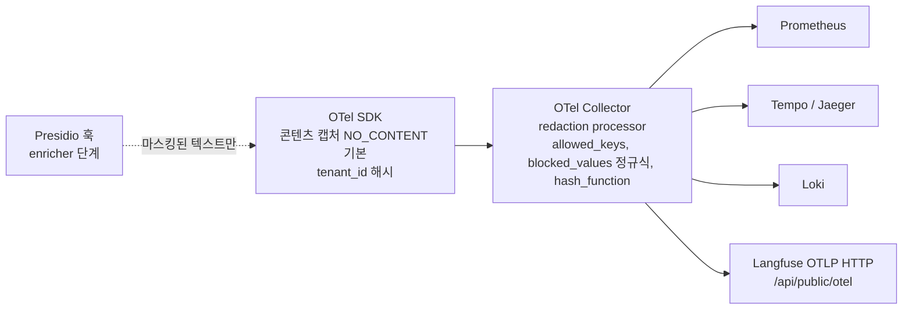

# 평가 프레임워크·벤치마크·관측성

## 목적

설계 브리프의 원칙 7(Evaluation-Driven)과 원칙 8(Observable & Explainable), 확정 결정 D-11(관측성)·D-12(평가 하네스 코어 포함)를 **실제 오픈소스 지형 위에서 검증**하고, 플랫폼이 어댑터로 감쌀 평가(evaluation)·벤치마크(benchmark)·관측성(observability) 기술을 선정한다. 이 문서는 `08-evaluation/*`과 `09-operations/03-observability.md`가 참조할 기술 근거이며, 평가 하네스(evaluation harness)의 아키텍처 초안을 제시한다.

모든 후보의 버전·라이선스·활동성은 2026-09-18 기준으로 PyPI JSON, GitHub, Hugging Face, 명세 저장소를 직접 조회하여 확인했고, 검증 단계(2026-09-22)에서 RAGAS 0.4.3 소스 태그·autoevals·MLflow 릴리스·Langfuse OTel 매핑 문서·OTel GenAI 스팬 규약 등을 재확인하여 정정했다(재확인 항목은 "재확인 2026-09-22"로 표기). 확인하지 못한 사실은 "확인 필요"로 표기한다.

## 범위

| 포함 | 제외 |
|------|------|
| RAG 평가 프레임워크(LLM-judge 포함), IR 메트릭 라이브러리, 공개 벤치마크(영문·다국어·한국어), 메트릭 정의, 골든셋 구축 방법, 온라인 실험(A/B·인터리빙), OpenTelemetry GenAI 규약, LLM 관측성 백엔드, 메트릭·로그·트레이스 스택, 비용·토큰 계측, 트레이스 내 프라이버시 | 임베딩 모델 자체의 성능 비교(05 문서), 리랭커·융합 알고리즘 선택(07 문서), 배포 매니페스트(09-operations), 골든셋의 실제 데이터 목록(08-evaluation/03) |

## 평가 기준

브리프 D-02(Apache-2.0 호환성)와 원칙 6(Korean-First)을 반영한 가중치다. 점수는 1~5, 가중 합은 5점 만점.

| 기준 | 가중치 | 판단 관점 |
|------|-------:|-----------|
| 한국어 지원 | 0.15 | 한국어 데이터·프롬프트 적응·토크나이저·한국어 벤치마크 포함 여부(관측성 도구는 UTF-8·다국어 텍스트 처리 무결성) |
| 라이선스 적합성(D-02) | 0.20 | Apache/MIT/BSD = 5, AGPL(분리 서비스로만) = 3, ELv2·BSL 등 비OSI = 2, NC/ND 데이터 = 1 |
| 성숙도·유지보수 | 0.15 | 최근 6개월 릴리스, 이슈 처리, 조직 후원, API 안정성 |
| 품질·성능 | 0.15 | 메트릭 정의의 표준성(TREC 호환), 재현성, 처리 속도, 판정 정확도 근거 |
| 통합 난이도 | 0.15 | 우리 계약(`RankedSet`, `ContextPack`)과의 매핑 용이성, 프레임워크 종속성, OTLP 호환 |
| 커뮤니티·생태계 | 0.10 | GitHub 스타·기여자·통합 수 |
| 운영 비용 | 0.10 | 셀프호스팅 인프라(ClickHouse 등) 요구, 판정 LLM 호출 비용 |

## 후보 목록

### 평가 프레임워크

| 이름 | 최신 버전(확인일) | 라이선스 | 성숙도 | 한국어 지원 | 핵심 강점 | 약점 |
|------|------------------|----------|--------|-------------|-----------|------|
| RAGAS | 0.4.3 (PyPI 업로드 2026-01-13; 확인 2026-09-18) | Apache-2.0 | 높음(15.8k stars, Vibrant Labs) | 언어 적응 `adapt_prompts(language, llm)`은 v0.4.3 `src/ragas/prompt/mixin.py`의 `PromptMixin`에 있고 레거시 `ragas.metrics`(`MetricWithLLM`)만 이를 상속. 0.4 `ragas.metrics.collections`의 `BaseMetric`(`collections/base.py`)은 `PromptMixin`을 상속하지 않고 `adapt`/`language` 참조도 없음(재확인 2026-09-22) → collections API는 **언어 적응 미지원**. 단, 프롬프트가 인스턴스 속성(예: `AnswerRelevancy.prompt`, `Faithfulness.nli_statement_prompt`)이라 **한국어 프롬프트 객체로 교체 가능** | RAG 특화 메트릭 정의(context precision/recall, faithfulness, answer relevancy, context relevance, factual correctness, noise sensitivity), 0.4.3 collections `__all__` 기준 **39개 메트릭 클래스**(재확인 2026-09-22), 지식그래프 기반 `TestsetGenerator` | 2026-01 이후 8개월간 릴리스 없음(오픈 이슈 373건), 0.3→0.4 API 대개편, collections 프롬프트 교체에 공식 생성자 인자 없음 |
| DeepEval | 4.2.3 (2026-09-14) | Apache-2.0 | 높음(18.3k stars, Confident AI) | 판정 LLM 자유 교체(`DeepEvalBaseLLM`), 프롬프트는 영어 | 50+ 메트릭(공식 문서 metrics-introduction의 "50+ SOTA, ready-to-use metrics" 표기 기준), pytest 통합(`deepeval test run`), G-Eval·DAG 커스텀 루브릭 | 상용 SaaS(Confident AI)로의 유도, 텔레메트리 기본 켬 |
| TruLens | 2.14.0 (2026-09-03) | MIT | 높음(Snowflake 유지) | 영어 프롬프트, 판정 모델 교체 가능 | RAG Triad(context relevance, groundedness, answer relevance), OTel 네이티브 트레이싱·OTLP 내보내기 | 대시보드·세션 모델이 자체 스택에 결합, RAG 특화 메트릭 수 적음 |
| Arize Phoenix Evals | `arize-phoenix-evals` 3.8.0 (2026-09-11) | **Elastic-2.0(비OSI)** | 높음 | 영어 프롬프트 | `create_classifier`, `FaithfulnessEvaluator`, `RetrievalRelevanceEvaluator`, DataFrame 대량 평가 | 라이선스가 Apache 플랫폼의 직접 의존성으로 부적합(호스티드 서비스 제한, 라이선스 키 조항) |
| Opik(평가 SDK) | 2.2.68 (2026-09-17) | Apache-2.0 | 높음(22.1k stars, Comet) | LiteLLM 경유 임의 판정 모델 | Hallucination·AnswerRelevance·ContextPrecision·ContextRecall·G-Eval, 데이터셋·실험 API, pytest 통합 | 데이터셋·실험이 Opik 서버에 결합, 인프라 무거움 |
| MLflow GenAI | 3.16.1 (2026-09-16) | Apache-2.0 | 매우 높음 | 영어 프롬프트 | `mlflow.genai.evaluate`, OSS에서 쓸 수 있는 리트리벌 판정 스코어러 `RetrievalGroundedness`·`RetrievalSufficiency` 2종, `@scorer` 커스텀, 평가 데이터셋 버전 관리 | 리트리벌 판정이 MLflow 트레이스의 RETRIEVER 스팬에 결합, `RetrievalRelevance`·`Safety` 스코어러는 Databricks 관리형 전용(공식 문서: "will be open-sourced soon") |
| LangSmith | SDK `langsmith` 0.12.6 (2026-09-16) | SDK MIT / **서버 비공개** | 높음 | - | 성숙한 데이터셋·실험 UI | 셀프호스팅은 상용 계약 필요 → 코어 후보 제외 |
| AutoRAG(legacy) | `AutoRAG` 0.3.25 (2026-08-24; 2026년 4·7·8월에도 유지보수 릴리스 지속) | Apache-2.0 (`legacy/`) | **유지보수 모드**(버그 수정·의존성 업데이트 릴리스는 지속되나 **신규 기능 개발 중단**; 저장소는 MIT 라이선스의 "AutoRAG 2.0" 에이전트로 전환) | **높음**: 한국어 BM25 토크나이저 `ko_kiwi`/`ko_okt`/`ko_kkma`, 한국어 QA 생성 예시 | YAML 노드 라인으로 파이프라인 조합을 자동 탐색, retrieval_recall/precision/f1/ndcg/map/mrr + 생성 메트릭 | 신규 기능 개발 중단, Python <3.13 제약(D-01 3.12는 충족), 자체 파이프라인 구조에 결합 |
| FlashRAG | GitHub main (최근 업데이트 2025-11-06) | MIT | 중간(연구 툴킷) | 없음 | 36개 전처리 데이터셋, 23개 RAG 알고리즘, sequential/conditional/branching/loop 파이프라인 | 영어 QA(EM/F1) 중심, 서빙 통합 부적합 |
| BERGEN | GitHub main | **CC BY-NC-SA 4.0** | 중간(NAVER Labs Europe) | 다국어 질의 실험 지원(언어 목록 확인 필요) | 20+ 리트리버(BM25, SPLADE-v3), 4 리랭커, 20+ 생성기 비교 | 비상업 라이선스 → 코드 포함 불가, 참고용 |
| RAGChecker | `ragchecker` 0.1.9 (2024-09-25) | Apache-2.0 | **낮음**(2년간 릴리스 없음) | 없음 | 클레임 단위 메트릭(claim recall, context precision, faithfulness, hallucination, noise sensitivity, context utilization, self-knowledge) | 유지보수 정체, 클레임 추출기 의존 |
| ARES | `ares-ai` (GitHub 733 stars) | Apache-2.0 | 낮음~중간 | 없음 | 합성 질의 + 소형 판정 분류기 파인튜닝 + PPI(prediction-powered inference)로 소량 사람 라벨과 결합 | 활동 저조, 파이프라인 무거움 |
| Vectara open-rag-eval | `open-rag-eval` 0.3.0 (2025-12-15) | Apache-2.0 | 중간(408 stars) | 없음(영어 프롬프트) | **참조 없는(reference-free)** RAG 평가 툴킷: `TRECEvaluator`(UMBRELA 관련성, HHEM 환각 점수, 인용 메트릭), `GoldenAnswerEvaluator`, `ConsistencyEvaluator`(BERTScore·ROUGE-L). UMBRELA·AutoNuggetizer를 패키지로 제공 | 커뮤니티 작음, Vectara 커넥터 중심 |
| castorini nuggetizer | `nuggetizer` PyPI 0.0.5 (2025-02-04), GitHub 태그 0.0.6 | Apache-2.0 | 낮음(29 stars, TREC RAG 참조 구현) | 없음 | TREC 2024 RAG AutoNuggetizer 공식 구현(nugget 생성·채점·할당), OpenAI/Azure/OpenRouter/vLLM 백엔드 | 연구 코드 수준, 릴리스 드묾 |
| RAGElo(Zeta Alpha) | `ragelo` 0.6.1 (2026-09-10) | Apache-2.0 | 중간(131 stars, 활동 지속) | 없음(프롬프트 영어) | **쌍대 비교(pairwise) LLM-judge + Elo**로 리트리버·RAG 파이프라인을 상대 순위화, 문서 관련성 판정기(reasoner/domain-expert/RDNAM), OpenAI·Ollama·instructor(Anthropic 등) 제공자 | 절대 점수 없음(상대 비교 전용), 커뮤니티 작음 |
| Braintrust autoevals | `autoevals` 0.3.0 (2026-06-09; 0.0.130→0.1.0(2026-02-13)→0.2.0(2026-04-02)→0.3.0으로 대개편, 재확인 2026-09-22) | MIT(GitHub `LICENSE` 기준; **PyPI 메타데이터에 license/classifier 미기재**) | 중간(1.0k stars) | 없음 | 경량 LLM-judge 라이브러리: `autoevals.ragas` 모듈에 `ContextEntityRecall`, `ContextRelevancy`, `ContextRecall`, `ContextPrecision`, `Faithfulness`, `AnswerRelevancy`, `AnswerSimilarity`, `AnswerCorrectness`(main 기준 클래스명 재확인 2026-09-22; RAGAS 정의 이식본), 기본 모델은 `init(default_model=...)`로 설정, LiteLLM 클라이언트 | Braintrust SaaS 지향, 서버 기능 없음, 0.x 대개편 직후라 API 안정성 관찰 필요 |
| Pydantic Evals | `pydantic-evals` 2.46.0 (2026-09-19; 2.45.0은 2026-09-18, pydantic-ai 모노레포, 재확인 2026-09-22) | MIT | 높음(Pydantic 팀) | 해당 없음(메트릭 자체 작성) | `Dataset`/`Case`/`Evaluator` 경량 하네스, **Pydantic v2 스택(D-01)과 정합**, OTel 스팬 기반 평가 | RAG 전용 메트릭 없음(evaluator 직접 구현) |
| Inspect AI(UK AISI) | `inspect-ai` 0.3.266 (2026-09-19; 0.3.265는 2026-09-17, 재확인 2026-09-22) | MIT | 높음(정부 기관 유지, 거의 매일 릴리스) | 없음 | 태스크·솔버·스코어러 모델, 대규모 LLM 평가 로그 뷰어, 모델 등급 판정 | 안전성 평가 중심, RAG 리트리벌 메트릭 없음 |
| promptfoo | GitHub main (25.3k stars) | MIT | 매우 높음 | 없음 | CI 친화 선언적 평가(YAML), RAG 관련 assertion(context-faithfulness·context-recall·context-relevance; 명칭 확인 필요), 레드팀 | **TypeScript/Node.js ≥ 22** 스택 → Python 하네스와 이질 |
| Evidently | `evidently` 0.7.23 (2026-09-11; 재확인 2026-09-22) | Apache-2.0 | 높음 | 없음 | 100+ 내장 지표, LLM 판정·텍스트 디스크립터, RAG 테스트셋 생성·품질 리포트 | 표 데이터 모니터링 출신, RAG 특화 깊이 얕음 |
| Giskard | `giskard` 3.0.0 (2026-08-26; `requires-python >=3.12`로 D-01 충족, 재확인 2026-09-22) | Apache-2.0 | 중간 | 없음 | RAGET(RAG Evaluation Toolkit) 테스트셋 자동 생성은 **v2 legacy 문서**로 이동, v3 `quality_scan`이 후속 | 3.0 재편으로 RAGET API 안정성 불명 |
| LlamaIndex evaluators | `llama-index-core`(브리프 R2로 이미 스택 후보) | MIT | 매우 높음 | 영어 프롬프트(프롬프트 템플릿 교체 가능) | `RetrieverEvaluator`(hit_rate·MRR 등 qrels형), `FaithfulnessEvaluator`, `RelevancyEvaluator`, `CorrectnessEvaluator`, `BatchEvalRunner` | 메트릭 정의가 RAGAS보다 단순, LlamaIndex `NodeWithScore` 모델에 결합 → 우리 `RankedSet` 어댑터 필요 |
| Haystack 2.x evaluators | `haystack-ai` 2.x | Apache-2.0 | 높음(deepset) | 영어 프롬프트 | `DocumentRecallEvaluator`, `DocumentMRREvaluator`, `DocumentNDCGEvaluator`, `FaithfulnessEvaluator`, `ContextRelevanceEvaluator`, `LLMEvaluator`(커스텀), RAGAS·DeepEval 통합 컴포넌트 | Haystack `Document`·파이프라인 모델에 결합, IR 메트릭은 ranx 대비 기능 적음 |
| DeepEval `Synthesizer` / distilabel | DeepEval 4.2.3 내장 / `distilabel`(Argilla·HF 계열, 3.4k stars) | Apache-2.0 / Apache-2.0 | 높음 / 중간(원저자 이탈, 커뮤니티 유지보수 전환 공지) | 프롬프트 영어(교체 가능) | 합성 골든(질의·기대 답) 생성 — RAGAS `TestsetGenerator`의 대안. distilabel은 LLM 파이프라인형 합성 데이터 생성 프레임워크 | distilabel 유지보수 리스크, 다중 홉 지식그래프 합성은 RAGAS가 더 정교 |
| Prometheus-Eval / Prometheus 2(KAIST) | `prometheus-eval` 0.1.20 (2024-09-02); 모델 Prometheus 2 7B/8x7B, BGB 8x7B, **M-Prometheus 3B/7B/14B(2025-04, 다국어)** | Apache-2.0(코드·가중치) | 낮음~중간(1.1k stars, 2025-04 이후 업데이트 미확인) | M-Prometheus가 다국어 판정 목표(한국어 정확도 수치 확인 필요) | **셀프호스팅 판정 모델**: 절대 등급(1~5)·상대 비교(A/B) 모두 지원 → 판정 LLM 비용·프라이버시 완화 | 판정 품질이 최신 상용 모델보다 낮을 가능성, 유지보수 정체 → 단일 후보로는 위험 |
| Atla Selene-1-Mini (`AtlaAI/Selene-1-Mini-Llama-3.1-8B`) | 2025-01-27 공개, Llama-3.1-8B 기반, 128K 컨텍스트 | Apache-2.0(모델 카드 기준) | 중간 | 영어 중심(독·불·이·포·힌디·스페인·태국어 지원 명시, **한국어 미명시**) | 절대 점수(1~5)·분류(yes/no)·쌍대 비교 3형식 지원, 8B로 vLLM 셀프호스팅 용이 | 한국어 판정 능력 미검증 → 교정 통과 전제 |
| Flow-Judge-v0.1 (`flowaicom/Flow-Judge-v0.1`) | Phi-3.5-mini 기반 3.8B | Apache-2.0 | 낮음~중간 | 영어 | 이진(pass/fail)·3점·5점 리커트 루브릭 판정, 소형 | 한국어 미검증, 후속 릴리스 미확인 |
| Argilla 2.x / Label Studio Community | Argilla `argilla-io/argilla`(5.1k stars) / Label Studio Community | Apache-2.0 / Apache-2.0 | Argilla: **유지보수 모드**(README: "we won't be adding new features going forward", 버그 수정만) / Label Studio: 높음 | UI 다국어·UTF-8 텍스트 무관 | qrels(0~3 등급)·`answer_spans`(문자 구간) **사람 검수 큐용 주석 도구**; Argilla는 HF 데이터셋 연동, Label Studio는 span 라벨링 UI·웹훅 | Argilla 신규 기능 중단, Label Studio는 Community/Enterprise 경계 존재 |

### IR 메트릭 라이브러리·벤치마크 도구

| 이름 | 최신 버전(확인일) | 라이선스 | 성숙도 | 한국어 지원 | 핵심 강점 | 약점 |
|------|------------------|----------|--------|-------------|-----------|------|
| ranx | 0.3.21 (2025-08-07) | MIT | 높음 | 언어 무관 | Numba 가속, 12 메트릭(`ndcg`는 선형 이득, 지수 이득은 별도 `ndcg_burges`), 25 융합 알고리즘, `compare()` 유의성 검정(`stat_test` = student/fisher/tukey), `optimize_fusion()` | 단일 메인테이너, graded 임계값 표기가 ir_measures보다 제한적, Bonferroni·Holm 등 다중 비교 보정 옵션 없음(PyTerrier `pt.Experiment`가 참조 구현) |
| PyTerrier `pt.Experiment` | `python-terrier` 1.0 (2025-11-13; 재확인 2026-09-22) | **MPL-2.0**(파일 단위 카피레프트; Apache 코드와 링크는 가능하나 D-02 "Apache/MIT/BSD 우선" 목록 밖 → 판단 필요) | 높음(Glasgow Terrier 팀, 516 stars) | 언어 무관 | `pt.Experiment(systems, topics, qrels, measures, baseline=0, test="t", correction="holm" (또는 "bonferroni", "hs", "fdr_bh" 등), correction_alpha=0.05)` — **baseline 대비 paired t-test와 statsmodels 다중 비교 보정 내장**, ir_measures 측정치 사용 | Java(Terrier) 의존, 실행 시 JVM 필요 → 운영 하네스 의존성으로는 무거움. 하네스의 Holm 보정 자체 구현을 검증하는 **참조 구현**으로 사용 |
| ir_measures | 0.4.3 (2025-11-25) | Apache-2.0 | 높음(Glasgow Terrier 팀) | 언어 무관 | `nDCG@10`, `P(rel=2)@5`, `Judged@10` 등 문자열 파싱, pytrec_eval·cwl_eval·ranx 등 다중 provider 공통 인터페이스, trec_eval 동일 수치 | 순수 계산 라이브러리(융합·통계 없음) |
| pytrec_eval / pytrec-eval-terrier | 0.5.10 (2025-10-20) | MIT(trec_eval 별도) | 높음 | 언어 무관 | NIST trec_eval C 바인딩 = TREC 공식 수치 | 저수준 API |
| BEIR | 2.2.0 (2025-06-04) | Apache-2.0 | 높음 | 영어 중심(17~18개 데이터셋) | `EvaluateRetrieval.evaluate()` → NDCG/MAP/Recall/P@k, 표준 코퍼스 포맷 | 데이터가 영어, 한국어 없음 |
| MTEB | 2.21.0 (2026-09-14) | Apache-2.0 | 매우 높음 | **한국어 전용 리트리벌 태스크 10종(`tasks/retrieval/kor` 7개 모듈) 내장**(아래 표) | 임베딩·리트리벌 표준 벤치마크, 리더보드, 태스크 메타데이터(라이선스 명시) | 임베딩 모델 단위 평가(파이프라인 전체 평가 아님) |
| ir_datasets | `ir-datasets` 0.6.3 (2026-07-18) | MIT | 높음 | 다국어 셋(MIRACL, Mr.TyDi 등) 표준 로더 | 코퍼스·질의·qrels 공통 인터페이스, TREC 포맷 내보내기, 지연 다운로드·캐시 | 한국어 전용 셋(LawIRKo 등)은 미포함 → 자체 등록 필요 |
| Pyserini / Anserini | `pyserini` 2.4.0 (2026-08-27) | Apache-2.0 | 높음(Waterloo castorini) | Mr.TyDi·MIRACL 사전 구축 인덱스·BM25 재현 런 | **재현 가능한 BM25·dense 베이스라인 런** 생성, TREC run 출력, `trec_eval` 래퍼 | Java(Lucene) 의존, 운영 스택에는 부적합(베이스라인 전용) |
| KURE 벤치마크 스크립트 | GitHub `nlpai-lab/KURE`(KURE-v2 2026-08-29 공개) | MIT | 중간(고려대 NLP&AI) | **한국어 특화**: MTEB(kor, v2) 리트리벌 9태스크 평가 스크립트(Ko-StrategyQA, AutoRAGRetrieval, MIRACL, PublicHealthQA, Belebele, Mr.TyDi, MLDR, LawIRKo, SQuADKorV1) | D-16 임베딩 선택 근거 재현용 스크립트·모델(KURE-v1/v2, KoE5) | 벤치마크 자체는 MTEB에 의존, 파이프라인 평가 아님 |

### 관측성

| 이름 | 최신 버전(확인일) | 라이선스 | 성숙도 | 한국어 지원 | 핵심 강점 | 약점 |
|------|------------------|----------|--------|-------------|-----------|------|
| OpenTelemetry Python SDK | `opentelemetry-sdk` 1.44.0 (2026-07-16), `opentelemetry-semantic-conventions` 0.65b0 | Apache-2.0 | 매우 높음(CNCF) | 해당 없음 | 트레이스·메트릭·로그 단일 API, OTLP | GenAI 규약은 별도 저장소·Development 단계 |
| OTel GenAI Semantic Conventions | 저장소 `open-telemetry/semantic-conventions-genai`(본 저장소 v1.42.0에서 분리) | Apache-2.0 | **Development(개발 단계)** | 해당 없음 | `gen_ai.*` 스팬·메트릭·이벤트(`gen_ai.evaluation.result` 포함), 에이전트·MCP 규약 | 안정화 전이라 속성명 변경 가능 |
| `opentelemetry-util-genai` | 1.1b0 (2026-08-20) | Apache-2.0 | 베타 | 해당 없음 | `TelemetryHandler`, 콘텐츠 캡처 모드 환경변수 | 베타 |
| OpenInference(spec + 계측) | `openinference-semantic-conventions` 0.1.38 (2026-09-15) | Apache-2.0 | 높음(Arize 주도) | 해당 없음 | `openinference.span.kind` 10종(CHAIN/LLM/RETRIEVER/RERANKER/EMBEDDING/TOOL/AGENT/GUARDRAIL/EVALUATOR/PROMPT), `retrieval.documents.*.document.score`·`reranker.*` 등 **문서 단위 속성** | Arize 생태계 중심, OTel 공식 규약 아님 |
| OTel Python contrib 공식 GenAI 계측기 | `opentelemetry-instrumentation-openai-v2` 2.4b0 (2026-05-01; 재확인 2026-09-22), 같은 계열 `-vertexai`, `-google-genai`, `-botocore`(Bedrock) | Apache-2.0 | 베타(OTel 공식) | 해당 없음 | **현행 `gen_ai.*` 네이티브**(`gen_ai.input.messages` 등), `OTEL_INSTRUMENTATION_GENAI_CAPTURE_MESSAGE_CONTENT`로 콘텐츠 캡처 제어, "코드 내 계측 API는 OTel만" 결정과 가장 정합 | Anthropic·LlamaIndex·벡터DB 계측기는 없음(OpenAI 호환 엔드포인트 경유 시에만 적용), 베타 |
| OpenLIT | `openlit` SDK 1.45.0 (2026-08-03; 재확인 2026-09-22), GitHub `openlit/openlit` | Apache-2.0 | 중간(2.8k stars) | 해당 없음 | **OTel 네이티브·`gen_ai.*` 규약 준수** 자동 계측(LLM·벡터DB: Chroma·Pinecone·Qdrant·Milvus·AstraDB 등 70+), ClickHouse 백엔드 + 자체 UI, GPU 메트릭 | Langfuse 대비 UI·주석 큐·데이터셋 기능 얕음, 커뮤니티 작음 |
| OpenLLMetry(Traceloop) | `traceloop-sdk` 0.62.3 (2026-08-10) | Apache-2.0 | 높음(7.4k stars) | 해당 없음 | LLM 15+·벡터DB(Qdrant, Milvus, Weaviate, Chroma, LanceDB 등) 자동 계측, 24+ 백엔드 | SDK 초기화 방식이 침습적, 자체 속성과 `gen_ai.*` 혼재 |
| Langfuse | 서버 v4.38.0 (2026-09-17), Python SDK 4.15.4 (2026-09-16; v4는 2026-03 재작성) | **MIT(코어)**, `ee/` 폴더 상용 | 매우 높음(34.8k stars). **2026-01 ClickHouse에 인수**(README: "since January 2026 we're part of ClickHouse"); MIT 코어 유지 확인(2026-09-18) | UI 한국어 없음(텍스트 처리 무관) | OTLP HTTP 수신(`/api/public/otel`), 속성 매핑은 `langfuse.observation.*`(자체) + **구 `gen_ai.prompt`/`gen_ai.completion`/`gen_ai.usage.*`/`gen_ai.request.model`/`gen_ai.response.model`** + OpenInference `input.value`/`output.value`/`llm.*` + MLflow `mlflow.spanInputs`/`mlflow.spanOutputs`(공식 매핑 표 기준, 재확인 2026-09-22); LLM-as-a-judge·데이터셋·실험·주석 큐가 2025-06-04부터 MIT | gRPC 미지원, ClickHouse·Postgres·Redis·S3 필요, **현행 OTel GenAI 콘텐츠 속성(`gen_ai.input.messages`/`gen_ai.output.messages`)·`gen_ai.provider.name` 매핑은 매핑 표에 없음(확인 필요, as of 2026-09)** → 입력/출력이 UI에서 비어 보일 수 있음, **서버측 데이터 마스킹·보존 정책·감사 로그는 EE**, 인수 이후 EE 경계·로드맵·ClickHouse 종속 강화 여부 모니터링 필요 |
| Arize Phoenix | `arize-phoenix` 20.14.0 (2026-09-18) | **Elastic-2.0** | 매우 높음(11.5k stars, 주 2~3회 릴리스) | 해당 없음 | 단일 컨테이너, OTLP 수신, 셀프호스팅 무료·기능 제한 없음(OAuth2/LDAP/RBAC 포함) | 비OSI 라이선스(호스티드 서비스 제공 금지) → 분리 서비스로만 |
| Opik(서버) | 2.2.68 (2026-09-17) | Apache-2.0 | 높음 | 해당 없음 | 온라인 평가 규칙, 가드레일, OTLP HTTP 수신 | 속성 매핑이 `opik.*` 자체 규약, MySQL·ClickHouse·Redis·MinIO·ZooKeeper 요구, docker-compose는 비프로덕션 |
| 기타 LLM 관측성 백엔드(지형 완결용) | W&B Weave SDK(`wandb/weave`, 1.1k stars), Lunary(`lunary-ai/lunary`), Helicone(`Helicone/helicone`, 6.2k stars), Laminar(`lmnr-ai/lmnr`, 3.3k stars), AgentOps(`AgentOps-AI/agentops`, 5.8k stars) | Weave SDK Apache-2.0(**셀프호스팅은 W&B 엔터프라이즈 한정**), Lunary Apache-2.0(스타 수 확인 필요), Helicone Apache-2.0, Laminar Apache-2.0, AgentOps MIT | 중간~높음 | 해당 없음 | Laminar는 OTel 네이티브 SDK·gRPC 익스포터, Helicone은 프록시형(게이트웨이) 로깅, AgentOps는 에이전트 세션 리플레이 | 각각 자체 속성 규약·SaaS 지향, Helicone은 Supabase·ClickHouse·MinIO 등 5개 서비스, Weave 셀프호스팅 제약 → Langfuse 1차 결론을 바꾸지 못함(재확인 2026-09-22) |
| Prometheus | 안정(CNCF) | Apache-2.0 | 매우 높음 | 해당 없음 | 메트릭 표준 | 해당 없음 |
| Grafana / Tempo / Loki | 안정 | **AGPL-3.0-only** | 매우 높음 | 해당 없음 | 대시보드·트레이스(TraceQL, OTLP)·로그 | AGPL → D-02에 따라 분리 컨테이너로만, 코드 링크 금지 |
| Jaeger | 안정(CNCF) | Apache-2.0 | 높음 | 해당 없음 | 경량 트레이스 백엔드, OTLP | 로그·메트릭 없음 |
| Perses | GitHub `perses/perses`(CNCF Sandbox, 2.4k stars) | Apache-2.0 | 중간 | 해당 없음 | **비AGPL 대시보드**: Prometheus·Tempo·Loki·Pyroscope 데이터소스, 대시보드 스펙 GitOps, 플러그인 | Grafana 대비 패널·알림 기능 미성숙, Sandbox 단계 |
| SigNoz | GitHub `SigNoz/signoz`(32.1k stars) | **MIT(코어)**, `ee/`·`cmd/enterprise/`는 별도 라이선스 | 매우 높음 | 해당 없음 | OTel 네이티브 **트레이스·메트릭·로그 올인원**, ClickHouse 단일 저장소, OTLP | ClickHouse 운영 필요, 단일 벤더 스택(Prometheus 재사용 불가), EE 경계 존재 |
| ClickStack / HyperDX | GitHub `hyperdxio/hyperdx`(9.9k stars; ClickHouse 공식 스택 "ClickStack"의 UI) | MIT | 높음 | 해당 없음 | ClickHouse + OTel Collector(4317/4318) 로그·트레이스·세션 통합 | ClickHouse 필수, LLM 특화 뷰 없음 |
| OpenSearch Observability(Data Prepper + Trace/Log Analytics) | OpenSearch 안정(D-15로 이미 도입) | Apache-2.0 | 높음 | 해당 없음(Nori는 렉시컬 용도) | **D-15의 OpenSearch 클러스터를 로그·트레이스 저장소로 재사용**, Data Prepper `otel_trace_source`/`otel_logs_source`(OTLP) 또는 OTel Collector `opensearch` exporter, 트레이스-로그 상관 대시보드 | 검색 인덱스와 관측 데이터의 자원 경합(클러스터 분리 권장), TraceQL 수준의 질의 언어 없음(세부 기능 범위 확인 필요) |
| VictoriaMetrics / VictoriaLogs / VictoriaTraces | VictoriaMetrics 안정, VictoriaLogs(`VictoriaMetrics/VictoriaLogs`, 2.3k stars), VictoriaTraces(482 stars, **WIP: "On-disk data structures and API endpoints may change"**) | Apache-2.0(3종 모두) | 높음 / 높음 / 낮음 | 해당 없음 | **AGPL 불가 환경의 Prometheus·Loki·Tempo 대체 스택**, Prometheus 원격 쓰기·PromQL 호환(MetricsQL), OTLP 수신(VictoriaLogs·VictoriaTraces 문서 기준, 세부 확인 필요) | VictoriaTraces 미성숙, LLM 특화 뷰 없음, 대시보드는 별도(Perses 등) |
| OTel Collector(contrib) redaction processor | 트레이스 베타 / 로그·메트릭 알파 | Apache-2.0 | 중간 | 해당 없음 | 속성 허용 목록·정규식 값 마스킹·해시 | 로그·메트릭 알파 |
| OpenTelemetry Weaver | `open-telemetry/weaver`(489 stars, 활발) | Apache-2.0 | 중간(OTel 공식 도구) | 해당 없음 | semconv **레지스트리에서 속성 상수 코드 생성**, 레지스트리 린트·버전 간 diff, 방출 텔레메트리 라이브 검사(live-check), `schema_url` 고정 | 자체 `rag.*` 레지스트리를 Weaver YAML로 작성해야 함, 템플릿 학습 비용 |

### 한국어·다국어 리트리벌 벤치마크 데이터

| 데이터셋 | 출처·포맷 | 한국어 규모 | 라이선스 | 특징 | 용도 판단 |
|----------|-----------|-------------|----------|------|-----------|
| AutoRAGRetrieval (`yjoonjang/markers_bm`) | MTEB 태스크, Marker-Inc | 질의 114 / 문서 720 | MIT(MTEB 메타데이터 기준) | 금융·공공·의료·법률·커머스 공개 문서, arXiv 2410.20878 | 소규모 스모크 테스트 |
| Allganize RAG-Evaluation-Dataset-KO (`allganize/RAG-Evaluation-Dataset-KO`) | HF 데이터셋, 2024-08-09 갱신 | **PDF 63건(1,337쪽)·질의 300개**(금융·공공·의료·법률·커머스 5도메인 × 60) | MIT | 한국어 PDF 기반 RAG 종단 평가셋, 근거 유형이 단락·표·이미지로 구분(예: 금융 50/17/33%) | **한국어 PDF·표 파서·청킹 종단 회귀의 1차 외부 셋**(정답 단위가 문서·페이지이므로 `answer_spans` 재라벨 필요) |
| KoStrategyQA (`taeminlee/Ko-StrategyQA`) | MTEB 태스크 | HF 카드 기준 corpus 27,800행 · queries 8,500행 · qrels 5,520행(train 4,380 / dev 1,150; 재확인 2026-09-22) | CC BY 4.0(MTEB 메타데이터 `license="cc-by-4.0"` 기준; 원 데이터 카드에는 라이선스 태그 없음) | 다중 홉 질의 | 다중 홉 회귀 |
| LawIRKo (`on-and-on/lawgov_ir-ko`) | MTEB 태스크 | corpus 3,560 / queries 3,560 / qrels 3,560행(2025-12~2026-02 구축; 재확인 2026-09-22) | MIT | 법령 조문 단위 코퍼스, 법령명+조문 질의(질의:문서 1:1) | 법령 도메인 |
| MKQA (`apple/mkqa`) | HF 데이터셋, Apple | 26개 언어 병렬 10,000 질의(한국어 `ko` 포함), Natural Questions 기반 | CC BY-SA 3.0(재확인 2026-09-22) | 개방형 QA, 정답 문자열만 있고 **리트리벌 qrels 없음** | 한국어 개방형 QA 보조(자체 코퍼스에 질의 재사용, 정답 문자열로 `answer_spans` 시드) |
| SQuADKorV1Retrieval (`yjoonjang/squad_kor_v1`) | MTEB 태스크 | 확인 필요 | CC BY-SA 4.0 | 위키 기반 | 일반 도메인 |
| SDSKoPubVDR T2I / T2IT (`mteb/SDSKoPubVDRT2IRetrieval`, `mteb/SDSKoPubVDRT2ITRetrieval`) | MTEB 태스크 2종, arXiv 2511.04910 | 문서 361건(KOGL 제1유형 256건 + 법령 포털 105건), 질의-정답 600쌍 | CC BY-SA 4.0 | **한국 공공문서 이미지**(표·그래프·레이아웃) 시각 문서 검색 | 스캔 PDF·표 파서 품질 간접 평가 |
| KoViDoRe2 (cybersecurity/economic/energy/hr; HF `whybe-choi/kovidore-v2-*-mteb`) | MTEB 태스크 4종(단일 모듈 `kovidore2_bench_retrieval.py`) | 확인 필요 | CC BY 4.0 | 기업 문서 다중 페이지 시각 검색 | 시각 문서 |
| MIRACL-ko (`miracl/miracl`) | TREC qrels(`qid Q0 docid rel`) | train 868 / dev 213 질의(코퍼스 규모 확인 필요) | Apache-2.0 | 원어민 주석, 위키 문단 | dense/sparse 1차 검색 회귀 |
| Mr.TyDi-ko (`castorini/mr-tydi`) | positive/negative passages | 약 2.02k 행(분할별 수 확인 필요) | Apache-2.0 | 위키 기반 | 학습·회귀 |
| MLDR-ko (`Shitao/MLDR`) | BGE-M3 논문 데이터 | dev 200 / test 200 질의, 문서 6,176(평균 7,832 토큰) | MIT | **장문 문서** | 청킹·부모 확장(O-09) 평가 |
| KorQuAD 1.0 / 2.0 | 추출형 MRC | 1.0 약 7만 쌍(확인 필요), 2.1 102,960 쌍(47,957 문서) | **CC BY-ND 2.0 KR** | 2.0은 HTML 표·리스트 포함 장문 | 내부 평가 가능, 파생 배포 불가 |
| KLUE-MRC | NLU 벤치마크 8과제 | mrc 23.4k 행 | CC BY-SA 4.0 | 리트리벌 과제 없음 | 판독 품질 보조 |
| AI Hub 행정 문서 대상 기계독해 | JSON QA | 411,840 QA / 약 60만 행정문서 | AI Hub 약관, **내국인만 신청 가능**, 재배포 불가 | 6종 질의 유형(표 기반·절차형 포함) | 국내 조직 내부 골든셋 시드 |
| HWPX 기반 공개 리트리벌 벤치마크 | - | - | - | **존재 확인 못함(as of 2026-09)** | 자체 구축 필요 |
| (판정기 교정용) RAGTruth (`ParticleMedia/RAGTruth`) | GitHub JSONL | 영어 17,790 응답, 환각 span 약 14,289건(단어 수준 주석, Evident Conflict·Baseless Information 유형; 재확인 2026-09-22) | MIT | RAG 응답의 환각 구간 라벨 | faithfulness/환각 판정기(자체·DeepEval·RAGAS) **교정 데이터셋**(RAGBench 보조) |
| (판정기 교정용) LLM-AggreFact | HF `lytang/LLM-AggreFact` | 영어 grounding 판정 벤치마크(11개 서브셋 집계) | 확인 필요(서브셋별 상이) | 문서-클레임 뒷받침 여부 이진 라벨 | grounding 판정 모델 비교 보조 |
| (한국어 판정 능력 검증용) KoMT-Bench (`LGAI-EXAONE/KoMT-Bench`) / LogicKor (`instructkr/LogicKor`) | HF(접근 승인 필요) / GitHub(2024-10-17 아카이브) | 한국어 다중 턴 판정 벤치마크 / 한국어 다분야 사고력 벤치마크 | KoMT-Bench 데이터 **LGPL-3.0**(내부 평가 전용, 재배포 주의) / LogicKor 라이선스 확인 필요 | LLM-as-a-judge 프로토콜(GPT-4 계열 판정) | **셀프호스팅 판정 모델의 한국어 이해력 사전 검증**(리트리벌 평가셋 아님) |

## 심층 비교

### 메트릭 정의(공통 기준)

플랫폼 계약 문서와 평가 문서가 같은 정의를 쓰도록 여기서 고정한다. `k`는 컷오프, `rel(d)`는 등급 판정(0~3), 이진화는 `rel ≥ 1`(기본) 또는 `rel ≥ 2`(엄격, `P(rel=2)@k` 표기).

| 메트릭 | 정의 | 판정 단위 | 용도 | 계산 라이브러리 |
|--------|------|-----------|------|-----------------|
| Recall@k | 상위 k 내 관련 문서 수 / 전체 관련 문서 수 | 문서(doc-level) | 1차 검색(dense/sparse/lexical) 게이트. §7 목표 Recall@20 ≥ 0.92 | ranx `recall@k`, ir_measures `R@k` |
| Precision@k | 상위 k 내 관련 문서 수 / k | 문서 또는 청크 | 컨텍스트 팩 노이즈 | `precision@k`, `P@k` |
| nDCG@k | DCG@k / IDCG@k, **이득 함수는 선형 `rel`, 할인 `1/log2(i+1)`로 고정**(Järvelin & Kekäläinen; trec_eval·pytrec_eval·BEIR·ranx `ndcg`·ir_measures `nDCG` 기본과 동일 → 외부 벤치마크 수치와 직접 비교 가능). 지수 이득 `2^rel − 1`(Burges)이 필요하면 별도 지표명 `ndcg_exp@k`로 표기하고 ranx `ndcg_burges@k`·ir_measures `nDCG(dcg='exp-log2')@k`로 계산 | 문서, graded | 리랭킹 후 최종 품질의 제1 지표. §7 목표 nDCG@10 ≥ 0.80 | ranx `ndcg@k`, ir_measures `nDCG@k` |
| MRR | 첫 관련 문서 순위의 역수 평균 | 문서 | 단일 정답형 질의 | `mrr`, `RR` |
| MAP | 질의별 평균 정밀도의 평균 | 문서 | 다중 관련 문서 질의 | `map`, `AP` |
| Hit rate@k(Hits) | 상위 k 내 관련 문서 1개 이상이면 1 | 문서 | 스모크 게이트 | `hit_rate@k`, `Success@k` |
| Judged@k | 상위 k 중 qrels에 판정이 존재하는 비율 | 문서 | 풀링 편향 감지(낮으면 qrels 보강 필요) | ir_measures `Judged@k` |
| Span hit rate@k | 상위 k 청크 중 골든 정답 문자 구간(char span)과 겹치는 청크가 있으면 1 | **청크 + provenance** | 청킹 전략 비교(O-09) | 자체 구현(qrels의 `answer_spans`와 `Chunk.provenance` 교차) |
| Context precision(RAGAS) | 상위 k 컨텍스트 중 관련 컨텍스트가 상위에 놓인 정도(정밀도의 순위 가중 평균) | 청크, LLM 또는 참조 기반 | 참조 없는 운영 데이터 평가 | RAGAS 0.4 `ragas.metrics.collections`: `ContextPrecisionWithoutReference`(응답 기준, 참조 없음) / `ContextPrecisionWithReference` / `ContextPrecision`; DeepEval `ContextualPrecisionMetric`; autoevals `ContextPrecision`; LlamaIndex/Haystack 해당 없음(IR 메트릭으로 대체) |
| Context utilization(RAGAS) | 참조 없이 **응답**을 기준으로 계산한 context precision 변형(응답이 실제로 활용한 컨텍스트가 상위에 있는가) | 청크, LLM | 운영 트래픽의 컨텍스트 팩 순서 품질 | RAGAS 0.4 collections `ContextUtilization`(`context_precision` 모듈; 재확인 2026-09-22); RAGChecker context utilization(정체) |
| Context relevance(참조 없음) | 컨텍스트가 질의에 관련된 정도를 참조 없이 LLM이 등급 판정 | 청크, LLM | 참조 없는 운영 데이터 평가, TruLens RAG Triad의 context relevance와 동일 개념 | RAGAS 0.4 collections `ContextRelevance`(재확인 2026-09-22), DeepEval `ContextualRelevancyMetric`, TruLens `context_relevance`, Haystack `ContextRelevanceEvaluator`, autoevals `ContextRelevancy` |
| Context recall(RAGAS) | 참조 답변의 문장 중 컨텍스트로 귀속 가능한 비율 | 청크, LLM | 컨텍스트 팩 충분성 | RAGAS 0.4 collections `ContextRecall`(구 API의 `LLMContextRecall`/`NonLLMContextRecall`는 `ragas.metrics` 레거시 이름); DeepEval `ContextualRecallMetric`; MLflow `RetrievalSufficiency` |
| Faithfulness | 응답의 클레임 중 컨텍스트로 뒷받침되는 비율 | 응답 | 레퍼런스 `answer` 엔드포인트 품질 | RAGAS 0.4 collections `Faithfulness`(멀티모달은 `MultiModalFaithfulness`), DeepEval `FaithfulnessMetric`, TruLens groundedness, MLflow `RetrievalGroundedness`, LlamaIndex `FaithfulnessEvaluator`, Haystack `FaithfulnessEvaluator` |
| Response groundedness | 응답 전체가 컨텍스트에 근거하는지를 클레임 분해 없이 등급 판정(faithfulness의 경량 변형) | 응답, LLM | 운영 샘플링 모니터링(저비용) | RAGAS 0.4 collections `ResponseGroundedness`(재확인 2026-09-22) |
| Answer relevancy | 응답에서 역생성한 질문들과 원 질문의 임베딩 유사도 평균 | 응답 | 동일 | **RAGAS 0.4 collections `AnswerRelevancy`**(`answer_relevancy/metric.py`, `llm`·`embeddings`·`strictness=3`; 구 API 이름 `ResponseRelevancy`; 재확인 2026-09-22), DeepEval `AnswerRelevancyMetric`(병기), autoevals `AnswerRelevancy`, LlamaIndex `RelevancyEvaluator` |
| Factual correctness | 응답 클레임과 참조 답변 클레임의 정밀도·재현율·F1(클레임 분해 후 NLI) | 응답, LLM + 참조 | 골든 답변이 있는 셋의 정답성 | RAGAS 0.4 collections `FactualCorrectness`(재확인 2026-09-22), `AnswerCorrectness`, DeepEval G-Eval 정답성 루브릭, LlamaIndex `CorrectnessEvaluator` |
| Noise sensitivity | 무관 컨텍스트가 있을 때 오답 클레임이 생기는 비율 | 응답 | MMR·필터 효과 | RAGAS 0.4 collections `NoiseSensitivity` |
| Nugget recall/precision(TREC RAG) | 정답 필수 정보 조각(nugget) 중 응답이 포함한 비율 | 응답 | 장문 비사실형 질의 | castorini `nuggetizer`(Apache-2.0, TREC 2024 RAG 공식 AutoNuggetizer), Vectara `open-rag-eval`(Apache-2.0, UMBRELA·AutoNuggetizer 패키지화) |
| Pairwise win rate / Elo | 두 프로파일(또는 리트리버)의 결과를 쌍대 비교해 승률·Elo로 상대 순위화 | 문서 목록 또는 응답, LLM | 절대 점수가 불안정한 프로파일 비교(O-01·O-05) | RAGElo(Apache-2.0) 또는 자체 pairwise 프롬프트 |

트레이드오프: 문서 단위 qrels는 재청킹에 불변이고 사람이 판정하기 쉽다. 청크 단위 qrels는 청킹 전략을 바꾸면 무효화된다. 따라서 **골든셋의 진실값은 문서 ID + 정답 문자 구간(char offsets)** 으로 저장하고, 청크 단위 판정은 `Chunk.provenance`로 **파생 계산**한다(D-04의 provenance 보존이 전제).

### TREC 포맷(골든셋 교환 규약)

| 파일 | 형식(공백 구분) | 예시 |
|------|-----------------|------|
| qrels | `query_id iteration doc_id relevance` (iteration은 관례적으로 `0` 또는 `Q0`) | `q0001 0 01J9Z6X7K8M2N3P4Q5R6S7T8U9 2` |
| run | `query_id Q0 doc_id rank score run_tag` | `q0001 Q0 01J9Z6X7K8M2N3P4Q5R6S7T8U9 1 0.8731 hybrid_rrf_v3` |
| topics | JSONL `{ "query_id", "query", "language", "metadata" }` | 자체 포맷(TREC topic XML 대체) |

`doc_id`는 D-06에 따라 ULID이다. 청크·구간 진실값은 확장 필드로 별도 JSONL(`answer_spans: [{doc_id, start, end}]`)에 둔다. 이렇게 하면 ranx·ir_measures·pytrec_eval·BEIR·MTEB 모두와 무손실 교환이 가능하다.

### RAGAS

- 동작 방식: `SingleTurnSample(user_input, retrieved_contexts, response, reference)`를 `EvaluationDataset`으로 묶어 `ragas.evaluate(dataset, metrics, llm, embeddings)`를 호출한다. 메트릭은 LLM 기반(클레임 분해·귀속)과 비LLM 기반(참조 컨텍스트 문자열 비교)이 분리되어 있다. 0.4에서 `ragas.metrics.collections`로 메트릭이 재편되고 `llm_factory()`·`DiscreteMetric`·`ascore()`가 진입점으로 부각되었다(README 기준).
- 실제 진입점: 패키지 `ragas`; `ragas.evaluate`, `ragas.dataset_schema.SingleTurnSample`, `ragas.testset.TestsetGenerator`(`generate_with_langchain_docs`, `generate`), 지식그래프 `transforms`, 질의 합성기(single-hop specific/abstract, multi-hop specific/abstract 4종).
- 출력 형식: `EvaluationResult` → pandas DataFrame(샘플별 메트릭 컬럼) → 우리 `EvalReport`로 변환.
- 성능·근거: 메트릭 정의는 RAGAS 논문(Es et al., 2023/2024)에 기반. 판정 정확도는 판정 LLM에 의존하며 한국어 판정 정확도 공개 수치는 없음(확인 필요).
- 0.4 collections가 내보내는 메트릭 클래스(git 태그 v0.4.3 `src/ragas/metrics/collections/__init__.py`의 `__all__` 39개, 재확인 2026-09-22):
  - RAG 리트리벌·컨텍스트: `ContextPrecision`, `ContextPrecisionWithReference`, `ContextPrecisionWithoutReference`, `ContextUtilization`, `ContextRecall`, `ContextRelevance`, `ContextEntityRecall`, `NoiseSensitivity`
  - RAG 응답: `Faithfulness`, `ResponseGroundedness`, `AnswerRelevancy`, `AnswerCorrectness`, `AnswerAccuracy`, `FactualCorrectness`, `SemanticSimilarity`, `MultiModalFaithfulness`, `MultiModalRelevance`
  - 문자열·요약: `BleuScore`, `RougeScore`, `CHRFScore`, `ExactMatch`, `StringPresence`, `NonLLMStringSimilarity`(`DistanceMeasure`), `QuotedSpansAlignment`, `SummaryScore`
  - 루브릭: `DomainSpecificRubrics`, `InstanceSpecificRubrics`, `RubricsScoreWithReference`, `RubricsScoreWithoutReference`
  - 에이전트·도구·SQL(우리 범위 밖): `AgentGoalAccuracy`(±WithReference), `ToolCallAccuracy`, `ToolCallF1`, `TopicAdherence`, `DataCompyScore`, `SQLSemanticEquivalence`
  - 구 `ragas.metrics`의 `LLMContextPrecisionWithoutReference`·`LLMContextRecall`·`NonLLMContextRecall`·`ResponseRelevancy`는 레거시 API 이름이다(collections 대응은 각각 `ContextPrecisionWithoutReference`·`ContextRecall`·(비LLM 변형 없음)·`AnswerRelevancy`).
- 프롬프트 구조(재확인 2026-09-22): collections 메트릭은 `BaseMetric`(`collections/base.py`, `SimpleBaseMetric`+`NumericValidator` 상속) 하위 클래스로 `llm: InstructorBaseRagasLLM`·`embeddings: BaseRagasEmbedding`을 생성자에서 받고, 판정 프롬프트는 각 메트릭 패키지의 `util.py`에 정의된 프롬프트 클래스를 `__init__`에서 **인스턴스 속성**으로 붙인다(예: `AnswerRelevancy.prompt = AnswerRelevancePrompt()`, `Faithfulness.statement_generator_prompt`/`nli_statement_prompt`). 생성자 인자로 프롬프트를 바꾸는 공식 경로는 없으므로 한국어 프롬프트 교체는 **인스턴스 속성 재할당(동일 입출력 Pydantic 모델을 쓰는 서브클래스 프롬프트)** 으로 수행한다. 비공식 확장점이므로 계약 테스트로 고정한다.
- 함정: (1) 8개월간 릴리스 정체(2026-01-13 이후) — 포크 금지 원칙상 판정 프롬프트를 우리가 소유하는 방향으로 완화. (2) 프롬프트 언어 적응은 v0.4.3 `src/ragas/prompt/mixin.py`의 `PromptMixin.adapt_prompts(language: str, llm, adapt_instruction: bool = False)`에 구현되어 있고 레거시 `MetricWithLLM`만 이를 상속한다. collections `BaseMetric`은 `PromptMixin`을 상속하지 않고 `adapt`/`language` 참조가 없어 **collections API에서는 언어 적응 미지원**(재확인 2026-09-22) → 한국어 판정은 RAGAS 정의를 차용한 **자체 프롬프트(위 인스턴스 속성 교체 또는 독립 `evaluator` 플러그인)를 전제**로 설계한다(리스크 표 참조). (3) 텔레메트리 기본 켬(`RAGAS_DO_NOT_TRACK=true`로 해제). (4) `TestsetGenerator`는 LangChain `Document` 또는 자체 노드를 입력받으므로 `NormalizedDocument`→Document 어댑터가 필요.

### DeepEval

- 동작 방식: `LLMTestCase(input, actual_output, expected_output, retrieval_context, context)`에 메트릭 객체를 적용. `evaluate(test_cases, metrics)` 또는 pytest 플러그인 `deepeval test run test_rag.py`로 CI에서 실행. 메트릭은 0~1 점수와 이유(reason)를 반환하고 `threshold`로 pass/fail.
- 진입점: 패키지 `deepeval`; `ContextualPrecisionMetric`, `ContextualRecallMetric`, `ContextualRelevancyMetric`, `FaithfulnessMetric`, `AnswerRelevancyMetric`, `GEval(criteria, evaluation_steps)`, `DAGMetric`, `HallucinationMetric`; 판정 모델은 `DeepEvalBaseLLM` 서브클래스(Ollama·vLLM·Anthropic 등).
- 출력 형식: 테스트 결과 객체(점수·이유·성공 여부), JSON 리포트; Confident AI 업로드는 선택.
- 근거: 2026-08-24 v4.2.0에서 "higher is better" 점수 표준화, MCP 서버 지원. 활동성 매우 높음.
- 함정: 텔레메트리·로그인 유도(`DEEPEVAL_TELEMETRY_OPT_OUT=1`로 해제; 재확인 2026-09-22), 판정 프롬프트가 영어 고정이라 한국어 컨텍스트에 대한 클레임 추출 품질 검증 필요, 메트릭 수가 많아 정의가 RAGAS보다 덜 표준적.

### TruLens

- 동작 방식: `TruSession()`으로 세션을 만들고 앱을 `TruApp`(또는 `TruChain`, `TruLlama`)으로 감싸 실행하면 OTel 스팬이 기록되고, `Feedback(provider.context_relevance).on_input().on(context)` 형태의 피드백 함수가 스팬을 판정한다. 2.14.0에서 OTLP로 트레이스·메트릭 직접 내보내기, Ollama 피드백 제공자, 스트리밍 TTFT 계측 추가.
- 진입점: 패키지 `trulens`(코어 + `trulens-providers-*`); RAG Triad = `context_relevance`, `groundedness`, `relevance`.
- 출력: 세션 DB(SQLite/Postgres) + 대시보드; OTLP 스팬.
- 함정: 평가가 자체 스팬 계측에 결합되어 있어 우리 OTel 스팬과 이중 계측 위험. 스코어를 우리 `EvalReport`로 뽑아내는 API 안정성 확인 필요. 강점인 "RAG Triad"는 RAGAS·DeepEval로도 동일하게 구성 가능.

### Arize Phoenix(evals + 서버)

- 동작 방식: 서버는 OTLP를 받아 OpenInference 속성(`retrieval.documents.*`)을 문서 단위로 시각화한다. `arize-phoenix-evals` 3.x는 `LLM(provider, model)`과 `create_classifier(prompt, choices)`로 분류형 판정기를 만들고 `evaluate_dataframe`로 대량 실행한다.
- 라이선스 판단: Elastic License 2.0은 OSI 비승인이며 "제3자에게 호스티드·매니지드 서비스로 제공 금지", "라이선스 키 기능 우회 금지" 조항이 있다. Apache-2.0 플랫폼이 `arize-phoenix`·`arize-phoenix-evals`를 **pip 의존성으로 포함하면 배포물 전체의 라이선스 단순성이 깨진다.** 반면 OTLP를 보내는 **분리된 셀프호스팅 서비스**로 쓰는 것은 문제 없다(D-02의 AGPL 취급과 동일 원칙). OpenInference 계측 패키지 자체는 Apache-2.0이므로 사용 가능.
- 함정: 주 2~3회 릴리스로 변화가 빠름(20.12→20.14가 4일 사이). 셀프호스팅 시 기본 DB는 SQLite, `PHOENIX_SQL_DATABASE_URL`로 PostgreSQL 지정(프로덕션 권장). 포트는 HTTP UI·OTLP HTTP 6006(`PHOENIX_PORT`), OTLP gRPC 4317(`PHOENIX_GRPC_PORT`).

### Opik

- 동작 방식: SDK `opik`으로 트레이스·데이터셋·실험을 서버에 기록. `opik.evaluation.evaluate(dataset, task, scoring_metrics=[Hallucination(), ContextPrecision(), ...])`. 판정 모델은 LiteLLM 경유(기본 GPT-5-nano로 문서에 명시).
- OTLP: `/api/v1/private/otel/v1/traces`, **HTTP만 지원**, 헤더 `Authorization`·`projectName`·`Comet-Workspace`. 속성 매핑은 `opik.*` 자체 규약으로 `gen_ai.*`·OpenInference 매핑은 문서에 명시되지 않음(확인 필요).
- 함정: 셀프호스팅에 MySQL·ClickHouse·Redis·MinIO·ZooKeeper·Java 백엔드·Python 백엔드가 필요하고 docker-compose는 비프로덕션. Langfuse 대비 운영 부담이 크다.

### MLflow GenAI

- 동작 방식: `mlflow.genai.evaluate(data=[{"inputs":..., "expectations":...}], predict_fn=..., scorers=[Correctness(), RetrievalGroundedness(), ...])`. OSS MLflow에서 사용 가능한 리트리벌 판정 스코어러는 `RetrievalGroundedness`·`RetrievalSufficiency` 2종이며, 둘 다 **MLflow 트레이스의 RETRIEVER 스팬**을 읽는다. `RetrievalRelevance`와 `Safety`는 Databricks 관리형 MLflow 전용이다(공식 문서: "Safety and RetrievalRelevance judges are currently only available in Databricks managed MLflow and will be open-sourced soon"). `@scorer`로 커스텀, 3.15.2(2026-08-26)에서 `scorer_ensemble`·불변 평가 데이터셋 버전, **3.16.0(2026-09-04)에서 `@scorer(timeout=...)`**, 3.16.1(2026-09-16)에서 스코어러 버전 정보를 assessment 메타데이터에 전파(재확인 2026-09-22).
- 함정: 리트리벌 판정이 MLflow 자체 트레이싱 포맷에 결합 → 우리 OTel 스팬을 MLflow로 재수출하거나 `mlflow.trace` 이중 계측 필요. 리트리벌 **관련성** 판정(`RetrievalRelevance`)은 OSS에서 쓸 수 없어 우리 UMBRELA형 라벨러로 대체해야 한다. OSS에서 판정 모델 URI(`openai:/...`, LiteLLM 등) 지정이 필요(확인 필요). 우리는 실험 추적 저장소로 PostgreSQL을 이미 갖고 있어(D-14) MLflow는 **선택적 리포트 싱크**로 충분하다.

### AutoRAG(legacy)와 FlashRAG

- AutoRAG legacy: `autorag evaluate --config config.yaml --qa_data_path qa.parquet --corpus_data_path corpus.parquet`. QA parquet `qid, query, retrieval_gt, generation_gt`; corpus parquet `doc_id, contents, metadata`. 노드 라인: query_expansion → retrieval(BM25/vectordb/hybrid) → passage_augmenter → passage_reranker → passage_filter → passage_compressor → prompt_maker → generator. BM25 토크나이저에 `ko_kiwi`·`ko_okt`·`ko_kkma`(추가 의존성). 저장소 루트는 2.0(MIT, 에이전트)으로 전환되었고 legacy는 "버그 수정·의존성 업데이트·PyPI 릴리스만" 유지.
- 판단: 런타임 의존성이 아니라 **오프라인 탐색 도구**로 유용(프로파일 후보 조합의 그리드 탐색). 우리 `RankedSet`을 AutoRAG의 `retrieval_gt` 포맷으로 내보내는 변환기는 50줄 내외.
- FlashRAG(MIT): 영어 QA 36개 데이터셋과 23개 알고리즘의 재현 구현. 고급 기법(O-03 GraphRAG/RAPTOR류, 반복 검색) 베이스라인 참고용. 한국어 데이터 없음.

### IR 메트릭 라이브러리 비교

| 항목 | ranx | ir_measures | pytrec_eval(-terrier) | BEIR `EvaluateRetrieval` | PyTerrier `pt.Experiment` |
|------|------|-------------|-----------------------|--------------------------|---------------------------|
| 진입점 | `Qrels`, `Run`, `evaluate(qrels, run, ["ndcg@10","recall@20","mrr"])`, `compare(qrels, runs, metrics, stat_test="fisher")`, `fuse(runs, norm="min-max", method="rrf")`, `optimize_fusion` | `calc_aggregate([nDCG@10, R@100, Judged@10], qrels, run)`, `iter_calc`, `read_trec_qrels`, `read_trec_run` | `RelevanceEvaluator(qrels, {"ndcg_cut_10","recall_100"})` | `EvaluateRetrieval.evaluate(qrels, results, [1,3,5,10,100])` | `pt.Experiment([sys_a, sys_b], topics, qrels, [nDCG@10, R@20], baseline=0, test="t", correction="holm")` |
| 등급 임계 표기 | `rel_lvl` 파라미터 | `P(rel=2)@5` 문자열 | `-l` 상당 옵션 | 이진 기준 | ir_measures 문자열 |
| 통계 검정 | `compare(stat_test=...)`: paired t-test(`student`), Fisher randomization(`fisher`), Tukey HSD(`tukey`, 다중 시스템 비교 시) + `max_p` 임계. **Bonferroni·Holm 등 다중 비교 보정 옵션은 없음** → 하네스가 Holm 보정을 자체 적용 | 없음 | 없음 | 없음 | baseline 대비 paired t-test(기본 `test="t"`, 콜러블로 교체 가능) + **statsmodels 다중 비교 보정 내장**(`bonferroni`, `holm`, `hs`(holm-sidak), `sidak`, `sh`, `hommel`, `fdr_bh`, `fdr_by`, `fdr_tsbh`, `fdr_tsbky`, `fdr_gbs`; `correction_alpha=0.05`) |
| nDCG 이득 함수 | `ndcg` 선형(기본), `ndcg_burges` 지수 | `nDCG` 선형(기본, pytrec_eval provider), `nDCG(dcg='exp-log2')` 지수 | `ndcg_cut` 선형 | 선형(pytrec_eval) | ir_measures 위임 |
| 융합 | 25종, 파라미터 최적화 | 없음 | 없음 | 없음 | 파이프라인 연산자(`+`, `>>`)로 선형 결합 |
| trec_eval 동일성 | 근사(구현 차이 문서화됨) | provider가 pytrec_eval이면 동일 | 동일(원본) | pytrec_eval 사용 | ir_measures 위임 |
| 속도 | Numba 병렬 | provider 의존 | C | pytrec_eval | JVM 기동 비용 |
| 라이선스 | MIT | Apache-2.0 | MIT | Apache-2.0 | **MPL-2.0**(D-02 우선 목록 밖; 미해결 이슈 10) |

보조 도구: `ir_datasets`(MIT)는 MIRACL·Mr.TyDi·MLDR 등 표준 셋을 `queries/docs/qrels` 인터페이스로 로딩해 TREC 포맷으로 내보내고, Pyserini(Apache-2.0)는 동일 셋의 BM25(Lucene) 재현 런을 생성한다. 둘을 함께 쓰면 "우리 하네스의 BM25 베이스라인 nDCG@10이 공개 재현 수치와 ±0.01 이내"라는 **하네스 자체 검증 테스트**를 만들 수 있다. 다중 비교 보정은 ranx가 제공하지 않으므로 하네스가 Holm 보정을 `statsmodels.stats.multitest.multipletests(method="holm")`(BSD-3)로 적용하고, PyTerrier `pt.Experiment(baseline=..., correction="holm")`의 결과와 p값이 일치함을 **오프라인 참조 테스트**(개발 의존성, 런타임 비포함)로 확인한다. LlamaIndex `RetrieverEvaluator`·Haystack `Document*Evaluator`는 각 프레임워크 내부에서 빠르게 hit_rate·MRR·nDCG를 보는 용도로는 충분하지만 통계 검정·융합·trec_eval 동일성이 없어 하네스 코어로는 채택하지 않는다.

### 벤치마크 프로그램

- TREC RAG Track: 2024·2025는 MS MARCO V2.1 분할 코퍼스(1억 2천만+ 세그먼트), 과제 R(상위 100 세그먼트), AG(제공된 세그먼트로 400단어 이내 답변 + 문장 단위 인용), RAG(자체 검색 + 생성). 관련성 척도는 **2024년 0~3(UMBRELA 척도, 사람·LLM 판정 병용)**, **2025년 0~4 등급**(트랙 가이드라인). 답변은 AutoNuggetizer(LLM으로 nugget 생성·할당, vital/okay 구분)로 평가되며 21개 토픽·45개 런에서 완전 자동 nugget 평가와 (대부분) 수동 평가 간 강한 상관을 보고(Pradeep et al., arXiv 2411.09607). 2026은 "에이전트 우선" 트랙으로 코퍼스가 ClimbMix-400b로 교체. 우리 `ContextPack`의 인용 ID 설계는 TREC AG 제출 포맷(문장별 `citations`)과 호환되게 두면 외부 비교가 가능하다. 구현 패키지는 castorini `nuggetizer`(공식) 또는 Vectara `open-rag-eval`(UMBRELA + AutoNuggetizer + HHEM 환각 + 인용 메트릭을 하나의 CLI로 제공).
- UMBRELA(Apache-2.0): Bing의 LLM 관련성 판정(Thomas et al., SIGIR 2024)을 GPT-4o로 재현, 0~3 등급, TREC DL 2019~2023에서 검증. 골든셋 확장용 자동 라벨러의 참고 구현(`open-rag-eval`의 `TRECEvaluator`에 패키지로 포함).
- Allganize RAG-Evaluation-Dataset-KO(MIT, 2024-08): 한국어 PDF 63건(1,337쪽)·질의 300개, 5도메인, 단락·표·이미지 근거 유형 구분. 한국 공공문서 RAG 벤치마크가 부재하다는 전제에서 **가장 직접적인 한국어 PDF 종단 평가셋**이므로 자체 골든셋(KoPubDocs-RAG) 이전의 1차 외부 회귀 셋으로 삼는다. 단, 정답 단위가 문서·페이지 수준이라 `answer_spans`는 재라벨이 필요하고, 63건 규모라 통계 검정력은 낮다.
- RAGBench(CC BY 4.0): 약 100k 예시(논문 기준; HF 카드 분할 합계는 약 98.9k 행), 12개 도메인 데이터셋, TRACe(utilization, relevance, adherence, completeness) 라벨. LLM-judge 교정(사람 라벨 대비) 실험에 적합.
- CRAG(CC BY-NC 4.0): 5 도메인·8 질의 유형, mock KG/web API, 점수 정답 +1/누락 0/오답 −1. 비상업 → 내부 연구용.
- MultiHop-RAG(ODC-BY): 2,556 질의, 증거 2~4 문서. 다중 홉 검색 회귀.
- MTEB(MMTEB): 임베딩 모델 선택(D-16 근거)에 `mteb` 패키지로 한국어 전용 리트리벌 10태스크(AutoRAGRetrieval, Ko-StrategyQA, LawIRKo, SQuADKorV1Retrieval, SDSKoPubVDR T2I/T2IT, KoViDoRe2 ×4) + MIRACL/MLDR/Mr.TyDi 다국어 태스크의 ko 분할을 실행. KURE 저장소의 MTEB(kor, v2) 9태스크 스크립트로 공개 수치와 재현 일치를 확인한다. 파이프라인 전체 평가는 우리 하네스가 담당.

### LLM-judge 교정(사람 라벨과의 상관)

| 근거 | 내용 | 설계 함의 |
|------|------|-----------|
| Thomas et al. (Bing, SIGIR 2024, arXiv 2309.10621) | 실사용자 피드백으로 교정한 프롬프트로 LLM 라벨이 사람 라벨러와 동등한 정확도, 제3자 크라우드워커보다 우수·저비용 | 프롬프트는 우리 골든셋의 사람 라벨로 교정하고 버전 관리 |
| Zheng et al. (2023, MT-Bench) | GPT-4 판정과 사람 선호 일치율 80% 이상(사람 간 일치와 유사) | 쌍대 비교(pairwise) 판정이 절대 점수보다 안정 → 프로파일 상대 비교는 RAGElo(pairwise + Elo) 또는 자체 pairwise 프롬프트로 구현 |
| Kim et al. (Prometheus 2, 2024; M-Prometheus 2025) | 오픈 가중치 판정 모델이 절대 등급(1~5)·상대 비교(A/B)에서 GPT-4 판정과의 상관을 보고(수치는 논문 확인 필요) | 판정 비용·프라이버시 완화용 **셀프호스팅 judge 후보**. Prometheus-Eval은 2025-04 이후 갱신이 없어 단일 후보로 두지 않고 Atla Selene-1-Mini(Apache-2.0, 절대·분류·쌍대 3형식)·Flow-Judge-v0.1(Apache-2.0, 3.8B)을 병행 후보로 둔다. 어느 것도 한국어 판정 능력이 공개 검증되지 않았으므로 KoMT-Bench(LGPL-3.0, 내부 전용)·LogicKor(라이선스 확인 필요)로 한국어 이해력을 먼저 점검하고, 우리 골든셋의 사람 라벨로 κ·τ 교정을 통과한 뒤에만 승격 |
| RAGTruth (MIT; Niu et al., ACL 2024) / LLM-AggreFact | 17,790개 RAG 응답에 단어 수준 환각 span 약 14,289건 주석(영어) / grounding 판정 벤치마크 11개 서브셋 집계 | **faithfulness·환각 판정기(자체 프롬프트, DeepEval, RAGAS, HHEM) 교정 데이터셋**. RAGBench(TRACe)가 컨텍스트 활용·관련성 라벨을, RAGTruth가 span 수준 환각 라벨을 담당. 영어 셋이므로 한국어 교정은 자체 골든셋 사람 라벨 병행 |
| UMBRELA (arXiv 2406.06519) | TREC DL에서 LLM 관련성 판정이 효과적 시스템 순위와 높은 상관 | 시스템 순위 비교(Kendall τ) 목적에는 자동 판정 사용 가능 |
| Clarke & Dietz (arXiv 2412.17156) | LLM 판정은 LLM 리랭커를 쓴 시스템을 편애(순환성), 자동 메트릭을 겨냥한 적대적 시스템으로 점수 부풀리기 가능 | **최종 게이트는 사람 라벨 qrels**, LLM 판정은 확장·모니터링용. 리랭커 판정 모델과 평가 판정 모델을 분리 |

교정 프로토콜(초안): 골든셋의 10~20%를 사람이 등급 판정 → 동일 샘플을 LLM 판정 → 가중 Cohen's κ(등급)·Krippendorff's α, 시스템 순위 Kendall τ 산출 → κ ≥ 0.6 및 τ ≥ 0.9(초안 목표)일 때만 해당 판정 프롬프트 버전을 "확장 라벨링 허용"으로 승격. ARES의 PPI(prediction-powered inference)는 소량 사람 라벨로 자동 판정의 편향을 통계적으로 보정하는 방법으로 도입 가치가 있다.

### 골든셋 구축

```mermaid
flowchart LR
  A[NormalizedDocument 코퍼스<br/>KOGL 제1유형 공공문서 HWPX/PDF] --> B[합성 질의 생성<br/>RAGAS TestsetGenerator 1차 / DeepEval Synthesizer·distilabel 대안 / 자체 프롬프트<br/>single-hop, multi-hop, 표 질의, 비사실형]
  B --> C[자동 1차 판정<br/>UMBRELA형 0-3 등급, 판정 모델 버전 기록]
  C --> D[사람 검수 큐<br/>Langfuse annotation queue, Argilla/Label Studio(span 라벨) 또는 자체 UI]
  D --> E[qrels TREC + answer_spans JSONL<br/>BLAKE3 콘텐츠 주소화, 오브젝트 스토리지]
  E --> F[골든셋 버전 태그<br/>collection_id, profile 무관]
  G[운영 피드백<br/>feedback API, 인용 사용 로그] --> D
```

- 코퍼스 출처: 공공누리(KOGL) 제1유형(출처 표시만 요구, 상업적 이용·변경 허용) 문서로 구성하면 골든셋 공개가 가능하다. AI Hub 데이터는 내국인 한정·재배포 불가이므로 조직 내부 시드로만 사용.
- 질의 분포: 단일 홉 사실형 40%, 다중 홉 20%, 표·수치 질의 20%, 비사실형 장문 10%, 무응답(null) 10%(초안 목표). 무응답 질의는 Context Pack의 신뢰도 점수 검증에 필수.
- 판정 단위: 문서 + 정답 구간. 청크 판정은 파생.
- 검수 도구: 등급 판정(0~3)만이면 Langfuse annotation queue(MIT)로 충분하다. `answer_spans`(문자 구간) 라벨링은 Langfuse에 span 선택 UI가 없으므로 Label Studio Community(Apache-2.0, 텍스트 span 라벨링·웹훅) 또는 Argilla 2.x(Apache-2.0, 유지보수 모드이나 안정, HF 데이터셋 연동)를 분리 서비스로 두고, 결과를 TREC qrels + `answer_spans` JSONL로 내보내는 변환기를 하네스가 소유한다.

### 온라인 실험(A/B·인터리빙)

- A/B 테스트: 트래픽을 프로파일 A/B로 분할하고 피드백 지표를 비교. 단순하지만 감도가 낮아 표본이 많이 필요하다.
- 인터리빙(interleaving): 두 랭킹을 하나의 결과 리스트에 교차 배치(team-draft interleaving)하고 사용자 선택이 어느 팀에 귀속되는지로 승패를 판정한다. Chapelle et al.(TOIS 2012)은 두 상용 검색엔진과 학술 검색 시스템 데이터로 인터리빙이 사람 판정·관측 지표와 일치하고 절대 지표(A/B)보다 통계적 효율이 높음을 보였다. 흔히 인용되는 "A/B 대비 1~2자릿수 적은 표본" 수치는 두 논문(Chapelle et al. 2012; Radlinski & Craswell, WSDM 2013 "Optimized interleaving") 초록에서 확인되지 않아 본문 출처 확인 전까지 정량 주장으로 쓰지 않는다(확인 필요, as of 2026-09). Hofmann et al.(FnTIR 2016)이 방법론을 정리했다.
- 우리 상황의 특수성: 소비자가 사람이 아니라 LLM이다. "클릭"의 대체 신호는 (1) 다운스트림 LLM 응답이 **인용한 청크 ID**(Context Pack의 `citation_id`), (2) 클라이언트가 보내는 명시적 피드백(유용/무용, 정답 여부), (3) 답변 생성 후 faithfulness 판정. 따라서 인터리빙은 **Context Pack 내부 순서를 A/B 교차 배치**하고 인용 귀속으로 승패를 매기는 방식으로 적용 가능하다. 이를 위해 응답에 `experiment_id`와 팀 배정이 트레이스 속성으로 남아야 한다.

### 관측성 규약 비교

| 항목 | OTel GenAI semconv | OpenInference | OpenLLMetry |
|------|--------------------|---------------|-------------|
| 상태 | **Development**(spans·metrics·events 모두), 본 저장소 v1.42.0에서 `semantic-conventions-genai`로 분리, `schema_url`은 TODO | 0.1.x(안정적으로 유지, Apache-2.0) | Apache-2.0, "규약이 OTel에 편입"이라 표명 |
| 스팬 이름 | inference(`chat` 등)·`embeddings` 스팬: `{gen_ai.operation.name} {gen_ai.request.model}`; **retrieval 스팬: `{gen_ai.operation.name} {gen_ai.data_source.id}`**(`gen-ai-spans.md`, 재확인 2026-09-22) | `openinference.span.kind` 10종 = CHAIN/LLM/RETRIEVER/RERANKER/EMBEDDING/TOOL/AGENT/GUARDRAIL/EVALUATOR/PROMPT | 프레임워크별 |
| 필수 속성 | inference·embeddings: Required `gen_ai.operation.name`, `gen_ai.provider.name`; 조건부 `gen_ai.request.model`, `error.type`, `gen_ai.conversation.id`; 권고 `gen_ai.response.model`, `gen_ai.usage.input_tokens`, `gen_ai.usage.output_tokens`, `server.address`. **retrieval: Required는 `gen_ai.operation.name`만**, `gen_ai.provider.name`·`gen_ai.data_source.id`·`gen_ai.request.model`은 Conditionally Required, `error.type` 조건부 | `input.value`, `output.value`, `llm.token_count.prompt/completion/total`, `embedding.embeddings.N.embedding.vector` | `gen_ai.*` + `llm.*` 혼재 |
| **검색 문서 속성** | 연산명 `retrieval`·`gen_ai.data_source.id`는 있으나 **문서 단위 점수·내용 속성 없음**. 임베딩은 `gen_ai.embeddings.dimension.count`(레지스트리 등재 확인) | `retrieval.documents.N.document.id/score/content/metadata`, 리랭커 `reranker.query`, `reranker.model_name`, `reranker.top_k`, `reranker.input_documents.N.document.*`, `reranker.output_documents.N.document.*`(spec `semantic_conventions.md` 확인) | 벡터DB 계측(Qdrant 등)이 질의·결과 수 기록 |
| 콘텐츠 캡처 | `gen_ai.input.messages`, `gen_ai.output.messages`, `gen_ai.system_instructions`는 **Opt-In**("PII 포함 가능성" 명시). `opentelemetry-util-genai`의 `OTEL_INSTRUMENTATION_GENAI_CAPTURE_MESSAGE_CONTENT` = `NO_CONTENT`(기본)/`SPAN_ONLY`/`EVENT_ONLY`/`SPAN_AND_EVENT` | spec `configuration.md`의 환경변수(재확인 2026-09-22): `OPENINFERENCE_HIDE_INPUTS`, `OPENINFERENCE_HIDE_OUTPUTS`, `OPENINFERENCE_HIDE_INPUT_MESSAGES`, `OPENINFERENCE_HIDE_OUTPUT_MESSAGES`, `OPENINFERENCE_HIDE_INPUT_TEXT`, `OPENINFERENCE_HIDE_OUTPUT_TEXT`, `OPENINFERENCE_HIDE_EMBEDDINGS_VECTORS`, `OPENINFERENCE_HIDE_EMBEDDINGS_TEXT`, `OPENINFERENCE_BASE64_IMAGE_MAX_LENGTH`(코드에서는 `TraceConfig`로 동일 항목 설정) | 환경변수로 제어 |
| 메트릭 | `gen_ai.client.token.usage`(히스토그램, `{token}`, `gen_ai.token.type` = input/output), `gen_ai.client.operation.duration`(s), 스트리밍용 `time_to_first_chunk`, `time_per_output_chunk` | 없음(스팬 중심) | 일부 |
| 평가 이벤트 | `gen_ai.evaluation.result`: `gen_ai.evaluation.name`(필수), `gen_ai.evaluation.score.value`, `gen_ai.evaluation.score.label`, `gen_ai.evaluation.explanation`, `gen_ai.response.id`; 평가 대상 스팬의 자식으로 두는 것을 권고 | EVALUATOR 스팬 종류 | 없음 |
| 백엔드 수용 | Langfuse 관측 타입은 `langfuse.observation.type`이 최우선이고, 미설정 시 "다른 매핑 규약(예: `gen_ai.operation.name`) → 모델 속성 존재 시 `generation` → 기본 `span`" 순 폴백. 입력/출력은 구 `gen_ai.prompt`/`gen_ai.completion`만 매핑 표에 있고 **현행 `gen_ai.input.messages`/`gen_ai.output.messages`는 미기재**(확인 필요, as of 2026-09) | Phoenix 네이티브, Langfuse `input.value`/`output.value` 매핑 | Langfuse·Grafana 등 24+ |
| 공식 자동 계측기 | `opentelemetry-instrumentation-openai-v2` 2.4b0 등 OTel contrib(현행 `gen_ai.*` 네이티브) | `openinference-instrumentation-*`(Anthropic·OpenAI·LlamaIndex·LangChain 등) | `traceloop-sdk`(벡터DB 포함) |

결론: `gen_ai.*`만으로는 "왜 이 청크가 뽑혔는지"를 트레이스에 남길 수 없다. 두 규약을 **겹쳐 쓰되 네임스페이스를 분리**한다(아래 통합 설계 함의). 또한 현행 `gen_ai.*` 콘텐츠 속성만 내보내면 Langfuse UI에서 입력/출력이 비어 보일 수 있으므로, 콘텐츠 캡처를 켠 프로파일에서는 Collector `transform` 프로세서가 `langfuse.observation.type`·`langfuse.observation.input`/`langfuse.observation.output`을 **명시 부착**한다(통합 설계 함의·실패 모드 표 참조).

### LLM 관측성 백엔드 비교

| 항목 | Langfuse | Phoenix | Opik | Grafana Tempo(+Jaeger) |
|------|----------|---------|------|------------------------|
| 라이선스 | MIT 코어 + EE 폴더 | ELv2 | Apache-2.0 | AGPL-3.0(Jaeger Apache-2.0) |
| OTLP | HTTP/protobuf·HTTP/JSON, `/api/public/otel`, Basic auth, gRPC 미지원 | gRPC 4317(`PHOENIX_GRPC_PORT`)·HTTP 6006(`PHOENIX_PORT`, UI 공용) | HTTP만, 헤더 3종 | gRPC·HTTP |
| 규약 매핑 | `langfuse.observation.*`, 구 `gen_ai.prompt`/`gen_ai.completion` + `gen_ai.usage.*`/`gen_ai.request.model`/`gen_ai.response.model`, OpenInference `input.value`/`output.value`/`llm.*`, MLflow `mlflow.spanInputs`/`mlflow.spanOutputs`(현행 `gen_ai.input.messages`/`gen_ai.output.messages`·`gen_ai.provider.name`은 확인 필요) | OpenInference 네이티브 | `opik.*` 자체 | 원시 스팬 |
| LLM-judge | MIT(2025-06-04 개방), 관측(observation) 단위 실행 | 서버 내 evals(ELv2) | 온라인 평가 규칙 | 없음 |
| 데이터셋·실험·주석 큐 | 있음(MIT) | 있음 | 있음 | 없음 |
| EE 전용 | 프로젝트 RBAC, 보존 정책, **서버측 데이터 마스킹**, 감사 로그, SCIM, UI 커스터마이징 | 없음(기능 무제한) | 없음 | 없음 |
| 인프라 | Postgres + ClickHouse + Redis + S3 | 단일 컨테이너(SQLite 기본, `PHOENIX_SQL_DATABASE_URL`로 Postgres) | MySQL + ClickHouse + Redis + MinIO + ZooKeeper + 2 백엔드 | 오브젝트 스토리지 |
| 대용량 | ClickHouse 기반 | 중간 | 40M+ traces/day 주장 | 대규모 |
| 거버넌스 | **2026-01 ClickHouse 인수**; MIT 코어 유지 확인(2026-09-18), EE 범위 변화 모니터링 | Arize 단독 | Comet 단독 | Grafana Labs / CNCF |

표에 넣지 않은 백엔드(지형 완결용, 재확인 2026-09-22): W&B Weave(SDK Apache-2.0, 셀프호스팅은 엔터프라이즈 한정), Lunary(Apache-2.0), Helicone(Apache-2.0, 프록시형·5개 서비스 구성), Laminar `lmnr`(Apache-2.0, OTel 네이티브 SDK), AgentOps(MIT, 에이전트 세션 중심). 모두 자체 속성 규약 또는 SaaS 지향이라 OTLP 표준 경로·MIT 코어·주석 큐를 갖춘 Langfuse의 1차 지위를 바꾸지 않는다.

### 비AGPL 관측성 스택 대안(D-02 관점)

D-02는 AGPL을 "네트워크 분리 서비스"로만 허용한다. Grafana·Tempo·Loki는 그 조건을 충족하지만, AGPL 자체를 금지하는 배포 환경(일부 공공·금융)을 위해 완전 허용 라이선스 대안을 비교한다.

| 항목 | Grafana + Tempo + Loki | Perses + Tempo/Jaeger | SigNoz | ClickStack(HyperDX) | OpenSearch Observability | OpenLIT | VictoriaMetrics + VictoriaLogs + VictoriaTraces |
|------|------------------------|-----------------------|--------|---------------------|--------------------------|---------|------------------------------------------------|
| 라이선스 | AGPL-3.0-only | Apache-2.0(Perses) + AGPL Tempo 또는 Apache Jaeger | MIT 코어 + `ee/` | MIT | Apache-2.0 | Apache-2.0 | Apache-2.0(3종) |
| 범위 | 대시보드·트레이스·로그 | 대시보드만(데이터소스: Prometheus·Tempo·Loki·Pyroscope) | 트레이스·메트릭·로그 올인원 | 로그·트레이스·세션 | 로그·트레이스(Data Prepper OTLP 소스, Trace Analytics) | LLM 트레이스·메트릭·GPU | 메트릭(Prometheus 호환)·로그·트레이스(WIP), 대시보드 없음 |
| 저장소 | Tempo/Loki 오브젝트 스토리지 + Prometheus TSDB | Prometheus + 트레이스 백엔드 | ClickHouse | ClickHouse | **OpenSearch(D-15 클러스터 재사용 가능)** | ClickHouse | 자체 스토리지 엔진(단일 바이너리) |
| LLM 특화 뷰 | 없음 | 없음 | 없음 | 없음 | 없음 | `gen_ai.*` 대시보드 | 없음 |
| 성숙도 | 매우 높음 | CNCF Sandbox | 매우 높음(32.1k stars) | 높음(9.9k stars) | 높음 | 중간(2.8k stars) | 메트릭 매우 높음 / 로그 높음(2.3k stars) / 트레이스 **WIP**(482 stars, API 변경 가능) |
| 판단 | 표준 프로파일 1차(분리 컨테이너) | Grafana 대체 대시보드(AGPL 불가 환경) | 올인원 대체(단일 벤더 스택 수용 시) | ClickHouse 조직용 | **AGPL 불가 환경의 트레이스·로그 저장소 1차 대안**(운영 자원 재사용; 검색 클러스터와 분리 배치) | Langfuse 폴백(Apache-2.0 요구 시) | AGPL 불가 환경에서 OpenSearch 재사용이 부적합할 때(자원 경합)의 **Loki/Prometheus 대체**; VictoriaTraces는 성숙 전까지 Jaeger 유지 |

## 권고안

### 선정 근거 점수표

가중치: 한국어 0.15, 라이선스 0.20, 성숙도 0.15, 품질 0.15, 통합 0.15, 커뮤니티 0.10, 운영 0.10.

| 후보 | 한국어 | 라이선스 | 성숙도 | 품질 | 통합 | 커뮤니티 | 운영 | 가중 합 |
|------|-------:|---------:|-------:|-----:|-----:|---------:|-----:|--------:|
| **IR 메트릭** | | | | | | | | |
| ranx | 5 | 5 | 4 | 5 | 5 | 3 | 5 | **4.65** |
| MTEB(임베딩 선택용) | 5 | 5 | 5 | 5 | 3 | 5 | 4 | 4.60 |
| ir_measures | 5 | 5 | 4 | 5 | 4 | 3 | 5 | 4.50 |
| pytrec_eval | 5 | 5 | 3 | 5 | 3 | 3 | 5 | 4.20 |
| ir_datasets + Pyserini(베이스라인 재현) | 4 | 5 | 4 | 5 | 3 | 4 | 4 | 4.20 |
| BEIR | 5 | 5 | 3 | 4 | 3 | 4 | 4 | 4.05 |
| LlamaIndex / Haystack evaluators | 3 | 5 | 5 | 3 | 3 | 5 | 4 | 4.00 |
| KURE 벤치마크 스크립트 | 5 | 5 | 3 | 3 | 3 | 2 | 4 | 3.70 |
| PyTerrier `pt.Experiment`(참조 구현) | 5 | 3 | 4 | 5 | 2 | 3 | 3 | 3.60 |
| **LLM-judge·생성 평가** | | | | | | | | |
| RAGAS | 3 | 5 | 3 | 5 | 4 | 5 | 4 | **4.15** |
| DeepEval | 3 | 5 | 4 | 4 | 4 | 5 | 4 | **4.15** |
| Pydantic Evals(경량 하네스) | 2 | 5 | 4 | 3 | 5 | 4 | 4 | 3.90 |
| MLflow GenAI | 2 | 5 | 5 | 4 | 2 | 5 | 3 | 3.75 |
| Inspect AI | 2 | 5 | 5 | 3 | 3 | 4 | 4 | 3.75 |
| promptfoo | 2 | 5 | 5 | 3 | 2 | 5 | 4 | 3.70 |
| Braintrust autoevals | 2 | 5 | 4 | 3 | 4 | 3 | 4 | 3.65 |
| Argilla / Label Studio(검수 UI) | 4 | 5 | 3 | 3 | 3 | 4 | 3 | 3.65 |
| Evidently | 2 | 5 | 4 | 3 | 3 | 4 | 4 | 3.60 |
| open-rag-eval + nuggetizer | 2 | 5 | 3 | 4 | 4 | 2 | 3 | 3.45 |
| TruLens | 2 | 5 | 4 | 3 | 3 | 3 | 3 | 3.40 |
| Opik(평가 SDK) | 2 | 5 | 4 | 3 | 3 | 4 | 2 | 3.40 |
| AutoRAG legacy | 5 | 5 | 2 | 3 | 2 | 3 | 3 | 3.40 |
| Atla Selene-1-Mini(셀프호스팅 judge) | 2 | 5 | 3 | 4 | 3 | 3 | 3 | 3.40 |
| Giskard(RAGET legacy) | 2 | 5 | 3 | 3 | 3 | 4 | 3 | 3.35 |
| RAGElo | 2 | 5 | 3 | 3 | 4 | 2 | 3 | 3.30 |
| Prometheus-Eval(셀프호스팅 judge) | 3 | 5 | 2 | 3 | 3 | 2 | 3 | 3.15 |
| Phoenix evals | 2 | 2 | 4 | 4 | 3 | 4 | 4 | 3.15 |
| Flow-Judge-v0.1(셀프호스팅 judge) | 2 | 5 | 2 | 3 | 3 | 2 | 4 | 3.10 |
| RAGChecker | 2 | 5 | 1 | 4 | 3 | 2 | 3 | 3.00 |
| FlashRAG | 1 | 5 | 3 | 3 | 2 | 3 | 3 | 2.95 |
| ARES | 1 | 5 | 2 | 3 | 2 | 2 | 2 | 2.60 |
| BERGEN | - | 1 | - | - | - | - | - | 제외 |
| **관측성** | | | | | | | | |
| OTel SDK + Collector + Prometheus | 5 | 5 | 5 | 5 | 4 | 5 | 4 | **4.75** |
| Langfuse | 4 | 5 | 5 | 4 | 5 | 5 | 3 | **4.50** |
| OpenInference(규약·계측) | 4 | 5 | 4 | 4 | 5 | 4 | 5 | 4.45 |
| Jaeger | 4 | 5 | 5 | 3 | 4 | 4 | 5 | 4.30 |
| Grafana/Tempo/Loki | 5 | 3 | 5 | 5 | 4 | 5 | 3 | 4.25 |
| OpenSearch Observability(D-15 재사용) | 5 | 5 | 4 | 3 | 4 | 4 | 4 | 4.20 |
| SigNoz | 4 | 5 | 5 | 4 | 3 | 5 | 3 | 4.20 |
| OpenLLMetry | 4 | 5 | 4 | 3 | 4 | 4 | 5 | 4.15 |
| OTel contrib 공식 GenAI 계측기(openai-v2 등) | 4 | 5 | 3 | 4 | 5 | 4 | 5 | 4.30 |
| VictoriaMetrics/Logs(+Traces WIP) | 4 | 5 | 4 | 3 | 3 | 4 | 4 | 3.90 |
| Perses(대시보드) | 4 | 5 | 3 | 3 | 4 | 3 | 5 | 3.90 |
| OTel Weaver(규약 코드 생성) | 4 | 5 | 3 | 4 | 4 | 3 | 5 | 4.05 |
| Opik(서버) | 4 | 5 | 4 | 4 | 3 | 4 | 2 | 3.85 |
| ClickStack(HyperDX) | 4 | 5 | 4 | 3 | 3 | 4 | 3 | 3.80 |
| Phoenix(서버) | 4 | 2 | 5 | 4 | 4 | 4 | 4 | 3.75 |
| OpenLIT | 4 | 5 | 3 | 3 | 4 | 3 | 3 | 3.70 |

점수 해설(신규 후보): RAGAS는 0.4.3 collections에 `AnswerRelevancy`·`ContextRelevance`·`FactualCorrectness`·`ContextUtilization`·`ResponseGroundedness`까지 39개 클래스가 있음을 재확인(2026-09-22)하여 품질 점수를 5로 올렸고, DeepEval과 동점(4.15)이지만 메트릭 정의의 표준성을 이유로 RAGAS를 1차로 둔다(성숙도는 릴리스 정체로 3 유지). PyTerrier는 통계 검정 기능은 최고지만 MPL-2.0·JVM 의존으로 라이선스·통합 점수를 낮게 보아 참조 구현으로만 둔다. LlamaIndex·Haystack evaluators는 각 프레임워크 안에서만 편리하다. Pydantic Evals·Inspect AI·promptfoo·autoevals는 범용 평가 하네스로 라이선스·성숙도는 높지만 RAG 리트리벌 메트릭이 없거나(Pydantic Evals·Inspect AI) Node.js 스택(promptfoo)이라 통합 점수가 낮다. OTel contrib 공식 계측기는 현행 `gen_ai.*`와 정합해 통합 점수가 가장 높지만 Anthropic·벡터DB 계측기가 없어 OpenInference와 병용한다. open-rag-eval·RAGElo는 기능이 우리 결론(참조 없는 평가, 쌍대 비교)과 정확히 맞아 **역할별 2차**로 채택하되 커뮤니티가 작아 총점은 낮다. SigNoz는 Grafana보다 라이선스 점수가 높지만 Prometheus 재사용 불가·단일 벤더 스택이라 통합 점수를 낮게 보았고, OpenSearch Observability는 D-15 클러스터 재사용으로 운영·통합 점수를 얻었다.

### 역할별 1차·2차·폴백

| 역할 | 1차 | 2차 | 폴백 | 근거 |
|------|-----|-----|------|------|
| 리트리벌 메트릭 계산 | **ranx** | ir_measures(trec_eval 동일성 검증, `Judged@k`) | pytrec-eval-terrier | 통계 검정과 융합 최적화가 O-01·O-02 결정에 직접 쓰임. nDCG 이득 함수는 **선형(trec_eval 호환)으로 명시 고정**하고 지수 이득은 별도 지표명으로만 허용. 다중 프로파일 비교의 p값은 하네스가 Holm 보정(statsmodels)하며 PyTerrier `pt.Experiment(correction="holm")`를 개발 의존성 참조 구현으로 대조 |
| 골든셋 포맷 | TREC qrels/run + `answer_spans` JSONL | - | - | 모든 라이브러리와 교환 가능 |
| 표준 셋 로딩·베이스라인 | `ir_datasets`(MIRACL·Mr.TyDi·MLDR 로더) + Pyserini BM25 재현 런 | 자체 로더 | - | 하네스 자체 검증(공개 재현 수치와 일치) |
| LLM-judge(RAG 메트릭) | **RAGAS 0.4.3 collections**(`ContextPrecision*`, `ContextRecall`, `ContextRelevance`, `ContextUtilization`, `Faithfulness`, `ResponseGroundedness`, `AnswerRelevancy`, `FactualCorrectness`, `NoiseSensitivity` — 정의·클래스 모두 채택) | **DeepEval**(pytest CI 게이트, G-Eval·DAG 루브릭, `AnswerRelevancyMetric` 등 병기) | 자체 판정 프롬프트(`evaluator` 플러그인, `gen_ai.evaluation.result` 이벤트로 기록; Pydantic Evals `Evaluator`로 하네스 구성 가능) | RAGAS의 릴리스 정체와 collections의 언어 적응 미지원을 (a) 인스턴스 속성 프롬프트 교체, (b) DeepEval 병기, (c) 자체 폴백으로 상쇄. 판정 프롬프트·모델 버전은 우리가 소유 |
| 참조 없는(reference-free) 운영 데이터 평가 | UMBRELA형 라벨러 + faithfulness(위 judge) | **open-rag-eval**(UMBRELA·AutoNuggetizer·HHEM·인용 메트릭 패키지) | castorini `nuggetizer` 직접 호출 | 골든셋이 없는 운영 트래픽 샘플 평가 |
| 프로파일 상대 비교(쌍대) | ranx `compare()`(IR 메트릭, 사람 라벨) | **RAGElo**(pairwise LLM-judge + Elo) | 자체 pairwise 프롬프트 | 절대 점수보다 안정(Zheng et al.) |
| 셀프호스팅 판정 모델 | 상용/대형 판정 모델(교정 기준) | Atla Selene-1-Mini 8B(Apache-2.0, 절대·분류·쌍대) 또는 M-Prometheus(Apache-2.0, 다국어 목표) — vLLM 서빙 | Flow-Judge-v0.1(3.8B) | 비용·프라이버시 완화; Prometheus-Eval 단독은 갱신 정체(2025-04)로 위험. 한국어 이해력은 KoMT-Bench(내부 전용)·LogicKor로 사전 점검, 골든셋 κ·τ 교정 통과 후에만 승격 |
| 판정기 교정 데이터 | 자체 골든셋 사람 라벨(한국어) | RAGBench(TRACe; 컨텍스트 활용·관련성) + **RAGTruth**(MIT; span 수준 환각) | LLM-AggreFact(라이선스 확인 필요) | 영어 셋은 프롬프트·모델 사전 선별용, 최종 교정은 한국어 사람 라벨 |
| 합성 질의 생성 | RAGAS `TestsetGenerator` | DeepEval `Synthesizer`(골든 생성) / 자체 프롬프트(표 질의·HWPX 특화) | distilabel(Apache-2.0, 유지보수 전환), AutoRAG legacy 데이터 생성, Evidently·Giskard RAGET(legacy) 참고 | 지식그래프 기반 다중 홉 합성은 RAGAS가 가장 정교하나 유일하지는 않음 |
| 사람 검수 UI | Langfuse annotation queue(등급 판정) | **Label Studio Community**(Apache-2.0, `answer_spans` 문자 구간 라벨) | Argilla 2.x(Apache-2.0, 유지보수 모드) 또는 자체 UI | span 라벨링 UI는 Langfuse에 없음 |
| 자동 관련성 라벨러 | UMBRELA형 0~3 등급 프롬프트(자체 구현, Apache 참고; `open-rag-eval` 구현 재사용 가능) | ARES PPI 보정 | 사람 라벨만 | Clarke & Dietz의 순환성 경고 반영. MLflow `RetrievalRelevance`는 OSS 미제공이라 대체 불가 |
| 파이프라인 조합 탐색 | 자체 하네스 그리드(프로파일 × 골든셋) | AutoRAG legacy(오프라인) | - | 런타임 비의존 |
| 임베딩·리랭커 모델 선택 | `mteb`(한국어 전용 10태스크 + MIRACL/MLDR/Mr.TyDi ko) + KURE 재현 스크립트 | 자체 골든셋 | - | D-16 근거 데이터 |
| 한국어 외부 종단 회귀 셋 | Allganize RAG-Evaluation-Dataset-KO(MIT, PDF 63건·질의 300) | MLDR-ko·MIRACL-ko | - | 자체 골든셋 완성 전 1차 외부 셋 |
| 실험 결과 저장 | PostgreSQL(`eval_run`, `eval_report` 테이블) + 오브젝트 스토리지(run 파일) | MLflow 싱크(선택) | 파일 | D-14 재사용 |
| 계측 API | **OpenTelemetry Python SDK**(유일한 코드 내 API) | - | - | D-11 |
| 스팬 규약 | `gen_ai.*`(LLM·임베딩 호출) + OpenInference `retrieval.documents.*`(리트리버·리랭커) + 자체 `rag.*` | - | - | 아래 매핑 |
| 자동 계측 | OTel contrib 공식 계측기(`opentelemetry-instrumentation-openai-v2` 등; OpenAI 호환 엔드포인트·Bedrock·Vertex) + OpenInference 계측기(Anthropic·LlamaIndex 등 공식 계측기가 없는 대상) | OpenLLMetry(Qdrant 등 벡터DB) | 수동 스팬 | 모두 Apache-2.0. 같은 호출을 두 계측기가 중복 계측하지 않도록 대상별로 하나만 활성화 |
| 규약 속성 상수·`schema_url` 관리 | **OTel Weaver**로 `gen_ai.*` 레지스트리(고정 커밋) + 자체 `rag.*` 레지스트리 YAML에서 `rag_platform.telemetry` 상수 모듈 생성 | 수동 상수 모듈 | - | 속성명 변경을 빌드 시점에 감지(레지스트리 diff) |
| 메트릭·대시보드 | Prometheus + Grafana(분리 컨테이너) | Perses(Apache-2.0, AGPL 불가 환경) | Prometheus만 | Grafana AGPL은 D-02 허용 범위 |
| 트레이스 백엔드 | 표준 프로파일: Tempo(분리 컨테이너), 경량: **Jaeger** | OpenSearch Observability(D-15 클러스터 재사용; AGPL 불가 환경) 또는 SigNoz | 콘솔 익스포터 | Jaeger는 Apache-2.0으로 경량 프로파일에 적합. VictoriaTraces는 WIP라 후보 보류 |
| 로그 | structlog(JSON) → OTel Logs → Collector → Loki(분리) | OpenSearch(Data Prepper `otel_logs_source`) 또는 VictoriaLogs(Apache-2.0) | 파일 | trace_id 상관 |
| LLM 관측 UI | **Langfuse**(MIT 코어, OTLP HTTP; ClickHouse 인수 후 EE 경계 모니터링) | Phoenix(ELv2, 분리 서비스) | OpenLIT(Apache-2.0, `gen_ai.*` 네이티브) 또는 Opik(Apache, 무거움) | 규약 매핑 폭·LLM-judge OSS·주석 큐 |
| 프라이버시 | SDK 콘텐츠 캡처 기본 끔 + Collector redaction processor + Presidio(MIT) PII 훅 | - | - | Langfuse 서버측 마스킹이 EE이므로 **소스에서 마스킹** |

### 프로파일별 조합

| 프로파일 | 평가 | 관측성 |
|----------|------|--------|
| 개발(dev) | ranx + DeepEval pytest(소형 골든셋 114~500 질의), 판정 LLM은 로컬(Ollama/vLLM) | OTel 콘솔/Jaeger 단일 컨테이너, Prometheus 없음 |
| 경량(lightweight, Qdrant 단독) | ranx + RAGAS 야간 배치 | OTel Collector + Jaeger + Prometheus, Langfuse 선택 |
| 표준(standard) | ranx + ir_measures 교차검증 + RAGAS/DeepEval + UMBRELA형 라벨러(open-rag-eval) + RAGElo 쌍대 비교 + 인터리빙 | Collector(redaction) → Tempo/Loki/Prometheus + Grafana, Langfuse(Postgres·ClickHouse) |
| 규제(regulated) | 표준 + 사람 라벨 게이트 100%, 판정 모델은 셀프호스팅(Atla Selene-1-Mini·M-Prometheus 등, 교정 통과 시) | 표준 + 콘텐츠 캡처 `NO_CONTENT` 강제, 청크 ID·해시만 기록, Langfuse EE(보존·감사) 또는 미사용. AGPL 불가 환경은 Grafana/Tempo/Loki 대신 **OpenSearch Observability(D-15 재사용) + Perses**(OpenSearch 자원 경합 시 VictoriaMetrics/VictoriaLogs + Jaeger) |

## 통합 설계 함의

### 평가 하네스 아키텍처(오프라인 CI 게이트 + 온라인 피드백 루프)

```mermaid
flowchart TB
  subgraph Offline["오프라인: CI 게이트"]
    GS[(골든셋 스토어<br/>qrels + answer_spans<br/>BLAKE3 주소화)]
    PR[프로파일 정의<br/>profile_id, version]
    RUN[하네스 러너<br/>인프로세스 러너 D-17 재사용]
    RS[RankedSet / ContextPack<br/>질의별]
    TREC[TREC run 변환기]
    IR[IR 메트릭<br/>ranx / ir_measures]
    JUDGE[LLM-judge<br/>RAGAS / DeepEval / 자체]
    REP[(EvalReport<br/>PostgreSQL + 오브젝트 스토리지)]
    GATE{게이트<br/>nDCG@10 ≥ 목표<br/>회귀 ≤ 허용치<br/>Fisher p < 0.05}
    GS --> RUN
    PR --> RUN
    RUN --> RS --> TREC --> IR --> REP
    RS --> JUDGE --> REP
    REP --> GATE
  end
  subgraph Online["온라인: 피드백 루프"]
    API[Retrieval API<br/>experiment_id, team 배정]
    TR[OTel 트레이스<br/>gen_ai.* + retrieval.documents.* + rag.*]
    FB[feedback API<br/>인용 사용, 평점]
    LF[Langfuse<br/>관측 단위 LLM-judge, 주석 큐]
    CAND[qrels 후보<br/>자동 라벨 0-3]
    HUM[사람 검수]
    API --> TR --> LF
    API --> FB --> CAND --> HUM --> GS
    LF --> CAND
    API -. 인터리빙 승패 .-> REP
  end
```

- 하네스는 D-10의 `evaluator` 확장 지점에 플러그인으로 등록되는 세 종류의 구현체를 갖는다: `RetrievalMetricEvaluator`(ranx/ir_measures), `JudgeEvaluator`(RAGAS/DeepEval/자체), `SpanHitEvaluator`(provenance 기반).
- 러너는 프로덕션과 동일한 `QueryRequest → QueryPlan → CandidateSet → RankedSet → ContextPack` 스테이지를 인프로세스 러너로 실행한다(D-17). 같은 코드 경로를 쓰지 않는 평가는 무효로 간주한다.
- CI 게이트 정책(초안 목표): 기본 프로파일의 nDCG@10(선형 이득)·Recall@20이 §7 목표 미달이면 실패; 베이스라인 대비 nDCG@10 하락이 0.01을 넘고 Fisher randomization p < 0.05이면 실패; `Judged@10 < 0.7`이면 "qrels 보강 필요" 경고. 한 번에 여러 프로파일(또는 여러 메트릭)을 베이스라인과 비교할 때는 ranx가 다중 비교 보정을 제공하지 않으므로 **하네스가 Holm 보정을 적용한 p값**으로 판정한다(3개 이상 시스템의 전체 비교는 `stat_test="tukey"` 사용).

### 어댑터 계약(제안, 03-contracts에 필드 추가 제안으로 전달)

| 계약 | 필드 | 타입 | 필수 | 설명 | 예시 |
|------|------|------|------|------|------|
| `EvalDataset` | `dataset_id` | string(ulid) | 예 | 골든셋 식별자 | `01J9Z...` |
| | `content_hash` | string | 예 | qrels+topics+spans의 BLAKE3 | `9f3a...` |
| | `topics_uri` | string(uri) | 예 | JSONL 위치 | `s3://eval/ds1/topics.jsonl` |
| | `qrels_uri` | string(uri) | 예 | TREC qrels | `s3://eval/ds1/qrels.txt` |
| | `answer_spans_uri` | string(uri) | 아니오 | 문자 구간 진실값 | `s3://eval/ds1/spans.jsonl` |
| | `language` | string(bcp47) | 예 | 주 언어 | `ko-KR` |
| | `judgment_level` | enum[document, span] | 예 | 진실값 단위 | `document` |
| | `label_provenance` | enum[human, llm_calibrated, llm_uncalibrated, synthetic] | 예 | 라벨 출처 | `human` |
| `EvalRun` | `run_id` | string(ulid) | 예 | 실행 식별자 | |
| | `profile_id`, `profile_version` | string | 예 | 평가 대상 프로파일 | `hybrid_rrf`, `3.1.0` |
| | `dataset_id` | string(ulid) | 예 | | |
| | `index_commit_ids` | array<string(ulid)> | 예 | 재현성(D-05 `IndexCommit`) | |
| | `run_uri` | string(uri) | 예 | TREC run 파일 | |
| | `judge_model` | object | 아니오 | `{provider, model, prompt_version}` | |
| `EvalReport` | `metrics` | object | 예 | `{ "ndcg@10": 0.81, "recall@20": 0.93, ... }` 질의 평균 | |
| | `per_query_uri` | string(uri) | 예 | 질의별 메트릭 parquet | |
| | `comparison` | object | 아니오 | `{baseline_run_id, deltas, stat_test, p_values}` | |
| | `gate_result` | enum[pass, fail, warn] | 예 | | |

Pydantic v2 스케치(식별자만 예시):

```python
class EvalReport(BaseModel):
    model_config = ConfigDict(extra="forbid")
    schema_version: Literal["1.0.0"] = "1.0.0"
    run_id: ULID
    metrics: dict[str, float]
    per_query_uri: AnyUrl
    comparison: EvalComparison | None = None
    gate_result: Literal["pass", "fail", "warn"]
```

### 표준 모델 매핑(트레이스)

| 파이프라인 스팬 | `gen_ai.operation.name` | 추가 규약 속성 | 자체 `rag.*` 속성(저카디널리티만) |
|-----------------|-------------------------|----------------|------------------------------------|
| `retrieve.dense` / `retrieve.sparse` / `retrieve.lexical` | `retrieval`(스팬 이름 `retrieval {gen_ai.data_source.id}`) | **`gen_ai.data_source.id` = `collection_id`(또는 인덱스 이름; 규약상 Conditionally Required)**, `gen_ai.provider.name`은 벡터DB 벤더가 아니라 GenAI 시스템 식별자이므로 자체 리트리버에는 생략, OpenInference `openinference.span.kind=RETRIEVER`, `retrieval.documents.N.document.id`, `.document.score` | `rag.retriever.kind`, `rag.index_backend`, `rag.top_k`, `rag.tenant_id`(해시), `rag.collection_id`(`gen_ai.data_source.id`와 동일 값, 자체 대시보드 필터용) |
| `fuse` | (없음, 내부 스팬) | - | `rag.fusion.method`(rrf/weighted/dbsf), `rag.fusion.candidates_in`, `rag.fusion.candidates_out` |
| `rerank` | OTel 잘 알려진 값에는 `retrieval`만 있고 rerank 전용 값은 **없음** → 잠정 `retrieval` 재사용(자체 값 `rerank` 도입 여부는 미해결 이슈 5) | `openinference.span.kind=RERANKER`, `reranker.query`, `reranker.model_name`, `reranker.top_k`, `reranker.input_documents.N.document.id`, `reranker.output_documents.N.document.id/score` | `rag.reranker.model`, `rag.reranker.batch_size` |
| `embed` | `embeddings` | `gen_ai.request.model`, `gen_ai.usage.input_tokens`, `gen_ai.embeddings.dimension.count`(OTel 속성 레지스트리 등재 확인) | `rag.embedder.serving`(tei/infinity) |
| `enrich.llm` | `chat`(스팬 이름 `chat {gen_ai.request.model}`) | `gen_ai.provider.name`(Required), `gen_ai.request.model`, `gen_ai.usage.*`, 메시지(`gen_ai.input.messages`/`gen_ai.output.messages`)는 Opt-In | `rag.enricher.kind`(summary/questions/keywords) |
| `pack` | (없음) | - | `rag.pack.token_budget`, `rag.pack.tokens_used`, `rag.pack.chunks_in`, `rag.pack.chunks_out`, `rag.pack.dedup_removed` |
| 평가 | 이벤트 `gen_ai.evaluation.result` | `gen_ai.evaluation.name="ndcg@10"`, `gen_ai.evaluation.score.value`, `gen_ai.evaluation.explanation` | `rag.eval.dataset_id`, `rag.eval.run_id` |

- **점수 분해(dense/sparse/lexical/rerank)는 스팬 속성이 아니라 `RankedSet` 항목의 `score_breakdown`과 스팬 이벤트(`rag.candidate.scored`)에 기록**한다. 후보 수 × 4개 점수를 속성으로 넣으면 카디널리티·용량 폭발. 트레이스에는 상위 k개의 `document.id`와 최종 점수만 남기고, 전체 분해는 `ContextPack.explain`(질의 시 `explain=true`)으로 반환한다.
- 문서 내용(`document.content`)은 기본 미기록. `explain` 모드에서도 청크 ID와 BLAKE3 해시만.
- **Langfuse 호환 속성 부착**: 플랫폼 코드는 현행 `gen_ai.*`만 내보내고, Langfuse로 향하는 Collector 파이프라인에서 `transform` 프로세서(OTTL)가 `langfuse.observation.type`(`retrieval`→`retriever`, `chat`→`generation`, `embeddings`→`embedding`, 그 외 `span`)을 부착하고, 콘텐츠 캡처가 켜진 프로파일에서만 `gen_ai.input.messages`→`langfuse.observation.input`, `gen_ai.output.messages`→`langfuse.observation.output`을 복사한다. 이렇게 하면 Langfuse 매핑 표가 현행 속성을 지원하기 전에도 UI 입력/출력이 비지 않고, 플랫폼 코드에는 벤더 속성이 들어가지 않는다.
- **속성 상수 생성**: `gen_ai.*`는 `semantic-conventions-genai` 저장소의 고정 커밋, `rag.*`는 자체 Weaver 레지스트리 YAML에서 OTel Weaver로 `rag_platform.telemetry` 상수 모듈을 생성하고 `schema_url`을 고정한다. 규약 개정 시 `weaver registry diff`로 변경을 빌드 단계에서 감지한다.

### 메트릭 이름(브리프 규약 `rag_<stage>_<name>_<unit>`)

| 메트릭 | 타입 | 라벨 | 설명 |
|--------|------|------|------|
| `rag_retrieve_latency_seconds` | histogram | `retriever_kind`, `index_backend`, `collection_id` | 리트리버별 지연 |
| `rag_rerank_latency_seconds` | histogram | `model`, `device` | 리랭커 지연(§7 p95 목표 검증) |
| `rag_query_latency_seconds` | histogram | `profile_id` | 종단 리트리벌 API 지연 |
| `rag_query_candidates_count` | histogram | `stage`(fused/reranked/packed) | 단계별 후보 수 |
| `rag_pack_tokens_count` | histogram | `profile_id` | Context Pack 토큰 |
| `rag_enrich_llm_tokens_total` | counter | `provider`, `model`, `token_type` | 보강 비용(O-05) — `gen_ai.client.token.usage`와 병행 |
| `rag_enrich_llm_cost_usd_total` | counter | `provider`, `model` | 가격표(설정) 기반 추정 비용 |
| `rag_ingest_stage_duration_seconds` | histogram | `stage`, `parser`, `format` | 수집 단계별 |
| `rag_eval_metric_value` | gauge | `dataset_id`, `profile_id`, `metric` | 최근 하네스 결과(Grafana 회귀 패널) |
| `rag_feedback_events_total` | counter | `kind`(cited/rated/flagged) | 온라인 피드백 |

### 프라이버시 파이프라인



- 3중 방어: (1) SDK 레벨에서 메시지 캡처 Opt-In 기본 끔, (2) Collector redaction processor(트레이스 베타)로 `document.content`·`gen_ai.*.messages` 키 차단과 주민등록번호·전화번호 정규식 마스킹, (3) Langfuse SDK `mask` 콜백(클라이언트측, MIT). 서버측 마스킹(Langfuse EE)에 의존하지 않는다.
- 테넌트 격리: 트레이스 속성 `rag.tenant_id`는 해시값. Langfuse 프로젝트를 테넌트별로 분리하거나(EE 없이 가능) 단일 프로젝트 + 태그.

### 실패 모드

| 실패 | 영향 | 완화 |
|------|------|------|
| 판정 LLM 장애·요금 초과 | 야간 LLM-judge 배치 중단 | IR 메트릭 게이트는 독립 실행, judge는 `warn`으로 격하, 예산 상한(토큰 카운터) |
| qrels 풀링 편향(`Judged@k` 낮음) | 새 리트리버가 과소평가 | 새 프로파일의 미판정 상위 결과를 자동 라벨 → 검수 큐 |
| 재청킹으로 청크 ID 변경 | 청크 단위 진실값 무효 | 진실값은 문서+구간, 청크 판정은 파생 |
| OTel GenAI 속성명 변경(Development) | 대시보드·Langfuse 매핑 깨짐 | OTel Weaver로 생성한 `rag_platform.telemetry` 상수 모듈, 레지스트리 커밋·`schema_url` 고정, `weaver registry diff`·계약 테스트 |
| Langfuse 매핑 깨짐(현행 `gen_ai.input.messages`/`gen_ai.output.messages`·`gen_ai.provider.name` 미매핑, 관측 타입 폴백 오판) | Langfuse UI에서 입력/출력 공란, 리트리버 스팬이 `span`/`generation`으로 잘못 분류 | Collector `transform` 프로세서가 `langfuse.observation.type`·`langfuse.observation.input`/`langfuse.observation.output`을 명시 부착(플랫폼 코드는 `gen_ai.*`만 유지); Langfuse 매핑 표 변경을 분기별 재확인 |
| Langfuse OTLP가 gRPC 미지원 | 내부 gRPC OTLP 사용 시 전송 실패 | Collector가 gRPC 수신 → HTTP 내보내기 변환 |
| 트레이스에 원문 유출 | 규제 위반 | 위 3중 방어 + 계약 테스트(문서 내용 문자열이 스팬에 없음을 검사) |
| 평가 판정 모델 = 리랭커/보강 모델 | 순환 편향(Clarke & Dietz) | 판정 모델 계열을 분리하고 `judge_model`을 `EvalRun`에 기록 |

### 리소스 요구(초안)

| 구성 | CPU/메모리 | 저장소 | 비고 |
|------|------------|--------|------|
| ranx/ir_measures 하네스(1만 질의) | 1 vCPU, < 1 GB | run 파일 수 MB | 수 초 |
| LLM-judge(RAGAS, 1,000 샘플, faithfulness+context precision) | 판정 LLM 호출 약 3~5k회 | - | 비용은 모델 단가 × 평균 2~4k 토큰/호출(초안 추정, 실측 필요) |
| Langfuse(Postgres+ClickHouse+Redis) | 4 vCPU, 8 GB 이상 권장(확인 필요) | ClickHouse 디스크 | 표준 프로파일 |
| Jaeger all-in-one | 1 vCPU, 1 GB | 인메모리/Badger | 경량 프로파일 |
| Prometheus + Grafana | 2 vCPU, 4 GB | TSDB | |

## 개방 결정에 대한 의견

| ID | 권고 |
|----|------|
| O-01 융합 기본값 | 하네스에서 결정한다. ranx `fuse()`로 RRF(k=60)·min-max 가중합·z-score·DBSF를 같은 `CandidateSet`에 적용하고 `compare(stat_test="fisher")`로 nDCG@10·Recall@20 차이를 검정, `optimize_fusion()`으로 가중치를 골든셋에 적합 후 **홀드아웃 골든셋**으로 과적합을 확인한다. 데이터 없는 현 시점의 잠정 기본값은 RRF(파라미터 무관·강건). 결정은 ADR로 기록 |
| O-02 sparse 표현 | 1차 검색 단계 지표는 Recall@100과 `Judged@100`. BGE-M3 sparse·SPLADE-v3·OpenSearch neural sparse를 같은 qrels로 비교하되, 한국어 형태소 분절 차이가 크므로 MIRACL-ko·LawIRKo·자체 공공문서 셋 3종 이상에서 일관되게 우세한 것을 채택 |
| O-04 late interaction 위치 | 리랭커 단계 배치 시 `rag_rerank_latency_seconds`와 nDCG@10 증분을, 인덱스 단계 배치 시 인덱스 크기·`rag_retrieve_latency_seconds`를 하네스가 동시에 기록해 §7 p95 목표(GPU 800ms/CPU 1.5s) 내에서 최대 nDCG를 택한다 |
| O-05 LLM 보강 기본값 | 보강 켬/끔 ablation을 골든셋에서 수행하고 `rag_enrich_llm_tokens_total`로 문서당 비용을 함께 보고한다. 채택 기준(초안): nDCG@10 +0.03 이상이면서 문서당 보강 비용이 설정 상한 이하. 비용 정책은 테넌트별 예산 카운터로 강제 |
| O-09 청크 크기·오버랩·토크나이저 | MLDR-ko(장문)와 자체 HWPX 셋으로 Span hit rate@k·nDCG@10·`rag_pack_tokens_count`를 함께 본다. 진실값이 문서+구간이므로 청크 크기 변경이 골든셋을 무효화하지 않는다. 토큰 계수는 임베딩 모델 토크나이저를 기준으로 하고 cl100k 계수는 보고용 보조 컬럼으로 기록 |
| O-03 GraphRAG/RAPTOR | 평가 관점에서는 MultiHop-RAG(ODC-BY)와 KoStrategyQA 다중 홉 회귀에서 기본 프로파일 대비 유의한 개선이 있을 때만 코어 옵션 모듈로 승격. FlashRAG 구현을 베이스라인 참고 |
| O-06 이벤트 버스 | 관측성 신호(OTLP)와 도메인 이벤트(웹훅·상태 전이)는 분리한다. 평가 피드백 이벤트(`feedback.query.cited` 등)는 도메인 이벤트로 취급 |
| O-10 gRPC | 내부 OTLP는 gRPC 사용 가능하나 Langfuse·Opik이 HTTP만 받으므로 Collector 경유를 표준으로 |

## 브리프와의 충돌

없음(확정 결정을 뒤집을 사안은 없음). 다만 다음 **정밀화**를 D-11·D-12 관련 ADR에 반영할 것을 권고한다.

1. D-11 "GenAI semantic conventions 준수": 규약이 아직 **Development 단계**이고 2026년 semconv v1.42.0에서 별도 저장소로 분리되어 `schema_url`이 TODO 상태다. "준수"를 "특정 저장소 커밋/버전에 고정하고 속성명을 단일 모듈에서 관리"로 표현해야 계약 안정성 원칙과 맞다.
2. D-11 "선택적으로 Langfuse/Arize Phoenix 익스포터": 두 백엔드 모두 OTLP를 수신하므로 **전용 익스포터가 아니라 OTLP 엔드포인트 설정**이면 충분하다. Phoenix는 ELv2(비OSI)이므로 D-02 정신에 따라 pip 의존성으로 포함하지 않고 분리 서비스로만 문서화해야 한다. `arize-phoenix-evals`를 `evaluator` 플러그인에 쓰는 것은 부적합.
3. D-11 "Prometheus/Grafana": Grafana·Loki·Tempo는 AGPL-3.0-only다. D-02가 허용하는 "네트워크 분리 서비스" 조건을 배포 문서에 명시하고, 경량 프로파일에는 Apache-2.0인 Jaeger를 둔다. AGPL 자체가 금지된 배포 환경을 위해 OpenSearch Observability(D-15 재사용)·Perses·SigNoz·VictoriaMetrics/VictoriaLogs를 비AGPL 대안으로 문서화한다.
6. D-02 "Apache/MIT/BSD 우선": MPL-2.0(PyTerrier)은 목록에 없다. 파일 단위 카피레프트로 Apache 코드와의 결합·배포는 가능하지만, 하네스 런타임 의존성에서는 배제하고 **개발(dev) 의존성·참조 구현으로만** 쓰는 것을 D-02 해석 지침에 추가할 것을 권고한다(미해결 이슈 10).
4. D-12 "골든셋 포맷(qrels)": qrels는 문서 단위이므로 청킹 평가를 위해 `answer_spans` 확장이 필요하다(계약 추가 제안). "A/B 프로파일 비교"에 인터리빙과 쌍대 비교(RAGElo형)를 추가 권고.
5. D-16의 임베딩 기본값 근거로 삼을 한국어 전용 리트리벌 태스크가 MTEB에 10종(7개 모듈) 존재하고 KURE 저장소에 재현 스크립트가 있으므로 "한국어 임베딩 벤치마크"는 자체 구축 대신 `mteb` 실행 + 자체 골든셋 조합으로 충분하다.

## 리스크 및 완화

| 리스크 | 가능성 | 영향 | 완화 |
|--------|--------|------|------|
| RAGAS 유지보수 정체 지속(2026-01 이후 릴리스 없음) | 중 | 중 | DeepEval 2차, 자체 판정 폴백; 메트릭 **정의**만 차용하고 구현 종속 최소화 |
| RAGAS 0.4 collections의 언어 적응 미지원(`PromptMixin.adapt_prompts`는 레거시 API만 상속; 재확인 2026-09-22) | 확실 | 중 | 한국어 판정은 collections 메트릭의 **인스턴스 속성 프롬프트를 한국어 프롬프트 객체로 교체**(비공식 확장점 → 계약 테스트로 고정)하거나 RAGAS 정의를 옮긴 자체 프롬프트·DeepEval 커스텀 판정 모델로 실행 |
| RAGAS collections 프롬프트 교체가 비공식 확장점(생성자 인자 없음) | 중 | 낮음 | 교체 지점을 어댑터 한 곳에 격리, 버전 고정(0.4.3), 업스트림에 생성자 인자 제안 이슈 |
| 셀프호스팅 판정 모델(Selene·M-Prometheus·Flow-Judge)의 한국어 판정 능력 미검증 | 높음 | 중 | KoMT-Bench·LogicKor로 사전 점검, 골든셋 κ·τ 교정 통과 전 승격 금지, 상용 판정 모델을 교정 기준으로 유지 |
| Langfuse의 ClickHouse 인수(2026-01)로 EE 경계·로드맵·ClickHouse 종속 강화 | 중 | 중 | MIT 코어 유지 확인(2026-09-18)을 분기별 재확인; OTLP 표준 경로만 사용해 교체 가능성 유지; Apache-2.0 폴백 OpenLIT, 분리 서비스 Phoenix |
| MLflow `RetrievalRelevance`가 OSS 미제공 → MLflow 싱크만으로 리트리벌 관련성 판정 불가 | 확실 | 낮음 | 관련성 판정은 UMBRELA형 라벨러(open-rag-eval) 담당, MLflow는 리포트 싱크로만 |
| 다중 프로파일 비교의 1종 오류(ranx에 다중 비교 보정 없음) | 중 | 중 | 하네스가 Holm 보정 적용, 3개 이상 비교는 Tukey HSD |
| OTel GenAI 속성 개명 | 높음 | 중 | Weaver 생성 상수 모듈·레지스트리 diff·계약 테스트·Collector `transform` 프로세서로 구버전 속성 변환 |
| Langfuse가 현행 `gen_ai.input.messages`/`gen_ai.output.messages`를 매핑하지 않아 UI 입력/출력 공란 | 높음 | 낮음 | Collector `transform`으로 `langfuse.observation.*` 명시 부착, 매핑 표 분기별 재확인 |
| PyTerrier(MPL-2.0) 참조 구현이 런타임 의존성으로 유입 | 낮음 | 중 | dev 의존성 그룹으로 격리, 배포물 라이선스 검사(CI)에 MPL 금지 규칙 |
| LLM-judge 순환 편향으로 자기 리랭커 과대평가 | 중 | 높음 | 사람 라벨 게이트, 판정 모델 분리, κ·τ 교정 지표 상시 보고 |
| 한국어 공공문서(HWPX) 공개 벤치마크 부재 | 확실 | 높음 | KOGL 제1유형 문서로 자체 골든셋 구축·공개, SDS KoPub VDR·AutoRAGRetrieval·LawIRKo로 보완 |
| 비상업·ND 라이선스 데이터의 오용(BERGEN, CRAG, KorQuAD) | 중 | 높음 | 데이터셋 레지스트리에 라이선스 필드 필수, CI에서 배포물 포함 금지 검사 |
| 트레이스에 문서 원문 유출 | 중 | 높음 | NO_CONTENT 기본, Collector redaction, 계약 테스트 |
| Langfuse 대용량 운영 부담(ClickHouse) | 중 | 중 | 경량 프로파일은 Jaeger, 표준은 Helm 차트·리소스 가이드 문서화 |
| 판정 LLM 비용 폭증 | 중 | 중 | 샘플링(운영 트래픽 1~5%), 예산 카운터, 소형 판정 모델(교정 후) |
| `Judged@k` 저하로 새 기법 과소평가 | 높음 | 중 | 프로파일 변경 시 미판정 상위 결과 자동 라벨 → 검수 |

## 결정 사항 요약

- **결정:** 리트리벌 메트릭 계산은 ranx(1차)·ir_measures(2차)로, 골든셋 교환 포맷은 TREC qrels/run + `answer_spans` JSONL로 고정한다(ADR 예정). nDCG는 trec_eval 호환 **선형 이득**으로 정의하고, 다중 프로파일 비교는 하네스가 Holm 보정을 적용한다.
- **결정:** LLM-judge는 RAGAS 0.4.3 `ragas.metrics.collections`의 메트릭 정의·클래스(`ContextPrecision*`, `ContextRecall`, `ContextRelevance`, `ContextUtilization`, `Faithfulness`, `ResponseGroundedness`, `AnswerRelevancy`, `FactualCorrectness`, `NoiseSensitivity`; v0.4.3 `__all__` 기준)를 1차로 채택하고 DeepEval을 CI 게이트·병기 대안으로 둔다. collections API는 언어 적응(`adapt_prompts`)을 지원하지 않으므로 한국어 판정 프롬프트는 자체 소유하며 인스턴스 속성 교체 또는 독립 `evaluator` 플러그인으로 주입한다. 참조 없는 운영 평가는 open-rag-eval(UMBRELA·AutoNuggetizer), 프로파일 쌍대 비교는 RAGElo, 판정기 교정 데이터는 RAGBench + RAGTruth, `answer_spans` 검수 UI는 Label Studio Community를 2차로 둔다.
- **결정:** 자체 골든셋 완성 전 한국어 외부 종단 회귀 셋은 Allganize RAG-Evaluation-Dataset-KO(MIT)로 한다.
- **결정:** 코드 내 계측 API는 OpenTelemetry만 사용한다. 스팬 규약은 `gen_ai.*`(retrieval 스팬은 `gen_ai.data_source.id`=`collection_id`) + OpenInference `retrieval.documents.*` + 자체 `rag.*`를 네임스페이스 분리하여 병용하고, 속성 상수는 OTel Weaver로 생성한다. 자동 계측은 OTel contrib 공식 계측기를 우선하고 공식 계측기가 없는 대상(Anthropic·LlamaIndex·벡터DB)만 OpenInference·OpenLLMetry로 보완한다. Langfuse 호환 속성(`langfuse.observation.*`)은 Collector `transform`에서만 부착한다.
- **결정:** LLM 관측 UI 1차는 Langfuse(MIT 코어; 2026-01 ClickHouse 인수 이후 EE 경계를 분기별 재확인), Phoenix·Opik·OpenLIT은 OTLP 대상 분리 서비스로만 지원한다. Phoenix·Grafana 계열은 pip/코드 의존성으로 포함하지 않는다. AGPL 불가 환경의 트레이스·로그 저장소는 OpenSearch Observability(D-15 재사용), 대시보드는 Perses로 한다.
- **결정:** 트레이스 콘텐츠 캡처는 기본 끔이며 마스킹은 SDK·Collector에서 수행한다.
- **미정(O-01, O-02, O-04, O-05, O-09):** 위 "개방 결정에 대한 의견"의 하네스 절차로 확정.

## 미해결 이슈

1. `RankedSet` 항목에 `score_breakdown{dense, sparse, lexical, fused, rerank}`와 `ContextPack.explain`(선택) 필드가 계약에 있는지 03-contracts 작성자와 확인. 없으면 제안.
2. `QueryRequest`/`ContextPack`에 `experiment_id`·`team_assignment`(인터리빙)·`trace_id` 상관 필드 제안.
3. `feedback` API(`POST /v1/feedback`: `query_id`, `cited_chunk_ids`, `rating`, `comment`)를 05-api에 제안.
4. RAGAS 0.4.3 collections 메트릭의 한국어 프롬프트 교체 지점 구체화: 각 메트릭 `__init__`이 `util.py`의 프롬프트 클래스를 인스턴스 속성(`AnswerRelevancy.prompt`, `Faithfulness.statement_generator_prompt`/`nli_statement_prompt` 등)으로 붙이고 생성자 인자는 없음(재확인 2026-09-22). 메트릭별 속성명·입출력 Pydantic 모델 목록을 08-evaluation/04에서 표로 고정하고, 인스턴스 속성 재할당 방식의 계약 테스트 범위를 정한다. 업스트림에 프롬프트 주입 생성자 인자 제안 여부 결정.
5. 리랭커 스팬의 `gen_ai.operation.name`: OTel 표준 값이 없으므로 `retrieval` 재사용 vs 자체 값(`rerank`) 결정 → 09-operations/03 및 ADR. (`reranker.*` 속성명, `gen_ai.embeddings.dimension.count`, Phoenix 포트·DB, retrieval 스팬의 `gen_ai.data_source.id`는 확인 완료.)
6. Langfuse 셀프호스팅 리소스 권장치 확인. ClickHouse 인수 이후 EE 범위 변화와 OTel 매핑 표(현행 `gen_ai.input.messages`/`gen_ai.output.messages` 지원 여부)를 분기별 재확인하는 절차를 09-operations에 제안.
7. Mr.TyDi-ko·MIRACL-ko 코퍼스 정확 규모 확인(KoStrategyQA는 corpus 27,800 / queries 8,500 / qrels 5,520행, LawIRKo는 3,560/3,560/3,560행으로 확인 완료).
8. 자체 골든셋(가칭 KoPubDocs-RAG)의 문서 수집 대상(공공누리 제1유형)과 질의 분포 확정 → 08-evaluation/03. Allganize RAG-Evaluation-Dataset-KO의 문서·페이지 정답을 `answer_spans`로 재라벨하는 작업 범위 산정(Label Studio 프로젝트 템플릿 포함).
9. 인터리빙 감도 수치("A/B 대비 1~2자릿수")의 1차 출처 확인(Chapelle et al. 2012 본문 또는 다른 문헌). 확인 전까지 정량 주장 사용 금지.
10. 라이선스 판단 보류 항목: PyTerrier(MPL-2.0)를 dev 의존성 참조 구현으로 허용하는 D-02 해석 지침, LogicKor·LLM-AggreFact 데이터 라이선스, KoMT-Bench(LGPL-3.0)의 내부 평가 전용 사용 조건, Lunary 스타·활동성.

## 참조

확인일은 2026-09-18, "재확인 2026-09-22"로 표기한 항목은 2026-09-22.

- RAGAS: https://pypi.org/pypi/ragas/json , https://github.com/explodinggradients/ragas , https://docs.ragas.io/en/stable/concepts/metrics/available_metrics/ , https://docs.ragas.io/en/stable/concepts/test_data_generation/rag/ , v0.4.3 소스(재확인 2026-09-22): `src/ragas/metrics/collections/__init__.py`(`__all__` 39개), `src/ragas/metrics/collections/base.py`(`BaseMetric`, PromptMixin 미상속), `src/ragas/metrics/collections/answer_relevancy/metric.py`, `src/ragas/metrics/collections/faithfulness/metric.py`, `src/ragas/prompt/mixin.py`(`PromptMixin.adapt_prompts(language, llm, adapt_instruction=False)`)
- DeepEval: https://pypi.org/pypi/deepeval/json , https://github.com/confident-ai/deepeval/releases , https://deepeval.com/docs/metrics-introduction , 텔레메트리 해제 `DEEPEVAL_TELEMETRY_OPT_OUT=1` https://deepeval.com/docs/data-privacy , Synthesizer https://deepeval.com/docs/synthesizer-introduction
- LlamaIndex evaluators: https://docs.llamaindex.ai/en/stable/module_guides/evaluating/ ; Haystack evaluators: https://docs.haystack.deepset.ai/docs/evaluators
- distilabel: https://github.com/argilla-io/distilabel (Apache-2.0, 커뮤니티 유지보수 전환 공지)
- 판정 모델·교정 데이터: Atla Selene https://huggingface.co/AtlaAI/Selene-1-Mini-Llama-3.1-8B , Flow-Judge https://huggingface.co/flowaicom/Flow-Judge-v0.1 , RAGTruth https://github.com/ParticleMedia/RAGTruth (MIT, 17,790 응답), LLM-AggreFact https://huggingface.co/datasets/lytang/LLM-AggreFact , KoMT-Bench https://huggingface.co/datasets/LGAI-EXAONE/KoMT-Bench (접근 승인 필요), LogicKor https://github.com/instructkr/LogicKor (2024-10-17 아카이브)
- 주석 도구: Argilla https://github.com/argilla-io/argilla (Apache-2.0, README 유지보수 모드 공지) , Label Studio https://github.com/HumanSignal/label-studio
- MKQA: https://huggingface.co/datasets/apple/mkqa (CC BY-SA 3.0, 26개 언어 10k)
- TruLens: https://pypi.org/pypi/trulens/json , https://github.com/truera/trulens/releases , https://www.trulens.org/
- Arize Phoenix: https://pypi.org/pypi/arize-phoenix/json , https://pypi.org/pypi/arize-phoenix-evals/json , https://github.com/Arize-ai/phoenix , https://arize.com/docs/phoenix/self-hosting
- Elastic License 2.0: https://www.elastic.co/licensing/elastic-license
- Opik: https://pypi.org/pypi/opik/json , https://github.com/comet-ml/opik , https://www.comet.com/docs/opik/evaluation/metrics/overview , https://www.comet.com/docs/opik/tracing/opentelemetry/overview , https://www.comet.com/docs/opik/self-host/kubernetes
- MLflow: https://pypi.org/pypi/mlflow/json (3.15.2 2026-08-26, 3.16.0 2026-09-04, 3.16.1 2026-09-16) , https://github.com/mlflow/mlflow/releases (v3.16.0: `@scorer(timeout=...)`; v3.16.1: 스코어러 버전 메타데이터 전파) , https://mlflow.org/docs/latest/genai/eval-monitor/ , https://mlflow.org/docs/latest/genai/eval-monitor/scorers/llm-judge/predefined/
- LangSmith SDK: https://pypi.org/pypi/langsmith/json
- AutoRAG: https://pypi.org/pypi/AutoRAG/json , https://github.com/Marker-Inc-Korea/AutoRAG , https://github.com/Marker-Inc-Korea/AutoRAG/tree/main/legacy , https://marker-inc-korea.github.io/AutoRAG/ , https://marker-inc-korea.github.io/AutoRAG/nodes/retrieval/bm25.html , https://github.com/Marker-Inc-Korea/AutoRAG-example-korean-embedding-benchmark
- FlashRAG: https://github.com/RUC-NLPIR/FlashRAG
- BERGEN: https://github.com/naver/bergen
- RAGChecker: https://github.com/amazon-science/RAGChecker , https://pypi.org/pypi/ragchecker/json
- ARES: https://github.com/stanford-futuredata/ARES
- ranx: https://pypi.org/pypi/ranx/json , https://github.com/AmenRa/ranx , 메트릭 정의(`ndcg` 선형·`ndcg_burges` 지수) https://amenra.github.io/ranx/metrics/ , 통계 검정 https://amenra.github.io/ranx/compare/ (소스 `ranx/meta/compare.py`)
- ir_measures: https://pypi.org/pypi/ir-measures/json , https://github.com/seanmacavaney/ir_measures , https://ir-measur.es/en/latest/measures.html (`nDCG(dcg=...)`)
- ir_datasets: https://pypi.org/pypi/ir-datasets/json , https://ir-datasets.com/
- Pyserini: https://pypi.org/pypi/pyserini/json , https://github.com/castorini/pyserini
- KURE: https://github.com/nlpai-lab/KURE
- open-rag-eval: https://pypi.org/pypi/open-rag-eval/json , https://github.com/vectara/open-rag-eval
- nuggetizer: https://pypi.org/pypi/nuggetizer/json , https://github.com/castorini/nuggetizer
- RAGElo: https://pypi.org/pypi/ragelo/json , https://github.com/zetaalphavector/RAGElo
- autoevals: https://pypi.org/pypi/autoevals/json (0.3.0 업로드 2026-06-09; license 필드 비어 있음) , https://github.com/braintrustdata/autoevals (LICENSE MIT; `py/autoevals/ragas.py` 클래스명 재확인 2026-09-22)
- PyTerrier: https://pypi.org/pypi/python-terrier/json (1.0, 2025-11-13) , https://github.com/terrier-org/pyterrier (MPL-2.0) , `pt.Experiment` 유의성 검정·보정 https://pyterrier.readthedocs.io/en/latest/experiments.html
- Pydantic Evals: https://pypi.org/pypi/pydantic-evals/json , https://pydantic.dev/docs/ai/evals/evals/
- Inspect AI: https://pypi.org/pypi/inspect-ai/json , https://inspect.aisi.org.uk/
- promptfoo: https://github.com/promptfoo/promptfoo
- Evidently: https://pypi.org/pypi/evidently/json , https://github.com/evidentlyai/evidently
- Giskard: https://pypi.org/pypi/giskard/json , https://github.com/Giskard-AI/giskard , RAGET(legacy) https://legacy-docs.giskard.ai/en/stable/open_source/testset_generation/index.html
- Prometheus-Eval: https://pypi.org/pypi/prometheus-eval/json , https://github.com/prometheus-eval/prometheus-eval
- pytrec_eval: https://pypi.org/pypi/pytrec-eval-terrier/json , https://github.com/cvangysel/pytrec_eval
- BEIR: https://pypi.org/pypi/beir/json , https://github.com/beir-cellar/beir
- MTEB: https://pypi.org/pypi/mteb/json , https://github.com/embeddings-benchmark/mteb/tree/main/mteb/tasks/retrieval/kor (`__init__.py`에 10개 태스크 클래스: AutoRAGRetrieval, KoStrategyQA, LawIRKo, SQuADKorV1Retrieval, SDSKoPubVDRT2IRetrieval, SDSKoPubVDRT2ITRetrieval, KoVidore2 Cybersecurity/Economic/Energy/Hr; 모듈 7개: auto_rag_retrieval.py, ko_strategy_qa.py, kovidore2_bench_retrieval.py, law_ir_ko.py, sds_kopub_vdr_t2i_retrieval.py, sds_kopub_vdr_t2it_retrieval.py, squad_kor_v1_retrieval.py)
- 한국어·다국어 데이터: https://huggingface.co/datasets/allganize/RAG-Evaluation-Dataset-KO , https://huggingface.co/datasets/yjoonjang/markers_bm , https://huggingface.co/datasets/taeminlee/Ko-StrategyQA (corpus 27,800 / queries 8,500 / qrels 5,520행) , https://huggingface.co/datasets/on-and-on/lawgov_ir-ko (3,560행 × 3, MIT) , KoViDoRe2 https://huggingface.co/whybe-choi (`kovidore-v2-*-mteb`) , https://huggingface.co/datasets/miracl/miracl , https://huggingface.co/datasets/castorini/mr-tydi , https://huggingface.co/datasets/Shitao/MLDR , https://korquad.github.io/ , https://huggingface.co/datasets/klue/klue , https://www.aihub.or.kr/aihubdata/data/view.do?dataSetSn=569 , SDS KoPub VDR 논문 https://arxiv.org/abs/2511.04910 (문서 361건·질의-정답 600쌍) , AutoRAG 논문 https://arxiv.org/abs/2410.20878
- TREC RAG: https://trec-rag.github.io/ , 2024 가이드라인·UMBRELA 0~3 판정 https://trec-rag.github.io/annoucements/2024-track-guidelines/ , 2025 가이드라인(0~4 등급) https://trec-rag.github.io/annoucements/2025-track-guidelines/ , AutoNuggetizer https://arxiv.org/abs/2411.09607
- UMBRELA: https://github.com/castorini/umbrela , https://arxiv.org/abs/2406.06519
- RAGBench: https://huggingface.co/datasets/rungalileo/ragbench
- CRAG: https://github.com/facebookresearch/CRAG
- MultiHop-RAG: https://github.com/yixuantt/MultiHop-RAG
- LLM-judge 교정: Thomas et al. https://arxiv.org/abs/2309.10621 , Clarke & Dietz https://arxiv.org/abs/2412.17156 , Zheng et al. "Judging LLM-as-a-Judge with MT-Bench and Chatbot Arena"(NeurIPS 2023)
- 온라인 평가: Chapelle, Joachims, Radlinski, Yue, "Large-scale validation and analysis of interleaved search evaluation", ACM TOIS 2012(초록: https://www.microsoft.com/en-us/research/publication/large-scale-validation-and-analysis-of-interleaved-search-evaluation/ ; 본문은 접근 차단으로 정량 수치 미확인); Radlinski & Craswell, "Optimized interleaving for online retrieval evaluation", WSDM 2013(https://www.microsoft.com/en-us/research/publication/optimized-interleaving-for-online-retrieval-evaluation/); Hofmann, Li, Radlinski, "Online Evaluation for Information Retrieval", Foundations and Trends in IR, 2016(페이지 접근 불가로 서지만 인용)
- 판정 모델: Prometheus 2 https://arxiv.org/abs/2405.01535 , M-Prometheus https://github.com/prometheus-eval/prometheus-eval (2025-04 공개)
- OpenTelemetry: https://pypi.org/pypi/opentelemetry-sdk/json , https://pypi.org/pypi/opentelemetry-semantic-conventions/json , https://pypi.org/pypi/opentelemetry-util-genai/json , https://github.com/open-telemetry/semantic-conventions/releases/tag/v1.42.0 , https://github.com/open-telemetry/semantic-conventions-genai (docs/gen-ai/README.md, gen-ai-spans.md, gen-ai-metrics.md, gen-ai-events.md) , https://github.com/open-telemetry/opentelemetry-collector-contrib/tree/main/processor/redactionprocessor
- OpenInference: https://pypi.org/pypi/openinference-semantic-conventions/json , https://github.com/Arize-ai/openinference , 콘텐츠 숨김 환경변수 https://github.com/Arize-ai/openinference/blob/main/spec/configuration.md
- OTel contrib 공식 GenAI 계측기: https://pypi.org/pypi/opentelemetry-instrumentation-openai-v2/json (2.4b0, 2026-05-01) , https://github.com/open-telemetry/opentelemetry-python-contrib/tree/main/instrumentation-genai
- OTel GenAI 스팬 규약(retrieval 스팬 이름·필수 속성): https://github.com/open-telemetry/semantic-conventions-genai/blob/main/docs/gen-ai/gen-ai-spans.md
- OpenTelemetry Weaver: https://github.com/open-telemetry/weaver (Apache-2.0)
- VictoriaMetrics 계열: https://github.com/VictoriaMetrics/VictoriaMetrics , https://github.com/VictoriaMetrics/VictoriaLogs , https://github.com/VictoriaMetrics/VictoriaTraces (WIP 고지)
- 기타 LLM 관측성 백엔드: https://github.com/wandb/weave , https://github.com/lunary-ai/lunary , https://github.com/Helicone/helicone , https://github.com/lmnr-ai/lmnr , https://github.com/AgentOps-AI/agentops
- OpenLLMetry: https://pypi.org/pypi/traceloop-sdk/json , https://github.com/traceloop/openllmetry
- Langfuse: https://pypi.org/pypi/langfuse/json , https://github.com/langfuse/langfuse (README: "This repository is MIT licensed, except for the `ee` folders", "since January 2026 we're part of ClickHouse") , https://github.com/langfuse/langfuse/releases , https://langfuse.com/docs/opentelemetry/get-started (속성 매핑 표: `gen_ai.prompt`/`gen_ai.completion`/`gen_ai.usage.*`/`gen_ai.request.model`/`gen_ai.response.model`, `input.value`/`output.value`, `mlflow.spanInputs`/`mlflow.spanOutputs`, `langfuse.observation.*`; 관측 타입 폴백 순서; 재확인 2026-09-22) , https://langfuse.com/self-hosting/license-key , https://langfuse.com/blog/2025-06-04-open-sourcing-langfuse-product , https://langfuse.com/docs/evaluation/evaluation-methods/llm-as-a-judge
- Phoenix 셀프호스팅 설정(`PHOENIX_PORT`, `PHOENIX_GRPC_PORT`, `PHOENIX_SQL_DATABASE_URL`): https://arize.com/docs/phoenix/self-hosting/configuration
- OpenInference 스팬 종류·`reranker.*` 속성: https://github.com/Arize-ai/openinference/blob/main/spec/semantic_conventions.md
- OTel 속성 레지스트리(`gen_ai.embeddings.dimension.count`, `gen_ai.operation.name` 잘 알려진 값): https://github.com/open-telemetry/semantic-conventions-genai/blob/main/docs/registry/attributes/gen-ai.md
- Grafana 계열 라이선스: https://github.com/grafana/grafana , https://github.com/grafana/loki , https://github.com/grafana/tempo
- 비AGPL 관측성 대안: Perses https://github.com/perses/perses , SigNoz https://github.com/SigNoz/signoz (LICENSE: MIT, `ee/`·`cmd/enterprise/` 별도) , ClickStack/HyperDX https://github.com/hyperdxio/hyperdx , OpenLIT https://github.com/openlit/openlit , OpenSearch Observability https://docs.opensearch.org/latest/observing-your-data/ (Data Prepper OTel 소스)
