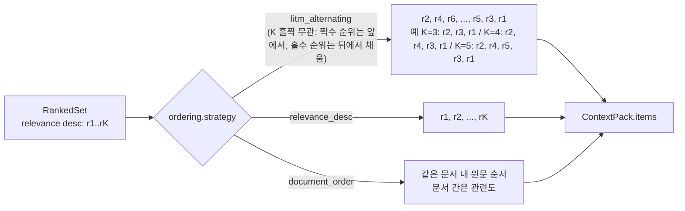
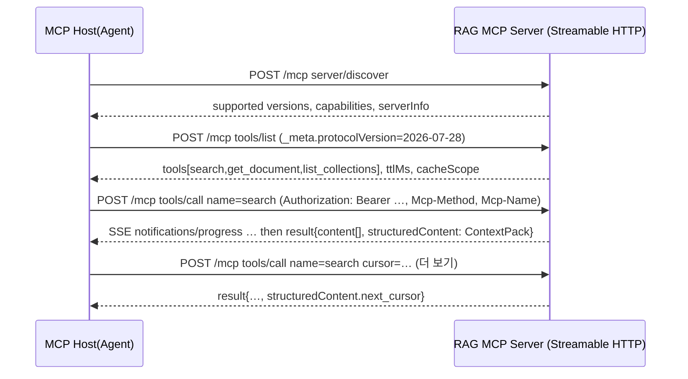
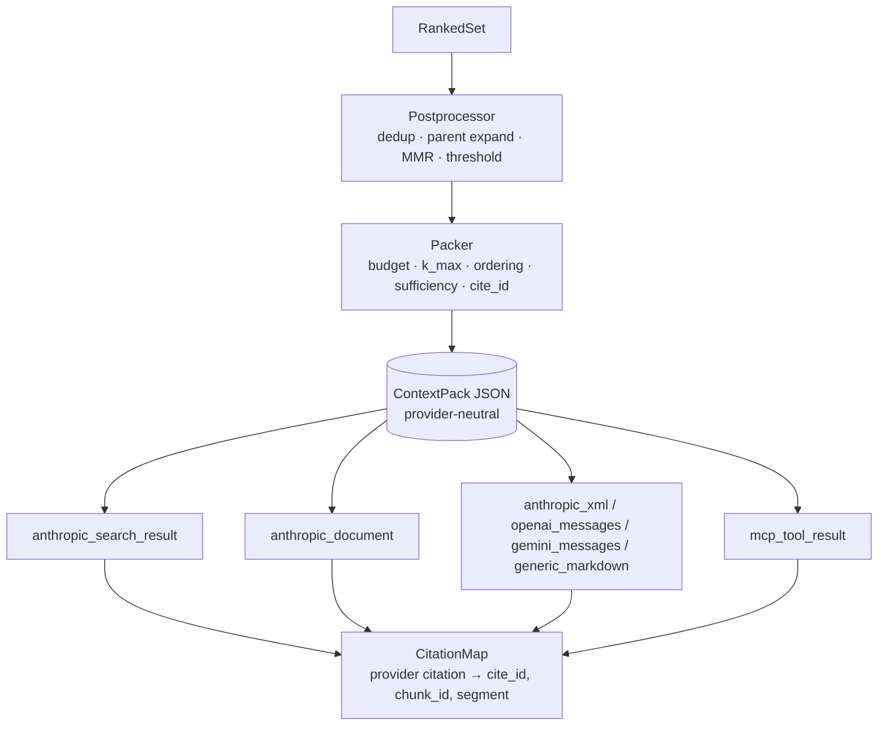

# LLM 컨텍스트 최적화·인용·MCP 연동

## 목적

리트리벌 파이프라인의 마지막 스테이지(`RankedSet → ContextPack`, D-05)가 만들어 내는 결과물을 **LLM이 최고로 활용**하도록 패키징·직렬화하는 방법을 조사한다. 구체적으로 다음 질문에 근거를 갖고 답한다.

1. Top-K 청크를 **어떤 순서**로, **얼마나 많이**, **어떤 헤더와 형식**으로 넣어야 정답률이 높아지는가 (Lost in the Middle 및 후속 연구, 컨텍스트 양 vs 정답률, 표 직렬화 형식).
2. **인용(citation)** 을 어떻게 안정적으로 만들고, 중복·상충 정보와 **충분성(sufficiency)** 신호, 신뢰도 점수를 어떻게 전달하는가.
3. **토큰 예산**을 공급자별 토크나이저로 어떻게 산정하고, **프롬프트 캐싱**과 어떻게 정합시키는가.
4. 공급자별 **네이티브 포맷**(Anthropic Messages `document`/`search_result` + `citations`, OpenAI Responses `file_search`, Gemini File Search/annotations, vLLM/Ollama 템플릿)으로 어떻게 렌더링하는가.
5. **MCP(Model Context Protocol)** 서버(D-13)를 어떤 스펙 버전·전송·인증·SDK로 구현하고, 리트리벌 도구 스키마와 설명문을 어떻게 설계하는가.
6. 위 결론을 **ContextPack 계약(D-20)** 의 필드와 **렌더러(renderer)** 요구사항으로 구체화한다.

## 범위

| 포함 | 제외 |
|------|------|
| ContextPack 직렬화·순서·예산·인용 설계 근거 | 융합·리랭킹 알고리즘 자체(07-retrieval-techniques 문서) |
| Anthropic / OpenAI / Gemini / 로컬 LLM 렌더링 포맷 | 답변 생성 UI, 대화 상태 관리 |
| MCP 스펙(2025-06-18 → 2025-11-25 → 2026-07-28), Python SDK, FastMCP | MCP 클라이언트(호스트) 구현 |
| 리트리벌 MCP 도구 스키마·설명문·구조화 출력·결과 크기 정책 | 에이전트 오케스트레이션 프레임워크 비교 |
| 토크나이저·토큰 카운팅·프롬프트 캐싱 정합성 | 임베딩 토크나이저(05-embedding 문서) |

조사 기준일은 2026-09-18이며, 검증 반영 개정(0.3.0)에서 추가 확인한 사실은 2026-09-22 기준이다. 웹으로 확인한 사실은 참조 절에 확인일과 함께 기록했고, 확인하지 못한 사실은 "확인 필요"로 표기했다.

## 평가 기준

| 기준 | 가중치 | 설명 |
|------|--------|------|
| 한국어 지원 | 0.15 | 한국어 텍스트·표·인용 경계(문장 분리)·토큰 팽창에 대한 대응 |
| 라이선스 적합성(D-02) | 0.15 | Apache/MIT/BSD 우선. 공급자 API는 라이선스가 아니라 약관·베타 여부·데이터 보존 정책으로 평가 |
| 성숙도/유지보수 | 0.15 | GA 여부, 최근 릴리스, 스펙 안정성(파괴적 변경 빈도) |
| 품질/성능 | 0.20 | 인용 정확도, 정답률에 대한 연구 근거, 토큰 효율 |
| 통합 난이도 | 0.15 | 표준 JSON(ContextPack)에서 해당 포맷으로의 매핑 복잡도, 역매핑(인용 ID) 가능성 |
| 커뮤니티/생태계 | 0.10 | 클라이언트·호스트 지원 범위, SDK 언어 수 |
| 운영 비용 | 0.10 | 토큰 비용, 캐시 적합성, 추가 인프라 |

점수는 1~5. 총점 = Σ(점수 × 가중치).

## 후보 목록

후보는 세 층으로 나눈다: (A) 컨텍스트 구성 기법·연구, (B) 공급자 네이티브 포맷, (C) MCP·도구·토큰 인프라.

| 이름 | 최신 버전(확인일) | 라이선스 | 성숙도 | 한국어 지원 | 핵심 강점 | 약점 |
|------|-------------------|----------|--------|-------------|-----------|------|
| (A) LITM 재배열(양끝 배치) — Liu et al. 2023; 참조 구현 LangChain `LongContextReorder`, LlamaIndex `LongContextReorder`, Haystack `LostInTheMiddleRanker` | 연구 2023(TACL); 구현은 `langchain_community`, `llama-index-core`, `haystack-ai` 유지(2026-09-18/22) | 논문 공개, LangChain MIT, LlamaIndex MIT, Haystack Apache-2.0 | 검증됨 | 언어 무관 | 학습 불필요, 구현 10줄. Haystack 구현은 **K 홀짝과 무관한 결정적 배치**(1위 처음·2위 끝)와 `word_count_threshold` 예산 컷 내장 | LangChain·LlamaIndex 구현은 **K 홀짝에 따라 1위 위치가 바뀜**(A1); Haystack은 1위를 처음(primacy)에 둠(우리 규칙과 좌우 반전); 다단계 추론에서 문서 원순서를 깨뜨릴 수 있음 |
| (A) 컨텍스트 압축 — LLMLingua-2 (Microsoft) | `llmlingua` 0.2.2 (2024-04-09, 이후 릴리스 없음) (2026-09-18) | MIT | 유지보수 정체 | 다국어 BERT 계열 인코더(한국어 품질 확인 필요) | 예산 초과 시 절단 대신 토큰 분류 기반 압축, 3~6배 빠름(공식 설명) | 압축이 인용 경계(`segments`)를 깨뜨림, 추가 모델 서빙 |
| (A) 문맥 인식 문장 추출 압축 — EXIT (Hwang et al., ACL Findings 2025) | GitHub `ThisIsHwang/EXIT`, HF 어댑터 `doubleyyh/exit-gemma-2b` (2026-09-22) | 저장소 Apache-2.0(검증자 확인), 어댑터 HF 메타 `apache-2.0`; **기반 `google/gemma-2b-it`는 Gemma Terms of Use → 파생 가중치 승계 여부 확인 필요** | 연구 공개(arXiv 2412.12559) | 어댑터는 **영어 전용**(모델 카드: 교차 언어 압축 미지원) → 한국어는 재학습 필요 | 문서 전체를 문맥으로 문장별 이진 분류·추출 → **문장 경계 보존**(`segments` 유지), Provence의 오픈 라이선스 대안 | 2B 디코더 서빙 비용, 한국어 학습 데이터 필요 |
| (A) 프록시 어텐션 문장 압축 — Sentinel (arXiv 2505.23277) | GitHub `yzhangchuck/Sentinel`, 프로브 가중치 HF 공개 (2026-09-22) | **저장소 LICENSE 미확인(확인 필요)** | 연구 공개 | 영어·중국어(중국어는 영어 학습 전이); 한국어 확인 필요 | 동결 Qwen2.5-0.5B-Instruct 어텐션 프로빙으로 문장 선택, 단일 순전파, 7B급 압축기와 경쟁(저자 주장) | 라이선스 미확인으로 채택 보류, 문장 분리기 의존 |
| (A) 문장 프루닝+리랭킹 — Provence / xProvence (Naver Labs) | HF `naver/provence-reranker-debertav3-v1`, `naver/xprovence-reranker-bgem3-v1` (2026-09-18) | **CC BY-NC-ND 4.0** | 연구 공개 | xProvence 16개 언어(한국어 포함) | 문장 단위 프루닝과 리랭크 점수를 한 번에 | **D-02 위반(비상업·개작 금지) → 제외**. 기록만. 오픈 대안은 EXIT(위) |
| (A) 근거 없는 스팬 탐지 — LettuceDetect (KRLabs) | `lettucedetect` 0.2.3 (2026-08-13) | MIT | 활발 | 영어·유럽어·중국어 모델 공개, **한국어 확인 필요**(mmBERT 기반 v2는 다국어 전이 가능성) | 토큰 단위 근거 없음(hallucination) 스팬 + 문자 위치 출력, 경량 인코더 | 답변 후검증 전용(팩 구성에는 무관) |
| (A) 환각 판정 — Vectara HHEM-2.1-Open | HF `vectara/hallucination_evaluation_model` (2026-09-18) | Apache-2.0 | 안정 | **영어 전용**(다국어는 상용 HHEM-2.3) | FLAN-T5-Base, <600MB, RAGTruth-QA 균형 정확도 74.28%(모델 카드) | 한국어 미지원으로 기본 채택 불가 |
| (A) 근거성 판정 — MiniCheck (Tang et al. 2024) | GitHub `Liyan06/MiniCheck` (2026-09-22) | 저장소 Apache-2.0; RoBERTa-L/DeBERTa-v3-L/Flan-T5-L 판정기는 기반 모델 라이선스 승계(MIT/Apache-2.0, 확인 필요); **Bespoke-MiniCheck-7B는 CC BY-NC → 제외** | 연구 공개 | 영어(LLM-AggreFact) | HHEM 대안 소형 판정기, 문장 단위 근거성 | 한국어 미지원, 후검증 전용 |
| (A) LLM-judge 평가 프레임워크 — RAGAS / DeepEval / TruLens | `ragas`, `deepeval`, `trulens` (2026-09-22, 버전 고정 없음) | Apache-2.0 / Apache-2.0 / MIT | GA(활발) | 프롬프트 언어 설정 가능(한국어 품질은 판정 LLM 의존) | faithfulness·contextual precision/recall/relevancy(RAGAS·DeepEval), RAG Triad(groundedness·context relevance·answer relevance, TruLens) | 질의당 LLM 호출 비용(O-05), 08-evaluation 문서 소관 |
| (A) 표 직렬화 실험(현세대 모델) — Improving Agents 블로그 2025-09-30 | GPT-4.1-nano, 1,000행×8속성, 1,000질의, 11개 형식 (2026-09-22) | 블로그(동료심사 아님) | 단일 실험 | 영어 합성 데이터 | Markdown-KV 60.7% > XML 56.0% > INI 55.7% > YAML 54.7% > **HTML 53.6%** > JSON 52.3% > Markdown 표 51.9% > CSV 44.3%; 토큰은 Markdown-KV 52,104 vs CSV 19,524(HTML은 Markdown 표의 약 3배, 검증자 확인) | 평탄한 대형 표 한 종류, 병합 셀 없음 → Sui et al.(HTML 우세)의 **반대 증거**로만 사용 |
| (A) 컨텍스트 양 상한(inverted-U) — Jin et al. 2024 | arXiv 2410.05983 (2026-09-18) | 논문 | 검증됨 | 언어 무관 | "많이 넣을수록 좋다"는 가정을 반증 | 최적 K는 모델·도메인별로 달라 평가 필요 |
| (A) 문맥 보강 헤더(Contextual Retrieval) — Anthropic 2024 | 블로그 2024-09 (2026-09-18) | 기법 공개 | 검증됨 | 다국어 적용 가능 | top-20 실패율 35~67% 감소 | LLM 보강 비용(O-05) |
| (A) 표 직렬화 형식 연구 — Sui et al. WSDM 2024, Singha et al. 2023 | arXiv 2305.13062 / 2310.10358 | 논문 | 검증됨(구세대 모델) | 표 언어 무관 | HTML 우세 근거(SUC 7개 과제 평균, GPT-3.5) | GPT-3.5/4 기준, 현세대 모델 재검증 필요. **형식 간 2위 이하 순위는 근거 부족**; 2025년 GPT-4.1-nano 실험(위 행)에서는 HTML 우위가 뒤집힘 |
| (A) 충분성 신호 — Joren et al. 2024/2025 | arXiv 2411.06037 | 논문 | 검증됨 | 언어 무관 | 부족 시 기권(abstain) 유도, +2~10% | 오토레이터 비용 |
| (A) 지식 상충 — Astute RAG, ClashEval | arXiv 2410.07176 / 2404.10198 | 논문 | 검증됨 | 언어 무관 | 상충 표시·출처 인식 통합 근거 | 추가 LLM 호출 |
| (B) Anthropic `search_result` 블록 + `citations` | GA, 베타 헤더 불필요 (2026-09-18) | API 약관 | GA | 한국어 문장 인용 가능(블록 단위) | RAG 전용, `source`/`title` 보존, 블록 단위 인용, `cited_text` 출력 토큰 미과금 | 구조화 출력(`output_config.format`)과 병용 불가(400) |
| (B) Anthropic `document` 블록 + `citations` | GA (2026-09-18) | API 약관 | GA | 문장 청킹(한국어 확인 필요) | PDF 페이지 인용, 커스텀 콘텐츠로 블록 단위 제어, `context` 필드 | 스캔 PDF 인용 불가, `title` 길이 제한 |
| (B) Anthropic XML `<documents>` 템플릿 + `cache_control` | 공식 프롬프팅 가이드 (2026-09-18) | 해당 없음 | 안정 | 우수 | 모델 무관 폴백, 20k+ 토큰 시 상단 배치 권고 | 인용은 프롬프트 기반(파싱 필요) |
| (B) OpenAI Responses API `file_search` / `file_citation` | 문서 확인 (2026-09-18) | API 약관 | GA | 확인 필요 | 관리형 벡터 스토어, `filters`, `ranking_options` | 자체 리트리버 결과에는 적용 불가(텍스트 렌더링만) |
| (B) Gemini File Search / Interactions `url_citation`·`file_citation` annotations | 문서 확인 (2026-09-18) | API 약관 | GA(File Search) | 확인 필요 | 관리형 RAG, 메타데이터 필터, 페이지 인용 | 응답 포맷이 `generateContent`→Interactions로 이동 중 |
| (B) 로컬 LLM: vLLM OpenAI 호환 서버 | 문서 확인 (2026-09-18) | Apache-2.0 | GA | 모델 의존 | `/v1/chat/completions`·`/v1/responses`, 구조화 출력, 프리픽스 캐싱 | 인용은 프롬프트 기반 |
| (B) 로컬 LLM: Ollama | OpenAI 호환 `/v1/responses` v0.13.3+ (2026-09-18) | MIT | GA | 모델 의존 | 손쉬운 배포, `format` JSON Schema | `tool_choice` 미지원 |
| (B) 로컬 LLM: SGLang | `sglang` **0.5.20** (2026-09-18) | Apache-2.0 | GA | 모델 의존 | RadixAttention 자동 프리픽스 캐싱, OpenAI 호환 API, 구조화 출력 | vLLM 대비 생태계 작음, 렌더러 관점 차이는 없음(OpenAI 호환) |
| (B) 로컬 LLM: llama.cpp `llama-server` | 릴리스 상시(버전 고정 없음, 2026-09-18) | MIT | GA | 모델 의존(GGUF) | CPU/경량 프로파일, OpenAI 호환 `/v1/chat/completions`, 프롬프트 캐시 | 처리량 낮음, 구조화 출력은 GBNF 문법(JSON Schema 변환 지원, 확인 필요) |
| (B) LiteLLM (공급자 중립 게이트웨이) | `litellm` **1.101.0** (2026-09-14), Py 3.10~3.14 | MIT | GA | 해당 없음 | Anthropic/OpenAI/Gemini/vLLM/Ollama 공통 메시지 변환, 프롬프트 캐싱 패스스루, `token_counter` | `token_counter`는 로컬 토크나이저 근사(Claude는 정확하지 않음), 의존성 무거움 |
| (B) Portkey AI Gateway / Bifrost (Maxim) — LiteLLM 대안 게이트웨이 | GitHub `Portkey-AI/gateway`, `maximhq/bifrost` (2026-09-22, 버전 고정 없음) | MIT / Apache-2.0 | GA | 해당 없음 | OpenAI 호환 단일 API로 다중 공급자 라우팅·폴백; Portkey는 MCP 게이트웨이 기능 포함 | 별도 프로세스(Node/Go) 운영; `search_result`·`citations` 같은 공급자 고유 블록 패스스루 여부 확인 필요. 전송 계층 옵션 비교용으로만 기록 |
| (C) MCP 스펙 | **2026-07-28** (최신), 2025-11-25, 2025-06-18 (2026-09-18) | **Apache-2.0**(스펙·신규 기여), 문서 CC-BY-4.0, 재라이선스 동의 없는 일부 구 기여 MIT — MIT→Apache-2.0 전환 중(2026-09 확인) | 활발(13개월 3회 개정) | 해당 없음 | 표준 도구·리소스·프롬프트, Streamable HTTP, OAuth 2.1 | 파괴적 개정(무상태화, 세션 제거) |
| (C) `mcp` (공식 Python SDK) | **2.2.0** (2026-09-07) | MIT | GA(v2 대개편) | 해당 없음 | 2026-07-28 지원, `MCPServer`, 구조화 출력 | v1→v2 이름 변경(`FastMCP`→`MCPServer`), 필드 snake_case |
| (C) `fastmcp` (jlowin) | **4.0.5** (2026-09-17) | Apache-2.0 | GA | 해당 없음 | `ToolResult`, `ToolAnnotations`, 다양한 OAuth 프로바이더 | 지원 스펙 버전 명시 확인 필요 |
| (C) `fastapi-mcp` (Tadata) | **0.4.0** (2025-07-28, 이후 릴리스 없음) | MIT | 정체 의심 | 해당 없음 | FastAPI 라우트를 MCP 도구로 자동 노출, 인증 의존성 공유(D-01과 직접 맞물림) | 2026-07-28 스펙(무상태·`server/discover`) 지원 여부 확인 필요; 14개월 미릴리스 |
| (C) MCP Inspector (`@modelcontextprotocol/inspector`) | 공식 저장소 유지(버전은 npm 확인 필요, 2026-09-18) | MIT | 활발 | 해당 없음 | 웹/CLI/TUI로 서버 점검, CLI 비대화형 OAuth 스모크 테스트 | 수동 점검·스모크용. 스펙 버전별 자동 회귀는 아래 conformance가 담당 |
| (C) MCP 공식 적합성 테스트 (`@modelcontextprotocol/conformance`) | 공식 저장소 유지(npm 버전 확인 필요, 2026-09-22) | Apache-2.0(LF Projects; 구 기여 일부 MIT) | 활발 | 해당 없음 | `npx @modelcontextprotocol/conformance server --url <url> --spec-version 2025-11-25\|2026-07-28`로 **구(initialize 기반 stateful)·신(무상태 `_meta`) 라이프사이클을 각각 검증**, 클라이언트 모드도 지원 | Node 런타임 필요(Python CI에 추가), 시나리오 커버리지는 확인 필요 |
| (C) agentgateway (Linux Foundation) | GitHub `agentgateway/agentgateway` (2026-09-22, 버전 고정 없음) | Apache-2.0 | 활발 | 해당 없음 | MCP·A2A 네이티브 프록시: JWT/API 키/OAuth 인증, OTel 메트릭·로그·추적, 라우팅 | MCP 서버 앞단 인증·관측성을 외부화하는 옵션(Rust 바이너리 운영 부담); 2026-07-28 무상태 스펙 지원 여부 확인 필요 |
| (C) Anthropic `count_tokens` API | GA, 무료, 5k~20k RPM (2026-09-18) | API 약관 | GA | 정확(모델별) | 모델별 정확 카운트, 도구·PDF 포함 | 네트워크 호출, `url`/`file` 소스 불가 |
| (C) Gemini `count_tokens` + `google.genai.local_tokenizer.LocalTokenizer` | google-genai SDK (2026-09-18) | Apache-2.0(SDK) / API 약관 | GA | 모델 토크나이저 | `client.models.count_tokens()` 원격 정확 카운트, `LocalTokenizer.count_tokens()/compute_tokens()` 로컬 카운트 | 로컬 토크나이저 지원 모델 목록·과금 여부 확인 필요 |
| (C) `tiktoken` | **0.14.0** (2026-08-17) | MIT | GA | o200k 계열이 다국어 효율 개선(확인 필요) | 오프라인, 빠름 | OpenAI 전용. Claude 등 타사 모델에는 오차 방향·크기를 보장할 수 없음 |
| (C) `tokenizers` (Hugging Face) | **0.23.2** (2026-09-03) | Apache-2.0 | GA | 모델 토크나이저 그대로 | 로컬 LLM 정확 카운트 | 공급자 폐쇄 모델에는 무의미 |

## 심층 비교

### A. 컨텍스트 구성 기법 (연구 근거)

#### A1. 순서 전략: Lost in the Middle과 후속 연구

| 연구 | 핵심 발견 | 수치 | 설계 함의 |
|------|-----------|------|-----------|
| Liu et al., "Lost in the Middle" (TACL 2023) | 관련 정보가 입력의 처음·끝에 있을 때 성능이 가장 높고 중간에 있을 때 크게 저하(U자형) | 다중 문서 QA·키-값 검색에서 위치만 바꿔도 유의미한 저하 | 최상위 결과를 **양끝**에 두는 재배열이 학습 없이 가능한 최소 대응 |
| Hsieh et al., "Found in the Middle" (ACL Findings 2024) | 원인은 **U자형 어텐션 편향**(관련성과 무관하게 처음·끝 토큰에 높은 어텐션) | 어텐션 보정으로 RAG 과제에서 기존 방법 대비 최대 15%p 향상 | 우리는 모델 내부를 못 바꾸므로 **위치 배정**으로 우회 |
| He et al., "Never Lost in the Middle" (2023) | 위치 무관 분해 학습(ASM QA)으로 완화 | 셔플 다중 문서 QA +13.7%, 패시지 검색 +21.5% (절대) | 로컬 파인튜닝 프로파일에서만 고려 |
| Peysakhovich & Lerer, "Attention Sorting" (2023) | **최신성 편향**(recency bias): 앞쪽 관련 정보가 평균적으로 덜 주목됨 | 고어텐션 문서를 끝으로 이동해 개선 | 가장 중요한 항목은 **질의 바로 앞(끝)** 에 배치 |
| Jin et al., "Long-Context LLMs Meet RAG" (2024) | 검색 결과 수를 늘리면 성능이 오르다 **다시 내려가는 역U자**. 원인은 hard negative | "retrieval reordering"이 학습 없는 완화책으로 유효 | K 상한과 재배열을 기본 켬 |

**결정 근거의 한계**: 위 연구는 2023~2024년 모델 기준이다. 현세대 1M 컨텍스트 모델에서 U자 편향이 얼마나 남아 있는지는 우리 골든셋으로 재측정해야 한다(08-evaluation). 그러나 재배열은 비용이 0이고 최악의 경우에도 해가 되지 않는 편이므로 기본값으로 둔다.

**권고 순서 알고리즘(`litm_alternating`)**: 세 참조 구현과 **동일 계열**(양끝 번갈아 배치)이지만 정의는 다르다.

| 참조 구현 | 알고리즘 | K=3 / K=4 / K=5 결과 | 1위·2위 위치 |
|-----------|----------|----------------------|--------------|
| LangChain `LongContextReorder._litm_reordering` (MIT) | 리스트를 뒤집은 뒤 짝수 인덱스 `insert(0)`, 홀수 인덱스 `append` | `[r1, r3, r2]` / `[r2, r4, r3, r1]` / `[r1, r3, r5, r4, r2]` | **K 홀짝에 따라 바뀜**(홀수 K는 1위 처음, 짝수 K는 1위 끝) |
| LlamaIndex `LongContextReorder` (MIT) | 점수 오름차순 정렬 후 동일 번갈아 배치 | 동일 | 동일 |
| Haystack `LostInTheMiddleRanker` (`haystack-ai`, Apache-2.0) | `indices=[0]`에서 시작해 `insertion_index = len//2 + len%2` 위치에 삽입; `word_count_threshold`·`top_k` 예산 컷 내장 | `[r1, r3, r2]` / `[r1, r4, r3, r2]` / `[r1, r5, r3, r4, r2]`(검증자 소스 시뮬레이션: 0-기준 순위 인덱스로 K=3→`[0,2,1]`, K=4→`[0,3,2,1]`, K=5→`[0,4,2,3,1]`) | **홀짝 무관 결정적**: 1위 항상 처음(primacy), 2위 항상 끝 |

LangChain·LlamaIndex는 소스 시뮬레이션으로 K 홀짝 의존을 확인했다. Haystack은 이미 홀짝과 무관한 결정적 배치를 제공하므로 "기존 구현에 없다"는 것이 아니라, **어느 끝에 1위를 두느냐**가 차이다. Haystack은 1위를 처음에 두고, 우리 규칙은 Peysakhovich & Lerer의 최신성 편향(recency bias)을 근거로 1위를 **질의 직전(끝)** 에 둔다. 즉 우리 규칙은 Haystack 배치의 **좌우 반전**이다. 어느 끝이 현세대 모델에서 더 유리한지는 직접 비교 근거가 없으므로 골든셋 A/B 항목(`r1` 마지막 vs `r1` 처음, 08-evaluation)으로 두고, 결과에 따라 `ordering.strategy`에 `litm_alternating_primacy` 변형을 추가할 수 있게 열어 둔다(리스크 표 참조).

우리 정의는 **순위 기준 직접 배치**다. 관련도 순위 `k`(1-기준), 항목 수 `K`에 대해 0-기준 렌더 위치를 다음처럼 정한다.

| 순위 `k` | 위치 `position` | 설명 |
|----------|-----------------|------|
| 홀수(1, 3, 5, …) | `K - (k + 1) / 2` | 끝에서부터 채움. `r1`은 항상 마지막(질의 직전) |
| 짝수(2, 4, 6, …) | `k / 2 - 1` | 처음부터 채움. `r2`는 항상 처음 |

결정적 순서 테스트 케이스(계약 문서 `03-contracts/11-context-pack.md`의 불변식·테스트에 포함할 것): K=1 → `[r1]`, K=2 → `[r2, r1]`, K=3 → `[r2, r3, r1]`, K=4 → `[r2, r4, r3, r1]`, K=5 → `[r2, r4, r5, r3, r1]`. 모든 K에서 `r1`이 마지막, `r2`가 처음이며 하위 항목은 중앙에 모인다. 다만 **다단계 추론·절차 문서**(예: 규정의 조·항 연속)는 원문 순서 유지가 더 중요할 수 있으므로 `ordering.strategy`를 `document_order`로 전환할 수 있어야 한다.



#### A2. 컨텍스트 길이 vs 정답률: 더 많은 청크가 항상 좋은가

| 근거 | 결론 |
|------|------|
| Jin et al. 2024 (역U자) | 아니다. 일정 K를 넘으면 hard negative가 정답률을 끌어내린다. |
| Anthropic Contextual Retrieval 2024 | top-20이 top-5/10보다 **검색 실패율**은 낮았다. 단, 이는 "정답이 포함될 확률"이며 생성 정답률과 동일하지 않다. |
| Li et al., "RAG or Long-Context LLMs?" (EMNLP 2024 Industry) | 자원이 충분하면 롱컨텍스트가 RAG를 능가하지만 비용이 크다. Self-Route(모델 자기평가로 RAG/LC 라우팅)로 비용을 크게 절감. |
| Joren et al., "Sufficient Context" (2024/2025) | 대형 모델은 컨텍스트가 **불충분해도 기권하지 않고 오답**을 내는 경향. 충분성 신호 기반 선택적 생성이 정답 비율을 2~10% 개선. |

**설계 함의**: ContextPack은 (1) K를 **토큰 예산과 상한 K_max(기본 20, 초안)** 로 이중 제한하고, (2) 리랭커 점수 절대 임계값 아래의 항목을 **hard negative 후보**로 잘라 내며(`omitted[].reason = "below_threshold"`), (3) 잘라 낸 결과가 부족할 때 `sufficiency.status`로 LLM에 알린다. "부모 확장(small-to-big)"은 K를 늘리지 않고 토큰만 늘리므로 예산 내에서 우선 적용한다.

#### A3. 청크 헤더(제목·섹션 경로·출처·날짜)의 효과

Anthropic Contextual Retrieval(2024-09)은 청크 앞에 **50~100 토큰의 문서 문맥 설명**을 붙여 임베딩·BM25 인덱싱했을 때 top-20 검색 실패율을 다음처럼 낮췄다(자체 평가셋, 5.7% 기준).

| 구성 | 실패율 | 감소 |
|------|--------|------|
| 컨텍스트 임베딩만 | 3.7% | 35% |
| 컨텍스트 임베딩 + 컨텍스트 BM25 | 2.9% | 49% |
| + 리랭킹 | 1.9% | 67% |

이는 **검색 단계** 효과지만, 같은 헤더를 **생성 단계**에도 전달하면 LLM이 출처·시점·섹션을 구분해 인용할 수 있고, 상충 정보(구버전 규정 vs 신버전)의 판별 근거가 된다. 따라서 ContextPack 항목은 `header`(제목, 섹션 경로, 출처 URI, 문서 날짜, 페이지, 언어)를 필수로 갖고, 렌더러는 이를 공급자 포맷의 `title`/`source`/`context` 또는 XML `<source>` 하위 태그에 매핑한다. 생성 비용은 문서당 100만 토큰 기준 약 $1.02(Anthropic 추정, 800토큰 청크·8k 문서·프롬프트 캐싱 가정)로, O-05의 기본값 판단 근거가 된다.

#### A4. 표 직렬화 형식

| 연구 | 형식 비교 결과 | 비고 |
|------|----------------|------|
| Sui et al., "Table Meets LLM" (WSDM 2024), SUC 벤치마크, GPT-3.5 | **HTML이 7개 구조 이해 과제 평균에서 최고**(Table 2, GPT-3.5 기준). 논문이 보고하는 65.43%는 Table 3의 "HTML + 형식 설명 + 역할 프롬프트 + 1-shot 등 모든 입력 설계를 적용한 평균"이다. **HTML 이외 형식 간 순위(Markdown/JSON/XML/구분자)는 과제별로 뒤바뀌며 이 논문으로 2위를 정당화할 수 없다** | 구분자(partition mark)·열 순서·형식 설명 유무도 수 %p 영향 |
| Singha et al., "Tabular Representation, Noisy Operators…" (2023) | 8개 표현 형식 × 8개 노이즈 연산에서 형식에 따라 구조 이해 성능 차이. 노이즈(병합 셀, 헤더 누락 등)에 취약 | 특정 형식 우위 수치는 본문 확인 필요 |
| Improving Agents, "Which Table Format Do LLMs Understand Best?" (블로그, 2025-09-30), GPT-4.1-nano | 1,000행×8속성 합성 직원 표, 1,000개 조회 질의, 11개 형식. **Markdown-KV(행 단위 key-value) 60.7% > XML 56.0% > INI 55.7% > YAML 54.7% > HTML 53.6% > JSON 52.3% > Markdown 표 51.9% > CSV 44.3%**. 토큰은 Markdown-KV 52,104(최다) vs CSV 19,524(최소); HTML은 Markdown 표의 약 3배(검증자 확인: 75,204 vs 25,140) | 동료심사 아님, 평탄한 대형 표 한 종류(병합 셀 없음), 단일 모델. 그러나 **현세대 모델에서 HTML 우위가 재현되지 않는 반대 증거** |

**함의**: (1) 표 청크는 **HTML(`<table>`, `rowspan/colspan` 보존)을 1차 형식**으로 둔다. 1차 근거는 **병합 셀(rowspan/colspan) 무손실**이며, Sui et al.의 HTML 우세는 **구세대 모델(GPT-3.5) 기준이고 2025년 GPT-4.1-nano 실험에서는 뒤집혔으므로** 보조 근거로만 쓴다(HTML을 "연구 근거" 1차라고 표기하지 않는다). Markdown을 2차로 두는 근거는 **토큰 절약과 사람 가독성**(단순 격자표에서 HTML 태그 오버헤드 제거)이며, JSON 레코드는 3차(행 단위 질의·필터). ContextPack에 **다중 형식**을 담아 렌더러가 선택하게 한다. (2) HWPX·PDF 파서가 보존한 병합 셀 정보를 잃지 않도록 표준 문서 모델(D-04)의 `table` 블록에서 HTML을 무손실 생성해야 한다. (3) 형식별 순위 주장은 **현세대 모델·한국어 표에서 재측정이 필요**하므로 평가 하네스에 표 QA 서브셋을 두되, 후보에 HTML·Markdown 표·JSON 레코드 외에 **Markdown-KV/레코드형(행 단위 key-value)** 을 포함한다(2025 실험 1위). 병합 셀이 없는 평탄한 대형 표에서 레코드형이 우세하면 `table_format_preference`에 `markdown_kv`를 추가하고 표 유형(병합 셀 유무·행 수)별로 1차 형식을 프로파일에 고정한다.

#### A5. 중복·상충 정보 표시

| 근거 | 발견 | 설계 함의 |
|------|------|-----------|
| ClashEval (Wu, Wu, Zou 2024/2025) | 6개 모델이 검색된 **오류 정보를 60% 이상 채택**. 사전 확신이 낮을수록 검색 결과에 더 끌려감 | 검색 결과의 신뢰 표지가 없으면 잡음이 그대로 답에 반영 |
| Astute RAG (Wang et al. 2024) | 불완전 검색은 "불가피하고 흔하며 유해". 출처 인식(source-aware) 통합으로 최악 조건에서도 no-RAG 이상 | 항목별 **출처·버전·날짜**와 `conflicts_with` 표지 제공 |

**설계**: 후처리 단계의 중복 제거는 완전 중복(BLAKE3 동일)·준중복(토큰 Jaccard 또는 임베딩 코사인 임계값, 07 문서 참조)을 제거하고 `duplicates_of`로 남긴다. 상충은 **자동 판정하지 않고** 신호만 준다: 같은 `doc_id` 다른 `doc_version`, 같은 `section_path` 다른 문서, 날짜 역전 등 **규칙 기반** 표지를 `conflicts_with[]`에 기록하고, 렌더러는 "다음 항목은 서로 다른 버전/출처입니다"라는 짧은 안내와 날짜를 함께 노출한다. 안내 문구의 **위치는 렌더러별로 다르다**: Anthropic `search_result` 경로에서는 `tool_result` 안에 별도 `text` 블록을 섞을 수 없으므로(B1 제약) 해당 `search_result`의 `content[]` 첫 텍스트 블록에 넣거나(인용 가능해짐), 시스템 지시문 변형 또는 `tool_result` 바깥의 user `text` 블록으로 낸다. XML 폴백에서는 `<document>` 하위 `<note>` 태그로 낸다. LLM 기반 상충 판정은 프로파일 옵션(O-05와 동일한 비용 정책).

#### A6. 충분성 신호와 신뢰도 점수 전달

| 항목 | 근거 | 권고 |
|------|------|------|
| 충분성(insufficient context) | Joren et al.: 충분성 오토레이터 + 선택적 생성으로 정답 비율 +2~10% | `sufficiency.status ∈ {sufficient, partial, insufficient, unknown}` 을 ContextPack에 포함. 기본은 **규칙 기반**(최고 리랭크 점수 임계값, 질의 측면 커버리지) `unknown/partial` 산출, LLM 오토레이터는 프로파일 옵션 |
| 신뢰도 점수 | 원시 부동소수 점수(RRF 0.016…, 코사인 0.83…)는 모델·융합 방식마다 스케일이 달라 LLM이 오해할 수 있음. 직접 근거 연구는 확보하지 못함(확인 필요) | 렌더링 시 **원시 점수는 숨기고** 3단계 `confidence_tier(high/medium/low)`만 헤더에 노출. 원시 점수 분해는 `scores`에 유지(관측성, 원칙 8) |
| 기권 유도 문구 | Anthropic 가이드: 인용 근거를 먼저 뽑도록 지시(ground in quotes) | 템플릿 힌트 `render_hints.instructions_template_id`에 "컨텍스트에 없으면 없다고 답하라"와 `sufficiency` 상태별 문구 포함 |
| 답변 후검증(faithfulness) | LettuceDetect(MIT, 토큰 단위 근거 없는 스팬 + 문자 위치), Vectara HHEM-2.1-Open(Apache-2.0, 영어 전용, RAGTruth-QA 균형 정확도 74.28%), MiniCheck(Tang et al. 2024; RoBERTa-L/DeBERTa-v3-L/Flan-T5-L 소형 판정기, 저장소 Apache-2.0; Bespoke-MiniCheck-7B는 CC BY-NC로 제외) 같은 **소형 인코더 판정기**가 LLM 오토레이터보다 저비용 | 팩 구성 단계가 아니라 레퍼런스 `answer`·평가 하네스(08-evaluation)에서 `FaithfulnessChecker` 어댑터로 사용. 한국어는 LettuceDetect mmBERT 기반 v2의 전이 성능을 골든셋으로 확인한 뒤 채택(확인 필요, as of 2026-09). HHEM-2.1-Open·MiniCheck은 영어 문서 컬렉션 전용 옵션 |
| LLM-judge 프레임워크 | RAGAS(Apache-2.0: faithfulness, context precision/recall), DeepEval(Apache-2.0: Faithfulness, Contextual Precision/Recall/Relevancy), TruLens(MIT: RAG Triad — groundedness·context relevance·answer relevance) | `FaithfulnessChecker`의 `LlmJudgeChecker`와 `SufficiencyJudge`의 `LlmJudge` 구현 후보. 프롬프트를 한국어로 바꿀 수 있으나 판정 품질은 판정 LLM에 의존. 프레임워크 선정은 08-evaluation 문서 소관이며 여기서는 어댑터 뒤에 둘 수 있음만 확인 |

#### A7. 토큰 예산 산정(공급자별 토크나이저)

| 공급자 | 정확한 방법 | 오프라인 근사 | 주의 |
|--------|-------------|---------------|------|
| Anthropic | `POST /v1/messages/count_tokens` (무료, 티어별 5,000/10,000/20,000 RPM, 추정치, `url`/`file` 소스 불가) | 공식 오프라인 토크나이저 없음. `tiktoken`·LiteLLM `token_counter`는 **Claude 토크나이저가 아니므로 오차 방향·크기를 보장할 수 없다**(공식 비교치 없음) | Claude 4.7+ 및 Fable/Mythos 계열은 **신 토크나이저로 약 30% 더 많은 토큰**(Anthropic 문서). 따라서 구세대 기준으로 유통되던 어떤 근사 배율도 현세대에는 맞지 않을 가능성이 높다. 모델 ID(`claude-opus-5`, `claude-sonnet-5`, `claude-fable-5-1`)를 지정해 카운트 |
| OpenAI | `tiktoken` 0.14.0(`o200k_base`, `cl100k_base`, `o200k_harmony`) | 동일(정확) | 모델별 인코딩 매핑 `encoding_for_model` |
| Gemini | `client.models.count_tokens()`(google-genai SDK, 입력 토큰만 반환) | `google.genai.local_tokenizer.LocalTokenizer.count_tokens()/compute_tokens()`(로컬, 지원 모델 확인 필요) | `count_tokens` 과금·쿼터는 문서에서 확인하지 못함(확인 필요, as of 2026-09) |
| 로컬(vLLM/SGLang/Ollama/llama.cpp) | HF `tokenizers` 0.23.2 `Tokenizer.from_pretrained` | 동일(정확) | 모델 토크나이저 그대로 |
| 공급자 중립 게이트웨이 | LiteLLM `token_counter(model, messages)` | 모델별 로컬 토크나이저, 없으면 tiktoken 폴백(공식 문서) | Anthropic 대상에는 근사. 편의용이며 예산 산정의 최종 근거로 쓰지 않음 |

**설계**: ContextPack의 `budget.tokenizer`는 `{provider, model, name}` 3중 키로 기록한다. **Anthropic 대상 예산은 `count_tokens`로만 산정**하고(`count_method = "exact_api"`), 결과는 `blake3(text)+tokenizer` 키로 Redis에 캐시해 RPM 한도를 아낀다. 근사 카운트를 쓸 수밖에 없을 때(오프라인 사전 패킹, API 장애)는 `budget.count_method = "approximate"`로 표시하고, **배율은 고정 상수가 아니라 골든셋에서 `exact / approx`로 실측한 `calibration_ratio`** 를 프로파일에 저장해 곱한 뒤 추가 안전 마진(초안 10%)을 둔다. 한국어 토큰 팽창률은 공급자·모델별로 다르므로(O-09) 같은 골든셋으로 측정해 프로파일 설정에 고정한다.

#### A8. 프롬프트 캐싱과의 관계

Anthropic 프롬프트 캐싱은 **접두어(prefix) 바이트 일치**로 동작한다. 렌더 순서는 `tools → system → messages`, 브레이크포인트 최대 4개, 최소 캐시 길이는 모델별 512(Opus 5, Fable 5.1)/1024(Sonnet 5, Opus 4.8)/2048(Opus 4.7)/4096(Opus 4.6, Haiku 4.5) 토큰, TTL 5분(쓰기 1.25배)·1시간(쓰기 2배), 읽기 0.1배(Fable 5.1은 0.025배). `cache_control`은 **대부분의 최상위 블록**(`tools` 정의, `system` 블록, user/assistant 텍스트 블록, 이미지·`document` 블록, `tool_use`/`tool_result`)에 붙일 수 있으나 **예외가 있다**: thinking 블록에는 직접 붙일 수 없고(이전 assistant 턴의 접두어에 포함될 때만 함께 캐시됨), 인용(`citations`) 같은 **하위 블록에는 붙일 수 없어 상위 블록에 붙여야 하며**, **빈 텍스트 블록은 캐시 불가**다(공식 문서 "What cannot be cached"). 렌더러는 `search_result`·`document` 최상위 블록에만 브레이크포인트를 두고, 빈 `text` 블록을 만들지 않는다. vLLM도 `enable_prefix_caching`(자동 프리픽스 캐싱)으로 같은 원리를 적용한다.

**안정 접두어에 둘 것 / 두지 말 것**:

| 접두어(캐시 대상) | 가변 접미어(캐시 제외) |
|-------------------|------------------------|
| 시스템 프롬프트(인용 규칙, 기권 규칙, 출력 형식) | 이번 질의의 ContextPack 항목 |
| 도구 정의(MCP `tools/list`는 **결정적 순서**로, 스펙 2026-07-28 권고) | 사용자 질의 |
| 컬렉션 수준 고정 문맥(용어집, 문서 요약) — 세션 내 반복 시 | 타임스탬프, 요청 ID, 원시 점수 |
| 동일 세션에서 반복되는 **문서 전체**(`document` 블록) | 순서가 바뀌는 청크 목록 |

따라서 ContextPack은 `render_hints.stable_prefix`(컬렉션 고정 문맥 참조)와 `render_hints.volatile_suffix`를 분리하고, 렌더러는 **접두어 끝에 브레이크포인트**를 두며, 항목 직렬화는 `sort_keys`·결정적 순서로 바이트 안정성을 보장한다. 멀티턴에서는 이전 턴의 ContextPack이 히스토리에 남아 캐시되므로, 새 턴에서 **이전 항목을 재정렬하지 말고 추가만** 한다. 로컬 서빙에서는 vLLM `enable_prefix_caching`, SGLang RadixAttention(자동), llama.cpp 프롬프트 캐시가 같은 접두어 규칙으로 이득을 본다.

#### A9. 예산 초과 대응: 절단 vs 강등 vs 압축

브리프 R4는 "컨텍스트 압축"을 플러그인 기법으로 명시한다. 예산 초과 시 선택지를 비교한다.

| 정책 | 방법 | 인용 경계 보존 | 추가 비용 | 판단 |
|------|------|----------------|-----------|------|
| `truncate`(기본) | 중앙(하위 순위) 항목부터 제거, `omitted.reason=budget_exceeded` | 보존 | 0 | 기본값. 재현성·인용 안정성 최우선 |
| `downgrade_tables` | 표 형식 강등 HTML→Markdown→JSON(R5) | 보존(표 블록 단위) | 0 | 기본값에 포함 |
| `compress`(플러그인) — 문장 단위 추출형 1차 후보 | **EXIT**(Hwang et al., ACL Findings 2025; 저장소 Apache-2.0, 어댑터 `doubleyyh/exit-gemma-2b` HF 메타 `apache-2.0`, 기반 Gemma-2b-it): 검색 문서 전체를 문맥으로 각 문장을 이진 분류해 **문장 단위로 추출**. 저자 보고로 압축 후 정답률 유지·향상과 지연 단축 | **보존**(문장 경계 유지 → `segments`에서 제거된 문장만 빼고 `char_start/end` 재계산 가능) | 2B 디코더(4-bit 가능) 서빙 | **`compress` 1차 후보**. 단 공개 어댑터는 영어 전용(모델 카드: 교차 언어 압축 미지원)이므로 한국어 컬렉션에는 재학습 필요; Gemma Terms of Use가 파생 가중치에 승계되는지 확인 필요(as of 2026-09) |
| `compress`(플러그인) — 토큰 단위 2차 후보 | LLMLingua-2(MIT, `llmlingua` 0.2.2): BERT 계열 인코더의 토큰 분류로 저정보 토큰 삭제, 3~6배 빠른 태스크 무관 압축(공식 설명) | **깨짐**(`segments[].char_start/end`가 무효화되어 `cited_text` 역매핑 불가) | 인코더 서빙 | 2차 옵션. 압축 후 `segments`를 재계산하고 `text_format=plain`으로 강제. 한국어 품질과 2024-04 이후 미릴리스(정체) 상태는 채택 전 확인 필요 |
| `compress`(플러그인) — 관찰 후보 | **Sentinel**(arXiv 2505.23277): 동결 Qwen2.5-0.5B-Instruct의 어텐션을 프로빙해 사용될 문장을 선택, 단일 순전파; 영어·중국어 | 문장 단위 보존 | 0.5B 프록시 서빙(경량) | **보류**: 저장소 라이선스 미확인(확인 필요, as of 2026-09), 한국어 미검증. 라이선스 확인 시 EXIT보다 가벼운 대안 |
| 문장 프루닝 | Provence/xProvence(Naver Labs): 질의 무관 문장 제거 + 리랭크 점수 | 문장 단위 보존 | 리랭커 대체 가능 | **채택 불가**: 모델 라이선스 CC BY-NC-ND 4.0(비상업·개작 금지)으로 D-02 위반. 동일 아이디어(문장 단위 추출)의 오픈 라이선스 구현은 **EXIT**가 이미 있으므로 그쪽을 평가 |

**설계**: `budget.overflow_policy: enum[truncate, downgrade_tables, compress]`(배열, 적용 순서)를 계약에 제안하고 기본은 `["downgrade_tables", "truncate"]`. `compress`는 D-10 확장 지점 `postprocessor`의 `ContextCompressor` 어댑터로 두며, 구현 우선순위는 **문장 단위 보존형(EXIT) → 토큰 단위(LLMLingua-2)** 순이다. 문장 단위 압축은 `segments`를 "삭제된 문장 제외 후 오프셋 재계산"으로 유지할 수 있어 인용 역매핑이 살아남지만, 토큰 단위 압축은 `text_format=plain` 강제와 `segments` 전면 재계산이 필요하다. 적용 시 `diagnostics.compression_ratio`와 `diagnostics.compressor`를 기록한다.

### B. 공급자별 네이티브 포맷

#### B1. Anthropic Messages API — `search_result` 블록 (RAG 1차 경로)

| 항목 | 내용 |
|------|------|
| 상태 | GA, 베타 헤더 불필요. Haiku 3 제외 모든 활성 모델. Claude API·Bedrock·Google Cloud |
| 블록 스키마 | `{"type":"search_result","source":"<URL 또는 kb://… 같은 안정 식별자>","title":"…","content":[{"type":"text","text":"…"},…],"citations":{"enabled":true}}` |
| 위치 | user 메시지 최상위 콘텐츠 또는 `tool_result.content` 내부. assistant 메시지에는 불가 |
| 인용 결과 | `search_result_location` — `source`, `title`, `cited_text`, `search_result_index`(요청 전체의 `search_result` 등장 순서, 0-기준), `start_block_index`, `end_block_index`(배타적) |
| 인용 단위 | **텍스트 블록이 최소 인용 단위**(블록 내부 부분 문자열 인용 없음). 세밀한 인용이 필요하면 `content`를 문장·단락 단위로 분할 |
| 제약 | 요청 내 모든 `search_result`의 `citations.enabled`는 동일해야 함(all-or-nothing). 웹 검색 도구와 병용 시 반드시 켬. 텍스트만 지원. **`output_config.format`(구조화 출력)과 병용 불가 → 400** |
| 제약(동종 블록) | **`tool_result.content` 배열에 `search_result`가 하나라도 있으면 모든 블록이 `search_result`여야 한다.** 다른 타입(`text` 등)을 섞으면 validation error. 보조 문구가 필요하면 어느 한 `search_result`의 `content[]` 안에 `text` 블록으로 넣는다(그 문구도 인용 가능해짐). user 메시지 최상위에서는 `text`·`image`·`document`와 자유롭게 혼합 가능(공식 문서 "Mixing with other content types") |
| 비용 | `cited_text`는 출력 토큰·(재전송 시) 입력 토큰에 미과금 |
| 모범 사례(공식) | 안정적인 `source`, 설명적인 `title`, 논리 단위로 블록 분할, 빈 결과는 에러 대신 `{"type":"text","text":"No results found."}` |

**ContextPack 매핑**: 항목 1개 → `search_result` 1개. `source = "rag://{tenant}/{collection}/{chunk_id}"`처럼 안정 URI(D-06 ULID)로 두면 `search_result_index ↔ cite_id` 역매핑이 결정적이다. `title`에는 `"{doc_title} › {section_path} ({doc_date})"`를 넣어 A3의 헤더 효과를 얻고, `content`는 청크 본문을 **문장 또는 단락 단위 블록**으로 분할해 인용 경계를 세밀화한다. 한국어 문장 분리는 Kiwi `split_into_sents`(오프셋 반환; Kiwi C++ 코어 0.24.0은 Apache-2.0이나 **PyPI `kiwipiepy` 0.23.2는 LGPLv3 정적 링크 wheel**이고 0.24.0부터 Apache-2.0 전환 절차 진행 중 — 사용 시점 버전의 라이선스 확인 필요, as of 2026-09)를 1차로, **`kss`(BSD-3-Clause, `punct` 백엔드)** 를 라이선스 중립 폴백으로 둔다. LGPL 동적 링크는 D-02 위반이 아니지만 Apache/MIT/BSD 우선 원칙에 따라 표기한다. 세부 비교·측정은 13-korean-nlp 문서에 위임한다. 표는 HTML 문자열 블록으로 넣는다. `sufficiency`·`conflicts_with`·절단 안내 같은 **팩 수준 안내 문구**는 도구 경로(`tool_result`)에서는 동종 블록 제약 때문에 (a) 첫 `search_result`의 `content[0]` 텍스트 블록, (b) 시스템 지시문 변형, (c) `tool_result` 바깥의 별도 user `text` 블록 중 하나로만 전달한다. 빈 결과는 `search_result` 대신 `{"type":"text","text":"No results found."}` 단일 블록으로 반환한다(이 경우 배열에 `search_result`가 없으므로 허용).

#### B2. Anthropic Messages API — `document` 블록 + `citations` (문서 단위 2차 경로)

| 문서 유형 | 소스 | 인용 단위 | 인용 위치 타입 |
|-----------|------|-----------|----------------|
| Plain text | `{"type":"text","media_type":"text/plain","data":…}` 또는 `{"type":"file","file_id":…}` | 문장(자동 청킹) | `char_location` — `start_char_index`(0-기준), `end_char_index`(배타적) |
| PDF | `{"type":"base64","media_type":"application/pdf",…}`, URL, `file_id` | 문장 | `page_location` — `start_page_number`(1-기준), `end_page_number`(배타적) |
| Custom content | `{"type":"content","content":[{"type":"text",…},…]}` | **추가 청킹 없음**(제공 블록 그대로) | `content_block_location` — `start_block_index`(0-기준), `end_block_index`(배타적) |

공통 필드: `title`(길이 제한), `context`(인용되지 않는 메타데이터 문자열; JSON 문자열 가능), `citations.enabled`. 모든 인용에 `cited_text`, `document_index`, `document_title` 포함. 스캔 PDF(추출 텍스트 없음)는 인용 불가. `.docx/.xlsx`는 text/plain으로 변환해 넣는다. PDF 제한: 요청 32MB, 600페이지(200k 컨텍스트 모델은 100페이지). 문서 블록에도 `cache_control` 가능.

**언제 쓰나**: `get_document` 결과(문서 전체·긴 섹션)나 "원문 PDF 그대로" 프로파일. 청크 리스트에는 B1이 더 적합하다(항목별 `source`/`title` 보존, 요청 전체 인덱싱). `document`의 문장 자동 청킹이 한국어에서 어떻게 동작하는지는 확인 필요이므로, 세밀 제어가 필요하면 Custom content로 우리가 문장 경계를 정한다.

#### B3. Anthropic XML `<documents>` 템플릿 (모델 무관 폴백)

공식 프롬프팅 가이드 권고: (1) 20k+ 토큰의 긴 자료는 **프롬프트 상단, 질의·지시 위**에 배치, (2) 각 문서를 `<document index="n">` 안에 `<source>`(및 메타데이터 하위 태그)와 `<document_content>`로 감싼다, (3) 답변 전에 관련 **인용문을 먼저 추출**(ground in quotes)하도록 지시. 이 템플릿은 OpenAI/Gemini/로컬 LLM 렌더러의 기본 골격으로도 쓴다(태그 이름은 동일, 인용 마커는 `[d3]`).

```xml
<documents>
  <document index="1">
    <source>rag://t1/c9/01J9…</source>
    <title>개인정보 처리방침 › 3. 보유기간</title>
    <date>2026-03-01</date>
    <confidence>high</confidence>
    <document_content>…</document_content>
  </document>
</documents>
```

#### B4. Anthropic 부속 기능: 프롬프트 캐싱, 토큰 카운팅, MCP 커넥터, 모델

| 기능 | 핵심 파라미터 | 비고 |
|------|---------------|------|
| 프롬프트 캐싱 | `cache_control: {"type":"ephemeral"}` (+`"ttl":"1h"`), 요청 최상위 자동 캐싱, 최대 4 브레이크포인트 | A8 참조 |
| 토큰 카운팅 | `client.messages.count_tokens(model=…, system=…, tools=…, messages=…)` → `input_tokens` | 무료, 추정치 |
| MCP 커넥터(베타 `mcp-client-2025-11-20`) | `mcp_servers:[{"type":"url","url":"https://…","name":…,"authorization_token":…}]` + `tools:[{"type":"mcp_toolset","mcp_server_name":…,"default_config":{…},"configs":{…},"cache_control":…}]` | **도구 호출만** 지원(리소스·프롬프트 불가), Streamable HTTP·SSE, 공개 HTTPS 필수, ZDR 비대상. 응답 블록 `mcp_tool_use`/`mcp_tool_result`. `defer_loading`+도구 검색 도구로 대규모 도구 세트 처리 |
| 클라이언트 측 MCP 헬퍼 | `pip install "anthropic[mcp]"` → `anthropic.lib.tools.mcp.async_mcp_tool`, `mcp_message`, `mcp_resource_to_content`, `mcp_resource_to_file` | stdio·리소스·프롬프트가 필요할 때 |
| 모델 ID(2026-09) | `claude-opus-5`(1M, $5/$25), `claude-sonnet-5`(1M, $2/$10), `claude-fable-5-1`(1M, $10/$50), `claude-haiku-4-5`(200K, $1/$5) | 날짜 접미어 없음. 레퍼런스 `answer` 구현 기본은 `claude-opus-5` |

**주의**: 레퍼런스 `answer` 엔드포인트(브리프 §6)가 인용을 켜면 `output_config.format`을 함께 쓸 수 없다. 구조화된 답(JSON)과 인용이 동시에 필요하면 (a) 인용 켠 자유 텍스트 응답 후 후처리, 또는 (b) 도구 호출(`tool_use`)로 구조를 받고 인용은 텍스트 블록에서 취득하는 2단계 설계가 필요하다.

#### B5. OpenAI Responses API — `file_search` 및 메시지 렌더링

| 항목 | 내용 |
|------|------|
| 도구 선언 | `tools:[{"type":"file_search","vector_store_ids":[…],"max_num_results":N,"filters":{"type":"in","key":"category","value":[…]},"ranking_options":{"ranker":"auto"\|"default-2024-08-21","score_threshold":0.0~1.0}}]` |
| 출력 | `file_search_call` 항목(`id`,`status`,`queries`,`search_results`는 `include:["file_search_call.results"]` 시 채움) + `message`의 `annotations:[{"type":"file_citation","index":…,"file_id":…,"filename":…}]` |
| 필터 연산자 | `eq, ne, gt, gte, lt, lte, in, nin` + `and, or` |
| 청킹 기본값 | `max_chunk_size_tokens=800`, `chunk_overlap_tokens=400`(범위 100~4096, 오버랩 ≤ 절반) |
| 검색 엔드포인트 | `POST /vector_stores/{id}/search`, 기본 10건, 최대 50건 |

**함의**: `file_search`는 OpenAI 관리형 벡터 스토어에만 동작하므로 **우리 리트리버 결과에는 네이티브 인용 경로가 없다**. OpenAI 렌더러는 B3 XML 템플릿을 `input` 텍스트(또는 `input_text` 항목)로 넣고, `[d3]` 마커를 후처리로 파싱한다. 필요 시 구조화 출력(`text.format` JSON Schema)으로 `{"answer":…, "citations":["d1","d3"]}`를 강제해 인용 파싱을 안정화한다(Anthropic과 달리 인용과 구조화 출력이 충돌하지 않음).

#### B6. Gemini — File Search, Interactions annotations, 레거시 `groundingMetadata`

| 항목 | 내용 |
|------|------|
| File Search(관리형 RAG) | `tools:[{"type":"file_search","file_search_store_names":["fileSearchStores/…"]}]`, 업로드 시 `chunking_config.white_space_config{max_tokens_per_chunk,max_overlap_tokens}`, 질의 시 `metadata_filter`. 응답 `file_citation` annotations: `file_name`, `source`, `page_number`, `media_id`, `custom_metadata`. 파일 100MB, 스토어 1GB~1TB(티어) |
| Google Search grounding(Interactions API) | `steps[]`에 `google_search_call{queries}`, `google_search_result{search_suggestions}`, `model_output.content[].annotations:[{"type":"url_citation","url","title","start_index","end_index"}]` |
| 레거시 `generateContent.groundingMetadata` | `webSearchQueries`, `searchEntryPoint`, `groundingChunks[].web{uri,title}`, `groundingSupports[]{segment{startIndex,endIndex,text},groundingChunkIndices,confidenceScores}` — **현재 문서에서 확인하지 못함(확인 필요, as of 2026-09)**. `google_search_retrieval` 도구는 **구형 모델 전용(레거시)**, 현행 모델은 `google_search` 사용(공식 문서 문구: "Older models use a `google_search_retrieval` tool. For all current models, use the `google_search` tool"; 문서는 "deprecated"라고 쓰지 않음) |

**함의**: OpenAI와 동일하게 자체 리트리버 결과는 텍스트 렌더링 + 마커 파싱. Gemini의 `start_index/end_index` 문자 오프셋 인용 방식은 우리 표준 인용 모델(문자 범위)과 호환되므로, 렌더러 역매핑 인터페이스를 **문자 범위 기반**으로 통일한다.

#### B7. 로컬 LLM — vLLM, Ollama

| 항목 | vLLM | Ollama |
|------|------|--------|
| 엔드포인트 | `/v1/completions`, `/v1/chat/completions`, `/v1/responses` | `/v1/chat/completions`, `/v1/completions`, `/v1/embeddings`, `/v1/models`, `/v1/responses`(v0.13.3+), 기본 `http://localhost:11434/v1/` |
| 템플릿 | 토크나이저 내장 Jinja2 `chat_template` 또는 `--chat-template <file>`, `--chat-template-content-format string\|openai` | Modelfile `TEMPLATE`(Go 템플릿, `.System`, `.Prompt`, `.Response`; `.Messages`/`.Tools`는 확인 필요) |
| 구조화 출력 | `response_format:{"type":"json_schema",…}` 또는 `structured_outputs:{json\|regex\|grammar\|choice}`. 백엔드 `--structured-outputs-config.backend ∈ {auto(기본), xgrammar, guidance, outlines, lm-format-enforcer}`(`auto`가 요청 내용에 따라 선택; `lm-format-enforcer`는 정규식이 Python `re` 기반으로 나머지 Rust 스타일과 다름). **구 필드 `guided_json/guided_regex/guided_choice/guided_grammar/guided_decoding_backend`는 v0.12.0에서 제거**되어 `structured_outputs`만 사용 | 네이티브 `format`에 JSON Schema; OpenAI 호환 `response_format` 지원. 클라우드 모드 미지원 |
| 도구 호출 | 지원. `tool_choice` auto/required/none/명명 호출. `parallel_tool_calls=false`는 **PR #26233(2025-11-25 병합)부터 강제**: 생성을 멈추는 것이 아니라 응답 반환 시 첫 호출 이후를 **후처리로 버림**(공식 OpenAI 호환 서버 문서: "false면 0 또는 1건만 반환"; 기본 `true`, 그 이전 버전은 필드를 받되 무시). 렌더러는 이 동작에 의존하지 말고 첫 호출만 취하는 방어 로직을 둔다 | 지원(`tool_choice` 미지원) |
| 캐싱 | `enable_prefix_caching=True`(자동 프리픽스 캐싱; 기본값 여부 확인 필요) | 확인 필요 |

그 밖의 로컬 서빙 후보: **SGLang** 0.5.20(Apache-2.0)은 RadixAttention 자동 프리픽스 캐싱과 OpenAI 호환 API·구조화 출력을 제공해 vLLM과 렌더러 관점에서 동일하게 취급한다(GPU 프로파일 대안). **llama.cpp `llama-server`**(MIT)는 CPU·경량 프로파일용 OpenAI 호환 서버로, 구조화 출력은 GBNF 문법(JSON Schema→GBNF 변환, 확인 필요). 어느 쪽도 인용은 프롬프트 기반이며 토큰 카운트는 HF `tokenizers`(GGUF는 내장 토크나이저)로 한다.

**함의**: 로컬 렌더러는 B3 XML + 마커 방식, 인용 구조화는 `json_schema`로 강제하되 vLLM 어댑터는 `structured_outputs` 필드(구 `guided_*` 금지)를 쓴다. 프리픽스 캐싱을 위해 A8의 접두어 규칙을 동일하게 적용한다. 한국어 대응 오픈 모델의 chat template 차이는 서빙 엔진이 흡수하므로 렌더러는 OpenAI 호환 메시지 배열만 만든다. 다만 모델 라이선스는 D-02 기준으로 구분한다: **Qwen3 계열(Apache-2.0)** 을 상업 배포 프로파일의 기본 예시로 두고, **EXAONE 4.0**은 "EXAONE AI Model License Agreement 1.2 - NC"(연구·교육 한정, 상업 이용은 별도 계약)이므로 **상업 배포 프로파일 기본값 불가·평가용**, **HyperCLOVA X SEED**는 자체 "HyperCLOVA X SEED Model License Agreement"이므로 **상업 이용 조건 확인 필요**(as of 2026-09)로 표기한다(모델별 세부는 13-korean-nlp 문서와 정합). 공급자 중립 게이트웨이로는 LiteLLM(MIT) 외에 **Portkey AI Gateway(MIT)**, **Bifrost(Apache-2.0)** 가 있어 Anthropic/OpenAI/Gemini/vLLM/SGLang/Ollama 호출을 한 클라이언트로 통일하고 프롬프트 캐싱 파라미터를 패스스루할 수 있으나, `search_result`·`citations` 같은 공급자 고유 블록은 렌더러가 직접 만들어야 하고 게이트웨이가 이를 그대로 통과시키는지 확인해야 하므로 **렌더러 대체가 아니라 전송 계층 옵션**으로만 본다.

### C. MCP(Model Context Protocol)

#### C1. 스펙 버전 이력과 최신 상태

| 버전 | 주요 변경(요약) | 우리 영향 |
|------|-----------------|-----------|
| 2025-03-26 | Streamable HTTP 도입(HTTP+SSE 대체) | 기준 전송 |
| 2025-06-18 | 구조화 도구 출력(`structuredContent`/`outputSchema`), elicitation, `resource_link`, OAuth 리소스 서버 분류, `MCP-Protocol-Version` 헤더로 협상된 버전 지정 필수, JSON-RPC 배치 지원 제거(공식 2025-06-18 changelog 확인) | 구조화 출력 근거 |
| 2025-11-25 | OIDC Discovery, 아이콘, 증분 스코프 동의(`WWW-Authenticate`), 도구 이름 지침, 열거형 elicitation, URL 모드 elicitation, 샘플링 도구 호출, **Client ID Metadata Documents**, 실험적 tasks, JSON Schema 2020-12 기본 방언, SDK 티어링 | 인증 설계 |
| **2026-07-28(최신)** | **무상태화**: `initialize`·`Mcp-Session-Id` 제거. 모든 요청 `_meta`에 `io.modelcontextprotocol/protocolVersion`·`io.modelcontextprotocol/clientCapabilities` **필수**, `io.modelcontextprotocol/clientInfo`는 **SHOULD**(클라이언트 자기 식별), 서버는 각 결과 `_meta`에 `io.modelcontextprotocol/serverInfo` **SHOULD**; 버전 불일치는 `UnsupportedProtocolVersionError`; `server/discover` 필수; `subscriptions/listen`으로 알림 스트림; 결과에 `resultType`(`complete`\|`input_required`) 필수; **MRTR**(서버→클라이언트 요청을 `InputRequiredResult`로 대체); tasks는 확장으로 이동; `ping`·`logging/setLevel` 제거, Roots/Sampling/Logging **폐기 예정**; HTTP+SSE 폐기; DCR 폐기(CIMD 권장); 목록 결과에 `ttlMs`·`cacheScope`(`CacheableResult`) 필수; `tools/list` **결정적 순서** 권고(프롬프트 캐시); `Mcp-Method`·`Mcp-Name` 헤더 필수, `x-mcp-header`; `_meta`에 OTel `traceparent/tracestate/baggage` 관례; `structuredContent` 임의 JSON 허용; 오류 코드 `-32020~-32099` 스펙 예약; 12개월 폐기 정책 | 서버 상태를 세션에 두지 말고 **명시적 핸들**(예: `cursor`, `pack_id`)로 전달. 요청 검증은 `protocolVersion`·`clientCapabilities` 누락만 오류 처리하고 `clientInfo` 누락은 오류가 아님 |



#### C2. 전송과 인증

| 항목 | 요구사항(2026-07-28) | 구현 지침 |
|------|----------------------|-----------|
| Streamable HTTP | 단일 MCP 엔드포인트(POST), 응답은 JSON 또는 요청 범위 SSE, `Accept: application/json, text/event-stream`, `MCP-Protocol-Version`·`Mcp-Method`·`Mcp-Name` 헤더, `Origin` 검증(403), GET/DELETE는 405, 재개(`Last-Event-ID`) 없음, 스트림 종료 = 취소, `X-Accel-Buffering: no` | FastAPI 앱에 `/mcp` 마운트, 리버스 프록시 버퍼링 해제, 로컬은 127.0.0.1 바인드 |
| 구버전 호환 | 2025-11-25 이하 클라이언트는 `initialize` 핸드셰이크·세션 사용 → 서버는 400 본문으로 현대 오류를 구분해야 함 | SDK(v2)가 처리. 운영 초기는 두 세대 클라이언트 모두 테스트. **1차 CI 도구는 공식 적합성 스위트 `@modelcontextprotocol/conformance`**(Apache-2.0): `npx @modelcontextprotocol/conformance server --url <url> --spec-version 2025-11-25`와 `--spec-version 2026-07-28`을 각각 실행해 initialize 기반 stateful 라이프사이클과 무상태 `_meta` 라이프사이클을 모두 검증(문서상 dated 버전은 stateful, 2026-07-28은 stateless 시나리오). **MCP Inspector**(MIT; 웹/CLI/TUI)는 수동 점검과 CLI 비대화형 OAuth 스모크 테스트용으로 위치를 조정. `mcp` 1.x 클라이언트 고정은 conformance가 커버하지 못하는 시나리오가 확인될 때만 보조 수단 |
| 앞단 게이트웨이(옵션) | 스펙은 리소스 서버가 토큰 검증·PRM 게시를 하도록 요구 | **agentgateway**(Linux Foundation, Apache-2.0: MCP·A2A 네이티브 프록시, JWT/API 키/OAuth 인증, OTel 관측성, 라우팅)나 Portkey MCP Gateway(MIT)로 인증·관측성을 외부화할 수 있다. 다만 우리 서버가 자체 JWT 검증을 유지해야 하므로(심층 방어, D-09 ACL은 클레임 기반) 게이트웨이는 **선택 배치**이며 2026-07-28 무상태 스펙(`Mcp-Method`·`Mcp-Name` 헤더, `server/discover`) 지원 여부 확인 필요(as of 2026-09) |
| 인증 | OAuth 2.1 리소스 서버. **PRM(RFC 9728) 필수**, AS 메타데이터(RFC 8414) 또는 OIDC Discovery 중 1개 이상, PKCE, **Resource Indicators(RFC 8707) 필수**(`resource=`canonical URI), CIMD 권장·DCR 폐기, RFC 9207 `iss` 검증, `Authorization: Bearer` 헤더만(쿼리 금지), 401/403 + `WWW-Authenticate scope=`, 스텝업 인증, 토큰 audience 검증 필수 | 우리 서버는 **토큰 검증자(JWT/JWKS)만** 구현하고 AS는 외부 OIDC(브리프 §6: 인증 서버는 비목표). `tenant_id`·ACL은 토큰 클레임에서 도출(D-09) |
| stdio | 인증 스펙 적용 안 함(환경 변수 자격증명) | 개발용 `rag-mcp --stdio` 제공 |

#### C3. Python SDK 선택: `mcp` 2.x vs `fastmcp` 4.x

| 항목 | `mcp` 2.2.0 (공식) | `fastmcp` 4.0.5 (jlowin) |
|------|--------------------|--------------------------|
| 라이선스 | MIT | Apache-2.0 |
| Python | ≥3.10 | ≥3.10 |
| 스펙 지원 | **2026-07-28 및 모든 이전 개정** 명시 | 명시 확인 필요(2026-09) |
| 서버 클래스 | `from mcp.server import MCPServer`(v1의 `FastMCP`가 `MCPServer`로 개명, 모듈 `mcp.server.mcpserver`) | `from fastmcp import FastMCP` |
| 도구 정의 | `@mcp.tool()`; 반환 타입 주석 → `outputSchema`/`structuredContent` | `@mcp.tool`(`name`, `description`, `tags`, `annotations=ToolAnnotations(...)`, `timeout`, `output_schema`); `fastmcp.tools.ToolResult(content, structured_content, meta)` |
| 실행 | `mcp run server.py --transport streamable-http`; 클라이언트 `Client("http://…/mcp")` | HTTP/stdio/SSE |
| 인증 | 토큰 검증·OAuth 지원(클래스 명 확인 필요) | `JWTVerifier`(JWKS), `StaticTokenVerifier`, `RemoteAuthProvider`, `OAuthProxy`, `OAuthProvider`, `MultiAuth`; `FastMCP(name=…, auth=…)` |
| v2 파괴적 변경 | 필드 snake_case(`input_schema`, `is_error`, `next_cursor`), `httpx`→`httpx2`, 요청 본문 **4 MiB 기본 제한**, 핸들러 예외는 JSON-RPC 오류(자동 `is_error` 변환 없음), `CallToolResult` 직접 구성, 저수준 `Server`는 `on_call_tool=`/`on_list_tools=` 생성자 인자, `get_context()` 제거(주입 `ctx`), 환경 변수 설정 제거 | v3→v4 변경 확인 필요 |
| 타입 패키지 | `mcp.types` = `mcp-types` 미러 | 자체 |

세 번째 후보 **`fastapi-mcp`**(Tadata, MIT, 0.4.0)는 FastAPI 라우트를 MCP 도구로 자동 노출하고 FastAPI 인증 의존성을 그대로 공유해 D-01과 가장 직접 맞물린다. 그러나 마지막 릴리스가 2025-07-28로 14개월 이상 멈춰 있고 무상태 스펙(2026-07-28, `server/discover`·`_meta` 버전 협상)을 지원하는지 확인하지 못했다(확인 필요, as of 2026-09). 또 REST 스키마를 그대로 도구로 노출하면 C6의 설명문·`response_format`·결과 크기 정책을 도구별로 다듬기 어렵다.

**판단**: 공식 SDK는 최신 스펙 준수가 확인되고 의존성이 가볍다. FastMCP는 인증 프로바이더와 `ToolResult`가 편리하지만 4.x의 스펙 버전과 `mcp` v2 호환 관계를 확인하지 못했다. **1차: `mcp` 2.x(`MCPServer`)**, 2차: `fastmcp` 4.x(인증 프록시가 필요할 때), 폴백: 저수준 `mcp.server.Server`. `fastapi-mcp`는 스펙 추종이 확인될 때까지 채택하지 않는다. 어느 쪽이든 어댑터(`McpToolAdapter`) 뒤에 두어 교체 가능하게 한다(원칙 2).

#### C4. 도구 결과 크기 제한과 페이지네이션

| 사실 | 출처 |
|------|------|
| MCP `tools/call` 결과에는 **네이티브 페이지네이션이 없다**. 커서 페이지네이션은 `tools/list`·`resources/list`·`resources/templates/list`·`prompts/list`에만 적용(불투명 `cursor`, `nextCursor` 부재 = 끝, 빈 문자열도 유효 커서) | MCP 스펙 2026-07-28 |
| 스펙은 세션이 없으므로 상태는 **명시적 핸들**(도구 인자로 전달되는 문자열)로 유지하고, 만료 정책을 도구 설명에 적시하며, 만료 핸들 호출은 실행 오류(`isError:true`)로 반환 | MCP 스펙 2026-07-28 "Stateful Tools" |
| Claude Code는 도구 응답을 기본 **25,000 토큰**으로 제한. 잘라낼 때 "더 좁은 검색을 하라"는 안내 문구를 포함하라 | Anthropic 엔지니어링 블로그 2025 |
| `response_format` 열거형(`concise` 72토큰 vs `detailed` 206토큰 예시)으로 에이전트가 상세도를 고르게 하라 | 같은 글 |
| Python SDK v2는 요청 본문 4 MiB 제한(응답 제한은 없음) | 마이그레이션 가이드 |

**설계**: `search` 도구는 (1) `top_k` 기본 10·최대 50, (2) `response_format ∈ {concise, detailed}`(기본 `concise`: 헤더+요약 2~3문장, `detailed`: 전체 청크), (3) 결과 토큰 상한 `max_result_tokens`(기본 20,000, 초안)로 자르고 `truncated: true`와 `next_cursor`(서버 발행 불투명 핸들, Redis TTL 10분)를 `structuredContent`에 넣는다. 텍스트 블록에는 "결과 N건 중 M건 표시. 더 보려면 `cursor`를 전달하거나 `filters`로 범위를 좁히십시오."를 덧붙인다.

#### C5. 리트리벌 도구 스키마 설계(D-13: `search`, `get_document`, `list_collections`)

| 도구 | 입력(`inputSchema`, 2020-12) | 출력(`outputSchema` = ContextPack 계열) | 주석 |
|------|------------------------------|------------------------------------------|------|
| `search` | `query: string(required)`, `collection_ids: array<string(ulid)>`, `top_k: integer(1..50, default 10)`, `filters: object`(문서 메타·날짜 범위·언어), `mode: enum[hybrid, dense, lexical]`(default hybrid), `response_format: enum[concise, detailed]`(default concise), `include_parents: boolean`(default false), `cursor: string` | `ContextPack`(슬림 프로파일: `items[].{cite_id, header, text, confidence_tier, provenance}`, `sufficiency`, `truncated`, `next_cursor`) | `readOnlyHint=true, idempotentHint=true, openWorldHint=false` |
| `get_document` | `document_id: string(ulid)` 또는 `cite_id: string`(둘 중 하나), `section_path: array<string>`, `page_range: {start, end}`, `format: enum[markdown, plain, html]`(default markdown), `max_tokens: integer` | `{document_id, title, source_uri, doc_version, sections[], text, truncated, next_cursor}` | 동일 |
| `list_collections` | `cursor: string`, `include_stats: boolean` | `{collections[]:{collection_id, name, description, profile_id, document_count, languages[]}, next_cursor}` | 동일 |

도구 이름은 스펙 지침(1~128자, `[A-Za-z0-9_.-]`)을 따르고, 여러 서버가 결합될 때의 충돌을 피하기 위해 네임스페이스 접두어 `rag_`(예: `rag_search`)를 **호스트 설정으로 선택 가능**하게 한다(스펙은 호스트가 접두어를 붙일 수 있다고 명시하므로 기본 이름은 D-13 그대로 유지).

#### C6. 에이전트가 검색 도구를 잘 쓰게 하는 설명문 작성법

Anthropic 가이드(도구 작성, MCP 커넥터 문서)와 MCP 스펙의 요구를 종합한 체크리스트:

| 원칙 | 적용 예 |
|------|---------|
| 신입 동료에게 설명하듯 **암묵 지식을 명시** | "회사 내부 문서(HWPX·PDF·DOCX)에서 의미·키워드 하이브리드 검색. 웹 검색이 아님. 최신 규정은 `filters.doc_date_gte`로 좁힐 것." |
| 파라미터 이름 모호성 제거 | `collection_ids`(복수, ULID) vs `collection`(X). `top_k`는 "반환 청크 수, 문서 수 아님" 명시 |
| 언제 쓰고 언제 쓰지 말지 | "일반 상식 질문에는 호출하지 말 것. 사용자가 문서·규정·수치를 물으면 호출." |
| 결과 해석 방법 | "각 항목의 `cite_id`를 답변에 `[d3]` 형태로 인용. `sufficiency.status=insufficient`면 없는 정보라고 답할 것." |
| 후속 행동 안내 | "결과가 부족하면 `get_document`로 같은 `cite_id`의 전체 섹션을 읽거나 `filters`를 완화." |
| 크기 제어 | "`response_format=concise`가 기본. 원문이 필요할 때만 `detailed`." |
| 오류 | 입력 검증 오류는 `isError:true`의 실행 오류로(모델이 스스로 수정), 알 수 없는 도구·형식 오류는 프로토콜 오류로 |

#### C7. 구조화 출력(`structuredContent`) 지원

스펙: `outputSchema`가 있으면 서버는 **반드시** 그에 맞는 `structuredContent`를 반환하고, 하위 호환을 위해 같은 JSON을 `TextContent`로도 반환할 것을 권고(SHOULD). `structuredContent`는 서버 산출 데이터이며 LLM "구조화 출력"과 무관하다. Python SDK v2·FastMCP 모두 반환 타입 주석(Pydantic 모델 등)으로 자동 생성한다.

**설계**: `structuredContent`에는 **ContextPack JSON(슬림)** 을, `content[0].text`에는 **B3 XML 렌더링**(사람·모델이 바로 읽는 형태)을 넣는다. 텍스트 블록에 JSON을 중복으로 넣으면 토큰이 2배가 되므로, 하위 호환 텍스트는 XML 렌더링으로 대체하고 그 사실을 도구 설명에 적는다(스펙은 SHOULD).

### D. ContextPack 계약(D-20) 필드 제안과 렌더러 요구사항

아래는 `03-contracts/11-context-pack.md`에 제안하는 필드다(확정은 계약 문서에서). 기존 계약 용어(`tenant_id`, `collection_id`, `chunk_id`, ULID, RFC 3339, BLAKE3)를 그대로 사용한다.

#### D1. 최상위 필드

| 필드 | 타입 | 필수 | 설명 | 예시 |
|------|------|------|------|------|
| `schema_version` | string | Y | 계약 버전 | `"1.0.0"` |
| `pack_id` | string(ulid) | Y | 팩 식별자 | `"01J9…"` |
| `query_id` | string(ulid) | Y | `QueryRequest` 참조 | |
| `tenant_id` | string | Y | D-09 | |
| `collection_ids` | array<string(ulid)> | Y | 검색 대상 | |
| `created_at` | string(date-time) | Y | RFC 3339 UTC | |
| `profile_id` | string | Y | 파이프라인 프로파일 | `"default-ko-hybrid@1.3"` |
| `budget` | object | Y | D2 | |
| `ordering` | object | Y | `{strategy: enum[litm_alternating, relevance_desc, document_order], applied: boolean}` | |
| `items` | array<ContextItem> | Y | D3. **렌더 순서대로** 정렬 | |
| `omitted` | array<object> | N | `{chunk_id, reason: enum[below_threshold, duplicate, budget_exceeded, acl_denied, parent_merged]}` | |
| `sufficiency` | object | Y | `{status: enum[sufficient, partial, insufficient, unknown], coverage: number(0..1), missing_aspects: array<string>, method: enum[rule, llm_judge]}` | |
| `diagnostics` | object | N | `{dedup_removed: integer, parent_expansions: integer, mmr_lambda: number, filters_applied: object, trace_id: string}` | |
| `render_hints` | object | Y | D4 | |
| `content_hash` | string | Y | `items` 직렬화의 BLAKE3(hex). 멱등성·캐시 키 | |

#### D2. `budget`

| 필드 | 타입 | 필수 | 설명 | 예시 |
|------|------|------|------|------|
| `tokenizer` | object | Y | `{provider: enum[anthropic, openai, google, local], model: string, name: string}` | `{"provider":"anthropic","model":"claude-opus-5","name":"claude-4.7+"}` |
| `count_method` | enum[exact_api, exact_local, approximate] | Y | 산정 방식 | |
| `safety_margin` | number | Y | 근사 시 적용 추가 비율(초안 0.10) | `0.10` |
| `calibration_ratio` | number | N | 근사 시 골든셋 실측 배율(`exact / approx`). `count_method=approximate`일 때 필수 | `1.31` |
| `overflow_policy` | array<enum[downgrade_tables, truncate, compress]> | Y | 예산 초과 시 적용 순서(A9) | `["downgrade_tables","truncate"]` |
| `max_context_tokens` | integer | Y | 팩 전체 상한 | `24000` |
| `used_tokens` | integer | Y | 실제 사용 | |
| `reserved_answer_tokens` | integer | N | 답변용 예약 | |
| `k_max` | integer | Y | 항목 수 상한 | `20` |

#### D3. `ContextItem`

| 필드 | 타입 | 필수 | 설명 | 예시 |
|------|------|------|------|------|
| `cite_id` | string | Y | **짧고 안정적인 인용 ID**. 팩 내 유일, 렌더 순서와 무관하게 관련도 순으로 부여(`d1`이 1위) | `"d3"` |
| `chunk_id` | string(ulid) | Y | 원 청크 | |
| `document_id` | string(ulid) | Y | | |
| `doc_version` | string | Y | 문서 버전(IndexCommit 해시 또는 버전 라벨) | |
| `rank` | integer | Y | 관련도 순위(1-기준) | |
| `position` | integer | Y | 렌더 순서(0-기준) | |
| `scores` | object | Y | `{fused, rerank, dense, sparse, lexical}` (관측용, 렌더 시 숨김) | |
| `confidence_tier` | enum[high, medium, low] | Y | 렌더에 노출되는 신뢰 등급(리랭크 점수 구간, 프로파일 설정) | |
| `header` | object | Y | `{title, section_path: array<string>, source_uri, doc_date: string(date), page_start, page_end, language: string(bcp47), doc_type}` | |
| `text` | string | Y | 본문(문맥 보강 헤더 제외) | |
| `text_format` | enum[markdown, plain, html] | Y | | |
| `segments` | array<object> | Y | 인용 경계용 세그먼트 `[{index, text, char_start, char_end}]`(문장·단락 단위; 한국어는 Kiwi `split_into_sents` 1차, `kss`(BSD-3) 폴백, B1 참조) | |
| `context_prefix` | string | N | D-19 문맥 보강 문장(50~100토큰) | |
| `tables` | array<object> | N | `[{table_id, html, markdown, json_records, caption}]` | |
| `figures` | array<object> | N | `[{figure_id, caption, alt_text}]` | |
| `parent` | object | N | `{parent_chunk_id, expanded: boolean, parent_text_included: boolean}` | |
| `duplicates_of` | string | N | 대표 `cite_id` | |
| `conflicts_with` | array<object> | N | `[{cite_id, kind: enum[version, source, date], note}]` | |
| `provenance` | object | Y | D-04 출처 `{page, bbox, char_offset: {start, end}, element_path}` | |
| `acl` | object | Y | D-09 | |
| `token_count` | integer | Y | `budget.tokenizer` 기준 | |

#### D4. `render_hints`

| 필드 | 타입 | 필수 | 설명 | 예시 |
|------|------|------|------|------|
| `preferred_renderer` | enum[anthropic_search_result, anthropic_document, anthropic_xml, openai_messages, gemini_messages, generic_markdown, mcp_tool_result] | Y | 기본 렌더러 | |
| `citation_style` | enum[native, bracket_id] | Y | 네이티브 `citations` vs `[d3]` 마커 | |
| `instructions_template_id` | string | Y | 시스템 지시 템플릿(인용·기권·형식) | `"rag-answer-ko@2"` |
| `stable_prefix_ref` | string | N | 컬렉션 고정 문맥(용어집 등) 아티팩트 해시. 캐시 접두어 | |
| `table_format_preference` | array<enum[html, markdown, markdown_kv, json]> | Y | 우선순위(`markdown_kv`는 행 단위 key-value 레코드형, A4 평가 후 채택 여부 결정) | `["html","markdown"]` |
| `language` | string(bcp47) | Y | 지시문 언어 | `"ko"` |
| `expose_confidence` | boolean | Y | 신뢰 등급 노출 여부 | `true` |

#### D5. 렌더러 요구사항

| # | 요구사항 | 근거 |
|---|----------|------|
| R1 | **결정적 직렬화**: 동일 ContextPack → 바이트 동일 출력(`sort_keys`, 고정 순서, 타임스탬프 제외) | 프롬프트 캐싱 접두어 일치, 재현성(원칙 4) |
| R2 | **안정 접두어/가변 접미어 분리**와 브레이크포인트 위치 지정(Anthropic `cache_control`) | A8 |
| R3 | **인용 역매핑**: 공급자 인용(`search_result_index`/`document_index`+block/char/page 범위, `file_citation`, `url_citation start/end_index`, `[dN]` 마커) → `{cite_id, chunk_id, segments[]}`로 되돌리는 `CitationMap` 반환 | 검증 가능 인용, 평가 하네스 |
| R4 | 항목 헤더를 공급자 필드(`title`/`source`/`context`/`<source>`)에 매핑하고 원시 점수는 노출하지 않음 | A3, A6 |
| R5 | 표는 `table_format_preference` 순으로 선택, 토큰 예산 초과 시 다음 형식으로 강등 | A4 |
| R6 | `sufficiency.status`에 따라 지시문 변형(예: `insufficient` → "컨텍스트에 근거가 없으면 모른다고 답하라") | A6 |
| R7 | `conflicts_with`가 있으면 항목 헤더에 버전·날짜를 반드시 포함하고 짧은 안내 문장 추가. Anthropic `search_result` 도구 경로에서는 안내 문장을 별도 `text` 블록으로 섞지 않고 해당 `search_result.content[]` 내부 텍스트 블록, 시스템 지시문 변형, 또는 `tool_result` 바깥 user `text` 블록으로 전달 | A5, B1 |
| R8 | 토큰 예산 재검증: 렌더링 후 실제 토큰 수를 공급자 토크나이저로 재계산해 `budget.used_tokens` 갱신, 초과 시 `budget.overflow_policy` 순서(표 강등 → 중앙 항목 제거 → 선택적 압축)로 대응 | A7, A9 |
| R9 | Anthropic 렌더러는 인용 활성화 시 `output_config.format` 사용을 차단(400 예방) | B1 |
| R10 | MCP 렌더러는 `structuredContent`(슬림 팩) + `content[0].text`(XML) + 크기 초과 시 `truncated`/`next_cursor`. Anthropic 호스트가 `tool_result`로 재전달하는 경로를 위해 `content[]`를 `search_result`로 낼 때는 **동종 블록만**(절단 안내 문구는 첫 `search_result.content[0]`에) | C4, C7, B1 |
| R11 | `litm_alternating`은 A1의 순위 기준 직접 배치 규칙을 따르며 K=1..5 결정적 테스트 케이스를 통과해야 함(`r1` 항상 마지막, `r2` 항상 처음) | A1 |



## 권고안

### 1차/2차/폴백

| 역할 | 1차 | 2차 | 폴백 | 근거 |
|------|-----|-----|------|------|
| 순서 전략 | `litm_alternating`(순위 기준 직접 배치: K 홀짝과 무관하게 `r1`은 질의 직전, `r2`는 처음; Haystack `LostInTheMiddleRanker`의 좌우 반전, `r1` 위치는 골든셋 A/B) | `document_order`(절차·규정 문서 프로파일) | `relevance_desc` | A1 |
| K·예산 | `k_max=20`, 예산 = 모델 컨텍스트의 일부(기본 24k 토큰, 초안), 리랭크 임계값 컷 | 프로파일별 조정 | K=10 | A2 |
| 예산 초과 대응 | `["downgrade_tables", "truncate"]` | `compress`(문장 단위 보존형 EXIT 1차 후보 → 토큰 단위 LLMLingua-2 2차; 한국어·라이선스 확인 후) | `truncate` | A9 |
| 헤더 | `title › section_path (doc_date)` + `source_uri` + `confidence_tier` | + `context_prefix`(문맥 보강) | 제목만 | A3 |
| 표 형식 | HTML(**병합 셀 무손실**이 1차 근거; 구세대 모델 연구 우위는 2025 실험에서 뒤집혀 보조 근거) | Markdown 표(토큰 절약·가독성) 또는 Markdown-KV/레코드형(2025 실험 1위; 순위는 골든셋 재측정 후 표 유형별 고정) | JSON records | A4 |
| 인용 ID | `d1..dN` 관련도순 부여, 렌더 위치와 분리 | | | B1, B3 |
| 충분성 | 규칙 기반 `sufficiency` 상태 + 지시문 | LLM 오토레이터(프로파일) | `unknown` | A6 |
| 답변 후검증 | (팩 범위 밖) `answer`·평가 하네스에서 LettuceDetect(한국어 확인 후) | HHEM-2.1-Open·MiniCheck(영어 컬렉션) | LLM-judge(RAGAS/DeepEval/TruLens 등, 08-evaluation 소관) | A6 |
| 신뢰도 | 3단계 등급 노출, 원시 점수 숨김 | | 미노출 | A6 |
| 토큰 카운트 | 대상 모델 정확 카운트(Anthropic `count_tokens`, Gemini `count_tokens`/`LocalTokenizer`, HF `tokenizers`, `tiktoken`은 OpenAI만) | 캐시된 카운트 재사용 | 근사 × 실측 `calibration_ratio` + 10% 마진 | A7 |
| Anthropic 렌더러 | `search_result` 블록 + `citations` | `document`(Custom content) | XML `<documents>` | B1, B2, B3 |
| OpenAI/Gemini/로컬 렌더러 | XML `<documents>` + `[dN]` 마커 + 구조화 출력으로 인용 배열 강제 | | Markdown | B5~B7 |
| MCP 스펙 | 2026-07-28(SDK가 이전 개정 호환) | | | C1 |
| MCP SDK | `mcp` 2.x `MCPServer` | `fastmcp` 4.x | 저수준 `mcp.server.Server` | C3 |
| MCP 인증 | 외부 OIDC AS + JWT 검증(RFC 9728 PRM 게시) | FastMCP `OAuthProxy`; 앞단 agentgateway(옵션) | 정적 토큰(개발) | C2 |
| MCP 회귀 검증 | `@modelcontextprotocol/conformance`(`--spec-version 2025-11-25`·`2026-07-28` 각각, CI) | MCP Inspector(수동·OAuth 스모크) | `mcp` 1.x 클라이언트 고정(보조) | C2 |
| 결과 크기 | `response_format=concise`, 20k 토큰 상한, `next_cursor` 핸들 | | top_k 축소 | C4 |

### 프로파일별 조합

| 프로파일 | 구성 |
|----------|------|
| `default-ko-hybrid` | `litm_alternating`, k_max 20, 24k 토큰, HTML 표, 규칙 충분성, Anthropic `search_result`, MCP concise |
| `regulatory-ko`(규정·법령) | `document_order`(문서 내), 버전 상충 표지 필수, `get_document` 유도 문구, `detailed` 허용 |
| `lightweight`(Qdrant 단독·로컬 LLM) | k_max 10, 12k 토큰, Markdown 표, XML 렌더러 + `json_schema` 인용, HF tokenizers, 서빙은 vLLM/SGLang(GPU) 또는 llama.cpp `llama-server`(CPU) |
| `long-context`(1M 모델, 소수 문서) | 부모 확장 최대, `document` 블록(PDF 페이지 인용), Self-Route식 라우팅은 08-evaluation 후 결정 |

### 선정 근거 점수표

점수는 역할별로 비교한다(다른 역할의 후보끼리 총점을 비교하지 않는다). 품질 항목은 **인용 정확도·검증 가능성**을 우선 반영한다: 네이티브 `citations`는 모델이 실제 블록을 가리키는 `cited_text`를 API가 보증하지만, `[dN]` 마커는 모델이 임의 ID를 생성(환각 인용)할 수 있고 정규식 파싱·구조화 출력 강제가 필요하다.

**Anthropic 대상 렌더러(1차 선택)**

| 후보 | 한국어 0.15 | 라이선스 0.15 | 성숙도 0.15 | 품질 0.20 | 통합 0.15 | 커뮤니티 0.10 | 비용 0.10 | 총점 |
|------|------------|--------------|------------|-----------|-----------|--------------|-----------|------|
| Anthropic `search_result`+citations | 4 | 4 | 5 | 5 | 5 | 4 | 4 | **4.50** |
| Anthropic `document`+citations | 3 | 4 | 5 | 4 | 4 | 4 | 4 | 4.00 |
| XML `<documents>` + `[dN]`(Anthropic에서 사용 시) | 5 | 5 | 5 | 2 | 4 | 5 | 5 | 4.25 |

**공급자 중립 렌더러(OpenAI·Gemini·로컬; 자체 리트리버 결과에 네이티브 인용 경로 없음)**

| 후보 | 한국어 0.15 | 라이선스 0.15 | 성숙도 0.15 | 품질 0.20 | 통합 0.15 | 커뮤니티 0.10 | 비용 0.10 | 총점 |
|------|------------|--------------|------------|-----------|-----------|--------------|-----------|------|
| XML `<documents>` + `[dN]` + 구조화 출력 인용 배열 | 5 | 5 | 5 | 3 | 4 | 5 | 5 | **4.45** |
| OpenAI `file_search`(관리형 스토어 전용) | 3 | 4 | 5 | 3 | 2 | 5 | 3 | 3.50 |
| Gemini File Search(관리형 스토어 전용) | 3 | 4 | 4 | 3 | 2 | 4 | 3 | 3.25 |
| LiteLLM 게이트웨이(전송 계층; 렌더러 대체 불가) | 4 | 5 | 4 | 3 | 4 | 5 | 4 | 4.10 |

**MCP SDK**

| 후보 | 한국어 0.15 | 라이선스 0.15 | 성숙도 0.15 | 품질 0.20 | 통합 0.15 | 커뮤니티 0.10 | 비용 0.10 | 총점 |
|------|------------|--------------|------------|-----------|-----------|--------------|-----------|------|
| `mcp` 2.x | 5 | 5 | 4 | 4 | 4 | 5 | 5 | **4.55** |
| `fastmcp` 4.x | 5 | 5 | 4 | 4 | 4 | 4 | 5 | 4.45 |
| `fastapi-mcp` 0.4.0 | 5 | 5 | 2 | 3 | 5 | 3 | 5 | 3.95(스펙 추종 미확인) |

**토큰 카운터(대상 모델별로 하나만 유효)**

| 후보 | 한국어 0.15 | 라이선스 0.15 | 성숙도 0.15 | 품질 0.20 | 통합 0.15 | 커뮤니티 0.10 | 비용 0.10 | 총점 |
|------|------------|--------------|------------|-----------|-----------|--------------|-----------|------|
| Anthropic `count_tokens` API | 5 | 4 | 5 | 5 | 4 | 4 | 4 | **4.50**(Anthropic) |
| Gemini `count_tokens` / `LocalTokenizer` | 5 | 5 | 4 | 5 | 4 | 4 | 4 | 4.50(Gemini) |
| `tiktoken` | 3 | 5 | 5 | 5 | 5 | 5 | 5 | 4.65(OpenAI 전용; 타사 모델 근사 시 품질 2) |
| HF `tokenizers` | 5 | 5 | 5 | 5 | 4 | 5 | 5 | **4.85**(로컬 전용) |
| LiteLLM `token_counter` | 4 | 5 | 4 | 2 | 5 | 5 | 5 | 4.20(근사 전용) |

**예산 초과 대응·후검증 보조 모델**

| 후보 | 한국어 0.15 | 라이선스 0.15 | 성숙도 0.15 | 품질 0.20 | 통합 0.15 | 커뮤니티 0.10 | 비용 0.10 | 총점 |
|------|------------|--------------|------------|-----------|-----------|--------------|-----------|------|
| EXIT 문장 추출 압축(플러그인) | 2 | 4 | 2 | 4 | 4 | 2 | 3 | 3.10(**`compress` 1차 후보**; 한국어 재학습·Gemma 승계 확인 후. 통합 4는 문장 경계 보존으로 `segments` 유지 가능) |
| LLMLingua-2 압축(플러그인) | 3 | 5 | 2 | 3 | 2 | 4 | 3 | 3.10(2차 옵션; 인용 경계 파괴로 통합 2) |
| Sentinel 문장 압축 | 2 | **2**(미확인) | 2 | 3 | 4 | 2 | 4 | 2.70(라이선스 확인 전 보류) |
| Provence/xProvence 프루닝 | 4 | **1** | 3 | 4 | 3 | 3 | 4 | 3.10(**D-02 위반, 제외**) |
| LettuceDetect 후검증 | 3 | 5 | 4 | 4 | 4 | 3 | 5 | 4.00(한국어 확인 후) |
| HHEM-2.1-Open 후검증 | 1 | 5 | 4 | 4 | 4 | 4 | 5 | 3.85(영어 전용) |
| MiniCheck 후검증(RoBERTa/DeBERTa/Flan-T5) | 1 | 4 | 3 | 4 | 4 | 3 | 5 | 3.50(영어 전용; 7B 변형은 CC BY-NC 제외) |

## 통합 설계 함의

### 어댑터 계약

| 인터페이스 | 시그니처(개념) | 비고 |
|------------|----------------|------|
| `Packer` (D-10 확장 지점 `packer`) | `pack(ranked: RankedSet, plan: QueryPlan, profile: PackProfile) -> ContextPack` | 순수 함수. 토크나이저 어댑터 주입 |
| `TokenCounter` | `count(text \| blocks, tokenizer: TokenizerSpec) -> TokenCount{tokens, method: enum[exact_api, exact_local, approximate]}`; 구현 `AnthropicApiCounter`, `GeminiApiCounter`, `GeminiLocalCounter`(`google.genai.local_tokenizer`), `TiktokenCounter`(OpenAI 전용), `HfTokenizersCounter`, `CalibratedApproxCounter`(LiteLLM `token_counter` 또는 문자 비율 × 실측 `calibration_ratio`) | 결과 Redis 캐시(`blake3(text)+tokenizer`). 공급자와 카운터가 불일치하면(`anthropic` + `TiktokenCounter`) 구성 검증 단계에서 거부 |
| `ContextCompressor` (D-10 `postprocessor`) | `compress(items, target_tokens, tokenizer) -> (items, CompressionReport{ratio, granularity: enum[sentence, token], segments_preserved: boolean})`; 구현 `ExitCompressor`(문장 단위, 1차 후보), `LlmLingua2Compressor`(토큰 단위, 2차), `SentinelCompressor`(라이선스 확인 후) | `overflow_policy`에 `compress`가 있을 때만 로드. `granularity=sentence`면 삭제 문장 제외 후 `segments` 오프셋 재계산, `token`이면 `text_format=plain` 강제 + `segments` 전면 재계산 |
| `FaithfulnessChecker` (08-evaluation·`answer` 전용) | `check(answer, pack) -> list[UnsupportedSpan{char_start, char_end, confidence}]`; 구현 `LettuceDetectChecker`, `HhemChecker`, `MiniCheckChecker`, `LlmJudgeChecker`(RAGAS/DeepEval/TruLens 래핑 가능) | 팩 구성 경로 밖. 한국어 모델 확인 후 기본값 결정 |
| `ContextRenderer` | `render(pack: ContextPack, options) -> RenderedContext{provider_payload, stable_prefix, volatile_suffix, citation_map: CitationMap}` | R1~R10 |
| `CitationMapper` | `map_back(provider_response, citation_map) -> list[ResolvedCitation{cite_id, chunk_id, segment_range, cited_text}]` | 평가·감사 |
| `SufficiencyJudge` | `judge(pack, plan) -> Sufficiency`; 구현 `RuleJudge`, `LlmJudge` | O-05 비용 정책 |
| `McpToolAdapter` | `search/get_document/list_collections` → 리트리벌 API 호출 → `ToolResult` | `mcp` 2.x 또는 `fastmcp` 4.x 뒤에 숨김 |

### 표준 모델 매핑

| ContextPack | Anthropic `search_result` | Anthropic `document`(custom) | XML/OpenAI/Gemini/로컬 | MCP `structuredContent` |
|-------------|---------------------------|------------------------------|------------------------|-------------------------|
| `items[i].cite_id` | `source` URI 접미어 + `CitationMap[search_result_index]` | `CitationMap[document_index]` | `<document index>` + `[dN]` | 그대로 |
| `header.title/section_path/doc_date` | `title` | `title` + `context`(JSON 문자열) | `<title><section><date>` | 그대로 |
| `header.source_uri` | `source` | `context` | `<source>` | 그대로 |
| `segments[]` | `content[]` 텍스트 블록 | `content[]` 블록 | 본문 | 생략(슬림) |
| `tables[].html` | 텍스트 블록(HTML 문자열) | 텍스트 블록 | `<table>` 그대로 | 생략 또는 markdown |
| `confidence_tier` | `title` 접미어 또는 `context` | `context` | `<confidence>` | 그대로 |
| `sufficiency` | 시스템 지시문 변형(user 최상위 경로에서는 별도 `text` 블록도 가능; `tool_result` 경로에서는 첫 `search_result.content[0]` 텍스트 블록) | 시스템 지시문 변형 또는 `context` | `<pack_note>` 태그 또는 지시문 | 그대로 |
| `conflicts_with[]`·절단 안내 문구 | 해당 `search_result.content[]` 내부 텍스트 블록(동종 블록 제약, B1) 또는 `tool_result` 바깥 user `text` | `context` 필드(비인용 메타) | `<document>` 하위 `<note>` | `structuredContent` 필드 + `content[0].text`(XML) |

### 실패 모드

| 실패 | 탐지 | 대응 |
|------|------|------|
| 토큰 예산 초과(카운트 오차) | 렌더 후 재카운트, 공급자 400/컨텍스트 초과 | `overflow_policy` 순서 적용(표 강등 → 중앙(하위) 항목 제거 → 선택적 압축) 후 재렌더, `omitted.reason=budget_exceeded` |
| 근사 카운터를 다른 공급자 모델에 적용(예: tiktoken으로 Claude 예산 산정) | 구성 검증(`budget.tokenizer.provider` vs 카운터 구현 불일치), `count_method=approximate`인데 `calibration_ratio` 없음 | 구성 거부; 부득이하면 실측 배율 + 마진 적용하고 `diagnostics`에 표시 |
| `tool_result`에 `search_result`와 `text` 블록 혼합 | 렌더러 사전 검증(동종 블록 규칙), 공급자 validation error | 안내 문구를 첫 `search_result.content[0]`로 이동하거나 `tool_result` 바깥 user `text`로 분리 |
| 인용 켠 상태에서 구조화 출력 요청 | 렌더러 사전 검증 | 400 예방: `citation_style=bracket_id`로 전환 또는 2단계 호출 |
| 캐시 미스 지속 | `usage.cache_read_input_tokens == 0` | 접두어 바이트 diff, 가변 필드 제거 |
| MCP 결과 과대 | 토큰 상한 초과 | 절단 + `next_cursor`, 안내 문구 |
| 만료 커서 | 핸들 조회 실패 | `isError:true` 실행 오류 "cursor expired; re-run search" |
| 공급자 인용 역매핑 실패 | `CitationMap` 미존재 인덱스 | 인용 제거 대신 `unresolved` 표시, 메트릭 `rag_pack_citation_unresolved_total` |
| 상충 문서 오판 | 사용자 피드백/평가 | 규칙 표지만 유지, LLM 판정은 옵션 |

### 리소스 요구

| 구성요소 | 요구 |
|----------|------|
| Packer/Renderer | CPU 경량. 토큰 카운트 캐시로 Anthropic API 호출 최소화(RPM 5k~20k 한도) |
| MCP 서버 | FastAPI 프로세스에 `/mcp` 마운트, 커서 핸들용 Redis(D-14), 리버스 프록시 SSE 버퍼링 해제 |
| 충분성 LLM 판정(옵션) | 질의당 1회 소형 모델 호출(`claude-haiku-4-5` 또는 로컬), 비용은 O-05 정책 |
| 관측성 | OTel GenAI semconv + MCP `_meta` `traceparent` 전파(스펙 2026-07-28 관례), 메트릭 `rag_pack_tokens_total`, `rag_pack_items_count`, `rag_pack_sufficiency_status` |

## 개방 결정에 대한 의견

| ID | 권고 |
|----|------|
| O-01 융합 기본값 | 융합 점수는 **렌더링에 노출하지 않으므로** 선택이 ContextPack 형식에 영향을 주지 않는다. 단 `confidence_tier` 구간은 **리랭커 점수**(융합 점수 아님) 기준으로 정의해 융합 방식과 독립시킬 것을 권고 |
| O-05 LLM 보강 기본값 | 문맥 보강 헤더(`context_prefix`)는 검색 실패율 35~67% 감소 근거와 문서당 약 $1.02/M 토큰(캐싱 가정) 비용을 고려해 **기본 켬(수집 시 1회)** 권고. 충분성 LLM 판정·상충 LLM 판정은 **기본 끔**(질의당 반복 비용) |
| O-09 청크 크기·토크나이저 | 토큰 예산 산정은 **공급자·모델 토크나이저** 기준이어야 한다. `cl100k`/`o200k`(tiktoken)는 OpenAI 토크나이저이므로 Claude 토큰 수에 대한 오차 방향·크기를 보장할 수 없고(공식 비교치 없음), Claude 4.7+ 계열은 구세대 대비 약 30% 팽창한다(Anthropic 문서). 따라서 Anthropic 대상 예산은 `count_tokens`로만 산정하고 근사는 골든셋 실측 `calibration_ratio`로 보정한다. 청크 크기 기본값은 임베딩 모델 토크나이저로 정하되, ContextPack 예산은 대상 LLM 토크나이저로 재계산하는 **이중 카운트**를 권고. 한국어 팽창률은 골든셋으로 측정해 프로파일에 고정 |
| O-10 gRPC | MCP는 JSON-RPC over Streamable HTTP이고 에이전트 생태계의 사실상 표준 인터페이스이므로, **REST + MCP로 충분**하며 gRPC는 내부 고처리량 경로가 필요할 때로 유보 권고 |
| O-03 GraphRAG/RAPTOR | ContextPack 항목 타입에 `item_kind: enum[chunk, summary, community_report, entity]`를 예약해 두면 외부 플러그인이 같은 계약으로 결과를 실을 수 있다. 코어 여부와 무관하게 **계약 확장 슬롯만** 권고 |

## 브리프와의 충돌

| 대상 | 내용 | 권고 |
|------|------|------|
| D-20 (Anthropic 렌더러 = `document`+`citations`) | 연구 결과 Anthropic의 RAG 전용 경로는 **`search_result` 블록**(GA, 항목별 `source`/`title`, 블록 단위 인용, `tool_result` 내 사용 가능)이다. `document` 블록은 문서 전체·PDF 인용에 적합하며 청크 리스트에는 인덱스·메타 보존이 약하다 | D-20의 문구를 "Anthropic Messages `search_result`/`document` + `citations` 블록"으로 **보정**(ADR 불필요한 범위의 명확화로 판단; 아키텍트 확인 필요) |
| §6 레퍼런스 `answer` 엔드포인트(Claude 기반, 인용 포함) | Anthropic 인용은 `output_config.format`과 **병용 불가(400)**. 구조화 응답과 인용을 동시에 기대하면 설계 충돌 | `answer`는 인용 켠 텍스트 응답을 1차로 하고, 구조화 필요 시 2단계 호출 또는 `bracket_id` 스타일로 전환 |
| D-13 MCP 도구 3종 | 충돌 없음. 단 MCP 2026-07-28이 **세션을 제거**했으므로 "더 보기"는 세션 상태가 아닌 **명시적 `cursor` 핸들**로 설계해야 함 | `search`·`get_document`에 `cursor` 입력/`next_cursor` 출력 추가 제안 |
| 그 외 D-xx | 없음 | |

## 리스크 및 완화

| 리스크 | 영향 | 완화 |
|--------|------|------|
| MCP 스펙 파괴적 개정 지속(13개월 3회, 세션·핸드셰이크 제거) | 서버 재작업 | 공식 SDK 추종, `McpToolAdapter`로 격리, `@modelcontextprotocol/conformance`를 스펙 버전별(`2025-11-25`·`2026-07-28`)로 CI 실행, 폐기 정책(12개월) 모니터링 |
| Python SDK v1→v2 대개편(`FastMCP`→`MCPServer`, snake_case, `httpx2`) | 예제·플러그인 코드 호환 문제 | v2 고정(`mcp>=2,<3`), 플러그인 가이드에 명시 |
| 공급자 응답 포맷 이동(Gemini `generateContent`→Interactions, OpenAI Responses) | 렌더러·역매핑 깨짐 | 역매핑을 **문자 범위 기반 공통 모델**로 통일, 렌더러별 계약 테스트 |
| LITM 재배열이 현세대 모델에서 효과 미미 또는 역효과 | 품질 정체 | 골든셋 A/B(`litm_alternating` vs `relevance_desc` vs `document_order`), 프로파일 스위치 |
| `r1`을 끝(최신성 편향, 우리 규칙)에 두는 선택이 처음(primacy, Haystack 규칙)보다 불리할 가능성 — 직접 비교 근거 없음 | 최상위 근거 활용도 저하 | 골든셋 A/B(`r1` 마지막 vs `r1` 처음, 08-evaluation)로 결정; 필요 시 `litm_alternating_primacy` 변형 추가 |
| 표 HTML이 토큰 과다(2025 실험: Markdown 표의 약 3배) 또는 평탄한 대형 표에서 정답률 열위(HTML 53.6% vs Markdown-KV 60.7%) | 예산 초과·정답률 저하 | 형식 강등(HTML→Markdown→JSON), 표 유형별(병합 셀 유무·행 수) 1차 형식 프로파일 고정, Markdown-KV 후보 평가, 표 전용 청킹(D-19)과 열 축약 |
| 원시 점수·과다 메타데이터 노출로 LLM 혼란 | 오답·과신 | 3단계 등급만 노출, 헤더 필드 최소화 |
| 인용 ID가 렌더 위치와 결합되어 재정렬 시 깨짐 | 인용 불일치 | `cite_id`는 관련도 순 부여·불변, `position`은 별도 필드 |
| 프롬프트 캐시 무효화(타임스탬프·정렬 불안정) | 비용 증가 | R1 결정적 직렬화, `usage` 기반 회귀 테스트 |
| 한국어 토큰 팽창으로 예산 오차 | 컨텍스트 초과 | 공급자 정확 카운트, 근사 시 실측 `calibration_ratio` + 10% 마진, 측정치로 프로파일 고정 |
| 타사 토크나이저 근사(tiktoken·LiteLLM)를 Claude에 적용해 과소 집계 | 컨텍스트 초과·400 | 구성 검증으로 거부, `count_tokens` 강제, 카운트 캐시로 RPM 절감 |
| LITM 참조 구현(LangChain·LlamaIndex)을 그대로 써서 홀수 K에서 1위가 처음으로 감 | 최신성 편향 대응 실패, 순서 비결정성 논란 | 자체 순위 기준 배치 규칙(A1) + K=1..5 테스트(R11) |
| 보조 모델 라이선스 부적합(Provence CC BY-NC-ND, Bespoke-MiniCheck-7B CC BY-NC, EXAONE NC, Sentinel 미확인) | D-02 위반 | 채택 제외 또는 보류, 대안(EXIT Apache-2.0(Gemma 승계 확인), LLMLingua-2 MIT, LettuceDetect MIT, HHEM Apache-2.0, MiniCheck 소형 판정기, Qwen3 Apache-2.0)만 옵션 |
| 한국어 문장 분리기 라이선스 전환기(`kiwipiepy` 0.23.2 LGPLv3 → 0.24.0 Apache-2.0 예정) | Apache/MIT/BSD 우선 원칙 저촉, 의존성 심사 지연 | 버전별 라이선스 표기, `kss`(BSD-3) 폴백 어댑터 준비, 13-korean-nlp 문서 판단 추종 |
| 압축 플러그인의 공개 가중치가 영어 전용(EXIT 어댑터, Sentinel 영·중) | 한국어 컬렉션에서 압축 품질 미보장 | `compress` 기본 끔, 한국어 재학습 또는 골든셋 검증 후 프로파일별 켬 |
| 검색 오류 정보 채택(ClashEval 60%+) | 잘못된 답 | 출처·날짜·버전 헤더, 상충 표지, 충분성 지시문, 리랭크 임계값 컷 |
| MCP 커넥터(Anthropic)는 도구만 지원·ZDR 비대상 | 리소스/프롬프트 미노출, 데이터 보존 우려 | 리소스·프롬프트는 클라이언트 측 헬퍼 경로로 제공, 민감 테넌트는 MCP 커넥터 대신 직접 호출 |

## 결정 사항 요약

- **결정:** ContextPack 기본 순서 전략은 `litm_alternating`(순위 기준 직접 배치: 홀수 순위는 끝에서, 짝수 순위는 처음에서 채워 K 홀짝과 무관하게 `r1`이 질의 직전·`r2`가 처음; LangChain·LlamaIndex 구현과 동일 계열이지만 동일하지 않고, Haystack `LostInTheMiddleRanker`(1위 처음·2위 끝)의 좌우 반전), K 상한 20, 리랭크 임계값 컷, 규칙 기반 `sufficiency`를 포함한다. `r1`을 끝에 두는 선택은 Peysakhovich & Lerer의 최신성 편향에만 근거하므로 골든셋 A/B(`r1` 마지막 vs 처음)로 검증한다. (ADR 후보: `06-adr/`에 "컨텍스트 패킹 기본 전략")
- **결정:** 인용 ID는 관련도순 `d1..dN`으로 렌더 위치와 분리하며, 원시 점수는 노출하지 않고 3단계 `confidence_tier`만 노출한다.
- **결정:** 표는 HTML 1차(**1차 근거는 병합 셀 무손실**; Sui et al.의 HTML 우세는 GPT-3.5 기준이며 2025년 GPT-4.1-nano 실험에서는 Markdown-KV 60.7% > … > HTML 53.6%로 뒤집혀 보조 근거로만 둠), Markdown 2차(토큰 절약·가독성), JSON 3차로 다중 형식을 팩에 담는다. 평가 하네스 표 QA 서브셋에 Markdown-KV/레코드형을 후보로 넣고, 표 유형별 1차 형식과 2차·3차 순위는 현세대 모델·한국어 골든셋 재측정으로 확정한다.
- **결정:** Anthropic 렌더러 1차는 `search_result` + `citations`, 2차 `document`(Custom content), 폴백 XML `<documents>`; 타 공급자·로컬은 XML + `[dN]` + 구조화 출력. `tool_result` 경로에서는 `search_result` 동종 블록 규칙을 지키고 안내 문구는 `search_result.content[]` 내부·지시문·바깥 user `text` 중 하나로만 전달한다.
- **결정:** 토큰 예산은 대상 LLM 토크나이저로 산정한다(Anthropic `count_tokens`, Gemini `count_tokens`/`LocalTokenizer`, OpenAI `tiktoken`, 로컬 HF `tokenizers`). Anthropic에는 근사 카운터를 쓰지 않으며, 근사가 불가피하면 골든셋 실측 `calibration_ratio` + 10% 마진을 적용한다.
- **결정:** 예산 초과 대응은 `overflow_policy = ["downgrade_tables", "truncate"]` 기본, `compress`는 플러그인 옵션으로 **문장 단위 보존형 EXIT(Apache-2.0, 인용 경계 유지)를 1차 후보**, LLMLingua-2(MIT, 토큰 단위, 정체)를 2차로 둔다. 두 후보 모두 한국어 성능 확인 전까지 기본 끔. Provence/xProvence는 CC BY-NC-ND로 제외, Sentinel은 라이선스 확인 전 보류.
- **결정:** MCP 서버는 스펙 2026-07-28(스펙 라이선스 Apache-2.0 전환 중), `mcp` 2.x `MCPServer`, Streamable HTTP, 외부 OIDC + JWT 검증, `structuredContent`=슬림 ContextPack, `response_format`·`cursor`·20k 토큰 상한. 요청 `_meta` 검증은 `protocolVersion`·`clientCapabilities`만 필수로 본다. 구·신 클라이언트 회귀는 `@modelcontextprotocol/conformance`(`--spec-version 2025-11-25`·`2026-07-28`)를 CI에서 실행해 검증하고, MCP Inspector는 수동 점검·OAuth 스모크용으로 쓴다.
- **결정:** 로컬 한국어 모델의 상업 배포 프로파일 기본 예시는 Qwen3 계열(Apache-2.0)로 두고, EXAONE 4.0(NC 라이선스)은 평가용, HyperCLOVA X SEED는 자체 라이선스 조건 확인 후 결정한다(D-02).
- **미정(O-05):** 충분성·상충의 LLM 판정 기본값(권고: 끔). 답변 후검증기(LettuceDetect) 기본 켬 여부는 한국어 확인 후.
- **미정(O-09):** 한국어 토큰 팽창 마진과 `calibration_ratio`의 최종 수치(측정 후 고정).

## 미해결 이슈

1. `03-contracts/11-context-pack.md`에 D1~D4 필드 채택 여부와 `item_kind`(O-03 확장 슬롯) 예약 여부 결정 필요.
2. `03-contracts/09-query-request-and-query-plan.md`에 `response_format`, `k_max`, `max_context_tokens`, 대상 LLM(`target_model`) 필드 제안.
3. Anthropic `document` 블록의 한국어 문장 자동 청킹 품질 확인 필요(테스트 후 Custom content 강제 여부 결정).
4. `fastmcp` 4.x가 지원하는 MCP 스펙 버전과 `mcp` 2.x 의존 관계 확인 필요.
5. Gemini 레거시 `groundingMetadata`(`groundingChunks`/`groundingSupports`) 현행 지원 여부 확인 필요.
6. vLLM 자동 프리픽스 캐싱 기본값(V1 엔진) 확인 필요.
7. 현세대 모델에서 LITM 효과(`r1` 마지막 vs `r1` 처음 포함)·표 형식 격차(HTML vs Markdown 표 vs Markdown-KV/레코드형 vs JSON, 병합 셀 유무별, 한국어 표)의 골든셋 재측정(08-evaluation 계획에 항목 추가). Sui et al.의 형식별 순위는 GPT-3.5 기준이며 2위 이하 순위는 근거로 쓰지 않고, 2025년 GPT-4.1-nano 실험(HTML 열위)은 평탄한 대형 표 단일 조건이므로 마찬가지로 결정 근거가 아닌 재측정 사유로만 쓴다.
8. 신뢰도 점수 노출이 생성 품질에 미치는 영향을 다룬 직접 연구는 확보하지 못함. 내부 A/B로 대체.
9. `budget.calibration_ratio`·`overflow_policy` 필드와 `TokenCounter` 반환 타입(`TokenCount{tokens, method}`)의 계약 채택 여부(`03-contracts/11-context-pack.md`). 근사 카운터의 실측 배율 측정 절차는 08-evaluation에 제안.
10. `fastapi-mcp` 0.4.0의 2026-07-28 스펙(무상태·`server/discover`) 지원 여부와 유지보수 상태 확인 필요(as of 2026-09).
11. LettuceDetect v2(mmBERT), EXIT(공개 어댑터 영어 전용 → 한국어 재학습 데이터·비용), LLMLingua-2의 한국어 성능 확인 필요(as of 2026-09). 확인 전까지 세 모델은 기본 끔. EXIT는 기반 Gemma-2b-it의 Gemma Terms of Use가 어댑터에 승계되는지, Sentinel은 저장소 라이선스를 확인해야 한다.
12. Gemini `count_tokens` 과금·쿼터와 `LocalTokenizer` 지원 모델 목록 확인 필요(as of 2026-09).
13. `@modelcontextprotocol/conformance`의 시나리오 커버리지(인증·SSE 취소·`server/discover`·`CacheableResult`)와 npm 최신 버전 확인 필요. 커버하지 못하는 구 스펙(initialize 핸드셰이크) 시나리오가 있을 때만 `mcp` 1.x 클라이언트를 테스트 의존성으로 보조 고정한다.
14. `kiwipiepy` 0.24.0(Apache-2.0) PyPI 릴리스 시점 확인. 그 전까지 `segments` 생성기의 기본 문장 분리기를 Kiwi(LGPLv3 wheel)로 둘지 `kss`(BSD-3)로 둘지는 13-korean-nlp 문서 판단을 따른다.
15. vLLM `parallel_tool_calls=false` 강제(PR #26233, 2025-11-25)가 `/v1/responses` 엔드포인트에도 적용되는지 확인 필요(문서는 `/v1/chat/completions` 기준). HyperCLOVA X SEED 라이선스의 상업 이용 조건 확인 필요(as of 2026-09).

## 참조

확인일은 별도 표기가 없으면 2026-09-18, "(2026-09-22)" 표기는 검증 반영 개정에서 추가 확인.

- Liu et al., "Lost in the Middle: How Language Models Use Long Contexts" (TACL 2023) — https://arxiv.org/abs/2307.03172
- Hsieh et al., "Found in the Middle: Calibrating Positional Attention Bias Improves Long Context Utilization" (ACL Findings 2024) — https://arxiv.org/abs/2406.16008
- He et al., "Never Lost in the Middle: Mastering Long-Context Question Answering with Position-Agnostic Decompositional Training" — https://arxiv.org/abs/2311.09198
- Peysakhovich & Lerer, "Attention Sorting Combats Recency Bias In Long Context Language Models" — https://arxiv.org/abs/2310.01427
- Jin et al., "Long-Context LLMs Meet RAG: Overcoming Challenges for Long Inputs in RAG" — https://arxiv.org/abs/2410.05983
- Li et al., "Retrieval Augmented Generation or Long-Context LLMs? A Comprehensive Study and Hybrid Approach" (EMNLP 2024 Industry) — https://arxiv.org/abs/2407.16833
- Joren et al., "Sufficient Context: A New Lens on Retrieval Augmented Generation Systems" — https://arxiv.org/abs/2411.06037
- Wang et al., "Astute RAG: Overcoming Imperfect Retrieval Augmentation and Knowledge Conflicts for LLMs" — https://arxiv.org/abs/2410.07176
- Wu, Wu, Zou, "ClashEval: Quantifying the tug-of-war between an LLM's internal prior and external evidence" — https://arxiv.org/abs/2404.10198
- Sui et al., "Table Meets LLM: Can Large Language Models Understand Structured Table Data?" (WSDM 2024) — https://arxiv.org/abs/2305.13062 ; 전문 https://ar5iv.org/abs/2305.13062 (Table 2: GPT-3.5 형식별 7개 과제 정확도, HTML 평균 최고; Table 3: 모든 입력 설계 적용 시 HTML 평균 65.43%. 형식별 개별 평균 수치는 본 문서에 기재하지 않음)
- Singha et al., "Tabular Representation, Noisy Operators, and Impacts on Table Structure Understanding Tasks in LLMs" — https://arxiv.org/abs/2310.10358
- Anthropic, "Introducing Contextual Retrieval" — https://www.anthropic.com/news/contextual-retrieval
- Anthropic, "Writing effective tools for agents — with agents" — https://www.anthropic.com/engineering/writing-tools-for-agents
- Anthropic Docs, Citations — https://platform.claude.com/docs/en/build-with-claude/citations
- Anthropic Docs, Search results — https://platform.claude.com/docs/en/build-with-claude/search-results
- Anthropic Docs, Prompting best practices(XML 태그, 롱컨텍스트) — https://platform.claude.com/docs/en/build-with-claude/prompt-engineering/claude-prompting-best-practices
- Anthropic Docs, Token counting — https://platform.claude.com/docs/en/build-with-claude/token-counting
- Anthropic Docs, Prompt caching — https://platform.claude.com/docs/en/build-with-claude/prompt-caching
- Anthropic Docs, MCP connector — https://platform.claude.com/docs/en/agents-and-tools/mcp-connector
- MCP Specification 2026-07-28, Changelog — https://modelcontextprotocol.io/specification/2026-07-28/changelog
- MCP Specification 2025-11-25, Changelog — https://modelcontextprotocol.io/specification/2025-11-25/changelog
- MCP Specification 2025-06-18, Changelog("Remove support for JSON-RPC batching", "Require negotiated protocol version to be specified via MCP-Protocol-Version header") — https://modelcontextprotocol.io/specification/2025-06-18/changelog (2026-09-22)
- MCP Conformance Test Suite `@modelcontextprotocol/conformance`(Apache-2.0, LF Projects; `server --url <url> --spec-version 2025-11-25|2026-07-28`) — https://github.com/modelcontextprotocol/conformance (2026-09-22)
- agentgateway(Linux Foundation, Apache-2.0; MCP·A2A 프록시, JWT/OAuth, OTel) — https://github.com/agentgateway/agentgateway (2026-09-22)
- MCP Specification 2026-07-28, Tools — https://modelcontextprotocol.io/specification/2026-07-28/server/tools
- MCP Specification 2026-07-28, Pagination — https://modelcontextprotocol.io/specification/2026-07-28/server/utilities/pagination
- MCP Specification 2026-07-28, Streamable HTTP — https://modelcontextprotocol.io/specification/2026-07-28/basic/transports/streamable-http
- MCP Specification 2026-07-28, Authorization — https://modelcontextprotocol.io/specification/2026-07-28/basic/authorization
- MCP Python SDK (README, migration guide) — https://github.com/modelcontextprotocol/python-sdk ; PyPI `mcp` 2.2.0 — https://pypi.org/project/mcp/
- FastMCP (jlowin) — https://gofastmcp.com/servers/tools , https://gofastmcp.com/servers/auth/authentication ; PyPI `fastmcp` 4.0.5 — https://pypi.org/project/fastmcp/
- OpenAI Docs, File search (Responses API) — https://developers.openai.com/api/docs/guides/tools-file-search ; Retrieval — https://developers.openai.com/api/docs/guides/retrieval
- Google, Gemini API File Search — https://ai.google.dev/gemini-api/docs/file-search ; Grounding with Google Search — https://ai.google.dev/gemini-api/docs/google-search
- vLLM Docs, OpenAI-compatible server — https://docs.vllm.ai/en/latest/serving/online_serving/ ; Structured outputs — https://docs.vllm.ai/en/latest/features/structured_outputs/ ; Automatic prefix caching — https://docs.vllm.ai/en/latest/features/automatic_prefix_caching/
- Ollama Docs, OpenAI compatibility — https://docs.ollama.com/api/openai-compatibility ; Structured outputs — https://docs.ollama.com/capabilities/structured-outputs ; Modelfile — https://docs.ollama.com/modelfile
- LangChain `LongContextReorder` 소스 — https://github.com/langchain-ai/langchain-community/blob/main/libs/community/langchain_community/document_transformers/long_context_reorder.py (`documents.reverse()` 후 짝수 인덱스 `insert(0)`, 홀수 인덱스 `append`; K 홀짝 의존은 소스 시뮬레이션으로 확인)
- LlamaIndex `LongContextReorder` 노드 포스트프로세서 — https://developers.llamaindex.ai/python/framework-api-reference/postprocessor/long_context_reorder/ (`llama-index-core`, 점수 오름차순 정렬 후 동일 번갈아 배치)
- Haystack `LostInTheMiddleRanker`(`haystack-ai`, Apache-2.0; `word_count_threshold`, `top_k`; `insertion_index = len//2 + len%2`, 1위 처음·2위 끝) — https://docs.haystack.deepset.ai/docs/lostinthemiddleranker ; 소스 https://github.com/deepset-ai/haystack/blob/main/haystack/components/rankers/lost_in_the_middle.py (2026-09-22)
- Improving Agents, "Which Table Format Do LLMs Understand Best?"(2025-09-30, GPT-4.1-nano, 1,000행×1,000질의, 11개 형식; Markdown-KV 60.7%, XML 56.0%, INI 55.7%, YAML 54.7%, HTML 53.6%, JSON 52.3%, Markdown 표 51.9%, CSV 44.3%) — https://www.improvingagents.com/blog/best-input-data-format-for-llms (2026-09-22)
- Hwang et al., "EXIT: Context-Aware Extractive Compression for Enhancing Retrieval-Augmented Generation"(ACL Findings 2025) — https://arxiv.org/abs/2412.12559 ; 코드 https://github.com/ThisIsHwang/EXIT (Apache-2.0, 검증자 확인) ; 어댑터 https://huggingface.co/doubleyyh/exit-gemma-2b (HF 메타 apache-2.0, 기반 google/gemma-2b-it, 영어 전용) (2026-09-22)
- Zhang et al., "Sentinel: Attention Probing of Proxy Models for LLM Context Compression" — https://arxiv.org/abs/2505.23277 ; 코드 https://github.com/yzhangchuck/Sentinel (Qwen2.5-0.5B-Instruct 프록시, 영·중; LICENSE 파일 미확인) (2026-09-22)
- Tang et al., "MiniCheck: Efficient Fact-Checking of LLMs on Grounding Documents"(2024) — https://github.com/Liyan06/MiniCheck (저장소 Apache-2.0; Bespoke-MiniCheck-7B는 상업 이용 별도 문의) (2026-09-22)
- RAGAS — https://github.com/explodinggradients/ragas (Apache-2.0) ; DeepEval — https://github.com/confident-ai/deepeval (Apache-2.0) ; TruLens — https://github.com/truera/trulens (MIT, RAG Triad) (2026-09-22)
- Portkey AI Gateway — https://github.com/Portkey-AI/gateway (MIT, MCP Gateway 기능) ; Bifrost — https://github.com/maximhq/bifrost (Apache-2.0) (2026-09-22)
- kss(Korean Sentence Splitter, BSD-3-Clause) — https://github.com/hyunwoongko/kss ; kiwipiepy(0.23.2 LGPLv3, 0.24.0 Apache-2.0 전환 절차 중; 13-korean-nlp 문서 확인) — https://github.com/bab2min/kiwipiepy (2026-09-22)
- LG AI Research, EXAONE 4.0 모델 카드("EXAONE AI Model License Agreement 1.2 - NC") — https://huggingface.co/LGAI-EXAONE/EXAONE-4.0-32B ; NAVER HyperCLOVA X SEED 모델 카드("HyperCLOVA X SEED Model License Agreement") — https://huggingface.co/naver-hyperclovax/HyperCLOVAX-SEED-Think-14B (2026-09-22)
- vLLM PR #26233 "[Frontend] Respect Chat Completion parallel_tool_calls param"(2025-11-25 병합; false면 첫 호출 이후 후처리로 제거) — https://github.com/vllm-project/vllm/pull/26233 ; 이슈 #9451 — https://github.com/vllm-project/vllm/issues/9451 ; OpenAI 호환 서버 문서 — https://docs.vllm.ai/en/latest/serving/online_serving/openai_compatible_server/ (2026-09-22)
- Anthropic Docs, Prompt caching "What can be cached / What cannot be cached"(thinking 블록·하위 블록·빈 텍스트 블록 제외) — https://platform.claude.com/docs/en/build-with-claude/prompt-caching (2026-09-22)
- PyPI `tiktoken` 0.14.0 — https://pypi.org/project/tiktoken/ ; PyPI `tokenizers` 0.23.2 — https://pypi.org/project/tokenizers/
- MCP 스펙 저장소 LICENSE(MIT→Apache-2.0 전환, 문서 CC-BY-4.0) — https://github.com/modelcontextprotocol/modelcontextprotocol/blob/main/LICENSE
- MCP Inspector — https://github.com/modelcontextprotocol/inspector (MIT)
- PyPI `fastapi-mcp` 0.4.0 — https://pypi.org/project/fastapi-mcp/ (MIT, 2025-07-28)
- PyPI `litellm` 1.101.0 — https://pypi.org/project/litellm/ ; LiteLLM token usage 문서 — https://docs.litellm.ai/docs/completion/token_usage (`token_counter`는 모델별 로컬 토크나이저, 없으면 tiktoken 폴백)
- PyPI `sglang` 0.5.20 — https://pypi.org/project/sglang/ (Apache-2.0, RadixAttention)
- PyPI `llmlingua` 0.2.2 — https://pypi.org/project/llmlingua/ (MIT, 2024-04-09)
- Hugging Face `naver/provence-reranker-debertav3-v1`, `naver/xprovence-reranker-bgem3-v1` — https://huggingface.co/naver/provence-reranker-debertav3-v1 ; https://huggingface.co/naver/xprovence-reranker-bgem3-v1 (CC BY-NC-ND 4.0, xProvence 16개 언어에 한국어 포함)
- PyPI `lettucedetect` 0.2.3 — https://pypi.org/project/lettucedetect/ (MIT, 2026-08-13)
- Hugging Face `vectara/hallucination_evaluation_model`(HHEM-2.1-Open) — https://huggingface.co/vectara/hallucination_evaluation_model (Apache-2.0, 영어 전용)
- Google, Gemini API 토큰 이해·카운팅 — https://ai.google.dev/gemini-api/docs/tokens ; Vertex AI 토큰 목록·로컬 토크나이저(`google.genai.local_tokenizer.LocalTokenizer`) — https://docs.cloud.google.com/vertex-ai/generative-ai/docs/multimodal/list-token
- vLLM Structured outputs(백엔드 `auto/xgrammar/guidance/outlines/lm-format-enforcer`, `guided_*` v0.12.0 제거) — https://docs.vllm.ai/en/latest/features/structured_outputs/
